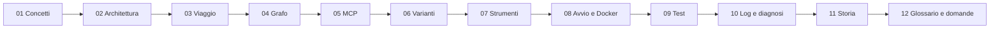

# Indice e percorso di studio

L'**assistente del laboratorio** è un programma da terminale, scritto in Python. Conversa con un modello che gira sul tuo computer, servito da LM Studio (provato con `google/gemma-4-e2b`). Il flusso di ogni turno è un grafo LangGraph con tre nodi: `modello`, `strumenti` e `limite`.

Il modello può usare dieci strumenti: ora, conversioni, calcoli, scadenze, catalogo dei corsi, note e meteo. Gli strumenti stanno in un server MCP che l'assistente avvia, interroga e spegne da solo. La conversazione vive solo in memoria; tra una sessione e l'altra restano soltanto le note, salvate in SQLite.

---

## Come sono fatti i capitoli

Ogni capitolo ha tre livelli. Non serve leggerli tutti e tre ogni volta.

| Livello | Dove | A che cosa serve |
|---|---|---|
| **Scheda in 5 minuti** | in cima | l'idea del capitolo in parole semplici: idee chiave, cosa sapere a memoria, tre domande d'orale |
| **Corpo** | in mezzo | i dettagli: codice con `file:riga`, esempi eseguiti davvero, casi limite |
| **Scaletta per le slide** | in fondo | 6–10 slide già impostate: titolo, tre punti, che cosa mostrare |

**Come studiare un capitolo.**
1. Leggi la scheda.
2. Apri il corpo solo per le idee che non ti sono chiare: ogni idea della scheda indica la sezione («→ sezione N»).
3. Rispondi a voce alle domande della scheda, senza guardare.

---

## Il progetto lezione per lezione

### Lezione 4 · L'assistente di base (2 novembre)

**Che cosa è stato costruito.**
- Una chat da terminale con un modello locale, raggiunto tramite l'API compatibile con OpenAI di LM Studio.
- Il grafo LangGraph con i tre nodi e un limite di 3 giri di strumento per ogni domanda.
- Un solo strumento, l'orologio, allora scritto dentro l'assistente.
- La cronologia solo in memoria e il fuso dell'utente rilevato anche dentro Docker.
- L'avvio diretto e quello con Docker Compose; i test con un modello finto.

**Da studiare.**

| Capitolo | Che cosa guardare |
|---|---|
| [01 Panoramica e concetti](01-panoramica-e-concetti.md) | sezioni 3–6: modello locale, tool calling, ToolMessage, LangGraph |
| [04 Il grafo LangGraph](04-grafo-langgraph.md) | la struttura (nodi e archi) è di questa lezione e non è più cambiata |
| [08 Configurazione, avvio e Docker](08-configurazione-avvio-docker.md) | `.env`, fuso dell'utente, Docker: nascono qui |
| [09 Test e verifiche](09-test-e-verifiche.md) | il metodo: modello finto per i test, prove reali separate |
| [11 Storia del progetto](11-storia-del-progetto.md) | sezione 3, la fase 0 |

### Lezione 5 · Gli strumenti via MCP (3–9 novembre)

**Che cosa è stato costruito.**
- Un server MCP (FastMCP) che l'assistente avvia, scopre con la discovery e spegne da solo.
- Dieci strumenti, con la logica scritta una volta sola in `logica/`.
- Tre modi di collegare uno strumento: MCP per tutti, `@tool` locale per la calcolatrice, FastAPI con wrapper HTTP per le scadenze.
- Le note persistenti in SQLite e il meteo da Open-Meteo.
- I log su tre file e la diagnosi per livelli.
- Una revisione finale con 9 correzioni, unita in `main` il 9 novembre.

**Da studiare.**

| Capitolo | Che cosa guardare |
|---|---|
| [01 Panoramica e concetti](01-panoramica-e-concetti.md) | sezioni 7–10: MCP, N×M contro N+M, API e FastAPI, wrapper |
| [02 Architettura](02-architettura.md) | tutto: le cartelle e i processi di oggi |
| [03 Il viaggio di una richiesta](03-viaggio-di-una-richiesta.md) | tutto: tre domande seguite dal terminale alla risposta |
| [04 Il grafo LangGraph](04-grafo-langgraph.md) | sezioni 10, 13, 14 e 15: controlli sugli argomenti, esiti, log, nuove regole del messaggio di sistema |
| [05 MCP in pratica](05-mcp-in-pratica.md) | tutto |
| [06 Le tre varianti](06-tre-varianti.md) | tutto |
| [07 I dieci strumenti](07-gli-strumenti.md) | tutto |
| [08 Configurazione, avvio e Docker](08-configurazione-avvio-docker.md) | le variabili delle varianti, l'avvio dei server, l'arresto ordinato |
| [10 Log e diagnosi](10-log-e-diagnosi.md) | tutto |
| [11 Storia del progetto](11-storia-del-progetto.md) | sezioni 4–7 |

### Lezione 6 · Evolvere l'agente (in corso)

Le slide del docente (`LLM_Lez_6.pdf`, 19 slide, fuori dal repository) dividono la lezione in nove step. Ognuno parte dal precedente funzionante e va verificato con un'evidenza.

| Step | Che cosa | Evidenza minima (slide 19) |
|---|---|---|
| 1 · Router (fatto, branch `dev-router`: [04, sezione 21](04-grafo-langgraph.md#21-lezione-6-il-router-dellambito)) | un nodo LLM decide se la domanda rientra nell'ambito dell'agente | domanda fuori ambito rifiutata senza passare dall'agente |
| 2 · Revisore | un nodo LLM controlla che la risposta sia coerente con la domanda | risposta incompleta corretta dopo la revisione, entro il limite |
| 3 · Riassunto | un nodo LLM comprime la cronologia oltre una soglia | informazione del primo turno ancora usata dopo la compressione |
| 4 · Resource | preferenze dell'utente lette dal server MCP a inizio sessione | preferenze applicate cambiando il file, non il codice |
| 5 · Prompt | comandi `/prompts` e `/prompt` nella CLI | comandi funzionanti, con argomenti validati |
| 6 · Agente come servizio | l'agente risponde anche via HTTP | stessa risposta dalla CLI e dall'API |
| 7 · Back-end | API per le chat, salvate in PostgreSQL | chat ancora presenti dopo il riavvio |
| 8 · Front-end | interfaccia di chat nel browser | conversazione completa dal browser, errori mostrati |
| 9 · Docker Compose | quattro container: front-end, back-end, agente, database | quattro container avviati con un comando |

**Stato.** Il branch `dev-lezione_6` è aperto e parte da `dev`. Non c'è ancora né specifica né codice. Si comincia dagli step da terminale; l'interfaccia grafica (step 6–9) arriverà più avanti. Quando uno step sarà fatto, i capitoli interessati riceveranno la loro parte, a partire da 04 Il grafo.

---

## Mappa dei documenti, per argomento

| # | Documento | In una riga |
|---|---|---|
| 00 | [Indice e percorso di studio](00-indice.md) | questa pagina |
| 01 | [Panoramica e concetti di base](01-panoramica-e-concetti.md) | che cos'è il progetto e i concetti che servono: LLM locale, tool calling, agente, MCP |
| 02 | [Architettura](02-architettura.md) | le cartelle `logica/`, `server_mcp/`, `servizio_api/`, `assistente/`, `risorse/` e chi fa che cosa |
| 03 | [Il viaggio di una richiesta](03-viaggio-di-una-richiesta.md) | dalla riga scritta nel terminale alla risposta, passando per modello, strumento e log |
| 04 | [Il grafo LangGraph](04-grafo-langgraph.md) | stato, nodi, instradamento, limite di 3 giri, controlli sugli argomenti |
| 05 | [MCP in pratica](05-mcp-in-pratica.md) | server FastMCP, client, ponte sincrono, avvio e arresto dei processi |
| 06 | [Le tre varianti di collegamento](06-tre-varianti.md) | MCP, `@tool` locale e FastAPI con wrapper: stesso contratto, percorso diverso |
| 07 | [I dieci strumenti uno per uno](07-gli-strumenti.md) | che cosa fa ogni strumento, i suoi errori e i suoi esempi |
| 08 | [Configurazione, avvio e Docker](08-configurazione-avvio-docker.md) | il file `.env`, `python -m assistente`, `compose.yaml`, `avvia.ps1` e il fuso orario |
| 09 | [Test e verifiche](09-test-e-verifiche.md) | test automatici con modello finto, prove reali separate (`--lmstudio`, `--docker`) |
| 10 | [Log, diagnosi e limiti noti](10-log-e-diagnosi.md) | i tre file di log, la diagnosi per livelli, che cosa il codice non può impedire |
| 11 | [Storia del progetto e decisioni](11-storia-del-progetto.md) | dalla base del 2 novembre alla revisione unita il 9 novembre, con le decisioni prese |
| 12 | [Glossario e domande di ripasso](12-glossario-e-domande.md) | i termini tecnici e le domande tipiche dell'orale |

---

## Percorsi di studio



**Prima volta (circa un'ora, solo schede).** Leggi le dodici schede in ordine, dalla 01 alla 12. Alla fine sai di che cosa parla ogni capitolo e dove cercare.

**Approfondimento (3–4 ore).** Riprendi i capitoli uno alla volta, con il codice aperto accanto.
- Quando il testo cita `percorso:riga`, apri il file e leggi la funzione intera.
- Dopo il 03, avvia una volta `python -m assistente` (servono il `.env` e LM Studio acceso, vedi 08). Chiedi l'ora a Tokyo e guarda nel terminale la riga `[ora_corrente · mcp: Asia/Tokyo]`, prodotta da `assistente/terminale.py:37`.
- Dopo il 09, lancia `python -m pytest`: le prove reali risultano `skipped`.

**Ripasso veloce (30–45 minuti).**
1. La tabella «Cosa sapere a memoria» qui sotto.
2. Le tabelle «Da sapere a memoria» delle schede.
3. Le domande del capitolo 12, senza guardare le risposte.

**Preparazione all'orale.**
1. Spiega a voce, in 2 minuti ciascuno: il grafo (04), il percorso di una chiamata MCP (03 e 05), le tre varianti (06), perché una risposta plausibile non prova che lo strumento sia stato usato (10).
2. Prepara il perché delle scelte (11): un solo server MCP, la calcolatrice in locale e le scadenze in FastAPI, il limite di 3 giri.
3. Ripassa con onestà i limiti noti (10). Il più importante: il modello piccolo a volte dice «Ho salvato la nota» senza aver chiamato `add_note`.

---

## Cosa sapere a memoria

| Tema | Valore | Dove |
|---|---|---|
| Nodi del grafo | `modello`, `strumenti`, `limite`; dopo `modello` decide `instrada_dopo_modello` | `assistente/grafo.py:132`, `:203-211` |
| Stato | `messages` (con `add_messages`), `fuso_utente`, `giri_strumento` | `assistente/grafo.py:29-32` |
| Limite di giri | `MAX_GIRI_STRUMENTO = 3` per turno, poi un testo fisso di scuse | `assistente/grafo.py:20-23` |
| Server MCP | FastMCP, trasporto HTTP (Streamable HTTP), `http://127.0.0.1:<MCP_PORTA>/mcp` | `server_mcp/__main__.py:40-43`, `assistente/avvio_server.py:143` |
| Dieci strumenti | `ora_corrente`, `converti_unita`, `calcola`, `calcola_scadenza`, `search_catalog`, `get_item`, `add_note`, `list_notes`, `delete_note`, `get_weather` | `server_mcp/server.py:128-192` |
| Varianti | `VARIANTE_CALCOLATRICE` = `mcp`/`locale`; `VARIANTE_SCADENZE` = `mcp`/`fastapi`; una sola versione per nome | `assistente/configurazione.py:7-8`, `assistente/varianti.py:17-43` |
| Server pronto | solo quando la discovery (`tools/list`) riesce, non un semplice HTTP 200; attesa massima 10 s | `assistente/avvio_server.py:25`, `:155-170` |
| Tempi massimi | MCP 10 s, FastAPI 5 s, meteo 4 s per fase e 8 s in tutto, LM Studio 120 s | `client_mcp.py:16`, `wrapper_scadenze.py:19`, `logica/meteo.py:17-20`, `modello.py:84` |
| Esiti nel log | `ok`, `errore_tool`, `errore_collegamento`, `strumento_sconosciuto`, `limite` | `assistente/grafo.py:66-74` (primi tre), `:154`, `:198`; README «Log» |
| Log | `logs/assistente.log`, `logs/server_mcp.log`, `logs/servizio_api.log` (solo con `fastapi`) | `assistente/registro.py:9-11` |
| Persistenza | cronologia solo in memoria; note in `archivio/note.sqlite3` | `logica/note.py:19` |
| Fuso, in ordine | `FUSO_HOST_WINDOWS` (da `avvia.ps1`), poi il fuso del computer (solo fuori da Docker), poi `FUSO_ORARIO`, poi `UTC` con avviso | `assistente/fuso.py:36-53` |
| Chiave API | `"lm-studio"`: è un segnaposto, non una credenziale | `assistente/modello.py:15` |
| Risposte di prova | `(3+4)*2` dà 14; 23/12/2026 più 3 giorni lavorativi dà 29/12/2026; `DLL-01` dura 120 ore | README «Test» |
| Test | 503 raccolti, di cui 36 prove reali (30 `lmstudio`, 6 `docker`) saltate se non le chiedi; il 09/11/2026: 467 passati e 36 saltati | `python -m pytest` |

**Prova lampo.** Eseguita davvero con il modello finto di `tests/finti.py`, senza LM Studio. Lo script costruisce il grafo con `crea_grafo` (`assistente/grafo.py:141`), passando `ModelloFinto` con due risposte preparate e `orologio_finto` fermo al 2026-11-08 20:13 UTC. Poi esegue un turno con `esegui_turno` (`assistente/grafo.py:214`). Questa è la cronologia restituita:

```
HumanMessage | che ore sono a Tokyo?
AIMessage    | [{'name': 'ora_corrente', 'args': {'fuso': 'Asia/Tokyo'}, 'id': 'c1', 'type': 'tool_call'}]
ToolMessage  | {"fuso": "Asia/Tokyo", "data_ora": "2026-11-09T05:13:00+09:00", "scarto_utc": "+09:00", "giorno_settimana": "lunedì"}
AIMessage    | A Tokyo sono le 05:13.
```

Attenzione: è una risposta simulata. Mostra come funziona il grafo, ma non dimostra che il modello vero sappia usare lo strumento.

---

## Come preparare una presentazione

1. **Scegli l'argomento.** Per un argomento solo, usa la scaletta in fondo al suo capitolo. Per una lezione intera, prendi i capitoli elencati in «Il progetto lezione per lezione» e unisci le loro scalette, togliendo le slide ripetute.
2. **Controlla i «Da mostrare».** Ogni slide indica un diagramma, una tabella o un pezzo di codice che esiste già nel capitolo o nel progetto. Copialo da lì, non ridisegnarlo a memoria.
3. **Con Claude.** Chiedi di creare una presentazione partendo dalla scaletta del capitolo N: titoli, punti e materiali da mostrare sono già scritti.
4. **Regola d'oro.** Ogni numero e ogni nome nelle slide deve venire dal capitolo, che a sua volta viene dal codice. Se una slide dice qualcosa che il capitolo non dice, va controllata nel codice.

---

## Le altre fonti

| Fonte | Che cosa contiene | Quando usarla |
|---|---|---|
| `README.md` | comandi verificati, variabili del `.env`, log, diagnosi | per eseguire davvero qualcosa |
| `../CLAUDE.md` | obiettivo, confini, scelte tecniche, regole Git e di metodo | per spiegare *perché* il progetto è fatto così e che cosa non fa |
| [`docs/superpowers/`](../superpowers/README.md) | specifiche, piani e checkpoint, con un indice per lezione | per i contratti degli strumenti, l'ordine di costruzione e gli esiti reali delle prove |
| `git log` | 85 commit in `main` al 09/11/2026, in Conventional Commits italiani; 8 sono unioni `chore: unisci …` (passi 1–7 e revisione) | per ricostruire la storia (11); `git show <hash>` per vedere una singola modifica |

**Regola pratica.** In caso di dubbio conta il codice attuale: questi documenti lo spiegano, ma non lo sostituiscono. Anche i checkpoint fotografano un momento preciso. Il checkpoint del passo 7 riporta 419 test passati e 36 saltati; poi sono arrivate le nove correzioni della revisione, unite in `main` il 09/11/2026 (`846b02a`), e oggi i test raccolti sono 503.
