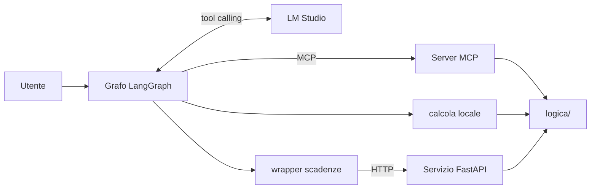
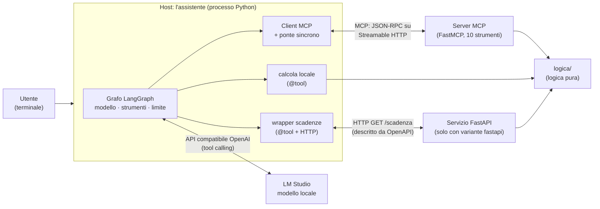
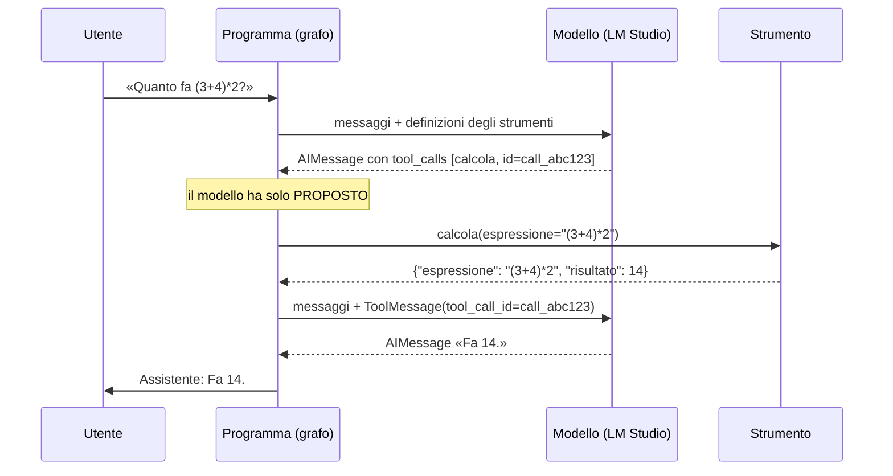
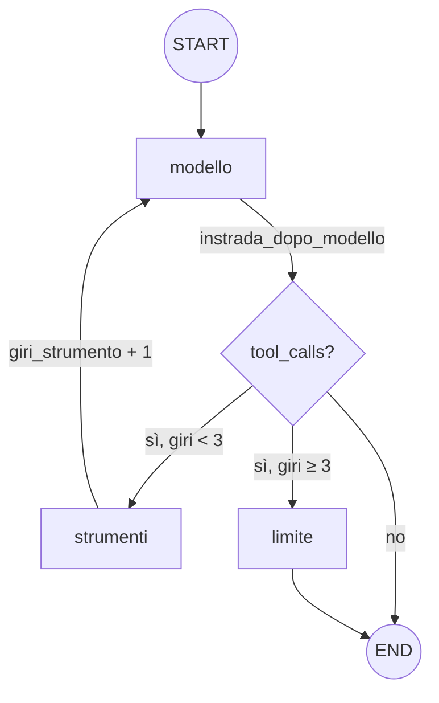
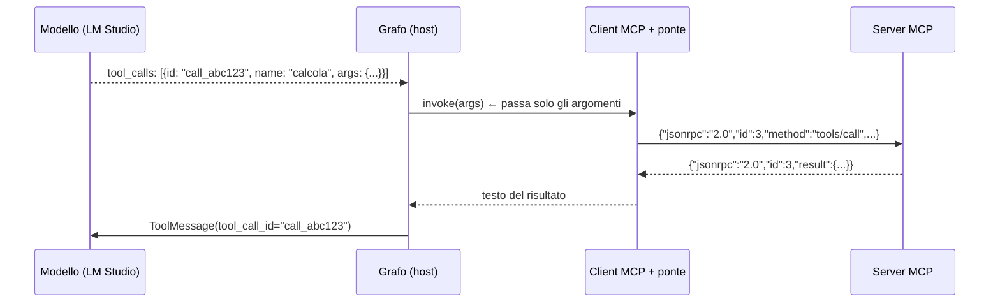
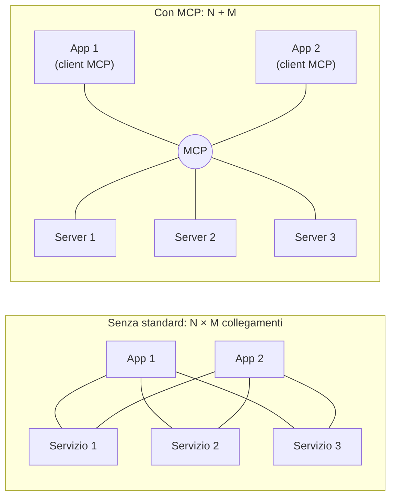

# 01 — Panoramica e concetti di base

> Documento di studio n. 1. Precedente: [00 — Indice e percorso di studio](00-indice.md) · Successivo: [02 — Architettura](02-architettura.md)

## Scheda in 5 minuti

**Di che cosa parla.** Questo capitolo presenta l'assistente del laboratorio e i concetti che servono per capirlo. Ogni concetto parte da zero: modello locale, tool calling, LangGraph, MCP, FastAPI e wrapper. Poi viene agganciato al progetto.

**Le idee chiave**

1. **Un assistente da terminale con un modello locale.** Il programma conversa con un modello servito da LM Studio, sullo stesso computer. Niente cloud: i dati restano sul PC e non serve una chiave segreta. → sezioni 1 e 3
2. **Il modello propone, il programma esegue.** Il modello non esegue niente. Risponde con una richiesta: nome dello strumento e argomenti. Il programma la controlla, la esegue e gli rimanda il risultato. Questo meccanismo si chiama *tool calling*. → sezione 4
3. **Ogni richiesta riceve una risposta con lo stesso identificativo.** Il risultato torna al modello in un `ToolMessage`, che porta il `tool_call_id` della richiesta. Il programma chiude ogni richiesta, anche quando non la esegue: altrimenti la cronologia non è valida. → sezione 5
4. **Il flusso è un grafo che si vede.** LangGraph descrive il turno con tre nodi: `modello`, `strumenti` e `limite`. Dopo tre giri di strumenti, se il modello ne chiede ancora, scatta `limite`. Così il modello non può chiedere strumenti all'infinito. → sezione 6
5. **MCP mette gli strumenti in un server condiviso.** I dieci strumenti stanno in un server MCP. L'assistente lo avvia, gli chiede l'elenco degli strumenti (la *discovery*) e lo spegne all'uscita. Anche altri programmi potrebbero usarlo. → sezione 7
6. **Con uno standard i collegamenti si sommano, non si moltiplicano.** Tre app e dieci servizi, senza standard, fanno 30 collegamenti. Con MCP ne bastano 13. Però MCP ha un costo: un processo, una porta, un nuovo tipo di errore. → sezione 8
7. **Tre strade, una sola logica.** La calcolatrice può essere anche una funzione locale. Le scadenze possono passare anche da un servizio FastAPI, con un wrapper scritto a mano. Cambia solo la strada: il calcolo è sempre quello di `logica/`. → sezioni 9 e 10

**Il quadro**



**Da sapere a memoria**

| Cosa | Valore | Dove |
|---|---|---|
| Nodi del grafo | `modello`, `strumenti`, `limite` | `assistente/grafo.py:203-211` |
| Giri di strumento per turno | al massimo 3 (`MAX_GIRI_STRUMENTO`) | `assistente/grafo.py:20` |
| Nome del server MCP | «Strumenti laboratorio», 10 strumenti | `server_mcp/server.py:31` |
| Indirizzo del server MCP | `http://127.0.0.1:<MCP_PORTA>/mcp` | `assistente/avvio_server.py:142-143` |
| Chiave per LM Studio | `"lm-studio"`, solo un segnaposto | `assistente/modello.py:14-15` |
| Dove nasce il `ToolMessage` | nel nodo `strumenti` | `assistente/grafo.py:180-185` |

**Se te lo chiedono all'orale**

- *Chi esegue lo strumento: il modello o il programma?* Il programma. Il modello produce solo la richiesta; il nodo `strumenti` la controlla e la esegue.
- *Una risposta giusta prova che lo strumento è stato usato?* No. Lo provano la riga `[nome · origine: …]` nel terminale e la riga in `logs/assistente.log`. Il modello piccolo a volte dice «Ho salvato la nota» senza chiamare `add_note`.
- *Quando conviene MCP invece di una funzione locale?* Quando lo strumento va condiviso tra più applicazioni. Per un calcolo usato da un solo programma basta una funzione, come la calcolatrice `locale`.

Per i dettagli continua con il resto del capitolo: le idee rimandano alle sezioni con «→ sezione N».

---

Questo documento spiega **che cos'è** l'assistente del laboratorio e **quali concetti** servono per capirlo. Ogni concetto parte da zero e poi viene collegato al codice reale. Gli esempi in blocchi di codice sono stati **eseguiti davvero**, con il modello finto (`tests/finti.py`) o con il server MCP in memoria, senza LM Studio e senza rete. Quando un esempio è simulato, il testo lo dice.

Indice del documento:

- [Scheda in 5 minuti](#scheda-in-5-minuti)

1. [Il progetto in breve](#1-il-progetto-in-breve)
2. [Mappa dei concetti](#2-mappa-dei-concetti)
3. [Modello linguistico locale: LM Studio e API compatibile con OpenAI](#3-modello-linguistico-locale-lm-studio-e-api-compatibile-con-openai)
4. [Tool calling: il modello propone, il programma esegue](#4-tool-calling-il-modello-propone-il-programma-esegue)
5. [ToolMessage e tool_call_id](#5-toolmessage-e-tool_call_id)
6. [LangGraph: il flusso come grafo](#6-langgraph-il-flusso-come-grafo)
7. [MCP: Model Context Protocol](#7-mcp-model-context-protocol)
8. [Perché MCP: N×M contro N+M](#8-perché-mcp-nm-contro-nm)
9. [API, OpenAPI e FastAPI](#9-api-openapi-e-fastapi)
10. [Wrapper](#10-wrapper)
11. [Che cosa il progetto NON fa](#11-che-cosa-il-progetto-non-fa)
12. [Riepilogo e domande di autoverifica](#12-riepilogo-e-domande-di-autoverifica)

- [Scaletta per le slide](#scaletta-per-le-slide)

---

## 1. Il progetto in breve

### 1.1 Che cos'è

L'**assistente del laboratorio** è un'applicazione **da terminale**, scritta in Python 3.14. Conversa con un **modello linguistico locale** servito da **LM Studio**, sullo stesso computer. È stato provato con il modello `google/gemma-4-e2b` (README, «Requisiti»), un modello piccolo: la specifica della lezione 5 lo indica come «2B», cioè dell'ordine di 2 miliardi di parametri (§13, «Rischio da dichiarare»).

Il programma ha quattro caratteristiche principali:

- **organizza la conversazione in un grafo LangGraph esplicito.** Il grafo ha tre nodi: `modello`, `strumenti` e `limite` (`assistente/grafo.py:203-211`);
- **dà al modello dieci strumenti.** Il modello li può *chiedere*, e il programma li *esegue davvero*: è il **tool calling**;
- **gli strumenti stanno in un server MCP.** Si chiama «Strumenti laboratorio» ed è scritto con FastMCP (`server_mcp/server.py:31`). L'assistente lo avvia da solo, ne scopre il catalogo e lo spegne all'uscita;
- **si avvia in due modi:** direttamente con `python -m assistente`, oppure con Docker Compose (`.\avvia.ps1`).

La **cronologia** della conversazione resta in memoria e si perde alla chiusura. L'unica informazione che sopravvive tra una sessione e l'altra sono le **note** dello strumento `add_note`, salvate in `archivio/note.sqlite3`. È un'eccezione voluta, scritta in `../CLAUDE.md` («Obiettivo»).

### 1.2 Il contesto: corso e lezione

Il progetto fa parte del corso **«Deep Learning e LLM: costruire chatbot e agenti»** (`../CLAUDE.md`, riga 3, subito sotto il titolo).

- **L'assistente di base** è nato con la specifica del 2 novembre 2026 (`docs/superpowers/specs/2026-11-02-assistente-laboratorio-design.md`). Era una chat libera con un solo strumento, l'orologio, eseguito localmente. Serviva a mostrare «il tool calling vero: il modello chiede l'ora, il programma la calcola davvero» (specifica di base, §1).
- **La lezione 5 l'ha esteso.** Si intitola **«MCP: dalle funzioni agli strumenti condivisi»** ed è descritta in due specifiche: il convertitore via MCP (03/11) e gli strumenti della lezione 5 (08/11).

La storia completa, passo per passo, è in [11 — Storia del progetto](11-storia-del-progetto.md).

Il titolo della lezione riassume bene il progetto. Si passa da **funzioni** Python, chiamate solo dentro un programma, a **strumenti condivisi**: stanno in un server che qualsiasi applicazione compatibile può scoprire e usare.

### 1.3 A cosa serve: i due obiettivi della lezione 5

La specifica della lezione 5 (`docs/superpowers/specs/2026-11-08-strumenti-lezione-5-design.md`, §1) fissa due obiettivi.

1. **Un solo server MCP per tutti gli strumenti**, compreso l'orologio, che prima era una funzione locale. Il server espone dieci strumenti:

   | Strumento | Nomi MCP | Che cosa fa (in breve) |
   |---|---|---|
   | orologio | `ora_corrente` | data e ora attuali in un fuso IANA (per esempio `Asia/Tokyo`) |
   | convertitore | `converti_unita` | unità metriche di lunghezza, massa e volume; °C ↔ °F |
   | calcolatrice | `calcola` | espressioni aritmetiche, senza `eval` |
   | scadenze | `calcola_scadenza` | data più N giorni di calendario o lavorativi (festività italiane 2026–2028) |
   | catalogo | `search_catalog`, `get_item` | ricerca e dettaglio dei corsi dell'ITS da un file JSON locale |
   | note | `add_note`, `list_notes`, `delete_note` | note persistenti su SQLite |
   | meteo | `get_weather` | meteo attuale dal servizio pubblico Open-Meteo (richiede la rete) |

   I dettagli di ogni strumento sono in [07 — I dieci strumenti](07-gli-strumenti.md).

2. **Un confronto didattico tra tre modi di collegare uno strumento all'agente.**
   - **MCP**: tutti gli strumenti, dal server.
   - **Locale**: una funzione Python con `@tool` nel processo dell'agente. Solo per `calcola`.
   - **FastAPI**: un servizio HTTP con un *wrapper* scritto a mano. Solo per `calcola_scadenza`.

   La variante si sceglie nel file `.env` (`VARIANTE_CALCOLATRICE`, `VARIANTE_SCADENZE`). Il modello vede **una sola versione** per nome. Approfondimento in [06 — Le tre varianti](06-tre-varianti.md).

### 1.4 Come si presenta una sessione

Questa è l'uscita reale riportata nel README («Avvio diretto»), ottenuta con l'ingresso inviato da una pipe di PowerShell:

```powershell
"che ore sono a Tokyo?", "quanti metri sono 2,5 km?", "esci" | python -m assistente
```

```
Assistente del laboratorio
Fuso orario: Europe/Berlin (computer locale)
Strumenti: converti_unita (mcp), ora_corrente (mcp), calcola (mcp), calcola_scadenza (mcp), search_catalog (mcp), get_item (mcp), add_note (mcp), list_notes (mcp), delete_note (mcp), get_weather (mcp)
Scrivi «esci» o premi Ctrl+C per uscire.
Tu: [ora_corrente · mcp: Asia/Tokyo]
Assistente: Attualmente a Tokyo sono le 04:13 del lunedì, 9 novembre 2026.
Tu: [converti_unita · mcp: 2.5, km, m]
Assistente: 2,5 km sono 2500 metri.
Tu: Arrivederci.
```

Le righe tra parentesi quadre, come `[ora_corrente · mcp: Asia/Tokyo]`, le stampa il terminale (`assistente/terminale.py:20-38`). Ne compare una per ogni chiamata a uno strumento **eseguita con successo**, con il nome, la variante e gli argomenti. È la prova visibile che lo strumento è stato usato davvero: se manca, il modello ha risposto «a memoria».

Le domande dell'utente non compaiono dopo `Tu:` perché arrivano dalla pipe e non sono digitate: il terminale stampa il prompt `Tu: ` senza a capo, e la riga successiva (quella dello strumento) finisce sulla stessa riga. Per la stessa ragione l'ultima riga è `Tu: Arrivederci.`: dopo `esci` la sessione stampa «Arrivederci.» (`terminale.py:66`, `:86`).

---

## 2. Mappa dei concetti

Il diagramma mostra dove interviene ogni concetto quando l'utente fa una domanda.



| Concetto | Dove si vede nel progetto | Sezione |
|---|---|---|
| Modello locale, API compatibile OpenAI | `assistente/modello.py` | [3](#3-modello-linguistico-locale-lm-studio-e-api-compatibile-con-openai) |
| Tool calling | `bind_tools` (`modello.py:87`), nodo `strumenti` (`grafo.py:149-189`) | [4](#4-tool-calling-il-modello-propone-il-programma-esegue) |
| ToolMessage, `tool_call_id` | `grafo.py:180-185` | [5](#5-toolmessage-e-tool_call_id) |
| LangGraph | `assistente/grafo.py` | [6](#6-langgraph-il-flusso-come-grafo) |
| MCP: host, client, server | `assistente/` (host), `client_mcp.py` (client), `server_mcp/` (server) | [7](#7-mcp-model-context-protocol) |
| API, OpenAPI, FastAPI | `servizio_api/app.py` | [9](#9-api-openapi-e-fastapi) |
| Wrapper | `client_mcp.py:57-77` (ponte), `wrapper_scadenze.py` | [10](#10-wrapper) |

---

## 3. Modello linguistico locale: LM Studio e API compatibile con OpenAI

### 3.1 Da zero: che cos'è un modello linguistico

Un **modello linguistico di grandi dimensioni** (LLM, *Large Language Model*) è una rete neurale addestrata a prevedere il testo che segue un altro testo. Riceve una sequenza di messaggi (sistema, utente, assistente…) e produce il messaggio successivo.

Da solo, un LLM **non sa fare nulla fuori dal testo**:

- non conosce l'ora attuale;
- non legge file e non chiama servizi;
- può sbagliare un calcolo.

I suoi «numeri» sono testo generato, non calcoli. Per questo esistono gli strumenti (sezione 4).

### 3.2 Locale invece che cloud

Il modello gira **sul computer dell'utente**, non su un servizio cloud. È una scelta del progetto: `../CLAUDE.md` dice «LM Studio sull'host» e vieta i servizi cloud. Le conseguenze:

| Aspetto | Modello locale (questo progetto) | Servizio cloud |
|---|---|---|
| Dati | restano sul computer | escono verso il fornitore |
| Credenziali | nessuna | chiave API segreta |
| Capacità | limitata dall'hardware: qui un modello piccolo, circa 2B | modelli molto grandi |
| Affidabilità del tool calling | discreta, con errori osservati (sezione 4.5) | in genere migliore |

### 3.3 LM Studio

**LM Studio** è un'applicazione desktop che scarica, carica in memoria e *serve* modelli locali. Il suo server (porta predefinita 1234) espone un'**API compatibile con OpenAI**: gli stessi percorsi e lo stesso formato JSON dell'API di OpenAI.

| Percorso | A cosa serve nel progetto |
|---|---|
| `GET /v1/models` | elenco degli identificativi dei modelli; l'assistente lo usa all'avvio per controllare che `LMSTUDIO_MODEL` esista |
| `POST /v1/chat/completions` | la chat vera e propria: messaggi + definizioni degli strumenti in ingresso, risposta (testo o richieste di strumento) in uscita |

Il vantaggio della compatibilità è che si può usare una libreria già pronta per OpenAI, cambiando solo l'indirizzo. Il progetto usa `ChatOpenAI` di `langchain-openai` (`assistente/modello.py:79-87`):

```python
chat = ChatOpenAI(
    model=config.modello,          # LMSTUDIO_MODEL, dal .env
    base_url=config.base_url,      # LMSTUDIO_BASE_URL, per esempio http://localhost:1234/v1
    api_key=CHIAVE_SEGNAPOSTO,     # "lm-studio": LM Studio non la controlla
    timeout=120,
    max_retries=1,
)
return chat.bind_tools(strumenti)
```

Tre dettagli da saper spiegare.

- **La chiave `"lm-studio"` non è una credenziale** (`modello.py:14-15`). La libreria esige una chiave, LM Studio non la controlla. Quindi nel progetto non c'è nessun segreto: `.env.example` lo dice esplicitamente.
- **Indirizzo e modello arrivano solo da variabili d'ambiente**, mai scritti nel codice. Le variabili sono `LMSTUDIO_BASE_URL` e `LMSTUDIO_MODEL`, obbligatorie (`configurazione.py:6`). L'identificativo è quello restituito da `GET /v1/models`, «mai inventato» (`../CLAUDE.md`, «Scelte tecniche»).
- **Prima della chat l'assistente controlla il server** con `verifica_server` (`modello.py:42`). Se LM Studio è spento compare `Impossibile raggiungere LM Studio all'indirizzo …`. Se il modello non è nell'elenco compare `Il modello '…' non è disponibile su LM Studio`, con l'elenco dei disponibili. In entrambi i casi il programma esce con codice 1, senza traceback.

Con Docker, LM Studio **resta sull'host** e non va containerizzato. Il container lo raggiunge a `http://host.docker.internal:1234/v1`, tramite la variabile `LMSTUDIO_BASE_URL_DOCKER` (vedi [08](08-configurazione-avvio-docker.md)).

---

## 4. Tool calling: il modello propone, il programma esegue

### 4.1 L'idea

Il **tool calling** (chiamata di strumenti, detto anche *function calling*) è il meccanismo con cui un LLM può usare funzioni esterne. La regola fondamentale:

> **Il modello non esegue niente.** Produce una *richiesta strutturata*: «chiama lo strumento X con questi argomenti». È il **programma** che decide se eseguirla, la esegue e restituisce il risultato al modello.

Il ciclo completo ha cinque passi.

1. Il programma manda al modello i messaggi **e** la descrizione degli strumenti disponibili: nome, descrizione e schema JSON degli argomenti.
2. Il modello risponde con un messaggio che contiene una o più **richieste di strumento** (`tool_calls`), ciascuna con un identificativo.
3. Il programma esegue ogni richiesta.
4. Il programma aggiunge alla cronologia un **messaggio di risultato** per ogni richiesta, collegato tramite l'identificativo.
5. Il programma richiama il modello, che ora vede il risultato e scrive la risposta in linguaggio naturale. Se serve, chiede un altro strumento.



### 4.2 Che cosa vede il modello: la definizione di uno strumento

`bind_tools` (`modello.py:87`) traduce ogni strumento LangChain nel formato OpenAI e lo allega a ogni richiesta. Questa è la definizione **reale** della calcolatrice locale, ottenuta con `convert_to_openai_tool`:

```json
{
  "type": "function",
  "function": {
    "name": "calcola",
    "description": "Calcola un'espressione aritmetica con numeri decimali (punto come separatore), + - * / % ** e parentesi. Esempio: espressione=\"(3 + 4) * 2\".",
    "parameters": {
      "type": "object",
      "properties": {
        "espressione": {"type": "string", "description": "Espressione aritmetica, per esempio (3 + 4) * 2"}
      },
      "required": ["espressione"]
    }
  }
}
```

Il modello sceglie lo strumento **solo** in base a nome, descrizione e schema. Per questo le descrizioni sono scritte con cura. Per esempio, `search_catalog` e `get_item` devono distinguersi chiaramente (`server_mcp/server.py:63-71`).

### 4.3 Che cosa risponde il modello e che cosa torna indietro

Ecco i messaggi nel formato JSON dell'API OpenAI, cioè quello che viaggia davvero verso LM Studio. Sono stati prodotti con il convertitore interno di `langchain-openai`, senza rete:

```json
{"role": "user", "content": "Quanto fa (3+4)*2?"}
{"role": "assistant", "content": null,
 "tool_calls": [{"type": "function", "id": "call_abc123",
                 "function": {"name": "calcola", "arguments": "{\"espressione\": \"(3+4)*2\"}"}}]}
{"role": "tool", "tool_call_id": "call_abc123", "content": "{\"espressione\": \"(3+4)*2\", \"risultato\": 14}"}
```

Due osservazioni importanti:

- **`arguments` è una stringa JSON**, non un oggetto. Un modello piccolo può scrivere JSON non valido. LangChain mette allora quella richiesta in `invalid_tool_calls`, e il grafo la chiude comunque con un errore (`grafo.py:61-63`, `:122-129`, testo `TESTO_NON_JSON` a `:24`).
- Il messaggio `role: "tool"` porta lo **stesso `tool_call_id`** della richiesta. È il collegamento spiegato nella sezione 5.

### 4.4 Che cosa fa il programma prima e dopo l'esecuzione

Il nodo `strumenti` (`grafo.py:149-189`) non esegue alla cieca. Per ogni richiesta:

1. **cerca lo strumento per nome.** Se il nome non esiste: `Strumento sconosciuto: '…'.`, esito `strumento_sconosciuto`;
2. **controlla gli argomenti contro lo schema**, prima di qualsiasi variante (`grafo.py:158-172`). Se ne manca uno obbligatorio: `Argomenti mancanti per …`. Se ce n'è uno inventato: `Argomenti non previsti per …: … Usa solo: …`;
3. **esegue lo strumento** con `strumento.invoke(...)`. Qualsiasi eccezione diventa un errore e non blocca il programma (`grafo.py:174-179`);
4. **crea un `ToolMessage`** con il risultato o l'errore e scrive una riga di log.

Esempio **reale** con il modello finto: il modello inventa un argomento `precisione` e il grafo lo rifiuta senza eseguire.

```
{"errore": "Argomenti non previsti per calcola: precisione. Usa solo: espressione.", "tipo": "strumento"}   status=error
```

E se l'espressione è pericolosa (`__import__('os')`), la calcolatrice la rifiuta. Non usa mai `eval`:

```
{"errore": "Carattere non consentito: '_'. Sono ammessi numeri, + - * / % ** e parentesi.", "tipo": "strumento"}   status=error
```

### 4.5 Perché è importante, e che cosa non può garantire

Il tool calling serve a **non far inventare** al modello ciò che non può sapere: l'ora, una conversione esatta, il contenuto del catalogo, il meteo. Il messaggio di sistema lo dice esplicitamente (`grafo.py:35-54`). Per esempio:

> «Non dire mai di aver salvato, eliminato, calcolato o cercato qualcosa senza aver chiamato lo strumento in questo turno: se non hai chiamato lo strumento, non l'hai fatto.»

Però **il programma non può costringere il modello a chiedere lo strumento**: la decisione è del modello. Nelle prove reali `google/gemma-4-e2b` ha risposto «Ho salvato la nota» **senza** chiamare `add_note`, circa una volta su tre. Il caso è documentato nel README («Diagnosi») e nel checkpoint conclusivo. Il progetto rende visibile questo **falso successo**:

- nel terminale manca la riga `[add_note · mcp: …]`;
- in `logs/assistente.log` manca la riga `origine=… tool=…`.

Ne segue una regola di metodo, presente in `../CLAUDE.md`: **«Una risposta simulata non dimostra che il modello locale sappia usare lo strumento.»** I test automatici con il modello finto dimostrano che il *programma* funziona. Solo le prove reali con LM Studio dicono qualcosa sul *modello* (vedi [09](09-test-e-verifiche.md)).

---

## 5. ToolMessage e tool_call_id

### 5.1 I tipi di messaggio di LangChain

La cronologia è una lista di messaggi LangChain (`langchain_core.messages`):

| Classe | Ruolo nell'API OpenAI | Chi lo produce nel progetto |
|---|---|---|
| `SystemMessage` | `system` | `messaggio_sistema(fuso)` (`grafo.py:35`): viene **ricreato a ogni chiamata** del modello, non è salvato nella cronologia |
| `HumanMessage` | `user` | `esegui_turno`, con il testo scritto nel terminale (`grafo.py:218`) |
| `AIMessage` | `assistant` | il modello: testo finale **oppure** `tool_calls`; anche il nodo `limite` ne crea uno con un testo fisso |
| `ToolMessage` | `tool` | il nodo `strumenti` (e il nodo `limite`), uno per ogni richiesta |

### 5.2 Com'è fatto un ToolMessage

Il ToolMessage viene creato in `grafo.py:180-185`:

```python
messaggio = ToolMessage(
    contenuto,                         # stringa: il JSON del risultato o {"errore": ...}
    tool_call_id=chiamata["id"],       # lo stesso id della richiesta del modello
    name=chiamata["name"],             # nome dello strumento
    status="success" if esito == "ok" else "error",
)
```

| Campo | Significato |
|---|---|
| `content` | il risultato come testo. Negli strumenti del progetto è sempre JSON: un oggetto con chiavi in italiano, oppure `{"errore": "…"}` |
| `tool_call_id` | l'identificativo della richiesta a cui risponde: è il **collegamento** tra domanda e risposta |
| `name` | nome dello strumento |
| `status` | `success` o `error`; il terminale stampa la riga `[… · …: …]` solo per `success` (`terminale.py:32`) |

### 5.3 Perché il `tool_call_id` è indispensabile

1. **Correlazione.** Il modello può chiedere più strumenti nello stesso messaggio. L'id dice quale risultato appartiene a quale richiesta.
2. **Cronologia valida.** L'API di tipo OpenAI pretende che **ogni** `tool_call` di un messaggio `assistant` abbia il suo messaggio `tool` con lo stesso id. Per questo il progetto chiude **sempre** ogni richiesta, anche quando non la esegue:
   - quando si raggiunge il limite di giri (`nodo_limite`, `grafo.py:191-201`), con `"limite di chiamate raggiunto"`;
   - quando gli argomenti non sono JSON (`_malformate_chiuse`, `grafo.py:122-129`). Il commento a `grafo.py:62` lo dice: «vanno chiuse anche loro, o la cronologia resta invalida».
3. **Tracciabilità.** Il log dell'assistente registra sia l'id della richiesta sia quello del ToolMessage. Riga **reale** prodotta dal grafo con il modello finto:

```
origine=locale tool=calcola call_id=call_abc123 argomenti={"espressione":"(3+4)*2"} esito=ok risultato={"espressione": "(3+4)*2", "risultato": 14} tool_message.call_id=call_abc123
```

La cronologia completa del turno, sempre reale con il modello finto e la calcolatrice locale vera:

```
HumanMessage  "Quanto fa (3+4)*2?"
AIMessage     tool_calls=[{name: calcola, args: {espressione: "(3+4)*2"}, id: call_abc123}]
ToolMessage   tool_call_id=call_abc123  status=success  {"espressione": "(3+4)*2", "risultato": 14}
AIMessage     "Fa 14."
```

Alla seconda chiamata il modello ha ricevuto `SystemMessage, HumanMessage, AIMessage, ToolMessage`: è così che «vede» il risultato.

> Attenzione: il `tool_call_id` **non arriva al server MCP**. Il protocollo MCP usa un suo identificativo, diverso (sezione 7.6).

---

## 6. LangGraph: il flusso come grafo

### 6.1 Da zero

**LangGraph** è una libreria (dello stesso ecosistema di LangChain) per descrivere un'applicazione con LLM come un **grafo a stati**. Gli elementi sono quattro:

| Elemento | Che cos'è | Nel progetto |
|---|---|---|
| **Stato** | un dizionario tipizzato che passa da un nodo all'altro | `StatoConversazione` (`grafo.py:29-32`): `messages`, `fuso_utente`, `giri_strumento` |
| **Nodo** | una funzione che riceve lo stato e restituisce un aggiornamento | `nodo_modello`, `nodo_strumenti`, `nodo_limite` |
| **Arco** | un passaggio fisso da un nodo a un altro | `START → modello`, `strumenti → modello`, `limite → END` |
| **Arco condizionale** | una funzione che sceglie il prossimo nodo guardando lo stato | `instrada_dopo_modello` (`grafo.py:132-138`) |

Due concetti in più:

- **Reducer.** `messages` è annotato con `add_messages`. Quando un nodo restituisce `{"messages": [nuovo]}`, il nuovo messaggio viene **aggiunto** alla lista, non la sostituisce.
- **Compile e invoke.** `StateGraph(...).compile()` produce un oggetto eseguibile. `grafo.invoke(stato_iniziale)` lo esegue finché arriva a `END` e restituisce lo stato finale (`grafo.py:211`, `:214-223`).

### 6.2 Il grafo del progetto



- **`modello`** chiama il modello con il messaggio di sistema più la cronologia.
- **`instrada_dopo_modello`** guarda l'ultimo messaggio. Se non ci sono richieste di strumento, il turno finisce. Se ci sono ma si è già arrivati a `MAX_GIRI_STRUMENTO = 3` (`grafo.py:20`), si va a `limite`. Altrimenti si va a `strumenti`.
- **`strumenti`** esegue le richieste, produce i ToolMessage e incrementa `giri_strumento`.
- **`limite`** chiude le richieste rimaste con un errore e aggiunge un `AIMessage` fisso: «Non sono riuscito a completare la richiesta: troppe chiamate agli strumenti…».

Il limite impedisce un ciclo infinito se il modello continua a chiedere strumenti. Tre giri bastano anche per i casi a due passaggi, come ricerca e poi dettaglio nel catalogo.

### 6.3 Perché un grafo esplicito

Il progetto avrebbe potuto usare un agente «prefabbricato». Le specifiche lo considerano un **anti-obiettivo**: «Il grafo è nascosto dietro un agente "prefabbricato" che non mostra nodi e instradamento» (specifica di base, §4). Leggendo `grafo.py` si devono riconoscere stato, nodi e instradamento. È un requisito didattico: all'orale devi saperli indicare.

Il grafo è **sincrono**: i nodi sono funzioni normali, non `async`. L'unico punto asincrono è nascosto nel ponte MCP (sezione 10).

Approfondimento completo in [04 — Il grafo LangGraph](04-grafo-langgraph.md).

---

## 7. MCP: Model Context Protocol

### 7.1 Da zero

**MCP** (*Model Context Protocol*) è un **protocollo aperto e standard** con cui un'applicazione basata su LLM scopre e usa capacità esterne, come strumenti e dati, offerte da un *server*. Lo si può paragonare a una presa standard: chi costruisce lo strumento implementa il lato server una volta sola, e qualsiasi applicazione con un client MCP lo può usare.

Senza MCP, ogni applicazione deve sapere a mano come chiamare ogni strumento. Con MCP, l'applicazione **chiede al server** che cosa sa fare (*discovery*) e riceve nome, descrizione e schema di ogni strumento.

### 7.2 I tre ruoli: host, client, server

| Ruolo | Definizione | Nel progetto |
|---|---|---|
| **Host** | l'applicazione con l'LLM, che decide quali capacità usare e le presenta al modello | l'**assistente** (`python -m assistente`). È lui che seleziona gli strumenti consentiti: `varianti.py:1-5` («l'agente, come host, sceglie le capacità consentite») |
| **Client** | il componente dentro l'host che parla il protocollo con **un** server | `MultiServerMCPClient` di `langchain-mcp-adapters`, configurato in `client_mcp.py:80-87` con una sola connessione chiamata `laboratorio` |
| **Server** | il programma che espone le capacità | il processo `python -m server_mcp`, scritto con **FastMCP** (`server_mcp/server.py:123`) |

Il server **espone sempre tutti e dieci gli strumenti**: è un servizio condiviso. È l'**host** che, secondo il `.env`, può togliere `calcola` o `calcola_scadenza` dal catalogo e mettere al loro posto la variante locale o FastAPI (`varianti.py:32-43`).

### 7.3 Le tre primitive: tools, resources, prompts

| Primitiva | Che cos'è | Chi la «controlla» | Nel progetto |
|---|---|---|---|
| **tools** | funzioni eseguibili con argomenti, che possono avere effetti | il **modello**, che decide quando chiamarle | **sì**: i dieci strumenti |
| **resources** | dati leggibili identificati da un URI (file, record…) | l'applicazione | **no**: è un non obiettivo, compresa la resource facoltativa del catalogo |
| **prompts** | modelli di messaggio riutilizzabili, offerti all'utente | l'utente | **no**: non obiettivo |

Verifica reale con il client MCP in memoria: `list_resources()` e `list_prompts()` restituiscono liste vuote. FastMCP dichiara comunque le *capacità* `resources` e `prompts` nella risposta a `initialize` (vedi sotto), ma il progetto non registra niente di questo tipo.

### 7.4 Il protocollo: JSON-RPC 2.0, `initialize`, `tools/list`, `tools/call`

I messaggi MCP sono in formato **JSON-RPC 2.0**. Ogni richiesta ha `jsonrpc`, un **`id`**, un `method` e dei `params`. La risposta riporta lo **stesso `id`** con un `result` (o un `error` di protocollo). I metodi che contano qui sono tre:

| Metodo | Quando | A cosa serve |
|---|---|---|
| `initialize` | all'apertura di ogni sessione | client e server si accordano su versione del protocollo e capacità |
| `tools/list` | discovery | il server restituisce l'elenco degli strumenti, con `name`, `description`, `inputSchema` |
| `tools/call` | esecuzione | il client chiede di eseguire uno strumento con certi `arguments` |

Questo è uno scambio **reale**. Il server del progetto (`crea_server`) è stato montato dentro il processo con il client di test di Starlette, senza rete né porte, con un archivio delle note temporaneo. Le risposte sono abbreviate con `…`:

```
>>> {"jsonrpc":"2.0","id":1,"method":"initialize","params":{"protocolVersion":"2025-06-18","capabilities":{},"clientInfo":{"name":"prova","version":"0"}}}
<<< {"jsonrpc":"2.0","id":1,"result":{"protocolVersion":"2025-06-18","capabilities":{…,"prompts":{"listChanged":true},"resources":{…},"tools":{"listChanged":true},…},"serverInfo":{"name":"Strumenti laboratorio","version":"3.4.11"}}}

>>> {"jsonrpc":"2.0","id":2,"method":"tools/list","params":{}}
<<< {"jsonrpc":"2.0","id":2,"result":{"tools":[{"name":"converti_unita","description":"Converte un valore tra unità metriche …","inputSchema":{"additionalProperties":false,"properties":{"valore":{…,"type":"number"},…}}},…]}}

>>> {"jsonrpc":"2.0","id":3,"method":"tools/call","params":{"name":"calcola","arguments":{"espressione":"(3+4)*2"}}}
<<< {"jsonrpc":"2.0","id":3,"result":{"content":[{"type":"text","text":"{\"espressione\":\"(3+4)*2\",\"risultato\":14}"}],"structuredContent":{"espressione":"(3+4)*2","risultato":14},"isError":false}}

>>> {"jsonrpc":"2.0","id":4,"method":"tools/call","params":{"name":"calcola","arguments":{"espressione":"1/0"}}}
<<< {"jsonrpc":"2.0","id":4,"result":{"content":[{"type":"text","text":"Divisione per zero."}],"isError":true}}
```

Da notare:

- **Discovery.** I dieci nomi restituiti da `tools/list` sono, in ordine: `converti_unita`, `ora_corrente`, `calcola`, `calcola_scadenza`, `search_catalog`, `get_item`, `add_note`, `list_notes`, `delete_note`, `get_weather`. Nome, descrizione e schema **arrivano dal server** e non sono riscritti nell'assistente: è un obiettivo della specifica del convertitore (§2.3).
- **Errore dello strumento ≠ errore del protocollo.** «Divisione per zero» non è un `error` JSON-RPC. È un `result` normale con **`isError: true`**. Nel server lo produce `esegui_registrato`, che trasforma `ErroreStrumento` in `ToolError` (`server_mcp/server.py:98-109`). Nel client l'adattatore lo trasforma in `ToolException`, e il ponte lo restituisce come `{"errore": "…", "tipo": "strumento"}` (`client_mcp.py:63-64`).
- **`additionalProperties: false`** nello schema: il server non accetta argomenti in più. Il grafo li rifiuta comunque prima, uguale per tutte le varianti (sezione 4.4).

Lo stesso si può fare in Python con il client in memoria di FastMCP (`con_client` in `tests/test_server_mcp.py`). Esempio reale:

```python
r = await client.call_tool("calcola_scadenza",
                           {"data_inizio": "2026-12-23", "giorni": 3, "lavorativi": True})
# {"data_inizio":"2026-12-23","giorni":3,"lavorativi":true,"scadenza":"2026-12-29",
#  "giorno_settimana":"martedì","festivita_saltate":["2026-12-25 Natale","2026-12-26 Santo Stefano"],
#  "nota":"Calcolo indicativo: non ha valore legale."}
```

### 7.5 I trasporti: stdio e Streamable HTTP

Il **trasporto** è il «canale» su cui viaggiano i messaggi JSON-RPC. MCP ne definisce due principali:

| | **stdio** | **Streamable HTTP** |
|---|---|---|
| Come funziona | l'host avvia il server come processo figlio e gli parla tramite standard input/output | il server è un servizio HTTP; il client manda le richieste con `POST` a un indirizzo (qui `/mcp`) |
| Chi può usare il server | solo il processo che l'ha avviato | qualsiasi client che raggiunge l'indirizzo (per esempio MCP Inspector) |
| Uso tipico | strumenti locali di una singola applicazione | servizi condivisi, anche remoti |
| Nel progetto | **non obiettivo** (estensione facoltativa esclusa dalla specifica, §3) | **sì** |

Il server del progetto usa Streamable HTTP (`server_mcp/__main__.py:39-48`):

```python
crea_server(**opzioni).run(
    transport="http", host="127.0.0.1", port=argomenti.porta, path="/mcp",
    show_banner=False, stateless_http=True, json_response=True, log_level="warning",
)
```

- **`host="127.0.0.1"`**: il server ascolta solo sul computer locale. Non è raggiungibile da altri computer, ed è un non obiettivo renderlo tale.
- **`stateless_http=True`**: il server non conserva sessioni tra una richiesta e l'altra.
- **`json_response=True`**: le risposte sono JSON semplice invece di uno stream SSE. Si vede nello scambio sopra.
- L'indirizzo completo è `http://127.0.0.1:<MCP_PORTA>/mcp` (`assistente/avvio_server.py:142-143`).

Lato client, l'adattatore apre una **sessione nuova per ogni chiamata**: `initialize`, poi `tools/call`. Ogni chiamata è quindi una richiesta indipendente, con un tempo massimo di 10 secondi (`TIMEOUT_CHIAMATA`, `client_mcp.py:16`).

**Pronto vuol dire che risponde in MCP.** All'avvio l'assistente non si accontenta di un processo acceso o di un HTTP 200. Considera pronto il server solo quando una discovery `tools/list` riesce (`avvio_server.py:161-162`), entro 10 secondi. Approfondimento in [05 — MCP in pratica](05-mcp-in-pratica.md).

### 7.6 Due identificativi diversi: `tool_call_id` e `id` JSON-RPC

Questo è un punto classico da orale. Nella stessa chiamata esistono **due identificativi indipendenti**, su due tratti diversi:



| | `tool_call_id` | `id` JSON-RPC |
|---|---|---|
| Chi lo genera | il lato modello, nella risposta con `tool_calls` | il client MCP, per ogni richiesta del protocollo |
| Dove viaggia | tra modello e host: `AIMessage` → `ToolMessage` | tra client e server MCP |
| A cosa serve | collegare risultato e richiesta **nella cronologia del modello** | collegare risposta e richiesta **nel protocollo** |
| Dove compare nei log | `logs/assistente.log` (`call_id=…`, `tool_message.call_id=…`) | non è registrato dal progetto |

Il server **non riceve mai** il `tool_call_id`: il ponte chiama `strumento.ainvoke(argomenti)` con i soli argomenti (`client_mcp.py:62`). Per confrontare le due tracce, `assistente.log` e `server_mcp.log`, si usano quindi **strumento, argomenti e ora**, come spiega il README («Log»). La specifica del convertitore lo fissa al §5.4.

---

## 8. Perché MCP: N×M contro N+M

### 8.1 Il problema dell'integrazione

Immagina **N applicazioni** con un LLM (un assistente da terminale, un editor, un chatbot web…) e **M strumenti o servizi** (orologio, meteo, catalogo…).

- **Senza uno standard**, ogni applicazione deve scrivere il proprio codice di collegamento per ogni servizio: un *wrapper* per ogni coppia. Le integrazioni sono **N × M**. Se un servizio cambia, vanno aggiornate tutte le N applicazioni che lo usano.
- **Con MCP**, ogni applicazione implementa **un** client MCP e ogni servizio **un** server MCP. Le integrazioni sono **N + M**. Le applicazioni scoprono gli strumenti con `tools/list`, quindi un cambiamento nel server arriva a tutti senza riscrivere i client.

Con numeri concreti: 3 applicazioni e 10 strumenti fanno 30 integrazioni senza standard e 13 con MCP.



### 8.2 Dove si vede nel progetto

Il progetto mette i due mondi uno accanto all'altro, ed è proprio lo scopo del confronto tra le varianti:

- **Variante FastAPI = il mondo N×M.** Il wrapper delle scadenze ha nome, descrizione e schema **scritti a mano**. La docstring di `assistente/wrapper_scadenze.py:1-6` lo dice chiaramente: «Nome, descrizione e schema sono scritti qui, a mano: non c'è discovery. Se l'endpoint cambia, il wrapper va aggiornato in ogni applicazione che lo usa.» Un test controlla che coincidano con il catalogo MCP. Senza quel test, nessuno se ne accorgerebbe.
- **Variante MCP = il mondo N+M.** Il server si può usare anche **senza l'assistente**, da un altro client MCP o da MCP Inspector: `python -m server_mcp --porta 8765` (README, «Il server MCP da solo»). Il catalogo arriva con la discovery.

### 8.3 MCP non è sempre la scelta migliore

Un orale maturo riconosce anche i costi. MCP aggiunge:

- un processo da avviare, attendere e spegnere;
- una porta e un tempo massimo da gestire;
- un nuovo tipo di errore, il collegamento (`Server MCP non raggiungibile`), da distinguere dagli errori dello strumento.

Per un calcolo puro e interno, una funzione locale è ragionevole. È proprio il motivo per cui la specifica sceglie la calcolatrice come variante locale (§1, «Scelta mia»). La regola è questa: **MCP conviene quando lo strumento va condiviso tra più applicazioni**. Per una funzione usata da un solo programma, il costo può non valerne la pena.

---

## 9. API, OpenAPI e FastAPI

### 9.1 Da zero

- **API** (*Application Programming Interface*): un insieme di operazioni che un programma offre ad altri programmi. Un'**API web** (o HTTP) espone queste operazioni come indirizzi (*endpoint*) da chiamare con richieste HTTP. Un esempio è `GET /scadenza?data_inizio=…&giorni=…&lavorativi=…`.
- **OpenAPI**: uno standard per **descrivere** un'API HTTP in un documento JSON o YAML: percorsi, parametri, tipi, risposte. È una descrizione rivolta a sviluppatori e strumenti di sviluppo. **Non** è un protocollo pensato per far scoprire strumenti a un LLM.
- **FastAPI**: un framework Python per scrivere API web. Dai parametri tipizzati delle funzioni genera da solo la descrizione OpenAPI (`/openapi.json`) e una pagina interattiva per provare l'API (`/docs`).
- **Uvicorn**: il server ASGI che esegue l'applicazione FastAPI.

### 9.2 Il servizio del progetto

Il servizio vive in `servizio_api/app.py`. Espone **un solo** endpoint, `GET /scadenza` (`app.py:47`), che usa la stessa logica pura del server MCP (`logica/scadenze.py`). Esempio **reale**, eseguito con il client di test di FastAPI, senza rete:

```
GET /openapi.json
  paths: ['/scadenza']
  parametri: data_inizio (string, obbligatorio), giorni (integer, obbligatorio), lavorativi (boolean, obbligatorio)

GET /scadenza?data_inizio=2026-12-23&giorni=3&lavorativi=true
  200 {"data_inizio":"2026-12-23","giorni":3,"lavorativi":true,"scadenza":"2026-12-29","giorno_settimana":"martedì",
       "festivita_saltate":["2026-12-25 Natale","2026-12-26 Santo Stefano"],"nota":"Calcolo indicativo: non ha valore legale."}

GET /scadenza?data_inizio=2026-02-30&giorni=3&lavorativi=true
  400 {"errore":"Data non valida: '2026-02-30'. Usa il formato AAAA-MM-GG, per esempio 2026-12-23."}

GET /scadenza?data_inizio=2026-12-23&giorni=tre&lavorativi=true
  400 {"errore":"Argomenti non validi per calcola_scadenza: giorni: valore non valido"}
```

Scelte da saper motivare:

- **Errori sempre `400` in italiano.** Di suo FastAPI risponderebbe `422` con un messaggio in inglese. Un gestore dedicato lo sostituisce (`app.py:38`).
- **Pronto vuol dire contratto presente.** All'avvio l'assistente considera pronto il servizio solo quando `/openapi.json` risponde **e** descrive `/scadenza` (`avvio_server.py:191-194`), non al primo HTTP 200.
- **Il servizio gira solo con `VARIANTE_SCADENZE=fastapi`**, su `127.0.0.1:<API_PORTA>`, ed è avviato e spento dall'assistente.

### 9.3 MCP e OpenAPI a confronto

| | OpenAPI / FastAPI | MCP |
|---|---|---|
| Descrive | un'API HTTP (percorsi, parametri) | strumenti per LLM (nome, descrizione, schema degli argomenti) |
| Discovery per l'agente | no: qualcuno deve scrivere un wrapper che traduce l'endpoint in uno strumento | sì: `tools/list` restituisce direttamente strumenti pronti |
| Tipi dei valori | nella query viaggiano come testo: FastAPI accetta per esempio `lavorativi="yes"` | JSON tipizzato: la variante MCP rifiuta `"yes"` |
| Errori | codici HTTP (`400`, `5xx`) | `isError` nel risultato, oppure errori di protocollo |

La differenza sui tipi è documentata nel README («Differenze note, dovute ai framework»).

---

## 10. Wrapper

### 10.1 Da zero

Un **wrapper** («involucro») è un pezzo di codice che **avvolge** un'altra cosa per presentarla con un'interfaccia diversa, senza cambiarne la logica. Nel progetto i wrapper servono a far apparire cose diverse (un server MCP asincrono, un servizio HTTP) come **normali strumenti LangChain sincroni**, che il grafo tratta tutti allo stesso modo con `strumento.invoke(argomenti)`.

### 10.2 I wrapper del progetto

| Wrapper | Che cosa avvolge | Che cosa aggiunge | Dove |
|---|---|---|---|
| **Ponte MCP** (`avvolgi`) | lo strumento asincrono creato da `langchain-mcp-adapters` | la versione sincrona (`asyncio.run`), il tempo massimo di 10 s, gli errori trasformati in JSON (`tipo: strumento` o `tipo: collegamento`), `metadata={"origine": "mcp"}` | `client_mcp.py:57-77` |
| **Wrapper delle scadenze** | l'endpoint HTTP `GET /scadenza` del servizio FastAPI | nome, descrizione e schema scritti a mano, chiamata HTTP con `httpx` e tempo massimo di 5 s, risposte `400` trasformate in errori dello strumento, rete o `5xx` in errori di collegamento, `metadata={"origine": "fastapi"}` | `wrapper_scadenze.py:35-79` |

Entrambi rispettano una regola comune: **non sollevano mai eccezioni verso il grafo**. Restituiscono sempre una stringa, con il risultato oppure `{"errore": "…", "tipo": "…"}`. Il grafo legge `tipo` per decidere l'esito nel log: `errore_collegamento` oppure `errore_tool` (`grafo.py:66-74`).

Esempio **reale**: il wrapper delle scadenze collegato al servizio FastAPI vero tramite il client di test, senza rete.

```
wrapper.invoke({"data_inizio": "2026-12-23", "giorni": 3, "lavorativi": True})
→ {"data_inizio":"2026-12-23","giorni":3,"lavorativi":true,"scadenza":"2026-12-29",…}
wrapper.name = calcola_scadenza   wrapper.metadata = {'origine': 'fastapi'}
```

### 10.3 E la variante locale?

La calcolatrice locale **non** è un wrapper di rete. È una funzione Python decorata con **`@tool`** di LangChain (`calcolatrice_locale.py:25`). Il decoratore ricava nome, descrizione e schema dalla firma e dalla docstring, e la funzione chiama direttamente `logica.calcolatrice`. Nessun processo in più: la chiamata compare solo in `logs/assistente.log`. È proprio questa la differenza da osservare nel confronto ([06](06-tre-varianti.md)).

In sintesi, le tre varianti portano tutte allo **stesso contratto** (nome, descrizione, schema, risultato, errori) e alla **stessa logica pura** in `logica/`. Cambia solo il **percorso**:

| Variante | Percorso dal nodo `strumenti` alla logica | Processi coinvolti |
|---|---|---|
| `mcp` | ponte → client MCP → HTTP `/mcp` → server FastMCP → `logica/` | assistente + server MCP |
| `locale` | funzione `@tool` → `logica/` | solo l'assistente |
| `fastapi` | wrapper `@tool` → HTTP `/scadenza` → FastAPI → `logica/` | assistente + server MCP + servizio FastAPI |

Nota: con la variante `fastapi` il server MCP gira comunque, perché serve per gli altri strumenti.

---

## 11. Che cosa il progetto NON fa

I **non obiettivi** sono decisioni esplicite, non dimenticanze. Le specifiche li elencano perché nessuno li aggiunga «per sbaglio». Il `CLAUDE.md` aggiunge: «Implementare solo i requisiti concordati». Quando una specifica più recente contraddice una precedente, vale la più recente (specifica della lezione 5, introduzione). Per esempio, «niente MCP» e «nessun altro strumento oltre all'orologio» della specifica di base **non valgono più**.

### 11.1 Non obiettivi in vigore

| Area | Che cosa il progetto non fa | Fonte |
|---|---|---|
| Rete e accesso | server e servizio raggiungibili da altri computer (ascoltano solo su `127.0.0.1`); nessuna autenticazione | spec. lezione 5 §3; spec. convertitore §3 |
| Sessioni | nessuna architettura client/server per più utenti, nessuna sessione multipla | spec. di base §3 |
| Persistenza | la cronologia non sopravvive alla chiusura (le note sono l'unica eccezione, voluta) | spec. di base §3; `../CLAUDE.md` |
| Interfaccia | nessuna interfaccia grafica o web; nessun servizio cloud | spec. di base §3; `../CLAUDE.md` |
| Esecuzione | grafo e interfaccia **non** asincroni | spec. lezione 5 §3 |
| LM Studio | non va containerizzato: resta sull'host | spec. di base §3; `../CLAUDE.md` |
| Fuso | nessuna geolocalizzazione: si usa il fuso del computer, non la posizione | spec. di base §3 |
| MCP | niente trasporto **stdio**, niente **due server MCP** collegati allo stesso agente, niente **prompts** e **resources** MCP (compresa la resource del catalogo) | spec. lezione 5 §3 |
| Varianti | varianti locale o FastAPI solo per calcolatrice e scadenze; niente server MCP che chiama il servizio FastAPI; mai due versioni dello stesso strumento visibili insieme; niente cambio di variante a sessione in corso (si cambia il `.env` e si riavvia) | spec. lezione 5 §3 |
| Catalogo | nessuna ricerca semantica né **RAG**: è materia della lezione 6 | spec. lezione 5 §3; `../CLAUDE.md` |
| Note | nessuna conferma interattiva imposta dal programma prima di eliminare: l'eliminazione è sicura perché avviene solo per ID esatto | spec. lezione 5 §3 |
| Scadenze | nessuna festività locale (santi patroni), nessun valore legale del calcolo | spec. lezione 5 §3 |
| Convertitore | nessuna unità non metrica (miglia, libbre…), tranne °F; niente kelvin, tonnellate, m³ | spec. convertitore §3 |
| Lezioni future | niente workflow, altri strumenti o framework non concordati | `../CLAUDE.md` («Confini») |

Una sfumatura da saper spiegare sulle note. Il programma non chiede conferma, ma il **messaggio di sistema** (`grafo.py:49-51`) e la descrizione di `delete_note` (`server.py:81-84`) chiedono **al modello** di mostrare ID e testo e di chiedere conferma all'utente prima di eliminare. È un'istruzione al modello, non un controllo del codice. La garanzia del codice è un'altra: si elimina solo la nota con l'ID esatto.

### 11.2 Anti-obiettivi: che cosa lo renderebbe un fallimento

Gli **anti-obiettivi** sono diversi dai non obiettivi: sono comportamenti che renderebbero il progetto un fallimento **anche se sembra funzionare**. I principali, dalle tre specifiche:

- l'ora, una conversione o un calcolo **inventati dal modello** invece che calcolati dallo strumento (falso successo);
- **test con risposte simulate presentati come prova** che il modello sa usare lo strumento;
- nome, descrizione o schema MCP **riscritti a mano nel client** invece che ricevuti dal server;
- un errore di collegamento presentato come errore dello strumento, o il contrario (per esempio la rete del meteo confusa con «città non trovata»);
- **processi orfani** dopo l'uscita;
- **due versioni dello stesso strumento** visibili insieme al modello, o varianti che non sono copie esatte;
- **logica duplicata** invece che riusata da `logica/`;
- la calcolatrice che usa `eval` o `exec`;
- il grafo nascosto in un agente prefabbricato.

---

## 12. Riepilogo e domande di autoverifica

### 12.1 I concetti in una frase

| Concetto | In una frase, collegata al progetto |
|---|---|
| LLM locale | un modello linguistico che gira sul PC, qui servito da LM Studio e raggiunto con `ChatOpenAI` grazie all'API compatibile con OpenAI |
| Tool calling | il modello *propone* una chiamata (`tool_calls`), il nodo `strumenti` la controlla e la *esegue* |
| ToolMessage | il messaggio con il risultato di uno strumento, collegato alla richiesta tramite `tool_call_id` |
| LangGraph | la libreria con cui il flusso è un grafo esplicito: stato, nodi `modello`/`strumenti`/`limite`, instradamento condizionale |
| MCP | il protocollo standard con cui l'host scopre (`tools/list`) ed esegue (`tools/call`) gli strumenti di un server |
| Host / client / server | l'assistente / `MultiServerMCPClient` / il processo FastMCP «Strumenti laboratorio» |
| Streamable HTTP | il trasporto usato: `POST` JSON-RPC a `http://127.0.0.1:<MCP_PORTA>/mcp` |
| `id` JSON-RPC | l'identificativo del protocollo tra client e server: non è il `tool_call_id` |
| N×M contro N+M | senza standard ogni app scrive un collegamento per ogni servizio; con MCP basta un client per app e un server per servizio |
| OpenAPI / FastAPI | la descrizione standard di un'API HTTP e il framework che la genera; qui per la variante delle scadenze |
| Wrapper | il codice che avvolge un server MCP o un endpoint HTTP perché sembri un normale strumento sincrono |

### 12.2 Domande di autoverifica

Prova a rispondere a voce, poi controlla nelle sezioni indicate.

1. Perché si dice che «il modello propone e il programma esegue»? Che cosa succederebbe se il modello potesse eseguire da solo? (§4.1)
2. Che cosa contiene la definizione di uno strumento che arriva al modello, e chi la genera nella variante MCP e in quella locale? (§4.2, §7.4, §10.3)
3. Perché ogni richiesta di strumento deve avere un ToolMessage, anche quando non viene eseguita? Indica i due punti del codice che lo garantiscono. (§5.3)
4. Disegna il grafo e spiega quando si passa al nodo `limite`. (§6.2)
5. Chi è l'host, chi il client e chi il server in questo progetto? Chi decide quale variante di `calcola` vede il modello? (§7.2)
6. Che differenza c'è tra un errore con `isError: true` e un errore di collegamento? Come li distingue il log? (§7.4, §10.2)
7. Perché il server MCP non riceve il `tool_call_id`, e come si confrontano allora i due log? (§7.6)
8. Spiega N×M contro N+M con un esempio preso dal progetto. (§8)
9. Perché la variante FastAPI ha bisogno di un wrapper scritto a mano, mentre quella MCP no? (§8.2, §9.3)
10. Elenca tre cose che il progetto volutamente **non** fa e spiega perché. (§11.1)
11. Una risposta corretta del modello dimostra che lo strumento è stato usato? Che cosa controlli? (§4.5)

---

**Prosegui con:** [02 — Architettura](02-architettura.md) per le cartelle e le responsabilità, poi [03 — Il viaggio di una richiesta](03-viaggio-di-una-richiesta.md). Per i termini: [12 — Glossario e domande](12-glossario-e-domande.md).

---

## Scaletta per le slide

Una presentazione di circa 10 slide su questo capitolo. Ogni slide: titolo, tre punti brevi, che cosa mostrare.

### Slide 1 · L'assistente del laboratorio
- Un'app da terminale che conversa con un modello locale
- Il modello chiede gli strumenti, il programma li esegue davvero
- Obiettivo: confrontare tre modi di collegare uno strumento

*Da mostrare:* la sessione reale della sezione 1.4, con le righe `[ora_corrente · mcp: …]`.

### Slide 2 · Un modello locale con LM Studio
- Il modello gira sul PC: dati locali, nessuna chiave
- LM Studio offre un'API compatibile con OpenAI
- All'avvio si controlla che il modello sia disponibile

*Da mostrare:* il codice di `assistente/modello.py:79-87` (`ChatOpenAI` e `bind_tools`).

### Slide 3 · Tool calling: il modello propone
- Il modello risponde con nome dello strumento e argomenti
- Il programma esegue e restituisce il risultato
- Poi il modello scrive la risposta finale

*Da mostrare:* il diagramma di sequenza della sezione 4.1.

### Slide 4 · Il programma controlla prima di eseguire
- Strumento sconosciuto: errore, niente esecuzione
- Argomenti mancanti o inventati: errore, niente esecuzione
- Ogni eccezione diventa un messaggio: il programma non si blocca

*Da mostrare:* i due errori reali della sezione 4.4, l'argomento inventato `precisione` e l'espressione `__import__('os')`.

### Slide 5 · ToolMessage e tool_call_id
- Ogni richiesta del modello ha un identificativo
- Il risultato torna con lo stesso identificativo
- Anche le richieste non eseguite vanno chiuse

*Da mostrare:* la cronologia completa del turno nella sezione 5.3.

### Slide 6 · Il grafo LangGraph
- Stato, nodi e instradamento si leggono nel codice
- Tre nodi: modello, strumenti, limite
- Dopo tre giri di strumenti il turno si chiude

*Da mostrare:* il diagramma del grafo nella sezione 6.2.

### Slide 7 · MCP: host, client, server
- L'host è l'assistente: sceglie gli strumenti per il modello
- Il client scopre gli strumenti con `tools/list`
- Il server li esegue con `tools/call`

*Da mostrare:* la tabella dei ruoli della sezione 7.2 e lo scambio JSON-RPC reale della sezione 7.4.

### Slide 8 · Perché MCP: N×M contro N+M
- Senza standard: un collegamento per ogni coppia app-servizio
- Con MCP: un client per app, un server per servizio
- MCP costa: un processo, una porta, nuovi errori

*Da mostrare:* il diagramma della sezione 8.1.

### Slide 9 · Tre strade verso la stessa logica
- `mcp`: tutti gli strumenti, dal server
- `locale`: la calcolatrice come funzione `@tool`
- `fastapi`: le scadenze via HTTP, con un wrapper

*Da mostrare:* la tabella dei percorsi nella sezione 10.3.

### Slide 10 · Che cosa ricordare
- Il modello propone, il programma esegue
- Una risposta giusta non prova l'uso dello strumento
- MCP conviene quando lo strumento va condiviso

*Da mostrare:* la tabella «I concetti in una frase» della sezione 12.1.
