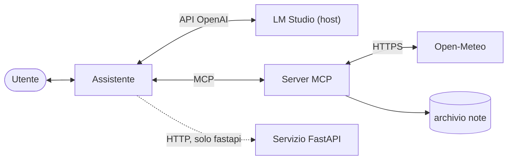
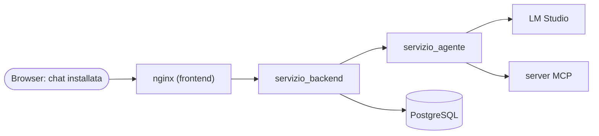
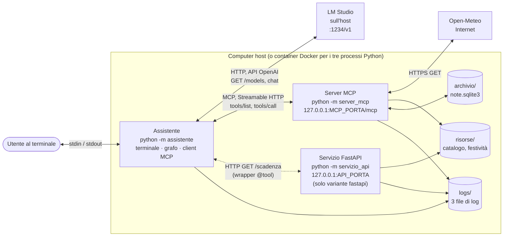
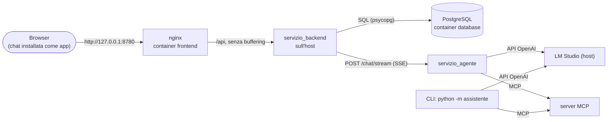
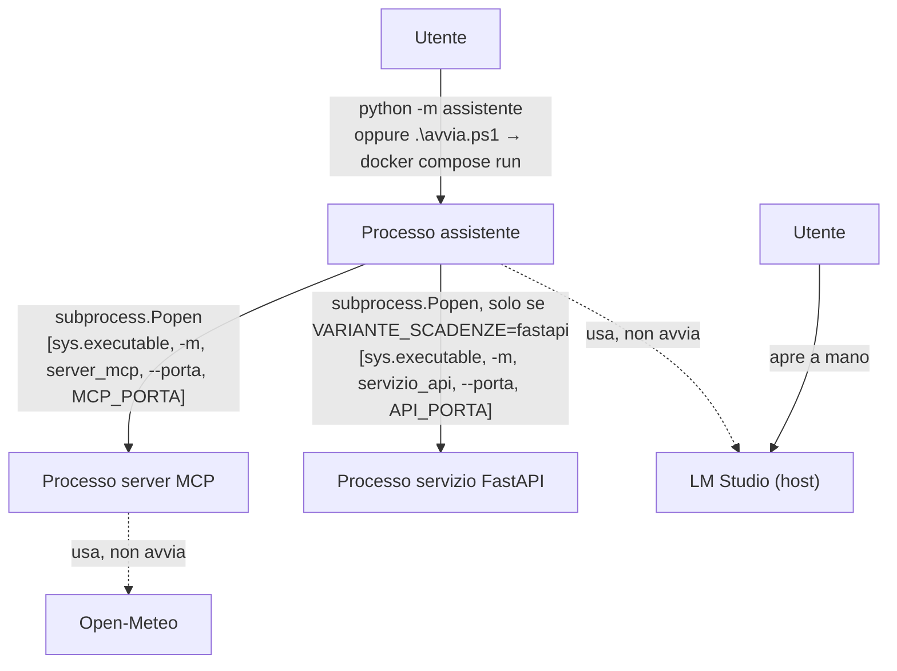
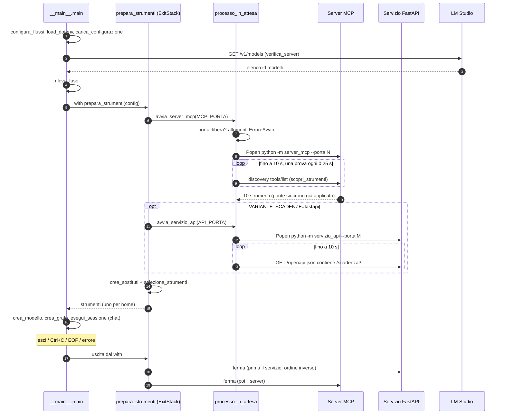
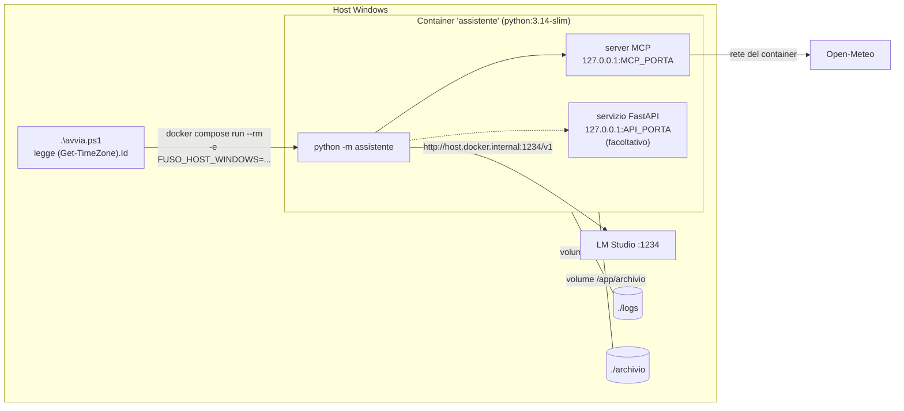
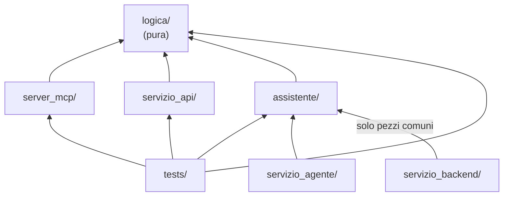
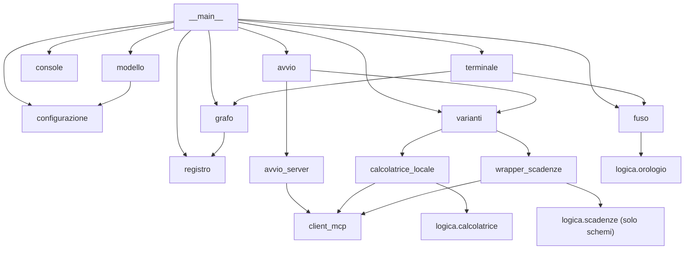

# Architettura

> Percorso di studio: [00 Indice](00-indice.md) · [01 Panoramica e concetti](01-panoramica-e-concetti.md) · **02 Architettura** · [03 Il viaggio di una richiesta](03-viaggio-di-una-richiesta.md) · [04 Il grafo](04-grafo-langgraph.md) · [05 MCP in pratica](05-mcp-in-pratica.md)

## Scheda in 5 minuti

**Di che cosa parla.** Questo capitolo mostra i pezzi del sistema e come si parlano. Dice chi avvia chi, su quali porte, dove sta il codice e su quali principi si regge. Serve per orientarsi prima di seguire una richiesta passo per passo.

**Le idee chiave**

1. **Un solo comando avvia tutto.** L'utente lancia solo l'assistente. L'assistente avvia da sé il server MCP e, solo con la variante `fastapi`, il servizio delle scadenze. All'uscita li spegne sempre. → sezioni 1 e 2
2. **LM Studio e Open-Meteo stanno fuori.** LM Studio lo apre l'utente sull'host. L'assistente controlla solo che risponda e che il modello ci sia. Open-Meteo è un servizio su Internet: lo chiama solo il server MCP, per il meteo. → sezioni 1.6 e 1.7
3. **«Pronto» vuol dire che risponde davvero.** Un processo acceso non basta. Il server MCP è pronto quando la discovery restituisce gli strumenti. Il servizio FastAPI è pronto quando la sua descrizione OpenAPI contiene `/scadenza`. → sezione 2.3
4. **Nessun processo resta acceso per sbaglio.** I processi figli si spengono in ordine inverso, anche se l'avvio fallisce a metà. Prima si chiede la chiusura. Se dopo 5 secondi il processo è ancora vivo, lo si chiude a forza. → sezione 2.5
5. **Tutto resta sul computer locale.** Server e servizio ascoltano solo su `127.0.0.1`: nessun altro computer li raggiunge. In Docker non si pubblicano porte, perché i tre processi stanno nello stesso container. → sezioni 3 e 4
6. **La logica è scritta una volta sola.** I calcoli stanno in `logica/`, che non importa niente del resto del progetto. Server MCP, servizio FastAPI e variante locale la riusano. → sezioni 5 e 9.1
7. **Tutto è sincrono, tranne il ponte.** Sincrono vuol dire che ogni chiamata aspetta la sua risposta prima di andare avanti. Gli strumenti dell'adattatore MCP invece sono solo asincroni. Il ponte li esegue con `asyncio.run` e restituisce sempre una stringa, mai un'eccezione. → sezione 9.2
8. **Dalla lezione 6 il sistema ha più ingressi.** Oltre al terminale ci sono l'agente come servizio HTTP (`servizio_agente/`), il back-end delle chat (`servizio_backend/`) con PostgreSQL, e la chat nel browser (`frontend/`) servita da nginx. Il browser parla solo con nginx, nginx con il back-end, il back-end con l'agente e il database. → sezione 1.5 ter e capitoli [13](13-agente-come-servizio.md), [14](14-backend-delle-chat.md), [15](15-chat-nel-browser.md)

**Il quadro**



Con la lezione 6 si aggiunge il lato web (dettagli nella sezione 1.5 ter):



**Da sapere a memoria**

| Cosa | Valore | Dove |
|---|---|---|
| Sequenza di avvio | configurazione → LM Studio → fuso → processi → chat | `assistente/__main__.py:20-37` |
| Prontezza del server MCP | una discovery `tools/list` riuscita | `assistente/avvio_server.py:161-168` |
| Attesa di avvio e di arresto | 10 s e 5 s | `assistente/avvio_server.py:25-26` |
| Arresto in ordine inverso | `ExitStack` | `assistente/avvio.py:33` |
| Porte ammesse | 1024–65535, `API_PORTA` diversa da `MCP_PORTA` | `assistente/configurazione.py:28-34`, `:65-66` |
| Ponte sincrono | `asyncio.run`, 10 s per chiamata | `assistente/client_mcp.py:57-77` |
| Servizi della lezione 6 | agente su `AGENTE_PORTA`, back-end su `BACKEND_PORTA`, PostgreSQL su `POSTGRES_PORTA` (5432), nginx su `FRONTEND_PORTA` (8780): tutti solo su `127.0.0.1` | `servizio_agente/__main__.py:69`, `servizio_backend/__main__.py:69`, `compose.yaml:59`, `:78` |

**Se te lo chiedono all'orale**

- *Quanti processi girano durante la chat?* Due con la variante `mcp` delle scadenze: assistente e server MCP. Tre con `fastapi`. LM Studio è un'applicazione a parte, non un figlio.
- *Che cosa succede se il server MCP cade durante la chat?* Il ponte restituisce un errore di tipo `collegamento` e il grafo lo registra. La chat continua, ma il server non viene riavviato.
- *Perché in Docker non si pubblicano porte?* I tre processi Python stanno nello stesso container e si parlano sul suo `127.0.0.1`. LM Studio si raggiunge sull'host con `host.docker.internal`. (Fa eccezione la lezione 6: i servizi `agente`, `database` e `frontend` pubblicano una porta, ma solo su `127.0.0.1` dell'host.)
- *Quali processi servono per la chat nel browser?* Il database e il `frontend` (container Compose), più l'agente e il back-end, che oggi si avviano a mano sull'host. Lo step 9 li metterà tutti in container con un solo comando.

Per i dettagli continua con il resto del capitolo: le idee rimandano alle sezioni con «→ sezione N».

---

Questo documento risponde a quattro domande, in quest'ordine:

1. quali **pezzi** compongono il sistema e chi avvia chi;
2. come comunicano: **porte, indirizzi e trasporti**;
3. dove sta ogni cosa: **cartelle e file Python**, ciascuno con la sua responsabilità;
4. su quali **librerie** si appoggia il progetto e su quali **principi** è costruito.

Il percorso dettagliato di una singola domanda (dalla tastiera alla risposta) è nel documento [03](03-viaggio-di-una-richiesta.md). Il grafo è spiegato nel [04](04-grafo-langgraph.md) e i dettagli del protocollo MCP nel [05](05-mcp-in-pratica.md).

---

## In breve (da saper dire in 60 secondi)

- **Un solo comando** (`python -m assistente`, oppure `.\avvia.ps1` con Docker) avvia il **processo dell'assistente**. È lui ad avviare, come processi figli, il **server MCP** e, solo se `VARIANTE_SCADENZE=fastapi`, il **servizio FastAPI**. All'uscita li spegne sempre.
- **LM Studio** non viene avviato dal programma. È un'applicazione separata sull'host, che l'utente apre da sé. L'assistente lo raggiunge via HTTP (API compatibile con OpenAI) e all'avvio controlla soltanto che risponda.
- **Open-Meteo** è un servizio pubblico su Internet. Lo chiama **solo il server MCP**, e solo per lo strumento `get_weather`.
- La logica degli strumenti è scritta **una volta sola** in `logica/`. Sopra ci sono tre «involucri»: la registrazione MCP (`server_mcp/`), l'endpoint FastAPI (`servizio_api/`) e le due varianti nell'agente (`assistente/calcolatrice_locale.py`, `assistente/wrapper_scadenze.py`).
- Il codice del progetto è **sincrono**. L'unico punto asincrono è il **ponte MCP** (`assistente/client_mcp.py`), che con `asyncio.run` trasforma gli strumenti asincroni dell'adattatore in strumenti sincroni per il grafo.
- Server MCP e servizio FastAPI ascoltano solo su **`127.0.0.1`**. Il server MCP usa la porta `MCP_PORTA` (per esempio 8765) e il percorso `/mcp`; il servizio FastAPI usa `API_PORTA` (per esempio 8766). LM Studio, che non è configurato dal progetto, risponde di norma sulla porta 1234.

---

## 1. I componenti

### 1.1 Tabella riassuntiva

| Componente | Che cos'è | Chi lo avvia | Dove gira | Indirizzo | Trasporto | Log |
|---|---|---|---|---|---|---|
| **Assistente** | processo Python principale: terminale, grafo LangGraph, client MCP, varianti | l'utente (`python -m assistente` o `.\avvia.ps1`) | host, oppure container Docker | nessuna porta in ascolto | – | `logs/assistente.log` |
| **Server MCP** «Strumenti laboratorio» | processo figlio, FastMCP; espone i 10 strumenti | l'assistente (`assistente/avvio_server.py:159`) | stessa macchina o stesso container dell'assistente | `http://127.0.0.1:<MCP_PORTA>/mcp` | MCP su **Streamable HTTP** (JSON-RPC) | `logs/server_mcp.log` |
| **Servizio FastAPI** «Servizio scadenze» (facoltativo) | processo figlio, FastAPI + uvicorn; espone `GET /scadenza` | l'assistente, **solo** con `VARIANTE_SCADENZE=fastapi` (`assistente/avvio.py:38-40`) | come sopra | `http://127.0.0.1:<API_PORTA>` | HTTP REST (query string, risposta JSON) | `logs/servizio_api.log` |
| **LM Studio** | applicazione desktop che serve il modello (per esempio `google/gemma-4-e2b`) | l'utente, a mano | sempre sull'**host** (mai containerizzato) | `LMSTUDIO_BASE_URL`, per esempio `http://localhost:1234/v1` | HTTP, API compatibile con OpenAI | – (fuori dal progetto) |
| **Open-Meteo** | servizio pubblico di meteo, senza chiave | nessuno: è esterno | Internet | `geocoding-api.open-meteo.com`, `api.open-meteo.com` | HTTPS | si vede in `logs/server_mcp.log` |

Accanto ai processi ci sono tre «luoghi» su disco:

| Cartella | Contenuto | In Git? | Chi la usa |
|---|---|---|---|
| `risorse/` | `catalogo_corsi.json` (12 corsi), `festivita_italia.json` (anni 2026–2028) | sì | server MCP; servizio FastAPI (festività) |
| `archivio/` | `note.sqlite3`, l'unico dato che sopravvive alla sessione | no (`.gitignore`, `.dockerignore`) | solo il server MCP |
| `logs/` | i file di log (tre, più `servizio_backend.log` con il back-end) | no | i processi Python |

### 1.2 Diagramma dei componenti



Le frecce tratteggiate indicano una parte facoltativa. Il servizio FastAPI esiste solo con `VARIANTE_SCADENZE=fastapi`.

### 1.3 L'assistente (processo principale)

È il **programma vero e proprio**, e in termini MCP fa da **host**: decide quali capacità dare al modello. Si avvia da `assistente/__main__.py`, che esegue una sequenza fissa (`assistente/__main__.py:20-37`):

```python
configura_flussi()                       # pipe in UTF-8 (riga 21)
load_dotenv(override=False)              # .env, senza sovrascrivere l'ambiente (23)
config = carica_configurazione(os.environ)   # 24
configura_registro(LOG_ASSISTENTE)       # 25
verifica_server(config.base_url, config.modello)   # LM Studio risponde? (26)
fuso = rileva_fuso(os.environ)           # 27
with prepara_strumenti(config) as strumenti:       # avvia i processi figli (28)
    grafo = crea_grafo(crea_modello(config, strumenti), strumenti)   # 29
    esegui_sessione(grafo, fuso, origini=..., parametri=...)         # 30
```

Due dettagli da saper spiegare:

- **LM Studio si controlla prima di avviare qualsiasi processo.** Se `verifica_server` fallisce, nessun processo figlio parte, quindi non c'è niente da spegnere.
- **Tre famiglie di errori di avvio** (`ErroreConfigurazione`, `ErroreServer`, `ErroreAvvio`) finiscono tutte nello stesso `except` (riga 31). Il programma stampa `Errore: …` su stderr ed esce con codice 1, senza traceback. Un `Ctrl+C` stampa «Arrivederci.» ed esce con codice 0.

### 1.4 Il server MCP

- **Avvio:** `python -m server_mcp --porta N [--note FILE]` (`server_mcp/__main__.py:25-52`).
- **Opzioni di `run`** (`server_mcp/__main__.py:39-48`):
  - `transport="http"`, cioè Streamable HTTP;
  - `host="127.0.0.1"` e `path="/mcp"`;
  - `stateless_http=True`: ogni richiesta è indipendente, senza sessione da mantenere;
  - `json_response=True`: la risposta è un JSON semplice invece di un flusso SSE;
  - `show_banner=False` e `log_level="warning"`, per un log pulito.
- **Che cosa crea `crea_server`** (`server_mcp/server.py:116-126`), una volta per tutta la vita del processo:
  - un unico `httpx.Client`, usato da Open-Meteo;
  - l'`ArchivioNote` sul file `archivio/note.sqlite3`, o su quello passato con `--note`;
  - il catalogo, che viene caricato e validato **subito** (`carica_catalogo()`, riga 126). Se il file non è valido, il server non parte.
- **I dieci strumenti** sono registrati con `@server.tool(...)` (`server_mcp/server.py:128-193`). Ognuno passa da `esegui_registrato` (righe 98-109), che fa due cose:
  - scrive una riga di log per ogni chiamata;
  - trasforma `ErroreStrumento` in un `ToolError` MCP, cioè in un risultato con `isError`.
- **Arresto pulito.** `_installa_segnali_di_arresto` (righe 17-22) trasforma `SIGBREAK` (Windows) e `SIGTERM` (Linux/Docker) in `KeyboardInterrupt`. Così il blocco `finally` registra «arresto server» e il processo esce con codice 0.
- **Avvio a mano.** Si può avviare anche da solo, per esempio per provarlo con MCP Inspector (vedi README). In quel caso usa l'archivio reale, a meno di indicare `--note`.

### 1.5 Il servizio FastAPI (facoltativo)

- **Avvio:** `python -m servizio_api --porta N` (`servizio_api/__main__.py:26-42`). Esegue `uvicorn.run(crea_app(), host="127.0.0.1", port=..., log_level="warning", access_log=False)` (riga 38).
- **Un solo endpoint:** `GET /scadenza?data_inizio=…&giorni=…&lavorativi=…` (`servizio_api/app.py:47-65`). Chiama la stessa `logica.scadenze.calcola_scadenza` usata dal server MCP.
- **Errori in italiano.** Gli errori di validazione, che FastAPI darebbe come `422` in inglese, diventano `400` con `{"errore": "..."}` in italiano (`servizio_api/app.py:38-45`). Un errore imprevisto diventa `500`, sempre con `{"errore": ...}` (righe 58-61).
- **Documentazione automatica.** FastAPI genera da sé `/openapi.json` e `/docs`. L'assistente usa proprio `/openapi.json` per capire quando il servizio è pronto (sezione 2.3).
- **Come lo usa l'agente.** L'agente non chiama il servizio direttamente. Passa da un **wrapper scritto a mano** (`assistente/wrapper_scadenze.py`), registrato con `@tool`. Qui non c'è discovery: nome, descrizione e schema sono copiati a mano, e un test controlla che coincidano con quelli MCP.

### 1.5 bis Il servizio dell'agente (lezione 6, step 6)

`python -m servizio_agente` è una seconda porta d'ingresso allo stesso agente: al posto del
terminale c'è un server HTTP (FastAPI e uvicorn) su `127.0.0.1:AGENTE_PORTA`, con `/salute` e
`/chat`. Avvia e spegne il server MCP come la CLI e costruisce il grafo con la stessa funzione,
`crea_agente` (`assistente/agente.py`). È senza stato: la cronologia la rimanda il client.
Dettagli in [13 — L'agente come servizio HTTP](13-agente-come-servizio.md).

### 1.5 ter I servizi della lezione 6: back-end, database e chat nel browser

Con gli step 6, 7 e 8 della lezione 6 il programma non ha più solo il terminale come ingresso. Oggi i processi possibili sono cinque, oltre a LM Studio e al server MCP:

| Processo | Che cos'è | Chi lo avvia | Dove gira | Indirizzo | Log |
|---|---|---|---|---|---|
| **CLI** (assistente) | il terminale di sempre | l'utente: `python -m assistente`, `.\avvia.ps1` | host o container `assistente` | nessuna porta | `logs/assistente.log` |
| **Servizio dell'agente** | FastAPI con `/salute`, `/chat`, `/chat/stream`; senza stato; avvia e spegne un suo server MCP | l'utente: `python -m servizio_agente`, `.\avvia-agente.ps1` | host o container `agente` | `127.0.0.1:AGENTE_PORTA` | `logs/assistente.log` |
| **Back-end delle chat** | FastAPI con progetti, chat, ricerca e turno in streaming SSE; salva in PostgreSQL | l'utente: `python -m servizio_backend` | host | `127.0.0.1:BACKEND_PORTA` | `logs/servizio_backend.log` |
| **Database** | PostgreSQL 18 con il volume `dati_postgres` | `docker compose up -d database` | container `database` | `127.0.0.1:POSTGRES_PORTA` | – |
| **nginx** (servizio `frontend`) | serve i file compilati della chat e inoltra `/api` al back-end | `docker compose up -d --build frontend` | container `frontend` | `127.0.0.1:FRONTEND_PORTA` (8780) | – |



Che cosa fa ogni pezzo e perché sta lì:

- **Il browser parla solo con nginx.** Pagina e API hanno la stessa origine, quindi non serve configurare CORS nel back-end, e il back-end resta su `127.0.0.1`.
- **Il back-end tiene insieme database e agente.** L'agente resta senza stato e riceve la cronologia a ogni turno; il back-end la legge dal database e la salva solo a risposta completa.
- **Il database è un container.** I dati sopravvivono nel volume `dati_postgres`.
- **Per ora due pezzi sono sull'host.** L'agente e il back-end si avviano a mano (`python -m ...`); il `frontend` e il `database` con Compose. Lo step 9 della lezione 6 metterà tutti e quattro in container con un solo comando.

Le cartelle nuove sono `servizio_agente/` (`app.py`, `__main__.py`), `servizio_backend/` (`app.py`, `archivio.py`, `client_agente.py`, `turni.py`, `configurazione.py`, `testi.py`, `schema.sql`) e `frontend/` (progetto Svelte 5 con `src/`, `public/`, `nginx/`, `Dockerfile`). Per i dettagli: [13 L'agente come servizio HTTP](13-agente-come-servizio.md), [14 Il back-end delle chat](14-backend-delle-chat.md), [15 La chat nel browser](15-chat-nel-browser.md); i container in [08, sezioni 7.9–7.11](08-configurazione-avvio-docker.md).

### 1.6 LM Studio

- **Sta sempre sull'host**, anche quando l'assistente gira in Docker (regola del `CLAUDE.md`: «LM Studio non va containerizzato»).
- **Controllo all'avvio.** `assistente/modello.py:42-76` chiama `GET {LMSTUDIO_BASE_URL}/models` con `urllib`, timeout 5 secondi. Controlla che `LMSTUDIO_MODEL` sia tra gli `id` restituiti. L'identificativo non viene mai inventato: lo dà il server.
- **Il client di chat.** `assistente/modello.py:79-87` crea un `ChatOpenAI` con:
  - `base_url` preso dalla configurazione;
  - `api_key="lm-studio"`, un segnaposto e non una credenziale: LM Studio non la controlla, ma la libreria ne vuole una (riga 15);
  - `timeout=120` e `max_retries=1`.

  Poi lo collega agli strumenti selezionati con `bind_tools(strumenti)`.

### 1.7 Open-Meteo

- **Quando si usa:** solo `get_weather`, cioè `logica/meteo.py`. La chiamata parte dal **processo del server MCP**, non dall'assistente.
- **Due richieste HTTPS:**
  - geocoding, per passare dal nome alle coordinate: `https://geocoding-api.open-meteo.com/v1/search`;
  - previsione, per le condizioni attuali: `https://api.open-meteo.com/v1/forecast` (`logica/meteo.py:15-16`).
- **Tempi massimi:**
  - 4 secondi per ogni fase di httpx (`TIMEOUT_METEO`);
  - 8 secondi in tutto per lo strumento (`TEMPO_TOTALE`, righe 17-20).

  Gli 8 secondi restano sotto i 10 del ponte MCP. Così l'errore arriva dal meteo («Servizio meteo: nessuna risposta…») e non come «Server MCP: nessuna risposta».
- **Nei test non si usa mai la rete.** Il server riceve un `httpx.Client` finto (iniezione del parametro `http`, `server_mcp/server.py:120`).

---

## 2. Processi: chi avvia chi

### 2.1 L'albero dei processi



Il codice che avvia i figli è uno solo, `processo_in_attesa` (`assistente/avvio_server.py:85-139`), e vale sia per il server MCP sia per il servizio FastAPI. Il `Popen` (righe 105-113) avvia il figlio con queste opzioni:

| Opzione | Valore | Perché |
|---|---|---|
| interprete | `sys.executable` | lo stesso Python (e quindi lo stesso `.venv`) dell'assistente |
| `cwd` | `CARTELLA_PROGETTO` (la cartella del progetto, riga 28) | `-m server_mcp` e `-m servizio_api` si trovano qualunque sia la cartella corrente |
| `stdin` | `DEVNULL` | il figlio non deve rubare l'input della chat |
| `stdout` / `stderr` | il file di log, con `stderr=STDOUT` | l'output del server non finisce mai nel terminale della chat |
| `env` | ambiente corrente + `PYTHONUTF8=1` | log in UTF-8 anche su Windows |
| gruppo | `CREATE_NEW_PROCESS_GROUP` su Windows, `start_new_session` altrove (righe 79-82) | il `Ctrl+C` del terminale non arriva al figlio, che si spegne solo quando lo chiede l'assistente |

### 2.2 Sequenza di avvio e arresto



### 2.3 Quando un processo è «pronto»

Un processo acceso non basta, e nemmeno un HTTP 200. Ogni processo ha la sua **prova di prontezza**, ripetuta finché non riesce o finché non scade l'attesa (`assistente/avvio_server.py:118-127`):

| Processo | Prova di prontezza | Riferimento |
|---|---|---|
| Server MCP | una **discovery MCP** (`tools/list`) completa, con almeno uno strumento; altrimenti «Il server MCP non espone nessuno strumento.» | `assistente/avvio_server.py:161-168` |
| Servizio FastAPI | `GET /openapi.json` che nei `paths` contiene `/scadenza` | `assistente/avvio_server.py:191-194` |

Se il processo termina prima o i 10 secondi scadono, l'errore è `Il <descrizione> non è partito (porta N)`, seguito dalle **ultime 10 righe del suo log** (righe 128-133, funzione `ultime_righe`). Lo studente lo vede subito senza aprire il file.

### 2.4 Porta libera: perché due controlli

`porta_libera` (`assistente/avvio_server.py:35-47`) fa due controlli:

1. prova un `bind` su `127.0.0.1:porta` senza `SO_REUSEADDR`;
2. prova anche a **connettersi**. Su Windows il `bind` su `127.0.0.1` riesce anche se un altro programma ascolta su `0.0.0.0`: se qualcuno risponde, la porta è comunque occupata.

Il messaggio d'errore dice quale variabile cambiare: `Porta 8765 già in uso: chiudi il programma che la usa o cambia MCP_PORTA nel .env.`

### 2.5 Arresto garantito: niente processi orfani

- **`ExitStack`** (`assistente/avvio.py:33`) raccoglie i processi avviati. All'uscita li chiude **in ordine inverso**: prima il servizio FastAPI, poi il server MCP. Se il secondo processo non parte, l'`ExitStack` spegne anche il primo.
- **`ferma`** (`assistente/avvio_server.py:58-76`) procede per gradi:
  1. chiede la chiusura: `CTRL_BREAK_EVENT` su Windows, `terminate()` altrove;
  2. aspetta fino a 5 secondi (`ATTESA_ARRESTO`);
  3. nel `finally` fa `kill()` se il processo è ancora vivo. Vale anche se l'attesa viene interrotta, per esempio da un secondo `Ctrl+C`.
- **Lato figlio**, `SIGBREAK`/`SIGTERM` diventano `KeyboardInterrupt` (`server_mcp/__main__.py:12-22`, `servizio_api/__main__.py:13-23`). Così l'uscita è ordinata e il codice è 0. Senza questo gestore, su Windows il processo usciva con codice 3 senza eseguire il `finally`, un problema annotato nel checkpoint del passo 1 e poi risolto.

### 2.6 Tempi massimi (da sapere)

| Costante | Valore | Dove | Che cosa limita |
|---|---|---|---|
| `ATTESA_AVVIO` | 10 s | `assistente/avvio_server.py:25` | attesa della prontezza di un processo figlio |
| `PAUSA_TRA_PROVE` | 0,25 s | `assistente/avvio_server.py:27` | pausa tra due prove di prontezza (ogni prova dura al massimo 2 s, riga 123) |
| `ATTESA_ARRESTO` | 5 s | `assistente/avvio_server.py:26` | attesa dell'uscita ordinata prima del `kill` |
| `TIMEOUT_CHIAMATA` | 10 s | `assistente/client_mcp.py:16` | ogni chiamata a uno strumento MCP (ponte) |
| `TIMEOUT_HTTP` | 5 s | `assistente/wrapper_scadenze.py:19` | ogni chiamata del wrapper al servizio FastAPI |
| `TIMEOUT_METEO` / `TEMPO_TOTALE` | 4 s / 8 s | `logica/meteo.py:17-20` | richieste a Open-Meteo (per fase / totale) |
| verifica di LM Studio | 5 s | `assistente/modello.py:46` | `GET /models` all'avvio |
| chat con il modello | 120 s, 1 nuovo tentativo | `assistente/modello.py:84-85` | ogni invocazione del modello |

---

## 3. Porte, indirizzi e trasporti

| Collegamento | Da → a | Indirizzo | Protocollo | Libreria lato client | Codice |
|---|---|---|---|---|---|
| Controllo del modello | assistente → LM Studio | `{LMSTUDIO_BASE_URL}/models` | HTTP GET, JSON | `urllib.request` (libreria standard) | `assistente/modello.py:22-24, 42-76` |
| Chat e tool calling | assistente → LM Studio | `LMSTUDIO_BASE_URL` | HTTP, API compatibile con OpenAI | `langchain-openai` (`ChatOpenAI`) | `assistente/modello.py:79-87` |
| Strumenti MCP | assistente → server MCP | `http://127.0.0.1:<MCP_PORTA>/mcp` | MCP (JSON-RPC) su **Streamable HTTP**, senza stato, risposte JSON | `langchain-mcp-adapters` (`MultiServerMCPClient`, trasporto `"streamable_http"`) | `assistente/client_mcp.py:80-87`, `assistente/avvio_server.py:142-143` |
| Variante FastAPI | assistente (wrapper) → servizio | `http://127.0.0.1:<API_PORTA>/scadenza` | HTTP GET con query string, JSON | `httpx` | `assistente/wrapper_scadenze.py:35-79` |
| Prontezza FastAPI | assistente → servizio | `http://127.0.0.1:<API_PORTA>/openapi.json` | HTTP GET | `httpx` | `assistente/avvio_server.py:191-194` |
| Meteo | server MCP → Open-Meteo | `https://geocoding-api.open-meteo.com/v1/search`, `https://api.open-meteo.com/v1/forecast` | HTTPS GET, JSON | `httpx` | `logica/meteo.py:68-86` |
| Note | server MCP → file | `archivio/note.sqlite3` | SQLite (file locale) | `sqlite3` (libreria standard) | `logica/note.py:58-67` |
| Terminale | utente ↔ assistente | stdin / stdout | testo UTF-8 | `input` / `print` | `assistente/terminale.py:41-86`, `assistente/console.py` |

**Le porte:**

| Porta | Variabile | Chi ascolta | Su quale interfaccia | Pubblicata da Docker? |
|---|---|---|---|---|
| 1234 (predefinita di LM Studio) | dentro `LMSTUDIO_BASE_URL` | LM Studio | dipende da LM Studio (host) | non serve: LM Studio è già sull'host |
| es. 8765 | `MCP_PORTA` (obbligatoria, 1024–65535) | server MCP | solo `127.0.0.1` | **no**: assistente e server stanno nello stesso container |
| es. 8766 | `API_PORTA` (solo con `fastapi`, diversa da `MCP_PORTA`) | servizio FastAPI | solo `127.0.0.1` | **no**, per lo stesso motivo |

I controlli sulle porte stanno in `assistente/configurazione.py:28-34`: solo cifre, tra 1024 e 65535. Le righe 65-66 vietano che le due porte coincidano.

**Perché solo `127.0.0.1`.** Server e servizio non devono essere raggiungibili da altri computer: niente autenticazione e niente esposizione in rete. Tra i non obiettivi la specifica della lezione 5 elenca proprio «server o servizio raggiungibili da altri computer; autenticazione».

**Perché `stateless_http=True`.** Il ponte esegue ogni chiamata come un'operazione a sé (`asyncio.run` per chiamata, vedi sezione 9.2). Un server senza stato non deve ricordare nessuna sessione tra una richiesta e l'altra.

**Due identificativi diversi.** Il `call_id` della richiesta del modello e l'id JSON-RPC del protocollo MCP sono numeri diversi, e il server non riceve il `call_id`. Per questo le tracce di `assistente.log` e `server_mcp.log` si confrontano per strumento, argomenti e ora (vedi [10](10-log-e-diagnosi.md)).

---

## 4. Docker: la stessa architettura in un container

Con Docker **non cambia l'architettura**: cambia solo dove girano i tre processi Python.



| File | Ruolo architetturale |
|---|---|
| `Dockerfile` | immagine `python:3.14-slim`; `ENV ASSISTENTE_IN_DOCKER=1` (il fuso del container, UTC, non va usato) e `PYTHONUNBUFFERED=1`; copia **solo** `assistente/`, `logica/`, `server_mcp/`, `servizio_api/`, `risorse/`; `CMD ["python", "-m", "assistente"]` |
| `compose.yaml` | nella lezione 5 **un solo servizio** (`assistente`); dalla lezione 6 ce ne sono altri tre (`agente`, `database`, `frontend`, vedi sotto). Il servizio `assistente`: `env_file: .env`; sostituisce `LMSTUDIO_BASE_URL` con `LMSTUDIO_BASE_URL_DOCKER`; richiede con `:?` `MCP_PORTA` e le due varianti; monta `./logs` e `./archivio`; `extra_hosts: host.docker.internal:host-gateway`; `stdin_open` e `tty` per la chat |
| `avvia.ps1` | legge il fuso di Windows e lancia `docker compose run --rm -e FUSO_HOST_WINDOWS=<fuso> assistente` (con `-SenzaTty` aggiunge `-T`, per le prove con la pipe) |
| `.dockerignore` | esclude `.env`, `.venv`, `tests`, `docs`, `logs`, `archivio`, cache e cartelle di riserva delle prove |

Conseguenze da saper spiegare:

- **Nessuna porta pubblicata**: assistente, server MCP e servizio FastAPI parlano tra loro sul `127.0.0.1` **del container**.
- **LM Studio è raggiunto «all'indietro»** sull'host, tramite `host.docker.internal`.
- **Log e note sopravvivono a `--rm`** grazie ai volumi.
- **Un solo `requirements.txt`** basta, perché agente, server e servizio condividono lo stesso ambiente, sia nel `.venv` sia nel container.
- **I file di `risorse/` sono copiati nell'immagine**: dopo averli modificati serve `docker compose build`.

I dettagli (fuso, comandi, prove) sono nel [documento 08](08-configurazione-avvio-docker.md).

**Dopo la lezione 6.** `compose.yaml` ha quattro servizi: `assistente` (la CLI, come sopra), `agente` (il servizio HTTP, con un suo server MCP nel container), `database` (PostgreSQL con il volume `dati_postgres`) e `frontend` (nginx con la chat). Gli ultimi tre pubblicano una porta, ma solo su `127.0.0.1` dell'host. Il back-end delle chat non è ancora in un container: si avvia sull'host (sarà lo step 9). Vedi la sezione 1.5 ter e [08, sezioni 7.9–7.11](08-configurazione-avvio-docker.md).

---

## 5. Mappa delle cartelle

```text
assistente-laboratorio/
├── assistente/          ← l'agente: terminale, grafo, modello, client MCP, varianti, avvio dei processi
├── logica/              ← logica pura dei 10 strumenti (scritta una volta sola)
├── server_mcp/          ← registrazione MCP dei 10 strumenti + punto di avvio
├── servizio_api/        ← servizio FastAPI di calcola_scadenza + punto di avvio
├── servizio_agente/     ← l'agente come servizio HTTP (/salute, /chat, /chat/stream), senza stato
├── servizio_backend/    ← il back-end delle chat: progetti, chat, ricerca, turno in streaming; SQL scritto a mano con psycopg
├── frontend/            ← la chat nel browser: Svelte 5 + Vite, PWA, nginx (Dockerfile e configurazione)
├── risorse/             ← dati versionati: catalogo_corsi.json, festivita_italia.json
├── archivio/            ← note.sqlite3 (creato alla prima nota; fuori da Git)
├── logs/                ← assistente.log, server_mcp.log, servizio_api.log, servizio_backend.log (fuori da Git)
├── tests/               ← test automatici, aiuti per i test, prove reali (test_reale_*.py)
├── docs/superpowers/    ← specifiche, piani, checkpoint (metodo Superpowers)
├── docs/studio/         ← questi documenti di studio
├── .env.example         ← configurazione di esempio, senza credenziali (.env resta fuori da Git)
├── requirements.txt     ← dipendenze dell'applicazione, versioni fissate
├── requirements-dev.txt ← -r requirements.txt + pytest
├── pytest.ini           ← testpaths, pythonpath, marcatori lmstudio/docker
├── Dockerfile, compose.yaml, avvia.ps1, .dockerignore, .gitignore
└── README.md
```

La regola di dipendenza tra le cartelle di codice è semplice. **`logica/` non importa niente del progetto, e tutti importano `logica/`.**



Non esistono importazioni tra `assistente/`, `server_mcp/` e `servizio_api/`. Fanno eccezione voluta i due servizi della lezione 6: il servizio dell'agente riusa `assistente/` (`crea_agente`) perché è un'altra porta d'ingresso allo stesso agente; il back-end importa da `assistente/` solo pezzi comuni (`registro`, `sse`, `http`, la configurazione) e parla con l'agente via HTTP. L'assistente avvia gli altri due **come processi** (`-m server_mcp`, `-m servizio_api`) e parla con loro **in rete**, mai importandoli. È la conferma pratica che si tratta di componenti separati. La verifica è stata fatta analizzando con `ast` tutte le importazioni dei file (vedi la sezione 10, esempio 1).

---

## 6. Ogni file Python e la sua responsabilità

### 6.1 `logica/`: la logica pura degli strumenti

Nessun modulo qui dentro importa `fastmcp`, `fastapi` o LangChain. Ogni funzione riceve argomenti di tipo `object`, cioè qualsiasi valore arrivi dal modello, li valida da sé e restituisce un `dict`. Se qualcosa non va, solleva `ErroreStrumento` con un messaggio in italiano.

| File | Righe | Responsabilità | Usato da |
|---|---|---|---|
| `logica/__init__.py` | 1 | docstring: «Logica pura degli strumenti: nessuna dipendenza da MCP, FastAPI o LangChain» | – |
| `logica/errori.py` | 5 | `ErroreStrumento(ValueError)`: l'unico errore «di dominio», con un messaggio in italiano per il modello | tutti i moduli di `logica/`, server, servizio, varianti |
| `logica/orologio.py` | 43 | `ora_corrente(fuso, adesso)`: data e ora nel fuso IANA (`zoneinfo`); `è_fuso_valido`; `ora_utc`; giorni della settimana in italiano (`GIORNI`) | server MCP, `assistente/fuso.py`, `logica/note.py`, `logica/scadenze.py` |
| `logica/conversioni.py` | 89 | `converti(valore, da, a)`: unità metriche di lunghezza, massa e volume, più °C ↔ °F, in aritmetica `Decimal`; `UNITA_AMMESSE` | server MCP |
| `logica/numeri.py` | 34 | `numero_json(valore, inesatto)`: come restituire un numero «senza falsa esattezza» (int, float o testo) | calcolatrice, convertitore |
| `logica/calcolatrice.py` | 105 | `calcola(espressione)`: espressioni aritmetiche con `ast`, **senza `eval`**, solo nodi ammessi; `SCHEMA_ESPRESSIONE` condiviso da tutte le varianti | server MCP, `assistente/calcolatrice_locale.py` |
| `logica/scadenze.py` | 112 | `calcola_scadenza(data_inizio, giorni, lavorativi)`: giorni di calendario o lavorativi, festività da `risorse/festivita_italia.json` (caricate una volta, `@cache`); `SCHEMA_DATA_INIZIO/GIORNI/LAVORATIVI` | server MCP, `servizio_api/app.py`, `assistente/wrapper_scadenze.py` (solo gli schemi) |
| `logica/catalogo.py` | 105 | `carica_catalogo` (con validazione: un file non valido è un errore di avvio, `ValueError`), `cerca`, `dettaglio`; schemi `SCHEMA_QUERY/MAX_RESULTS/CODE` | server MCP |
| `logica/note.py` | 119 | `ArchivioNote`: `aggiungi`, `elenca`, `elimina` su SQLite; una connessione per operazione; `AUTOINCREMENT`, quindi gli ID non vengono mai riusati; `PERCORSO_NOTE = archivio/note.sqlite3` | server MCP |
| `logica/meteo.py` | 209 | `meteo_attuale(city, http)`: geocoding + previsione da Open-Meteo, scadenza totale con un `ThreadPoolExecutor`; codici WMO in italiano; errori di rete distinti da «città non trovata» | server MCP |

> Nota di precisione: `logica/meteo.py` importa `httpx`, perché deve fare richieste HTTP. Il principio è «nessuna dipendenza da MCP, FastAPI o LangChain», non «nessuna libreria esterna». Il client HTTP però non lo crea la logica: lo **riceve come parametro** (`http: httpx.Client`). Così nei test se ne passa uno finto, senza rete.

### 6.2 `server_mcp/`: il contratto MCP

| File | Righe | Responsabilità |
|---|---|---|
| `server_mcp/__init__.py` | 1 | docstring del pacchetto |
| `server_mcp/__main__.py` | 56 | punto di avvio `python -m server_mcp --porta N [--note FILE]`: argomenti da riga di comando, `logging.basicConfig` su stderr (quindi nel log), segnali di arresto, `run(transport="http", host="127.0.0.1", path="/mcp", stateless_http=True, json_response=True, ...)` |
| `server_mcp/server.py` | 195 | `crea_server(adesso=..., percorso_note=..., http=...)`: nomi e **descrizioni** dei 10 strumenti (righe 31-89), schemi degli argomenti con `WithJsonSchema`, `esegui_registrato` (log + `ToolError`). **Nessun calcolo qui**: ogni strumento è una riga che chiama `logica/` |

### 6.3 `servizio_api/`: la variante FastAPI

| File | Righe | Responsabilità |
|---|---|---|
| `servizio_api/__init__.py` | 1 | docstring del pacchetto |
| `servizio_api/__main__.py` | 46 | punto di avvio `python -m servizio_api --porta N`: log su stderr, segnali di arresto, `uvicorn.run(..., host="127.0.0.1")` |
| `servizio_api/app.py` | 67 | `crea_app()`: `GET /scadenza` che chiama `logica.scadenze.calcola_scadenza`; gestore degli errori di validazione in italiano (400); rete di sicurezza per gli errori imprevisti (500); log di ogni richiesta |

### 6.4 `assistente/`: l'agente

| File | Righe | Responsabilità |
|---|---|---|
| `assistente/__init__.py` | 1 | docstring del pacchetto |
| `assistente/__main__.py` | 41 | `main()`: la sequenza di avvio della sezione 1.3, la gestione degli errori di avvio (codice 1) e di `Ctrl+C` |
| `assistente/console.py` | 19 | `configura_flussi`: se ingresso o uscita **non** sono un terminale (pipe o file), li passa a UTF-8 (`utf-8-sig` in ingresso, per togliere il BOM di PowerShell) |
| `assistente/configurazione.py` | 76 | `Configurazione` (dataclass immutabile) e `carica_configurazione(env)`: variabili obbligatorie, porte 1024–65535, varianti ammesse, `API_PORTA` solo con `fastapi` e diversa da `MCP_PORTA`; `ErroreConfigurazione` |
| `assistente/fuso.py` | 53 | `rileva_fuso(env)`: `FUSO_HOST_WINDOWS` → fuso del computer (non in Docker) → `FUSO_ORARIO` → `UTC` con avviso; `RisultatoFuso(fuso, origine, avviso)` |
| `assistente/errori.py` | 5 | `ErroreAvvio`: porta occupata, processo che non parte, catalogo vuoto, nomi duplicati, variante senza servizio |
| `assistente/registro.py` | 38 | percorsi dei tre log (`logs/…`), `formatta` (righe `chiave=valore`), `configura_registro` (FileHandler UTF-8, idempotente, `propagate=False`, quindi niente stampe nel terminale) |
| `assistente/modello.py` | 87 | `verifica_server` (LM Studio risponde e il modello è nell'elenco; indirizzo controllato prima della richiesta) e `crea_modello` (`ChatOpenAI` + `bind_tools`); `ErroreServer` |
| `assistente/avvio_server.py` | 205 | ciclo di vita dei processi figli: `porta_libera`, `processo_in_attesa` (avvio → prova di prontezza → arresto garantito), `ferma`, `avvia_server_mcp` (prontezza = discovery), `avvia_servizio_api` (prontezza = `/openapi.json`) |
| `assistente/client_mcp.py` | 87 | client MCP e **ponte sincrono**: `scopri_strumenti(url)` (discovery con `MultiServerMCPClient`, trasporto `streamable_http`) e `avvolgi(strumento)` (strumento sincrono, stesso nome/descrizione/schema, `metadata={"origine": "mcp"}`, mai eccezioni: errori JSON con `tipo` `strumento` o `collegamento`); azzittisce i log di `mcp`, `httpx`, `httpcore` |
| `assistente/calcolatrice_locale.py` | 34 | variante **locale** di `calcola`: funzione con `@tool`, stesso schema (`SCHEMA_ESPRESSIONE`) e stessa logica; `metadata={"origine": "locale"}` |
| `assistente/wrapper_scadenze.py` | 79 | variante **FastAPI** di `calcola_scadenza`: wrapper `@tool` con contratto scritto a mano; traduce gli argomenti in query e la risposta HTTP (200/400/500/errore di rete) nel formato del grafo; `metadata={"origine": "fastapi"}` |
| `assistente/varianti.py` | 53 | l'agente come **host**: `crea_sostituti` (versioni non MCP richieste dal `.env`), `seleziona_strumenti` (una sola versione per nome, altrimenti `ErroreAvvio`), `origini` e `parametri` per il terminale |
| `assistente/avvio.py` | 46 | `prepara_strumenti(config)`: in un `ExitStack` avvia il server MCP, se serve il servizio FastAPI, e seleziona gli strumenti. È usato sia da `python -m assistente` sia dalle prove reali, così **il percorso è lo stesso** |
| `assistente/grafo.py` | 223 | il grafo LangGraph: `StatoConversazione`, messaggio di sistema, nodi `modello`/`strumenti`/`limite`, `instrada_dopo_modello`, controlli degli argomenti (mancanti o in più) **prima** di eseguire, log di ogni chiamata, `esegui_turno` (vedi [04](04-grafo-langgraph.md)) |
| `assistente/terminale.py` | 86 | `esegui_sessione`: benvenuto (fuso, strumenti con origine), ciclo `Tu:` / `Assistente:`, uscita con `esci`/`Ctrl+C`/EOF, riga `[nome · origine: argomenti]` per ogni chiamata riuscita; la cronologia resta solo in memoria |

### 6.5 `tests/`: test, aiuti e prove reali

**File di supporto** (non contengono test):

| File | Responsabilità |
|---|---|
| `tests/conftest.py` | opzioni `--lmstudio` e `--docker`: senza di loro i test marcati vengono **saltati**; fixture `porta` (una porta libera scelta dal sistema operativo) e `popen_registrati` (registra i processi avviati per controllare che vengano spenti) |
| `tests/finti.py` | `ModelloFinto` (risposte preparate, nessun server), `chiamata(...)`, `chiamata_orologio(...)`, `strumento_finto(...)`, `orologio_finto(istante)` |
| `tests/reale.py` | `ambiente_reale(...)`: lo **stesso percorso** di `python -m assistente`, senza terminale; usa **sempre** un archivio temporaneo delle note, mai quello dell'utente |
| `tests/processi.py` | `esegui_con_limite`: esegue un comando con un limite di tempo che termina l'**intero albero** dei processi (su Windows `subprocess.run(timeout=…)` non basta) |
| `tests/cartelle_da_parte.py` | durante la prova Docker sposta da parte `logs/` e `archivio/` dell'utente e le ripristina sempre |
| `tests/server_vuoto.py` | server FastMCP **senza strumenti**, per provare l'errore «catalogo vuoto» |

**Test automatici** (girano con `python -m pytest`, senza LM Studio né Docker; il numero è quello delle funzioni `test_…`, prima della parametrizzazione):

| Area | File (funzioni di test) |
|---|---|
| logica pura | `test_orologio.py` (8), `test_conversioni.py` (8), `test_numeri.py` (5), `test_calcolatrice.py` (8), `test_scadenze.py` (10), `test_catalogo.py` (14), `test_note.py` (20), `test_meteo.py` (17, risposte HTTP simulate) |
| server MCP | `test_server_mcp.py` (26, client MCP **in memoria**, rete vietata) |
| servizio FastAPI | `test_servizio_api.py` (7, `TestClient` di FastAPI) |
| varianti | `test_calcolatrice_locale.py` (5), `test_wrapper_scadenze.py` (8), `test_varianti.py` (8) |
| ponte e processi | `test_client_mcp.py` (3), `test_avvio_server.py` (14, server MCP **reale** su porta libera), `test_avvio_servizio_api.py` (6), `test_prepara_strumenti.py` (1), `test_avvio_unico.py` (8, `main()` con server reale e modello finto), `test_processi.py` (2) |
| agente | `test_grafo.py` (25), `test_terminale.py` (18), `test_configurazione.py` (13), `test_fuso.py` (7), `test_modello.py` (9), `test_registro.py` (2), `test_console.py` (3) |
| progetto | `test_requisiti.py` (1: i pacchetti usati direttamente sono fissati), `test_cartelle_da_parte.py` (8), `test_reale_ambiente.py` (4: le prove reali non toccano mai l'archivio dell'utente) |

**Prove reali** (saltate se non richieste esplicitamente):

| File | Marcatore | Che cosa prova |
|---|---|---|
| `test_reale_lmstudio.py` | `lmstudio` | il modello chiama davvero `ora_corrente` |
| `test_reale_convertitore.py` | `lmstudio` | 5 conversioni con `converti_unita` |
| `test_reale_calcolatrice.py` | `lmstudio` | stessa domanda con `calcola` `mcp` e `locale` |
| `test_reale_scadenze.py` | `lmstudio` | stessa domanda con `calcola_scadenza` `mcp` e `fastapi` |
| `test_reale_catalogo.py` | `lmstudio` | scelta tra `search_catalog` e `get_item`, nessun corso inventato |
| `test_reale_note.py` | `lmstudio` | note su un archivio temporaneo, anche dopo un riavvio |
| `test_reale_meteo.py` | `lmstudio` | meteo vero (serve la rete) |
| `test_reale_docker.py` | `docker` | container, fuso dall'host, varianti, volumi, meteo senza rete |

Approfondimento nel [documento 09](09-test-e-verifiche.md).

### 6.6 `risorse/`, `archivio/`, `logs/`

| Cartella | File | Chi scrive | Chi legge | Quando |
|---|---|---|---|---|
| `risorse/` | `catalogo_corsi.json` | lo sviluppatore (versionato) | `logica/catalogo.py` nel server MCP | **all'avvio del server** (`server_mcp/server.py:126`); dopo una modifica bisogna riavviare |
| `risorse/` | `festivita_italia.json` | lo sviluppatore (versionato) | `logica/scadenze.py`, nel server MCP o nel servizio FastAPI | alla **prima** chiamata di `calcola_scadenza` (`@cache`, `logica/scadenze.py:39-46`) |
| `archivio/` | `note.sqlite3` | `logica/note.py` (nel server MCP) | `logica/note.py` | creato alla prima operazione sulle note; sopravvive alla sessione e al container (volume) |
| `logs/` | `assistente.log` | logger `assistente` (`assistente/registro.py:27-39`) | lo studente, i test reali | in coda, una riga per evento |
| `logs/` | `server_mcp.log` | stdout/stderr del processo server (redirezione di `Popen`) | lo studente; le ultime righe finiscono nell'errore di avvio | in coda |
| `logs/` | `servizio_api.log` | stdout/stderr del processo servizio | come sopra | solo con la variante `fastapi` |

---

## 7. Dipendenze esterne: `requirements.txt`

Tutte le versioni sono **fissate con `==`**, come chiede il `CLAUDE.md` («dipendenze motivate, concordate e con versioni fissate»). Le versioni installate nel `.venv` (Python 3.14.7) coincidono con quelle elencate.

| Pacchetto | Versione | Perché c'è | Chi lo importa |
|---|---|---|---|
| `langgraph` | 1.2.19 | il **grafo** esplicito (stato, nodi, archi condizionali): requisito del corso | `assistente/grafo.py` |
| `langchain-openai` | 1.7.3 | `ChatOpenAI`: client per l'API compatibile OpenAI di LM Studio, con tool calling (`bind_tools`) | `assistente/modello.py` |
| `langchain-core` | 1.7.3 | messaggi (`AIMessage`, `ToolMessage`…), `BaseTool`, `StructuredTool`, `@tool`; base comune di LangGraph, langchain-openai e dell'adattatore MCP | quasi tutto `assistente/`, `tests/finti.py` |
| `tzlocal` | 5.4.5 | nome del fuso del computer e tabella `win_tz`, che converte i nomi Windows (`W. Europe Standard Time`) in nomi IANA | `assistente/fuso.py` |
| `tzdata` | 2026.6 | il **database dei fusi orari**: su Windows Python non ce l'ha, e `zoneinfo` ne ha bisogno. Nessuno lo importa direttamente | (usato da `zoneinfo` in `logica/orologio.py`) |
| `python-dotenv` | 1.2.4 | `load_dotenv`: legge il file `.env` nell'avvio diretto | `assistente/__main__.py`, `tests/reale.py` |
| `fastmcp` | 3.4.11 | scrive il **server MCP** (`FastMCP`, `@server.tool`, `ToolError`) e il client in memoria dei test | `server_mcp/server.py`, `tests/test_server_mcp.py`, `tests/server_vuoto.py` |
| `langchain-mcp-adapters` | 0.3.2 | **client MCP** lato agente: `MultiServerMCPClient` scopre il catalogo e lo converte in strumenti LangChain | `assistente/client_mcp.py` |
| `mcp` | 1.30.0 | SDK del protocollo, dipendenza **indiretta** di entrambi i pacchetti precedenti; fissato perché una 2.x arrivata per sbaglio romperebbe l'adattatore (che richiede `mcp<2`) | (indiretto) |
| `fastapi` | 0.162.2 | il **servizio HTTP** della variante FastAPI, con OpenAPI e `/docs` generati da sé | `servizio_api/app.py`, test |
| `uvicorn` | 0.54.0 | il server ASGI che **esegue** l'app FastAPI | `servizio_api/__main__.py` |
| `httpx` | 0.28.1 | client HTTP **sincrono**: wrapper delle scadenze, prova di prontezza, Open-Meteo; nei test `MockTransport` per vietare la rete | `assistente/wrapper_scadenze.py`, `assistente/avvio_server.py`, `logica/meteo.py`, `server_mcp/server.py` |
| `pydantic` | 2.14.2 | `WithJsonSchema`: fissa a mano lo **schema JSON** di ogni argomento, identico in tutte le varianti | `server_mcp/server.py`, `assistente/calcolatrice_locale.py`, `assistente/wrapper_scadenze.py` |
| `starlette` | 1.10.0 | base di FastAPI, **condivisa** con `mcp`: va fissata per tenere compatibili i due mondi (`fastapi.exceptions`, `fastapi.responses` e `fastapi.testclient` vengono da qui) | (indiretto, tramite FastAPI) |

E in `requirements-dev.txt`: `-r requirements.txt` più **`pytest==9.2.0`**, solo per lo sviluppo. Non entra nell'immagine Docker, che installa solo `requirements.txt`.

Tre osservazioni da orale:

1. **La compatibilità ha deciso le versioni.** Secondo la specifica del convertitore (sezione 8), l'ultima `fastmcp` 4.x richiede `mcp>=2.3`, mentre `langchain-mcp-adapters` 0.3.2 richiede `mcp<2`. La combinazione che si risolve è `fastmcp` 3.4.11 + `langchain-mcp-adapters` 0.3.2 + `mcp` 1.30.0.
2. **Le dipendenze indirette usate direttamente vanno fissate.** `httpx`, `uvicorn`, `pydantic` e `starlette` arriverebbero comunque come dipendenze di altri pacchetti. Sono fissate perché il codice le usa (o ne dipende) direttamente. `pydantic` e `starlette` sono state aggiunte nel commit `7eabf37`, e da allora `tests/test_requisiti.py` controlla che restino in elenco.
3. **Dove basta la libreria standard, niente librerie in più.**

   | Bisogno | Modulo standard |
   |---|---|
   | calcolatrice | `ast`, `decimal` |
   | note | `sqlite3` |
   | fusi orari | `zoneinfo` |
   | verifica di LM Studio | `urllib.request` |
   | processi figli | `subprocess`, `signal`, `socket` |
   | scadenza totale del meteo | `concurrent.futures` |

---

## 8. Come si incastrano i moduli dell'agente

Le importazioni interne di `assistente/` (ricavate dal codice con `ast`, esempio 1 della sezione 10):



Alcune cose si notano subito:

- **Il grafo non sa nulla di MCP.** `grafo.py` importa solo `registro` e riceve gli strumenti già pronti come lista di `BaseTool`. Che uno strumento arrivi da MCP, dal processo locale o da FastAPI lo dice solo `metadata["origine"]`, usata per il log e per il terminale.
- **`client_mcp.py` non importa niente del progetto.** Le due varianti non MCP importano da lui solo le costanti `TIPO_STRUMENTO` / `TIPO_COLLEGAMENTO`, così il formato degli errori è uguale ovunque.
- **`modello.py` non sa nulla di MCP.** Riceve la lista degli strumenti e la passa a `bind_tools`.

---

## 9. I principi architetturali

### 9.1 La logica è scritta una volta sola, in `logica/`

**La regola.** Ogni calcolo vive in un solo modulo puro. Le varianti cambiano solo il **percorso** con cui il risultato arriva al grafo, mai il calcolo. L'anti-obiettivo della specifica della lezione 5 è esplicito: «Logica duplicata. La calcolatrice o le scadenze sono riscritte una seconda volta in una variante».

**Come si vede nel codice:**

| Strumento | Logica | Involucri che la riusano |
|---|---|---|
| `calcola` | `logica/calcolatrice.py:calcola` | `server_mcp/server.py:148-152` (MCP), `assistente/calcolatrice_locale.py:25-31` (locale) |
| `calcola_scadenza` | `logica/scadenze.py:calcola_scadenza` | `server_mcp/server.py:154-161` (MCP), `servizio_api/app.py:47-65` (FastAPI; il wrapper `assistente/wrapper_scadenze.py` riusa solo gli schemi) |
| tutti gli altri | `logica/*.py` | solo `server_mcp/server.py` |

**Anche il contratto è condiviso**, oltre alla logica:

- gli **schemi** degli argomenti sono costanti di `logica/`: `SCHEMA_ESPRESSIONE`, `SCHEMA_DATA_INIZIO`, `SCHEMA_GIORNI`, `SCHEMA_LAVORATIVI`;
- le **descrizioni** MCP e quelle delle varianti sono uguali, e due test lo verificano. Il commento in `server_mcp/server.py:51` e `:56` dice proprio «Identica alla docstring … lo verifica un test».

**Il vantaggio** è che la logica si testa da sola, senza server, rete o modello: è il grosso dei test automatici.

### 9.2 Codice sincrono, tranne il ponte MCP

**Perché sincrono.** Il `CLAUDE.md` chiede «codice sincrono e moduli piccoli». Grafo, terminale, configurazione, avvio dei processi, wrapper HTTP (`httpx` sincrono) e logica sono tutti sincroni.

**Il problema.** Gli strumenti prodotti da `langchain-mcp-adapters` sono **solo asincroni**: invocati in modo sincrono, sollevano `NotImplementedError`. Il grafo invece li chiama con `strumento.invoke(...)`, che è sincrono (`assistente/grafo.py:175`).

**La soluzione: il ponte** (`assistente/client_mcp.py:57-77`). Ogni strumento scoperto viene avvolto in uno `StructuredTool` sincrono, con lo stesso nome, la stessa descrizione e lo stesso `args_schema`:

```python
def esegui(**argomenti) -> str:
    try:
        contenuto = asyncio.run(asyncio.wait_for(strumento.ainvoke(argomenti), timeout))
    except ToolException as errore:                        # errore dello strumento (isError MCP)
        return _errore(str(errore), TIPO_STRUMENTO)
    except TimeoutError:                                   # nessuna risposta entro 10 s
        return _errore(f"Server MCP: nessuna risposta entro {timeout:g} secondi.", TIPO_COLLEGAMENTO)
    except Exception as errore:                            # anche ExceptionGroup del trasporto
        return _errore(f"Server MCP non raggiungibile: ...", TIPO_COLLEGAMENTO)
    return _testo(contenuto)
```

Anche la discovery usa `asyncio.run` (`assistente/client_mcp.py:86`). È l'**unico posto** del progetto in cui il codice applicativo avvia un ciclo di eventi.

**Che cosa resta asincrono, per completezza:**

- l'interno dei framework, cioè FastMCP, uvicorn e il trasporto MCP;
- il gestore degli errori di validazione di FastAPI, scritto `async def` (`servizio_api/app.py:39`);
- il client in memoria nei test (`tests/test_server_mcp.py`, `con_client`).

Il meteo usa un **thread** (`ThreadPoolExecutor`) per la scadenza totale, non `asyncio`.

**Il ponte non solleva mai eccezioni verso il grafo.** Restituisce sempre una stringa: il risultato, oppure `{"errore": "...", "tipo": "strumento" | "collegamento"}`. Così il grafo distingue «lo strumento ha rifiutato gli argomenti» da «il server non risponde», e lo scrive nel log come `errore_tool` o `errore_collegamento`.

### 9.3 Un solo comando avvia tutto

Lo studente non deve aprire tre terminali. `python -m assistente`:

- controlla LM Studio;
- avvia il server MCP e, se serve, il servizio FastAPI, aspettando che siano **davvero** pronti;
- apre la chat;
- all'uscita spegne tutto, anche dopo un errore a metà avvio (`ExitStack`).

Con Docker il comando unico è `.\avvia.ps1`, e la catena di avvio dentro il container è identica.

Le prove reali usano la **stessa** funzione `prepara_strumenti` (`tests/reale.py:52`). Quello che si prova è quindi esattamente quello che si usa, non un percorso parallelo.

### 9.4 L'agente è l'host: sceglie lui le capacità

- **Il server è uguale per tutti.** Espone sempre tutti e dieci gli strumenti, perché è un servizio condiviso che non dipende dalla configurazione di un singolo agente.
- **L'agente sceglie.** È lui a decidere quale versione passare al modello (`assistente/varianti.py:32-43`): se una variante non è `mcp`, lo strumento MCP omonimo viene tolto e sostituito.
- **Un controllo prima della chat.** Uno strumento che arriva due volte provoca `ErroreAvvio` («… presente due volte: ogni strumento deve arrivare al modello da una sola variante»). Il modello non vede mai due versioni dello stesso strumento.

### 9.5 Configurazione solo dall'ambiente

- **Indirizzi, modello, porte e varianti** vengono solo da variabili d'ambiente (`assistente/configurazione.py:6`), lette dal `.env` o dall'ambiente del processo.
- **Le variabili già impostate vincono sul `.env`** (`load_dotenv(override=False)`), così Docker e i test possono sovrascrivere i valori.
- **Le variabili sono obbligatorie e senza predefiniti nascosti.** Se manca qualcosa, l'errore dice quali variabili aggiungere e da dove copiarle (`.env.example`).

### 9.6 Dipendenze iniettabili, per testare senza mondo esterno

Molte funzioni ricevono come parametro ciò che toccherebbe il mondo esterno:

| Funzione | Parametri iniettabili |
|---|---|
| `crea_server` | `adesso` (l'orologio), `percorso_note`, `http` |
| `ArchivioNote` | `adesso` |
| `verifica_server` | `leggi_json` |
| `rileva_fuso` | `fuso_locale` |
| `esegui_sessione` | `leggi`, `scrivi` |
| `crea_wrapper_scadenze` | `http` |
| `avvia_server_mcp` | `comando` |

Così i test usano un istante fisso, una cartella temporanea, una rete vietata e un modello finto (vedi [09](09-test-e-verifiche.md)). Il `CLAUDE.md` ricorda però che «una risposta simulata non dimostra che il modello locale sappia usare lo strumento». Per questo esistono le prove reali, separate.

### 9.7 Moduli piccoli, responsabilità nette

| Strato | Responsabilità |
|---|---|
| `logica/` | calcola |
| `server_mcp/`, `servizio_api/` | espongono un contratto |
| `assistente/client_mcp.py` | traduce da asincrono a sincrono |
| `assistente/varianti.py` | sceglie gli strumenti |
| `assistente/avvio_server.py` | gestisce i processi |
| `assistente/grafo.py` | orchestra la conversazione |
| `assistente/terminale.py` | parla con l'utente |

Il file più lungo del progetto, `assistente/grafo.py`, ha 223 righe.

---

## 10. Esempi reali eseguiti

Tutti gli esempi sono stati eseguiti il 2026-11-08 con l'interprete del progetto (`.venv\Scripts\python.exe -I`), senza LM Studio, senza rete e senza toccare `logs/` o `archivio/`. Gli script sono in una cartella temporanea di prova (`scratchpad/studio/02-architettura`).

**Esempio 1: chi importa chi** (analisi `ast` di tutti i file). Ecco un estratto dell'output reale:

```text
logica/calcolatrice.py: interni=['logica.errori', 'logica.numeri'] esterni=[]
logica/meteo.py: interni=['logica.errori'] esterni=['httpx']
server_mcp/server.py: interni=['logica.calcolatrice', 'logica.catalogo', ..., 'logica.scadenze'] esterni=['fastmcp', 'fastmcp.exceptions', 'httpx', 'pydantic']
servizio_api/app.py: interni=['logica.errori', 'logica.scadenze'] esterni=['fastapi', 'fastapi.exceptions', 'fastapi.responses']
assistente/client_mcp.py: interni=[] esterni=['langchain_core.tools', 'langchain_mcp_adapters.client']
assistente/grafo.py: interni=['assistente.registro'] esterni=['langchain_core.messages', 'langchain_core.tools', 'langgraph.graph', 'langgraph.graph.message']
```

Nessun file di `logica/` importa `assistente`, `server_mcp` o `servizio_api`, e nessuno importa `fastmcp`, `fastapi` o `langchain`.

**Esempio 2: il server MCP visto da un client** (client FastMCP in memoria, archivio temporaneo, rete vietata):

```text
N strumenti: 10
['converti_unita', 'ora_corrente', 'calcola', 'calcola_scadenza', 'search_catalog', 'get_item',
 'add_note', 'list_notes', 'delete_note', 'get_weather']
calcola: {"espressione":"(3 + 4) * 2","risultato":14}
errore: True Carattere non consentito: '_'. Sono ammessi numeri, + - * / % ** e parentesi.
```

Lo schema di `calcola_scadenza` scoperto dal client è quello delle costanti di `logica/scadenze.py`, con `"required": ["data_inizio", "giorni", "lavorativi"]` e `"additionalProperties": false`.

**Esempio 3: il ponte sincrono** (strumenti asincroni finti, avvolti da `avvolgi` con timeout 0,5 s):

```text
originale sincrono: NotImplementedError StructuredTool does not support sync invocation.
ok     -> {"eco":"a"} {'origine': 'mcp'}
lento  -> {"errore": "Server MCP: nessuna risposta entro 0.5 secondi.", "tipo": "collegamento"}
rotto  -> {"errore": "Fuso orario sconosciuto: 'Mars/Olympus'.", "tipo": "strumento"}
caduto -> {"errore": "Server MCP non raggiungibile: ConnectionError: connessione rifiutata", "tipo": "collegamento"}
```

Qui si vedono il problema (uno strumento solo asincrono non si invoca in modo sincrono) e la soluzione (il ponte risponde sempre con una stringa).

**Esempio 4: la configurazione e i suoi errori:**

```text
Configurazione(base_url='http://localhost:1234/v1', modello='google/gemma-4-e2b', porta_mcp=8765,
               variante_calcolatrice='locale', variante_scadenze='fastapi', porta_api=8766)
Errore: API_PORTA deve essere diversa da MCP_PORTA.
Errore: MCP_PORTA non valida: '80'. Usa un numero intero tra 1024 e 65535, per esempio 8765.
Errore: VARIANTE_SCADENZE non valida: 'rest'. Valori ammessi: mcp, fastapi.
```

Si noti che `VARIANTE_CALCOLATRICE=Locale` è stata normalizzata in `locale` (`strip().lower()`).

**Esempio 5: l'host sceglie le varianti** (tre strumenti «MCP» finti, configurazione `locale` + `fastapi`):

```text
{'ora_corrente': 'mcp', 'calcola': 'locale', 'calcola_scadenza': 'fastapi'}
{'ora_corrente': [], 'calcola': ['espressione'], 'calcola_scadenza': ['data_inizio', 'giorni', 'lavorativi']}
ErroreAvvio Strumento 'calcola' presente due volte: ogni strumento deve arrivare al modello da una sola variante.
```

**Esempio 6: il servizio FastAPI** (`TestClient`, in memoria):

```text
200 {"data_inizio":"2026-12-23","giorni":3,"lavorativi":true,"scadenza":"2026-12-29","giorno_settimana":"martedì",
     "festivita_saltate":["2026-12-25 Natale","2026-12-26 Santo Stefano"],"nota":"Calcolo indicativo: non ha valore legale."}
400 {"errore":"Argomenti non validi per calcola_scadenza: giorni: mancante; lavorativi: mancante"}
['/scadenza']        ← i paths di /openapi.json: è ciò che controlla la prova di prontezza
```

**Esempio 7: gli indirizzi costruiti dall'assistente:**

```text
http://127.0.0.1:8765/mcp http://127.0.0.1:8766
```

---

## 11. Domande d'orale su questa parte

1. **Quanti processi ci sono quando l'assistente è in chat?** Due con la variante `mcp` delle scadenze (assistente + server MCP), tre con `fastapi` (+ servizio FastAPI). LM Studio è un'applicazione a parte, non un figlio dell'assistente.
2. **Chi avvia il server MCP e come capisce che è pronto?** L'assistente, con `subprocess.Popen` (`assistente/avvio_server.py:105`). È pronto quando una discovery `tools/list` riesce e restituisce almeno uno strumento, non quando il processo è acceso o risponde 200.
3. **Perché il server ascolta solo su `127.0.0.1` e perché in Docker non si pubblicano porte?** Perché non deve essere raggiungibile da altri computer: non c'è autenticazione. In Docker server e assistente stanno nello stesso container, quindi parlano sul `127.0.0.1` del container.
4. **Che cosa succede se il server MCP cade durante la chat?** Il ponte restituisce `{"errore": "Server MCP non raggiungibile: …", "tipo": "collegamento"}`, il grafo lo registra come `errore_collegamento` e la chat continua. L'assistente non riavvia il server.
5. **Come si evita che restino processi orfani?** Con tre accorgimenti: l'`ExitStack`, che spegne in ordine inverso anche dopo un avvio fallito a metà; `ferma`, cioè richiesta di chiusura, 5 secondi di attesa e poi `kill` in un `finally`; il gruppo di processi separato, perché il `Ctrl+C` della chat non arrivi direttamente ai figli.
6. **Dove sta la logica della calcolatrice, e quante volte è scritta?** Una volta sola, in `logica/calcolatrice.py`. La riusano il server MCP e la variante locale, con lo stesso schema (`SCHEMA_ESPRESSIONE`).
7. **Perché esiste `client_mcp.py` e perché è l'unico punto asincrono?** Gli strumenti di `langchain-mcp-adapters` sono solo asincroni, mentre il grafo è sincrono. Il ponte li esegue con `asyncio.run` e restituisce sempre una stringa, senza mai sollevare eccezioni.
8. **Perché `mcp`, `pydantic` e `starlette` sono in `requirements.txt` se nessuno li installa «a mano»?** Per tre motivi:
   - `mcp` è condiviso da `fastmcp` e dall'adattatore, e una 2.x romperebbe l'adattatore;
   - `pydantic` è importato direttamente (`WithJsonSchema`);
   - `starlette` è la base condivisa da FastAPI e `mcp`.

   Fissarli rende l'ambiente riproducibile, e un test lo controlla.
9. **Perché Open-Meteo lo chiama il server e non l'assistente?** Perché `get_weather` è uno strumento MCP. Lo strumento incapsula il servizio esterno, e l'agente vede solo il contratto MCP.
10. **Che cosa cambia nell'architettura con Docker?** Niente nella logica: gli stessi tre processi girano nel container. Cambiano l'indirizzo di LM Studio (`host.docker.internal`), l'origine del fuso (`FUSO_HOST_WINDOWS` da `avvia.ps1`) e i volumi per `logs/` e `archivio/`.

---

> Prosegui con [03 · Il viaggio di una richiesta](03-viaggio-di-una-richiesta.md), che segue una domanda attraverso tutti questi componenti. Per i dettagli di avvio e Docker vedi [08](08-configurazione-avvio-docker.md); per log e diagnosi vedi [10](10-log-e-diagnosi.md).

---

## Scaletta per le slide

Una presentazione di circa 11 slide su questo capitolo. Ogni slide: titolo, tre punti brevi, che cosa mostrare.

### Slide 1 · Com'è fatto il sistema
- Un assistente, un server MCP, un servizio facoltativo
- LM Studio e Open-Meteo restano fuori dal programma
- Capire i pezzi aiuta a seguire ogni richiesta

*Da mostrare:* il diagramma dei componenti della sezione 1.2.

### Slide 2 · Chi avvia chi
- L'utente avvia solo l'assistente
- L'assistente avvia i processi figli con `subprocess.Popen`
- LM Studio lo apre l'utente, a mano

*Da mostrare:* l'albero dei processi della sezione 2.1.

### Slide 3 · La sequenza di avvio
- Prima la configurazione e il controllo di LM Studio
- Poi il fuso orario e i processi figli
- Infine modello, grafo e chat

*Da mostrare:* il codice di `assistente/__main__.py:20-37`.

### Slide 4 · Quando un processo è pronto
- Un processo acceso o un HTTP 200 non bastano
- Server MCP: la discovery deve riuscire
- Servizio FastAPI: `/openapi.json` deve descrivere `/scadenza`

*Da mostrare:* la tabella delle prove di prontezza della sezione 2.3.

### Slide 5 · Spegnere sempre tutto
- `ExitStack`: arresto in ordine inverso
- Richiesta di chiusura, 5 secondi di attesa, poi `kill`
- Gruppo separato: il `Ctrl+C` non arriva ai figli

*Da mostrare:* il codice di `ferma`, in `assistente/avvio_server.py:58-76`.

### Slide 6 · Porte e indirizzi
- Server MCP su `127.0.0.1:<MCP_PORTA>/mcp`
- Servizio FastAPI su `127.0.0.1:<API_PORTA>`
- LM Studio di norma sulla porta 1234

*Da mostrare:* la tabella dei collegamenti della sezione 3.

### Slide 7 · Docker: la stessa architettura
- I tre processi Python girano in un container
- LM Studio resta sull'host: `host.docker.internal`
- Log e note sopravvivono grazie ai volumi

*Da mostrare:* il diagramma della sezione 4.

### Slide 8 · Cartelle e dipendenze
- `logica/` non importa niente del progetto
- Tutte le altre cartelle di codice importano `logica/`
- L'assistente parla con gli altri in rete, senza importarli

*Da mostrare:* il diagramma delle dipendenze tra cartelle della sezione 5.

### Slide 9 · Sincrono, tranne il ponte
- Il grafo chiama gli strumenti in modo sincrono
- Gli strumenti dell'adattatore MCP sono solo asincroni
- Il ponte usa `asyncio.run` e non solleva eccezioni

*Da mostrare:* il codice di `avvolgi`, in `assistente/client_mcp.py:57-77`.

### Slide 10 · Dopo la lezione 6: più ingressi
- Terminale, servizio dell'agente, back-end con PostgreSQL e chat nel browser
- Il browser parla con nginx, nginx con il back-end, il back-end con agente e database
- Tutto solo su `127.0.0.1`; l'agente resta senza stato

*Da mostrare:* il diagramma della sezione 1.5 ter e i capitoli 13, 14 e 15.

### Slide 11 · Che cosa ricordare
- Un comando avvia e spegne tutto
- Pronto vuol dire che risponde davvero
- Logica unica, moduli piccoli, responsabilità nette

*Da mostrare:* la tabella «Moduli piccoli, responsabilità nette» della sezione 9.7.
