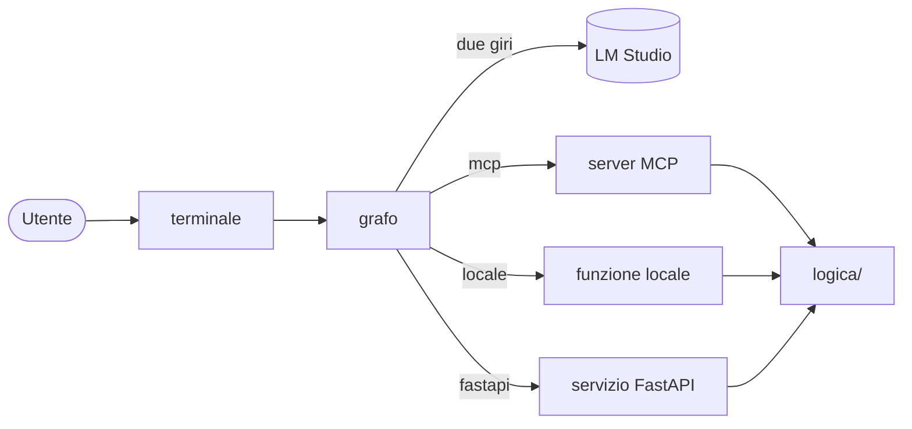
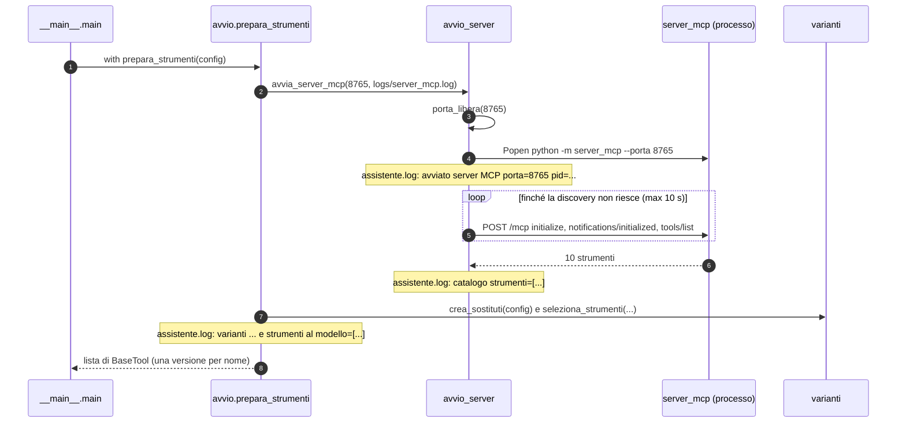
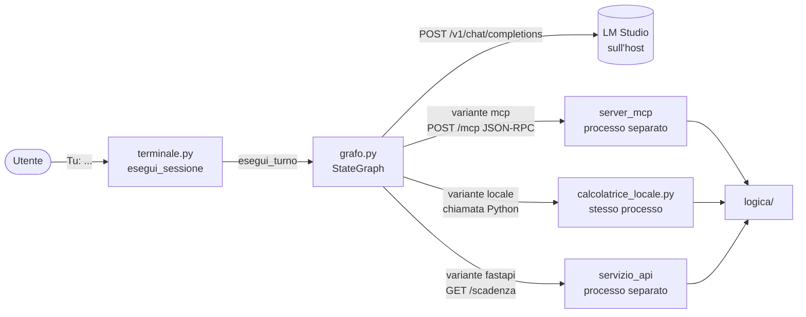
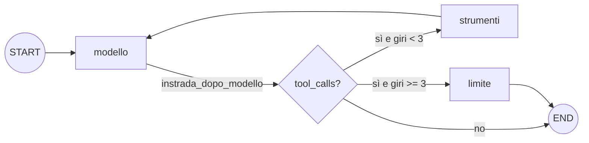
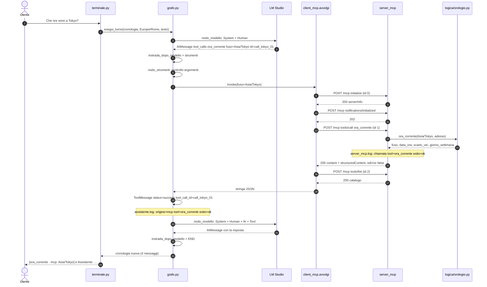
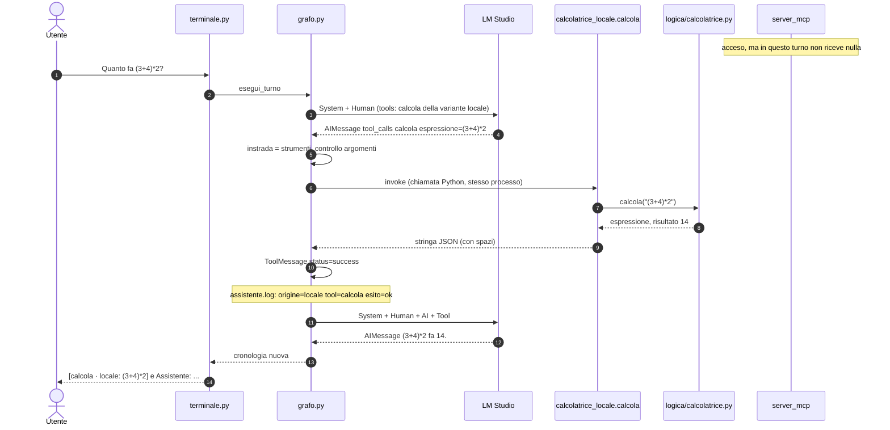
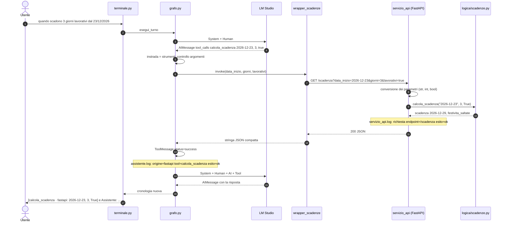
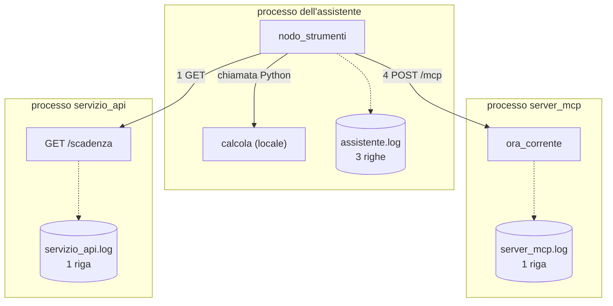

# 03 · Il viaggio di una richiesta

> Percorso di studio: [00 Indice](00-indice.md) · [01 Panoramica](01-panoramica-e-concetti.md) · [02 Architettura](02-architettura.md) · **03 Il viaggio di una richiesta** · [04 Il grafo](04-grafo-langgraph.md) · [05 MCP in pratica](05-mcp-in-pratica.md) · [06 Le tre varianti](06-tre-varianti.md) · [07 Gli strumenti](07-gli-strumenti.md) · [08 Configurazione e Docker](08-configurazione-avvio-docker.md) · [09 Test](09-test-e-verifiche.md) · [10 Log e diagnosi](10-log-e-diagnosi.md) · [11 Storia](11-storia-del-progetto.md) · [12 Glossario](12-glossario-e-domande.md)

## Scheda in 5 minuti

**Di che cosa parla.** Il capitolo segue tre domande vere, dal tasto Invio alla risposta stampata.
Ogni domanda usa un modo diverso di collegare lo strumento: MCP, locale, FastAPI. Serve a vedere
che il percorso è sempre lo stesso e che cambia un solo passo.

**Le idee chiave**

1. **Due giri del modello.** Al primo giro il modello non risponde: chiede uno strumento. Il
   programma lo esegue. Al secondo giro il modello legge il risultato e scrive la risposta.
   → sezione 1
2. **Il modello chiede, il programma esegue.** La richiesta è un `AIMessage` con `tool_calls`:
   nome, argomenti e un `id`. Il risultato torna in un `ToolMessage` con lo stesso `id`. Così il
   modello sa a quale richiesta risponde ogni risultato. → sezione 1
3. **Cambia solo il passo 5.** Terminale, grafo, controlli, log e stampa sono uguali per tutte le
   varianti. Cambia solo il modo in cui il nodo `strumenti` ottiene il risultato. → sezioni 1 e 6
4. **MCP: quattro richieste per una chiamata.** A ogni chiamata la libreria apre una sessione
   nuova: `initialize`, `notifications/initialized`, `tools/call` e infine `tools/list`. Il server
   è *stateless*: non ricorda nulla tra una richiesta e l'altra. → sezione 2.6
5. **Locale: nessuna rete.** La calcolatrice è una funzione Python, nello stesso processo
   dell'assistente. Il server MCP è acceso, ma in quel turno non riceve nulla. → sezione 3.4
6. **FastAPI: una sola richiesta GET.** Il wrapper mette gli argomenti nell'indirizzo e chiama
   `/scadenza`. Niente sessione e niente catalogo: è un normale servizio web. → sezioni 4.3 e 4.4
7. **I log sono la prova.** Ogni chiamata lascia una riga in `assistente.log` con la sua
   `origine`. Una risposta plausibile senza quella riga non prova che lo strumento sia stato usato.
   → sezioni 5 e 6

**Il quadro**



**Da sapere a memoria**

| Cosa | Valore | Dove |
|---|---|---|
| Giri di strumento per turno | al massimo 3 (`MAX_GIRI_STRUMENTO`) | `assistente/grafo.py:20` |
| Attesa massima di una chiamata MCP | 10 secondi (`TIMEOUT_CHIAMATA`) | `assistente/client_mcp.py:16` |
| Attesa massima del wrapper FastAPI | 5 secondi (`TIMEOUT_HTTP`) | `assistente/wrapper_scadenze.py:19` |
| L'unico punto asincrono | `asyncio.run(asyncio.wait_for(...))` | `assistente/client_mcp.py:62` |
| Modalità del server MCP | `stateless_http=True`, `json_response=True` | `server_mcp/__main__.py:45-46` |
| Righe `[strumento · origine: ...]` | solo per i `ToolMessage` con `status != "error"` | `assistente/terminale.py:32` |

**Se te lo chiedono all'orale**

- *Perché una chiamata MCP produce quattro richieste HTTP?* Per ogni chiamata la libreria apre e
  inizializza una sessione nuova. Dopo un risultato senza errore chiede anche `tools/list`, per
  controllare il risultato con lo schema dello strumento.
- *Con la variante locale, come dimostri che il server MCP non ha lavorato?* In `server_mcp.log`
  non c'è nessuna riga `tool=calcola`. La chiamata compare solo in `assistente.log`, con
  `origine=locale`.
- *Gli esempi del capitolo provano che il modello sa usare gli strumenti?* No: le risposte del
  modello sono preparate a mano. Provano che il programma tratta bene la richiesta; il modello lo
  verificano solo le prove reali con `--lmstudio`.

Per i dettagli continua con il resto del capitolo: le idee rimandano alle sezioni con «→ sezione N».

---

Questo documento segue **tre domande vere** dal momento in cui premi Invio nel terminale fino alla
risposta stampata. Per ogni passo trovi: il file e la funzione che lavorano, i messaggi che si
aggiungono alla cronologia, che cosa passa sul filo (JSON-RPC verso `/mcp`, `GET /scadenza`, la
richiesta a LM Studio), le righe che finiscono nei tre log e la riga che compare nel terminale.

| # | Domanda | Variante | Strumento | Dove gira lo strumento |
|---|---|---|---|---|
| 1 | «Che ore sono a Tokyo?» | MCP | `ora_corrente` | processo del server MCP |
| 2 | «Quanto fa (3+4)*2?» | locale | `calcola` | processo dell'assistente |
| 3 | «quando scadono 3 giorni lavorativi dal 23/12/2026» | FastAPI | `calcola_scadenza` | processo del servizio FastAPI |

Se ti serve prima il quadro generale, leggi [02 Architettura](02-architettura.md). Per i dettagli
del grafo (stato, reducer, limite) c'è [04](04-grafo-langgraph.md), per il protocollo MCP
[05](05-mcp-in-pratica.md), per il confronto ragionato delle varianti [06](06-tre-varianti.md).

## Indice del documento

- [Scheda in 5 minuti](#scheda-in-5-minuti)
- [Come sono stati ottenuti gli esempi](#come-sono-stati-ottenuti-gli-esempi)
- [0. Prima della prima domanda: che cosa è già pronto](#0-prima-della-prima-domanda-che-cosa-è-già-pronto)
- [1. La mappa comune a tutti e tre i viaggi](#1-la-mappa-comune-a-tutti-e-tre-i-viaggi)
- [2. Richiesta 1: «Che ore sono a Tokyo?» (variante MCP)](#2-richiesta-1--che-ore-sono-a-tokyo-variante-mcp)
- [3. Richiesta 2: «Quanto fa (3+4)*2?» (variante locale)](#3-richiesta-2--quanto-fa-342-variante-locale)
- [4. Richiesta 3: «quando scadono 3 giorni lavorativi dal 23/12/2026» (variante FastAPI)](#4-richiesta-3--quando-scadono-3-giorni-lavorativi-dal-23122026-variante-fastapi)
- [5. Le tre domande nella stessa sessione](#5-le-tre-domande-nella-stessa-sessione)
- [6. I tre viaggi a confronto](#6-i-tre-viaggi-a-confronto)
- [7. Come rifare gli esperimenti](#7-come-rifare-gli-esperimenti)
- [8. Domande di ripasso](#8-domande-di-ripasso)
- [Scaletta per le slide](#scaletta-per-le-slide)

---

## Come sono stati ottenuti gli esempi

Tutti i messaggi, i corpi JSON e le righe di log riportati qui sono **stati prodotti eseguendo il
codice del progetto**, non scritti a mano. Sono simulate solo le parti che richiederebbero
LM Studio, porte aperte o la rete:

| Parte | Nel programma vero | Nell'esperimento |
|---|---|---|
| Modello | LM Studio tramite `ChatOpenAI` (`assistente/modello.py:79-87`) | `ModelloFinto` di `tests/finti.py`, con le risposte preparate |
| Server MCP | processo `python -m server_mcp --porta 8765` | lo stesso `crea_server()` montato come app ASGI in memoria, con le stesse opzioni di `server_mcp/__main__.py:39-48` (`path="/mcp"`, `stateless_http=True`, `json_response=True`) e un archivio delle note temporaneo |
| Client MCP | `scopri_strumenti` + `avvolgi` (`assistente/client_mcp.py`) | lo stesso `MultiServerMCPClient` e lo stesso `avvolgi`, con un trasporto httpx che consegna ogni richiesta all'app in memoria e la annota |
| Servizio FastAPI | processo `python -m servizio_api --porta 8766` | lo stesso `crea_app()` dentro un `TestClient` di Starlette, passato al wrapper con il parametro `http` |
| Ora | `ora_utc()`, l'ora reale | istante fisso **2026-11-08 10:30:00 UTC**, iniettato con `adesso` |
| Fuso dell'utente | rilevato da `rileva_fuso` | fissato a `Europe/Rome` (su Windows il rilevamento dà spesso `Europe/Berlin`, che ha la stessa ora: vedi README, «Diagnosi») |

Grafo, nodi, instradamento, controlli degli argomenti, ponte MCP, wrapper, logica degli strumenti,
terminale e formato dei log sono il codice reale. Nessuna porta è stata aperta: `127.0.0.1:8765` e
`127.0.0.1:8766` compaiono negli URL solo come etichette, le richieste non escono dal processo.
Gli script stanno fuori dal progetto, nella cartella temporanea
`scratchpad\studio\03-viaggio-di-una-richiesta\` (`viaggio.py`, `payload.py`, `payload_mcp.py`).

> **Attenzione (regola del `CLAUDE.md`)**: le risposte del modello qui sono preparate. Dimostrano
> che il programma tratta correttamente una richiesta di strumento; **non** dimostrano che il
> modello locale sappia chiederla. Questo lo verificano solo le prove reali con `--lmstudio`
> (vedi [09 Test e verifiche](09-test-e-verifiche.md)).

---

## 0. Prima della prima domanda: che cosa è già pronto

Quando compare il prompt `Tu: `, `main()` (`assistente/__main__.py:20`) ha già fatto tutto questo:

| Ordine | File:riga | Che cosa succede |
|---|---|---|
| 1 | `__main__.py:21` | `configura_flussi()`: se ingresso o uscita sono una pipe o un file, li passa a UTF-8 (`console.py:13-19`) |
| 2 | `__main__.py:23-24` | `load_dotenv(override=False)` e `carica_configurazione(os.environ)`: legge il `.env` e convalida porte e varianti |
| 3 | `__main__.py:25` | `configura_registro(LOG_ASSISTENTE)`: il logger `assistente` scrive in `logs/assistente.log` |
| 4 | `__main__.py:26` | `verifica_server`: `GET {LMSTUDIO_BASE_URL}/models`; il modello configurato deve essere nell'elenco |
| 5 | `__main__.py:27` | `rileva_fuso`: il fuso dell'utente, deciso **una volta sola** per tutta la sessione |
| 6 | `__main__.py:28` → `avvio.py:22` | `prepara_strumenti`: avvia il server MCP (e, con `fastapi`, il servizio), sceglie le varianti |
| 7 | `__main__.py:29` | `crea_grafo(crea_modello(config, strumenti), strumenti)`: il modello è già **legato** agli strumenti con `bind_tools` (`modello.py:87`) |
| 8 | `__main__.py:30` | `esegui_sessione(...)`: parte il ciclo di chat (`terminale.py:41`) |

Il passo 6 è il più ricco. `avvia_server_mcp` (`avvio_server.py:154-170`) controlla che la porta sia
libera, lancia il processo con `subprocess.Popen` con uscita standard ed errori diretti nel file
`logs/server_mcp.log` (`avvio_server.py:105-113`) e poi riprova la **discovery** finché non riesce o
finché non scadono 10 secondi (`avvio_server.py:115-127`, `161-162`). Un processo acceso o un HTTP
200 non bastano: il server è pronto solo quando `tools/list` risponde con il catalogo.

Sul filo una discovery sono tre `POST http://127.0.0.1:8765/mcp` (traffico registrato
nell'esperimento):

| # | Metodo JSON-RPC | `id` | Intestazioni rilevanti | Risposta HTTP |
|---|---|---|---|---|
| 1 | `initialize` | 0 | `accept: application/json, text/event-stream`, `content-type: application/json` | 200, con `serverInfo: {"name": "Strumenti laboratorio", "version": "3.4.11"}` |
| 2 | `notifications/initialized` | nessuno (è una notifica) | in più `mcp-protocol-version: 2025-11-25` | 202, corpo vuoto |
| 3 | `tools/list` | 1 | `mcp-protocol-version: 2025-11-25` | 200, dieci strumenti con `name`, `description`, `inputSchema`, `outputSchema` |



Righe che l'avvio lascia in `logs/assistente.log` (formato `%(asctime)s %(message)s` con data
`%Y-%m-%d %H:%M:%S`, `registro.py:35`). Il testo è quello del codice; orari e `pid` sono indicativi,
perché nell'esperimento non c'è un processo separato:

```text
2026-11-09 10:00:00 avviato server MCP porta=8765 pid=12345
2026-11-09 10:00:01 catalogo strumenti=['converti_unita', 'ora_corrente', 'calcola', 'calcola_scadenza', 'search_catalog', 'get_item', 'add_note', 'list_notes', 'delete_note', 'get_weather']
2026-11-09 10:00:01 varianti calcolatrice=mcp scadenze=mcp
2026-11-09 10:00:01 strumenti al modello=['converti_unita', 'ora_corrente', 'calcola', 'calcola_scadenza', 'search_catalog', 'get_item', 'add_note', 'list_notes', 'delete_note', 'get_weather']
```

Vengono da `avvio_server.py:114`, `avvio_server.py:169`, `avvio.py:41-43` e `avvio.py:45`. Le
liste hanno gli apici singoli perché sono stampate con `%s` di Python, non come JSON. In
`logs/server_mcp.log` il server scrive `INFO server_mcp avvio server porta=8765`
(`server_mcp/__main__.py:35`). All'uscita compaiono `spento server MCP codice=0` nell'assistente
(`avvio_server.py:138`) e `INFO server_mcp arresto server` nel server (`server_mcp/__main__.py:52`).

La mappa dei collegamenti che userai nei tre viaggi:



---

## 1. La mappa comune a tutti e tre i viaggi

Qualunque sia la variante, il viaggio ha sempre la stessa forma. Cambia **solo** il passo 5, cioè
il modo in cui il nodo `strumenti` ottiene il risultato.

| Passo | File e funzione | Che cosa succede |
|---|---|---|
| 1 | `terminale.py:63` `esegui_sessione` | `leggi("Tu: ")`, tolti BOM e spazi; riga vuota ignorata, `esci` chiude |
| 2 | `terminale.py:72` → `grafo.py:214` `esegui_turno` | costruisce lo stato iniziale e chiama `grafo.invoke` |
| 3 | `grafo.py:145` `nodo_modello` | primo giro: il modello chiede uno strumento (`AIMessage` con `tool_calls`) |
| 4 | `grafo.py:132` `instrada_dopo_modello` | ci sono `tool_calls` e `giri_strumento < 3` → `"strumenti"` |
| 5 | `grafo.py:149` `nodo_strumenti` | controlla gli argomenti, esegue lo strumento, crea il `ToolMessage`, scrive il log |
| 6 | `grafo.py:145` `nodo_modello` | secondo giro: il modello legge il risultato e risponde |
| 7 | `grafo.py:132` `instrada_dopo_modello` | nessuna `tool_calls` → `END` |
| 8 | `terminale.py:80-84` | stampa una riga `[strumento · origine: valori]` per ogni chiamata riuscita, poi la risposta |



### I messaggi che incontrerai

| Tipo | Chi lo crea | Campi importanti | Resta nella cronologia? |
|---|---|---|---|
| `SystemMessage` | `messaggio_sistema(fuso)` (`grafo.py:35-54`) | le regole, con il fuso dell'utente | **no**: viene ricreato e anteposto a ogni chiamata del modello (`grafo.py:146`) |
| `HumanMessage` | `esegui_turno` (`grafo.py:218`) | `content` = il testo scritto | sì |
| `AIMessage` con `tool_calls` | il modello | `content` vuoto, `tool_calls=[{name, args, id, type}]` | sì |
| `ToolMessage` | `nodo_strumenti` (`grafo.py:180-185`) | `content` (stringa JSON), `tool_call_id`, `name`, `status` (`success`/`error`) | sì |
| `AIMessage` finale | il modello | `content` = la risposta | sì |

Il **`tool_call_id`** del `ToolMessage` deve essere uguale all'`id` della richiesta nell'`AIMessage`:
è così che il modello sa a quale richiesta risponde ogni risultato. Lo **`status`** invece non viene
mandato a LM Studio (lo vedrai nel corpo della richiesta, sezione 3.3): serve al programma, per la
riga del terminale (`terminale.py:32`) e, indirettamente, per il campo `esito` del log.

### Come si legge una riga di `assistente.log`

Ogni chiamata a uno strumento produce una riga scritta da `_registra` (`grafo.py:106-119`) con il
formato `chiave=valore` di `formatta` (`registro.py:14-23`): le stringhe così come sono (con gli a
capo trasformati in spazi), gli altri valori come JSON compatto.

| Campo | Da dove viene | Valori possibili |
|---|---|---|
| `origine` | `strumento.metadata["origine"]` (`grafo.py:157`) | `mcp`, `locale`, `fastapi`, `sconosciuta` |
| `tool` | `chiamata["name"]` | il nome chiesto dal modello |
| `call_id` | `chiamata["id"]`, deciso dal server del modello | per esempio `call_tokyo_01` |
| `argomenti` | `chiamata["args"]` (dizionario → JSON compatto) | `{"fuso":"Asia/Tokyo"}` |
| `esito` | `_esito(contenuto)` (`grafo.py:66-74`) o i controlli del nodo | `ok`, `errore_tool`, `errore_collegamento`, `strumento_sconosciuto`, `limite` |
| `risultato` | la stringa restituita dallo strumento, **così com'è** | JSON del risultato o dell'errore |
| `tool_message.call_id` | `ToolMessage.tool_call_id` | deve coincidere con `call_id` |

---

## 2. Richiesta 1 · «Che ore sono a Tokyo?» (variante MCP)

Configurazione: `VARIANTE_CALCOLATRICE=mcp`, `VARIANTE_SCADENZE=mcp`. Tutti e dieci gli strumenti
arrivano al modello dal server MCP:

```text
Strumenti: converti_unita (mcp), ora_corrente (mcp), calcola (mcp), calcola_scadenza (mcp), search_catalog (mcp), get_item (mcp), add_note (mcp), list_notes (mcp), delete_note (mcp), get_weather (mcp)
```

### 2.1 Il terminale legge la domanda

`esegui_sessione` (`terminale.py:63`) chiama `leggi("Tu: ")`, che nel programma vero è la funzione
`input`. Al testo vengono tolti il BOM (che può arrivare da una pipe di PowerShell) e gli spazi.
Non è vuoto e non è `esci`, quindi si passa a `esegui_turno(grafo, cronologia, fuso.fuso, testo)`
(`terminale.py:72`). Al primo turno `cronologia` è una lista vuota (`terminale.py:59`).

### 2.2 `esegui_turno` costruisce lo stato

`grafo.py:216-222`. Lo stato iniziale, così come è arrivato a `grafo.invoke` nell'esperimento:

```json
{
  "messages": [{"tipo": "HumanMessage", "content": "Che ore sono a Tokyo?"}],
  "fuso_utente": "Europe/Rome",
  "giri_strumento": 0
}
```

`giri_strumento` riparte da 0 a ogni turno: il limite di 3 vale **per turno**, non per sessione.
La lista `cronologia` del terminale non viene modificata: `esegui_turno` crea una lista nuova e
restituisce la cronologia completa alla fine (`grafo.py:223`). Il grafo non ha un checkpointer: la
memoria della conversazione è proprio questa lista, che il terminale ripassa a ogni turno.

### 2.3 Primo giro del modello: la richiesta di strumento

`nodo_modello` (`grafo.py:145-147`) chiama `modello.invoke([SystemMessage, HumanMessage])`.
Nell'esperimento il modello finto ha registrato esattamente questa sequenza di tipi:
`["SystemMessage", "HumanMessage"]`.

Nel programma vero `modello` è `ChatOpenAI(...).bind_tools(strumenti)` (`modello.py:79-87`, con
`timeout=120` e `max_retries=1`), e `invoke` diventa una richiesta HTTP
`POST http://localhost:1234/v1/chat/completions`. Il corpo, ottenuto chiamando il metodo interno di
`ChatOpenAI` che lo costruisce **senza inviarlo** (script `payload_mcp.py`), ha quattro chiavi:
`model`, `stream` (`false`), `tools` e `messages`. In `tools` ci sono dieci elementi, uno per
strumento, nell'ordine del catalogo; quello dell'orologio è:

```json
{"type": "function",
 "function": {
   "name": "ora_corrente",
   "description": "Restituisce data e ora attuali nel fuso orario indicato. `fuso`: nome IANA, per esempio \"Europe/Rome\" o \"Asia/Tokyo\".",
   "parameters": {"additionalProperties": false,
                  "properties": {"fuso": {"description": "Nome IANA del fuso, per esempio Europe/Rome o Asia/Tokyo",
                                          "type": "string"}},
                  "required": ["fuso"], "type": "object"}}}
```

Nome, descrizione e schema sono **quelli ricevuti dal server** con `tools/list`: `avvolgi` li copia
senza riscriverli (`client_mcp.py:71-77`). Il messaggio di sistema completo, con il fuso già
inserito, è il primo elemento di `messages`:

```text
Sei un assistente utile. Rispondi nella lingua in cui scrive l'utente.
Per conoscere la data o l'ora usa sempre lo strumento ora_corrente: non inventarle e non dedurle dai messaggi precedenti.
Il fuso orario dell'utente è Europe/Rome: usalo quando l'utente non indica un altro luogo o fuso.
Se l'utente indica un luogo, passa allo strumento il nome IANA del fuso corrispondente (per esempio Asia/Tokyo per Tokyo).
Per conversioni di unità e altri calcoli usa sempre lo strumento adatto tra quelli disponibili: non farli a mente.
...(seguono le regole su azioni dichiarate, catalogo, note e meteo)
```

La risposta del modello, convertita da LangChain, è un `AIMessage` come questo:

```json
{
  "tipo": "AIMessage",
  "content": "",
  "tool_calls": [
    {"name": "ora_corrente", "args": {"fuso": "Asia/Tokyo"}, "id": "call_tokyo_01", "type": "tool_call"}
  ]
}
```

Due osservazioni da orale:

- il modello traduce «Tokyo» in `Asia/Tokyo` perché il messaggio di sistema glielo chiede
  (`grafo.py:41-42`) e perché la descrizione dello strumento lo suggerisce
  (`server_mcp/server.py:47-50`). Il programma non fa nessuna traduzione da città a fuso;
- l'`id` (`call_tokyo_01` nell'esperimento) lo genera **il server del modello**, non il programma.

### 2.4 L'instradamento

`instrada_dopo_modello` (`grafo.py:132-138`): l'ultimo messaggio ha `tool_calls` e
`giri_strumento` vale 0 (minore di `MAX_GIRI_STRUMENTO = 3`, `grafo.py:20`), quindi la funzione
restituisce `"strumenti"`.

### 2.5 Il nodo `strumenti` prepara la chiamata

`nodo_strumenti` (`grafo.py:149-189`), per ogni elemento di `tool_calls`:

1. cerca lo strumento per nome nel dizionario `per_nome` (`grafo.py:143`, `152`): trovato;
2. legge l'origine dai metadati: `"mcp"`, messa da `avvolgi` (`client_mcp.py:76`);
3. **controllo dell'host prima di eseguire** (`grafo.py:159-172`): argomenti obbligatori mancanti
   (`_argomenti_mancanti`, `grafo.py:82-85`) o non previsti dallo schema (`_argomenti_in_piu`,
   `grafo.py:88-99`). Lo schema richiede solo `fuso` e la richiesta contiene solo `fuso`: si va avanti.
   Il controllo serve perché, per uno strumento con schema dato come dizionario JSON (come quelli
   MCP), LangChain non convalida gli argomenti: li passa così come sono;
4. `strumento.invoke({"fuso": "Asia/Tokyo"})` (`grafo.py:175`).

Lo strumento è il **tool sincrono** costruito da `avvolgi` (`client_mcp.py:57-77`). La sua funzione
`esegui` fa:

```python
contenuto = asyncio.run(asyncio.wait_for(strumento.ainvoke(argomenti), timeout))
```

(`client_mcp.py:62`). Qui il mondo sincrono del grafo entra in quello asincrono della libreria
`langchain-mcp-adapters`, con un limite di 10 secondi (`TIMEOUT_CHIAMATA`, `client_mcp.py:16`). È
l'**unico punto asincrono** dell'assistente.

### 2.6 Sul filo: quattro `POST /mcp`

Gli strumenti ottenuti con `client.get_tools()` non conservano una sessione MCP aperta: per **ogni**
chiamata la libreria apre una sessione nuova, la inizializza e poi chiama lo strumento. Il traffico
registrato durante il turno, tutto verso `http://127.0.0.1:8765/mcp`:

| # | Metodo JSON-RPC | `id` | Intestazioni rilevanti | Risposta |
|---|---|---|---|---|
| 1 | `initialize` | 0 | `accept: application/json, text/event-stream`, `content-type: application/json` | 200, JSON |
| 2 | `notifications/initialized` | — | in più `mcp-protocol-version: 2025-11-25` | 202, corpo vuoto |
| 3 | `tools/call` | 1 | `mcp-protocol-version: 2025-11-25` | 200, JSON |
| 4 | `tools/list` | 2 | `mcp-protocol-version: 2025-11-25` | 200, JSON con i dieci strumenti |

Non c'è nessuna intestazione `mcp-session-id`: il server gira in modalità **stateless**
(`stateless_http=True`, `server_mcp/__main__.py:45`) e ogni richiesta HTTP è indipendente. Con
`json_response=True` (`server_mcp/__main__.py:46`) le risposte sono JSON semplice
(`content-type: application/json`), non uno stream SSE.

**1 · `initialize`** (richiesta):

```json
{"method": "initialize",
 "params": {"protocolVersion": "2025-11-25", "capabilities": {},
            "clientInfo": {"name": "mcp", "version": "0.1.0"}},
 "jsonrpc": "2.0", "id": 0}
```

La risposta dichiara la versione del protocollo, le capacità del server (`tools`, `resources`,
`prompts`, `logging`) e `"serverInfo": {"name": "Strumenti laboratorio", "version": "3.4.11"}`: il
nome viene da `NOME_SERVER` (`server_mcp/server.py:31`), la versione è quella di FastMCP.

**3 · `tools/call`**, la chiamata vera e propria:

```json
{"method": "tools/call",
 "params": {"name": "ora_corrente", "arguments": {"fuso": "Asia/Tokyo"}},
 "jsonrpc": "2.0", "id": 1}
```

Risposta:

```json
{"jsonrpc": "2.0", "id": 1,
 "result": {
   "content": [{"type": "text",
                "text": "{\"fuso\":\"Asia/Tokyo\",\"data_ora\":\"2026-11-08T19:30:00+09:00\",\"scarto_utc\":\"+09:00\",\"giorno_settimana\":\"domenica\"}"}],
   "structuredContent": {"fuso": "Asia/Tokyo", "data_ora": "2026-11-08T19:30:00+09:00",
                         "scarto_utc": "+09:00", "giorno_settimana": "domenica"},
   "isError": false}}
```

Il risultato viaggia **due volte**: come testo (`content`) e come oggetto (`structuredContent`).
L'assistente usa il testo.

**4 · `tools/list` dopo la chiamata.** Non lo chiede il nostro codice: è la libreria `mcp`
(versione 1.30.0, `ClientSession.call_tool`) che, dopo un risultato **senza errore**, vuole
confrontare `structuredContent` con l'`outputSchema` dello strumento. La sessione è nuova e non ha
gli schemi in memoria, quindi li richiede. Dopo un errore (`isError: true`) questa richiesta non
parte (lo vedrai nella sezione 2.13).

> Il `call_id` del modello (`call_tokyo_01`) **non arriva al server**: sul filo l'identificativo è
> l'`id` JSON-RPC (qui 1), che ricomincia da 0 a ogni sessione. Per questo il README dice che le due
> tracce di log si confrontano per strumento, argomenti e ora.

### 2.7 Dentro il server MCP

Nel processo del server, FastMCP riceve `tools/call` e chiama la funzione registrata
`ora_corrente_mcp` (`server_mcp/server.py:140-146`):

```python
return esegui_registrato(NOME_OROLOGIO, {"fuso": fuso}, lambda: ora_corrente(fuso, adesso()))
```

`esegui_registrato` (`server_mcp/server.py:98-109`) esegue la logica pura
`logica.orologio.ora_corrente` (`logica/orologio.py:33-43`): il fuso è un nome IANA valido
(`è_fuso_valido`, `logica/orologio.py:17-19`), l'istante viene convertito con
`ZoneInfo("Asia/Tokyo")` e si costruisce il dizionario con `fuso`, `data_ora`, `scarto_utc` e
`giorno_settimana`. Poi `esegui_registrato` scrive la riga di log e restituisce il dizionario;
FastMCP lo trasforma in `content` + `structuredContent`.

Il calcolo, con l'istante dell'esperimento: 10:30 UTC + 9 ore = **19:30** di domenica a Tokyo.

### 2.8 Il ritorno nel ponte

L'adattatore converte il risultato MCP in blocchi di contenuto LangChain
(`[{"type": "text", "text": "{...}"}]`). `_testo` (`client_mcp.py:42-54`) concatena i blocchi di
testo ed `esegui` restituisce una semplice **stringa**. Se qualcosa va storto, `esegui` non solleva
eccezioni verso il grafo ma restituisce un JSON d'errore (`client_mcp.py:63-68`):

| Che cosa succede | Stringa restituita | `esito` nel log |
|---|---|---|
| il server risponde `isError: true` (l'adattatore solleva `ToolException`) | `{"errore": "<messaggio del server>", "tipo": "strumento"}` | `errore_tool` |
| nessuna risposta entro 10 s | `{"errore": "Server MCP: nessuna risposta entro 10 secondi.", "tipo": "collegamento"}` | `errore_collegamento` |
| server spento o caduto | `{"errore": "Server MCP non raggiungibile: ...", "tipo": "collegamento"}` | `errore_collegamento` |

### 2.9 Il `ToolMessage` e la riga di `assistente.log`

Tornato in `nodo_strumenti`, `_esito(contenuto)` (`grafo.py:66-74`) legge la stringa: è JSON ma non
ha la chiave `errore`, quindi l'esito è `ok` e lo `status` sarà `success`. Si costruisce il
messaggio (`grafo.py:180-185`):

```json
{
  "tipo": "ToolMessage",
  "content": "{\"fuso\":\"Asia/Tokyo\",\"data_ora\":\"2026-11-08T19:30:00+09:00\",\"scarto_utc\":\"+09:00\",\"giorno_settimana\":\"domenica\"}",
  "tool_call_id": "call_tokyo_01",
  "name": "ora_corrente",
  "status": "success"
}
```

e `_registra` (`grafo.py:106-119`) scrive in `logs/assistente.log`:

```text
2026-11-09 04:23:51 origine=mcp tool=ora_corrente call_id=call_tokyo_01 argomenti={"fuso":"Asia/Tokyo"} esito=ok risultato={"fuso":"Asia/Tokyo","data_ora":"2026-11-08T19:30:00+09:00","scarto_utc":"+09:00","giorno_settimana":"domenica"} tool_message.call_id=call_tokyo_01
```

`call_id` e `tool_message.call_id` coincidono: è la prova scritta che il risultato è stato
collegato alla richiesta giusta. Il nodo restituisce
`{"messages": [ToolMessage], "giri_strumento": 1}` (`grafo.py:189`); il reducer `add_messages`
accoda il messaggio alla lista dello stato.

Intanto, nel processo del server, `logs/server_mcp.log` ha ricevuto queste righe (formato
`%(asctime)s %(levelname)s %(name)s %(message)s`, `server_mcp/__main__.py:31-33`):

```text
2026-11-09 04:23:51,689 INFO mcp.server.streamable_http Terminating session: None
2026-11-09 04:23:51,691 INFO mcp.server.streamable_http Terminating session: None
2026-11-09 04:23:51,696 INFO mcp.server.lowlevel.server Processing request of type CallToolRequest
2026-11-09 04:23:51,700 INFO server_mcp chiamata tool=ora_corrente argomenti={"fuso":"Asia/Tokyo"} esito=ok risultato={"fuso":"Asia/Tokyo","data_ora":"2026-11-08T19:30:00+09:00","scarto_utc":"+09:00","giorno_settimana":"domenica"}
2026-11-09 04:23:51,701 INFO mcp.server.streamable_http Terminating session: None
2026-11-09 04:23:51,703 INFO mcp.server.lowlevel.server Processing request of type ListToolsRequest
2026-11-09 04:23:51,704 INFO mcp.server.streamable_http Terminating session: None
```

La riga che conta è quella di `server_mcp`, scritta dal **nostro** codice
(`server_mcp/server.py:108`). Le altre sono della libreria `mcp`: una `Terminating session: None`
per ognuna delle quattro richieste HTTP (modalità stateless, nessuna sessione da conservare) e una
`Processing request of type ...` per le richieste `tools/call` e `tools/list`. Finiscono nello stesso
file perché il server registra a livello INFO su stderr e l'assistente dirige stderr nel log
(`avvio_server.py:109-110`). Le righe della libreria possono cambiare con la sua versione; quelle
`chiamata tool=...` no. Non ci sono righe di accesso HTTP perché uvicorn gira con
`log_level="warning"` (`server_mcp/__main__.py:47`).

### 2.10 Secondo giro del modello e risposta

Il grafo torna a `modello` (arco fisso `strumenti → modello`, `grafo.py:209`). Ora il modello
riceve quattro messaggi, `["SystemMessage", "HumanMessage", "AIMessage", "ToolMessage"]`, che nel
corpo per LM Studio diventano (dopo il messaggio di sistema):

```json
[{"role": "user", "content": "Che ore sono a Tokyo?"},
 {"role": "assistant", "content": null,
  "tool_calls": [{"type": "function", "id": "call_tokyo_01",
                  "function": {"name": "ora_corrente", "arguments": "{\"fuso\": \"Asia/Tokyo\"}"}}]},
 {"role": "tool", "tool_call_id": "call_tokyo_01",
  "content": "{\"fuso\":\"Asia/Tokyo\",\"data_ora\":\"2026-11-08T19:30:00+09:00\",\"scarto_utc\":\"+09:00\",\"giorno_settimana\":\"domenica\"}"}]
```

Il modello legge il risultato e risponde:

```json
{"tipo": "AIMessage", "content": "A Tokyo sono le 19:30 di domenica 8 novembre 2026."}
```

`instrada_dopo_modello` non trova `tool_calls` → `END`. `grafo.invoke` restituisce lo stato finale
con quattro messaggi e `giri_strumento: 1`. La sequenza dei nodi eseguiti, osservata con
`grafo.stream(..., stream_mode="updates")`:

| Nodo | Messaggi aggiunti | `giri_strumento` aggiornato |
|---|---|---|
| `modello` | `AIMessage` (con `tool_calls`) | — |
| `strumenti` | `ToolMessage` | 1 |
| `modello` | `AIMessage` (risposta) | — |

### 2.11 Il terminale stampa

`esegui_sessione` riceve la nuova cronologia e considera solo i messaggi di questo turno,
`nuova[len(cronologia):]` (`terminale.py:80`). `_righe_strumenti` (`terminale.py:20-38`) abbina ogni
`ToolMessage` con `status != "error"` alla sua richiesta tramite `tool_call_id` e stampa nome,
origine e valori degli argomenti nell'ordine dello schema (`_valori`, `terminale.py:14-17`; l'ordine
viene da `parametri(strumenti)`, `varianti.py:46-48`). Poi `cronologia = nuova` (`terminale.py:82`)
e la risposta, cioè il testo dell'ultimo `AIMessage` (`terminale.py:83-84`). Sessione completa
dell'esperimento:

```text
Assistente del laboratorio
Fuso orario: Europe/Rome (computer locale)
Strumenti: converti_unita (mcp), ora_corrente (mcp), calcola (mcp), calcola_scadenza (mcp), search_catalog (mcp), get_item (mcp), add_note (mcp), list_notes (mcp), delete_note (mcp), get_weather (mcp)
Scrivi «esci» o premi Ctrl+C per uscire.
Tu: Che ore sono a Tokyo?
[ora_corrente · mcp: Asia/Tokyo]
Assistente: A Tokyo sono le 19:30 di domenica 8 novembre 2026.
Tu: esci
Arrivederci.
```

Con l'ingresso da una pipe, come nell'esempio del README, il testo letto non viene ripetuto a video
e si vede `Tu: [ora_corrente · mcp: Asia/Tokyo]` sulla stessa riga. Se il turno fallisce con
un'eccezione (per esempio LM Studio chiuso a metà sessione), il terminale stampa `Errore: ...` e la
cronologia **resta quella di prima**: la domanda fallita non viene conservata (`terminale.py:75-78`).

### 2.12 Il diagramma completo



### 2.13 Variante con errore: il modello sbaglia il fuso

Che cosa succede se il modello scrive `Asia/Tokio` invece di `Asia/Tokyo`? Nell'esperimento il
modello finto prima sbaglia, poi si corregge.

Sul filo, la prima `tools/call` riceve:

```json
{"jsonrpc": "2.0", "id": 1,
 "result": {"content": [{"type": "text",
   "text": "Fuso orario sconosciuto: 'Asia/Tokio'. Usa un nome IANA, per esempio 'Europe/Rome'."}],
   "isError": true}}
```

Arriva con HTTP 200: per MCP l'errore dello **strumento** è un risultato con `isError: true`, non un
errore del protocollo. Dopo questa risposta non parte nessun `tools/list` (il traffico del turno è
`initialize`, `notifications/initialized`, `tools/call` per il tentativo sbagliato, poi
`initialize`, `notifications/initialized`, `tools/call`, `tools/list` per quello giusto). Nel
server, `logica.orologio.ora_corrente` ha sollevato `ErroreStrumento`; `esegui_registrato` l'ha
registrata e trasformata in `ToolError` (`server_mcp/server.py:102-104`). FastMCP scrive in più,
sul proprio canale d'errore (stderr, quindi nello stesso file di log), una riga
`Error calling tool 'ora_corrente'`.

Nell'assistente l'adattatore solleva `ToolException`, `avvolgi` la cattura e restituisce il JSON
d'errore con `"tipo": "strumento"`. La cronologia del turno diventa:

| # | Messaggio | Dettagli |
|---|---|---|
| 1 | `HumanMessage` | «Che ore sono a Tokyo?» |
| 2 | `AIMessage` | `tool_calls`: `ora_corrente`, `{"fuso": "Asia/Tokio"}`, `id=call_err_01` |
| 3 | `ToolMessage` | `{"errore": "Fuso orario sconosciuto: 'Asia/Tokio'. Usa un nome IANA, per esempio 'Europe/Rome'.", "tipo": "strumento"}`, `tool_call_id=call_err_01`, **`status=error`** |
| 4 | `AIMessage` | `tool_calls`: `ora_corrente`, `{"fuso": "Asia/Tokyo"}`, `id=call_err_02` |
| 5 | `ToolMessage` | il risultato corretto, `tool_call_id=call_err_02`, `status=success` |
| 6 | `AIMessage` | la risposta finale |

`giri_strumento` finale: **2**; il modello è stato chiamato tre volte. I log:

```text
# logs/assistente.log
2026-11-09 04:23:57 origine=mcp tool=ora_corrente call_id=call_err_01 argomenti={"fuso":"Asia/Tokio"} esito=errore_tool risultato={"errore": "Fuso orario sconosciuto: 'Asia/Tokio'. Usa un nome IANA, per esempio 'Europe/Rome'.", "tipo": "strumento"} tool_message.call_id=call_err_01
2026-11-09 04:23:57 origine=mcp tool=ora_corrente call_id=call_err_02 argomenti={"fuso":"Asia/Tokyo"} esito=ok risultato={"fuso":"Asia/Tokyo",...} tool_message.call_id=call_err_02

# logs/server_mcp.log (solo le righe del nostro codice)
2026-11-09 04:23:57,733 INFO server_mcp chiamata tool=ora_corrente argomenti={"fuso":"Asia/Tokio"} esito=errore messaggio=Fuso orario sconosciuto: 'Asia/Tokio'. Usa un nome IANA, per esempio 'Europe/Rome'.
2026-11-09 04:23:57,744 INFO server_mcp chiamata tool=ora_corrente argomenti={"fuso":"Asia/Tokyo"} esito=ok risultato={...}
```

Nel terminale c'è **una sola** riga `[ora_corrente · mcp: Asia/Tokyo]`: le chiamate fallite non
vengono stampate (`terminale.py:32`). Se il modello avesse continuato a sbagliare, dopo il terzo giro
di strumento `instrada_dopo_modello` avrebbe scelto `limite` e il turno si sarebbe chiuso con il
testo `TESTO_LIMITE` (`grafo.py:21-23`, `191-201`): vedi [04](04-grafo-langgraph.md).

---

## 3. Richiesta 2 · «Quanto fa (3+4)*2?» (variante locale)

Configurazione: `VARIANTE_CALCOLATRICE=locale` (scadenze ancora `mcp`).

### 3.1 Che cosa cambia all'avvio

Il server MCP parte lo stesso e la discovery restituisce ancora dieci strumenti, `calcola`
compreso: il server espone sempre tutto. La scelta la fa l'assistente, che qui fa da **host**:

1. `crea_sostituti(config)` (`varianti.py:17-29`) crea la calcolatrice locale con
   `crea_calcolatrice_locale()` (`calcolatrice_locale.py:22-34`): una funzione Python decorata con
   `@tool`, con `metadata = {"origine": "locale"}` (`calcolatrice_locale.py:33`);
2. `seleziona_strumenti` (`varianti.py:32-43`) **toglie** dai remoti lo strumento con lo stesso nome
   e **accoda** il sostituto; poi controlla che nessun nome compaia due volte (altrimenti
   `ErroreAvvio`).

Per questo `calcola` passa in fondo alla riga di benvenuto:

```text
Strumenti: converti_unita (mcp), ora_corrente (mcp), calcola_scadenza (mcp), search_catalog (mcp), get_item (mcp), add_note (mcp), list_notes (mcp), delete_note (mcp), get_weather (mcp), calcola (locale)
```

In `assistente.log` le righe d'avvio diventano `varianti calcolatrice=locale scadenze=mcp` e
`strumenti al modello=[..., 'get_weather', 'calcola']`.

### 3.2 I passi 1-4: identici

Terminale, `esegui_turno`, primo giro del modello, instradamento: come nella richiesta 1. Il modello
non sa e non deve sapere quale variante sta usando: vede lo **stesso** nome, la stessa descrizione e
lo stesso schema (lo verificano `test_contratto_identico` e `test_schema_identico_a_quello_mcp` in
`tests/test_calcolatrice_locale.py`, vedi [06](06-tre-varianti.md)). La sua richiesta:

```json
{"tipo": "AIMessage", "content": "",
 "tool_calls": [{"name": "calcola", "args": {"espressione": "(3+4)*2"}, "id": "call_calc_01", "type": "tool_call"}]}
```

### 3.3 Che cosa vede LM Studio (corpo della richiesta)

Questo è il corpo che `ChatOpenAI` costruirebbe per `POST /v1/chat/completions`, ottenuto con il
modello vero di `crea_modello` **senza inviarlo** (script `payload.py`; messaggio di sistema
accorciato, mostrato solo lo strumento `calcola` della variante locale):

```json
{"model": "google/gemma-4-e2b", "stream": false,
 "tools": [{"type": "function", "function": {
     "name": "calcola",
     "description": "Calcola un'espressione aritmetica con numeri decimali (punto come separatore), + - * / % ** e parentesi. Esempio: espressione=\"(3 + 4) * 2\".",
     "parameters": {"properties": {"espressione": {
         "description": "Espressione aritmetica, per esempio (3 + 4) * 2", "type": "string"}},
       "required": ["espressione"], "type": "object"}}}],
 "messages": [{"role": "system", "content": "Sei un assistente utile. ..."},
              {"role": "user", "content": "Quanto fa (3+4)*2?"}]}
```

La descrizione viene dalla docstring della funzione (`calcolatrice_locale.py:27`), lo schema
dell'argomento dalla costante condivisa `SCHEMA_ESPRESSIONE` (`logica/calcolatrice.py:22`). Unica
differenza visibile rispetto alla versione MCP: manca `"additionalProperties": false`, che lo schema
MCP dichiara e quello generato da `@tool` no. Per il modello non cambia nulla, e gli argomenti in
più sono comunque rifiutati dal grafo per tutte le varianti (`grafo.py:88-99`).

E i messaggi del **secondo giro**, dopo l'esecuzione:

```json
[{"role": "user", "content": "Quanto fa (3+4)*2?"},
 {"role": "assistant", "content": null,
  "tool_calls": [{"type": "function", "id": "call_calc_01",
                  "function": {"name": "calcola", "arguments": "{\"espressione\": \"(3+4)*2\"}"}}]},
 {"role": "tool", "content": "{\"espressione\": \"(3+4)*2\", \"risultato\": 14}", "tool_call_id": "call_calc_01"}]
```

Tre dettagli:

- nel formato OpenAI gli argomenti viaggiano come **stringa** JSON (`"arguments": "{...}"`);
  LangChain li trasforma nel dizionario `args` quando legge la risposta (verificato convertendo una
  risposta d'esempio: si ottiene `{'espressione': '(3+4)*2'}`). Se la stringa non è JSON valido,
  la chiamata finisce in `invalid_tool_calls`, che il grafo chiude con un errore
  (`grafo.py:61-63`, `122-129`);
- il `ToolMessage` diventa un messaggio con `role: "tool"` e `tool_call_id`;
- **lo `status` non c'è**: per il modello conta solo il contenuto.

### 3.4 Il passo 5: nessuna rete

`nodo_strumenti` trova `calcola` in `per_nome`; l'origine è `locale`. I controlli sugli argomenti
passano (`espressione` è l'unico obbligatorio). `strumento.invoke({"espressione": "(3+4)*2"})` chiama
**direttamente** la funzione Python `calcola` (`calcolatrice_locale.py:26-31`), nello stesso processo
e nello stesso thread:

```python
try:
    return json.dumps(calcola_logica(espressione), ensure_ascii=False)
except ErroreStrumento as errore:
    return json.dumps({"errore": str(errore), "tipo": TIPO_STRUMENTO}, ensure_ascii=False)
```

La logica è la stessa del server MCP, `logica.calcolatrice.calcola` (`logica/calcolatrice.py:74-105`):

1. controlla che sia un testo non vuoto, al massimo 200 caratteri, senza virgola decimale e solo con
   caratteri ammessi (`0123456789.+-*/%() `, `logica/calcolatrice.py:23`);
2. `ast.parse(testo, mode="eval")` (`logica/calcolatrice.py:91`) costruisce l'albero
   `BinOp(BinOp(3 + 4) * 2)` **senza eseguirlo** (niente `eval`);
3. `_valuta` (`logica/calcolatrice.py:47-71`) visita l'albero ammettendo solo una lista chiusa di
   nodi, in aritmetica `Decimal`: 3 + 4 = 7, 7 × 2 = 14;
4. nessun passaggio ha dovuto arrotondare, quindi `numero_json(14, inesatto=False)` restituisce
   l'intero `14` (`logica/numeri.py:20-24`).

Risultato: `{"espressione": "(3+4)*2", "risultato": 14}`.

Durante questo turno **nessuna richiesta HTTP** è partita verso `/mcp`: il traffico registrato nella
fase del turno è vuoto. In `server_mcp.log` ci sono soltanto le righe della discovery iniziale.

### 3.5 `ToolMessage`, log e terminale

```json
{"tipo": "ToolMessage", "content": "{\"espressione\": \"(3+4)*2\", \"risultato\": 14}",
 "tool_call_id": "call_calc_01", "name": "calcola", "status": "success"}
```

Nota la forma del JSON: **con gli spazi** dopo `:` e `,`, perché la variante locale usa
`json.dumps` con i separatori predefiniti. La variante MCP restituisce JSON compatto: con
`VARIANTE_CALCOLATRICE=mcp` la stessa chiamata ha prodotto `{"espressione":"(3+4)*2","risultato":14}`
(verificato nell'esperimento della sezione 5). Il significato è identico, la forma tradisce il
percorso.

`logs/assistente.log`:

```text
2026-11-09 04:23:53 origine=locale tool=calcola call_id=call_calc_01 argomenti={"espressione":"(3+4)*2"} esito=ok risultato={"espressione": "(3+4)*2", "risultato": 14} tool_message.call_id=call_calc_01
```

`logs/server_mcp.log`: **nessuna** riga `tool=calcola`. È proprio il criterio usato dalla prova
reale della calcolatrice: con `locale` la chiamata compare solo nel log dell'assistente.

Terminale:

```text
Tu: Quanto fa (3+4)*2?
[calcola · locale: (3+4)*2]
Assistente: (3+4)*2 fa 14.
```



---

## 4. Richiesta 3 · «quando scadono 3 giorni lavorativi dal 23/12/2026» (variante FastAPI)

Configurazione: `VARIANTE_SCADENZE=fastapi`, `API_PORTA=8766` (calcolatrice `mcp`).

### 4.1 Che cosa cambia all'avvio

`carica_configurazione` pretende `API_PORTA`, diversa da `MCP_PORTA` (`configurazione.py:57-66`).
Poi `prepara_strumenti` (`avvio.py:38-40`) avvia **un secondo processo**,
`python -m servizio_api --porta 8766`, con `avvia_servizio_api` (`avvio_server.py:184-205`). Il
servizio è considerato pronto quando `GET http://127.0.0.1:8766/openapi.json` descrive il percorso
`/scadenza` (`avvio_server.py:191-194`), non al primo HTTP 200.

`crea_sostituti` (`varianti.py:25-28`) crea il wrapper con `crea_wrapper_scadenze(url_api)`
(`wrapper_scadenze.py:35-79`): un `@tool` con nome, descrizione e schema **scritti a mano**, perché
con FastAPI non c'è discovery (un test, `test_contratto_identico_al_catalogo_mcp`, controlla che
coincidano con il catalogo MCP). `seleziona_strumenti` sostituisce la versione MCP:

```text
Strumenti: converti_unita (mcp), ora_corrente (mcp), calcola (mcp), search_catalog (mcp), get_item (mcp), add_note (mcp), list_notes (mcp), delete_note (mcp), get_weather (mcp), calcola_scadenza (fastapi)
```

Le righe d'avvio dei due log (testo dal codice, orari e `pid` indicativi):

```text
# logs/assistente.log
2026-11-09 10:00:00 avviato server MCP porta=8765 pid=12345
2026-11-09 10:00:01 catalogo strumenti=['converti_unita', 'ora_corrente', 'calcola', 'calcola_scadenza', ...]
2026-11-09 10:00:01 avviato servizio FastAPI porta=8766 pid=12346
2026-11-09 10:00:02 varianti calcolatrice=mcp scadenze=fastapi
2026-11-09 10:00:02 strumenti al modello=['converti_unita', 'ora_corrente', 'calcola', 'search_catalog', 'get_item', 'add_note', 'list_notes', 'delete_note', 'get_weather', 'calcola_scadenza']

# logs/servizio_api.log
2026-11-09 10:00:01,234 INFO servizio_api avvio servizio porta=8766
```

L'ultima viene da `servizio_api/__main__.py:35`. Le richieste di prova a `/openapi.json` non
lasciano righe: uvicorn gira con `log_level="warning"` e `access_log=False`
(`servizio_api/__main__.py:38`). All'uscita l'`ExitStack` di `prepara_strumenti` chiude i processi
in ordine inverso: prima `spento servizio FastAPI codice=0`, poi `spento server MCP codice=0`.

### 4.2 Il modello deve tradurre la data

L'utente scrive `23/12/2026`, ma lo schema chiede una data ISO: la descrizione di `data_inizio` dice
«Data di partenza in formato ISO AAAA-MM-GG, per esempio 2026-12-23» (`logica/scadenze.py:22`).
La conversione è compito **del modello**; lo strumento accetta solo il formato ISO e rifiuta il
resto con `Data non valida: ...` (`logica/scadenze.py:49-55`). Il modello deve anche capire che
«lavorativi» significa `lavorativi=true`. La richiesta:

```json
{"tipo": "AIMessage", "content": "",
 "tool_calls": [{"name": "calcola_scadenza",
                 "args": {"data_inizio": "2026-12-23", "giorni": 3, "lavorativi": true},
                 "id": "call_scad_01", "type": "tool_call"}]}
```

### 4.3 Il passo 5: il wrapper HTTP

`nodo_strumenti` trova `calcola_scadenza` con origine `fastapi`; i tre argomenti obbligatori ci sono
tutti e nessuno è inventato. `strumento.invoke(...)` entra nella funzione `calcola_scadenza` del
wrapper:

1. `_parametro` (`wrapper_scadenze.py:28-32`) trasforma i valori in testo per la query: il booleano
   Python `True` diventa `"true"`, il 3 diventa `"3"` (`wrapper_scadenze.py:52`);
2. `chiama(params)` (`wrapper_scadenze.py:38-42`) apre un `httpx.Client` e fa la richiesta con un
   timeout di 5 secondi (`TIMEOUT_HTTP`, `wrapper_scadenze.py:19`).

Sul filo (registrato nell'esperimento):

```http
GET http://127.0.0.1:8766/scadenza?data_inizio=2026-12-23&giorni=3&lavorativi=true
```

Niente JSON-RPC, niente `initialize`, niente catalogo: una sola richiesta HTTP «normale», con gli
argomenti nella query string.

### 4.4 Dentro il servizio FastAPI

FastAPI legge i parametri della query e li **converte** secondo i tipi della funzione `scadenza`
(`servizio_api/app.py:47-65`): `data_inizio: str`, `giorni: int` → 3, `lavorativi: bool` → `True`.
Se la conversione fallisse, il gestore `validazione_in_italiano` (`servizio_api/app.py:38-45`)
risponderebbe 400 con un messaggio italiano, invece del 422 in inglese predefinito di FastAPI.

Poi la logica pura condivisa, `logica.scadenze.calcola_scadenza` (`logica/scadenze.py:71-112`),
conta i giorni **a partire dal giorno successivo** alla data di inizio (mercoledì 23 dicembre;
ciclo `while contati < quanti`, `logica/scadenze.py:84`):

| Giorno | Giorno della settimana | Che cosa fa il ciclo | Contati |
|---|---|---|---|
| 2026-12-24 | giovedì | feriale | 1 |
| 2026-12-25 | venerdì | festività «Natale»: saltato e annotato | 1 |
| 2026-12-26 | sabato | festività «Santo Stefano»: saltato e annotato | 1 |
| 2026-12-27 | domenica | fine settimana: saltato, **non** annotato | 1 |
| 2026-12-28 | lunedì | feriale | 2 |
| 2026-12-29 | martedì | feriale | **3** → fine |

Santo Stefano cade di sabato, ma compare lo stesso tra le festività saltate: il codice controlla
prima il calendario delle festività (`logica/scadenze.py:98-100`) e solo dopo il giorno della
settimana (`logica/scadenze.py:101`). Le festività vengono da `risorse/festivita_italia.json`
(anni 2026–2028).

Il servizio scrive in `logs/servizio_api.log` (`servizio_api/app.py:62-64`) e risponde 200 con:

```json
{"data_inizio": "2026-12-23", "giorni": 3, "lavorativi": true, "scadenza": "2026-12-29",
 "giorno_settimana": "martedì",
 "festivita_saltate": ["2026-12-25 Natale", "2026-12-26 Santo Stefano"],
 "nota": "Calcolo indicativo: non ha valore legale."}
```

### 4.5 Il ritorno nel wrapper

Il wrapper (`wrapper_scadenze.py:53-76`) traduce la risposta HTTP in una stringa per il grafo,
senza mai sollevare eccezioni:

| Risposta del servizio | Stringa per il grafo | `esito` nel log |
|---|---|---|
| 200 con oggetto JSON | il JSON ricompattato (`separators=(",", ":")`) | `ok` |
| 400 (argomenti non validi) o 500 con `{"errore": ...}` | `{"errore": "<messaggio>", "tipo": "strumento"}` | `errore_tool` |
| nessuna risposta entro 5 s | `{"errore": "Servizio scadenze: nessuna risposta entro 5 secondi.", "tipo": "collegamento"}` | `errore_collegamento` |
| servizio spento o altro errore HTTP | `{"errore": "Servizio scadenze non raggiungibile: ...", "tipo": "collegamento"}` | `errore_collegamento` |
| altra risposta (stato inatteso o corpo non JSON) | `{"errore": "Servizio scadenze non raggiungibile: risposta non valida (HTTP ...).", "tipo": "collegamento"}` | `errore_collegamento` |
| URL impossibile da costruire (valore enorme o caratteri non validi) | `{"errore": "Argomenti non validi per calcola_scadenza: ...", "tipo": "strumento"}` | `errore_tool` |

### 4.6 `ToolMessage`, log e terminale

```json
{"tipo": "ToolMessage",
 "content": "{\"data_inizio\":\"2026-12-23\",\"giorni\":3,\"lavorativi\":true,\"scadenza\":\"2026-12-29\",\"giorno_settimana\":\"martedì\",\"festivita_saltate\":[\"2026-12-25 Natale\",\"2026-12-26 Santo Stefano\"],\"nota\":\"Calcolo indicativo: non ha valore legale.\"}",
 "tool_call_id": "call_scad_01", "name": "calcola_scadenza", "status": "success"}
```

`logs/assistente.log`:

```text
2026-11-09 04:23:55 origine=fastapi tool=calcola_scadenza call_id=call_scad_01 argomenti={"data_inizio":"2026-12-23","giorni":3,"lavorativi":true} esito=ok risultato={"data_inizio":"2026-12-23","giorni":3,"lavorativi":true,"scadenza":"2026-12-29","giorno_settimana":"martedì","festivita_saltate":["2026-12-25 Natale","2026-12-26 Santo Stefano"],"nota":"Calcolo indicativo: non ha valore legale."} tool_message.call_id=call_scad_01
```

`logs/servizio_api.log`:

```text
2026-11-09 04:23:55,793 INFO servizio_api richiesta endpoint=/scadenza argomenti={"data_inizio":"2026-12-23","giorni":3,"lavorativi":true} esito=ok risultato={"data_inizio":"2026-12-23","giorni":3,"lavorativi":true,"scadenza":"2026-12-29","giorno_settimana":"martedì","festivita_saltate":["2026-12-25 Natale","2026-12-26 Santo Stefano"],"nota":"Calcolo indicativo: non ha valore legale."}
```

`logs/server_mcp.log`: **nessuna** riga `tool=calcola_scadenza`, solo la discovery iniziale.

Terminale:

```text
Tu: quando scadono 3 giorni lavorativi dal 23/12/2026
[calcola_scadenza · fastapi: 2026-12-23, 3, True]
Assistente: 3 giorni lavorativi dal 23/12/2026 scadono martedì 29 dicembre 2026 (saltati Natale e Santo Stefano). Calcolo indicativo, senza valore legale.
```

Il `True` con la maiuscola non è un errore di battitura: `_valori` usa `str()` sui valori degli
argomenti (`terminale.py:17`), e `str(True)` in Python è `"True"`. Sul filo, invece, era `true`.



---

## 5. Le tre domande nella stessa sessione

Le tre varianti si possono combinare: con `VARIANTE_CALCOLATRICE=locale` e
`VARIANTE_SCADENZE=fastapi`, `ora_corrente` resta MCP (è solo MCP), `calcola` è locale e
`calcola_scadenza` passa da FastAPI. Così le tre domande stanno in **una sola** sessione, e si vede
la cronologia crescere. Sessione dell'esperimento:

```text
Assistente del laboratorio
Fuso orario: Europe/Rome (computer locale)
Strumenti: converti_unita (mcp), ora_corrente (mcp), search_catalog (mcp), get_item (mcp), add_note (mcp), list_notes (mcp), delete_note (mcp), get_weather (mcp), calcola (locale), calcola_scadenza (fastapi)
Scrivi «esci» o premi Ctrl+C per uscire.
Tu: Che ore sono a Tokyo?
[ora_corrente · mcp: Asia/Tokyo]
Assistente: A Tokyo sono le 19:30 di domenica 8 novembre 2026.
Tu: Quanto fa (3+4)*2?
[calcola · locale: (3+4)*2]
Assistente: (3+4)*2 fa 14.
Tu: quando scadono 3 giorni lavorativi dal 23/12/2026
[calcola_scadenza · fastapi: 2026-12-23, 3, True]
Assistente: 3 giorni lavorativi dal 23/12/2026 scadono martedì 29 dicembre 2026 (saltati Natale e Santo Stefano). Calcolo indicativo, senza valore legale.
Tu: esci
Arrivederci.
```

Quanti messaggi riceve il modello a ogni chiamata (registrato dal modello finto; `S` = sistema,
`H` = umano, `A` = AI, `T` = tool):

| Turno | Chiamata del modello | Messaggi ricevuti | Quanti |
|---|---|---|---|
| 1 | primo giro | S H | 2 |
| 1 | secondo giro | S H A T | 4 |
| 2 | primo giro | S H A T A **H** | 6 |
| 2 | secondo giro | S H A T A H A T | 8 |
| 3 | primo giro | S H A T A H A T A **H** | 10 |
| 3 | secondo giro | S H A T A H A T A H A T | 12 |

Il `SystemMessage` è sempre uno solo e sempre in testa: non si accumula, perché non entra mai nella
cronologia. Tutto il resto sì: al terzo turno lo stato iniziale passato a `grafo.invoke` contiene già
nove messaggi (i quattro di Tokyo, i quattro della calcolatrice e la nuova domanda). È questa la
«memoria di sessione»: una lista in RAM, persa all'uscita.

I tre log alla fine della sessione (righe del nostro codice):

```text
# logs/assistente.log
2026-11-09 04:30:12 origine=mcp tool=ora_corrente call_id=call_tokyo_01 argomenti={"fuso":"Asia/Tokyo"} esito=ok risultato={...} tool_message.call_id=call_tokyo_01
2026-11-09 04:30:12 origine=locale tool=calcola call_id=call_calc_01 argomenti={"espressione":"(3+4)*2"} esito=ok risultato={"espressione": "(3+4)*2", "risultato": 14} tool_message.call_id=call_calc_01
2026-11-09 04:30:12 origine=fastapi tool=calcola_scadenza call_id=call_scad_01 argomenti={"data_inizio":"2026-12-23","giorni":3,"lavorativi":true} esito=ok risultato={...} tool_message.call_id=call_scad_01

# logs/server_mcp.log
2026-11-09 04:30:12,446 INFO server_mcp chiamata tool=ora_corrente argomenti={"fuso":"Asia/Tokyo"} esito=ok risultato={...}

# logs/servizio_api.log
2026-11-09 04:30:12,458 INFO servizio_api richiesta endpoint=/scadenza argomenti={"data_inizio":"2026-12-23","giorni":3,"lavorativi":true} esito=ok risultato={...}
```

Tre righe in `assistente.log`, una per chiamata, ciascuna con la sua `origine`; una sola riga nel
server MCP (l'orologio) e una sola nel servizio (la scadenza). La calcolatrice locale non lascia
tracce fuori dall'assistente. Sul filo MCP, durante l'intera sessione, sono passate solo le quattro
richieste della chiamata all'orologio.



---

## 6. I tre viaggi a confronto

| Aspetto | MCP (`ora_corrente`) | Locale (`calcola`) | FastAPI (`calcola_scadenza`) |
|---|---|---|---|
| Processi coinvolti nel passo 5 | assistente + server MCP | solo l'assistente | assistente + servizio FastAPI |
| Oggetto che esegue | tool sincrono di `avvolgi` (`client_mcp.py:57-77`) | funzione `@tool` (`calcolatrice_locale.py:25-31`) | wrapper `@tool` (`wrapper_scadenze.py:45-76`) |
| Da dove viene il contratto | discovery `tools/list` dal server | firma e docstring della funzione | scritto a mano nel wrapper |
| Che cosa passa sul filo | 4 `POST /mcp` JSON-RPC (`initialize`, `notifications/initialized`, `tools/call`, `tools/list`) | niente | 1 `GET /scadenza?...` |
| Asincrono? | sì, dentro `asyncio.run` (`client_mcp.py:62`) | no | no |
| Timeout | 10 s | — | 5 s |
| Errore dello strumento arriva come | `isError: true` → `ToolException` → JSON `tipo: strumento` | `ErroreStrumento` → JSON `tipo: strumento` | HTTP 400 → JSON `tipo: strumento` |
| Forma del JSON nel `ToolMessage` | compatto | con spazi | compatto |
| `assistente.log` | `origine=mcp` | `origine=locale` | `origine=fastapi` |
| Log dell'altro processo | `server_mcp.log`: `chiamata tool=ora_corrente ...` | nessuno | `servizio_api.log`: `richiesta endpoint=/scadenza ...` |
| Riga del terminale | `[ora_corrente · mcp: Asia/Tokyo]` | `[calcola · locale: (3+4)*2]` | `[calcola_scadenza · fastapi: 2026-12-23, 3, True]` |
| Logica eseguita | `logica/orologio.py` | `logica/calcolatrice.py` | `logica/scadenze.py` |

Che cosa **non** cambia mai: il grafo, i due giri del modello, i controlli sugli argomenti prima di
eseguire (`grafo.py:159-172`, uguali per tutte le varianti), la forma del `ToolMessage`, la riga di
`assistente.log` e la regola del terminale. È il senso del confronto della lezione 5: cambia solo il
percorso, non lo strumento.

### Quando la chiamata non arriva a nessuno

Se il modello dimentica un argomento obbligatorio o ne inventa uno, `nodo_strumenti` rifiuta la
chiamata **prima** di invocare lo strumento (`grafo.py:161-172`), con un messaggio italiano uguale
per tutte le varianti (`Argomenti mancanti per ...` oppure
`Argomenti non previsti per ...: ... Usa solo: ...`) e `"tipo": "strumento"`. In quel caso non parte
nessuna richiesta, né verso `/mcp` né verso `/scadenza`: la traccia c'è solo in `assistente.log`, con
`esito=errore_tool`. Se invece il modello chiede uno strumento che non esiste, l'esito è
`strumento_sconosciuto` e l'origine `sconosciuta` (`grafo.py:153-155`). In tutti questi casi il
`ToolMessage` ha `status="error"` e nel terminale non compare nessuna riga `[...]`.

---

## 7. Come rifare gli esperimenti

Gli script non fanno parte del progetto e non lo modificano. L'idea chiave per vedere il traffico
MCP senza aprire porte è un trasporto httpx che consegna ogni richiesta all'app ASGI del server
(in un thread con il suo event loop, come se fosse un altro processo) e ne annota corpo e risposta.
Si passa al client MCP con l'opzione `httpx_client_factory` della connessione:

```python
client = MultiServerMCPClient(
    {"laboratorio": {"transport": "streamable_http", "url": "http://127.0.0.1:8765/mcp",
                     "timeout": 10.0, "httpx_client_factory": fabbrica}},  # fabbrica usa il trasporto in memoria
    handle_tool_errors=False,
)
strumenti = [avvolgi(s) for s in asyncio.run(client.get_tools())]  # lo stesso avvolgi del progetto
```

Per FastAPI basta il parametro `http` già previsto dal wrapper:
`crea_wrapper_scadenze("http://127.0.0.1:8766", http=TestClient(crea_app()))`. Il modello è
`ModelloFinto` con le risposte preparate (`chiamata(...)` e `AIMessage(...)` di `tests/finti.py`), e
la sessione è il vero `esegui_sessione` con `leggi` e `scrivi` sostituiti, come fa
`tests/test_terminale.py`. Il corpo per LM Studio si ottiene da `crea_modello(...)` con il metodo
interno `_get_request_payload` di `ChatOpenAI`, che costruisce la richiesta senza spedirla.

Differenze rispetto al programma vero, da tenere presenti:

- niente processi separati, quindi niente righe `avviato ...`/`spento ...` e niente `pid`;
- le risposte del modello sono scritte a mano: non provano nulla sul modello locale;
- l'intestazione `user-agent` e i dettagli TCP non sono quelli di un client reale;
- l'ora è fissa (10:30 UTC), il fuso dell'utente è fissato a `Europe/Rome`.

---

## 8. Domande di ripasso

1. Quali messaggi contiene la cronologia dopo la domanda su Tokyo, e perché il `SystemMessage` non
   c'è?
2. Perché la chiamata a `ora_corrente` produce quattro richieste HTTP e non una? Chi decide di
   mandare il `tools/list` finale, e perché non parte dopo un errore?
3. Che cosa collega `tool_call_id` e `id`? Perché il `call_id` del modello non compare in
   `server_mcp.log`?
4. Un errore dello strumento MCP arriva con HTTP 200: come fa l'assistente a capire che è un errore,
   e quali campi cambiano nel `ToolMessage` e nel log?
5. Con `VARIANTE_CALCOLATRICE=locale` il server MCP è acceso? Riceve qualcosa durante la domanda
   sulla calcolatrice? Come lo dimostri con i log?
6. Chi trasforma `23/12/2026` in `2026-12-23`? Che cosa succederebbe se non lo facesse?
7. Perché Santo Stefano compare tra le festività saltate anche se è sabato?
8. Perché nel terminale si legge `True` e sul filo `true`?
9. In quale caso una chiamata compare **solo** in `assistente.log`, anche con la variante MCP?
10. Al terzo turno di una sessione, quanti messaggi riceve il modello al primo giro, e perché il
    numero cresce di due a ogni chiamata?
11. Da che cosa capisci, guardando solo il `content` del `ToolMessage` di `calcola`, se è passato
    dalla variante locale o da quella MCP?

Per le risposte e i termini (JSON-RPC, stateless, discovery, reducer) vedi
[12 Glossario e domande](12-glossario-e-domande.md); per leggere i log in una diagnosi vera,
[10 Log, diagnosi e limiti noti](10-log-e-diagnosi.md).

---

## Scaletta per le slide

Una presentazione di circa 10 slide su questo capitolo. Ogni slide: titolo, tre punti brevi, che cosa mostrare.

### Slide 1 · Il viaggio di una richiesta
- Tre domande vere, dal tasto Invio alla risposta
- Tre modi di collegare uno strumento: MCP, locale, FastAPI
- Obiettivo: scoprire che cambia un solo passo

*Da mostrare:* la tabella delle tre domande all'inizio del capitolo.

### Slide 2 · Prima della prima domanda
- L'assistente avvia il server MCP e ne scopre gli strumenti
- Il server è pronto solo quando `tools/list` risponde
- Il modello è già legato agli strumenti con `bind_tools`

*Da mostrare:* il diagramma di sequenza dell'avvio nella sezione 0.

### Slide 3 · La mappa comune
- Otto passi, uguali per tutte le varianti
- Primo giro: il modello chiede uno strumento
- Secondo giro: il modello legge il risultato e risponde

*Da mostrare:* la tabella degli otto passi e il diagramma del grafo nella sezione 1.

### Slide 4 · I messaggi della cronologia
- Domanda, richiesta di strumento, risultato, risposta finale
- Il `tool_call_id` del risultato è uguale all'`id` della richiesta
- Il messaggio di sistema si ricrea a ogni chiamata

*Da mostrare:* la tabella «I messaggi che incontrerai» nella sezione 1.

### Slide 5 · Richiesta 1: l'ora a Tokyo via MCP
- Il modello traduce «Tokyo» in `Asia/Tokyo`
- Quattro `POST /mcp`: ogni chiamata apre una sessione nuova
- Il server è stateless e risponde in JSON semplice

*Da mostrare:* il diagramma completo della sezione 2.12.

### Slide 6 · Quando il modello sbaglia
- `Asia/Tokio` non esiste: il server risponde con `isError: true`
- Il `ToolMessage` ha `status=error`; il modello legge e si corregge
- Nel terminale compare solo la chiamata riuscita

*Da mostrare:* la tabella della cronologia nella sezione 2.13.

### Slide 7 · Richiesta 2: la calcolatrice locale
- `calcola` è una funzione Python nello stesso processo
- Nessuna richiesta HTTP: il server MCP non riceve nulla
- Il JSON con gli spazi tradisce il percorso locale

*Da mostrare:* il codice di `assistente/calcolatrice_locale.py:25-34`.

### Slide 8 · Richiesta 3: la scadenza via FastAPI
- Il modello converte `23/12/2026` nel formato ISO `2026-12-23`
- Una sola richiesta `GET /scadenza`, con gli argomenti nell'indirizzo
- Natale e Santo Stefano saltati: scadenza martedì 29 dicembre

*Da mostrare:* la tabella dei giorni contati nella sezione 4.4.

### Slide 9 · I tre viaggi a confronto
- Processi coinvolti: due per MCP e FastAPI, uno per locale
- Attesa massima: 10 secondi per MCP, 5 per FastAPI
- Stesso grafo, stessi controlli, stessa riga di log

*Da mostrare:* la tabella della sezione 6 e lo schema dei tre processi nella sezione 5.

### Slide 10 · Che cosa ricordare
- Due giri del modello; cambia solo il passo 5
- La riga in `assistente.log` prova quale percorso è stato usato
- Risposte preparate: non provano che il modello sappia scegliere

*Da mostrare:* un nuovo schema: tre frecce (MCP, locale, FastAPI) che arrivano allo stesso `ToolMessage` e alla stessa riga di `assistente.log`.
