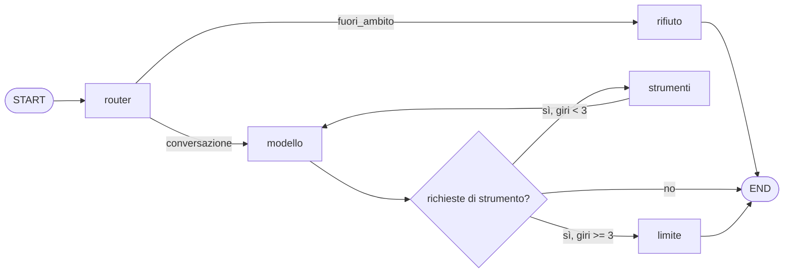
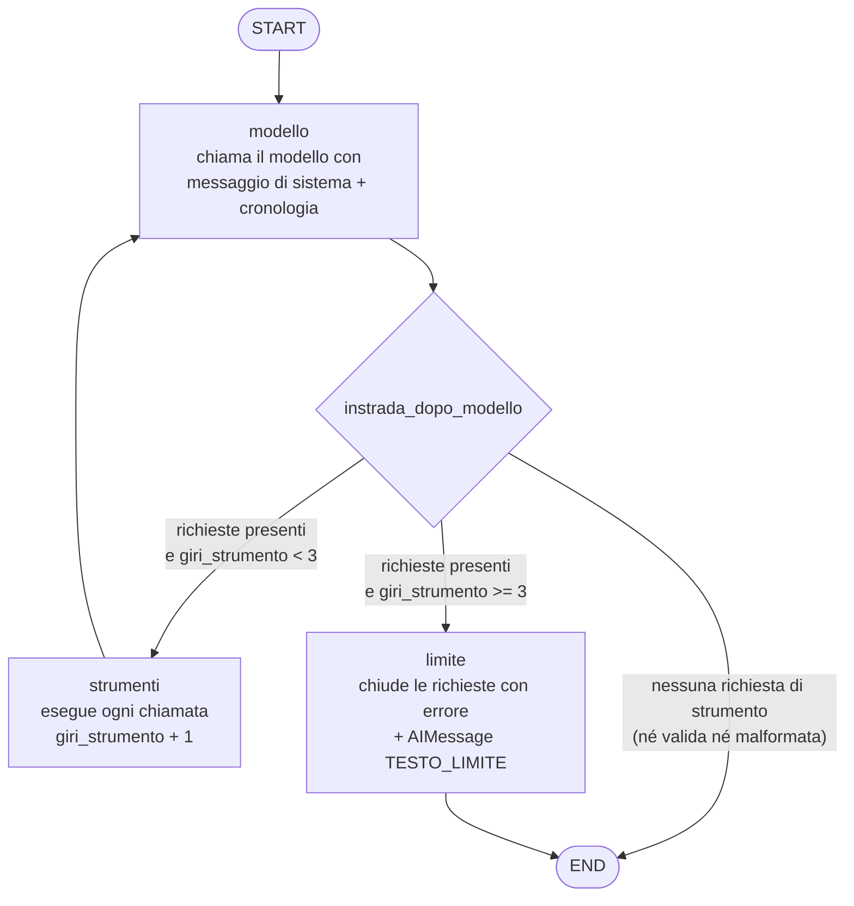
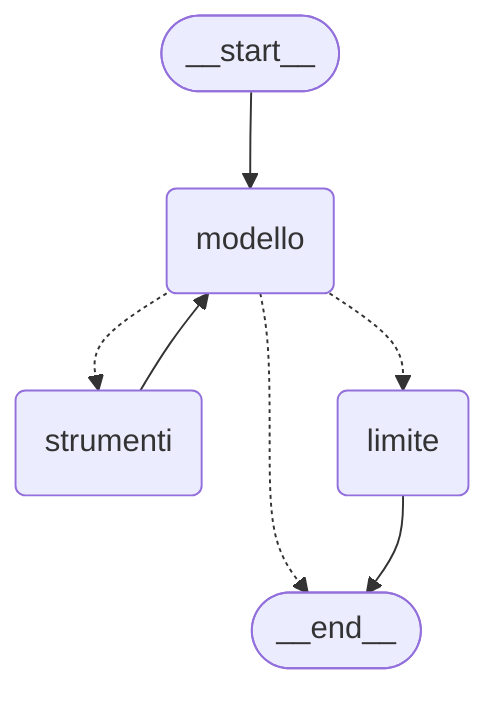
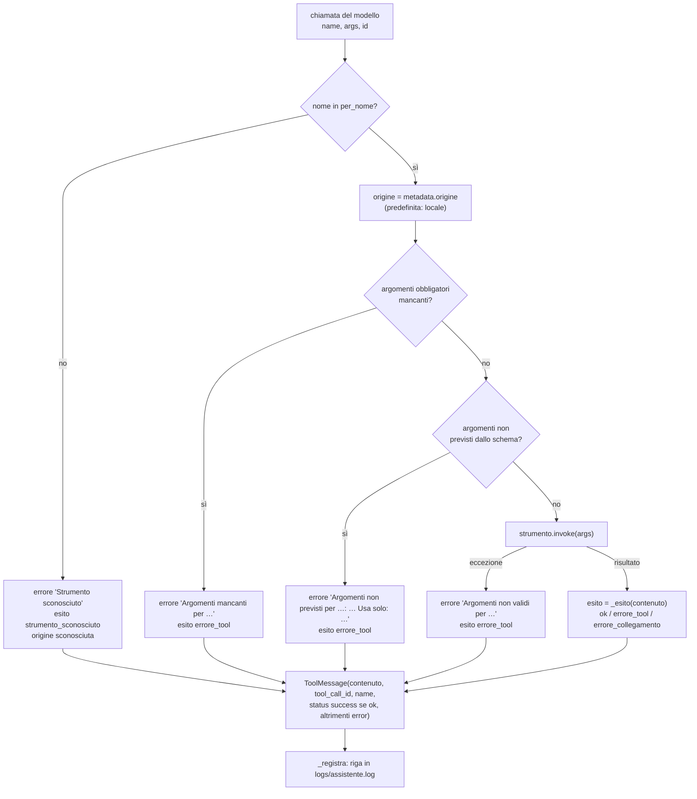
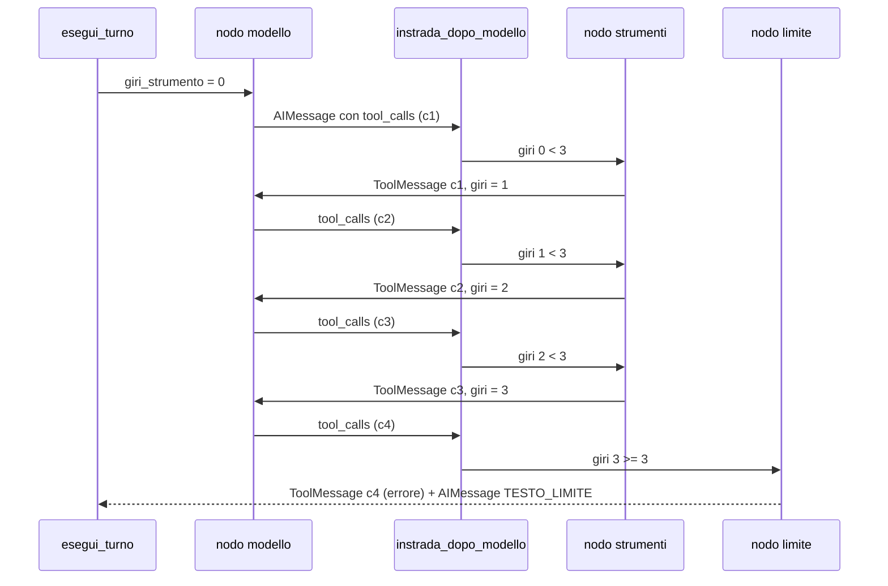
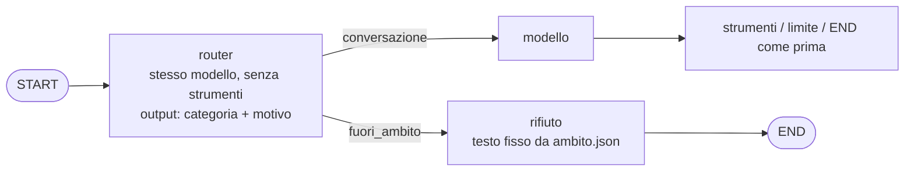

# 04 — Il grafo LangGraph

[← Indice](00-indice.md) · [← 03 Il viaggio di una richiesta](03-viaggio-di-una-richiesta.md) · [05 MCP in pratica →](05-mcp-in-pratica.md)

## Scheda in 5 minuti

**Di che cosa parla.** Il capitolo smonta `assistente/grafo.py`, il cuore dell'agente. Il grafo
decide quando chiamare il modello, quando eseguire uno strumento e quando fermarsi. Tutto il resto
del progetto ruota intorno a questo file.

**Le idee chiave**

0. **Lezione 6: prima dell'agente c'è un router.** Il nodo `router` classifica la domanda come
   `conversazione` o `fuori_ambito`, usando lo stesso modello senza strumenti e l'ambito scritto in
   `risorse/ambito.json`. Fuori ambito, il nodo `rifiuto` risponde con un testo fisso e l'agente non
   parte. → sezione 21
1. **Tre nodi e una sola decisione.** I nodi dell'agente sono `modello`, `strumenti` e `limite`. Dopo
   `modello`, la funzione `instrada_dopo_modello` sceglie la strada: fine, strumenti o limite. Da
   `strumenti` si torna sempre al modello, che legge i risultati. → sezioni 3 e 8
2. **Lo stato è piccolo.** Contiene la cronologia dei messaggi, il fuso dell'utente e un contatore
   di giri. Un nodo restituisce solo i campi che cambia. Per i messaggi un *reducer*, cioè una
   regola di fusione, aggiunge in coda invece di sostituire. → sezioni 2 e 4
3. **Il messaggio di sistema non entra nella cronologia.** Il nodo `modello` lo ricrea a ogni
   chiamata e lo mette in testa alla lista. Così ha sempre il fuso giusto e non si duplica.
   → sezioni 7 e 15
4. **Ogni richiesta riceve una risposta.** Per ogni chiamata del modello nasce un `ToolMessage` con
   lo stesso id, anche quando la chiamata fallisce. Una richiesta senza risposta renderebbe la
   cronologia invalida, e il turno dopo fallirebbe. → sezioni 9 e 11
5. **Prima di eseguire, l'host controlla.** L'host è il programma che ospita il modello: qui,
   l'agente. Rifiuta gli argomenti mancanti o inventati con un messaggio italiano che spiega come
   correggersi. Il controllo è uguale per tutte le varianti. → sezione 10
6. **Al massimo 3 giri per messaggio.** Un contatore conta i passaggi dal nodo `strumenti` e
   riparte da zero a ogni turno. Alla quarta richiesta il nodo `limite` chiude le richieste aperte
   e risponde con un testo fisso. → sezione 12
7. **La memoria sta nel terminale.** Il grafo non ha un *checkpointer*, cioè non salva lo stato tra
   un turno e l'altro. Il terminale tiene la lista dei messaggi e la ripassa a ogni turno.
   → sezione 16

**Il quadro**



**Da sapere a memoria**

| Cosa | Valore | Dove |
|---|---|---|
| Limite di giri per turno | `MAX_GIRI_STRUMENTO = 3` | `assistente/grafo.py:26` |
| Campi dello stato | `messages` (con `add_messages`), `fuso_utente`, `giri_strumento`, `categoria` (lezione 6) | `assistente/grafo.py:36-40` |
| Instradamento dopo il modello | `END`, `"limite"` o `"strumenti"` | `assistente/grafo.py:140-146` |
| Instradamento dopo il router | `"modello"` o `"rifiuto"` | `assistente/grafo.py:149-150` |
| Costruzione | con router: 5 nodi, 2 archi condizionali; senza: 3 nodi; `compile()` senza checkpointer | `assistente/grafo.py:229-244` |
| Contatore azzerato a ogni turno | `"giri_strumento": 0` | `assistente/grafo.py:253` |
| Logger | `assistente.strumenti` (chiamate), `assistente.grafo` (nodi), `assistente.router`, tutti in `logs/assistente.log` | `assistente/grafo.py:32-33`, `assistente/router.py` |
| Ambito e rifiuto | `risorse/ambito.json` | `assistente/ambito.py` |

**Se te lo chiedono all'orale**

- *Perché esiste il nodo `limite`, invece di andare subito a `END`?* L'ultimo messaggio del modello
  contiene richieste ancora aperte. Il nodo le chiude con un errore, così la cronologia resta
  valida, e aggiunge una risposta leggibile per l'utente.
- *Qual è la differenza tra esito e `status`?* L'esito ha cinque valori e va nel log. Lo `status`
  vale `success` o `error`: serve al terminale e ai test, e non arriva al modello.
- *Perché non usare `ToolNode` o `create_react_agent` di LangGraph?* Il piano li esclude: nodi e
  instradamento devono essere scritti, e riconoscibili, nel nostro codice. Così controlli, esito e
  log sono uguali per ogni variante.

Per i dettagli continua con il resto del capitolo: le idee rimandano alle sezioni con «→ sezione N».

---

Questo documento smonta `assistente/grafo.py` (256 righe con la lezione 6) pezzo per pezzo. È il cuore dell'agente:
decide **quando** chiamare il modello, **quando** eseguire uno strumento e **quando** fermarsi.
Tutto il resto del progetto (server MCP, varianti, terminale, Docker) ruota intorno a questo file.

> **In breve.** Il grafo ha tre nodi (`modello`, `strumenti`, `limite`) e una sola decisione
> (`instrada_dopo_modello`). Lo stato contiene la cronologia dei messaggi, il fuso dell'utente e un
> contatore di giri. Il modello può chiedere strumenti al massimo 3 volte per messaggio dell'utente.
> Ogni richiesta di strumento riceve **sempre** una risposta (`ToolMessage`), anche quando è
> sbagliata, sconosciuta, malformata o fuori limite: così la cronologia resta valida. Ogni chiamata
> lascia una riga in `logs/assistente.log` con il suo esito.

## Indice del documento

- [Scheda in 5 minuti](#scheda-in-5-minuti)
1. [Dove sta il grafo nel progetto](#1-dove-sta-il-grafo-nel-progetto)
2. [I concetti di LangGraph che servono](#2-i-concetti-di-langgraph-che-servono)
3. [Il diagramma del grafo](#3-il-diagramma-del-grafo)
4. [Lo stato: `StatoConversazione`](#4-lo-stato-statoconversazione)
5. [Costanti e logger](#5-costanti-e-logger)
6. [`crea_grafo`: la costruzione](#6-crea_grafo-la-costruzione)
7. [Il nodo `modello`](#7-il-nodo-modello)
8. [L'instradamento: `instrada_dopo_modello`](#8-linstradamento-instrada_dopo_modello)
9. [Il nodo `strumenti`](#9-il-nodo-strumenti)
10. [I controlli dell'host prima dell'esecuzione](#10-i-controlli-dellhost-prima-dellesecuzione)
11. [Le chiamate malformate (`invalid_tool_calls`)](#11-le-chiamate-malformate-invalid_tool_calls)
12. [Il limite di 3 giri e il nodo `limite`](#12-il-limite-di-3-giri-e-il-nodo-limite)
13. [Esito e `status` del ToolMessage](#13-esito-e-status-del-toolmessage)
14. [La registrazione nel log](#14-la-registrazione-nel-log)
15. [Il messaggio di sistema, riga per riga](#15-il-messaggio-di-sistema-riga-per-riga)
16. [`esegui_turno` e la cronologia](#16-esegui_turno-e-la-cronologia)
17. [I test del grafo](#17-i-test-del-grafo)
18. [Storia del file](#18-storia-del-file)
19. [Punti delicati e limiti noti](#19-punti-delicati-e-limiti-noti)
20. [Domande da orale](#20-domande-da-orale)
21. [Lezione 6: il router dell'ambito](#21-lezione-6-il-router-dellambito)
22. [La risposta in streaming](#22-la-risposta-in-streaming)
23. [Le istruzioni del progetto](#23-le-istruzioni-del-progetto)
- [Scaletta per le slide](#scaletta-per-le-slide)

---

## 1. Dove sta il grafo nel progetto

Il grafo non sa nulla di LM Studio, di MCP o del terminale. Riceve due cose dall'esterno: un
**modello** (qualunque oggetto con `.invoke(messaggi) -> AIMessage`) e una **lista di strumenti**
LangChain (`BaseTool`). Questa scelta, voluta fin dal primo piano, permette ai test di passare un
modello finto (`tests/finti.py`) al posto di LM Studio.

| Chi | Dove | Che cosa fa con il grafo |
|---|---|---|
| Avvio | `assistente/__main__.py:29` | `crea_grafo(crea_modello(config, strumenti), strumenti)` |
| Terminale | `assistente/terminale.py:72` | `esegui_turno(grafo, cronologia, fuso.fuso, testo)` a ogni messaggio |
| Prove reali | `tests/reale.py:53`, `tests/test_reale_lmstudio.py:52` | stesso percorso dell'avvio, con LM Studio vero |
| Test automatici | `tests/test_grafo.py` | `crea_grafo(ModelloFinto([...]), [orologio_finto(ISTANTE), ...])` |

Lo **stesso** elenco `strumenti` viene passato due volte: a `crea_modello`, che lo lega al modello con
`bind_tools` (così il modello riceve nomi, descrizioni e schemi, `assistente/modello.py:87`), e a
`crea_grafo`, che lo usa per eseguire davvero le chiamate. Se i due elenchi fossero diversi, il modello
potrebbe chiedere uno strumento che il grafo non conosce (caso gestito comunque: vedi
[`strumento_sconosciuto`](#13-esito-e-status-del-toolmessage)).

Per il quadro generale dei moduli vedi [02 — Architettura](02-architettura.md); per il percorso
completo di un messaggio dall'utente al modello e ritorno vedi
[03 — Il viaggio di una richiesta](03-viaggio-di-una-richiesta.md).

---

## 2. I concetti di LangGraph che servono

Versioni fissate in `requirements.txt`: `langgraph==1.2.19`, `langchain-core==1.7.3`,
`langchain-openai==1.7.3`.

| Concetto | Che cos'è | Nel progetto |
|---|---|---|
| **Stato** | Un dizionario tipizzato che passa da un nodo all'altro | `StatoConversazione` (`grafo.py:29`) |
| **Nodo** | Una funzione `stato -> aggiornamento parziale` | `nodo_modello`, `nodo_strumenti`, `nodo_limite` |
| **Arco fisso** | "Dopo A vai sempre a B" | `START→modello`, `strumenti→modello`, `limite→END` |
| **Arco condizionale** | Una funzione decide il prossimo nodo | `instrada_dopo_modello` dopo `modello` |
| **Reducer** | Regola per fondere l'aggiornamento con il valore precedente | `add_messages` sul campo `messages` |
| **`compile()`** | Trasforma la descrizione in un oggetto eseguibile | `costruttore.compile()` (`grafo.py:211`) |
| **`invoke(input)`** | Esegue il grafo da `START` a `END` e restituisce lo stato finale | in `esegui_turno` (`grafo.py:216`) |
| **Checkpointer** | Memoria persistente dello stato tra invocazioni | **non usato**: la cronologia la tiene il terminale |

Un nodo **non** restituisce lo stato intero: restituisce solo i campi che cambia. LangGraph li fonde
nello stato con questa regola:

- se il campo ha un reducer (qui solo `messages`), applica il reducer: `add_messages` **aggiunge** i
  nuovi messaggi in coda;
- se non ce l'ha (`giri_strumento`, `fuso_utente`), il nuovo valore **sostituisce** il vecchio.

**Perché non `ToolNode` o `create_react_agent`?** La specifica iniziale (sezione 5.5) vietava solo
gli «agenti prefabbricati che nascondono il grafo» e ammetteva i componenti di LangGraph «per lo stato
dei messaggi e per l'esecuzione degli strumenti». Il piano è stato più severo
(`docs/superpowers/plans/2026-11-02-assistente-laboratorio.md:20`): «Niente agenti prefabbricati di
LangGraph (`create_react_agent` e simili) né `ToolNode`: nodi e instradamento scritti nel nostro
codice». Del kit di LangGraph si usa quindi solo `add_messages` (il reducer dello stato). Il motivo è
didattico (obiettivo 2 della specifica: «stato, nodi e instradamento riconoscibili leggendo il
codice»). Il vantaggio pratico si è visto dopo: i controlli dell'host, il calcolo dell'esito e il log
li abbiamo scritti noi, uguali per ogni variante.

---

## 3. Il diagramma del grafo

La docstring del file (`grafo.py:1-6`) lo disegna così:

```text
START -> modello -> (instrada_dopo_modello) -> strumenti -> modello
                                            -> limite    -> END
                                            -> END
```

Versione Mermaid, con le condizioni sugli archi:



Questo è invece il diagramma che LangGraph stesso genera dal grafo compilato
(`grafo.get_graph().draw_mermaid()`, eseguito con il modello finto). Gli archi tratteggiati (`-.->`)
sono quelli condizionali:



(L'output reale comincia con un'intestazione `config:` e finisce con tre righe `classDef` di colori:
qui sono omesse.)

Si nota che c'è **un solo ciclo** (`modello → strumenti → modello`) e che l'unico punto di decisione è
dopo il nodo `modello`. Dal nodo `strumenti` si torna **sempre** al modello: è il modello che legge i
risultati e decide se rispondere o chiedere altro.

**Confronto con la specifica.** La specifica iniziale (sezione 5.5) descriveva solo due uscite: «se il
modello ha chiesto lo strumento e il limite non è raggiunto → nodo strumenti; altrimenti → fine del
turno», lasciando al costruttore il modo di tenere valida la cronologia quando scatta il limite. Il
terzo nodo, `limite`, è la soluzione scelta: invece di andare direttamente a `END`, passa da un nodo
che chiude le richieste rimaste aperte (vedi [sezione 12](#12-il-limite-di-3-giri-e-il-nodo-limite)).

---

## 4. Lo stato: `StatoConversazione`

```python
class StatoConversazione(TypedDict):                          # grafo.py:29-32
    messages: Annotated[list[AnyMessage], add_messages]
    fuso_utente: str
    giri_strumento: int  # giri di strumento nel turno corrente
```

| Campo | Tipo | Reducer | Chi lo scrive | A che serve |
|---|---|---|---|---|
| `messages` | lista di messaggi LangChain | `add_messages` (accoda) | `esegui_turno` (iniziale), tutti e tre i nodi | la cronologia: `HumanMessage`, `AIMessage`, `ToolMessage` |
| `fuso_utente` | stringa IANA, es. `Europe/Rome` | nessuno | solo `esegui_turno` | costruire il messaggio di sistema |
| `giri_strumento` | intero | nessuno (sovrascrive) | `esegui_turno` (0), `nodo_strumenti` (+1) | far rispettare il limite di 3 giri |

### Il campo `messages` e `add_messages`

`Annotated[..., add_messages]` dice a LangGraph: «quando un nodo restituisce `{"messages": [...]}`,
non sostituire la lista, ma aggiungi in coda». Per questo `nodo_modello` può restituire solo
`{"messages": [risposta]}` senza ricopiare tutta la cronologia.

Dettagli verificati nel codice installato (`langgraph/graph/message.py`):

- `add_messages` assegna un `id` (un UUID) a ogni messaggio che non ne ha uno. Lo fa **sull'oggetto
  messaggio**: dopo un turno, i messaggi della cronologia hanno tutti un `id`. Prova reale con il
  modello finto (gli id cambiano a ogni esecuzione): `['eb6fd4b6-…', 'c39262f1-…']`.
- Se arriva un messaggio con un `id` già presente, lo **sostituisce** invece di aggiungerlo. Nel
  progetto non succede (nessun nodo riusa un id), ma è il motivo per cui non si "duplicano" i messaggi
  quando la stessa cronologia viene ripassata al grafo nel turno successivo.

### Perché il fuso è nello stato

Il messaggio di sistema contiene il fuso dell'utente. Invece di salvarlo nella cronologia, lo si
ricostruisce a ogni chiamata del modello partendo da `stato["fuso_utente"]` (vedi
[sezione 15](#15-il-messaggio-di-sistema-riga-per-riga)). Il fuso è rilevato una sola volta all'avvio
(`assistente/fuso.py`, vedi [08 — Configurazione, avvio e Docker](08-configurazione-avvio-docker.md))
e passato a ogni turno da `esegui_turno`.

### Perché un contatore e non "contare i ToolMessage"

Un giro può contenere **più** chiamate in parallelo (un `AIMessage` con tre `tool_calls` produce tre
`ToolMessage`), e la cronologia contiene anche i giri dei turni precedenti. Il contatore misura
esattamente ciò che serve: quante volte, **in questo turno**, si è passati dal nodo `strumenti`. Ripartendo
da 0 a ogni turno (`grafo.py:220`) il limite vale per messaggio dell'utente, come chiede la specifica.

---

## 5. Costanti e logger

| Nome | Riga | Valore | Uso |
|---|---|---|---|
| `NOME_OROLOGIO` | 19 | `"ora_corrente"` | nominato nel messaggio di sistema; è il nome pubblicato dal server MCP |
| `MAX_GIRI_STRUMENTO` | 20 | `3` | soglia dell'instradamento |
| `TESTO_LIMITE` | 21-23 | «Non sono riuscito a completare la richiesta: troppe chiamate agli strumenti. Prova a riformularla.» | risposta finale quando scatta il limite |
| `TESTO_NON_JSON` | 24 | «Argomenti non validi: devono essere un oggetto JSON con gli argomenti dello strumento.» | risposta alle chiamate malformate |
| `registro` | 26 | `logging.getLogger("assistente.strumenti")` | una riga per ogni chiamata |

Due osservazioni:

- `NOME_OROLOGIO` è scritto **a mano** nel grafo perché l'orologio non è più un modulo locale: nel
  commit `06cba52` è stato spostato nel server MCP e `assistente/strumenti.py` è stato cancellato. Il
  grafo non importa nulla dal server: conosce solo il nome pubblicato.
- `TESTO_LIMITE` è **generico** («troppe chiamate agli strumenti»). All'inizio diceva «troppe
  chiamate all'orologio»; è diventato generico con l'arrivo del convertitore (commit `88281c7`). Un
  test lo controlla: `test_testi_generici` verifica che contenga «strumenti» e non «orologio».

---

## 6. `crea_grafo`: la costruzione

```python
def crea_grafo(modello, strumenti: list[BaseTool]):          # grafo.py:141
    """`modello` ha `.invoke(messaggi) -> AIMessage` ed è già collegato agli strumenti."""
    per_nome = {strumento.name: strumento for strumento in strumenti}
    ...
    costruttore = StateGraph(StatoConversazione)              # grafo.py:203-211
    costruttore.add_node("modello", nodo_modello)
    costruttore.add_node("strumenti", nodo_strumenti)
    costruttore.add_node("limite", nodo_limite)
    costruttore.add_edge(START, "modello")
    costruttore.add_conditional_edges("modello", instrada_dopo_modello, ["strumenti", "limite", END])
    costruttore.add_edge("strumenti", "modello")
    costruttore.add_edge("limite", END)
    return costruttore.compile()
```

Punti chiave:

- **`per_nome`** è un dizionario `nome → strumento`, costruito una volta. Il nodo `strumenti` lo usa
  per trovare lo strumento chiesto dal modello in tempo costante. I nomi sono unici perché
  `seleziona_strumenti` (`assistente/varianti.py`) rifiuta all'avvio uno strumento presente due volte.
- **I tre nodi sono funzioni interne** (closure): vedono `modello` e `per_nome` senza bisogno di
  metterli nello stato. Lo stato contiene solo dati della conversazione, non oggetti tecnici.
- **`add_conditional_edges(..., ["strumenti", "limite", END])`**: il terzo argomento elenca le
  destinazioni possibili. Serve a LangGraph per validare il grafo e per disegnarlo (è grazie a questo
  elenco che il diagramma generato mostra i tre archi tratteggiati).
- **`compile()` senza checkpointer**: ogni `invoke` parte da zero, con lo stato iniziale passato da
  `esegui_turno`. Non c'è memoria nascosta dentro il grafo.

---

## 7. Il nodo `modello`

```python
def nodo_modello(stato: StatoConversazione) -> dict:          # grafo.py:145-147
    risposta = modello.invoke([messaggio_sistema(stato["fuso_utente"]), *stato["messages"]])
    return {"messages": [risposta]}
```

Tre righe, ma con due scelte importanti:

1. **Il messaggio di sistema è messo in testa a ogni chiamata e non entra nello stato.** La lista
   passata al modello è nuova: `[SystemMessage, *cronologia]`. Il nodo restituisce solo la
   `risposta`, quindi il `SystemMessage` non finisce mai in `messages`. Il test
   `test_risposta_diretta` lo verifica in due modi: il primo messaggio visto dal modello è un
   `SystemMessage` con il fuso, e nella cronologia restituita non c'è nessun `SystemMessage`.
2. **Il modello vede tutta la cronologia.** L'API di LM Studio (compatibile con OpenAI) è senza
   stato: a ogni chiamata bisogna rimandare l'intera conversazione. Prova reale con il modello finto,
   al secondo turno di una chat: il modello riceve
   `[SystemMessage, HumanMessage 'ciao', AIMessage 'Ciao!', HumanMessage 'come va?']`.

La `risposta` è un `AIMessage` che può contenere:

- solo testo (`content`) → risposta finale;
- `tool_calls` → richieste di strumento valide (argomenti già convertiti in dizionario);
- `invalid_tool_calls` → richieste i cui argomenti non erano JSON valido (vedi
  [sezione 11](#11-le-chiamate-malformate-invalid_tool_calls)).

**Se il modello solleva un'eccezione** (LM Studio chiuso, timeout di 120 secondi con un solo nuovo
tentativo, `timeout=120, max_retries=1` in `assistente/modello.py:84-85`), il nodo non la intercetta: l'eccezione esce da `grafo.invoke`, quindi da
`esegui_turno`, e la gestisce il terminale (vedi [sezione 16](#16-esegui_turno-e-la-cronologia)).

---

## 8. L'instradamento: `instrada_dopo_modello`

```python
def instrada_dopo_modello(stato) -> Literal["strumenti", "limite", "__end__"]:   # grafo.py:132-138
    ultimo = stato["messages"][-1]
    if not getattr(ultimo, "tool_calls", None) and not _malformate(ultimo):
        return END
    if stato["giri_strumento"] >= MAX_GIRI_STRUMENTO:
        return "limite"
    return "strumenti"
```

È una funzione **pura**: legge lo stato, non lo modifica, restituisce il nome del prossimo nodo. Per
questo si testa direttamente con dizionari scritti a mano (`test_instradamento`), senza eseguire il
grafo. `END` è la costante di LangGraph che vale `"__end__"`.

| Ultimo messaggio | `giri_strumento` | Risultato |
|---|---|---|
| `AIMessage` senza `tool_calls` né `invalid_tool_calls` | qualsiasi | `END` (risposta finale) |
| con `tool_calls` (o solo `invalid_tool_calls`) | 0, 1, 2 | `"strumenti"` |
| con `tool_calls` (o solo `invalid_tool_calls`) | 3 o più | `"limite"` |

Perché questi dettagli:

- **`getattr(ultimo, "tool_calls", None)`**: non tutti i tipi di messaggio hanno l'attributo
  `tool_calls`; `getattr` con valore predefinito evita un `AttributeError`.
- **Anche le chiamate malformate contano come "richiesta".** Se l'`AIMessage` contiene solo
  `invalid_tool_calls`, terminare il turno lascerebbe nella cronologia una richiesta senza risposta,
  e la chiamata successiva al modello fallirebbe. Questa condizione è stata aggiunta nel commit
  `7a366f5` (vedi [sezione 11](#11-le-chiamate-malformate-invalid_tool_calls)).
- **Il controllo del limite viene dopo** il controllo "c'è una richiesta?": se il modello risponde
  con testo, il turno finisce normalmente anche se i giri sono già 3.

Prova reale (`instrada_dopo_modello` chiamata direttamente con stati scritti a mano):

```text
giri 0 → strumenti    giri 1 → strumenti    giri 2 → strumenti
giri 3 → limite       giri 4 → limite
AIMessage("ciao") con giri 3                → __end__
AIMessage con sola chiamata malformata, giri 0 → strumenti
```

---

## 9. Il nodo `strumenti`

È il nodo più lungo (`grafo.py:149-189`). Per **ogni** chiamata dell'ultimo `AIMessage` produce
**esattamente un** `ToolMessage` con lo stesso `tool_call_id`, poi chiude anche le chiamate
malformate, poi incrementa il contatore.



Il codice, passo per passo:

```python
for chiamata in stato["messages"][-1].tool_calls:                 # grafo.py:151
    strumento = per_nome.get(chiamata["name"])
    if strumento is None:
        origine, esito = "sconosciuta", "strumento_sconosciuto"
        contenuto = _errore(f"Strumento sconosciuto: '{chiamata['name']}'.")
    else:
        origine = (strumento.metadata or {}).get("origine", "locale")
        # Controllo dell'host prima dell'esecuzione (slide 5), uguale per ogni variante.
        mancanti = _argomenti_mancanti(strumento, chiamata["args"])
        in_piu, previsti = _argomenti_in_piu(strumento, chiamata["args"])
        if mancanti: ...          # errore_tool, nessuna esecuzione
        elif in_piu: ...          # errore_tool, nessuna esecuzione
        else:
            try:
                contenuto = strumento.invoke(chiamata["args"])
                esito = _esito(contenuto)
            except Exception as eccezione:  # anche argomenti non validi
                contenuto = _errore(f"Argomenti non validi per {chiamata['name']}: {eccezione}")
                esito = "errore_tool"
```

### Da dove viene l'`origine`

Ogni strumento porta nei `metadata` la sua variante:

| Valore | Impostato in | Strumenti |
|---|---|---|
| `mcp` | `assistente/client_mcp.py` (`avvolgi`, `metadata={"origine": ORIGINE_MCP}`) | tutti quelli scoperti dal server |
| `locale` | `assistente/calcolatrice_locale.py` (`calcola.metadata = {"origine": ORIGINE_LOCALE}`) | `calcola` con `VARIANTE_CALCOLATRICE=locale` |
| `fastapi` | `assistente/wrapper_scadenze.py` (`calcola_scadenza.metadata = {"origine": ORIGINE_FASTAPI}`) | `calcola_scadenza` con `VARIANTE_SCADENZE=fastapi` |
| `sconosciuta` | scritto dal grafo | strumento inesistente o chiamata malformata |

Se uno strumento non avesse `metadata`, il nodo `strumenti` userebbe `locale`. Il grafo non distingue
le varianti nel comportamento: le tratta tutte allo stesso modo e usa l'origine solo per il log. Le
varianti sono spiegate in [06 — Le tre varianti](06-tre-varianti.md).

### Il `try/except` è una rete di sicurezza

Gli strumenti del progetto sono costruiti per **non sollevare mai** eccezioni verso il grafo:

- il ponte MCP (`avvolgi`) restituisce sempre una stringa, risultato o `{"errore", "tipo"}`;
- la calcolatrice locale e il wrapper FastAPI intercettano i propri errori e li restituiscono come JSON;
- i loro argomenti sono annotati `Any` con `WithJsonSchema`, quindi pydantic non rifiuta i tipi
  sbagliati: arrivano alla logica, che risponde con un errore italiano.

L'`except` scatta quindi solo per strumenti con validazione pydantic stretta. Prova reale con
l'orologio finto dei test (costruito con `StructuredTool.from_function`, che valida i tipi) e
`{"fuso": 123}`:

```text
{"errore": "Argomenti non validi per ora_corrente: 1 validation error for ora_corrente\nfuso\n  Input should be a valid string [type=string_type, input_value=123, input_type=int]\n ..."}
```

Il messaggio è in inglese: proprio per evitare messaggi così nei casi più comuni (argomenti mancanti o
inventati) sono stati aggiunti i controlli della [sezione 10](#10-i-controlli-dellhost-prima-dellesecuzione).

### Alla fine del ciclo

```python
risultati += _malformate_chiuse(stato["messages"][-1], TESTO_NON_JSON, "errore_tool")   # grafo.py:188
return {"messages": risultati, "giri_strumento": stato["giri_strumento"] + 1}          # grafo.py:189
```

- I `ToolMessage` sono nello **stesso ordine** delle richieste (`test_strumento_sconosciuto_e_argomenti_errati`
  controlla `["x1", "x2"]`), con quelli delle chiamate malformate in coda.
- Le chiamate sono eseguite **in sequenza**, non in parallelo: il codice è sincrono, come chiede `CLAUDE.md`.
- Il contatore aumenta di 1 per **giro**, qualunque sia il numero di chiamate nel giro, e anche se
  tutte le chiamate sono fallite.
- Se l'`AIMessage` contiene **solo** chiamate malformate, `tool_calls` è vuoto: il ciclo `for` non
  fa nulla e il nodo produce soltanto i `ToolMessage` di `_malformate_chiuse`. Anche questo giro conta.

### Esempio reale: sei chiamate in un solo giro

Modello finto che, in un unico `AIMessage`, chiede sei chiamate, una per ogni ramo del diagramma;
strumenti disponibili: l'orologio finto dei test (origine `mcp`) e la calcolatrice locale.

| id | Chiamata | Ramo | `ToolMessage` (contenuto abbreviato) | `status` |
|---|---|---|---|---|
| `d1` | `calcola({})` | argomenti mancanti | `Argomenti mancanti per calcola: espressione. Riprova…` | `error` |
| `d2` | `calcola({"espressione": "1+1", "precisione": 2})` | argomenti in più | `Argomenti non previsti per calcola: precisione. Usa solo: espressione.` | `error` |
| `d3` | `meteo({"citta": "Roma"})` | strumento sconosciuto | `Strumento sconosciuto: 'meteo'.` | `error` |
| `d4` | `ora_corrente({"fuso": 123})` | eccezione di `invoke` | `Argomenti non validi per ora_corrente: 1 validation error…` | `error` |
| `d5` | `ora_corrente({"fuso": "Mars/Olympus"})` | eseguito, errore dello strumento | `Fuso orario sconosciuto: 'Mars/Olympus'. Usa un nome IANA…` | `error` |
| `d6` | `calcola({"espressione": "(3 + 4) * 2"})` | eseguito, riuscito | `{"espressione": "(3 + 4) * 2", "risultato": 14}` | `success` |

Sei richieste, sei `ToolMessage` nello stesso ordine, sei righe di log (riportate nella
[sezione 14](#14-la-registrazione-nel-log)), un solo giro consumato. Poi il grafo torna al modello,
che vede tutti e sei i risultati insieme.

---

## 10. I controlli dell'host prima dell'esecuzione

Il commento a `grafo.py:158` dice «Controllo dell'host prima dell'esecuzione (slide 5), uguale per
ogni variante». **Host** è il termine MCP per l'applicazione che ospita il modello e decide che cosa
eseguire: qui, l'agente. Prima di eseguire una chiamata l'host confronta gli argomenti con lo schema
dello strumento.

### Leggere lo schema: `_schema`

```python
def _schema(strumento: BaseTool) -> dict:                      # grafo.py:77-79
    schema = strumento.tool_call_schema
    return schema if isinstance(schema, dict) else schema.model_json_schema()
```

Serve perché gli strumenti del progetto hanno schemi di due forme diverse (verificato):

| Strumento | `tool_call_schema` è… | Perché |
|---|---|---|
| strumenti MCP avvolti | un `dict` (JSON Schema) | `avvolgi` passa `args_schema=strumento.args_schema`, lo schema ricevuto dal server |
| `calcola` locale, `calcola_scadenza` FastAPI | una classe pydantic | nascono da `@tool`, che costruisce un modello pydantic dalla firma |

`_schema` restituisce sempre un dizionario JSON Schema, quindi i due controlli sotto funzionano allo
stesso modo per tutte le varianti.

### Argomenti mancanti

```python
def _argomenti_mancanti(strumento, argomenti) -> list[str]:    # grafo.py:82-85
    presenti = argomenti if isinstance(argomenti, dict) else {}
    return [nome for nome in _schema(strumento).get("required", []) if nome not in presenti]
```

Messaggio: `Argomenti mancanti per calcola: espressione. Riprova indicando tutti gli argomenti richiesti.`

### Argomenti non previsti

```python
def _argomenti_in_piu(strumento, argomenti) -> tuple[list[str], list[str]]:   # grafo.py:88-99
    schema = _schema(strumento)
    previsti = list(schema.get("properties", {}))
    if schema.get("additionalProperties") is True:
        return [], previsti
    presenti = argomenti if isinstance(argomenti, dict) else {}
    return [nome for nome in presenti if nome not in previsti], previsti
```

Messaggio: `Argomenti non previsti per calcola: precisione. Usa solo: espressione.`

L'eccezione `additionalProperties: true` esiste per uno schema che ammetta esplicitamente argomenti
liberi. Nessuno strumento reale lo fa: interrogando il server con il client MCP in memoria dei test,
tutti e dieci hanno `additionalProperties: False`. La usa solo `strumento_finto` dei test
(`tests/finti.py:46`), che accetta qualsiasi argomento.

Dettaglio importante: il confronto è `is True`, non "è diverso da `False`". Gli schemi pydantic di
`calcola` locale e di `calcola_scadenza` FastAPI **non hanno proprio** la chiave
`additionalProperties` (verificato: `model_json_schema()` restituisce solo `description`,
`properties`, `required`, `title`, `type`). Se il codice rifiutasse gli argomenti in più solo con
`additionalProperties: false`, la variante locale continuerebbe a ignorarli. Con `is True`, uno schema
che non dice nulla viene trattato come chiuso: è questo che rende il controllo uguale per tutte le
varianti.

| Strumento (server MCP) | `required` | `properties` |
|---|---|---|
| `converti_unita` | `valore`, `da`, `a` | `valore`, `da`, `a` |
| `ora_corrente` | `fuso` | `fuso` |
| `calcola` | `espressione` | `espressione` |
| `calcola_scadenza` | `data_inizio`, `giorni`, `lavorativi` | gli stessi |
| `search_catalog` | `query` | `query`, `max_results` |
| `get_item` | `code` | `code` |
| `add_note` | `text` | `text` |
| `list_notes` | (nessuno) | `limit` |
| `delete_note` | `note_id` | `note_id` |
| `get_weather` | `city` | `city` |

### Perché questi controlli esistono (la storia)

Prima dei controlli, la stessa chiamata sbagliata si comportava in modo **diverso a seconda della
variante**. Verificato chiamando gli strumenti **direttamente** (senza passare dal grafo), con le
librerie installate:

| Errore del modello | Variante locale (`@tool`, pydantic) | Variante MCP (schema `dict`) |
|---|---|---|
| argomento obbligatorio mancante | `calcola.invoke({})` solleva `ValidationError` in inglese: «Field required» | lo `StructuredTool` con schema `dict` non valida (passa `{}` alla funzione); il server risponde con errore: «1 validation error for call[calcola_mcp] … Missing required argument» |
| argomento inventato (`precisione`) | **ignorato in silenzio**: `calcola.invoke({"espressione": "1+1", "precisione": 2})` restituisce `{"espressione": "1+1", "risultato": 2}` | arriva al server: «… Unexpected keyword argument», con il nome interno `calcola_mcp` e un URL di pydantic |

I due commit che hanno introdotto i controlli lo raccontano:

- `ec2b384` (argomenti mancanti): «prima arrivava un errore pydantic in inglese»;
- `5bed890` (argomenti in più): «Un argomento in più arrivava al server MCP, che rispondeva con un
  errore pydantic in inglese (con il nome interno della funzione e un URL) senza riga di log; la
  variante locale invece lo ignorava».

Con i controlli nell'host:

- il messaggio è **italiano e uguale** per MCP, locale e FastAPI;
- la chiamata **non viene eseguita** (i test lo verificano con `eseguito == []`), quindi non arriva né
  al server né al servizio FastAPI e compare solo in `logs/assistente.log` (lo dice anche il README);
- il messaggio dice al modello **come correggersi** («Riprova indicando…», «Usa solo: …»), così può
  riprovare nel giro successivo, entro il limite di 3.

Ordine dei controlli: prima i mancanti, poi quelli in più (`elif`). Se una chiamata ha entrambi i
difetti, il modello riceve solo il messaggio sui mancanti.

Il contenuto usa `_errore_argomenti` (`grafo.py:102`), che aggiunge `"tipo": "strumento"`: lo stesso
formato `{"errore", "tipo"}` usato dal ponte MCP e dagli strumenti locali.

**Che cosa i controlli non fanno:** non controllano i **tipi** né i valori (`enum`, formati di data).
Quelli restano compito di ogni variante, ed è lì che le varianti possono ancora differire (per
esempio FastAPI accetta `lavorativi="yes"`, MCP no: vedi il README e [06](06-tre-varianti.md)).

---

## 11. Le chiamate malformate (`invalid_tool_calls`)

### Che cosa sono

Il modello restituisce gli argomenti di una chiamata come **testo** che dovrebbe essere JSON. Quando
`langchain-openai` converte la risposta di LM Studio in un `AIMessage`, prova a interpretare quel testo
(`langchain_openai/chat_models/base.py`, `parse_tool_call`); se fallisce, la chiamata non finisce in
`tool_calls` ma in **`invalid_tool_calls`**, con gli argomenti lasciati come stringa. Un modello piccolo
può produrre per esempio `{fuso: Europe/Rome` (senza virgolette e senza graffa finale).

### Perché vanno chiuse

Leggendo la stessa libreria (`_convert_message_to_dict`), quando la cronologia viene rimandata al
modello un `AIMessage` con `invalid_tool_calls` viene inviato con **tutte** le chiamate, valide e
malformate, nel campo `tool_calls` del messaggio dell'assistente. L'API compatibile con OpenAI si
aspetta che ogni chiamata dell'assistente sia seguita da un messaggio `tool` con lo stesso id. Una
chiamata malformata senza risposta renderebbe la cronologia invalida, e il turno successivo fallirebbe.

La docstring lo dice in una riga:

```python
def _malformate(messaggio) -> list[dict]:                      # grafo.py:61-63
    """Chiamate con argomenti non JSON: vanno chiuse anche loro, o la cronologia resta invalida."""
    return list(getattr(messaggio, "invalid_tool_calls", None) or [])
```

### Come vengono chiuse

```python
def _malformate_chiuse(messaggio, testo: str, esito: str) -> list[ToolMessage]:   # grafo.py:122-129
    chiusi = []
    for c in _malformate(messaggio):
        contenuto = _errore(testo)
        tool_message = ToolMessage(contenuto, tool_call_id=c.get("id") or "", name=c.get("name") or "", status="error")
        _registra("sconosciuta", c, esito, contenuto, tool_message)
        chiusi.append(tool_message)
    return chiusi
```

- Usata in **due** punti: dal nodo `strumenti` (testo `TESTO_NON_JSON`, esito `errore_tool`) e dal nodo
  `limite` (testo «limite di chiamate raggiunto», esito `limite`).
- La chiamata **non viene mai eseguita**: gli argomenti non sono un dizionario.
- `c.get("id") or ""` e `c.get("name") or ""`: in una chiamata malformata id e nome possono mancare;
  si usa una stringa vuota invece di far fallire il nodo.
- L'origine nel log è sempre `sconosciuta`, anche se il nome corrisponde a uno strumento esistente.

Prova reale (modello finto che restituisce prima la chiamata malformata, poi un testo):

```text
HumanMessage: 'che ore sono?'
AIMessage: '' tool_calls=[] invalid=[('ora_corrente', '{fuso: Europe/Rome', 'z1')]
ToolMessage: '{"errore": "Argomenti non validi: devono essere un oggetto JSON con gli argomenti dello strumento."}' call_id=z1 status=error
AIMessage: 'Riprovo più tardi.'
```

Riga di log corrispondente (senza data e ora, vedi [sezione 14](#14-la-registrazione-nel-log)):

```text
origine=sconosciuta tool=ora_corrente call_id=z1 argomenti={fuso: Europe/Rome esito=errore_tool risultato={"errore": "Argomenti non validi: …"} tool_message.call_id=z1
```

Il testo `TESTO_NON_JSON` è generico: all'inizio conteneva l'esempio `{"fuso": …}` dell'orologio, poi
è stato reso valido per qualsiasi strumento (specifica del convertitore, sezione 5.5).

---

## 12. Il limite di 3 giri e il nodo `limite`

### Che cosa conta come "giro"

Un giro è un passaggio dal nodo `strumenti`. Il conteggio, in un turno che non finisce mai:



Quindi, per ogni messaggio dell'utente:

- al massimo **3 esecuzioni** di strumenti (giri), ciascuna con una o più chiamate;
- al massimo **4 chiamate al modello** (il test `test_limite_raggiunto` verifica `len(modello.chiamate) == 4`);
- la quarta richiesta di strumento **non viene eseguita**.

### Il nodo `limite`

```python
def nodo_limite(stato: StatoConversazione) -> dict:            # grafo.py:191-201
    in_sospeso = []
    for c in stato["messages"][-1].tool_calls:
        # status="error": la chiamata non è stata eseguita.
        contenuto = _errore("limite di chiamate raggiunto")
        messaggio = ToolMessage(contenuto, tool_call_id=c["id"], name=c["name"], status="error")
        origine = (getattr(per_nome.get(c["name"]), "metadata", None) or {}).get("origine", "sconosciuta")
        _registra(origine, c, "limite", contenuto, messaggio)
        in_sospeso.append(messaggio)
    in_sospeso += _malformate_chiuse(stato["messages"][-1], "limite di chiamate raggiunto", "limite")
    return {"messages": [*in_sospeso, AIMessage(TESTO_LIMITE)]}
```

Fa due cose, entrambe necessarie:

1. **Chiude le richieste in sospeso** (valide e malformate) con un `ToolMessage` di errore. Senza
   questo passaggio la cronologia conterrebbe richieste senza risposta e il turno successivo
   fallirebbe. È il requisito della specifica (sezione 5.5): «la cronologia resta valida per i turni
   successivi (nessuna richiesta di strumento lasciata senza risultato)». La specifica lasciava al
   costruttore il *come*: questo nodo è la risposta.
2. **Aggiunge un `AIMessage(TESTO_LIMITE)`** scritto dal programma, non dal modello. Così l'ultimo
   messaggio del turno è sempre un `AIMessage` leggibile: il terminale lo stampa come risposta
   (`terminale.py`, `nuova[-1].text`). Dopo `limite` si va direttamente a `END`: il modello **non**
   viene richiamato.

Prova reale del caso limite (modello finto che chiede l'orologio quattro volte):

```text
HumanMessage: 'che ore sono?'
AIMessage: '' tool_calls=[('ora_corrente', {'fuso': 'Europe/Rome'}, 'c1')]
ToolMessage: '{"fuso": "Europe/Rome", "data_ora": "2026-11-02T15:04:05+01:00", …}' call_id=c1 status=success
AIMessage: '' tool_calls=[(… 'c2')]
ToolMessage: '{…}' call_id=c2 status=success
AIMessage: '' tool_calls=[(… 'c3')]
ToolMessage: '{…}' call_id=c3 status=success
AIMessage: '' tool_calls=[(… 'c4')]
ToolMessage: '{"errore": "limite di chiamate raggiunto"}' call_id=c4 status=error
AIMessage: 'Non sono riuscito a completare la richiesta: troppe chiamate agli strumenti. Prova a riformularla.'
```

Nel terminale compaiono tre righe `[ora_corrente · mcp: Europe/Rome]` (solo le chiamate riuscite) e poi
la risposta con `TESTO_LIMITE`.

### Perché 3

- È una *scelta* dichiarata nella specifica iniziale (sezione 5.5): «al massimo 3 giri di strumento
  per ogni messaggio dell'utente».
- La specifica della lezione 5 (sezione 7) lo conferma: «Il limite di giri resta 3. Bastano anche i
  casi a due passaggi: ricerca e dettaglio nel catalogo, elenco ed eliminazione delle note, orologio e
  scadenza». Tre giri lasciano un giro di margine per **correggersi** dopo un errore (per esempio
  dopo «Argomenti mancanti…»).
- Protegge da un modello che entra in un ciclo di chiamate: senza limite il turno potrebbe non finire.

Il limite **riparte da zero a ogni turno**: `esegui_turno` passa `giri_strumento: 0`. Il test
`test_giri_ripartono_a_ogni_turno` usa tre giri nel primo turno e uno nel secondo, e controlla che il
secondo non finisca in `limite`.

Nota: LangGraph ha un proprio limite di passi (`recursion_limit`; nella versione installata il valore
predefinito è 10007). Il nostro grafo esegue al massimo 8 nodi per turno (4 volte `modello`, 3 volte
`strumenti`, 1 volta `limite`), quindi quel limite non entra mai in gioco: a fermare il ciclo è il
nostro contatore, con un messaggio leggibile invece di un'eccezione.

---

## 13. Esito e `status` del ToolMessage

Ogni chiamata riceve un **esito**, scritto nel log, e il suo `ToolMessage` riceve uno **`status`**.

### Le cinque possibilità

| Esito | Quando | Contenuto del ToolMessage | `status` | Origine nel log |
|---|---|---|---|---|
| `ok` | lo strumento ha restituito un risultato senza chiave `errore` | il risultato dello strumento | `success` | `mcp` / `locale` / `fastapi` |
| `errore_tool` | lo strumento ha restituito `{"errore": …}` senza `tipo` o con `tipo` diverso da `collegamento`; oppure argomenti mancanti, in più, eccezione, chiamata malformata | il JSON d'errore | `error` | origine dello strumento (`sconosciuta` per le malformate) |
| `errore_collegamento` | lo strumento ha restituito `{"errore": …, "tipo": "collegamento"}` (server MCP o servizio FastAPI non raggiungibile, timeout) | il JSON d'errore | `error` | `mcp` / `fastapi` |
| `strumento_sconosciuto` | il nome chiesto dal modello non è in `per_nome` | `{"errore": "Strumento sconosciuto: '…'."}` | `error` | `sconosciuta` |
| `limite` | richiesta arrivata con `giri_strumento >= 3` | `{"errore": "limite di chiamate raggiunto"}` | `error` | origine dello strumento, o `sconosciuta` |

### `_esito`: come si legge il risultato

```python
def _esito(contenuto: object) -> str:                          # grafo.py:66-74
    try:
        dati = json.loads(contenuto) if isinstance(contenuto, str) else None
    except ValueError:
        dati = None
    if isinstance(dati, dict) and "errore" in dati:
        return "errore_collegamento" if dati.get("tipo") == "collegamento" else "errore_tool"
    return "ok"
```

Si applica **solo** al contenuto restituito da `strumento.invoke`. Le altre quattro situazioni hanno
l'esito deciso direttamente nel codice. Prove reali:

| Contenuto | `_esito` |
|---|---|
| `'{"risultato": 3}'` | `ok` |
| `'{"errore": "x"}'` | `errore_tool` |
| `'{"errore": "x", "tipo": "strumento"}'` | `errore_tool` |
| `'{"errore": "x", "tipo": "collegamento"}'` | `errore_collegamento` |
| `'testo libero'` (non JSON) | `ok` |
| `'[1,2]'` (JSON ma non oggetto) | `ok` |
| `['blocco']` (non stringa) | `ok` |

Il grafo non conosce i singoli strumenti: si fida di un **contratto** comune. Ogni strumento del
progetto segnala un errore restituendo un oggetto JSON con la chiave `errore`, e un problema di
collegamento con `"tipo": "collegamento"` (costanti `TIPO_STRUMENTO` e `TIPO_COLLEGAMENTO` in
`assistente/client_mcp.py`). Uno strumento che segnalasse un errore con testo libero verrebbe contato
come `ok`: è il prezzo della semplicità, accettabile perché tutti gli strumenti rispettano il contratto.

### Due forme di errore: `_errore` e `_errore_argomenti`

| Funzione | Produce | Usata per |
|---|---|---|
| `_errore(testo)` (`grafo.py:57`) | `{"errore": testo}` | strumento sconosciuto, eccezione, malformate, limite |
| `_errore_argomenti(testo)` (`grafo.py:102`) | `{"errore": testo, "tipo": "strumento"}` | argomenti mancanti o in più |

Entrambe usano `ensure_ascii=False`, così le lettere accentate restano leggibili (anche nel log).

### Lo `status`: a chi serve

```python
messaggio = ToolMessage(contenuto, tool_call_id=chiamata["id"], name=chiamata["name"],
                        status="success" if esito == "ok" else "error")          # grafo.py:180-185
```

Lo `status` è arrivato in tre tempi: `5c5f4d7` (nascita del terminale) lo mette a `"error"` nel nodo
`limite`, perché il terminale non stampi come eseguita una chiamata mai eseguita; `7a366f5` fa lo
stesso per le chiamate malformate; `88281c7` lo calcola anche nel nodo `strumenti` (`success` solo con
esito `ok`). **Non viene inviato al modello**: leggendo
`_convert_message_to_dict` di `langchain-openai`, di un `ToolMessage` si inviano solo `content`, `role`
e `tool_call_id`. Il modello capisce l'errore dal **contenuto** (`{"errore": …}`), ed è per questo che
i messaggi d'errore sono scritti per lui, in italiano e con l'indicazione di come correggersi.

Lo `status` serve al **nostro programma**:

- il terminale stampa la riga `[nome · origine: argomenti]` **solo** per i `ToolMessage` con
  `status != "error"` (`assistente/terminale.py:32`). Una chiamata fallita non deve sembrare riuscita;
- i test controllano `status == "success"` o `"error"` senza dover interpretare il contenuto.

---

## 14. La registrazione nel log

```python
def _registra(origine, chiamata, esito, contenuto, messaggio: ToolMessage) -> None:   # grafo.py:106-119
    registro.info(formatta({
        "origine": origine,
        "tool": chiamata.get("name") or "",
        "call_id": chiamata.get("id") or "",
        "argomenti": chiamata.get("args"),
        "esito": esito,
        "risultato": contenuto if isinstance(contenuto, str) else str(contenuto),
        "tool_message.call_id": messaggio.tool_call_id,
    }))
```

`_registra` è chiamata in **tutti e tre** i punti che creano un `ToolMessage` (nodo `strumenti`,
`_malformate_chiuse`, nodo `limite`): nessuna chiamata sfugge al log, qualunque sia l'esito.

### Dove finisce la riga

- Il logger si chiama `assistente.strumenti`: è un figlio del logger `assistente`.
- `configura_registro` (`assistente/registro.py:26-38`), chiamata all'avvio da `__main__.py:25`,
  aggancia al logger `assistente` un `FileHandler` su `logs/assistente.log` (in coda, UTF-8), con il
  formato `%(asctime)s %(message)s` e `propagate = False`: le righe vanno nel file e **non** nel
  terminale della chat.
- Nei test, `caplog.set_level(logging.INFO, logger="assistente.strumenti")` cattura le stesse righe.

### Il formato `chiave=valore`

`formatta` (`assistente/registro.py:14-23`) scrive le stringhe così come sono (togliendo gli a capo) e
gli altri valori come JSON compatto. Per questo `argomenti`, che è un dizionario, appare come
`{"fuso":"Asia/Tokyo"}`, mentre per una chiamata malformata, dove gli argomenti sono una stringa,
appare senza virgolette: `argomenti={fuso: Europe/Rome`.

Righe reali prodotte durante le prove di questo documento (nel file, in testa a ogni riga, c'è anche
la data e l'ora, per esempio `2026-11-08 10:15:02`):

```text
origine=mcp tool=ora_corrente call_id=c1 argomenti={"fuso":"Asia/Tokyo"} esito=ok risultato={"fuso": "Asia/Tokyo", "data_ora": "2026-11-02T23:04:05+09:00", "scarto_utc": "+09:00", "giorno_settimana": "lunedì"} tool_message.call_id=c1
origine=locale tool=calcola call_id=d1 argomenti={} esito=errore_tool risultato={"errore": "Argomenti mancanti per calcola: espressione. Riprova indicando tutti gli argomenti richiesti.", "tipo": "strumento"} tool_message.call_id=d1
origine=locale tool=calcola call_id=d2 argomenti={"espressione":"1+1","precisione":2} esito=errore_tool risultato={"errore": "Argomenti non previsti per calcola: precisione. Usa solo: espressione.", "tipo": "strumento"} tool_message.call_id=d2
origine=sconosciuta tool=meteo call_id=d3 argomenti={"citta":"Roma"} esito=strumento_sconosciuto risultato={"errore": "Strumento sconosciuto: 'meteo'."} tool_message.call_id=d3
origine=mcp tool=ora_corrente call_id=d4 argomenti={"fuso":123} esito=errore_tool risultato={"errore": "Argomenti non validi per ora_corrente: 1 validation error for ora_corrente\nfuso\n  Input should be a valid string … https://errors.pydantic.dev/2.14/v/string_type"} tool_message.call_id=d4
origine=mcp tool=ora_corrente call_id=d5 argomenti={"fuso":"Mars/Olympus"} esito=errore_tool risultato={"errore": "Fuso orario sconosciuto: 'Mars/Olympus'. Usa un nome IANA, per esempio 'Europe/Rome'.", "tipo": "strumento"} tool_message.call_id=d5
origine=locale tool=calcola call_id=d6 argomenti={"espressione":"(3 + 4) * 2"} esito=ok risultato={"espressione": "(3 + 4) * 2", "risultato": 14} tool_message.call_id=d6
origine=mcp tool=converti_unita call_id=e1 argomenti={"valore":1} esito=errore_collegamento risultato={"errore": "Server MCP non raggiungibile: ConnectError", "tipo": "collegamento"} tool_message.call_id=e1
origine=mcp tool=ora_corrente call_id=c4 argomenti={"fuso":"Europe/Rome"} esito=limite risultato={"errore": "limite di chiamate raggiunto"} tool_message.call_id=c4
```

(Le righe `d1`–`d6` vengono da un unico `AIMessage` con sei chiamate in parallelo; la riga `e1` da uno
strumento finto che simula il server spento.)

### A che servono i campi

| Campo | Perché c'è |
|---|---|
| `origine` | dimostra **quale variante** ha eseguito la chiamata (`mcp`, `locale`, `fastapi`) |
| `tool`, `argomenti` | che cosa ha chiesto il modello, esattamente |
| `call_id` | l'id della richiesta nel messaggio del modello |
| `esito` | una delle cinque categorie della [sezione 13](#13-esito-e-status-del-toolmessage) |
| `risultato` | che cosa ha ricevuto il modello |
| `tool_message.call_id` | l'id scritto nel `ToolMessage`: deve essere uguale a `call_id`, a riprova che ogni richiesta ha ricevuto la sua risposta |

Il README lo usa come prova: «Una risposta plausibile senza la riga `origine=… tool=…` in
`assistente.log` (…) non dimostra che lo strumento sia stato usato». Il `call_id` non arriva al server
MCP (l'id del protocollo JSON-RPC è un altro), quindi `assistente.log` e `server_mcp.log` si
confrontano per strumento, argomenti e ora. Approfondimento in
[10 — Log, diagnosi e limiti noti](10-log-e-diagnosi.md).

---

## 15. Il messaggio di sistema, riga per riga

```python
def messaggio_sistema(fuso_utente: str) -> SystemMessage:      # grafo.py:35-54
```

È una sola stringa con nove regole separate da `\n`. Viene **ricostruita a ogni chiamata del modello**
(nodo `modello`) e **non** viene salvata nella cronologia. Specifica iniziale, sezione 5.2: «viene
costruito a ogni chiamata del modello a partire dallo stato (così contiene sempre il fuso
dell'utente)». Vantaggi: il fuso è sempre quello attuale, il testo non si duplica nella cronologia e,
se le regole cambiano, non restano copie vecchie.

| # | Righe | Regola (testo nel codice) | Perché esiste | Introdotta in |
|---|---|---|---|---|
| 1 | 37 | «Sei un assistente utile. Rispondi nella lingua in cui scrive l'utente.» | È una chat libera su qualsiasi argomento (specifica 5.2): ruolo generico e lingua dell'utente, non sempre l'italiano | `699cbe9` |
| 2 | 38-39 | «Per conoscere la data o l'ora usa sempre lo strumento `ora_corrente`: non inventarle e non dedurle dai messaggi precedenti.» | Il modello non ha un orologio: se risponde da solo, inventa. «Non dedurle dai messaggi precedenti» perché la cronologia contiene ore già lette che diventano vecchie: a ogni domanda va richiamato lo strumento. È la regola che rende reale il tool calling | `699cbe9` |
| 3 | 40 | «Il fuso orario dell'utente è `{fuso_utente}`: usalo quando l'utente non indica un altro luogo o fuso.» | Per «che ore sono?» il modello deve sapere quale fuso passare. È l'unica parte variabile del messaggio | `699cbe9` |
| 4 | 41-42 | «Se l'utente indica un luogo, passa allo strumento il nome IANA del fuso corrispondente (per esempio Asia/Tokyo per Tokyo).» | Lo strumento accetta solo nomi IANA (`Mars/Olympus` dà «Fuso orario sconosciuto»). La traduzione luogo → fuso la fa il modello; l'esempio gli mostra il formato | `699cbe9` |
| 5 | 43-44 | «Per conversioni di unità e altri calcoli usa sempre lo strumento adatto tra quelli disponibili: non farli a mente.» | Con il convertitore (e poi calcolatrice e scadenze) il rischio è che il modello calcoli da solo, sbagliando. Regola volutamente generica: non nomina gli strumenti, perché nome e schema arrivano già dal catalogo (specifica del convertitore, 5.5). Nelle prove reali è comunque capitato che il modello rispondesse «14» a mente (checkpoint delle note) | `88281c7` |
| 6 | 45-46 | «Non dire mai di aver salvato, eliminato, calcolato o cercato qualcosa senza aver chiamato lo strumento in questo turno: se non hai chiamato lo strumento, non l'hai fatto.» | Nelle prove reali con `google/gemma-4-e2b` il modello rispondeva «Ho salvato la nota» senza chiamare `add_note`, e dopo il riavvio l'archivio era vuoto (checkpoint conclusivo). La regola nomina le quattro azioni tipiche degli strumenti | `fe2048d` |
| 7 | 47-48 | «Per domande sui corsi dell'ITS usa gli strumenti del catalogo e non inventare corsi che non compaiono nei risultati.» | Un modello tende a "riempire" con corsi plausibili. Prova reale: «Astrofisica», nessun risultato e nessun corso inventato (checkpoint del catalogo) | `a5528a5` |
| 8 | 49-51 | «Per le note: aggiungi una nota solo se l'utente chiede di ricordare o annotare qualcosa; elimina le note solo per ID; se l'utente non indica l'ID, prima elencale e chiedigli quale eliminare; prima di eliminare, anche se una sola nota corrisponde, mostra ID e testo e chiedi conferma all'utente.» | Le note sono **persistenti** (SQLite): un'aggiunta o un'eliminazione sbagliata resta. L'eliminazione solo per ID evita ambiguità (specifica della lezione 5, 5.6). L'ultima frase («prima di eliminare, anche se una sola nota corrisponde, … chiedi conferma») è arrivata con `2c067fd`: nelle prove reali, prima della correzione, il modello aveva eliminato l'unica nota corrispondente senza chiedere (checkpoint delle note) | `75c0a73`, `2c067fd` |
| 9 | 52-53 | «Se lo strumento del meteo dichiara di aver scelto una città tra più corrispondenze, dillo all'utente nominando la città scelta; se il risultato del meteo contiene una nota, riferiscila all'utente.» | Applica l'anti-obiettivo «nessuna scelta silenziosa»: con «Paris» il server sceglie Parigi tra più omonimi, con «Pordenon» sceglie Pordenone e lo dichiara nel campo `nota` (checkpoint del meteo). L'utente deve saperlo | `0cb67f5`, `4c30798` |

### Perché la conferma prima di eliminare è solo nel messaggio di sistema

Si poteva mettere nel grafo un nodo che blocca `delete_note` finché l'utente non conferma. La
specifica della lezione 5 la mette già tra i non obiettivi (sezione 3): «Conferma interattiva
dell'utente prima dell'eliminazione di una nota: l'eliminazione è sicura perché avviene solo per ID
esatto». Il checkpoint delle note, dopo le prove reali, conferma la decisione: «niente conferma umana obbligatoria nel grafo
prima di `delete_note`. Anticiperebbe l'intervento umano delle lezioni successive, che i Confini
escludono». La conferma resta quindi una **richiesta al modello**, non una garanzia del codice.

### I test sul messaggio di sistema

Sette test controllano frasi precise (`test_messaggio_sistema`, `test_testi_generici`,
`test_messaggio_sistema_catalogo`, `_note`, `_conferma_eliminazione`, `_meteo`,
`_vieta_azioni_non_eseguite`). Non dimostrano che il modello obbedisca (lo può dire solo una prova
reale con LM Studio), ma impediscono che una regola venga cancellata per sbaglio.

---

## 16. `esegui_turno` e la cronologia

```python
def esegui_turno(grafo, cronologia: list[BaseMessage], fuso_utente: str, testo: str) -> list[BaseMessage]:
    """Esegue un turno e restituisce la nuova cronologia completa; `cronologia` non viene modificata."""
    stato = grafo.invoke(
        {
            "messages": [*cronologia, HumanMessage(testo)],
            "fuso_utente": fuso_utente,
            "giri_strumento": 0,
        }
    )
    return list(stato["messages"])                              # grafo.py:214-223
```

Un **turno** è: un messaggio dell'utente → zero o più giri di strumenti → una risposta finale.

- **Stato iniziale**: la cronologia di prima più il nuovo `HumanMessage`, il fuso, il contatore a 0.
- **`[*cronologia, HumanMessage(testo)]`** crea una lista nuova: la lista ricevuta non viene toccata
  (`test_cronologia_tra_turni` verifica che `primo` resti lungo 2 dopo il secondo turno). Gli oggetti
  messaggio sono gli stessi (prova reale: `p[0] is s[0]` è `True`); `add_messages` assegna loro un
  `id` se non lo hanno.
- **Valore restituito**: la cronologia completa nuova, cioè vecchia + `HumanMessage` + tutti i
  messaggi prodotti nel turno (richieste, risultati, risposta finale).

### Chi conserva la cronologia

Non il grafo (nessun checkpointer), ma il **terminale**, in una variabile locale:

```python
cronologia: list[BaseMessage] = []                              # terminale.py:59
...
try:
    nuova = esegui_turno(grafo, cronologia, fuso.fuso, testo)   # terminale.py:72
except KeyboardInterrupt:
    break
except Exception as eccezione:
    # La cronologia resta quella di prima: il messaggio fallito non viene conservato.
    scrivi(f"Errore: {eccezione}")
    continue
for riga in _righe_strumenti(nuova[len(cronologia):], origini, parametri):   # terminale.py:80
    scrivi(riga)
cronologia = nuova                                              # terminale.py:82
```

Conseguenze:

- **Nessuna persistenza**: alla chiusura del programma la cronologia si perde, come chiede `CLAUDE.md`.
- **Turno fallito = turno cancellato**: se il modello solleva un'eccezione, `cronologia` non viene
  sostituita. Il turno fallito sparisce del tutto, compresi i giri di strumento già fatti (specifica
  iniziale, 5.1: «il messaggio dell'utente che ha causato l'errore non resta nella cronologia»).
- **`nuova[len(cronologia):]`** sono esattamente i messaggi del turno: il terminale stampa solo le
  chiamate riuscite di **questo** turno.
- **Nessun taglio**: il codice non accorcia mai la cronologia; cresce per tutta la sessione e viene
  rimandata intera al modello a ogni chiamata.

Prova reale con il terminale e il modello finto: primo messaggio, il modello chiede l'orologio e poi
fallisce (`ConnectionError("LM Studio chiuso")`); secondo messaggio «ciao»; terzo messaggio con
quattro richieste di orologio.

```text
Tu: Che ore sono a Tokyo?
Errore: LM Studio chiuso
Tu: ciao
Assistente: Ciao!
Tu: che ore sono?
[ora_corrente · mcp: Europe/Rome]
[ora_corrente · mcp: Europe/Rome]
[ora_corrente · mcp: Europe/Rome]
Assistente: Non sono riuscito a completare la richiesta: troppe chiamate agli strumenti. Prova a riformularla.
```

All'ultima chiamata il modello ha ricevuto `SystemMessage, HumanMessage, AIMessage, HumanMessage,
AIMessage, ToolMessage, AIMessage, ToolMessage, AIMessage, ToolMessage`: del turno su Tokyo non c'è
traccia.

**Attenzione a una sottigliezza:** il turno fallito sparisce dalla cronologia, ma gli **effetti** degli
strumenti già eseguiti restano. Nel turno su Tokyo l'orologio era stato eseguito, e la riga nel log
c'è. Con uno strumento che modifica qualcosa (`add_note`, `delete_note`) la modifica nell'archivio
resterebbe anche se il modello non ne ha più memoria.

### Esempio completo di un turno riuscito

Modello finto con due risposte preparate: prima la richiesta dell'orologio per Tokyo, poi il testo.
Istante fisso `2026-11-02 14:04:05 UTC`, fuso dell'utente `Europe/Rome`.

```text
HumanMessage: 'Che ore sono a Tokyo?'
AIMessage: '' tool_calls=[('ora_corrente', {'fuso': 'Asia/Tokyo'}, 'c1')]
ToolMessage: '{"fuso": "Asia/Tokyo", "data_ora": "2026-11-02T23:04:05+09:00", "scarto_utc": "+09:00", "giorno_settimana": "lunedì"}' call_id=c1 status=success
AIMessage: 'A Tokyo sono le 23:04.'
```

Percorso nel grafo: `START → modello → (strumenti) → strumenti → modello → (END) → END`. Un giro di
strumento, due chiamate al modello, una riga nel log con `esito=ok`.

---

## 17. I test del grafo

`tests/test_grafo.py` usa `ModelloFinto` (risposte preparate, registra in `chiamate` i messaggi
ricevuti), `orologio_finto(ISTANTE)` (stessa logica dell'orologio del server, istante fisso) e
`strumento_finto(risposta)`. Nessuno richiede LM Studio. Eseguiti per questo documento:
`python -m pytest tests/test_grafo.py -q` → **26 passed**.

| Test | Che cosa dimostra |
|---|---|
| `test_messaggio_sistema`, `test_testi_generici`, `test_messaggio_sistema_*` (5) | le regole del messaggio di sistema ci sono; `TESTO_LIMITE` è generico |
| `test_instradamento` | `END` senza richieste; `strumenti` con giri 0, 1, 2; `limite` con 3 |
| `test_risposta_diretta` | turno senza strumenti; il `SystemMessage` arriva al modello ma non entra nella cronologia |
| `test_ciclo_con_orologio` | ciclo `modello → strumenti → modello`; il ToolMessage ha il `tool_call_id` giusto e l'ora di Tokyo; il modello rivede il risultato |
| `test_cronologia_tra_turni` | il modello vede i turni precedenti; la lista di partenza non viene modificata |
| `test_limite_raggiunto` | dopo 4 richieste: `TESTO_LIMITE`, 4 chiamate al modello, ogni richiesta (`c1`–`c4`) ha la sua risposta |
| `test_giri_ripartono_a_ogni_turno` | il contatore riparte da 0 |
| `test_strumento_sconosciuto_e_argomenti_errati` | strumento inesistente e argomenti mancanti producono errori, nell'ordine delle richieste |
| `test_chiamata_con_json_malformato` | una chiamata malformata viene chiusa con un errore e il turno prosegue |
| `test_limite_chiude_anche_le_chiamate_malformate` | il nodo `limite` chiude anche le malformate |
| `test_chiamata_mcp_registrata` | riga di log completa con `origine=mcp`, `esito=ok`, `tool_message.call_id`; `status == "success"` |
| `test_errori_mcp_marcati` (2 casi) | `tipo: strumento` → `errore_tool`, `tipo: collegamento` → `errore_collegamento`, entrambi `status == "error"` |
| `test_errore_strumento_marcato` | fuso `Mars/Olympus`: `status == "error"`, `esito=errore_tool` |
| `test_strumento_sconosciuto_registrato`, `test_limite_registrato` | esiti `strumento_sconosciuto` e `limite` nel log; nel caso limite tre `esito=ok` e poi `c4` con `esito=limite` |
| `test_argomento_mancante_rifiutato_in_italiano` | messaggio italiano esatto, **nessuna esecuzione**, `origine=fastapi` nel log |
| `test_argomento_mancante_strumento_locale_con_firma` | lo stesso per `calcola` locale (schema pydantic) |
| `test_argomento_in_piu_rifiutato_in_italiano`, `test_argomento_in_piu_anche_per_la_variante_locale` | argomento inventato rifiutato prima dell'esecuzione, in entrambe le forme di schema |

Ricorda il principio di `CLAUDE.md`: «Una risposta simulata non dimostra che il modello locale sappia
usare lo strumento». Questi test dimostrano che **il grafo** si comporta bene con qualsiasi risposta
del modello; che il modello scelga lo strumento giusto lo dimostrano solo le prove reali (vedi
[09 — Test e verifiche](09-test-e-verifiche.md)).

---

## 18. Storia del file

| Commit | Data | Che cosa è cambiato in `grafo.py` |
|---|---|---|
| `699cbe9` | 2026-11-02 | nascita: stato, tre nodi, instradamento, limite 3, `esegui_turno`; messaggio di sistema con le prime quattro regole; `NOME_OROLOGIO` importato da `assistente/strumenti.py`; `TESTO_LIMITE` «troppe chiamate all'orologio»; ToolMessage senza `status` |
| `5c5f4d7` | 2026-11-02 | con il terminale: i ToolMessage del nodo `limite` ricevono `status="error"` («la chiamata non è stata eseguita») |
| `7a366f5` | 2026-11-02 | chiamate con argomenti non JSON (`invalid_tool_calls`) chiuse con un errore e `status="error"`, anche nel nodo `limite`; l'instradamento le considera richieste; testo con l'esempio `{"fuso": "Europe/Rome"}` |
| `88281c7` | 2026-11-08 | log di ogni chiamata (`_registra`, logger `assistente.strumenti`) con origine ed esito; `_esito` e `status` calcolato anche nel nodo `strumenti`; testi generici (`TESTO_LIMITE`, nuova costante `TESTO_NON_JSON`); regola «non farli a mente»; `NOME_OROLOGIO` scritto nel grafo |
| `ec2b384` | 2026-11-08 | controllo degli argomenti obbligatori mancanti, con messaggio italiano |
| `a5528a5`, `75c0a73`, `2c067fd`, `0cb67f5`, `4c30798` | 2026-11-08 | regole del messaggio di sistema per catalogo, note (con la conferma) e meteo |
| `fe2048d` | 2026-11-08 | regola «se non hai chiamato lo strumento, non l'hai fatto» |
| `5bed890` | 2026-11-08 | rifiuto degli argomenti non previsti; `_schema` comune alle due forme di schema |
| `669e362` | 2026-11-09 | lezione 6, step 1: nodi `router` e `rifiuto`, `instrada_dopo_router`, campo `categoria`, riga `nodo=modello` nel log (vedi sezione 21) |

La struttura del grafo (nodi e archi) **non è cambiata** dal primo commit fino alla lezione 5: la
specifica della lezione 5 lo chiedeva («La struttura resta invariata»). La lezione 6 aggiunge i nodi
`router` e `rifiuto` davanti all'agente, senza toccare i tre nodi esistenti. Sono cambiati solo il contenuto dei nodi e il
messaggio di sistema. La storia completa del progetto è in
[11 — Storia del progetto e decisioni](11-storia-del-progetto.md).

---

## 19. Punti delicati e limiti noti

- **Il codice rende visibile, ma non impedisce, una falsa dichiarazione del modello.** Se il modello
  dice «Ho salvato la nota» senza chiamare lo strumento, il grafo non può saperlo: manca solo la riga
  `[add_note · mcp: …]` nel terminale e la riga nel log. Il checkpoint conclusivo lo registra come
  limite del modello piccolo.
- **La regola «in questo turno»** del messaggio di sistema può essere letta in modo troppo stretto
  (checkpoint conclusivo, problema minore rimandato).
- **L'esito dipende dal contratto JSON**: un errore restituito come testo libero verrebbe contato `ok`.
- **I controlli dell'host guardano solo nomi** di argomenti (mancanti o in più), non tipi né valori.
- **Il messaggio dell'`except`** può essere in inglese (testo di pydantic); con gli strumenti reali
  del progetto non dovrebbe scattare, ma è una rete di sicurezza, non un messaggio curato.
- **Piccola asimmetria sull'origine**: per uno strumento esistente ma senza `metadata`, il nodo
  `strumenti` scrive `locale` mentre il nodo `limite` scrive `sconosciuta`
  (`grafo.py:157` contro `grafo.py:197`). Nel progetto non succede, perché tutti gli strumenti hanno
  `metadata["origine"]`.
- **Turno fallito**: sparisce dalla cronologia, ma gli effetti degli strumenti già eseguiti restano
  ([sezione 16](#16-esegui_turno-e-la-cronologia)).
- **Cronologia senza limite di lunghezza**: in una sessione molto lunga cresce sempre, e a ogni
  chiamata viene rimandata intera al modello.

---

## 20. Domande da orale

<details>
<summary>1. Quali sono i nodi del grafo e chi decide il percorso?</summary>

Tre nodi: `modello` (chiama il modello), `strumenti` (esegue le chiamate), `limite` (chiude il turno
quando i giri sono finiti). Decide `instrada_dopo_modello`, l'unico arco condizionale, eseguito dopo
`modello`: `END` se non ci sono richieste, `limite` se i giri sono già 3, altrimenti `strumenti`. Da
`strumenti` si torna sempre a `modello`, da `limite` si va a `END`.
</details>

<details>
<summary>2. Che cosa c'è nello stato e perché il fuso sta lì?</summary>

`messages` (cronologia, con reducer `add_messages` che accoda), `fuso_utente`, `giri_strumento`. Il
fuso serve a costruire il messaggio di sistema a ogni chiamata del modello, senza salvarlo nella
cronologia.
</details>

<details>
<summary>3. Perché il messaggio di sistema non è nella cronologia?</summary>

Perché viene ricostruito a ogni chiamata dallo stato: contiene sempre il fuso attuale, non si duplica
e non lascia copie vecchie se le regole cambiano. `nodo_modello` lo mette in testa alla lista passata
al modello e restituisce solo la risposta.
</details>

<details>
<summary>4. Che cosa succede se il modello chiede strumenti per la quarta volta nello stesso turno?</summary>

`giri_strumento` vale 3, quindi si va a `limite`: ogni richiesta in sospeso riceve un ToolMessage
`{"errore": "limite di chiamate raggiunto"}` con `status="error"` ed esito `limite` nel log, poi il
programma aggiunge `AIMessage(TESTO_LIMITE)` e il turno finisce senza richiamare il modello.
</details>

<details>
<summary>5. Perché ogni richiesta deve avere un ToolMessage, anche se non viene eseguita?</summary>

Perché l'API compatibile con OpenAI richiede che ogni chiamata dell'assistente sia seguita da un
messaggio `tool` con lo stesso id. Una richiesta senza risposta renderebbe la cronologia invalida e il
turno successivo fallirebbe. Vale anche per le chiamate malformate, che `langchain-openai` rimanda nel
campo `tool_calls`.
</details>

<details>
<summary>6. Che cos'è una chiamata malformata e come viene gestita?</summary>

Una chiamata i cui argomenti non sono JSON valido: `langchain-openai` la mette in
`invalid_tool_calls`. Non viene eseguita; `_malformate_chiuse` crea un ToolMessage d'errore
(`TESTO_NON_JSON` nel nodo strumenti, «limite di chiamate raggiunto» nel nodo limite) e la registra
con origine `sconosciuta`. Il modello può riprovare nel giro successivo.
</details>

<details>
<summary>7. Perché l'host controlla gli argomenti prima di eseguire?</summary>

Prima dei controlli, lo stesso errore dava risultati diversi a seconda della variante: con `@tool` un
argomento inventato veniva ignorato in silenzio e uno mancante dava un errore pydantic in inglese; con
MCP la chiamata arrivava al server, che rispondeva in inglese. Ora il grafo rifiuta prima di eseguire,
con un messaggio italiano uguale per tutte le varianti, che dice al modello come correggersi.
</details>

<details>
<summary>8. Qual è la differenza tra esito e status?</summary>

L'esito (cinque valori: `ok`, `errore_tool`, `errore_collegamento`, `strumento_sconosciuto`, `limite`)
va nel log e distingue il tipo di problema. Lo `status` del ToolMessage ha due valori (`success` solo se
l'esito è `ok`, altrimenti `error`) e serve al terminale per stampare solo le chiamate riuscite, e ai
test. Lo `status` non viene inviato al modello: il modello capisce l'errore dal contenuto JSON.
</details>

<details>
<summary>9. Come distingue il grafo un errore dello strumento da un errore di collegamento?</summary>

Con `_esito`: se il contenuto è un oggetto JSON con la chiave `errore`, guarda `tipo`; con
`"collegamento"` (server MCP o servizio FastAPI non raggiungibile, timeout) è `errore_collegamento`,
altrimenti `errore_tool`. Il ponte MCP e il wrapper FastAPI scrivono `tipo` secondo questo contratto.
</details>

<details>
<summary>10. Dove vive la cronologia e che cosa succede se il modello fallisce a metà turno?</summary>

Nel terminale, in una lista locale passata a `esegui_turno` a ogni messaggio; il grafo non ha
checkpointer. Se il modello solleva un'eccezione, il terminale stampa `Errore: …` e tiene la cronologia
di prima: il turno fallito sparisce. Gli effetti degli strumenti già eseguiti, però, restano.
</details>

<details>
<summary>11. Perché il limite è 3 e perché riparte da zero?</summary>

È una scelta della specifica: bastano i casi a due passaggi (ricerca e dettaglio, elenco ed
eliminazione, orologio e scadenza) con un giro di margine per correggersi dopo un errore, e il limite
protegge da cicli infiniti. Riparte da zero perché `esegui_turno` imposta `giri_strumento: 0`: il
limite vale per ogni messaggio dell'utente.
</details>

<details>
<summary>12. Come si dimostra che uno strumento è stato davvero chiamato?</summary>

Con la riga `origine=… tool=…` in `logs/assistente.log` (e la riga `[nome · origine: …]` nel
terminale). Una risposta plausibile senza quella riga non dimostra nulla: il modello potrebbe aver
risposto a mente. I test con il modello finto dimostrano il comportamento del grafo, non quello del
modello.
</details>

<details>
<summary>13. Perché esiste il nodo `limite` invece di andare direttamente a `END`?</summary>

Perché quando scatta il limite l'ultimo `AIMessage` contiene richieste di strumento ancora aperte.
Andando a `END` resterebbero senza `ToolMessage` e la cronologia sarebbe invalida al turno dopo; in più
l'utente non riceverebbe una risposta leggibile. Il nodo `limite` chiude ogni richiesta con
`{"errore": "limite di chiamate raggiunto"}` e aggiunge `AIMessage(TESTO_LIMITE)`. La specifica
chiedeva il risultato e lasciava al costruttore il modo.
</details>

<details>
<summary>14. Perché `_argomenti_in_piu` controlla `additionalProperties is True` e non `is False`?</summary>

Perché gli schemi pydantic della calcolatrice locale e del wrapper FastAPI non contengono la chiave
`additionalProperties`. Con `is True`, uno schema che non dice nulla è considerato chiuso e gli
argomenti inventati vengono rifiutati anche lì; altrimenti la variante locale continuerebbe a
ignorarli in silenzio, come faceva prima del commit `5bed890`.
</details>

---

## 21. Lezione 6: il router dell'ambito

Specifica: `docs/superpowers/specs/2026-11-09-router-ambito-design.md`. Obiettivo: le domande fuori
ambito ricevono un rifiuto **senza raggiungere l'agente**.



| Pezzo | Dove | Che cosa fa |
|---|---|---|
| Ambito | `risorse/ambito.json`, letto da `assistente/ambito.py` | elenchi `in_ambito`, `fuori_ambito` e il testo `rifiuto`: si cambia il file, non il codice; file assente o malformato → `ErroreAvvio` |
| Output strutturato | `DecisioneRouter` in `assistente/router.py` | `categoria` (`conversazione`/`fuori_ambito`) e `motivo` |
| Modello del router | `crea_router` in `assistente/modello.py` | lo stesso `ChatOpenAI` di LM Studio **senza** `bind_tools`, con `with_structured_output(..., method="json_schema")` |
| Prompt | `prompt_router` | costruito dagli elenchi del file; i seguiti brevi («e a Roma?», «la 2») sono conversazione; non valuta gli strumenti |
| Che cosa vede | `messaggi_router` | la nuova domanda e gli ultimi messaggi testuali, al massimo `MAX_MESSAGGI_ROUTER = 6`, senza `ToolMessage` |
| Decisione | `decidi` | output non valido → `conversazione` con `esito=errore` nel log; `openai.APIConnectionError` (anche il timeout) si propaga come per l'agente |
| Arco | `instrada_dopo_router` | `fuori_ambito` → `rifiuto`, altrimenti `modello` |
| Rifiuto | `nodo_rifiuto` | aggiunge `AIMessage(ambito.rifiuto)`: domanda e rifiuto restano in cronologia, il motivo va solo nel log |

**Le righe del log.** Ogni turno scrive `nodo=router categoria=... motivo=... esito=ok`; poi
`nodo=modello giri_strumento=N` a ogni passaggio dall'agente, oppure `nodo=rifiuto`. Nella prova
reale del 9 novembre (`google/gemma-4-e2b`):

```text
nodo=router categoria=conversazione motivo=La richiesta riguarda la conversione di un orario tra diverse località. esito=ok
nodo=modello giri_strumento=0
origine=mcp tool=ora_corrente ... argomenti={"fuso":"Asia/Tokyo"} esito=ok ...
nodo=modello giri_strumento=1

nodo=router categoria=fuori_ambito motivo=La richiesta riguarda la creazione di un testo creativo (una poesia), che è classificato come fuori ambito. esito=ok
nodo=rifiuto
```

Nel secondo turno manca `nodo=modello`: è l'evidenza che l'agente non è partito.

**Perché `router=None` resta possibile.** `crea_grafo(modello, strumenti)` senza router costruisce il
grafo della lezione 5: i test esistenti non cambiano. Router e ambito vanno passati insieme
(altrimenti `ValueError`). L'avvio (`assistente/__main__.py:31`) e le prove reali
(`tests/reale.py:54`) passano sempre entrambi.

**Test.** `tests/test_ambito.py` (il file), `tests/test_router.py` (prompt, messaggi visti, decisioni,
router difettoso, errore di collegamento), `tests/test_grafo_router.py` (i due percorsi con
`RouterFinto`, cronologia, log), `tests/test_reale_router.py` (prova reale con `--lmstudio`).

**Limiti.** Il router aggiunge una chiamata al modello a ogni turno. La classificazione è del modello:
un falso «fuori ambito» rifiuta una domanda lecita, e solo le prove reali lo rivelano.

<details>
<summary>Perché il router non sceglie anche lo strumento?</summary>

È una decisione presa (slide 4 e checkpoint del 9 novembre): il router decide solo l'ambito. Gli
strumenti restano all'agente, che ha il modello collegato con `bind_tools`; il router non li vede
nemmeno.
</details>

---

## 22. La risposta in streaming

Specifica: `docs/superpowers/specs/2026-11-09-streaming-rifiuto-design.md` (richiesta dell'utente,
fuori dai nove step). Il grafo non cambia: cambia **come** lo si esegue.

| Pezzo | Dove | Che cosa fa |
|---|---|---|
| Turno in streaming | `esegui_turno_in_streaming` in `assistente/grafo.py` | `grafo.stream(..., stream_mode=["messages", "values"])`: i pezzi di testo con `langgraph_node == "modello"` vanno a `su_testo`; ogni evento `values` dà la cronologia parziale a `su_messaggi`; il risultato è l'ultima cronologia, uguale a quella di `esegui_turno` |
| Terminale | `_StampaInStreaming` in `assistente/terminale.py` | «Assistente: » al primo pezzo; righe degli strumenti stampate appena arrivano, andando a capo se serve; senza pezzi (rifiuto, limite, risposta vuota) stampa la riga intera come prima |
| Avvio | `scrivi_pezzo` in `assistente/__main__.py` | `sys.stdout.write` più `flush`, senza andare a capo |
| Router fuori dallo streaming | `crea_router` (`disable_streaming=True`) e `decidi` (tag `nostream`) | la risposta del router è JSON per il programma; senza queste due righe pydantic stampava un avviso nel terminale a ogni turno |

**Perché il modello non cambia.** LangChain usa lo streaming dell'API di LM Studio da solo quando il
grafo è eseguito con `stream` e c'è un gestore che raccoglie i pezzi. Con LM Studio molti pezzi sono
vuoti (il ragionamento del modello): `su_testo` riceve solo quelli con testo.

**Test.** `tests/test_streaming.py` (pezzi solo dal nodo `modello`, cronologia uguale, rifiuto e
limite interi), cinque test `test_streaming_*` in `tests/test_terminale.py` (ordine di righe e
pezzi), `tests/test_reale_streaming.py` (48 pezzi nella prova del 9 novembre).

---

## 23. Le istruzioni del progetto

Lezione 6, step 7 (specifica `docs/superpowers/specs/2026-11-10-backend-chat-design.md`). Un progetto del
back-end può avere delle istruzioni valide per tutte le sue chat. L'agente le riceve come campo
facoltativo `istruzioni` e le aggiunge **in fondo al messaggio di sistema**.

| Pezzo | Dove | Che cosa fa |
|---|---|---|
| Stato | `assistente/grafo.py:44` | `istruzioni: NotRequired[str]`, usato solo dal nodo `modello` |
| Intestazione | `assistente/grafo.py:30` | «Istruzioni del progetto per questa conversazione (si aggiungono alle regole precedenti e non le sostituiscono):» |
| Messaggio di sistema | `messaggio_sistema(fuso_utente, istruzioni="")`, `assistente/grafo.py:47-69` | se `istruzioni.strip()` non è vuoto, in fondo `"\n" + intestazione + "\n" + istruzioni`; altrimenti il messaggio è identico a prima |
| Nodo modello | `assistente/grafo.py:177-181` | passa `stato.get("istruzioni", "")` a `messaggio_sistema` |
| Turni | `esegui_turno` (`:256`) ed `esegui_turno_in_streaming` (`:271`) | argomento facoltativo `istruzioni`; la CLI non lo passa e non cambia |

**Il router non le vede.** `nodo_router` (`assistente/grafo.py:170`) non legge `istruzioni`: l'ambito resta
deciso da `risorse/ambito.json` e il rifiuto resta il testo fisso. Le istruzioni di un progetto non possono
allargare l'ambito dell'agente né cambiare il rifiuto: è un anti-obiettivo della specifica.

**Limite.** Il servizio dell'agente accetta fino a 4000 caratteri (`servizio_agente/app.py:37`). Il
messaggio di sistema è rigenerato a ogni chiamata al modello e non entra nella cronologia salvata.

---

## Scaletta per le slide

Una presentazione di circa 12 slide su questo capitolo. Ogni slide: titolo, tre punti brevi, che cosa mostrare.

### Slide 1 · Il grafo: il cuore dell'agente
- Decide quando chiamare il modello, eseguire strumenti, fermarsi
- Riceve dall'esterno un modello e una lista di strumenti
- Per questo i test possono usare un modello finto

*Da mostrare:* la tabella «Chi / Dove / Che cosa fa con il grafo» della sezione 1.

### Slide 2 · I concetti di LangGraph
- Stato, nodi, archi fissi e un arco condizionale
- Il reducer `add_messages` accoda i messaggi nuovi
- Niente agenti prefabbricati: nodi e instradamento scritti da noi

*Da mostrare:* la tabella dei concetti della sezione 2.

### Slide 3 · Il diagramma
- Tre nodi: `modello`, `strumenti`, `limite`
- Un solo ciclo: modello, strumenti, di nuovo modello
- Una sola decisione, subito dopo il nodo `modello`

*Da mostrare:* il diagramma Mermaid con le condizioni sugli archi, nella sezione 3.

### Slide 4 · Lo stato
- `messages`: la cronologia, che cresce in coda
- `fuso_utente`: serve a costruire il messaggio di sistema
- `giri_strumento`: un contatore che riparte da zero a ogni turno

*Da mostrare:* il codice di `assistente/grafo.py:29-32` e la tabella della sezione 4.

### Slide 5 · Nodo modello e instradamento
- Messaggio di sistema in testa, mai salvato nella cronologia
- Il modello riceve ogni volta tutta la conversazione
- `instrada_dopo_modello` è pura: legge lo stato, non lo cambia

*Da mostrare:* il codice di `assistente/grafo.py:132-147` e la tabella della sezione 8.

### Slide 6 · Il nodo strumenti
- Un `ToolMessage` per ogni richiesta, con lo stesso id
- Prima controlla argomenti mancanti o inventati, poi esegue
- Gli errori diventano messaggi per il modello, non eccezioni

*Da mostrare:* il diagramma di flusso della sezione 9.

### Slide 7 · Chiamate malformate e limite
- Argomenti non JSON: chiamata chiusa con errore, mai eseguita
- Al massimo 3 giri di strumento per ogni messaggio
- Il nodo `limite` chiude le richieste e risponde con testo fisso

*Da mostrare:* il diagramma di sequenza del conteggio dei giri, nella sezione 12.

### Slide 8 · Esito, status e log
- Cinque esiti: `ok`, `errore_tool`, `errore_collegamento`, `strumento_sconosciuto`, `limite`
- `status` vale `success` o `error`: serve al terminale, non al modello
- Ogni chiamata lascia una riga in `logs/assistente.log`

*Da mostrare:* la tabella delle cinque possibilità della sezione 13.

### Slide 9 · La cronologia tra un turno e l'altro
- La tiene il terminale: il grafo non ha checkpointer
- Turno fallito: la cronologia resta quella di prima
- Gli effetti degli strumenti già eseguiti, però, restano

*Da mostrare:* il codice di `assistente/terminale.py:59-84`.

### Slide 10 · Che cosa ricordare
- Tre nodi, una decisione, un solo ciclo
- Ogni richiesta di strumento riceve sempre una risposta
- Massimo 3 giri per turno; la memoria sta nel terminale

*Da mostrare:* lo schema nella docstring di `assistente/grafo.py:1-10`.

### Slide 11 · Lezione 6: il router prima dell'agente
- `router` classifica: `conversazione` o `fuori_ambito`, con un motivo
- Ambito e testo del rifiuto in `risorse/ambito.json`, non nel codice
- Fuori ambito: nodo `rifiuto`, nessuna riga `nodo=modello` nel log

*Da mostrare:* il diagramma e le righe del log della sezione 21.

### Slide 12 · La risposta in streaming
- Stesso grafo, eseguito con `stream` invece di `invoke`
- Vanno a schermo solo i pezzi del nodo `modello`
- Router, rifiuto e limite restano interi

*Da mostrare:* la tabella della sezione 22.

### Slide 13 · Le istruzioni del progetto
- Campo `istruzioni` in fondo al messaggio di sistema
- Non sostituiscono le regole e il router non le vede
- Senza istruzioni il messaggio è identico a prima

*Da mostrare:* la tabella della sezione 23.

---

[← 03 Il viaggio di una richiesta](03-viaggio-di-una-richiesta.md) · [Indice](00-indice.md) · [05 MCP in pratica →](05-mcp-in-pratica.md)
