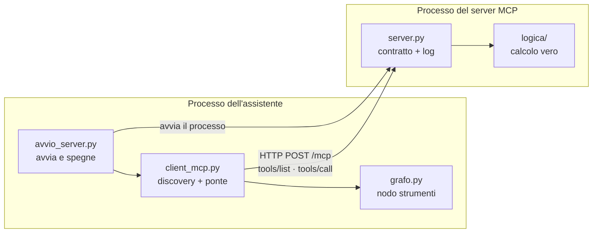
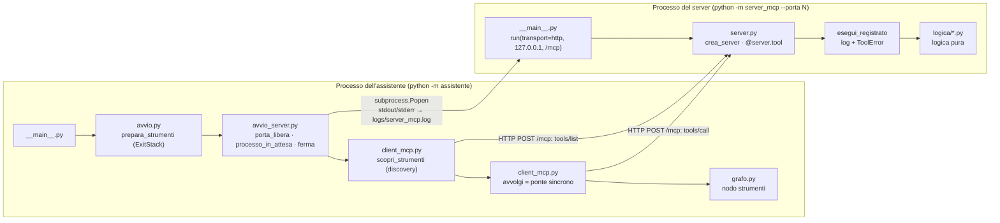
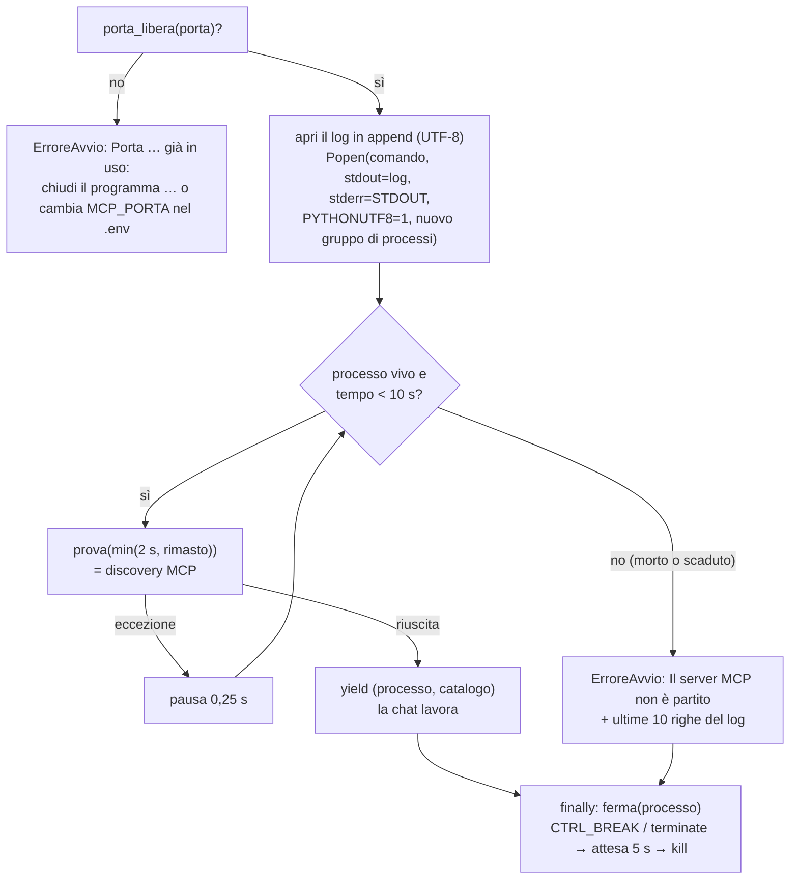
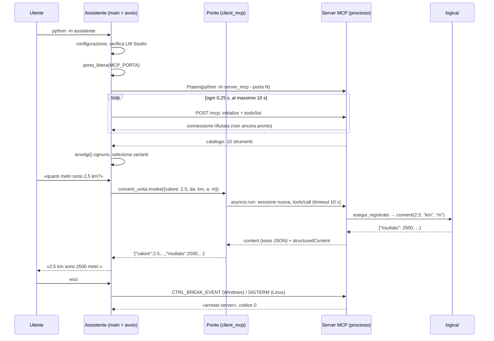

# MCP in pratica: server, client, ponte, processi

## Scheda in 5 minuti

**Di che cosa parla.** Questo capitolo segue MCP nel codice, dall'inizio alla fine. Mostra come il server offre i dieci strumenti, come l'assistente li scopre e li usa, e come accende e spegne il server. Serve a capire che cosa succede davvero quando il modello chiede uno strumento.

**Le idee chiave**

1. **Due processi separati.** L'assistente e il server MCP sono due programmi distinti. L'assistente avvia il server e gli parla via HTTP, solo sul computer locale. Quando la chat finisce, lo spegne. → sezione 2
2. **Il server pubblica il contratto, la logica sta altrove.** Il contratto di uno strumento è il suo nome, la sua descrizione e lo schema degli argomenti, cioè l'elenco degli argomenti con il loro tipo. Il server pubblica il contratto. Il calcolo vero sta in `logica/`, scritto una volta sola. → sezione 3
3. **Gli errori restano in italiano e riconoscibili.** Una richiesta non valida diventa un errore MCP, segnato con il flag `isError`. Un bug inatteso lo ferma una «rete di sicurezza». Il bug finisce nel log e al client arriva un messaggio breve in italiano. → sezione 3.5
4. **La discovery si fa una volta, all'avvio.** La discovery è la domanda «quali strumenti hai?» (`tools/list`). L'assistente la fa all'avvio e usa il catalogo ricevuto per tutta la sessione. Nel client non è scritto nulla del contratto. → sezione 5.2
5. **Il ponte rende sincroni gli strumenti.** Gli strumenti forniti dalla libreria si possono chiamare solo in modo asincrono, cioè con `await`. Il grafo invece lavora in modo sincrono, una cosa dopo l'altra. Il ponte avvolge ogni strumento in una versione sincrona, con lo stesso nome, la stessa descrizione e lo stesso schema. È l'unico punto asincrono del progetto. → sezione 5.3
6. **Due tipi di errore da non confondere.** `tipo: "strumento"` vuol dire che il server ha risposto, ma ha rifiutato la richiesta. `tipo: "collegamento"` vuol dire che il server non si raggiunge o non risponde in tempo. → sezione 5.5
7. **«Pronto» vuol dire «risponde in MCP».** Un processo acceso non basta, e nemmeno un HTTP 200. Il server è pronto quando una discovery riesce. All'uscita l'assistente gli chiede di chiudersi, aspetta e, se serve, lo chiude con la forza. → sezione 6

**Il quadro**



**Da sapere a memoria**

| Cosa | Valore | Dove |
|---|---|---|
| Indirizzo del server | `http://127.0.0.1:<porta>/mcp` | `assistente/avvio_server.py:142-143` |
| Avvio del server | `transport="http"`, `host="127.0.0.1"`, `path="/mcp"` | `server_mcp/__main__.py:39-48` |
| Timeout di ogni chiamata nel ponte | 10 s (`TIMEOUT_CHIAMATA`) | `assistente/client_mcp.py:16` |
| Errori MCP sollevati come eccezioni | `handle_tool_errors=False` | `assistente/client_mcp.py:84` |
| Attesa dell'avvio, pausa tra le prove, attesa dell'arresto | 10 s, 0,25 s, 5 s | `assistente/avvio_server.py:25-27` |
| Messaggio della rete di sicurezza | `Errore interno dello strumento <nome>: <Tipo>.` | `server_mcp/server.py:105-107` |

**Se te lo chiedono all'orale**

- *Perché serve il ponte?* Perché gli strumenti della libreria sono solo asincroni, mentre il grafo è sincrono. Il ponte li avvolge in strumenti sincroni con `asyncio.run`, senza cambiare nome, descrizione e schema.
- *Come capisce l'assistente che il server è pronto?* Ripete una discovery ogni 0,25 secondi, per al massimo 10 secondi. Il server è pronto quando la discovery riesce: un HTTP 200 non dimostra che parli MCP.
- *Chi decide quali strumenti vede il modello?* L'assistente, che fa da host. Il server espone sempre tutti e dieci gli strumenti, e l'assistente sceglie quali passare al modello.

Per i dettagli continua con il resto del capitolo: le idee rimandano alle sezioni con «→ sezione N».

---

Questo documento segue MCP nel codice, dall'inizio alla fine:

1. come il server FastMCP registra i dieci strumenti e trasforma gli errori;
2. come lo si avvia in Streamable HTTP e come si spegne in modo ordinato;
3. come l'assistente scopre il catalogo e trasforma ogni tool asincrono in un tool sincrono per il grafo (il **ponte**);
4. come l'assistente avvia, sorveglia e spegne il processo del server;
5. come provare il server da solo, senza l'assistente e senza LM Studio.

Prima di cominciare conviene aver letto [01 – Panoramica e concetti](01-panoramica-e-concetti.md), per i termini di base, e [03 – Il viaggio di una richiesta](03-viaggio-di-una-richiesta.md), per il percorso complessivo. Il grafo che usa questi strumenti è in [04 – Il grafo LangGraph](04-grafo-langgraph.md). Le varianti non MCP (`locale` e `fastapi`) sono in [06 – Le tre varianti](06-tre-varianti.md), il contenuto dei singoli strumenti in [07 – I dieci strumenti](07-gli-strumenti.md).

> Tutti i riferimenti `percorso:riga` sono relativi a `assistente-laboratorio/` e corrispondono al codice attuale di `main`, dove il branch `dev-revisione` è stato unito il 2026-11-09 con il merge `846b02a`. Gli esempi marcati **«eseguito»** sono stati lanciati davvero con l'interprete della `.venv` (Python 3.14), senza rete verso l'esterno, senza LM Studio e senza usare le porte 8765/8766: il server è stato usato **in memoria** oppure con processi di prova che non aprono porte. Gli esempi non eseguiti sono indicati come tali.

---

## Indice

- [Scheda in 5 minuti](#scheda-in-5-minuti)

1. [MCP in cinque minuti](#1-mcp-in-cinque-minuti-solo-quello-che-serve-qui)
2. [I due processi e i file coinvolti](#2-i-due-processi-e-i-file-coinvolti)
3. [Il server: `server_mcp/server.py`](#3-il-server-server_mcpserverpy)
4. [Avviare il server: `server_mcp/__main__.py`](#4-avviare-il-server-server_mcp__main__py)
5. [Il client e il ponte: `assistente/client_mcp.py`](#5-il-client-e-il-ponte-assistenteclient_mcppy)
6. [Avvio, attesa e arresto: `assistente/avvio_server.py`](#6-avvio-attesa-e-arresto-assistenteavvio_serverpy)
7. [`prepara_strumenti`: tutto insieme, con `ExitStack`](#7-prepara_strumenti-tutto-insieme-con-exitstack)
8. [La sequenza completa](#8-la-sequenza-completa)
9. [Provare il server da solo](#9-provare-il-server-da-solo)
10. [Diagnosi per livelli](#10-diagnosi-per-livelli)
11. [I test che coprono questa parte](#11-i-test-che-coprono-questa-parte)
12. [Come ci si è arrivati](#12-come-ci-si-è-arrivati-commit-principali)
13. [Punti delicati e limiti](#13-punti-delicati-e-limiti)
14. [Domande di ripasso](#14-domande-di-ripasso)

- [Scaletta per le slide](#scaletta-per-le-slide)

---

## 1. MCP in cinque minuti (solo quello che serve qui)

| Termine | Che cosa significa nel progetto |
|---|---|
| **Host** | L'applicazione che usa gli strumenti e decide quali concederne al modello: l'assistente (`python -m assistente`). |
| **Client MCP** | La parte dell'host che parla il protocollo: `MultiServerMCPClient` di `langchain-mcp-adapters`, usato in `assistente/client_mcp.py`. |
| **Server MCP** | Il processo che espone gli strumenti: «Strumenti laboratorio», scritto con FastMCP (`server_mcp/`). |
| **Tool (strumento)** | Una funzione con nome, descrizione e schema JSON degli argomenti (`inputSchema`). |
| **Discovery** | La richiesta `tools/list`: il client chiede al server il catalogo degli strumenti. Nel progetto si fa **una volta**, all'avvio. |
| **Chiamata** | La richiesta `tools/call` con nome e argomenti. La risposta contiene blocchi di testo (`content`), eventualmente uno `structuredContent` e il flag `isError`. |
| **JSON-RPC** | Il formato dei messaggi MCP. L'id JSON-RPC è diverso dal `tool_call_id` del modello, e il server non riceve mai quest'ultimo. |
| **Streamable HTTP** | Il trasporto usato: richieste HTTP `POST` a un unico indirizzo, qui `http://127.0.0.1:<porta>/mcp`. In FastMCP si scrive `transport="http"`, nell'adattatore `"transport": "streamable_http"`. |

Due frasi da ricordare per l'orale:

- il server **espone sempre tutti e dieci gli strumenti**; è l'host a scegliere quali passare al modello (`assistente/varianti.py:1-5`, `:32-43`, e [06](06-tre-varianti.md));
- il codice dell'assistente è **sincrono**; il ponte MCP (`assistente/client_mcp.py`) è **l'unico punto asincrono** (docstring alle righe 1-6).

---

## 2. I due processi e i file coinvolti



| File | Righe | Ruolo |
|---|---|---|
| `server_mcp/server.py` | 195 | Contratto MCP dei dieci strumenti (nomi, descrizioni, schemi) e log delle chiamate. Nessuna logica di calcolo. |
| `server_mcp/__main__.py` | 56 | Riga di comando, logging su stderr, avvio Streamable HTTP, segnali di arresto. |
| `server_mcp/__init__.py` | 1 | Solo la docstring del pacchetto. |
| `assistente/client_mcp.py` | 87 | Discovery e ponte sincrono. |
| `assistente/avvio_server.py` | 205 | Ciclo di vita dei processi di servizio: server MCP e servizio FastAPI. |
| `assistente/avvio.py` | 46 | `prepara_strumenti`: avvia i processi necessari, seleziona le varianti e spegne tutto all'uscita. |

Le dipendenze coinvolte sono fissate in `requirements.txt`: `fastmcp==3.4.11`, `mcp==1.30.0`, `langchain-mcp-adapters==0.3.2`, `httpx==0.28.1`, `pydantic==2.14.2`, `starlette==1.10.0` e `uvicorn==0.54.0`. La specifica del 2026-11-03 annota perché non si usa l'ultima FastMCP: *«l'ultima `fastmcp` (4.x) richiede `mcp>=2.3`, mentre l'ultima `langchain-mcp-adapters` (0.3.2) richiede `mcp<2`, quindi non convivono»* (`docs/superpowers/specs/2026-11-03-convertitore-unita-mcp-design.md:205`).

---

## 3. Il server: `server_mcp/server.py`

### 3.1 Separare contratto e logica

La docstring del modulo dice tutto: *«la logica sta in `logica/`, qui solo contratto e log»* (`server_mcp/server.py:1`). È la regola della specifica (*«La logica … sta in un modulo separato dalla registrazione MCP e non dipende da `fastmcp`»*, slide 18). Ogni strumento ha:

- un **nome** costante, per esempio `NOME_CONVERTITORE = "converti_unita"` (`server.py:31-41`);
- una **descrizione** costante, che il modello legge per decidere quando usare lo strumento (`server.py:43-89`). Due descrizioni sono identiche per contratto alle varianti non MCP, e un test lo verifica: `DESCRIZIONE_CALCOLATRICE` (`:51-55`, uguale alla docstring di `assistente/calcolatrice_locale.py`) e `DESCRIZIONE_SCADENZE` (`:56-61`, uguale a quella di `assistente/wrapper_scadenze.py`);
- uno **schema degli argomenti**, quasi sempre importato dalla logica (`SCHEMA_ESPRESSIONE`, `SCHEMA_QUERY`, `SCHEMA_TEXT`, …), così le varianti usano lo stesso schema;
- una **funzione di registrazione** di poche righe, che chiama la logica pura attraverso `esegui_registrato`.

Le descrizioni seguono anche le indicazioni delle slide: `search_catalog` e `get_item` si distinguono esplicitamente perché lavorano sugli stessi dati (`:63-71`, slide 28); `delete_note` chiede di mostrare la nota e di ottenere conferma prima di eliminarla (`:81-84`, slide 26).

| Nome MCP | Funzione Python | Parametri (facoltativi tra parentesi) | Logica chiamata |
|---|---|---|---|
| `converti_unita` | `converti_unita` | `valore`, `da`, `a` | `logica.conversioni.converti` |
| `ora_corrente` | `ora_corrente_mcp` | `fuso` | `logica.orologio.ora_corrente(fuso, adesso())` |
| `calcola` | `calcola_mcp` | `espressione` | `logica.calcolatrice.calcola` |
| `calcola_scadenza` | `calcola_scadenza_mcp` | `data_inizio`, `giorni`, `lavorativi` | `logica.scadenze.calcola_scadenza` |
| `search_catalog` | `search_catalog` | `query` (`max_results` = 5) | `logica.catalogo.cerca` |
| `get_item` | `get_item` | `code` | `logica.catalogo.dettaglio` |
| `add_note` | `add_note` | `text` | `ArchivioNote.aggiungi` |
| `list_notes` | `list_notes` | (`limit`) | `ArchivioNote.elenca` |
| `delete_note` | `delete_note` | `note_id` | `ArchivioNote.elimina` |
| `get_weather` | `get_weather` | `city` | `logica.meteo.meteo_attuale` |

Un dettaglio che si nota nella tabella: tre funzioni Python hanno il suffisso `_mcp` (`ora_corrente_mcp`, `calcola_mcp`, `calcola_scadenza_mcp`). Servono a non coprire le funzioni omonime importate dalla logica (`server.py:14`, `:28-29`). Il nome visibile al client resta quello passato con `name=`.

### 3.2 `crea_server`: una fabbrica con dipendenze iniettabili

```python
def crea_server(*, adesso=ora_utc, percorso_note=PERCORSO_NOTE, http=None) -> FastMCP:
    server = FastMCP(NOME_SERVER)
    client_http = http or httpx.Client()  # per Open-Meteo, per tutta la vita del processo
    archivio = ArchivioNote(percorso_note)
    catalogo = carica_catalogo()
```
(`server_mcp/server.py:116-126`, firma abbreviata)

- **`adesso`**: la funzione che dà l'istante corrente. I test la sostituiscono con un istante fisso, così l'orologio si verifica senza dipendere dall'ora reale.
- **`percorso_note`**: il file SQLite delle note. Il valore predefinito è `archivio/note.sqlite3`. Test e prove reali passano un file temporaneo.
- **`http`**: il client HTTP per Open-Meteo. Nei test è un `httpx.Client` con `MockTransport` che rifiuta ogni richiesta (`http_senza_rete`, `tests/test_server_mcp.py:31-37`), quindi nessun test usa la rete.
- Il **catalogo dei corsi** si carica una volta sola, alla creazione del server. Se `risorse/catalogo_corsi.json` non è valido, il server non parte.

Le dieci funzioni sono definite **dentro** `crea_server`: sono *closure* che «catturano» `adesso`, `archivio`, `catalogo` e `client_http`. Per questo due server creati con opzioni diverse (per esempio due archivi delle note) non si disturbano.

`crea_server` non avvia niente: restituisce un oggetto `FastMCP`. Lo si può usare **in memoria**, senza processi né porte (§ 9.1), oppure servirlo via HTTP con `.run(...)` (§ 4).

### 3.3 La registrazione di uno strumento

```python
@server.tool(name=NOME_CONVERTITORE, description=DESCRIZIONE_CONVERTITORE)
def converti_unita(
    valore: Annotated[Any, WithJsonSchema({"type": "number", "description": "Numero da convertire, ..."})],
    da: _unita("Unità di partenza"),
    a: _unita("Unità di arrivo"),
) -> dict:
    return esegui_registrato(NOME_CONVERTITORE, {"valore": valore, "da": da, "a": a}, lambda: converti(valore, da, a))
```
(`server_mcp/server.py:128-138`)

- `@server.tool(name=..., description=...)` registra la funzione nel catalogo. Nome e descrizione sono quelli scelti dal progetto, non il nome della funzione Python né la sua docstring.
- I nomi dei parametri Python (`valore`, `da`, `a`) diventano le proprietà dello schema. Un parametro con valore predefinito diventa facoltativo: `max_results` di `search_catalog` (`:166`) e `limit` di `list_notes` (`:182`).
- Il valore restituito è un `dict`. FastMCP lo invia sia come testo JSON sia come `structuredContent` (§ 3.6).
- `_unita(descrizione)` (`:112-113`) è una scorciatoia: costruisce lo stesso tipo annotato con `"enum": list(UNITA_AMMESSE)`, così le due unità hanno un elenco chiuso visibile al modello.

### 3.4 Perché `Annotated[Any, WithJsonSchema(...)]`

È la scelta più «strana» del server, e va saputa spiegare. Il tipo Python è `Any`, ma lo schema pubblicato è quello scritto a mano dentro `WithJsonSchema` (Pydantic). Ne derivano due effetti:

1. **Il modello vede uno schema preciso**: tipo, descrizione, enumerazione, minimi e massimi, valore predefinito.
2. **Pydantic non valida e non converte**: la funzione riceve il valore **grezzo**, così come l'ha mandato il client. La validazione la fa la logica pura, con messaggi in italiano **uguali in tutte le varianti**, perché la variante locale e quella FastAPI usano la stessa logica.

È uno dei fatti verificati nel prototipo, elencati nei Global Constraints del piano: *«un parametro `Annotated[Any, WithJsonSchema({...})]` pubblica lo schema voluto e passa alla funzione il valore grezzo»* (`docs/superpowers/plans/2026-11-03-convertitore-unita-mcp.md:34`).

**Esempio eseguito**: lo stesso parametro, prima tipizzato `float` e poi `Annotated[Any, WithJsonSchema]`, su un piccolo server di prova in memoria.

```text
tipizzato  schema: {"properties": {"valore": {"type": "number"}}, "required": ["valore"], ...}
grezzo     schema: {"properties": {"valore": {"description": "Numero", "type": "number"}}, "required": ["valore"], ...}

tipizzato  valore="abc" -> is_error=True  1 validation error for call[tipizzato] | valore |
                           Input should be a valid number, unable to parse string as a number [type=float_parsing, ...]
tipizzato  valore="2.5" -> {"valore":2.5}                        (stringa convertita in silenzio)
grezzo     valore="abc" -> {"ricevuto":"abc","tipo_python":"str"} (decide la funzione)
```

Con il tipo `float` l'errore arriva al modello in inglese e con il gergo di Pydantic, e una stringa viene convertita senza dirlo. Con il valore grezzo, invece, decide la logica. Nel server reale, in memoria (**eseguito**):

```text
converti_unita {"valore": "abc", "da": "km", "a": "m"} -> is_error=True  "Valore non numerico: 'abc'."
converti_unita {"valore": 1, "da": "C", "a": "m"}      -> is_error=True  "Unità sconosciuta: 'C'. Unità ammesse: km, hm, ..., °C, °F."
```

Lo schema reale di `search_catalog`, come lo riceve un client con la discovery (**eseguito**, descrizione accorciata):

```json
{"additionalProperties": false,
 "properties": {
   "query": {"description": "Una o più parole chiave da cercare nel titolo, nella sede o nel codice ...", "type": "string"},
   "max_results": {"default": 5, "description": "Numero massimo di corsi da restituire, da 1 a 20",
                   "maximum": 20, "minimum": 1, "type": "integer"}},
 "required": ["query"], "type": "object"}
```

Due osservazioni:

- `"required"` lo calcola FastMCP dai parametri **senza** valore predefinito: qui solo `query`.
- `"additionalProperties": false` lo aggiunge FastMCP. Se il client manda un argomento in più, FastMCP lo rifiuta, ma con un messaggio di Pydantic in inglese. **Eseguito**: `converti_unita` con `extra=1` → `is_error=True`, `1 validation error for call[converti_unita] extra Unexpected keyword argument …`. Per questo il grafo controlla gli argomenti **prima** di chiamare qualsiasi variante e risponde in italiano: *«Argomenti non previsti per …: extra. Usa solo: valore, da, a.»* (`assistente/grafo.py:88-99`, `:167-172`, commit `5bed890`).

### 3.5 `esegui_registrato`: log, errori controllati e rete di sicurezza

```python
def esegui_registrato(nome: str, argomenti: dict, calcolo: Callable[[], dict]) -> dict:
    try:
        risultato = calcolo()
    except ErroreStrumento as errore:
        registro.info("chiamata tool=%s argomenti=%s esito=errore messaggio=%s", nome, _json(argomenti), errore)
        raise ToolError(str(errore)) from None
    except Exception as errore:  # rete di sicurezza: nessun errore imprevisto in inglese o senza log
        registro.exception("chiamata tool=%s argomenti=%s esito=errore imprevisto", nome, _json(argomenti))
        raise ToolError(f"Errore interno dello strumento {nome}: {type(errore).__name__}.") from None
    registro.info("chiamata tool=%s argomenti=%s esito=ok risultato=%s", nome, _json(argomenti), _json(risultato))
    return risultato
```
(`server_mcp/server.py:98-109`)

Punto per punto:

- **`calcolo` è una `lambda`**: la registrazione prepara la chiamata, e `esegui_registrato` la esegue dentro il `try`. Così log e gestione degli errori sono scritti una volta sola per dieci strumenti.
- **`ErroreStrumento`** (`logica/errori.py`, sottoclasse di `ValueError`) è l'errore «previsto», cioè una richiesta non valida. Diventa un **`ToolError`** di FastMCP, che FastMCP trasforma in un risultato MCP con `isError: true` e il messaggio tale e quale. È la scelta della specifica: *«Il server segnala questi errori con il meccanismo di errore di MCP (risultato con `isError`), non come un risultato normale»*, così l'errore resta riconoscibile **a livello di protocollo**.
- **Rete di sicurezza** (`except Exception`, introdotta nel commit `2c067fd`): un'eccezione imprevista, cioè un bug, non deve arrivare al modello in inglese né restare fuori dal log. `registro.exception` scrive la riga a livello `ERROR` **con il traceback**. Al client arriva solo il **tipo** dell'eccezione, non il suo messaggio interno.
- **`from None`** toglie la catena delle eccezioni: il `ToolError` porta solo il messaggio pulito.
- **`_json`** (`:94-95`) serializza con `ensure_ascii=False` e senza spazi, così `°C` e `à` restano leggibili e ogni chiamata sta su una riga.

**Che cosa succederebbe senza la rete di sicurezza?** **Eseguito** su un server di prova: una funzione che solleva `OverflowError("int too large to convert to float")` senza nessuna gestione produce `is_error=True` con il testo `Error calling tool 'bug_nudo': int too large to convert to float`. Inglese, con il messaggio interno, e senza la riga `chiamata tool=…` nel log del progetto. Con la rete di sicurezza, il client riceve invece `Errore interno dello strumento <nome>: OverflowError.`.

Un caso concreto in cui la rete di sicurezza scatta: nei test il client HTTP del meteo solleva `AssertionError` a ogni richiesta. Non essendo un `ErroreStrumento` né un errore di rete gestito da `logica/meteo.py`, **eseguito** in memoria: `get_weather {"city": "Roma"}` → `Errore interno dello strumento get_weather: AssertionError.`. Se invece il trasporto solleva un vero `httpx.ConnectError`, la logica del meteo lo traduce in un errore previsto: `Servizio meteo non disponibile: ConnectError: …` (**eseguito**, § 5.5).

**Esempio eseguito** (formato del logging uguale a quello di `server_mcp/__main__.py:31-33`, data omessa):

```text
INFO server_mcp chiamata tool=converti_unita argomenti={"valore":2.5,"da":"km","a":"m"} esito=ok risultato={"valore":2.5,"da":"km","a":"m","risultato":2500,"grandezza":"lunghezza"}
INFO server_mcp chiamata tool=prova argomenti={"x":"abc"} esito=errore messaggio=Valore non numerico: 'abc'.
ERROR server_mcp chiamata tool=prova argomenti={"x":"abc"} esito=errore imprevisto
Traceback (most recent call last): ... OverflowError: numero troppo grande
```

Due strumenti con effetti scrivono una riga in più, ma solo dopo un'operazione riuscita: `add_note` (`:175-179`) e `delete_note` (`:185-189`) aggiungono `modifica note operazione=aggiunta|eliminazione id=…`. Se l'operazione fallisce, `esegui_registrato` solleva l'eccezione e la riga non viene scritta.

### 3.6 Che cosa viaggia in risposta

**Esempio eseguito**, con il client in memoria di FastMCP:

```text
OK   is_error=False  content[0].text={"valore":2.5,"da":"km","a":"m","risultato":2500,"grandezza":"lunghezza"}
                     structured_content={'valore': 2.5, 'da': 'km', 'a': 'm', 'risultato': 2500, 'grandezza': 'lunghezza'}
ERR  is_error=True   content[0].text=Unità sconosciuta: 'C'. Unità ammesse: ...   structured_content=None
```

Un risultato riuscito arriva quindi **due volte**: come testo JSON compatto e come oggetto strutturato. Un errore arriva come testo, con `isError` e senza contenuto strutturato. Il ponte dell'assistente usa solo il testo (§ 5.4).

---

## 4. Avviare il server: `server_mcp/__main__.py`

### 4.1 Riga di comando e log

```text
python -m server_mcp --porta 8765 [--note percorso.sqlite3]
```

- `--porta` è obbligatoria (`server_mcp/__main__.py:27`). Il server non ha una porta predefinita: la decide chi lo avvia, cioè l'assistente con `MCP_PORTA` dal `.env`.
- `--note` è facoltativa (`:28`). Se manca, si usa l'archivio reale `archivio/note.sqlite3`. Le prove reali e `tests/test_prepara_strumenti.py` la usano per lavorare su un archivio temporaneo. Nel codice: `opzioni = {"percorso_note": argomenti.note} if argomenti.note else {}` (`:38`), quindi senza `--note` vale il predefinito di `crea_server`.
- Il logging va su **stderr**, con formato `%(asctime)s %(levelname)s %(name)s %(message)s` (`:31-33`). Il file `logs/server_mcp.log` **non lo apre il server**: è l'assistente che redirige stdout e stderr del processo figlio nel file (§ 6.3). Se avvii il server da solo, le righe compaiono nel suo terminale.
- All'avvio scrive `avvio server porta=…` (`:35`), all'uscita `arresto server` (`:51-52`).

### 4.2 Le opzioni di `run`

```python
crea_server(**opzioni).run(
    transport="http", host="127.0.0.1", port=argomenti.porta, path="/mcp",
    show_banner=False, stateless_http=True, json_response=True, log_level="warning",
)
```
(`server_mcp/__main__.py:39-48`)

| Opzione | Valore | Perché |
|---|---|---|
| `transport` | `"http"` | In FastMCP 3 `"http"` è lo Streamable HTTP (i valori ammessi sono `"stdio"`, `"http"`, `"sse"`, `"streamable-http"`). |
| `host` | `"127.0.0.1"` | Solo loopback: il server non è raggiungibile da altri computer. È un requisito della specifica (*«Trasporto Streamable HTTP, solo su `127.0.0.1`»*). |
| `port` | da `--porta` | Viene da `MCP_PORTA`, passata dall'assistente. |
| `path` | `"/mcp"` | L'URL completo è `http://127.0.0.1:<porta>/mcp` (`assistente/avvio_server.py:142-143`). |
| `show_banner` | `False` | Niente banner grafico di FastMCP nel log. |
| `stateless_http` | `True` | Nessuna sessione da ricordare tra una richiesta e l'altra. Va d'accordo con il client, che apre una sessione nuova a ogni chiamata (§ 5.2). |
| `json_response` | `True` | Risposte `application/json` semplici invece di uno stream SSE. |
| `log_level` | `"warning"` | Uvicorn non scrive una riga per ogni richiesta HTTP. |

Le ultime tre opzioni vengono dal prototipo: *«`stateless_http=True, json_response=True, log_level="warning"` evitano traceback e rumore nel log del server»* (`docs/superpowers/plans/2026-11-03-convertitore-unita-mcp.md:33`). La stessa riga `run(...)` compare in `tests/server_vuoto.py`, un server **senza strumenti** che serve a provare l'errore «catalogo vuoto».

### 4.3 I segnali di arresto

```python
def _arresto_su_segnale(numero, frame):
    raise KeyboardInterrupt

def _installa_segnali_di_arresto() -> None:
    for nome in ("SIGBREAK", "SIGTERM"):
        if hasattr(signal, nome):
            signal.signal(getattr(signal, nome), _arresto_su_segnale)
```
(`server_mcp/__main__.py:12-22`)

- **`SIGBREAK`** esiste solo su Windows. È il segnale che arriva quando l'assistente invia `CTRL_BREAK_EVENT` (§ 6.4).
- **`SIGTERM`** è l'arresto su Linux e in Docker (`processo.terminate()`).
- `hasattr` rende il codice portabile: su Linux `signal.SIGBREAK` non esiste e viene saltato.
- **Il problema che risolve** (commit `b320bf1`): il commento nel codice spiega che *«Uvicorn chiude in modo ordinato e poi rilancia il segnale ricevuto»* e che *«Senza questo gestore il processo uscirebbe con codice 3 senza eseguire il blocco finally»* (`:13`, `:19`). La riga `arresto server` non compariva mai. Con il gestore il segnale diventa un `KeyboardInterrupt`, intercettato da `except KeyboardInterrupt: pass` (`:49-50`): l'uscita è normale (codice 0) e il `finally` registra l'arresto. Lo verifica `test_arresto_ordinato_registrato` (`tests/test_avvio_server.py:131-137`) sul server reale.

**Esempio eseguito**: tre processi figli Python, avviati con `CREATE_NEW_PROCESS_GROUP` (come fa `_opzioni_processo`) e fermati con la vera `ferma()` del progetto, con attesa ridotta a 2 s. Nessuna porta aperta.

```text
senza gestore      codice=3221225786 tempo=0.00s out=''                  (0xC000013A, STATUS_CONTROL_C_EXIT)
con gestore        codice=0          tempo=0.06s out='arresto ordinato'
ignora il segnale  codice=1          tempo=2.00s out=''                  (ucciso da kill dopo l'attesa)
```

Il terzo caso mostra il paracadute di `ferma`: chi ignora la richiesta viene terminato con la forza.

> **Dettaglio osservato durante la prova.** Un gestore di segnale Python viene eseguito nel thread principale solo quando l'interprete riprende il controllo. Un figlio di prova fermo in un unico `time.sleep(30)` non ha reagito a `SIGBREAK` prima del `kill`; con tante attese brevi sì. Per il server reale il comportamento corretto (codice 0 e riga `arresto server`) è dimostrato dal test citato sopra.

---

## 5. Il client e il ponte: `assistente/client_mcp.py`

### 5.1 Il problema da risolvere

Il grafo LangGraph del progetto è **sincrono**: chiama `strumento.invoke(argomenti)` (`assistente/grafo.py:175`). I tool prodotti da `langchain-mcp-adapters` sono invece **solo asincroni**. **Eseguito**, con l'adattatore collegato al server reale in memoria:

```text
invoke sincrono -> NotImplementedError StructuredTool does not support sync invocation.
args_schema tipo: dict   response_format: content_and_artifact
```

La soluzione del progetto è un **ponte**: ogni tool scoperto viene avvolto in un tool sincrono con lo stesso nome, la stessa descrizione e lo stesso schema. La specifica (§ 5.4) lo descrive così: *«Gli strumenti ottenuti, che sono solo asincroni, vengono avvolti da un piccolo ponte in strumenti LangChain sincroni»*. In alternativa si sarebbe dovuto rendere asincrono tutto il grafo, cosa che la specifica esclude (*«Grafo o interfaccia asincroni»* tra i non obiettivi).

### 5.2 La discovery: `scopri_strumenti`

```python
def scopri_strumenti(url: str, timeout_scoperta: float = TIMEOUT_CHIAMATA) -> list[BaseTool]:
    client = MultiServerMCPClient(
        {NOME_CONNESSIONE: {"transport": "streamable_http", "url": url, "timeout": TIMEOUT_CHIAMATA}},
        handle_tool_errors=False,
    )
    strumenti = asyncio.run(asyncio.wait_for(client.get_tools(), timeout_scoperta))
    return [avvolgi(strumento) for strumento in strumenti]
```
(`assistente/client_mcp.py:80-87`)

- **Una sola connessione**, chiamata `"laboratorio"` (`:15`), con trasporto `streamable_http` verso l'URL del server. `"timeout": 10.0` è il timeout HTTP dell'adattatore (nel codice della libreria: *«HTTP timeout»*).
- **`handle_tool_errors=False`**: è fondamentale. Con il valore predefinito (`True`) l'adattatore **restituisce** gli errori MCP come contenuto normale; con `False` li **solleva** come eccezione, e il ponte può riconoscerli. **Eseguito**, con l'adattatore collegato al server reale in memoria:

  ```text
  handle_tool_errors=True  -> ritorna [{'type': 'text', 'text': "Unità sconosciuta: 'C'. Unità ammesse: ..."}]
  handle_tool_errors=False -> solleva _MCPToolExecutionError (sottoclasse di ToolException) Unità sconosciuta: 'C'. ...
  ```
  Poiché `_MCPToolExecutionError` deriva da `langchain_core.tools.ToolException`, l'`except ToolException` del ponte la intercetta.
- **`asyncio.run(asyncio.wait_for(..., timeout_scoperta))`**: crea un ciclo di eventi, esegue la discovery con un tempo massimo e lo chiude. Durante l'attesa dell'avvio, `timeout_scoperta` vale al massimo 2 secondi per tentativo (§ 6.3).
- **Le eccezioni non sono gestite qui**, lo dice la docstring (*«le eccezioni le gestisce il chiamante»*): le gestisce l'attesa dell'avvio, che riprova finché il server non risponde.
- **Una sessione per chiamata**: `get_tools()` usato con una configurazione di connessione (e non con una sessione già aperta) produce tool che aprono una **sessione MCP nuova a ogni chiamata**. La documentazione di `MultiServerMCPClient.get_tools` lo dice: *«A new session will be created for each tool call»*. È ciò che permette al ponte di usare un `asyncio.run` diverso per ogni chiamata, senza sessioni legate a un ciclo di eventi già chiuso.

All'inizio del modulo il client fa tacere le librerie di rete: `mcp`, `httpx` e `httpcore` scrivono solo a livello `ERROR` (`:21-23`), perché il loro output non deve finire nel terminale della chat.

### 5.3 Il ponte: `avvolgi`

```python
def avvolgi(strumento: BaseTool, timeout: float = TIMEOUT_CHIAMATA) -> BaseTool:
    def esegui(**argomenti) -> str:
        try:
            contenuto = asyncio.run(asyncio.wait_for(strumento.ainvoke(argomenti), timeout))
        except ToolException as errore:
            return _errore(str(errore), TIPO_STRUMENTO)
        except TimeoutError:
            return _errore(f"Server MCP: nessuna risposta entro {timeout:g} secondi.", TIPO_COLLEGAMENTO)
        except Exception as errore:  # anche ExceptionGroup del trasporto
            return _errore(f"Server MCP non raggiungibile: {_descrivi(_prima_causa(errore))}", TIPO_COLLEGAMENTO)
        return _testo(contenuto)

    return StructuredTool(name=strumento.name, description=strumento.description,
                          args_schema=strumento.args_schema, func=esegui, metadata={"origine": ORIGINE_MCP})
```
(`assistente/client_mcp.py:57-77`)

- **Stesso contratto**: `name`, `description` e `args_schema` vengono copiati dal tool dell'adattatore. `args_schema` è proprio il **dizionario** JSON Schema ricevuto con la discovery. Il modello vede quindi esattamente ciò che il server pubblica: nulla è scritto a mano nel client, come chiede la specifica (anti-obiettivo: *«Nome, descrizione o schema dello strumento scritti a mano nel client invece che ricevuti dal server»*).
- **`func=esegui`** è una funzione sincrona: ora `invoke` funziona.
- **`metadata={"origine": "mcp"}`** permette al grafo e al terminale di sapere da dove arriva lo strumento: compare nella riga `[ora_corrente · mcp: Asia/Tokyo]` e nel campo `origine=mcp` di `logs/assistente.log` (`assistente/varianti.py:51-53`, `assistente/grafo.py:157`).
- **Timeout di 10 s** (`TIMEOUT_CHIAMATA = 10.0`, `:16`), applicato con `asyncio.wait_for` a **tutta** la chiamata (sessione, `initialize`, `tools/call`). Il meteo ha un limite totale di 8 secondi verso Open-Meteo (`TEMPO_TOTALE = 8.0`, `logica/meteo.py:20`), scelto apposta sotto i 10 del ponte: così l'errore arriva dal meteo e non come «nessuna risposta».
- **Non solleva mai eccezioni verso il grafo**: restituisce sempre una stringa, cioè il risultato oppure un JSON d'errore.
- **`TimeoutError`**: da Python 3.11 `asyncio.wait_for` solleva il `TimeoutError` predefinito, quindi basta catturare quello.

### 5.4 Le funzioni di appoggio

| Funzione | Righe | Che cosa fa |
|---|---|---|
| `_errore(testo, tipo)` | `:26-27` | Costruisce `{"errore": "...", "tipo": "strumento"\|"collegamento"}` con `ensure_ascii=False`. |
| `_prima_causa(eccezione)` | `:30-33` | Scende dentro gli `ExceptionGroup` annidati fino alla prima eccezione vera. Con il server spento il trasporto (basato su task group) solleva un gruppo che contiene un `ConnectError`. |
| `_descrivi(eccezione)` | `:36-39` | `"Tipo: messaggio"`, oppure solo `"Tipo"` se il messaggio è vuoto (per esempio `OSError()`). |
| `_testo(contenuto)` | `:42-54` | Concatena i blocchi `{"type": "text"}` restituiti dall'adattatore. Gestisce anche una stringa semplice e la coppia `(contenuto, artefatto)`. Il contenuto strutturato viene ignorato: al modello arriva il testo JSON. |

Che cosa restituisce davvero l'adattatore? **Eseguito**: `ainvoke` sul tool `converti_unita` dell'adattatore restituisce una lista di blocchi, per esempio `[{'type': 'text', 'text': '{"valore":2.5,...,"risultato":2500,...}', 'id': 'lc_…'}]`. `_testo` prende il campo `text` e ignora il resto.

### 5.5 Errore dello strumento contro errore di collegamento

È la distinzione centrale del ponte. La specifica la mette tra gli anti-obiettivi, cioè tra le cose che renderebbero il progetto un fallimento: *«Un errore di collegamento (server spento, timeout) si presenta come "unità sconosciuta", o il contrario»*.

**Esempio eseguito** con tool asincroni finti, costruiti come in `tests/test_client_mcp.py` (`StructuredTool` con `coroutine=` e `response_format="content_and_artifact"`), passati alla vera `avvolgi`:

```text
ok                -> {"risultato": 2500}
errore strumento  -> {"errore": "Unità sconosciuta: 'C'", "tipo": "strumento"}
server spento     -> {"errore": "Server MCP non raggiungibile: ConnectError: All connection attempts failed", "tipo": "collegamento"}
lento             -> {"errore": "Server MCP: nessuna risposta entro 0.2 secondi.", "tipo": "collegamento"}
```

(Nel caso «server spento» il tool finto solleva un `ExceptionGroup` che contiene `httpx.ConnectError("All connection attempts failed")`, cioè ciò che succede con il server reale spento; il caso reale è coperto da `test_ciclo_completo`.)

| Situazione | Dove nasce | Che cosa riceve il ponte | Che cosa restituisce il ponte | `esito` in `assistente.log` |
|---|---|---|---|---|
| Argomento rifiutato dalla logica (es. `da="C"`) | `ErroreStrumento` → `ToolError` → `isError` | `ToolException` | `tipo: "strumento"`, messaggio del server | `errore_tool` |
| Bug nel server | rete di sicurezza → `ToolError("Errore interno …")` | `ToolException` | `tipo: "strumento"` | `errore_tool` |
| Open-Meteo irraggiungibile | logica del meteo → `ErroreStrumento("Servizio meteo non disponibile: …")` | `ToolException` | `tipo: "strumento"` | `errore_tool` |
| Server MCP spento o caduto | `httpx.ConnectError` dentro un `ExceptionGroup` | `Exception` | `"Server MCP non raggiungibile: …"`, `tipo: "collegamento"` | `errore_collegamento` |
| Server bloccato | `asyncio.wait_for` scade | `TimeoutError` | `"Server MCP: nessuna risposta entro 10 secondi."` | `errore_collegamento` |

Attenzione alla terza riga, che spesso confonde: «collegamento» riguarda il tratto **assistente ↔ server MCP**. Se il server risponde ma la sua logica non raggiunge Open-Meteo, è un errore **dello strumento**. **Eseguito** in memoria, con un trasporto HTTP finto che solleva `httpx.ConnectError`: `get_weather {"city": "Roma"}` → `is_error=True`, `Servizio meteo non disponibile: ConnectError: rete vietata nella prova`.

Il grafo legge il campo `tipo` in `_esito` (`assistente/grafo.py:66-74`): `"collegamento"` dà `errore_collegamento`, qualsiasi altro `"errore"` dà `errore_tool`. In entrambi i casi il `ToolMessage` ha `status="error"` (`grafo.py:180-185`). L'assistente **non riavvia** un server caduto (scelta della specifica): la chat continua e le chiamate successive danno un errore di collegamento.

---

## 6. Avvio, attesa e arresto: `assistente/avvio_server.py`

La docstring del modulo riassume il ciclo (`avvio_server.py:1-5`): *«porta libera → avvio con l'output nel file di log → attesa che il processo risponda davvero (non basta che sia acceso) → arresto garantito all'uscita»*.



### 6.1 Le costanti

| Costante | Valore | Riga |
|---|---|---|
| `ATTESA_AVVIO` | 10,0 s: tempo massimo perché il server diventi pronto | `:25` |
| `ATTESA_ARRESTO` | 5,0 s: tempo concesso per chiudersi da solo prima del `kill` | `:26` |
| `PAUSA_TRA_PROVE` | 0,25 s tra un tentativo di discovery e il successivo | `:27` |
| `CARTELLA_PROGETTO` | la cartella `assistente-laboratorio/`, usata come `cwd` del processo figlio | `:28` |

### 6.2 `porta_libera`: due controlli, non uno

```python
def porta_libera(porta: int) -> bool:
    with socket.socket() as prova:
        try:
            prova.bind(("127.0.0.1", porta))  # senza SO_REUSEADDR: una porta in uso risulta occupata
        except OSError:
            return False
    try:
        with socket.create_connection(("127.0.0.1", porta), timeout=0.5):
            return False
    except OSError:
        return True
```
(`assistente/avvio_server.py:35-47`)

1. **Bind** su `127.0.0.1`. Se fallisce, qualcuno usa già la porta su quell'indirizzo.
2. **Connessione di prova**. Su Windows il bind su `127.0.0.1` **riesce anche se** un altro programma ascolta su `0.0.0.0` (tutte le interfacce). Se qualcuno risponde alla connessione, la porta è comunque occupata. Questo secondo controllo è stato aggiunto con il commit `9c7e599`.

**Esempio eseguito** (porta scelta dal sistema operativo, solo loopback, nessun server MCP coinvolto):

```text
porta 58215 libera? True
bind su 127.0.0.1 riuscito anche con 0.0.0.0 occupato: True
porta_libera con occupante su 0.0.0.0: False
```

Il controllo serve a dare un messaggio chiaro **prima** di avviare il processo. Un caso tipico è un server rimasto acceso da una sessione precedente: senza il controllo, la discovery parlerebbe con il server vecchio e non con quello appena avviato. Il messaggio è quello previsto dalla specifica: *«Porta 8765 già in uso: chiudi il programma che la usa o cambia MCP_PORTA nel .env.»* (`:97-100`).

### 6.3 `processo_in_attesa`: avvio e prontezza

È un **context manager generico** (`:85-139`): lo usano sia il server MCP sia il servizio FastAPI. Era generico fin dalla sua introduzione (commit `5b28141`, con la docstring del modulo che già prevedeva *«e in seguito servizio FastAPI»*); il commit `973eae7` ha poi aggiunto `avvia_servizio_api`, che lo riusa. Riceve il comando, la porta, il file di log, una funzione `prova(tempo_massimo)` che dice se il processo è pronto, e due testi per i messaggi (`descrizione`, `variabile_porta`). Il tipo generico `T` (`TypeVar`, `:32`) indica che `prova` può restituire qualsiasi cosa: per il server MCP il catalogo, per FastAPI `None`.

Le opzioni di `subprocess.Popen` (`:105-113`):

| Opzione | Effetto |
|---|---|
| `cwd=CARTELLA_PROGETTO` | `python -m server_mcp` trova i pacchetti `server_mcp/` e `logica/` qualunque sia la cartella di partenza. |
| `stdin=subprocess.DEVNULL` | Il server non legge mai dalla tastiera, che resta tutta della chat. |
| `stdout=log, stderr=subprocess.STDOUT` | Tutto l'output del server, compreso il logging su stderr, finisce in `logs/server_mcp.log` e **mai nel terminale della chat** (test `test_nessun_output_nel_terminale`). |
| `env={**os.environ, "PYTHONUTF8": "1"}` | Il figlio scrive in UTF-8 anche su Windows, dove altrimenti userebbe la codifica locale (cp1252). `°C` e `à` restano leggibili (test `test_log_del_server_in_utf8`). Il padre apre il file con `encoding="utf-8"` (`:102`) e lo rilegge in UTF-8 con `ultime_righe` (`:50-55`). |
| `creationflags=CREATE_NEW_PROCESS_GROUP` (Windows) / `start_new_session=True` (Linux) | Il figlio sta in un gruppo di processi suo (`_opzioni_processo`, `:79-82`). Serve per inviargli `CTRL_BREAK_EVENT` senza colpire l'assistente, e fa sì che il Ctrl+C premuto nella chat non arrivi direttamente al server: è l'assistente a spegnerlo, in ordine. |

**Prontezza = discovery riuscita, non HTTP 200.** Il ciclo `while processo.poll() is None` (`:118-127`) chiama `prova(min(2.0, rimasto))`. Per il server MCP, `prova` è `discovery` (`:161-162`), cioè una vera `tools/list`. Un HTTP 200 dimostrerebbe solo che un server web risponde. Una discovery riuscita dimostra che il processo parla MCP, sul percorso giusto, con versioni compatibili, e che il catalogo è leggibile. La specifica lo chiede esplicitamente (*«deve riuscire una discovery `tools/list`, non basta un HTTP 200 (slide 24)»*).

- Finché il server non ascolta, la discovery fallisce (connessione rifiutata). `except Exception` la cattura, si aspettano 0,25 s e si riprova.
- **Il catalogo trovato durante l'attesa è quello della sessione**: `prova` restituisce gli strumenti già avvolti nel ponte, e `processo_in_attesa` li restituisce con `yield processo, valore`. Non c'è una seconda discovery.
- Se il processo muore (per esempio per un errore di import) o i 10 s scadono, `pronto` resta `False`: `ErroreAvvio("Il server MCP non è partito (porta N). Ultime righe di …")` (`:128-133`), con le ultime 10 righe del log. Prima di leggerle, `log.flush()` svuota il buffer del file.
- **Ctrl+C durante l'attesa**: `KeyboardInterrupt` non è una sottoclasse di `Exception`, quindi non viene catturato dal ciclo. Risale, e il `finally` spegne comunque il processo (test `test_ctrl_c_durante_l_avvio_spegne_il_server`).
- **Il `finally` (`:135-139`) vale sempre**: dopo un avvio fallito, dopo un'uscita normale dalla chat, dopo un'eccezione. Prima `ferma(processo)`, poi una riga `spento server MCP codice=…` nel log dell'assistente, poi la chiusura del file di log. La variabile `processo = None` (`:103`) evita di chiamare `ferma` se è fallito proprio `Popen`.

### 6.4 `ferma`: chiedere, aspettare, imporre

```python
def ferma(processo: subprocess.Popen, attesa: float = ATTESA_ARRESTO) -> None:
    if processo.poll() is None:
        try:
            if sys.platform == "win32":
                processo.send_signal(signal.CTRL_BREAK_EVENT)
            else:
                processo.terminate()
        except OSError:
            pass
    try:
        processo.wait(attesa)
    except subprocess.TimeoutExpired:
        pass
    finally:
        if processo.poll() is None:
            processo.kill()
            processo.wait()
```
(`assistente/avvio_server.py:58-76`)

1. **Richiesta gentile**: su Windows `CTRL_BREAK_EVENT`, che nel server diventa `SIGBREAK` (§ 4.3). Su Linux e in Docker `terminate()`, cioè `SIGTERM`. Dal prototipo: *«su Windows `CTRL_BREAK_EVENT` a un processo avviato con `CREATE_NEW_PROCESS_GROUP` lo chiude in circa 0,2 s»* (piano 2026-11-03, riga 32). L'`except OSError` copre il caso di un processo appena morto.
2. **Attesa** fino a 5 s.
3. **Imposizione**: `kill()` se il processo è ancora vivo. Il `kill` sta in un **`finally`** (commit `9c7e599`): anche se l'attesa viene interrotta da un secondo Ctrl+C, il processo non resta orfano. Lo verifica `test_ctrl_c_durante_l_arresto_uccide_comunque`, con un finto processo il cui primo `wait` solleva `KeyboardInterrupt`.

Perché `CTRL_BREAK_EVENT` e non `terminate()` anche su Windows? Su Windows `terminate()` equivale a `TerminateProcess`, cioè un'uccisione immediata: il server non eseguirebbe il `finally` e non scriverebbe `arresto server`.

### 6.5 `avvia_server_mcp` e `ServerAvviato`

```python
@contextmanager
def avvia_server_mcp(porta, percorso_log, attesa=ATTESA_AVVIO, comando=None) -> Iterator[ServerAvviato]:
    url = url_server(porta)
    comando = comando or [sys.executable, "-m", "server_mcp", "--porta", str(porta)]
    ...
    with processo_in_attesa(comando, porta, percorso_log, discovery,
                            descrizione="server MCP", variabile_porta="MCP_PORTA", attesa=attesa) as (processo, strumenti):
        if not strumenti:
            raise ErroreAvvio("Il server MCP non espone nessuno strumento.")
        registro.info("catalogo strumenti=%s", [s.name for s in strumenti])
        yield ServerAvviato(processo, url, strumenti)
```
(`assistente/avvio_server.py:153-170`, abbreviato)

- **`sys.executable`**: il server parte con lo stesso interprete dell'assistente, cioè quello della `.venv` (o quello del container in Docker).
- **`comando`** si può sostituire. I test lo usano per simulare un server che non parte, uno che non risponde e uno senza strumenti (`tests/server_vuoto.py`). Le prove reali e `test_prepara_strumenti.py` lo usano per passare `--note` con un archivio temporaneo.
- **Catalogo vuoto**: errore esplicito. Un `ErroreAvvio` sollevato dentro il `with` passa dal `finally` di `processo_in_attesa`, quindi il server viene spento anche in questo caso.
- **`ServerAvviato`** (`:146-150`) è un `dataclass(frozen=True)` con `processo`, `url` e `strumenti`.
- Il gemello **`avvia_servizio_api`** (`:183-205`) riusa lo stesso `processo_in_attesa`. Per FastAPI «pronto» significa che `/openapi.json` descrive `/scadenza` (`:191-194`), anche qui più di un semplice HTTP 200. Dettagli in [06](06-tre-varianti.md).

I messaggi di `ErroreAvvio` arrivano a `assistente/__main__.py:31-33`, che stampa `Errore: …` su stderr e restituisce il codice 1, senza traceback.

---

## 7. `prepara_strumenti`: tutto insieme, con `ExitStack`

```python
@contextmanager
def prepara_strumenti(config, log_server=None, log_api=None, comando_server=None) -> Iterator[list[BaseTool]]:
    with ExitStack() as pila:
        server = pila.enter_context(avvia_server_mcp(config.porta_mcp, log_server or LOG_SERVER, comando=comando_server))
        url_api = None
        if config.variante_scadenze == "fastapi":
            servizio = pila.enter_context(avvia_servizio_api(config.porta_api, log_api or LOG_API))
            url_api = servizio.url
        strumenti = seleziona_strumenti(server.strumenti, crea_sostituti(config, url_api=url_api))
        yield strumenti
```
(`assistente/avvio.py:21-46`, senza le righe di log)

- **Perché `ExitStack`** (introdotto nel commit `9e39a71`, passo 3): il numero di processi dipende dalla configurazione, uno o due. `ExitStack` permette di entrare in un numero **variabile** di context manager e garantisce che all'uscita vengano chiusi **tutti**, in **ordine inverso** (LIFO). Il servizio FastAPI si spegne prima, il server MCP dopo. Senza `ExitStack` servirebbero due `with` annidati e un ramo `if` duplicato.
- **Fallimento a metà**: se il server MCP è partito ma il servizio FastAPI no, `avvia_servizio_api` solleva `ErroreAvvio`. Uscendo dal `with`, l'`ExitStack` spegne anche il server MCP già avviato. Lo dice la docstring: *«Se un processo non parte, l'ExitStack spegne anche quelli già avviati»*.
- **Selezione delle varianti**: `crea_sostituti` prepara la calcolatrice `locale` e/o il wrapper `fastapi`; `seleziona_strumenti` toglie dal catalogo MCP gli strumenti omonimi e verifica che nessun nome compaia due volte ([06](06-tre-varianti.md)).
- **Due righe di log** nell'assistente: `varianti calcolatrice=… scadenze=…` e `strumenti al modello=[…]` (`avvio.py:41-45`).
- **Lo stesso percorso per la chat e per le prove reali**: lo usano `python -m assistente` (`assistente/__main__.py:28-30`) e le prove reali (docstring di `avvio.py:1-3`). Così una prova reale verifica proprio il percorso che usa l'utente.

```python
with prepara_strumenti(config) as strumenti:
    grafo = crea_grafo(crea_modello(config, strumenti), strumenti)
    esegui_sessione(grafo, fuso, origini=origini(strumenti), parametri=parametri(strumenti))
```
(`assistente/__main__.py:28-30`)

Qualunque sia il modo di uscire dalla chat (`esci`, Ctrl+C, fine dell'input, eccezione), si esce dal `with` e i processi vengono spenti. Notare l'ordine in `main`: la verifica di LM Studio (`verifica_server`, `:26`) viene **prima** di `prepara_strumenti`, quindi se LM Studio non risponde il server MCP non viene nemmeno avviato.

---

## 8. La sequenza completa



---

## 9. Provare il server da solo

La specifica lo chiede esplicitamente: il server *«si può avviare anche da solo con un comando documentato. Serve per provarlo con MCP Inspector o con un altro client MCP»* (`specs/2026-11-03-convertitore-unita-mcp-design.md:105`). Ci sono quattro modi, dal più isolato al più realistico.

### 9.1 In memoria, senza processi né rete (eseguito)

FastMCP permette di collegare un `Client` direttamente all'oggetto server: niente porte, niente HTTP. È il metodo di `con_client` in `tests/test_server_mcp.py:40-56`, che usa anche un archivio delle note temporaneo e un client HTTP che vieta la rete.

```python
import asyncio, tempfile, httpx
from pathlib import Path
from fastmcp import Client
from server_mcp.server import crea_server

def vietato(richiesta): raise AssertionError("niente rete")

async def main():
    with tempfile.TemporaryDirectory(ignore_cleanup_errors=True) as cartella:
        server = crea_server(percorso_note=Path(cartella) / "note.sqlite3",
                             http=httpx.Client(transport=httpx.MockTransport(vietato)))
        async with Client(server) as client:
            print([t.name for t in await client.list_tools()])
            r = await client.call_tool("converti_unita", {"valore": 2.5, "da": "km", "a": "m"})
            print(r.structured_content)

asyncio.run(main())
```

Uscita reale:

```text
['converti_unita', 'ora_corrente', 'calcola', 'calcola_scadenza', 'search_catalog', 'get_item', 'add_note', 'list_notes', 'delete_note', 'get_weather']
{'valore': 2.5, 'da': 'km', 'a': 'm', 'risultato': 2500, 'grandezza': 'lunghezza'}
```

Va lanciato con l'interprete della `.venv` da `assistente-laboratorio/` (oppure con il percorso del progetto in `sys.path`). Per gli errori serve `call_tool(..., raise_on_error=False)`, altrimenti il client FastMCP solleva un'eccezione invece di restituire `is_error=True`.

### 9.2 Il processo da solo (comando del README)

```powershell
.\.venv\Scripts\Activate.ps1
python -m server_mcp --porta 8765 --note prova.sqlite3
```

- Ascolta su `http://127.0.0.1:8765/mcp`.
- Senza `--note` usa l'archivio reale `archivio/note.sqlite3`: per le prove conviene sempre indicare un altro file (il README lo raccomanda).
- I log compaiono **nel terminale**, perché qui nessuno li redirige in `logs/server_mcp.log`.
- Si ferma con Ctrl+C (scrive `arresto server`).
- Non va lanciato mentre l'assistente usa la stessa porta: l'assistente si fermerebbe con «Porta 8765 già in uso».

### 9.3 Con MCP Inspector (non eseguito in questo progetto)

MCP Inspector è lo strumento grafico ufficiale per provare un server MCP: si collega, mostra il catalogo e permette di chiamare gli strumenti a mano. Il README lo nomina (riga 157) ma **non documenta un comando verificato**. La procedura seguente è quella generale dello strumento e va considerata da provare:

1. Avvia il server come in § 9.2.
2. In un altro terminale (serve Node.js; `npx` scarica il pacchetto da npm): `npx @modelcontextprotocol/inspector`.
3. Nella pagina che si apre nel browser scegli **Transport Type: Streamable HTTP** e **URL: `http://127.0.0.1:8765/mcp`**, poi **Connect**.
4. Scheda **Tools** → **List Tools**: devono comparire i dieci strumenti, con le descrizioni e gli schemi del § 3.4 (enumerazione delle unità, `max_results` con predefinito 5, …).
5. Scegli `converti_unita`, inserisci `2.5`, `km`, `m` → **Run Tool**: il risultato è il JSON con `"risultato": 2500`. Con `da = C` deve comparire un errore (`isError`) con il messaggio italiano «Unità sconosciuta…».
6. Nel terminale del server compaiono le righe `chiamata tool=converti_unita … esito=ok|errore`.

Che cosa si osserva con l'Inspector che i test già coprono: catalogo, schema, risultato strutturato, errore MCP. Che cosa aggiunge: la prova che un client **diverso** dall'assistente usa il server, cioè che il server è davvero un servizio indipendente.

Con Docker l'Inspector sull'host **non** può collegarsi: il server ascolta su `127.0.0.1` dentro il container e `compose.yaml` non pubblica la porta (commento alla riga 8: *«Il server MCP gira nello stesso container: la porta non va pubblicata.»*). Vedi [08](08-configurazione-avvio-docker.md).

### 9.4 Con un client Python via HTTP (non eseguito qui)

È l'equivalente testuale dell'Inspector e usa solo le dipendenze del progetto. Richiede il server avviato come in § 9.2:

```python
import asyncio
from fastmcp import Client

async def main():
    async with Client("http://127.0.0.1:8765/mcp") as client:
        print([t.name for t in await client.list_tools()])
        r = await client.call_tool("converti_unita", {"valore": 2.5, "da": "km", "a": "m"}, raise_on_error=False)
        print(r.is_error, r.content[0].text)

asyncio.run(main())
```

In alternativa si può riusare il codice del progetto: `from assistente.client_mcp import scopri_strumenti` e poi `scopri_strumenti("http://127.0.0.1:8765/mcp")` restituisce i tool **già avvolti nel ponte**, che si chiamano in modo sincrono con `.invoke({...})`. È quello che fa `test_ciclo_completo`, su una porta libera scelta dal sistema operativo.

---

## 10. Diagnosi per livelli

Il README (righe 330-342) propone una diagnosi del server MCP «per livelli, dal processo alla risposta del modello». Ogni livello corrisponde a una parte di codice vista sopra:

| Sintomo | Livello | Dove nasce nel codice |
|---|---|---|
| `Porta … già in uso` | porta | `porta_libera`, `avvio_server.py:35-47`, `:97-100` |
| `Il server MCP non è partito` (con le ultime righe del log) | processo | `processo_in_attesa`, `:128-133` |
| `non espone nessuno strumento` | catalogo | `avvia_server_mcp`, `:167-168` |
| `Server MCP non raggiungibile` / `nessuna risposta entro 10 secondi` durante la chat | collegamento | ponte, `client_mcp.py:65-68` |
| strumento nel catalogo ma nessuna riga `[… · mcp: …]` | modello | descrizione, messaggio di sistema, tool calling del modello |
| risultato corretto nel log ma risposta sbagliata | interpretazione | `ToolMessage` e cronologia in `logs/assistente.log` |

La frase chiave del README: *«Un processo acceso o un HTTP 200 non bastano»*. I log si leggono in coppia: `logs/assistente.log` (avvio, catalogo, chiamate con `origine`, `esito`, `call_id`) e `logs/server_mcp.log` (chiamate ricevute dal server). Il `call_id` del modello non arriva al server, quindi le due tracce si confrontano per strumento, argomenti e ora. Approfondimento in [10 – Log e diagnosi](10-log-e-diagnosi.md).

---

## 11. I test che coprono questa parte

Tutti fanno parte di `python -m pytest` e non richiedono un modello. Quelli in `test_avvio_server.py` avviano il server **reale** su una porta libera scelta dal sistema operativo (fixture `porta`, `tests/conftest.py:19-26`).

| Comportamento | Test |
|---|---|
| Catalogo con i dieci nomi, schema del convertitore (`required`, `enum`) | `tests/test_server_mcp.py::test_catalogo` |
| Chiamata riuscita con `structured_content` e riga `esito=ok` nel log | `test_server_mcp.py::test_chiamata_riuscita` |
| Errore della logica → errore MCP (`is_error`, nessun contenuto strutturato) | `test_server_mcp.py::test_errore_come_errore_mcp` |
| Rete di sicurezza: `OverflowError` → `ToolError` in italiano e riga di log | `test_server_mcp.py::test_errore_imprevisto_registrato_e_in_italiano` |
| Ponte: stesso contratto, `metadata` con origine `mcp` | `tests/test_client_mcp.py::test_successo_e_contratto` |
| Ponte: `ToolException` → `strumento`; `ExceptionGroup`, anche annidati → `collegamento` | `test_client_mcp.py::test_errori` |
| Ponte: timeout | `test_client_mcp.py::test_timeout` |
| Ciclo completo reale: discovery, chiamata, errore, processo spento, poi errore di collegamento | `tests/test_avvio_server.py::test_ciclo_completo` |
| Log del server in UTF-8 (`°C`, «zero assoluto») | `test_avvio_server.py::test_log_del_server_in_utf8` |
| Nessun output nel terminale | `test_avvio_server.py::test_nessun_output_nel_terminale` |
| Porta occupata (su `127.0.0.1` e su `0.0.0.0`) | `test_porta_occupata`, `test_porta_occupata_su_tutte_le_interfacce` |
| Server che non parte, che non risponde, con catalogo vuoto: sempre spento | `test_server_che_non_parte`, `test_server_che_non_risponde_viene_spento`, `test_catalogo_vuoto` |
| Messaggi parametrizzati di `processo_in_attesa` | `test_processo_in_attesa_messaggi_parametrizzati`, `test_processo_in_attesa_porta_occupata_parametrizzata` |
| Ctrl+C durante l'avvio e durante l'arresto | `test_ctrl_c_durante_l_avvio_spegne_il_server`, `test_ctrl_c_durante_l_arresto_uccide_comunque` |
| Arresto ordinato: codice 0 e riga `arresto server` | `test_arresto_ordinato_registrato` |
| Note persistenti dopo il riavvio del server | `test_persistenza_dopo_riavvio` |
| `prepara_strumenti` con un comando personalizzato e un archivio temporaneo | `tests/test_prepara_strumenti.py::test_comando_server_con_archivio_temporaneo` |

Per il quadro completo dei test e delle prove reali vedi [09 – Test e verifiche](09-test-e-verifiche.md). Ricorda la regola del `CLAUDE.md`: *«Una risposta simulata non dimostra che il modello locale sappia usare lo strumento»*. Questi test provano l'infrastruttura, non il modello.

---

## 12. Come ci si è arrivati (commit principali)

| Commit | Che cosa ha introdotto |
|---|---|
| `8d3af6b` | `feat(server)`: server FastMCP con convertitore e orologio |
| `aef51e5` | `feat(mcp)`: ponte sincrono e selezione degli strumenti (`client_mcp.py`, `varianti.py`) |
| `5b28141` | `feat(mcp)`: avvio, attesa (con discovery) e arresto del server; `processo_in_attesa` già generico |
| `06cba52` | `feat(avvio)`: un solo comando per agente e server; orologio spostato nel server; nasce `avvio.py` |
| `973eae7` | `feat(api)`: `avvia_servizio_api`, che riusa `processo_in_attesa` per il servizio FastAPI |
| `9e39a71` | `feat(varianti)`: `prepara_strumenti` con `ExitStack` e servizio FastAPI facoltativo |
| `75c0a73` | `feat(server)`: note persistenti, opzione `--note`, righe `modifica note` |
| `2c067fd` | `fix(note)`: tra l'altro, la rete di sicurezza in `esegui_registrato` |
| `5bed890` | `fix(grafo)`: argomenti inventati dal modello rifiutati in italiano prima di qualsiasi variante |
| `b320bf1` | `fix(server)`: gestori di `SIGBREAK`/`SIGTERM`, arresto con codice 0 e riga `arresto server` |
| `9c7e599` | `fix(avvio)`: porta occupata su `0.0.0.0` riconosciuta; `kill` in un `finally` |

Il checkpoint del passo 1 (`docs/superpowers/checkpoint/2026-11-08-infrastruttura-mcp.md:32-35`) annotava tra i problemi rimandati (Minor) proprio *«su Windows un arresto normale risulta `codice=3`»*: il commit `b320bf1` lo ha risolto. La storia completa è in [11 – Storia del progetto](11-storia-del-progetto.md).

---

## 13. Punti delicati e limiti

- **Messaggio «non è partito» con righe vecchie.** Il log del server è aperto in append e `ultime_righe` legge le ultime 10 righe del file intero, quindi possono comparire righe di sessioni precedenti. Il checkpoint del passo 1 lo segnalava come Minor rimandato, e il codice attuale non lo ha cambiato (`avvio_server.py:50-55`, `:102`).
- **Nessun riavvio automatico.** Se il server cade durante la chat, ogni chiamata dà «Server MCP non raggiungibile». Bisogna uscire e riavviare. È una scelta dichiarata nella specifica.
- **Costo del ponte.** Ogni chiamata crea un ciclo di eventi (`asyncio.run`) e una sessione MCP nuova (`initialize` + `tools/call`). Con server locale e chiamate rare è un costo trascurabile, ed è il prezzo della semplicità di un grafo tutto sincrono. `asyncio.run` non si può chiamare dentro un ciclo di eventi già attivo: funziona proprio perché il resto del programma è sincrono.
- **Il `call_id` del modello non arriva al server.** Le tracce di `assistente.log` e `server_mcp.log` si confrontano per strumento, argomenti e ora (README, sezione Log).
- **Solo loopback.** Il server non è raggiungibile da altri computer, né dall'host quando gira in Docker. È una protezione voluta, non un difetto; non c'è autenticazione proprio perché il server non è esposto.
- **`--note` dimenticato.** Avviato da solo senza `--note`, il server scrive nell'archivio reale delle note.
- **Catalogo fisso per la sessione.** La discovery si fa una volta: se il server cambiasse catalogo durante la chat, l'assistente non lo saprebbe. Nel progetto non succede, perché il catalogo è definito in `crea_server`.

---

## 14. Domande di ripasso

1. **Perché il ponte è necessario?** Perché i tool di `langchain-mcp-adapters` sono solo asincroni (`invoke` dà `NotImplementedError`), mentre il grafo è sincrono. Il ponte li avvolge in `StructuredTool` sincroni con `asyncio.run`, e resta l'unico punto asincrono.
2. **Come fa l'assistente a sapere che il server è pronto?** Ripete una discovery `tools/list` ogni 0,25 s, con al massimo 2 s per tentativo, per un totale di 10 s. Il processo deve essere vivo e la discovery deve riuscire. Un HTTP 200 non basta, perché non dimostra che il server parli MCP.
3. **Che differenza c'è tra `tipo: "strumento"` e `tipo: "collegamento"`?** Il primo è un errore restituito dal server con `isError`: una richiesta rifiutata dalla logica, un servizio esterno (Open-Meteo) non disponibile o un bug intercettato. Il secondo indica che il server MCP non si raggiunge o non risponde entro 10 s. Nel log diventano `errore_tool` ed `errore_collegamento`.
4. **A che cosa serve `handle_tool_errors=False`?** A far sollevare `ToolException` agli errori MCP invece di restituirli come testo normale. Così il ponte li riconosce e li etichetta come errori dello strumento.
5. **Perché `Annotated[Any, WithJsonSchema(...)]` invece di `float`/`str`?** Per pubblicare uno schema preciso senza che Pydantic validi e converta. La logica riceve il valore grezzo e produce errori italiani uguali in tutte le varianti, invece di errori di Pydantic in inglese o conversioni silenziose.
6. **Che cosa fa la rete di sicurezza di `esegui_registrato`?** Intercetta qualsiasi eccezione imprevista, scrive nel log la riga con il traceback e restituisce al client `Errore interno dello strumento <nome>: <Tipo>.`, in italiano e senza dettagli interni. Senza, FastMCP risponderebbe `Error calling tool '<nome>': <messaggio interno>`.
7. **Come viene spento il server su Windows, e perché esce con codice 0?** `ferma` invia `CTRL_BREAK_EVENT`; il processo è in un gruppo suo grazie a `CREATE_NEW_PROCESS_GROUP`. Il server trasforma `SIGBREAK` in `KeyboardInterrupt`, che viene intercettato, e il `finally` scrive `arresto server`. Se non si chiude entro 5 s, scatta `kill()`, che sta in un `finally`.
8. **Perché `porta_libera` fa anche una connessione?** Perché su Windows il bind su `127.0.0.1` riesce anche quando un altro programma ascolta su `0.0.0.0`.
9. **Che cosa garantisce l'`ExitStack` di `prepara_strumenti`?** Che tutti i processi avviati, uno o due, vengano spenti all'uscita, in ordine inverso, anche se il secondo non parte.
10. **Perché `PYTHONUTF8=1` nel processo figlio?** Perché su Windows il figlio scriverebbe il log con la codifica locale (cp1252), e caratteri come `°C` e `à` si rovinerebbero. Il padre apre e rilegge il log in UTF-8.
11. **Dove finiscono i log del server?** Su stderr. Quando lo avvia l'assistente, stdout e stderr vanno in `logs/server_mcp.log`. Avviato da solo, nel suo terminale.
12. **Perché le opzioni `stateless_http=True` e `json_response=True`?** Il client apre una sessione nuova a ogni chiamata, quindi il server non deve ricordare sessioni; e le risposte JSON semplici, invece di uno stream SSE, evitano traceback e rumore nel log.
13. **Chi decide quali strumenti vede il modello?** L'host, cioè l'assistente: il server espone sempre tutti e dieci, `seleziona_strumenti` sostituisce le versioni MCP con le varianti scelte nel `.env`.
14. **Come proveresti il server senza l'assistente e senza LM Studio?** In memoria con `fastmcp.Client(crea_server(...))`, come fanno i test. Oppure avviandolo con `python -m server_mcp --porta 8765 --note prova.sqlite3` e collegando MCP Inspector (Streamable HTTP, `http://127.0.0.1:8765/mcp`) o un client Python.

Altre domande sull'intero progetto sono in [12 – Glossario e domande](12-glossario-e-domande.md).

---

## Scaletta per le slide

Una presentazione di circa 10 slide su questo capitolo. Ogni slide: titolo, tre punti brevi, che cosa mostrare.

### Slide 1 · MCP nel progetto: perché e come
- Gli strumenti vivono in un server separato
- L'assistente li scopre, li chiama e poi spegne il server
- Obiettivo: seguire una chiamata dall'inizio alla fine

*Da mostrare:* il diagramma «I due processi e i file coinvolti» della sezione 2.

### Slide 2 · Il vocabolario minimo
- Host, client e server: chi fa che cosa
- Discovery con `tools/list`, chiamata con `tools/call`
- Trasporto Streamable HTTP, solo su `127.0.0.1`

*Da mostrare:* la tabella dei termini della sezione 1.

### Slide 3 · Il server: contratto separato dalla logica
- Ogni strumento: nome, descrizione, schema degli argomenti
- Il calcolo vero sta in `logica/`
- Schema preciso al modello, valore grezzo alla logica

*Da mostrare:* il codice di `server_mcp/server.py:128-138`, la registrazione di `converti_unita`.

### Slide 4 · Errori in italiano e rete di sicurezza
- Richiesta non valida: `ToolError` e flag `isError`
- Bug inatteso: riga nel log con il traceback
- Al client arriva solo il tipo dell'eccezione

*Da mostrare:* il codice di `server_mcp/server.py:98-109`, cioè `esegui_registrato`.

### Slide 5 · Discovery e ponte sincrono
- La discovery si fa una volta, all'avvio
- Strumenti della libreria solo asincroni, grafo sincrono
- Il ponte copia nome, descrizione e schema

*Da mostrare:* il codice di `assistente/client_mcp.py:57-87`, cioè `avvolgi` e `scopri_strumenti`.

### Slide 6 · Errore dello strumento o del collegamento?
- `strumento`: il server risponde, ma rifiuta la richiesta
- `collegamento`: server spento o troppo lento
- Nel log diventano `errore_tool` ed `errore_collegamento`

*Da mostrare:* la tabella delle situazioni d'errore della sezione 5.5.

### Slide 7 · Avviare e spegnere il server
- Prima la porta libera, poi il processo
- Pronto solo quando la discovery riesce
- Arresto: chiedere, aspettare 5 secondi, poi imporre

*Da mostrare:* il diagramma di flusso all'inizio della sezione 6.

### Slide 8 · Tutto insieme: una richiesta completa
- `prepara_strumenti` avvia i processi con un `ExitStack`
- La domanda attraversa ponte, server e logica
- All'uscita tutti i processi si spengono

*Da mostrare:* il diagramma di sequenza della sezione 8.

### Slide 9 · Provare il server e fare diagnosi
- Server in memoria, senza porte né rete
- Server da solo, con `--porta` e `--note`
- Diagnosi per livelli: porta, processo, catalogo, collegamento

*Da mostrare:* la tabella «Diagnosi per livelli» della sezione 10.

### Slide 10 · Che cosa ricordare
- Due processi; il contratto lo pubblica il server
- Il ponte è l'unico punto asincrono
- Pronto vuol dire discovery riuscita; errori distinti per tipo

*Da mostrare:* un nuovo schema con tre caselle in fila, «il server pubblica → il ponte avvolge → il grafo chiama», e sotto due frecce d'errore etichettate «strumento» e «collegamento».
