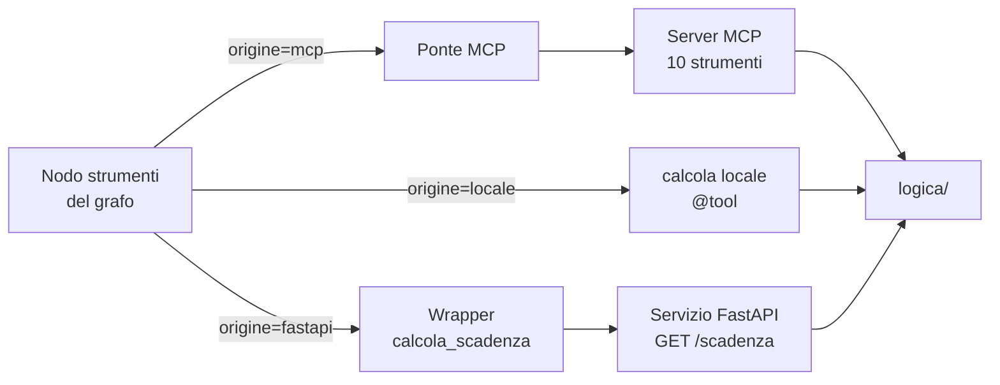
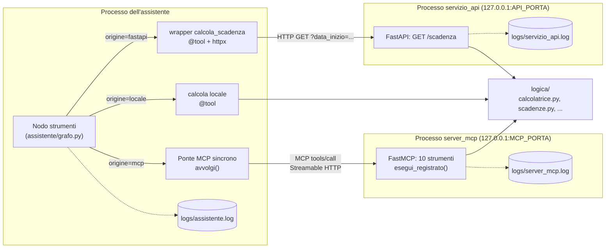
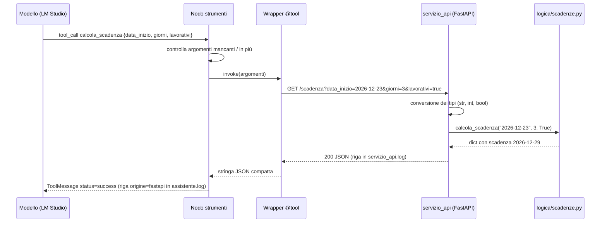
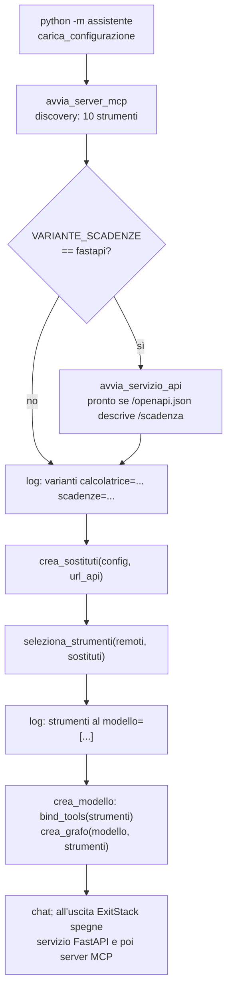

# 06 — Le tre varianti di collegamento

> Percorso di studio: [00 Indice](00-indice.md) · precedente [05 MCP in pratica](05-mcp-in-pratica.md) · successivo [07 I dieci strumenti](07-gli-strumenti.md)

## Scheda in 5 minuti

**Di che cosa parla.** Questo capitolo confronta tre modi di collegare uno strumento all'agente: MCP, una funzione locale con `@tool` e un servizio FastAPI con un wrapper HTTP. La logica e il contratto restano uguali; cambia solo la strada che fa la chiamata. Alla fine sai dire, per ogni variante, chi scrive il contratto, dove va aggiornato, che cosa vede il modello e dove compare nei log.

**Le idee chiave**

1. **Stesso strumento, tre strade.** MCP vale per tutti e dieci gli strumenti. La variante locale riguarda solo `calcola`, quella FastAPI solo `calcola_scadenza`. La scelta si fa nel `.env`, con `VARIANTE_CALCOLATRICE` e `VARIANTE_SCADENZE`. → sezione 1
2. **Le copie devono essere identiche.** Un confronto è utile solo se domanda, modello e significato dello strumento non cambiano. Per questo le versioni locale e FastAPI hanno lo stesso nome, gli stessi argomenti e lo stesso risultato della versione MCP. → sezione 1.2
3. **Le fondamenta sono comuni.** La logica sta una volta sola in `logica/`. Anche gli schemi degli argomenti sono costanti condivise da tutte le varianti. Le descrizioni sono copiate a mano, ma un test le confronta con il catalogo MCP. → sezione 3
4. **Cambia chi scrive il contratto.** Il contratto è nome, descrizione e schema degli argomenti. In MCP lo pubblica il server e l'agente lo scopre. In locale nasce dalla funzione: nome, firma e docstring. In FastAPI i contratti sono due: l'OpenAPI del servizio e il wrapper scritto a mano per il modello. → sezioni 4, 5 e 6
5. **Una sola versione per nome.** Il server espone sempre tutti e dieci gli strumenti. L'agente, che fa da host, toglie la versione MCP e mette al suo posto il sostituto con lo stesso nome. Se un nome compare due volte, l'avvio si ferma. → sezione 7
6. **Per il modello le varianti sono uguali.** Vede lo stesso nome, la stessa descrizione e gli stessi argomenti. Non sa da dove arriva lo strumento: l'etichetta `origine` resta all'host e serve solo per il log e il terminale. → sezione 8
7. **Le differenze si vedono nei log e nei tipi.** Ogni processo ha il suo log, quindi dai log si capisce che strada ha fatto una chiamata. FastAPI converte il testo della query ed è più tollerante: accetta `lavorativi="yes"`, mentre MCP lo rifiuta. → sezioni 10 e 11

**Il quadro**



**Da sapere a memoria**

| Cosa | Valore | Dove |
|---|---|---|
| Variabili delle varianti | `VARIANTE_CALCOLATRICE`: `mcp` o `locale`; `VARIANTE_SCADENZE`: `mcp` o `fastapi` | `assistente/configurazione.py:6-8` |
| Sostituzione per nome e controllo dei duplicati | `seleziona_strumenti` | `assistente/varianti.py:32-43` |
| Etichetta `origine` | `mcp`, `locale`, `fastapi` | `assistente/client_mcp.py:76`, `assistente/calcolatrice_locale.py:33`, `assistente/wrapper_scadenze.py:78` |
| Timeout | MCP 10 s, FastAPI 5 s, locale nessuno | `assistente/client_mcp.py:16`, `assistente/wrapper_scadenze.py:19` |
| Servizio FastAPI pronto quando | `/openapi.json` descrive `/scadenza` | `assistente/avvio_server.py:191-194` |
| Tipi veri nel servizio FastAPI | `str`, `int`, `bool` | `servizio_api/app.py:49-51` |

**Se te lo chiedono all'orale**

- *Perché la calcolatrice è locale e le scadenze in FastAPI?* La calcolatrice è un calcolo puro e interno, il caso tipico per una funzione locale. Le scadenze hanno argomenti semplici da mettere in una query e un risultato esatto, quindi le due varianti si confrontano al valore.
- *Come dimostri che una chiamata è passata dalla variante locale?* In `assistente.log` c'è la riga `origine=locale tool=calcola`. In `server_mcp.log`, invece, non compare nessuna riga nuova.
- *Il modello vede differenze tra le varianti?* Quasi nessuna: solo `additionalProperties: false`, presente nello schema MCP. Nome, descrizione e argomenti sono identici, e `origine` non gli viene inviata.

Per i dettagli continua con il resto del capitolo: le idee rimandano alle sezioni con «→ sezione N».

---

Questo documento spiega il **confronto didattico della lezione 5**: lo stesso strumento collegato all'agente in tre modi diversi. Alla fine dovresti saper rispondere, per ciascuna variante, a quattro domande:

1. **chi definisce il contratto** (nome, descrizione, schema degli argomenti);
2. **dove va aggiornato** se lo strumento cambia;
3. **che cosa vede il modello**;
4. **dove compare la chiamata nei log**.

L'idea da ricordare in una frase: **contratto e logica restano uguali, cambia solo il percorso** con cui il nodo `strumenti` del grafo ottiene il risultato.

> Nota sulle fonti. I numeri di slide (11, 17, 19, 21, 23, 24) sono quelli citati nel codice e nella specifica `docs/superpowers/specs/2026-11-08-strumenti-lezione-5-design.md`. Le slide non sono nella repository: quello che dicono è riportato solo come lo citano specifica e codice. Gli esempi «reali» di questo documento sono stati ottenuti eseguendo il codice del progetto con il modello finto (`tests/finti.py`), il client MCP in memoria (`con_client` di `tests/test_server_mcp.py`), il `TestClient` di FastAPI o un trasporto HTTP finto. Non è stato usato LM Studio e non ci sono state richieste di rete.

---

## 1. Le tre varianti in breve

| Variante | Quali strumenti | Dove gira la logica | File principali |
|---|---|---|---|
| **MCP** | **tutti e dieci** (il server li espone sempre) | processo separato `server_mcp`, raggiunto via MCP su HTTP | `server_mcp/server.py`, `assistente/client_mcp.py` |
| **locale con `@tool`** | solo `calcola` | dentro il processo dell'assistente | `assistente/calcolatrice_locale.py` |
| **FastAPI con wrapper HTTP** | solo `calcola_scadenza` | processo separato `servizio_api`, raggiunto con `GET /scadenza` | `servizio_api/app.py`, `servizio_api/__main__.py`, `assistente/wrapper_scadenze.py` |

La scelta si fa con due variabili d'ambiente, di solito scritte nel file `.env`:

| Variabile | Valori ammessi | Effetto |
|---|---|---|
| `VARIANTE_CALCOLATRICE` | `mcp`, `locale` | quale `calcola` vede il modello |
| `VARIANTE_SCADENZE` | `mcp`, `fastapi` | quale `calcola_scadenza` vede il modello |
| `API_PORTA` | intero 1024–65535, diverso da `MCP_PORTA` | porta del servizio FastAPI; obbligatoria **solo** con `VARIANTE_SCADENZE=fastapi`, altrimenti ignorata |

Nel `.env.example` i valori sono `VARIANTE_CALCOLATRICE=mcp`, `VARIANTE_SCADENZE=mcp`, `API_PORTA=8766`.

Gli altri otto strumenti (`ora_corrente`, `converti_unita`, `search_catalog`, `get_item`, `add_note`, `list_notes`, `delete_note`, `get_weather`) esistono **solo** in variante MCP.

### 1.1 Perché proprio queste due copie

Le decisioni sono nella specifica (sezione 1). L'utente ha deciso:

- un solo server MCP con tutti gli strumenti;
- tre varianti: tutti in MCP, **uno solo** in locale, **uno solo** in FastAPI;
- due strumenti **diversi** per le due copie;
- il modello vede **una sola versione** di ogni strumento duplicato, scelta nel `.env`.

La scelta di *quali* strumenti è del costruttore:

- **calcolatrice in locale**: è un calcolo puro e interno, il caso in cui (slide 17) una funzione locale è la scelta ragionevole;
- **scadenze in FastAPI**: gli argomenti sono semplici da mettere in una query HTTP e il risultato è deterministico, quindi le due varianti si possono confrontare **al valore esatto**.

### 1.2 Il principio del confronto (slide 21)

La specifica cita la slide 21: «un confronto utile mantiene invariati domanda, modello e significato dello strumento». Per questo le versioni locale e FastAPI sono **copie** di quella MCP: stesso nome, stessi argomenti, stesso risultato, stessi errori. Se fossero diverse, il confronto sarebbe tra due strumenti diversi e non tra due percorsi.

---

## 2. Il quadro d'insieme



Tre cose da notare:

- **la logica è una sola** (`logica/`): tutte e tre le frecce finiscono lì;
- **il nodo `strumenti` non sa quale percorso sta usando**: chiama `strumento.invoke(argomenti)` (`assistente/grafo.py:175`) e legge l'origine solo per scriverla nel log (`assistente/grafo.py:157`);
- **ogni processo ha il suo log**: per questo dai log si capisce che strada ha fatto una chiamata.

---

## 3. Le fondamenta comuni

### 3.1 La logica pura in `logica/`

Il calcolo vero sta in moduli che non importano né `fastmcp`, né `fastapi`, né LangChain:

- `logica/calcolatrice.py`: `calcola(espressione)` analizza l'espressione con `ast`, senza `eval`, in aritmetica `Decimal` (`logica/calcolatrice.py:74-105`);
- `logica/scadenze.py`: `calcola_scadenza(data_inizio, giorni, lavorativi)` conta i giorni di calendario o lavorativi, con le festività di `risorse/festivita_italia.json` (`logica/scadenze.py:71-112`).

Entrambe sollevano `ErroreStrumento` (`logica/errori.py:4`, sottoclasse di `ValueError`) con un messaggio in italiano. Ogni variante cattura questa eccezione e la traduce nel proprio formato di errore. I dettagli della logica sono in [07 I dieci strumenti](07-gli-strumenti.md).

Una conseguenza importante: **la logica controlla da sola i tipi** degli argomenti. Per esempio `_leggi_giorni` (`logica/scadenze.py:58-68`) accetta un `int` (non un `bool`), un `float` intero come `3.0` o un testo di sole cifre come `"3"`, e rifiuta tutto il resto. `lavorativi` deve essere un vero `bool` (`logica/scadenze.py:77-78`). Questo conta nel §10.

### 3.2 Gli schemi condivisi

Lo schema JSON di ogni argomento è scritto **una volta sola**, come costante nel modulo di logica, e lo importano tutte le varianti:

```python
# logica/calcolatrice.py:21-22
# Schema JSON dell'argomento `espressione`, unico per tutte le varianti (MCP e locale).
SCHEMA_ESPRESSIONE = {"type": "string", "description": "Espressione aritmetica, per esempio (3 + 4) * 2"}
```

```python
# logica/scadenze.py:21-27 (estratto)
SCHEMA_DATA_INIZIO = {"type": "string", "description": "Data di partenza in formato ISO AAAA-MM-GG, per esempio 2026-12-23"}
SCHEMA_GIORNI = {"type": "integer", "description": f"Numero di giorni da aggiungere, da 0 a {GIORNI_MASSIMI}"}
SCHEMA_LAVORATIVI = {"type": "boolean", "description": "true per contare solo i giorni lavorativi (...)"}
```

Chi le usa:

| Costante | Server MCP | Variante locale | Servizio FastAPI | Wrapper |
|---|---|---|---|---|
| `SCHEMA_ESPRESSIONE` | `server_mcp/server.py:150` | `assistente/calcolatrice_locale.py:26` | — | — |
| `SCHEMA_DATA_INIZIO`, `SCHEMA_GIORNI`, `SCHEMA_LAVORATIVI` | `server_mcp/server.py:156-158` | — | **solo la `description`**, dentro `Query(...)` (`servizio_api/app.py:49-51`) | `assistente/wrapper_scadenze.py:47-49` |

Il trucco tecnico è sempre lo stesso: `Annotated[Any, WithJsonSchema(SCHEMA)]`.

- Il tipo Python è `Any`, quindi pydantic **non valida né converte** il valore: arriva alla logica così com'è.
- Lo schema mostrato al modello, però, è quello dichiarato in `WithJsonSchema`.

Così anche un valore del tipo sbagliato riceve il messaggio d'errore italiano della logica, uguale in ogni variante. Esempio reale, `espressione=14` (un numero invece di un testo):

```text
locale: {"errore": "L'espressione deve essere un testo.", "tipo": "strumento"}
MCP:    isError=True, testo "L'espressione deve essere un testo."
```

Attenzione al servizio FastAPI: lì i tipi dei parametri sono **veri tipi Python** (`str`, `int`, `bool`, `servizio_api/app.py:49-51`), non le costanti. Dalle costanti prende solo la descrizione. È la radice delle differenze del §10 e un punto da ricordare nel §13.

### 3.3 Le descrizioni: copiate, ma controllate dai test

La descrizione dello strumento non si può condividere con una costante. Nella variante locale e nel wrapper è la **docstring** della funzione decorata con `@tool`, e una docstring dev'essere un testo letterale. Per questo il testo compare due volte:

| Strumento | Nel server | Nella copia |
|---|---|---|
| `calcola` | `DESCRIZIONE_CALCOLATRICE`, `server_mcp/server.py:52-55` | docstring, `assistente/calcolatrice_locale.py:27` |
| `calcola_scadenza` | `DESCRIZIONE_SCADENZE`, `server_mcp/server.py:57-61` | docstring, `assistente/wrapper_scadenze.py:51` |

Il server lo dichiara in un commento (`server_mcp/server.py:51` e `:56`: «Identica alla docstring [...]: lo verifica un test»). I test `tests/test_calcolatrice_locale.py:35` e `tests/test_wrapper_scadenze.py:27` confrontano nome, descrizione, `required` e `properties` con il catalogo MCP.

### 3.4 Lo stesso formato di errore verso il grafo

Qualunque sia la variante, il nodo `strumenti` riceve una **stringa**: il risultato JSON oppure un errore nella forma

```json
{"errore": "<messaggio in italiano>", "tipo": "strumento" | "collegamento"}
```

- `tipo: "strumento"`: l'input non va bene (data inesistente, espressione vietata, ...);
- `tipo: "collegamento"`: il servizio non risponde o risponde male.

Il grafo legge questo campo in `_esito` (`assistente/grafo.py:66-74`) e scrive nel log `esito=ok`, `errore_tool` o `errore_collegamento`. Le costanti `TIPO_STRUMENTO` e `TIPO_COLLEGAMENTO` sono definite in `assistente/client_mcp.py:17-18` e riusate dalla variante locale e dal wrapper.

### 3.5 L'etichetta `origine`

Ogni strumento porta nei suoi `metadata` la variante da cui viene:

| Variante | Dove viene impostata | Valore |
|---|---|---|
| MCP | `assistente/client_mcp.py:76` (in `avvolgi`) | `{"origine": "mcp"}` |
| locale | `assistente/calcolatrice_locale.py:33` | `{"origine": "locale"}` |
| FastAPI | `assistente/wrapper_scadenze.py:78` | `{"origine": "fastapi"}` |

Se manca, vale `locale` (`assistente/varianti.py:53`, `assistente/grafo.py:157`). **Il modello non la vede mai**: i `metadata` di LangChain non entrano nella definizione dello strumento inviata a LM Studio (verificato con `convert_to_openai_tool`, §8). Servono solo all'host: per il log, per la riga del terminale e per il messaggio di benvenuto.

---

## 4. Variante MCP: il contratto lo pubblica il server

È trattata per esteso in [05 MCP in pratica](05-mcp-in-pratica.md). Qui conta solo il confronto.

**Chi definisce il contratto.** Il server, nel decoratore `@server.tool(name=..., description=...)` e nella firma con `WithJsonSchema` (`server_mcp/server.py:148-161`):

```python
@server.tool(name=NOME_CALCOLATRICE, description=DESCRIZIONE_CALCOLATRICE)
def calcola_mcp(
    espressione: Annotated[Any, WithJsonSchema(SCHEMA_ESPRESSIONE)],
) -> dict:
    return esegui_registrato(NOME_CALCOLATRICE, {"espressione": espressione}, lambda: calcola(espressione))
```

Nota: la funzione Python si chiama `calcola_mcp`, ma il nome pubblicato è `NOME_CALCOLATRICE = "calcola"` (`server_mcp/server.py:34`). In MCP il nome lo decide il parametro `name`, non la funzione.

**Come arriva all'agente.** All'avvio l'assistente fa la **discovery** (`tools/list`) con `scopri_strumenti` (`assistente/client_mcp.py:80-87`). Ogni strumento scoperto viene avvolto da `avvolgi` (`assistente/client_mcp.py:57-77`) in uno `StructuredTool` sincrono con **lo stesso nome, la stessa descrizione e lo stesso schema** ricevuti dal server (`args_schema=strumento.args_schema`, un dizionario JSON Schema). Nell'agente non c'è scritto nulla del contratto.

**Nessuna conversione dei tipi.** Con uno schema dato come dizionario, LangChain passa gli argomenti così come sono. Prova reale: uno `StructuredTool` con lo schema MCP di `calcola_scadenza`, invocato con `{"giorni": "3", "lavorativi": "true"}`, riceve proprio `"3"` e `"true"`, testi. Quindi in MCP i valori arrivano alla logica esattamente come li ha scritti il modello.

**Errori.** `esegui_registrato` (`server_mcp/server.py:98-109`) trasforma `ErroreStrumento` in `ToolError`, cioè una risposta MCP con `isError`. L'adattatore la solleva come `ToolException`, e `avvolgi` la traduce in `{"errore": ..., "tipo": "strumento"}`. Un timeout di 10 secondi (`TIMEOUT_CHIAMATA`, `assistente/client_mcp.py:16`) o un errore di trasporto diventano `tipo: "collegamento"`.

**Log.** Due righe per ogni chiamata, una per processo:

```text
logs/assistente.log   ... origine=mcp tool=calcola call_id=... argomenti={"espressione":"(3 + 4) * 2"} esito=ok ...
logs/server_mcp.log   ... INFO server_mcp chiamata tool=calcola argomenti={"espressione":"(3 + 4) * 2"} esito=ok risultato={"espressione":"(3 + 4) * 2","risultato":14}
```

La seconda riga è stata ottenuta davvero, con il client MCP in memoria (l'ora iniziale è omessa). La prima mostra il formato di `_registra` (`assistente/grafo.py:106-119`).

---

## 5. Variante locale: il contratto nasce dalla funzione

### 5.1 Il codice

```python
# assistente/calcolatrice_locale.py:22-34
def crea_calcolatrice_locale() -> BaseTool:
    @tool
    def calcola(espressione: Annotated[Any, WithJsonSchema(SCHEMA_ESPRESSIONE)]) -> str:
        """Calcola un'espressione aritmetica con numeri decimali (punto come separatore), + - * / % ** e parentesi. Esempio: espressione="(3 + 4) * 2"."""
        try:
            return json.dumps(calcola_logica(espressione), ensure_ascii=False)
        except ErroreStrumento as errore:
            return json.dumps({"errore": str(errore), "tipo": TIPO_STRUMENTO}, ensure_ascii=False)

    calcola.metadata = {"origine": ORIGINE_LOCALE}
    return calcola
```

### 5.2 Che cosa fa `@tool`

Il decoratore `@tool` di LangChain trasforma la funzione in un `BaseTool` (slide 19):

- **nome** = nome della funzione Python (`calcola`): qui sì che il nome della funzione conta;
- **descrizione** = docstring;
- **schema degli argomenti** = firma della funzione. Di solito LangChain lo deduce dai tipi; qui `WithJsonSchema` lo impone uguale a quello MCP.

Non ci sono processi, porte, rete o discovery: la chiamata è una normale chiamata di funzione Python nello stesso processo dell'agente. Il modulo importa la logica con un altro nome (`from logica.calcolatrice import calcola as calcola_logica`), perché il nome `calcola` serve alla funzione decorata.

### 5.3 Un dettaglio con una storia: perché `Any` e non `str`

Il piano del passo 2 (`docs/superpowers/plans/2026-11-08-passo-2-calcolatrice.md:182`) prevedeva `def calcola(espressione: str)`. La revisione finale ha trovato due problemi (checkpoint `docs/superpowers/checkpoint/2026-11-08-calcolatrice.md`, commit `ae100c8`):

- lo schema locale non aveva la `description` dell'argomento, quindi era diverso da quello MCP;
- un valore non testuale (per esempio il numero `14`) veniva rifiutato da pydantic con un errore **in inglese**, mentre MCP dava l'errore italiano della logica.

Con `Annotated[Any, WithJsonSchema(SCHEMA_ESPRESSIONE)]` spariscono entrambe le differenze. Lo spiega il commento alle righe 23-24.

### 5.4 Errori e log

- **Errori di dominio**: `{"errore": ..., "tipo": "strumento"}`, con lo stesso testo della logica.
- **Errori di collegamento**: impossibili, perché non c'è niente da raggiungere.
- **Errori imprevisti** (un'eccezione diversa da `ErroreStrumento`): uscirebbero dalla funzione e li catturerebbe il grafo (`assistente/grafo.py:177-179`), che li riporta come `Argomenti non validi per calcola: ...` con `esito=errore_tool`.
- **Log**: **solo** `logs/assistente.log`. È proprio la differenza da osservare (specifica, sezione 8). Riga reale prodotta con il modello finto:

```text
origine=locale tool=calcola call_id=call_1 argomenti={"espressione":"(3 + 4) * 2"} esito=ok risultato={"espressione": "(3 + 4) * 2", "risultato": 14} tool_message.call_id=call_1
```

Nota il risultato **con gli spazi** dopo `:` e `,`. La variante locale usa `json.dumps` con i separatori predefiniti (`assistente/calcolatrice_locale.py:29`), mentre MCP produce JSON compatto: `{"espressione":"(3 + 4) * 2","risultato":14}`. È una differenza nota e rimandata (§10.3).

---

## 6. Variante FastAPI: un servizio HTTP e un wrapper scritto a mano

Questa variante ha **tre pezzi**: il servizio, il suo avvio e il wrapper nell'agente.

### 6.1 Il servizio (`servizio_api/app.py`)

```python
# servizio_api/app.py:47-52
@app.get(ENDPOINT, summary="Calcola una data di scadenza")
def scadenza(
    data_inizio: str = Query(description=SCHEMA_DATA_INIZIO["description"]),
    giorni: int = Query(description=SCHEMA_GIORNI["description"]),
    lavorativi: bool = Query(description=SCHEMA_LAVORATIVI["description"]),
):
```

Punti chiave:

- **Qui i tipi sono veri tipi Python** (`str`, `int`, `bool`): FastAPI li usa per convertire i parametri della query, che arrivano sempre come testo. È l'origine delle differenze del §10.
- **FastAPI genera da solo il contratto HTTP**: `/openapi.json` e la pagina interattiva `/docs` (slide 4). Parametri letti davvero da `/openapi.json` con il `TestClient`:

  | Parametro | In | Obbligatorio | Tipo OpenAPI | Descrizione |
  |---|---|---|---|---|
  | `data_inizio` | query | sì | `string` | da `SCHEMA_DATA_INIZIO` |
  | `giorni` | query | sì | `integer` | da `SCHEMA_GIORNI` |
  | `lavorativi` | query | sì | `boolean` | da `SCHEMA_LAVORATIVI` |

  I tipi OpenAPI vengono dalle annotazioni Python (`str`, `int`, `bool`), le descrizioni dalle costanti di `logica/scadenze.py`.

- **Errori sempre in italiano, con codice 400** (o 500 per l'imprevisto):

  | Caso | Dove | Risposta |
  |---|---|---|
  | `ErroreStrumento` della logica | `servizio_api/app.py:56-57` | `400 {"errore": "<testo della logica>"}` |
  | errore di validazione di FastAPI (di norma `422` in inglese) | gestore `validazione_in_italiano`, `servizio_api/app.py:38-45` | `400 {"errore": "Argomenti non validi per calcola_scadenza: <nome>: mancante"}` oppure `...: <nome>: valore non valido`; più errori uniti da `; ` |
  | eccezione imprevista | `servizio_api/app.py:58-61` | `500 {"errore": "Errore interno dello strumento calcola_scadenza: <TipoEccezione>."}`, come la «rete di sicurezza» di `esegui_registrato` |

  Esempio reale con due parametri sbagliati (`giorni=x`, `lavorativi=boh`):

  ```text
  400 {'errore': 'Argomenti non validi per calcola_scadenza: giorni: valore non valido; lavorativi: valore non valido'}
  ```

- **Log**: ogni richiesta scrive una riga sul logger `servizio_api` (`servizio_api/app.py:31` per gli errori, `:62-64` per il successo). Il processo la manda su stderr (`servizio_api/__main__.py:30-32`), e l'assistente, che lo ha avviato, la raccoglie in `logs/servizio_api.log`.

Il servizio ascolta **solo su `127.0.0.1`** (`servizio_api/__main__.py:38`). Si può avviare anche da solo, con `python -m servizio_api --porta 8766` (README, «Il servizio FastAPI da solo»).

### 6.2 L'avvio (`assistente/avvio_server.py:183-205`)

Il servizio parte **solo** se `VARIANTE_SCADENZE=fastapi` (`assistente/avvio.py:38-40`). Riusa `processo_in_attesa` (`assistente/avvio_server.py:86`), lo stesso ciclo del server MCP: porta libera → processo con l'output nel log → attesa (al massimo 10 secondi, `ATTESA_AVVIO`) → arresto garantito. Cambia solo il criterio di «pronto»:

```python
# assistente/avvio_server.py:191-194
def contratto_presente(tempo_massimo: float) -> None:
    risposta = httpx.get(f"{url}/openapi.json", timeout=tempo_massimo)
    if "/scadenza" not in risposta.json().get("paths", {}):
        raise ValueError("il servizio non descrive /scadenza")
```

Un HTTP 200 qualsiasi non basta: il servizio è pronto quando **il suo contratto descrive `/scadenza`** (specifica 5.4, «coerente con la slide 24»). Per il server MCP il criterio equivalente è una discovery riuscita (`assistente/avvio_server.py:161-162`).

### 6.3 Il wrapper (`assistente/wrapper_scadenze.py`)

Il wrapper è la funzione che il modello «crede» di chiamare. Nome, descrizione e schema sono **scritti a mano** (slide 19: niente discovery):

```python
# assistente/wrapper_scadenze.py:45-52
@tool
def calcola_scadenza(
    data_inizio: Annotated[Any, WithJsonSchema(SCHEMA_DATA_INIZIO)],
    giorni: Annotated[Any, WithJsonSchema(SCHEMA_GIORNI)],
    lavorativi: Annotated[Any, WithJsonSchema(SCHEMA_LAVORATIVI)],
) -> str:
    """Calcola la data di scadenza aggiungendo un numero di giorni a una data ISO (AAAA-MM-GG). [...]"""
    params = {"data_inizio": _parametro(data_inizio), "giorni": _parametro(giorni), "lavorativi": _parametro(lavorativi)}
```

**Resta sottile** (specifica 5.4): non valida gli argomenti, li traduce soltanto in parametri di query. `_parametro` (`assistente/wrapper_scadenze.py:28-32`) scrive i booleani come `true`/`false` e tutto il resto con `str()`. Richiesta reale catturata con un trasporto finto:

```text
http://servizio.test/scadenza?data_inizio=2026-12-23&giorni=3&lavorativi=false
```

La chiamata usa `httpx` sincrono con un timeout di **5 secondi** (`TIMEOUT_HTTP`, `assistente/wrapper_scadenze.py:19`). Senza un client iniettato, ogni chiamata apre e chiude un `httpx.Client` (righe 41-42). Il parametro `http` serve ai test: passano un `httpx.MockTransport` oppure il `TestClient` di FastAPI, così la rete non serve.

**Traduzione delle risposte.** Il wrapper non solleva mai eccezioni verso il grafo:

| Che cosa succede | Righe | Risultato per il grafo |
|---|---|---|
| `200` con un oggetto JSON | 69-70 | il JSON, ri-serializzato **compatto** (`separators=(",", ":")`) |
| `400` o `500` con `{"errore": "<testo>"}` | 71-73 | `{"errore": <testo>, "tipo": "strumento"}` |
| richiesta impossibile da costruire (valore lunghissimo, surrogato Unicode) | 55-59 | `Argomenti non validi per calcola_scadenza: valore troppo lungo o con caratteri non validi.`, `tipo: "strumento"` |
| timeout | 60-61 | `Servizio scadenze: nessuna risposta entro 5 secondi.`, `tipo: "collegamento"` |
| connessione rifiutata o altro errore `httpx` | 62-64 | `Servizio scadenze non raggiungibile: ConnectError: ...`, `tipo: "collegamento"` |
| qualsiasi altra risposta (`503`, JSON non valido, `400` senza il campo `errore`, ...) | 74-76 | `Servizio scadenze non raggiungibile: risposta non valida (HTTP <codice>).`, `tipo: "collegamento"` |

Esempi reali, ottenuti con un trasporto finto:

```text
{"errore": "Servizio scadenze non raggiungibile: ConnectError: connessione rifiutata", "tipo": "collegamento"}
{"errore": "Servizio scadenze: nessuna risposta entro 5 secondi.", "tipo": "collegamento"}
{"errore": "Servizio scadenze non raggiungibile: risposta non valida (HTTP 503).", "tipo": "collegamento"}
{"errore": "Errore interno dello strumento calcola_scadenza: KeyError.", "tipo": "strumento"}
{"errore": "Argomenti non validi per calcola_scadenza: valore troppo lungo o con caratteri non validi.", "tipo": "strumento"}
```

Perché un `500` con `{"errore"}` è un errore dello **strumento** e non di collegamento? Se il servizio ha risposto con il suo JSON d'errore, è acceso: il problema sta nello strumento. Prima del commit `82007eb` veniva presentato come un falso «non raggiungibile».

### 6.4 Il viaggio di una chiamata FastAPI



Per il viaggio completo di una richiesta, dal terminale alla risposta, vedi [03 Il viaggio di una richiesta](03-viaggio-di-una-richiesta.md).

---

## 7. La selezione: una sola versione per nome

### 7.1 Il principio

Il server MCP espone **sempre tutti e dieci gli strumenti**, qualunque sia la variante: è un servizio condiviso e non dipende dalla configurazione di un singolo agente. È **l'agente, come host**, a scegliere le capacità consentite (slide 11, citata in `assistente/varianti.py:3-4`). Se una variante non è `mcp`, l'agente toglie dal catalogo scoperto lo strumento con quel nome e al suo posto mette il **sostituto**.

### 7.2 La configurazione (`assistente/configurazione.py`)

- `VARIANTE_CALCOLATRICE` e `VARIANTE_SCADENZE` sono **obbligatorie** (`OBBLIGATORIE`, riga 6), per la regola «nessun valore di configurazione nel codice». I valori predefiniti `"mcp"` della dataclass (righe 19-20) servono solo a costruirla comodamente nei test.
- `leggi_variante` (righe 37-41) toglie gli spazi e passa a minuscolo: `"  Locale "` diventa `locale`. Un valore non ammesso dà un errore che elenca i valori validi.
- Con `fastapi` serve anche `API_PORTA`, diversa da `MCP_PORTA` (righe 57-66). Con `mcp`, `API_PORTA` non viene nemmeno letta.

Errori reali ottenuti con `carica_configurazione`:

```text
VARIANTE_CALCOLATRICE non valida: 'fastapi'. Valori ammessi: mcp, locale.
VARIANTE_SCADENZE non valida: 'locale'. Valori ammessi: mcp, fastapi.
Variabili d'ambiente mancanti: API_PORTA (serve con VARIANTE_SCADENZE=fastapi). Aggiungila al file .env, per esempio API_PORTA=8766.
API_PORTA deve essere diversa da MCP_PORTA.
```

### 7.3 `crea_sostituti` e `seleziona_strumenti` (`assistente/varianti.py`)

```python
# assistente/varianti.py:17-29
def crea_sostituti(config: Configurazione, *, url_api: str | None = None) -> list[BaseTool]:
    sostituti: list[BaseTool] = []
    if config.variante_calcolatrice == "locale":
        sostituti.append(crea_calcolatrice_locale())
    if config.variante_scadenze == "fastapi":
        if url_api is None:
            raise ErroreAvvio("Variante FastAPI delle scadenze richiesta, ma il servizio non è stato avviato.")
        sostituti.append(crea_wrapper_scadenze(url_api))
    return sostituti
```

```python
# assistente/varianti.py:32-43
def seleziona_strumenti(remoti, sostituti=()):
    nomi_sostituti = {s.name for s in sostituti}
    scelti = [s for s in remoti if s.name not in nomi_sostituti] + list(sostituti)
    visti = set()
    for strumento in scelti:
        if strumento.name in visti:
            raise ErroreAvvio(f"Strumento '{strumento.name}' presente due volte: ...")
        visti.add(strumento.name)
    return scelti
```

Da capire bene:

- **La sostituzione avviene per nome.** Funziona solo perché il sostituto ha lo stesso nome della versione MCP.
- **Il controllo dei duplicati** realizza un anti-obiettivo della specifica: mai due versioni dello stesso strumento visibili insieme al modello.
- **Un limite da conoscere.** Se un sostituto avesse per errore un nome *diverso* (per esempio `calcola_scadenze`), `seleziona_strumenti` non toglierebbe la versione MCP e non troverebbe duplicati: il modello vedrebbe due strumenti quasi uguali. Il codice non lo impedisce. Lo impediscono i test sul contratto (`tests/test_wrapper_scadenze.py:27`, `tests/test_calcolatrice_locale.py:12`), che confrontano il nome con il catalogo MCP.
- **I sostituti finiscono in coda alla lista.** Lo si vede nel benvenuto.

Le due funzioni di servizio in fondo al file:

- `parametri()` (righe 46-48): nome dello strumento → nomi degli argomenti nell'ordine dello schema. Serve al terminale per stampare `2026-12-23, 3, True` nell'ordine giusto, anche se il modello manda gli argomenti in un altro ordine;
- `origini()` (righe 51-53): nome dello strumento → `mcp`, `locale` o `fastapi`, per il benvenuto e le righe del terminale.

Esempio reale: dieci strumenti finti «remoti» con i nomi e l'ordine del catalogo vero, ed entrambe le varianti attive.

```text
catalogo MCP:  ['converti_unita', 'ora_corrente', 'calcola', 'calcola_scadenza', 'search_catalog', 'get_item',
                'add_note', 'list_notes', 'delete_note', 'get_weather']
al modello:    ['converti_unita', 'ora_corrente', 'search_catalog', 'get_item', 'add_note', 'list_notes',
                'delete_note', 'get_weather', 'calcola', 'calcola_scadenza']
benvenuto:     Strumenti: converti_unita (mcp), ora_corrente (mcp), search_catalog (mcp), get_item (mcp), add_note (mcp),
               list_notes (mcp), delete_note (mcp), get_weather (mcp), calcola (locale), calcola_scadenza (fastapi)
parametri:     {'calcola': ['espressione'], 'calcola_scadenza': ['data_inizio', 'giorni', 'lavorativi']}
ErroreAvvio: Variante FastAPI delle scadenze richiesta, ma il servizio non è stato avviato.
ErroreAvvio: Strumento 'calcola' presente due volte: ogni strumento deve arrivare al modello da una sola variante.
```

### 7.4 Chi chiama tutto questo

L'ordine in `assistente/__main__.py:23-30` è: `.env` → configurazione → registro → verifica di LM Studio → fuso → `prepara_strumenti` → modello e grafo → chat. `prepara_strumenti` (`assistente/avvio.py:21-46`) è il cuore delle varianti:



L'`ExitStack` garantisce che, se il servizio FastAPI non parte, venga spento anche il server MCP già avviato. Lo verifica `tests/test_avvio_unico.py:146` (`test_servizio_che_non_parte_spegne_tutto`).

La lista selezionata va **sia** al modello (`crea_modello` → `chat.bind_tools(strumenti)`, `assistente/modello.py:87`) **sia** al grafo (`crea_grafo`, che costruisce `per_nome`, `assistente/grafo.py:143`). Quello che il modello conosce e quello che il grafo esegue coincidono sempre.

**Non si cambia variante a sessione in corso**: si cambia la variabile e si riavvia (non obiettivo della specifica, sezione 3). Un dettaglio utile: `load_dotenv(override=False)` (`assistente/__main__.py:23`) dà la precedenza alle variabili già impostate nell'ambiente. Lo usano le prove reali (`ambiente_reale({"VARIANTE_...": ...})`) e Docker (`-e VARIANTE_...`). Dal codice segue che anche una variabile impostata in PowerShell prima dell'avvio (`$env:VARIANTE_CALCOLATRICE="locale"`) prevarrebbe sul `.env`. Il README però documenta come verificato solo il cambio nel `.env`.

---

## 8. Che cosa vede il modello

Il modello riceve da LM Studio una definizione di funzione in formato OpenAI. Ecco le versioni di `calcola`, ottenute davvero: lo schema MCP con il client in memoria, quello locale con `convert_to_openai_tool` (la stessa conversione che fa `bind_tools`).

**MCP** (`inputSchema` della discovery, che il ponte passa invariato):

```json
{"additionalProperties": false,
 "properties": {"espressione": {"description": "Espressione aritmetica, per esempio (3 + 4) * 2", "type": "string"}},
 "required": ["espressione"], "type": "object"}
```

**Locale** (`@tool`):

```json
{"name": "calcola",
 "description": "Calcola un'espressione aritmetica con numeri decimali (punto come separatore), + - * / % ** e parentesi. Esempio: espressione=\"(3 + 4) * 2\".",
 "parameters": {"properties": {"espressione": {"description": "Espressione aritmetica, per esempio (3 + 4) * 2", "type": "string"}},
                "required": ["espressione"], "type": "object"}}
```

Per `calcola_scadenza` vale lo stesso tra MCP e wrapper: nome, descrizione, `properties` e `required` identici (confronto eseguito: quattro volte `True`).

Conclusioni:

- **Per il modello le varianti sono indistinguibili**, salvo un dettaglio: lo schema MCP contiene `"additionalProperties": false`, quello di `@tool` no. Il test sul contratto confronta solo `properties` e `required` (limite dichiarato nel checkpoint delle scadenze). In pratica il comportamento non cambia, perché gli argomenti in più li rifiuta comunque il grafo (§9).
- **Il modello non sa da dove arriva lo strumento**: `origine` sta nei `metadata`, che non vengono inviati.
- **Il modello non vede mai l'OpenAPI del servizio.** Nella variante FastAPI esistono due contratti: quello HTTP (`/openapi.json`, per i client HTTP) e quello dello strumento (il wrapper, per il modello). Il secondo è una copia scritta a mano del catalogo MCP, non una traduzione automatica del primo.
- **Il risultato che il modello rilegge** (il `ToolMessage`) è identico byte per byte tra MCP e FastAPI per le scadenze: verificato qui sul testo, e nel checkpoint del passo 3 con LM Studio. Per la calcolatrice differisce solo per gli spazi del JSON locale.

---

## 9. Il controllo dell'host, uguale per tutti

Prima di eseguire qualsiasi variante, il nodo `strumenti` controlla gli argomenti (`assistente/grafo.py:158-172`, commento «Controllo dell'host prima dell'esecuzione (slide 5), uguale per ogni variante»). Lo schema lo legge da `strumento.tool_call_schema` (`_schema`, `assistente/grafo.py:77-79`), che funziona sia per lo schema-dizionario del ponte MCP sia per il modello pydantic di `@tool`.

- **argomenti obbligatori mancanti** → `Argomenti mancanti per calcola_scadenza: lavorativi. Riprova indicando tutti gli argomenti richiesti.` (commit `ec2b384`);
- **argomenti non previsti dallo schema** → `Argomenti non previsti per calcola: precisione. Usa solo: espressione.` (commit `5bed890`).

In entrambi i casi la chiamata **non arriva** né al server MCP né al servizio FastAPI: compare solo in `logs/assistente.log`, con `esito=errore_tool` e l'origine della variante selezionata. Righe reali:

```text
origine=fastapi tool=calcola_scadenza call_id=call_3 argomenti={"data_inizio":"2026-12-23","giorni":3} esito=errore_tool risultato={"errore": "Argomenti mancanti per calcola_scadenza: lavorativi. Riprova indicando tutti gli argomenti richiesti.", "tipo": "strumento"} ...
origine=locale tool=calcola call_id=call_4 argomenti={"espressione":"1+1","precisione":2} esito=errore_tool risultato={"errore": "Argomenti non previsti per calcola: precisione. Usa solo: espressione.", "tipo": "strumento"} ...
```

**Perché il controllo sta nel grafo.** Prima di `5bed890`, un argomento inventato dal modello aveva destini diversi: FastMCP lo rifiutava con un errore pydantic in inglese, `@tool` lo ignorava e il wrapper lo scartava. Il checkpoint del passo 3 riporta ancora quella situazione («rifiutato da MCP e ignorato dal wrapper»), che oggi **non è più vera**. Con il controllo nell'host il comportamento è uniforme. Il dettaglio del nodo è in [04 Il grafo LangGraph](04-grafo-langgraph.md).

---

## 10. Differenze note tra le varianti

Il confronto è fedele, ma non perfetto. Queste sono le differenze che restano, tutte verificate sul codice attuale.

### 10.1 Tipi più tolleranti in HTTP (la differenza principale)

Nella query HTTP ogni valore viaggia come **testo**: il servizio non può distinguere il booleano `true` dalla stringa `"true"`. FastAPI converte con le regole di pydantic, più permissive della logica pura che MCP usa direttamente. La specifica lo prevede (5.4): **parità piena** per gli argomenti **del tipo giusto**; per gli errori di tipo basta che ogni variante rifiuti con un messaggio italiano, anche con un testo diverso.

Risultati reali: gli stessi argomenti passati al wrapper (con il `TestClient` del servizio) e al server MCP in memoria. Dove non indicato, gli altri argomenti sono `data_inizio="2026-12-23"`, `giorni=3`, `lavorativi=true`.

| Argomenti cambiati | Variante FastAPI | Variante MCP |
|---|---|---|
| nessuno | scadenza `2026-12-29` | scadenza `2026-12-29` (testo identico byte per byte) |
| `lavorativi="true"` | **accettato** → `2026-12-29` | errore: `lavorativi deve essere true o false.` |
| `lavorativi="yes"` | **accettato** → `2026-12-29` | errore: `lavorativi deve essere true o false.` |
| `lavorativi=1` oppure `"1"` | **accettato** → `2026-12-29` | errore: `lavorativi deve essere true o false.` |
| `giorni="3.0"` | **accettato** → `2026-12-29` | errore: `giorni deve essere un numero intero tra 0 e 3650.` |
| `giorni=3.0` (numero) | accettato | accettato (la logica ammette un `float` intero, `logica/scadenze.py:62-63`) |
| `giorni="3"` | accettato | accettato (la logica ammette cifre in un testo, `logica/scadenze.py:64-65`) |
| `giorni="tre"` | errore: `Argomenti non validi per calcola_scadenza: giorni: valore non valido` | errore: `giorni deve essere un numero intero tra 0 e 3650.` |
| `giorni=true` | errore: `... giorni: valore non valido` | errore: `giorni deve essere un numero intero tra 0 e 3650.` |
| `lavorativi="forse"` | errore: `... lavorativi: valore non valido` | errore: `lavorativi deve essere true o false.` |
| `giorni=-1` oppure `4000` | errore: `giorni deve essere un numero intero tra 0 e 3650.` | **stesso testo** |
| `data_inizio="2026-02-30"` | errore: `Data non valida: '2026-02-30'. Usa il formato AAAA-MM-GG, per esempio 2026-12-23.` | **stesso testo** |
| `data_inizio="30/01/2026"` | errore: `Data non valida: '30/01/2026'. ...` | **stesso testo** |
| `data_inizio="2028-12-29"`, `giorni=5` | errore: `Festività disponibili solo per gli anni 2026–2028: ...` | **stesso testo** |

Come si legge la tabella:

- **argomenti del tipo giusto** → stesso risultato o stesso errore (righe «nessuno», `giorni` fuori intervallo, date, festività): è la parità piena;
- **tipo sbagliato ma «convertibile»** → FastAPI accetta, MCP rifiuta. È la differenza dichiarata nel README, sezione «Varianti di uno strumento»;
- **tipo sbagliato e non convertibile** → entrambi rifiutano, ma con testi diversi: FastAPI con il messaggio del gestore di validazione, MCP con quello della logica.

Un caso curioso: `data_inizio=20261223` (un numero) dà lo **stesso** messaggio nelle due varianti, `Data non valida: '20261223'. ...`, ma per caso. In FastAPI il numero arriva già come testo `"20261223"`; in MCP arriva come numero e la logica lo mette nel messaggio con `'{valore}'`. Il log del servizio infatti registra `"data_inizio":"20261223"`, quello del server `"data_inizio":20261223`.

### 10.2 Una conseguenza nei log: tre tracce, tre valori

La tolleranza di FastAPI si vede anche nei log. Chiamata reale con il modello finto e `lavorativi: "yes"`, in variante `fastapi`:

| Dove | Che cosa compare |
|---|---|
| terminale | `[calcola_scadenza · fastapi: 2026-12-23, 3, yes]` |
| `assistente.log` | `argomenti={"data_inizio":"2026-12-23","giorni":3,"lavorativi":"yes"} esito=ok` |
| `servizio_api.log` | `argomenti={"data_inizio":"2026-12-23","giorni":3,"lavorativi":true} esito=ok` |
| risultato restituito al modello | `{"data_inizio":"2026-12-23","giorni":3,"lavorativi":true,"scadenza":"2026-12-29",...}` |

L'assistente registra quello che **il modello ha chiesto**; il servizio registra quello che **FastAPI ha già convertito**. Per le richieste respinte dalla validazione, invece, il servizio registra i valori grezzi della query, cioè testi (`argomenti={"giorni":"1","lavorativi":"true"} esito=errore messaggio=... data_inizio: mancante`). Quando confronti le tracce di `assistente.log` e `servizio_api.log`, ricordati di questa conversione.

### 10.3 Le altre differenze

| Differenza | Dove nasce | Stato |
|---|---|---|
| JSON del risultato locale con gli spazi (`{"espressione": "...", "risultato": 14}`), MCP e FastAPI compatti | `json.dumps` senza `separators` in `assistente/calcolatrice_locale.py:29` | rimandata (Minor) nel checkpoint del passo 2 |
| `additionalProperties: false` solo nello schema MCP | lo aggiunge FastMCP, `@tool` no | non confrontato dal test; effetto neutralizzato dal controllo del grafo |
| I tipi OpenAPI del servizio vengono dalle annotazioni Python, non dalle costanti di `logica/` | `servizio_api/app.py:49-51` | nessun test confronta i tipi OpenAPI con `SCHEMA_*` (`tests/test_servizio_api.py:51` controlla solo titolo e percorso) |
| Timeout: MCP 10 s, FastAPI 5 s, locale nessuno | `TIMEOUT_CHIAMATA` (`assistente/client_mcp.py:16`), `TIMEOUT_HTTP` (`assistente/wrapper_scadenze.py:19`) | voluto (specifica 5.4, slide 19) |
| Errori di collegamento: possibili in MCP e FastAPI, impossibili in locale | nessun processo da raggiungere | intrinseco |
| Processi: il server MCP parte sempre; il servizio FastAPI solo con `fastapi`; la variante locale non aggiunge nulla | `assistente/avvio.py:33-40` | voluto |
| Il `call_id` del modello non arriva né al server né al servizio | MCP usa un suo identificativo; la query HTTP non lo contiene | le tracce si confrontano per strumento, argomenti e ora (README, «Log») |

---

## 11. Dove compare una chiamata nei log

| Variante | `logs/assistente.log` | `logs/server_mcp.log` | `logs/servizio_api.log` |
|---|---|---|---|
| MCP | `origine=mcp tool=...` | `chiamata tool=... esito=...` | — |
| locale | `origine=locale tool=calcola` | **nessuna riga** | — |
| FastAPI | `origine=fastapi tool=calcola_scadenza` | **nessuna riga** | `richiesta endpoint=/scadenza argomenti=... esito=...` |
| argomento mancante o in più (qualsiasi variante) | `esito=errore_tool` | nessuna riga | nessuna riga |

Riga reale di `servizio_api.log` (senza l'ora iniziale):

```text
INFO servizio_api richiesta endpoint=/scadenza argomenti={"data_inizio":"2026-12-23","giorni":3,"lavorativi":true} esito=ok risultato={"data_inizio":"2026-12-23","giorni":3,"lavorativi":true,"scadenza":"2026-12-29","giorno_settimana":"martedì","festivita_saltate":["2026-12-25 Natale","2026-12-26 Santo Stefano"],"nota":"Calcolo indicativo: non ha valore legale."}
```

**All'avvio**, in `assistente.log` compaiono anche le righe che dichiarano la configurazione, in quest'ordine (`assistente/avvio_server.py:114` e `:169`, `assistente/avvio.py:41-45`):

```text
avviato server MCP porta=8765 pid=...
catalogo strumenti=[...tutti e dieci...]
avviato servizio FastAPI porta=8766 pid=...        (solo con fastapi)
varianti calcolatrice=locale scadenze=fastapi
strumenti al modello=[...]
```

Il `catalogo` elenca **sempre dieci** strumenti, perché il server li espone tutti; `strumenti al modello` elenca ciò che resta dopo la selezione. Confrontare queste due righe è il modo più rapido per dimostrare che la selezione è avvenuta. All'uscita compaiono le righe `spento servizio FastAPI codice=...` e `spento server MCP codice=...` (`assistente/avvio_server.py:138`).

**Nel terminale** la variante si vede in due punti (`assistente/terminale.py:54` e `:37`). Le righe sotto sono state prodotte davvero, con `origini()` e `_righe_strumenti` e il modello finto:

```text
Strumenti: converti_unita (mcp), ora_corrente (mcp), search_catalog (mcp), ..., get_weather (mcp), calcola (locale), calcola_scadenza (fastapi)
[calcola · locale: (3 + 4) * 2]
[calcola_scadenza · fastapi: 2026-12-23, 3, True]
```

La riga `[...]` compare solo per le chiamate **riuscite** (`status != "error"`, `assistente/terminale.py:32`). Un argomento mancante, quindi, non produce la riga nel terminale ma solo quella di `assistente.log`.

Ricorda la regola del README: **una risposta plausibile senza la riga `origine=... tool=...` in `assistente.log` non dimostra che lo strumento sia stato usato**. I log sono trattati per intero in [10 Log e diagnosi](10-log-e-diagnosi.md).

---

## 12. Tabella di confronto (stile slide 21)

Le righe sono ricavate dal codice del progetto; la slide originale non è nella repository.

| | **MCP** | **Locale con `@tool`** | **FastAPI + wrapper HTTP** |
|---|---|---|---|
| Strumenti nel progetto | tutti e dieci | `calcola` | `calcola_scadenza` |
| Dove gira la logica | processo `server_mcp` | processo dell'assistente | processo `servizio_api` |
| **Chi definisce il contratto** | **il server** (`@server.tool` + `WithJsonSchema`) | **la funzione** (nome, firma, docstring) | **due posti**: l'endpoint (`Query` + tipi Python, da cui FastAPI genera l'OpenAPI) **e** il wrapper scritto a mano per il modello |
| Come lo conosce l'agente | discovery `tools/list` a ogni avvio | è codice dell'agente | ricopiato a mano, senza discovery |
| **Dove va aggiornato se cambia** | solo nel server; ogni client lo riceve alla discovery successiva | nel codice dell'agente (e in ogni agente che ne ha una copia) | nel servizio **e** nel wrapper di ogni applicazione che lo usa |
| Trasporto | MCP su Streamable HTTP, `http://127.0.0.1:MCP_PORTA/mcp` | chiamata di funzione | HTTP `GET /scadenza`, `http://127.0.0.1:API_PORTA` |
| Processi in più | uno (sempre avviato) | nessuno | uno (solo con `VARIANTE_SCADENZE=fastapi`) |
| Prontezza all'avvio | discovery riuscita | immediata | `/openapi.json` descrive `/scadenza` |
| Timeout | 10 s | nessuno | 5 s |
| Errori di dominio | `ToolError` → `isError` → `{"errore", "tipo":"strumento"}` | `ErroreStrumento` → `{"errore", "tipo":"strumento"}` | `400`/`500` con `{"errore"}` → `{"errore", "tipo":"strumento"}` |
| Errori di collegamento | sì (`tipo: "collegamento"`) | impossibili | sì (`tipo: "collegamento"`) |
| Tipi degli argomenti | nessuna conversione: decide la logica | nessuna conversione: decide la logica | testo convertito da FastAPI: più tollerante |
| **Che cosa vede il modello** | nome, descrizione, schema (con `additionalProperties: false`) | gli stessi (senza `additionalProperties`) | gli stessi (senza `additionalProperties`) |
| Formato del risultato | JSON compatto | JSON con gli spazi | JSON compatto |
| `origine` nel log | `mcp` | `locale` | `fastapi` |
| **File di log toccati** | `assistente.log` + `server_mcp.log` | solo `assistente.log` | `assistente.log` + `servizio_api.log` |
| Riuso da altri client | sì: qualsiasi client MCP (il README cita MCP Inspector) | no | sì via HTTP, ma ogni applicazione-agente scrive il suo wrapper |
| Quando conviene | strumento condiviso fra più agenti o applicazioni | calcolo puro e interno a un solo agente | servizio HTTP già esistente, o da usare anche fuori dagli agenti |

---

## 13. «Dove va aggiornato»: un esercizio sui cambiamenti

La riga più importante della tabella è «Dove va aggiornato». Nel nostro progetto le copie devono restare identiche, quindi conviene ragionare caso per caso. Ecco che cosa toccare per `calcola_scadenza`, ricavato dal codice attuale:

| Cambiamento | File da toccare | Chi se ne accorge se dimentichi qualcosa |
|---|---|---|
| Nuova festività o correzione della logica | solo `logica/scadenze.py` o `risorse/festivita_italia.json` | nessuno da allineare: tutte le varianti la usano subito (dopo il riavvio dei processi) |
| Descrizione di un argomento (per esempio in `SCHEMA_GIORNI`) | solo la costante in `logica/scadenze.py` | si aggiornano da sole MCP, wrapper **e** OpenAPI (che prende la `description` dalla costante) |
| Descrizione dello strumento | `DESCRIZIONE_SCADENZE` in `server_mcp/server.py` **e** docstring in `assistente/wrapper_scadenze.py` | `tests/test_wrapper_scadenze.py:27` fallisce |
| Tipo di un argomento (per esempio `giorni` da intero a numero) | costante `SCHEMA_GIORNI`, logica **e** annotazione `giorni: int` in `servizio_api/app.py` | nessun test confronta i tipi OpenAPI con le costanti: va ricordato a mano |
| Nuovo argomento | logica e costante; firma e dizionario `argomenti` nel server; `Query` e chiamata in `servizio_api/app.py`; firma e dizionario `params` nel wrapper | il test del contratto per server e wrapper; per il servizio, i test di parità |
| Nome dello strumento | `NOME_SCADENZE` nel server; nome della funzione del wrapper; `NOME_STRUMENTO` nei messaggi del servizio | il test del contratto. Senza, `seleziona_strumenti` non toglierebbe la versione MCP (§7.3) |

Per `calcola` (MCP e locale) il ragionamento è lo stesso, con due soli posti: il server e `assistente/calcolatrice_locale.py`.

Il punto didattico: le costanti condivise riducono il danno, ma non lo eliminano. In una situazione «MCP pura», con un solo server e più agenti, ogni cambiamento al contratto si fa **una volta**, nel server, e tutti i client lo ricevono alla discovery successiva. Con `@tool` e con il wrapper HTTP, ogni copia è un posto in più da tenere allineato.

---

## 14. I test che reggono il confronto

Test automatici eseguiti per questo documento: `test_varianti.py`, `test_calcolatrice_locale.py`, `test_wrapper_scadenze.py`, `test_servizio_api.py` e `test_grafo.py` danno **71 passed**. È stato escluso solo `test_servizio_spento_senza_eccezioni`, che apre una connessione verso `127.0.0.1:9`. I test di avvio, che lanciano processi veri, non sono stati eseguiti.

| Che cosa garantisce | Test |
|---|---|
| Contratto locale = contratto MCP | `tests/test_calcolatrice_locale.py:12` e `:35` |
| Stesso esito locale/MCP su espressioni valide e vietate | `tests/test_calcolatrice_locale.py:22` (`(3 + 4) * 2`, `0.1 + 0.2`, `1 / 0`, `__import__('os')`, `2,5`) |
| Tipo sbagliato → stesso errore italiano nelle due varianti | `tests/test_calcolatrice_locale.py:45` (`14`, `None`, `["1+1"]`) |
| Contratto del wrapper = catalogo MCP | `tests/test_wrapper_scadenze.py:27` |
| Parità FastAPI/MCP, compresi gli errori | `tests/test_wrapper_scadenze.py:46` (anche `9999-12-31`) |
| Parametri di query inviati | `tests/test_wrapper_scadenze.py:57` |
| Traduzione degli errori HTTP e di rete | `tests/test_wrapper_scadenze.py:78`, `:83`, `:92`, `:100` |
| Servizio: 400 in italiano, OpenAPI, 500 in italiano | `tests/test_servizio_api.py:17-65` |
| Ciclo di vita del servizio (avvio, porta occupata, arresto) | `tests/test_avvio_servizio_api.py` |
| Configurazione delle varianti e di `API_PORTA` | `tests/test_configurazione.py:51-92` |
| Sostituzione, duplicati, origini, ordine dei parametri | `tests/test_varianti.py` |
| Avvio completo con ciascuna variante e log giusti | `tests/test_avvio_unico.py:105` (locale: nessuna riga nel server), `:115` (MCP), `:129` (FastAPI: due processi, riga in `servizio_api.log`, nessuna in `server_mcp.log`) |
| Controllo dell'host uguale per tutte le varianti | `tests/test_grafo.py:209`, `:229`, `:259`, `:276` |

**Prove reali** (attivate solo con `--lmstudio` o `--docker`, non eseguite per questo documento):

- `tests/test_reale_calcolatrice.py` e `tests/test_reale_scadenze.py` forzano la variante con `ambiente_reale({"VARIANTE_...": variante})`, fanno la stessa domanda e controllano risultato, risposta, `origine=<variante>` nel log e, per le scadenze, la riga in `servizio_api.log` **solo** con `fastapi`. In più fanno l'errore controllato (slide 23) in entrambe le varianti, invocando lo strumento direttamente, senza il modello;
- `tests/test_reale_docker.py:119` (`test_varianti_in_docker`) prova le varianti nel container.

Secondo i checkpoint del 2026-11-08 (modello `google/gemma-4-e2b`): calcolatrice 14 in entrambe le varianti; scadenze 29 dicembre 2026, con risultato identico byte per byte.

Ricorda la regola del `CLAUDE.md`: **una risposta simulata non dimostra che il modello locale sappia usare lo strumento**. I test con il modello finto dimostrano il percorso, non la capacità del modello. Il quadro completo dei test è in [09 Test e verifiche](09-test-e-verifiche.md).

---

## 15. Come fare il confronto in aula

### 15.1 Preparazione

1. Nel `.env` devono esserci `MCP_PORTA`, `VARIANTE_CALCOLATRICE`, `VARIANTE_SCADENZE` e, per FastAPI, `API_PORTA` (vedi `.env.example`).
2. LM Studio acceso, con il modello indicato in `LMSTUDIO_MODEL`.
3. Da `assistente-laboratorio/`, in PowerShell: `.\.venv\Scripts\Activate.ps1`.
4. Tieni aperti i tre file di log (`logs/assistente.log`, `logs/server_mcp.log`, `logs/servizio_api.log`) per mostrare le righe nuove dopo ogni domanda.

### 15.2 Calcolatrice: MCP contro locale

| Passo | `VARIANTE_CALCOLATRICE=mcp` | `VARIANTE_CALCOLATRICE=locale` |
|---|---|---|
| Avvio | `python -m assistente` | cambia il `.env`, esci e rilancia `python -m assistente` |
| Benvenuto | `calcola (mcp)` in mezzo alla lista | `calcola (locale)` **in fondo** alla lista |
| Domanda | «Quanto fa (3+4)*2?» | stessa domanda |
| Terminale | `[calcola · mcp: ...]` | `[calcola · locale: ...]` |
| Risposta attesa | 14 | 14 |
| `assistente.log` | `origine=mcp tool=calcola`, risultato compatto | `origine=locale tool=calcola`, risultato con gli spazi |
| `server_mcp.log` | `chiamata tool=calcola ...` | **niente** di nuovo |

Il messaggio da far passare: **stesso risultato, stessa risposta, ma la seconda chiamata non è mai uscita dal processo dell'assistente.**

### 15.3 Scadenze: MCP contro FastAPI

Domanda: «Se parto il 23 dicembre 2026, quando scadono 3 giorni lavorativi?». Risposta attesa: 29 dicembre 2026, perché il 25 e il 26 sono festivi e il 27 è domenica.

| Che cosa osservare | `mcp` | `fastapi` |
|---|---|---|
| Processi | solo il server MCP | server MCP **e** servizio FastAPI |
| Benvenuto | `calcola_scadenza (mcp)` | `calcola_scadenza (fastapi)` in fondo |
| Terminale | `[calcola_scadenza · mcp: 2026-12-23, 3, True]` | `[calcola_scadenza · fastapi: 2026-12-23, 3, True]` |
| `assistente.log` | `origine=mcp` | `origine=fastapi`, più `avviato servizio FastAPI` all'avvio |
| `server_mcp.log` | riga `tool=calcola_scadenza` | nessuna |
| `servizio_api.log` | nessuna | `richiesta endpoint=/scadenza ... esito=ok` |

Per mostrare il **contratto generato da FastAPI**, avvia il servizio da solo (`python -m servizio_api --porta 8766`, README) e apri `http://127.0.0.1:8766/docs`. Lì gli studenti vedono i tre parametri di query con le descrizioni prese da `logica/scadenze.py`, le stesse che il modello vede nel wrapper. Poi fai notare che il modello **non** legge quella pagina: legge la copia scritta a mano nel wrapper.

### 15.4 Varianti in Docker senza toccare il `.env`

Comando riportato nel README (sezione «Avvio con Docker»):

```powershell
"Che tempo fa a Udine?", "esci" | docker compose run --rm -T -e VARIANTE_SCADENZE=fastapi -e API_PORTA=8766 -e VARIANTE_CALCOLATRICE=locale assistente
```

Server MCP e servizio FastAPI girano nello stesso container dell'assistente, e le loro porte non vengono pubblicate (`compose.yaml`). I log restano sull'host grazie al volume `./logs`. Dettagli in [08 Configurazione, avvio e Docker](08-configurazione-avvio-docker.md).

### 15.5 Domande da fare alla classe durante la prova

- «Il modello sa che sta usando la versione locale?» → No: vede lo stesso nome, la stessa descrizione e lo stesso schema; `origine` non gli viene inviata.
- «Se spengo il servizio FastAPI a metà sessione?» → Il wrapper restituisce un errore `tipo: "collegamento"` («Servizio scadenze non raggiungibile ...»), la chat continua e l'assistente non riavvia il servizio (README, «Diagnosi»).
- «Che cosa succede se il modello manda `lavorativi: "yes"`?» → Con FastAPI passa, con MCP no (§10.1); e i log di assistente e servizio mostrano valori diversi (§10.2).
- «Se voglio aggiungere un argomento a `calcola_scadenza`, quanti file tocco?» → Quattro, più i test (§13); in una situazione MCP pura basterebbe il server.
- «Perché il server MCP espone ancora `calcola` anche con la variante locale?» → Perché è un servizio condiviso: è l'host a scegliere (slide 11).

---

## 16. Una breve storia delle varianti (git log)

| Commit | Che cosa ha introdotto o corretto |
|---|---|
| `76787ac` | specifica degli strumenti della lezione 5 in tre varianti |
| `fba55b9` | variante locale della calcolatrice con `@tool` |
| `04574ee` | `VARIANTE_CALCOLATRICE` e prima selezione dal `.env` |
| `ae100c8` | variante locale con lo stesso schema MCP (`Any` + `WithJsonSchema`) e lo stesso errore italiano |
| `0761b01`, `4a4061e`, `973eae7` | servizio FastAPI, wrapper HTTP, avvio e arresto del servizio |
| `9e39a71` | `VARIANTE_SCADENZE`, `API_PORTA`, avvio del servizio nella sessione |
| `ec2b384` | argomenti mancanti rifiutati dal grafo in italiano, per ogni variante |
| `5bed890` | argomenti inventati rifiutati dal grafo in italiano, per ogni variante |
| `b320bf1` | arresto ordinato con riga di arresto nei log di server e servizio |
| `82007eb` | `500` con `{"errore"}` letto come errore dello strumento; URL impossibili da costruire gestiti nel wrapper; date oltre il 9999-12-31 |

Per la storia completa vedi [11 Storia del progetto](11-storia-del-progetto.md).

---

## 17. Domande di ripasso

1. **Perché la calcolatrice è in locale e le scadenze in FastAPI?** La calcolatrice è un calcolo puro e interno (slide 17). Le scadenze hanno argomenti semplici da mettere in una query e un risultato deterministico, confrontabile al valore esatto.
2. **Chi definisce il contratto nelle tre varianti?** MCP: il server, e l'agente lo scopre. Locale: nome, firma e docstring della funzione `@tool`. FastAPI: l'endpoint per il protocollo HTTP (OpenAPI) e, separatamente, il wrapper scritto a mano per il modello.
3. **Come si garantisce che le copie restino identiche?** Logica unica in `logica/`, schemi degli argomenti in costanti condivise, descrizioni duplicate ma confrontate con il catalogo MCP dai test.
4. **Che cosa fa `seleziona_strumenti`?** Toglie dal catalogo MCP gli strumenti che hanno un sostituto con lo stesso nome, mette i sostituti in coda e solleva `ErroreAvvio` se un nome compare due volte.
5. **Che cosa non può controllare `seleziona_strumenti`?** Un sostituto con un nome diverso da quello MCP: non lo riconoscerebbe come sostituto. Lo intercettano i test sul contratto.
6. **Perché il server MCP espone sempre dieci strumenti?** È un servizio condiviso; scegliere le capacità tocca all'host (slide 11).
7. **Come dimostri che una chiamata è passata dalla variante locale?** Riga `origine=locale tool=calcola` in `assistente.log` e nessuna riga nuova in `server_mcp.log`.
8. **Quando il wrapper restituisce `tipo: "strumento"` e quando `"collegamento"`?** `strumento`: `400`/`500` con `{"errore"}`, oppure una richiesta impossibile da costruire. `collegamento`: timeout, connessione fallita, qualsiasi altra risposta.
9. **Perché FastAPI accetta `lavorativi="yes"` e MCP no?** In HTTP tutto è testo e FastAPI lo converte con le regole tolleranti di pydantic. In MCP il valore arriva alla logica così com'è, e la logica accetta solo un vero booleano.
10. **Perché il servizio è «pronto» solo quando `/openapi.json` descrive `/scadenza`?** Un processo acceso o un HTTP 200 non provano che il contratto ci sia: si controlla quello che serve davvero (slide 24).
11. **Il modello vede differenze tra le varianti?** Solo `additionalProperties: false` nello schema MCP. Per il resto la definizione è identica, e il risultato differisce solo per gli spazi del JSON della calcolatrice locale.
12. **Perché `Annotated[Any, WithJsonSchema(...)]` e non semplicemente `str`?** Per mostrare al modello lo stesso schema MCP (con la `description`) e lasciare che sia la logica a rifiutare i tipi sbagliati, con lo stesso messaggio italiano in ogni variante.

---

> Documenti collegati: [01 Panoramica e concetti](01-panoramica-e-concetti.md) · [02 Architettura](02-architettura.md) · [03 Il viaggio di una richiesta](03-viaggio-di-una-richiesta.md) · [04 Il grafo LangGraph](04-grafo-langgraph.md) · [05 MCP in pratica](05-mcp-in-pratica.md) · [07 I dieci strumenti](07-gli-strumenti.md) · [08 Configurazione, avvio e Docker](08-configurazione-avvio-docker.md) · [09 Test e verifiche](09-test-e-verifiche.md) · [10 Log e diagnosi](10-log-e-diagnosi.md) · [11 Storia del progetto](11-storia-del-progetto.md) · [12 Glossario e domande](12-glossario-e-domande.md)

---

## Scaletta per le slide

Una presentazione di circa 10 slide su questo capitolo. Ogni slide: titolo, tre punti brevi, che cosa mostrare.

### Slide 1 · Tre modi di collegare uno strumento
- Stesso strumento, tre percorsi diversi
- MCP, `@tool` locale, FastAPI con wrapper HTTP
- Scopo: capire costi e vantaggi di ciascuno

*Da mostrare:* la tabella «Le tre varianti in breve» della sezione 1.

### Slide 2 · Il principio del confronto
- Domanda, modello e significato dello strumento restano uguali
- Copie con stesso nome, stessi argomenti, stesso risultato
- Scelta nel `.env`, una variante per strumento

*Da mostrare:* la tabella delle variabili d'ambiente della sezione 1.

### Slide 3 · Il quadro d'insieme
- Tre frecce, una sola logica in `logica/`
- Il nodo strumenti non sa quale percorso usa
- Ogni processo scrive il proprio log

*Da mostrare:* il diagramma della sezione 2.

### Slide 4 · Le fondamenta comuni
- Schemi degli argomenti come costanti condivise
- `Any` con `WithJsonSchema`: schema preciso, nessuna conversione
- Descrizioni copiate a mano, ma confrontate dai test

*Da mostrare:* il codice di `logica/scadenze.py:21-27` e la tabella «Chi le usa» della sezione 3.2.

### Slide 5 · Chi scrive il contratto
- MCP: il server lo pubblica, l'agente lo scopre
- Locale: nome, firma e docstring della funzione
- FastAPI: OpenAPI del servizio più wrapper scritto a mano

*Da mostrare:* il codice di `assistente/calcolatrice_locale.py:22-34` accanto a quello di `assistente/wrapper_scadenze.py:45-52`.

### Slide 6 · La variante FastAPI da vicino
- Il wrapper traduce gli argomenti in una query HTTP
- Il servizio è pronto quando `/openapi.json` descrive `/scadenza`
- Ogni risposta diventa un risultato o un errore tipizzato

*Da mostrare:* il diagramma di sequenza della sezione 6.4.

### Slide 7 · Una sola versione per nome
- Il server espone sempre tutti e dieci gli strumenti
- L'host sostituisce per nome e mette i sostituti in coda
- Nome duplicato: l'avvio si ferma con `ErroreAvvio`

*Da mostrare:* il codice di `assistente/varianti.py:32-43` e l'esempio «catalogo MCP / al modello» della sezione 7.3.

### Slide 8 · Che cosa vede il modello
- Stesso nome, descrizione e argomenti in ogni variante
- Unica differenza: `additionalProperties: false` solo in MCP
- `origine` resta all'host e non arriva al modello

*Da mostrare:* i due JSON di `calcola`, MCP e locale, della sezione 8.

### Slide 9 · Differenze e tracce nei log
- FastAPI converte il testo: accetta `lavorativi="yes"`
- MCP passa il valore grezzo alla logica, che rifiuta
- Righe in `server_mcp.log` oppure in `servizio_api.log`

*Da mostrare:* la tabella «Dove compare una chiamata nei log» della sezione 11.

### Slide 10 · Che cosa ricordare
- Contratto e logica uguali, cambia solo il percorso
- Con MCP il contratto si aggiorna una volta, nel server
- Con locale e wrapper ogni copia va tenuta allineata

*Da mostrare:* la tabella di confronto della sezione 12.
