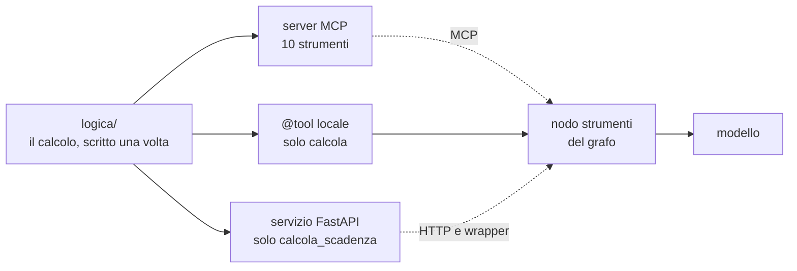
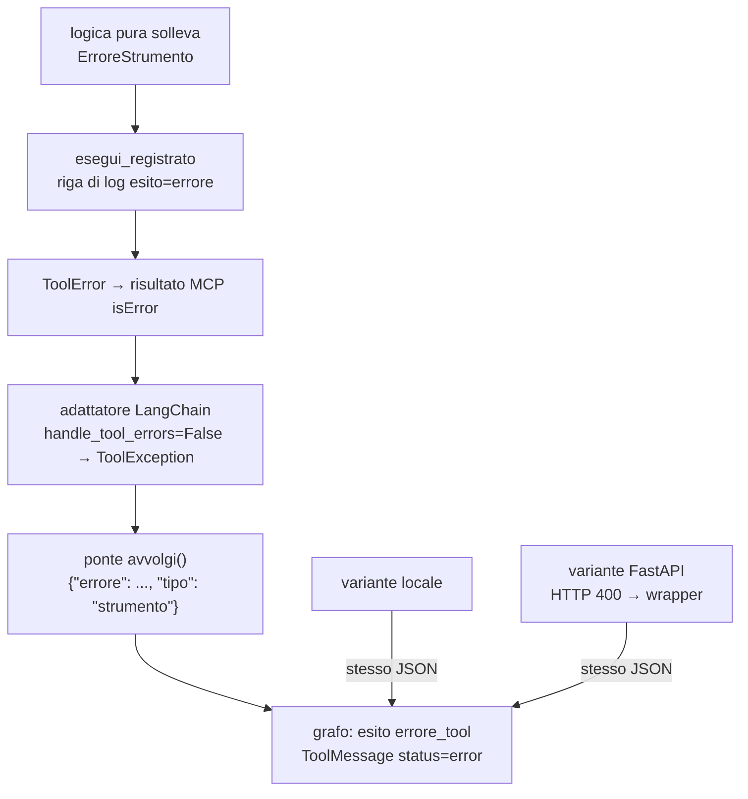
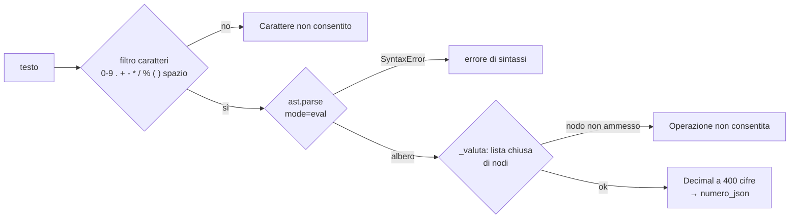
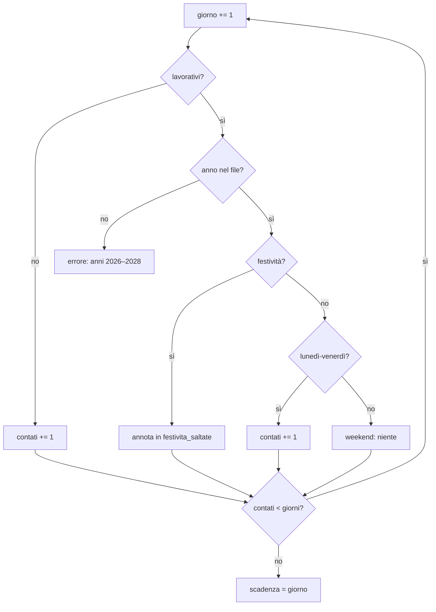
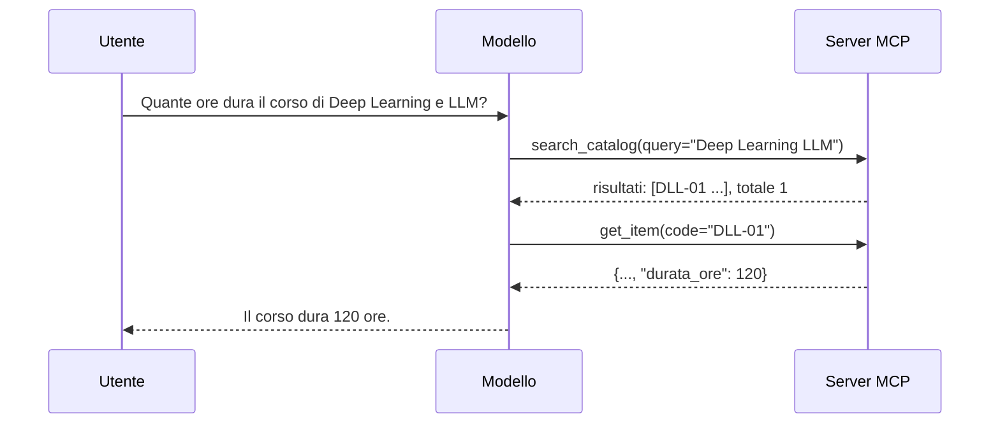
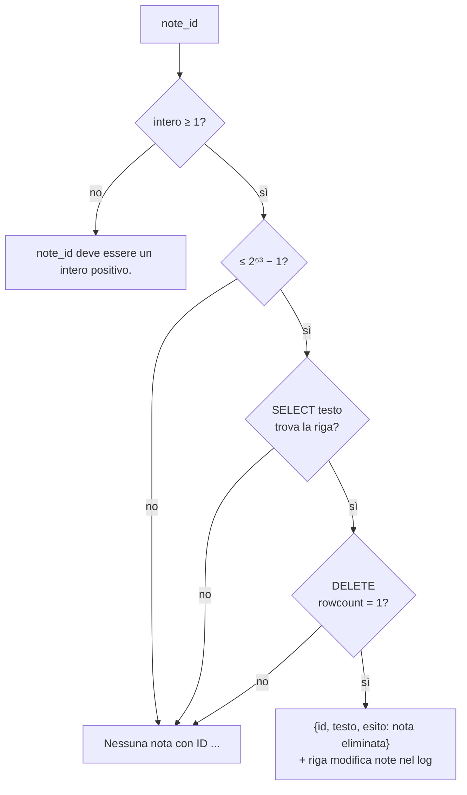
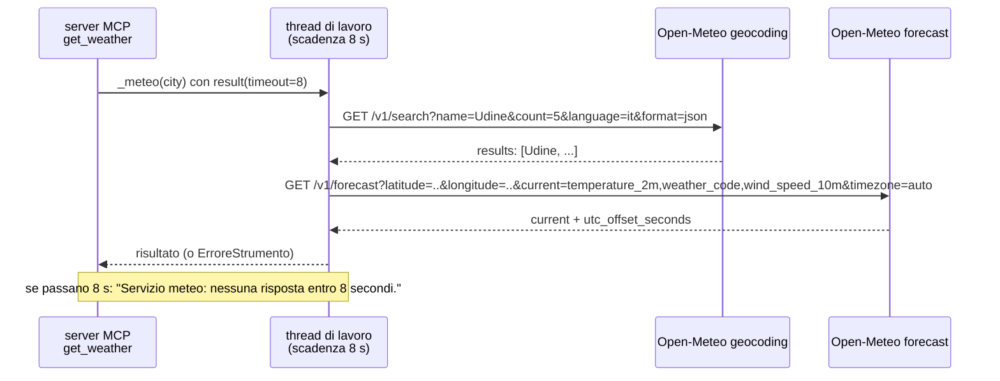
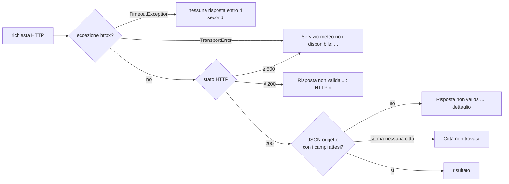

# 07 · I dieci strumenti uno per uno

> Percorso di studio: [00 Indice](00-indice.md) · [01 Panoramica](01-panoramica-e-concetti.md) · [02 Architettura](02-architettura.md) · [03 Viaggio di una richiesta](03-viaggio-di-una-richiesta.md) · [04 Grafo](04-grafo-langgraph.md) · [05 MCP in pratica](05-mcp-in-pratica.md) · [06 Tre varianti](06-tre-varianti.md) · **07 Strumenti** · [08 Configurazione e Docker](08-configurazione-avvio-docker.md) · [09 Test](09-test-e-verifiche.md) · [10 Log e diagnosi](10-log-e-diagnosi.md) · [11 Storia](11-storia-del-progetto.md) · [12 Glossario](12-glossario-e-domande.md)

## Scheda in 5 minuti

**Di che cosa parla.** Questo capitolo apre uno per uno i dieci strumenti che il modello può chiamare. Per ognuno mostra che cosa riceve, che cosa restituisce e quali errori dà. Serve a capire che cosa succede davvero quando il modello «usa uno strumento».

**Le idee chiave**

1. **Dieci strumenti, sette famiglie.** Il server MCP offre sempre dieci strumenti: orologio, convertitore, calcolatrice, scadenze, catalogo, note e meteo. Il catalogo ne ha due, le note tre. Il modello li vede tutti e sceglie da solo quale chiamare. → sezione 2
2. **La logica si scrive una volta sola.** Il calcolo vero di ogni strumento sta nella cartella `logica/`, che non sa nulla di MCP o di FastAPI. Il server e le varianti chiamano la stessa funzione. Così il risultato è uguale in ogni variante e si prova senza avviare nulla. → sezione 2.1
3. **Il modello vede un contratto: nome, descrizione e schema.** Lo schema è l'elenco degli argomenti, con il tipo di ciascuno. Il server pubblica lo schema, ma lascia arrivare il valore così com'è. Lo controlla la logica, con messaggi in italiano. → sezione 3.1
4. **Un errore è una frase che aiuta a correggersi.** Con un input sbagliato la logica solleva `ErroreStrumento`, un'eccezione con un messaggio italiano che spiega come rimediare. Il modello lo legge e può riprovare. Un guasto del percorso verso il server è un'altra cosa: un errore di «collegamento». → sezione 3.3
5. **Numeri senza falsa esattezza.** Calcolatrice e convertitore usano `Decimal`, l'aritmetica decimale esatta di Python: 0.1 + 0.2 dà proprio 0.3. Un risultato arrotondato esce con 15 cifre e mai come intero: 1/3 × 3 dà `1.0`, non `1`. Un numero esatto ma con troppe cifre per il JSON esce come testo. → sezione 4
6. **Regole rigide, limiti dichiarati.** La calcolatrice non usa mai `eval`, che eseguirebbe qualsiasi codice Python. Le scadenze conoscono le festività solo dal 2026 al 2028, e fuori da lì rifiutano. Meglio un rifiuto chiaro che una risposta sbagliata in silenzio. → sezioni 7, 8 e 16
7. **Ogni scelta resta visibile.** Le scadenze elencano le festività saltate e il meteo dichiara quale città ha scelto. Le note registrano ogni modifica nel log e non riusano mai un ID, il numero della nota. Così utente e modello possono controllare che cosa è successo. → sezioni 8.3, 11, 14.4 e 15.5

**I dieci strumenti in una riga**

- `ora_corrente` — dice data e ora di adesso in un fuso orario: «Che ore sono a Tokyo?»
- `converti_unita` — converte tra unità metriche, o tra gradi Celsius e Fahrenheit: «Quanti metri sono 2,5 km?»
- `calcola` — fa un calcolo aritmetico, in modo sicuro: «Quanto fa (3 + 4) per 2?»
- `calcola_scadenza` — aggiunge giorni a una data, anche solo quelli lavorativi: «Se parto il 23 dicembre, quando scadono 3 giorni lavorativi?»
- `search_catalog` — cerca i corsi dell'ITS per parola: «Quali corsi ci sono a Udine?»
- `get_item` — dà tutti i dettagli di un corso, partendo dal codice: «Quante ore dura il corso DLL-01?»
- `add_note` — salva una nota che resta anche dopo l'uscita: «Ricordami di consegnare il report venerdì.»
- `list_notes` — elenca le note salvate, dalla più recente: «Che note ho salvato?»
- `delete_note` — cancella una nota, indicata dal suo ID: «Elimina la nota 2.»
- `get_weather` — dice il meteo di adesso in una città, usando un servizio su Internet: «Che tempo fa a Udine?»

**Il quadro**



La stessa logica arriva al grafo per tre strade. È la versione semplice del diagramma della sezione 2.1.

**Da sapere a memoria**

| Cosa | Valore | Dove |
|---|---|---|
| Strumenti registrati nel server | 10, con `@server.tool` | `server_mcp/server.py:128-193` |
| Chi esegue, scrive il log e traduce gli errori | `esegui_registrato` | `server_mcp/server.py:98-109` |
| Cifre di un risultato arrotondato | 15 | `logica/numeri.py:17` |
| Limiti della calcolatrice | 200 caratteri, esponente tra −1000 e 1000, risultato sotto 1e300 | `logica/calcolatrice.py:16-18` |
| Anni delle festività | 2026, 2027, 2028, con 12 feste l'anno | `risorse/festivita_italia.json:3` |
| Tempi del meteo | 4 s per fase, 8 s in tutto; il ponte MCP aspetta 10 s | `logica/meteo.py:17-20`, `assistente/client_mcp.py:16` |

**Se te lo chiedono all'orale**

- *Perché la calcolatrice non usa `eval`?* Perché `eval` eseguirebbe qualsiasi codice, per esempio `__import__('os')`. La calcolatrice filtra i caratteri, costruisce un albero con `ast.parse` senza eseguirlo e valuta solo poche operazioni ammesse.
- *Perché `1/3*3` dà `1.0` e non `1`?* Perché il valore è stato arrotondato. Un risultato arrotondato non esce mai come intero, così non sembra esatto.
- *Perché `delete_note` non può cancellare la nota sbagliata?* Elimina solo per ID esatto. Grazie ad AUTOINCREMENT, un'opzione di SQLite, un ID non viene mai riusato. Un ID rimasto nella cronologia non può indicare una nota nuova.

Per i dettagli continua con il resto del capitolo: le idee rimandano alle sezioni con «→ sezione N».

---

Questo documento guarda **dentro** gli strumenti. Per ciascuno dei dieci trovi:

- lo scopo;
- il contratto: nome, descrizione e schema degli argomenti, cioè quello che il modello vede;
- il risultato, con esempi reali;
- gli errori, con il **testo esatto** dei messaggi;
- i casi limite;
- le scelte progettuali e il loro perché;
- i file che contengono la logica.

Come il modello scopre gli strumenti e come una chiamata viaggia fino al server è spiegato in [05 MCP in pratica](05-mcp-in-pratica.md). Il confronto tra le varianti MCP, locale e FastAPI è in [06 Tre varianti](06-tre-varianti.md). Il percorso completo di una domanda, dal terminale alla risposta, è in [03 Il viaggio di una richiesta](03-viaggio-di-una-richiesta.md).

---

## Indice

- [Scheda in 5 minuti](#scheda-in-5-minuti)

1. [Da dove vengono gli esempi](#1-da-dove-vengono-gli-esempi)
2. [Quadro d'insieme](#2-quadro-dinsieme)
3. [Regole comuni a tutti gli strumenti](#3-regole-comuni-a-tutti-gli-strumenti)
4. [Le regole numeriche: `logica/numeri.py`](#4-le-regole-numeriche-logicanumeripy)
5. [`ora_corrente`: orologio](#5-ora_corrente-orologio)
6. [`converti_unita`: convertitore](#6-converti_unita-convertitore)
7. [`calcola`: calcolatrice sicura](#7-calcola-calcolatrice-sicura)
8. [`calcola_scadenza`: giorni e scadenze](#8-calcola_scadenza-giorni-e-scadenze)
9. [`search_catalog`: ricerca nel catalogo](#9-search_catalog-ricerca-nel-catalogo)
10. [`get_item`: dettaglio di un corso](#10-get_item-dettaglio-di-un-corso)
11. [Le note persistenti: parte comune](#11-le-note-persistenti-parte-comune)
12. [`add_note`: aggiungere una nota](#12-add_note-aggiungere-una-nota)
13. [`list_notes`: elencare le note](#13-list_notes-elencare-le-note)
14. [`delete_note`: eliminare una nota](#14-delete_note-eliminare-una-nota)
15. [`get_weather`: meteo attuale](#15-get_weather-meteo-attuale)
16. [Tabella dei limiti e delle costanti](#16-tabella-dei-limiti-e-delle-costanti)
17. [Difetti minori noti](#17-difetti-minori-noti)
18. [Domande da orale sugli strumenti](#18-domande-da-orale-sugli-strumenti)

- [Scaletta per le slide](#scaletta-per-le-slide)

---

## 1. Da dove vengono gli esempi

Tutti i risultati e i messaggi d'errore di questo documento sono stati **ottenuti davvero**, eseguendo il codice attuale il 2026-11-09. Nessuno è stato scritto a mano.

- **Client MCP in memoria.** Uno script ha creato il server con `crea_server(...)` (`server_mcp/server.py:116`) e lo ha interrogato con il `Client` di FastMCP in memoria, come fa `con_client` in `tests/test_server_mcp.py`. I testi sono quindi quelli che il server restituisce davvero: JSON compatto per i successi, messaggio dell'errore MCP (`isError`) per gli errori.
- **Istante fissato per l'orologio.** Al server è stato passato `adesso=lambda: datetime(2026, 11, 8, 9, 30, tzinfo=timezone.utc)`, cioè domenica 8 novembre 2026 alle 9:30 UTC. È la stessa iniezione che usano i test.
- **Archivio delle note temporaneo.** Le note sono state scritte in una cartella temporanea, mai in `archivio/note.sqlite3`. La data di creazione delle note è quella reale dell'esecuzione (vedi [sezione 12.5](#125-scelte-progettuali) per il motivo).
- **Meteo con risposte simulate.** Nessuna richiesta di rete: un `httpx.MockTransport` restituiva risposte nel formato di Open-Meteo, con gli stessi dati usati in `tests/test_meteo.py`. Coordinate e temperature degli esempi meteo sono quindi di prova; la forma del risultato e i messaggi sono quelli reali del codice. Le verifiche contro Open-Meteo vero sono riportate dal checkpoint del passo 6 ([sezione 15.9](#159-verifiche-con-open-meteo-vero)).
- **Variante FastAPI.** Il servizio è stato interrogato con il `TestClient` di FastAPI, in processo e senza rete; il wrapper `@tool` è stato collegato allo stesso `TestClient`.
- **Controllo dell'host.** I messaggi del grafo sugli argomenti mancanti o inventati sono stati ottenuti con il modello finto di `tests/finti.py` e la calcolatrice locale.

---

## 2. Quadro d'insieme

Il server MCP si chiama «Strumenti laboratorio» (`NOME_SERVER`, `server_mcp/server.py:31`) ed espone sempre **dieci strumenti**, in sette famiglie: orologio, convertitore, calcolatrice, scadenze, catalogo (due strumenti), note (tre strumenti) e meteo.

| # | Strumento | Famiglia | Argomenti | Effetti | Varianti possibili | Logica pura |
|---|---|---|---|---|---|---|
| 1 | `ora_corrente` | orologio | `fuso` | nessuno | solo `mcp` | `logica/orologio.py` |
| 2 | `converti_unita` | convertitore | `valore`, `da`, `a` | nessuno | solo `mcp` | `logica/conversioni.py` + `logica/numeri.py` |
| 3 | `calcola` | calcolatrice | `espressione` | nessuno | `mcp` oppure `locale` | `logica/calcolatrice.py` + `logica/numeri.py` |
| 4 | `calcola_scadenza` | scadenze | `data_inizio`, `giorni`, `lavorativi` | nessuno | `mcp` oppure `fastapi` | `logica/scadenze.py` + `risorse/festivita_italia.json` |
| 5 | `search_catalog` | catalogo | `query`, `max_results` (facoltativo) | nessuno | solo `mcp` | `logica/catalogo.py` + `risorse/catalogo_corsi.json` |
| 6 | `get_item` | catalogo | `code` | nessuno | solo `mcp` | `logica/catalogo.py` |
| 7 | `add_note` | note | `text` | **scrive** su SQLite | solo `mcp` | `logica/note.py` |
| 8 | `list_notes` | note | `limit` (facoltativo) | nessuno (solo lettura) | solo `mcp` | `logica/note.py` |
| 9 | `delete_note` | note | `note_id` | **cancella** da SQLite | solo `mcp` | `logica/note.py` |
| 10 | `get_weather` | meteo | `city` | nessuno, ma usa Internet | solo `mcp` | `logica/meteo.py` |

**Nomi in italiano e in inglese.** La regola è nella specifica della lezione 5 (sezione 5). Dove le slide del corso danno nomi a strumenti e argomenti (catalogo, note, meteo) si usano quelli, in inglese: `search_catalog(query, max_results)`, `add_note(text)`, `get_weather(city)`. Gli strumenti che esistevano già (`ora_corrente`, `converti_unita`) hanno mantenuto il nome. Quelli senza nome nelle slide (calcolatrice e scadenze) l'hanno ricevuto in italiano. Le **chiavi dei risultati** sono invece sempre in italiano (`risultati`, `testo`, `temperatura`...).

**Ordine di nascita.** Il convertitore è nato per primo (specifica del 2026-11-03), con l'infrastruttura MCP. L'orologio esisteva già come strumento locale ed è stato spostato nel server nel passo 1 della lezione 5. Poi, un passo alla volta: calcolatrice (passo 2), scadenze (3), catalogo (4), note (5), meteo (6). La storia completa è in [11 Storia del progetto](11-storia-del-progetto.md).

### 2.1 Gli strati

La logica di ogni strumento è scritta **una volta sola**, nel pacchetto `logica/`, che non importa né `fastmcp`, né `fastapi`, né LangChain. Le registrazioni e le varianti la riusano.

```mermaid
flowchart LR
    subgraph logica["logica/ (pura)"]
        OR[orologio.py]
        CO[conversioni.py]
        CA[calcolatrice.py]
        SC[scadenze.py]
        CT[catalogo.py]
        NO[note.py]
        ME[meteo.py]
        NU[numeri.py]
        ER[errori.py<br/>ErroreStrumento]
    end
    CO --> NU
    CA --> NU
    subgraph server["server_mcp/server.py"]
        REG[10 registrazioni @server.tool<br/>+ esegui_registrato]
    end
    logica --> REG
    CA --> LOC[assistente/calcolatrice_locale.py<br/>@tool, variante locale]
    SC --> API[servizio_api/app.py<br/>GET /scadenza]
    API -. HTTP .-> WR[assistente/wrapper_scadenze.py<br/>@tool, variante FastAPI]
    REG -. MCP .-> PONTE[assistente/client_mcp.py<br/>ponte sincrono]
    PONTE --> GRAFO[nodo strumenti<br/>assistente/grafo.py]
    LOC --> GRAFO
    WR --> GRAFO
```

Perché questa separazione:

- **una sola logica per più varianti:** calcolatrice MCP e locale chiamano la stessa `logica.calcolatrice.calcola`; scadenze MCP e FastAPI la stessa `logica.scadenze.calcola_scadenza`. Così il risultato non può divergere;
- **test senza processi:** la logica pura si prova con una chiamata di funzione, senza server né rete;
- **registrazione sottile:** in `server_mcp/server.py` ogni strumento occupa poche righe (contratto, log, chiamata alla logica).

---

## 3. Regole comuni a tutti gli strumenti

### 3.1 Il contratto: nome, descrizione, schema

Ogni strumento è registrato nel server con il decoratore `@server.tool(name=..., description=...)` (`server_mcp/server.py:128-193`). Con la discovery (`tools/list`) il modello riceve tre cose:

- il **nome**, per esempio `get_item`;
- la **descrizione**, cioè le istruzioni d'uso scritte per il modello (costanti `DESCRIZIONE_*`, `server_mcp/server.py:43-89`);
- lo **schema JSON** degli argomenti.

**Perché `Annotated[Any, WithJsonSchema(...)]`.** Tutti i parametri sono dichiarati così, per esempio:

```python
# server_mcp/server.py:171-173
@server.tool(name=NOME_DETTAGLIO, description=DESCRIZIONE_DETTAGLIO)
def get_item(code: Annotated[Any, WithJsonSchema(SCHEMA_CODE)]) -> dict:
    return esegui_registrato(NOME_DETTAGLIO, {"code": code}, lambda: dettaglio(catalogo, code))
```

`WithJsonSchema` **pubblica** lo schema voluto (tipo, descrizione, limiti), mentre `Any` fa arrivare alla funzione il **valore grezzo**, senza la validazione automatica di pydantic. È uno dei «fatti verificati» del prototipo del convertitore (piano del 2026-11-03). Il motivo sta nella specifica della lezione 5, sezione 5: *se la validazione automatica dello schema non dà un messaggio italiano comprensibile, la fa il codice dello strumento*. Con un tipo vero (`code: str`) un valore sbagliato produrrebbe un errore pydantic in inglese; così, invece, ogni controllo lo fa la logica pura, con un messaggio italiano pensato per il modello.

Una conseguenza visibile negli esempi: lo schema dice `"type": "string"` per `espressione`, ma se il modello manda il numero `42` la chiamata arriva lo stesso alla logica, che risponde `L'espressione deve essere un testo.`.

Gli schemi **delle stesse costanti** servono a più varianti: `SCHEMA_ESPRESSIONE` (`logica/calcolatrice.py:22`) per la calcolatrice MCP e locale; `SCHEMA_DATA_INIZIO`, `SCHEMA_GIORNI`, `SCHEMA_LAVORATIVI` (`logica/scadenze.py:22-27`) per il server MCP, il servizio FastAPI e il wrapper.

Gli schemi effettivi, letti dal catalogo MCP, hanno tutti `"additionalProperties": false`. Esempio reale:

```json
{"additionalProperties": false,
 "properties": {"code": {"description": "Codice esatto del corso, per esempio DLL-01", "type": "string"}},
 "required": ["code"], "type": "object"}
```

Gli argomenti facoltativi (`max_results`, `limit`) hanno un `default` e non compaiono in `required`.

### 3.2 Il controllo dell'host prima di eseguire

Prima di eseguire qualsiasi strumento, in qualsiasi variante, il nodo `strumenti` del grafo confronta gli argomenti con lo schema (`assistente/grafo.py:82-99` e `158-172`). Esempi reali, ottenuti con il modello finto e la calcolatrice locale:

| Situazione | Messaggio restituito al modello |
|---|---|
| manca un argomento obbligatorio | `{"errore": "Argomenti mancanti per calcola: espressione. Riprova indicando tutti gli argomenti richiesti.", "tipo": "strumento"}` |
| c'è un argomento che lo schema non prevede | `{"errore": "Argomenti non previsti per calcola: precisione. Usa solo: espressione.", "tipo": "strumento"}` |

In questi casi la chiamata **non arriva** né al server né al servizio FastAPI e compare solo in `logs/assistente.log`, con esito `errore_tool`. Il controllo è nato in due momenti:

- il passo 3 (commit `ec2b384`) ha introdotto il controllo degli argomenti mancanti, perché il modello riceveva un errore pydantic in inglese;
- il commit `5bed890` ha aggiunto quello degli argomenti inventati, perché le varianti si comportavano in modo diverso (FastMCP rifiutava un argomento in più con un errore in inglese, `@tool` lo ignorava).

Ora il messaggio è lo stesso per tutte le varianti. Il funzionamento del nodo è descritto in [04 Il grafo LangGraph](04-grafo-langgraph.md).

### 3.3 Gli errori dello strumento: `ErroreStrumento`

Tutta la logica segnala un input non valido sollevando una sola eccezione:

```python
# logica/errori.py
class ErroreStrumento(ValueError):
    """Richiesta non valida per uno strumento, con un messaggio in italiano per il modello."""
```

Nel server ogni strumento passa da `esegui_registrato` (`server_mcp/server.py:98-109`), che fa tre cose:

1. se il calcolo riesce, scrive una riga di log `chiamata tool=... argomenti=... esito=ok risultato=...` e restituisce il dizionario;
2. se arriva un `ErroreStrumento`, scrive `esito=errore messaggio=...` e lo trasforma in `ToolError`, cioè in un **errore MCP** (risultato con `isError: true`);
3. se arriva un'eccezione imprevista (**rete di sicurezza**), scrive il traceback nel log e restituisce `Errore interno dello strumento <nome>: <TipoEccezione>.`. Così nessun errore arriva al modello in inglese o senza traccia.

Un esempio reale della rete di sicurezza: nei test il meteo riceve un client HTTP che solleva `AssertionError` a ogni richiesta (`http_senza_rete`, `tests/test_server_mcp.py:31-37`). Chiamare `get_weather("Udine")` con quel client produce nel log `esito=errore imprevisto` con il traceback, e al modello arriva `Errore interno dello strumento get_weather: AssertionError.`.

Un errore non viene mai restituito **insieme** a un risultato: o c'è il risultato, o c'è il messaggio (specifica, sezione 5).



**Errore dello strumento ed errore di collegamento.** Il JSON che arriva al grafo ha un campo `tipo`:

- `"strumento"`: la richiesta era sbagliata (data inesistente, fuso sconosciuto...). Il modello può correggersi;
- `"collegamento"`: il percorso non ha funzionato (server MCP spento, timeout di 10 secondi del ponte, servizio FastAPI non raggiungibile). Nel log l'esito è `errore_collegamento`.

Esempio reale: con la variante FastAPI e il servizio irraggiungibile il wrapper restituisce `{"errore": "Servizio scadenze non raggiungibile: ConnectError: Connessione rifiutata", "tipo": "collegamento"}`.

Attenzione a non confondere i livelli: un problema di **Open-Meteo** (rete del server verso Internet) è per il progetto un errore **dello strumento** `get_weather`, con `tipo: "strumento"`, perché il server MCP ha funzionato e ha risposto con un messaggio. È «collegamento» solo ciò che riguarda il percorso tra agente e server o servizio.

### 3.4 Numeri scritti come testo, booleani e `null`

I modelli piccoli a volte mandano un numero tra virgolette. La regola, nata con il convertitore ed estesa a tutti gli strumenti (specifica, sezione 5), è:

- `"2.5"` con il punto è accettato come 2.5;
- `"2,5"` con la virgola è rifiutato con la richiesta di usare il punto, perché la virgola è ambigua (`1,000` e `1.000`);
- un booleano (`true`) non è mai un numero, anche se in Python `True` vale 1 (`bool` è una sottoclasse di `int`, per questo il codice lo esclude sempre in modo esplicito).

Per gli argomenti **interi** (`giorni`, `max_results`, `limit`, `note_id`) le funzioni di lettura accettano tre forme e nient'altro (`logica/scadenze.py:58-68`, `logica/catalogo.py:60-72`, `logica/note.py:43-50`):

| Forma | Esempio | Accettato? |
|---|---|---|
| intero vero (non booleano) | `3` | sì |
| float con valore intero | `3.0` | sì, diventa `3` |
| testo di sole cifre ASCII | `"3"` | sì, diventa `3` |
| testo con decimali | `"3.0"` | no |
| float non intero | `2.5` | no |
| booleano | `true` | no |
| testo con segno | `"-1"` | no (la regex `[0-9]+` non ammette il segno) |

Il flag `re.ASCII` nelle regex (`_CIFRE`) serve a non accettare cifre di altri alfabeti, che per Python sarebbero «cifre» Unicode.

**`null` negli argomenti facoltativi.** Per `max_results` e `limit`, un `null` vale il predefinito (`logica/catalogo.py:61-62`, `logica/note.py:88`): un modello che manda l'argomento facoltativo come `null` non riceve un errore. Negli argomenti obbligatori, invece, `null` è un valore come un altro e la logica lo rifiuta con il suo messaggio (per esempio `Valore non numerico: None.` nel convertitore).

### 3.5 I log del server

Ogni chiamata lascia una riga in `logs/server_mcp.log`, scritta da `esegui_registrato`. Righe reali:

```text
chiamata tool=get_item argomenti={"code":"DLL-01"} esito=ok risultato={"codice":"DLL-01","titolo":"Deep Learning e LLM: costruire chatbot e agenti","sede":"Pordenone","durata_ore":120}
chiamata tool=get_item argomenti={"code":"dll-01"} esito=errore messaggio=Nessun corso con codice 'dll-01'. Usa prima search_catalog per trovare il codice.
```

Gli argomenti sono scritti in JSON compatto con `ensure_ascii=False` (`_json`, `server_mcp/server.py:94-95`), quindi accenti e `°C` restano leggibili. Le note aggiungono una seconda riga per ogni modifica riuscita ([sezione 11](#11-le-note-persistenti-parte-comune)). Il dettaglio dei log è in [10 Log e diagnosi](10-log-e-diagnosi.md).

---

## 4. Le regole numeriche: `logica/numeri.py`

Calcolatrice e convertitore calcolano con `Decimal`, l'aritmetica decimale esatta di Python, e non con i `float`. Così `0.1 + 0.2` dà `0.3` e non `0.30000000000000004`. Alla fine però il risultato va scritto in JSON, dove un numero non intero diventa un `float` a 64 bit, con circa 15-17 cifre significative. La funzione `numero_json(valore, inesatto)` (`logica/numeri.py:20-34`) decide **come** scriverlo, con un principio: *nessuna falsa esattezza*. Un numero arrotondato non deve sembrare esatto, e un numero esatto non deve perdere cifre.

```python
# logica/numeri.py:20-34
def numero_json(valore: Decimal, inesatto: bool) -> int | float | str:
    if not inesatto:
        if valore == valore.to_integral_value():
            return int(valore)                                   # 1) esatto e intero → int
        decimale = float(valore)
        if decimale != 0 and math.isfinite(decimale) and Decimal(repr(decimale)) == valore:
            return decimale                                      # 2) il float lo rappresenta senza perdite → float
        with localcontext() as contesto:  # normalize() arrotonda alla precisione del contesto
            contesto.prec = max(28, len(valore.as_tuple().digits))
            return str(valore.normalize())                       # 3) un float perderebbe cifre → testo esatto
    arrotondato = Decimal(format(valore, f".{CIFRE_SIGNIFICATIVE}g"))   # 4) già arrotondato → 15 cifre
    decimale = float(arrotondato)
    if decimale == 0 and valore != 0:
        raise ErroreStrumento("Risultato troppo piccolo per essere rappresentato.")
    return decimale                                              #    sempre float, MAI int
```

### 4.1 Le quattro regole con esempi reali

| Caso | Regola | Esempio reale (calcolatrice) | Uscita |
|---|---|---|---|
| 1. Esatto e intero | `int`, senza `.0` | `(3 + 4) * 2` | `14` |
| | anche se scritto con decimali | `1.50 * 2` | `3` |
| | anche se enorme (fino a 300 cifre) | `2 ** 100` | `1267650600228229401496703205376` |
| 2. Esatto, rappresentabile da un float | `float` | `0.1 + 0.2` | `0.3` |
| | | `10 / 4` | `2.5` |
| | | `1 / 8` | `0.125` |
| 3. Esatto, ma un float perderebbe cifre | **testo** del valore esatto | `123456789012345678 + 0.1` | `"123456789012345678.1"` |
| | | `10 ** -400` | `"1E-400"` |
| | (convertitore) | `123456789012345678901 mm → km` | `"123456789012345.678901"` |
| 4. Arrotondato (divisione periodica) | `float` a 15 cifre significative | `1 / 3` | `0.333333333333333` |
| | | `2 / 3` | `0.666666666666667` |
| | | `100 / 3` | `33.3333333333333` |
| | | `3 ** -1` | `0.333333333333333` |
| | mai `int`, anche se sembra intero | `1 / 3 * 3` | `1.0` |
| | troppo piccolo per un float | `1 / 3 * 10 ** -400` | errore `Risultato troppo piccolo per essere rappresentato.` |

Prove dirette su `numero_json`: `Decimal("3.00")` esatto → `3`; `Decimal("0.1000")` esatto → `0.1`; `Decimal("0.9999999999999999999")` inesatto → `1.0`.

### 4.2 I dettagli che contano

**Chi decide se il valore è «inesatto».** Solo la calcolatrice può produrre valori inesatti. Calcola con una precisione di 400 cifre e alla fine guarda il flag `Inexact` del contesto decimale (`logica/calcolatrice.py:104`): è vero solo se almeno un passaggio ha dovuto arrotondare, cioè in pratica con una divisione che non ha un numero finito di cifre (1/3, 1/7, anche `3 ** -1`). Il flag viene azzerato prima del calcolo con `contesto.clear_flags()` (riga 97). Il convertitore passa sempre `inesatto=False` (`logica/conversioni.py:88`), perché moltiplicare per potenze di 10 è sempre esatto e le temperature sono già arrotondate a 2 decimali per scelta.

**Perché il controllo `decimale != 0` nella regola 2.** `float(Decimal("1E-400"))` dà `0.0`: senza quel controllo un valore esatto e diverso da zero diventerebbe zero. Con il controllo si passa alla regola 3 e si restituisce il testo `"1E-400"`. Prima del commit `7871ef7`, `10 ** -400` diventava proprio `0.0`.

**Perché `max(28, ...)` nella regola 3.** `normalize()` toglie gli zeri finali ma arrotonda alla precisione del contesto, che per default è 28 cifre. Alzarla al numero di cifre del valore garantisce che il testo contenga **tutte** le cifre.

**Perché il testo nella regola 3.** Senza questa regola, `123456789012345678 + 0.1` diventava il float `123456789012346000`, cioè un numero con cifre inventate presentato come intero esatto. Il commit `7871ef7` (*«nessun numero arrotondato presentato come esatto»*) ha introdotto `numeri.py` proprio per questo: *meglio un testo vero che un numero con cifre inventate* (`logica/numeri.py:7-8`).

**Perché `1.0` e non `1` nella regola 4.** `1/3*3` in decimale a 400 cifre dà `0,999...9`, che arrotondato a 15 cifre diventa 1. Restituirlo come `1` (intero) farebbe credere a un risultato esatto. Il `.0` segnala che il valore è arrotondato.

**Perché 15 cifre.** Un `float` a 64 bit garantisce 15 cifre decimali significative senza errori di andata e ritorno. Con 15 cifre il numero JSON corrisponde esattamente al valore arrotondato; con 17 comparirebbero gli artefatti della virgola mobile. La specifica della calcolatrice suggeriva «per esempio 15» (sezione 5.3).

---

## 5. `ora_corrente`: orologio

### 5.1 Scopo

Restituisce data e ora **attuali** in un fuso orario indicato esplicitamente. È lo strumento più vecchio del progetto: nato come funzione locale nella prima specifica (2026-11-02), è stato spostato nel server MCP nel passo 1 della lezione 5, mantenendo nome, argomento e risultato. Il messaggio di sistema lo nomina in modo esplicito (`assistente/grafo.py:38-39`): *per conoscere la data o l'ora usa sempre lo strumento ora_corrente: non inventarle e non dedurle dai messaggi precedenti*.

### 5.2 Contratto

- **Descrizione:** «Restituisce data e ora attuali nel fuso orario indicato. `fuso`: nome IANA, per esempio "Europe/Rome" o "Asia/Tokyo".»

| Argomento | Tipo nello schema | Obbligatorio | Descrizione nello schema |
|---|---|---|---|
| `fuso` | string | sì | Nome IANA del fuso, per esempio Europe/Rome o Asia/Tokyo |

### 5.3 Risultato (esempi reali, istante fissato alle 9:30 UTC dell'8/11/2026)

```json
{"fuso":"Europe/Rome","data_ora":"2026-11-08T10:30:00+01:00","scarto_utc":"+01:00","giorno_settimana":"domenica"}
{"fuso":"Asia/Tokyo","data_ora":"2026-11-08T18:30:00+09:00","scarto_utc":"+09:00","giorno_settimana":"domenica"}
{"fuso":"Asia/Kolkata","data_ora":"2026-11-08T15:00:00+05:30","scarto_utc":"+05:30","giorno_settimana":"domenica"}
{"fuso":"Asia/Kathmandu","data_ora":"2026-11-08T15:15:00+05:45","scarto_utc":"+05:45","giorno_settimana":"domenica"}
{"fuso":"America/New_York","data_ora":"2026-11-08T04:30:00-05:00","scarto_utc":"-05:00","giorno_settimana":"domenica"}
{"fuso":"UTC","data_ora":"2026-11-08T09:30:00+00:00","scarto_utc":"+00:00","giorno_settimana":"domenica"}
```

| Campo | Significato | Codice |
|---|---|---|
| `fuso` | il fuso ricevuto | |
| `data_ora` | ISO 8601 al secondo, con lo scarto | `isoformat(timespec="seconds")`, `logica/orologio.py:40` |
| `scarto_utc` | scarto da UTC nel formato `±HH:MM`, anche per mezz'ore e quarti d'ora | `_scarto`, righe 26-30 |
| `giorno_settimana` | in italiano | tupla `GIORNI`, riga 9 |

### 5.4 Errori

Un solo messaggio, con il valore ricevuto tra apici:

| Input | Messaggio esatto |
|---|---|
| `Mars/Olympus` | `Fuso orario sconosciuto: 'Mars/Olympus'. Usa un nome IANA, per esempio 'Europe/Rome'.` |
| `europe/rome` | `Fuso orario sconosciuto: 'europe/rome'. Usa un nome IANA, per esempio 'Europe/Rome'.` |
| `Roma` | `Fuso orario sconosciuto: 'Roma'. Usa un nome IANA, per esempio 'Europe/Rome'.` |
| `5` (numero) | `Fuso orario sconosciuto: '5'. Usa un nome IANA, per esempio 'Europe/Rome'.` |
| `null` | `Fuso orario sconosciuto: 'None'. Usa un nome IANA, per esempio 'Europe/Rome'.` |

### 5.5 Casi limite

- **Maiuscole:** il nome deve essere esatto. `è_fuso_valido` (`logica/orologio.py:17-19`) controlla che sia una stringa presente in `available_timezones()`, quindi `europe/rome` è rifiutato anche se su Windows (file system che non distingue le maiuscole) `ZoneInfo("europe/rome")` potrebbe funzionare. Il controllo esplicito rende il comportamento uguale su ogni sistema, Docker compreso.
- **Ora legale:** lo scarto dipende dalla data, e `zoneinfo` lo calcola da solo. Prove con la logica pura: il 1° luglio 2026 alle 9:30 UTC Roma è `2026-07-01T11:30:00+02:00`; il 25 ottobre 2026, giorno del cambio, alle 0:59 UTC è `02:59:00+02:00` e un minuto dopo è `02:00:00+01:00`.
- **Il fuso del container non conta.** In Docker il sistema è in UTC, ma lo strumento usa sempre il fuso passato come argomento (specifica, sezione 5.1).
- **Elenco dei fusi in cache:** `_fusi_disponibili()` è decorata con `@cache` (righe 12-14), quindi l'elenco IANA si legge una volta sola.

### 5.6 Scelte progettuali

- **Fuso sempre esplicito.** Lo strumento non «indovina» il fuso: è il modello a passarlo. Il fuso dell'utente, rilevato all'avvio da `assistente/fuso.py`, sta nello stato del grafo e viene scritto nel messaggio di sistema (`assistente/grafo.py:40-42`), così il modello sa quale usare se l'utente non nomina un luogo, e come tradurre un luogo in nome IANA («Asia/Tokyo per Tokyo»).
- **Istante iniettabile.** `ora_corrente(fuso, adesso)` riceve l'istante come argomento; il server lo prende da `adesso()`, che per default è `ora_utc` (`server_mcp/server.py:118` e `146`). Nei test si passa un istante fisso: è così che i test dell'orologio sono ripetibili.
- **Errore MCP invece di risultato.** Prima dello spostamento nel server un fuso sconosciuto era un risultato normale `{"errore": ...}`; ora è un errore MCP (`isError`), come per tutti gli strumenti (specifica, sezione 5.1).
- **Riuso senza dipendenze dal server.** `assistente/fuso.py:9` importa `è_fuso_valido` da `logica.orologio`, non dal pacchetto del server: il rilevamento del fuso funziona senza importare `fastmcp`, come chiede la specifica.

### 5.7 File

`logica/orologio.py` (logica), `server_mcp/server.py:140-146` (registrazione), `tests/test_orologio.py`.

---

## 6. `converti_unita`: convertitore

### 6.1 Scopo

Converte un valore tra unità metriche della stessa grandezza (lunghezza, massa, volume) o tra gradi Celsius e Fahrenheit. È il primo strumento MCP del progetto: con lui è stata costruita tutta l'infrastruttura MCP (specifica del 2026-11-03).

### 6.2 Contratto

- **Descrizione:** «Converte un valore tra unità metriche della stessa grandezza (lunghezza, massa, volume) o tra gradi Celsius e Fahrenheit. Esempio: valore=2.5, da="km", a="m".»

| Argomento | Tipo nello schema | Obbligatorio | Note |
|---|---|---|---|
| `valore` | number | sì | «Numero da convertire, con il punto decimale (es. 2.5)» |
| `da` | string, **enum** | sì | «Unità di partenza» |
| `a` | string, **enum** | sì | «Unità di arrivo» |

L'enumerazione contiene le 22 unità ammesse (`UNITA_AMMESSE`, `logica/conversioni.py:18`) ed è costruita da `_unita` (`server_mcp/server.py:112-113`). Il modello riceve quindi l'elenco già con la discovery.

| Grandezza | Unità (esponente di 10 rispetto all'unità base) |
|---|---|
| lunghezza | `km` 3, `hm` 2, `dam` 1, `m` 0, `dm` −1, `cm` −2, `mm` −3 |
| massa | `kg` 3, `hg` 2, `dag` 1, `g` 0, `dg` −1, `cg` −2, `mg` −3 |
| volume | `hl` 2, `dal` 1, `l` 0, `dl` −1, `cl` −2, `ml` −3 |
| temperatura | `°C`, `°F` |

La tabella `_METRICHE` (`logica/conversioni.py:10-14`) memorizza proprio questi esponenti: convertire da `da` ad `a` vuol dire spostare la virgola di `esponente(da) − esponente(a)` posizioni.

### 6.3 Risultato (esempi reali)

```json
{"valore":2.5,"da":"km","a":"m","risultato":2500,"grandezza":"lunghezza"}
{"valore":750,"da":"ml","a":"l","risultato":0.75,"grandezza":"volume"}
{"valore":100,"da":"°C","a":"°F","risultato":212,"grandezza":"temperatura"}
{"valore":1,"da":"°F","a":"°C","risultato":-17.22,"grandezza":"temperatura"}
{"valore":36.6,"da":"°C","a":"°F","risultato":97.88,"grandezza":"temperatura"}
{"valore":0.1,"da":"km","a":"mm","risultato":100000,"grandezza":"lunghezza"}
{"valore":1.5,"da":"mg","a":"kg","risultato":1.5e-6,"grandezza":"massa"}
{"valore":123456789012345678901,"da":"mm","a":"km","risultato":"123456789012345.678901","grandezza":"lunghezza"}
```

`valore` riporta il numero interpretato: se il modello manda `"2.5"` (testo), nel risultato compare `2.5` (numero). `grandezza` dichiara la famiglia dell'unità.

### 6.4 Errori

L'ordine dei controlli (`converti`, `logica/conversioni.py:63-89`) è: valore, unità di partenza, unità di arrivo, stessa grandezza, limiti fisici, grandezza del risultato.

| Input | Messaggio esatto |
|---|---|
| `valore="2,5"` | `Valore non valido: usa il punto come separatore decimale, per esempio 2.5.` |
| `valore=true` | `Valore non numerico: un booleano non è un numero.` |
| `valore="abc"` | `Valore non numerico: 'abc'.` |
| `valore=null` | `Valore non numerico: None.` |
| `valore="inf"` | `Il valore deve essere un numero finito.` |
| `km` → `kg` | `Le unità 'km' e 'kg' appartengono a grandezze diverse: conversione impossibile.` |
| `a="litri"` | `Unità sconosciuta: 'litri'. Unità ammesse: km, hm, dam, m, dm, cm, mm, kg, hg, dag, g, dg, cg, mg, hl, dal, l, dl, cl, ml, °C, °F.` |
| `a="K"` | stesso messaggio con `'K'` (il kelvin non è ammesso) |
| `-1 m → cm` | `Valore negativo non ammesso per lunghezza.` |
| `-300 °C → °F` | `Temperatura sotto lo zero assoluto (-273.15 °C).` |
| `"-500" °F → °C` | `Temperatura sotto lo zero assoluto (-459.67 °F).` |
| `1e308 km → mm` | `Risultato troppo grande per essere rappresentato.` |
| `1e30 °C → °F` | `Risultato troppo grande per essere rappresentato.` |

### 6.5 Casi limite

- **Stessa unità:** `5 m → m` dà `5`, non è un errore (`logica/conversioni.py:51-52`).
- **Zero assoluto esatto:** `-273.15 °C → °F` è ammesso e dà `-459.67`; sotto è un errore. I minimi sono in `_MINIMO` (riga 16).
- **Lo zero è ammesso** per lunghezza, massa e volume (`0 kg → g` dà `0`); i negativi no. Per le temperature i negativi sono normali.
- **Valori enormi:** `1e308 km → mm` darebbe `1e311`, che un float non può contenere: invece di `Infinity` nel JSON c'è un errore (righe 81-86).
- **Temperature enormi:** il calcolo delle temperature usa la precisione decimale normale (28 cifre). Per `1e30 °C` l'arrotondamento a 2 decimali richiederebbe più cifre, `quantize` solleva `InvalidOperation` e lo strumento risponde «troppo grande» (righe 77-80, commit `02ce50d`). Con `1e20 °C` il calcolo riesce ancora e dà l'intero esatto `180000000000000000032`.
- **Interi grandi:** un intero JSON arriva come `int` Python e diventa `Decimal(valore)` senza passare dal float (riga 33), quindi resta esatto. Il risultato con troppe cifre per un float esce come testo (regola 3 della [sezione 4](#4-le-regole-numeriche-logicanumeripy)).
- **Arrotondamento delle metà verso l'alto:** `0.005 °C → °F` vale 32,009 e diventa `32.01`.

### 6.6 Scelte progettuali

- **Esattezza decimale.** Un valore ricevuto come float viene convertito con `Decimal(repr(numero))` (`logica/conversioni.py:42`), cioè partendo dalla sua rappresentazione decimale più breve: `0.1` diventa esattamente `0.1`, non `0.1000000000000000055...`. Le conversioni metriche usano `scaleb` (spostamento della virgola) con precisione 400 (righe 58-60): nessun arrotondamento. Così `0.1 km → mm` dà `100000` e non `100000.00000000001`.
- **Temperature a 2 decimali in entrambe le direzioni**, con arrotondamento `ROUND_HALF_UP` (righe 54-56). È una scelta della specifica del convertitore, «per coerenza».
- **Elenco chiuso, senza alias.** I simboli sono esatti e sensibili alle maiuscole: niente `L`, `Km`, `C`, `litri`. Unità non metriche (miglia, libbre), kelvin, tonnellate e m³ sono non obiettivi dichiarati. L'enum nello schema serve proprio a dire al modello quali simboli usare.
- **La virgola è rifiutata**, non interpretata: il modello deve riprovare con il punto. Il messaggio dice come.
- **Errori distinti dal risultato:** `ErroreConversione` è una sottoclasse di `ErroreStrumento` (righe 24-25), quindi passa dallo stesso meccanismo di tutti gli altri strumenti.

### 6.7 File

`logica/conversioni.py`, `logica/numeri.py`, `server_mcp/server.py:128-138` (con `_unita` alle righe 112-113), `tests/test_conversioni.py`.

---

## 7. `calcola`: calcolatrice sicura

### 7.1 Scopo

Calcola un'espressione aritmetica **senza `eval`**. Slide 25 del corso: *espressioni aritmetiche senza eval: solo operazioni consentite. Allena il rifiuto esplicito di input non validi.* È uno dei due strumenti con una seconda variante: oltre a quella MCP esiste la **variante locale** (`assistente/calcolatrice_locale.py`), una funzione registrata con `@tool` nel processo dell'agente (vedi [06 Tre varianti](06-tre-varianti.md)).

### 7.2 Contratto

- **Descrizione** (identica nelle due varianti, lo verifica `tests/test_server_mcp.py:118`): «Calcola un'espressione aritmetica con numeri decimali (punto come separatore), + - * / % ** e parentesi. Esempio: espressione="(3 + 4) * 2".»

| Argomento | Tipo nello schema | Obbligatorio | Descrizione |
|---|---|---|---|
| `espressione` | string | sì | Espressione aritmetica, per esempio (3 + 4) * 2 |

### 7.3 Risultato (esempi reali)

```json
{"espressione":"(3 + 4) * 2","risultato":14}
{"espressione":"0.1 + 0.2","risultato":0.3}
{"espressione":"1 / 3","risultato":0.333333333333333}
{"espressione":"123456789012345678 + 0.1","risultato":"123456789012345678.1"}
```

`espressione` riporta il testo ricevuto così com'è, spazi compresi (`" 3 "` → `"espressione":" 3 "`, `"risultato":3`).

Altri risultati reali utili per capire le regole:

| Espressione | Risultato | Cosa mostra |
|---|---|---|
| `6 / 3` | `2` | divisione esatta → intero |
| `(1 + 2) * (3 - 4) / 5` | `-0.6` | precedenze e parentesi usuali |
| `2 ** 3 ** 2` | `512` | `**` è associativa a destra: 2⁹ |
| `-2 ** 2` | `-4` | `**` lega più forte del meno unario, come in Python |
| `7 % 3` | `1` | resto |
| `7.5 % 2` | `1.5` | resto anche con i decimali |
| `-7 % 3` | `-1` | resto con il segno del dividendo (regola di `Decimal`), **diverso** da Python, dove vale 2. È fissato in `tests/test_calcolatrice.py:13` |
| `2 ** -1` | `0.5` | esponente negativo intero, risultato esatto |
| `0 ** 0` | `1` | come in Python (gestito a mano, `Decimal` lo rifiuterebbe) |
| `1 / 7` | `0.142857142857143` | divisione periodica: 15 cifre |
| `1 / 3 * 3` | `1.0` | valore arrotondato: mai intero |
| `10 ** -400` | `"1E-400"` | esatto ma non rappresentabile da un float |
| `2 ** 200` | `1606938044258990275541962092341162602522202993782792835301376` | interi grandi esatti |
| `1.` e `.5 * 2` | `1` e `1` | forme numeriche di Python accettate |
| `--5` | `5` | meno unario ripetuto |

### 7.4 Errori

I controlli avvengono in quest'ordine (`logica/calcolatrice.py:74-105`): tipo, vuoto, lunghezza, virgola, caratteri, sintassi, poi la valutazione.

| Input | Messaggio esatto |
|---|---|
| `42` (non testo) | `L'espressione deve essere un testo.` |
| `"   "` | `Espressione vuota.` |
| più di 200 caratteri | `Espressione troppo lunga: al massimo 200 caratteri.` |
| `2,5 + 1` | `Usa il punto come separatore decimale, per esempio 2.5.` |
| `max(1, 2)` | `Usa il punto come separatore decimale, per esempio 2.5.` (la virgola si controlla prima delle lettere) |
| `__import__("os")` | `Carattere non consentito: '_'. Sono ammessi numeri, + - * / % ** e parentesi.` |
| `1e5` | `Carattere non consentito: 'e'. Sono ammessi numeri, + - * / % ** e parentesi.` |
| `[1]`, `2 x 3` | `Carattere non consentito: '['. ...` / `Carattere non consentito: 'x'. ...` |
| `(3 + `, `2 * (3`, `3 +* 2`, `07 + 1`, `1 000` | `Espressione non valida: errore di sintassi.` |
| `7 // 2` | `Operazione non consentita.` |
| `(2)(3)` | `Operazione non consentita.` (è una «chiamata» nell'albero `ast`) |
| `1 / 0`, `5 % 0`, `0 ** -1` | `Divisione per zero.` |
| `2 ** 0.5`, `2 ** 1001`, `9 ** 9 ** 9` | `Esponente non ammesso: deve essere un intero tra -1000 e 1000.` |
| `10 ** 300` | `Risultato troppo grande.` |
| `1 / 3 * 10 ** -400` | `Risultato troppo piccolo per essere rappresentato.` |

Due dettagli sull'ordine: la **lunghezza** si misura sul testo originale (`len(espressione)`, riga 81), mentre vuoto, virgola e caratteri si controllano sul testo senza spazi ai lati. `07 + 1` è un errore di sintassi perché in Python 3 un intero con zeri iniziali non è ammesso.

### 7.5 Come funziona: tre barriere



1. **Filtro dei caratteri** (`CARATTERI_AMMESSI`, `logica/calcolatrice.py:23`): passano solo cifre, punto, `+ - * / % ( )` e spazio. Lettere, `_`, virgolette e parentesi quadre sono fermate subito. Questo da solo rende impossibili nomi, funzioni, attributi e notazione scientifica.
2. **Analisi sintattica** con `ast.parse(testo, mode="eval")` (riga 91): produce un albero, **non esegue nulla**.
3. **Valutazione su una lista chiusa di nodi** (`_valuta`, righe 47-71): sono ammessi solo `Expression`, `Constant` numerica, `UnaryOp` con `+`/`-` e `BinOp` con `+ - * / % **` (`_BINARI` e `_UNARI`, righe 25-26). Qualsiasi altro nodo, per esempio `FloorDiv` di `//` o `Call`, dà `Operazione non consentita.`.

Esempio: `(3 + 4) * 2` diventa l'albero `BinOp(left=BinOp(3, Add, 4), op=Mult, right=2)`. `_valuta` visita i nodi in modo ricorsivo: prima il `BinOp` interno (7), poi la moltiplicazione (14).

**Le costanti numeriche** non passano dal float: `_valuta` legge il **testo originale** del numero con `ast.get_source_segment` e lo converte in `Decimal` (righe 50-51). Per questo `0.1` è esattamente un decimo.

**Protezioni contro i calcoli che bloccano il programma:**

- esponente intero con valore assoluto al massimo 1000 (`ESPONENTE_MASSIMO`, controllo in `_potenza`, righe 35-44). `9 ** 9 ** 9` è rifiutato subito, perché l'esponente interno `9 ** 9` vale 387 420 489, senza tentare il calcolo enorme;
- ogni risultato intermedio deve stare sotto `1e300` (`LIMITE_RISULTATO`, `_controlla`, righe 29-32);
- precisione di 400 cifre (`PRECISIONE`, riga 20): ogni valore ammesso ha al massimo 300 cifre intere, quindi gli interi restano esatti. Prima della revisione del passo 2 la precisione era 50 e `2**200` veniva arrotondato e presentato come esatto (checkpoint del passo 2, commit `ae100c8`);
- eccezioni del contesto decimale tradotte: `DivisionByZero` → `Divisione per zero.`, `Overflow` e `InvalidOperation` → `Risultato troppo grande.` (righe 100-103).

### 7.6 Scelte progettuali

- **Mai `eval` o `exec`**: è un anti-obiettivo esplicito della specifica. `eval` eseguirebbe qualsiasi codice Python, per esempio `__import__('os')`.
- **Aritmetica decimale esatta**, come nel convertitore. Solo le divisioni periodiche vengono arrotondate, a 15 cifre significative, e allora il risultato non è mai un intero ([sezione 4](#4-le-regole-numeriche-logicanumeripy)).
- **Niente `//` e niente notazione scientifica**: scelte della specifica (sezione 5.3), per un insieme di operazioni piccolo e chiaro.
- **Divisione per zero anche per `0 ** -1`**: `Decimal` darebbe `Infinity`, non un errore. Il controllo esplicito è in `_potenza` (riga 40), correzione del commit `ffadbe5`.
- **`0 ** 0` vale 1**, come in Python: `Decimal` lo considera indefinito. Fino al commit `7871ef7` lo strumento rispondeva «troppo grande» (era tra i difetti minori del passo 2).
- **Variante locale con lo stesso contratto.** La funzione `@tool` della variante locale (`assistente/calcolatrice_locale.py:22-34`) ha la stessa docstring (che diventa la descrizione), lo stesso schema (`Annotated[Any, WithJsonSchema(SCHEMA_ESPRESSIONE)]`) e chiama la stessa `logica.calcolatrice.calcola`. In caso di errore restituisce `{"errore": "...", "tipo": "strumento"}` con lo stesso testo. Esempi reali della variante locale:
  - `{"espressione": "(3 + 4) * 2", "risultato": 14}`;
  - `{"errore": "Divisione per zero.", "tipo": "strumento"}`;
  - `{"errore": "L'espressione deve essere un testo.", "tipo": "strumento"}`.

  Unica differenza di forma, rimandata come «Minor» nel passo 2: il JSON locale ha gli spazi dopo i due punti e le virgole, quello MCP no.

### 7.7 File

`logica/calcolatrice.py`, `logica/numeri.py`, `assistente/calcolatrice_locale.py`, `server_mcp/server.py:148-152`; test in `tests/test_calcolatrice.py`, `tests/test_calcolatrice_locale.py`, `tests/test_numeri.py`.

---

## 8. `calcola_scadenza`: giorni e scadenze

### 8.1 Scopo

Calcola una data di scadenza aggiungendo un numero di giorni, di calendario o lavorativi, a una data di partenza. Slide 25: *date ISO e festività da file locale, risultato non normativo. Allena formati e casi limite.* È il secondo strumento con una variante: oltre a quella MCP c'è la **variante FastAPI** (`servizio_api/app.py` e `assistente/wrapper_scadenze.py`).

### 8.2 Contratto

- **Descrizione** (identica nel server e nel wrapper, lo verifica `tests/test_server_mcp.py:139`): «Calcola la data di scadenza aggiungendo un numero di giorni a una data ISO (AAAA-MM-GG). Con lavorativi=true conta solo i giorni dal lunedì al venerdì esclusi i festivi nazionali italiani. Risultato indicativo, senza valore legale.»

| Argomento | Tipo nello schema | Obbligatorio | Descrizione nello schema |
|---|---|---|---|
| `data_inizio` | string | sì | Data di partenza in formato ISO AAAA-MM-GG, per esempio 2026-12-23 |
| `giorni` | integer | sì | Numero di giorni da aggiungere, da 0 a 3650 |
| `lavorativi` | boolean | sì | true per contare solo i giorni lavorativi (lunedì-venerdì esclusi i festivi), false per i giorni di calendario |

### 8.3 Risultato (esempio reale, quello della specifica)

```json
{"data_inizio":"2026-12-23","giorni":3,"lavorativi":true,
 "scadenza":"2026-12-29","giorno_settimana":"martedì",
 "festivita_saltate":["2026-12-25 Natale","2026-12-26 Santo Stefano"],
 "nota":"Calcolo indicativo: non ha valore legale."}
```

Si parte da mercoledì 23 e si conta dal giorno dopo:

| Giorno | Esito | Contati |
|---|---|---|
| giovedì 24 | lavorativo | 1 |
| venerdì 25 | Natale: saltato e annotato | 1 |
| sabato 26 | Santo Stefano: saltato e annotato | 1 |
| domenica 27 | weekend: saltato, non annotato | 1 |
| lunedì 28 | lavorativo | 2 |
| martedì 29 | lavorativo | **3 → scadenza** |

Altri esempi reali:

| `data_inizio` | `giorni` | `lavorativi` | `scadenza` | `festivita_saltate` |
|---|---|---|---|---|
| 2026-12-23 | 3 | false | 2026-12-26 (sabato) | `[]` |
| 2026-12-23 | 0 | true | 2026-12-23 (mercoledì) | `[]` |
| 2026-12-24 | 1 | true | 2026-12-28 (lunedì) | Natale, Santo Stefano |
| 2026-12-26 | 1 | true | 2026-12-28 (lunedì) | `[]` (si parte da una festività) |
| 2026-04-03 | 2 | true | 2026-04-08 (mercoledì) | `2026-04-06 Pasquetta` |
| 2026-10-02 | 1 | true | 2026-10-05 (lunedì) | `2026-10-04 San Francesco` |
| 2027-10-01 | 1 | true | 2027-10-05 (martedì) | `2027-10-04 San Francesco` |
| 2026-01-31 | 30 | false | 2026-03-02 (lunedì) | `[]` |
| 2030-05-01 | 10 | false | 2030-05-11 (sabato) | `[]` |

Il campo `giorni` del risultato è normalizzato: con `giorni="3"` o `giorni=3.0` il risultato riporta `3`. `data_inizio`, invece, è riportata com'è.

### 8.4 L'algoritmo

```python
# logica/scadenze.py:81-102 (estratto semplificato)
giorno = inizio
contati = 0
while contati < quanti:
    giorno += timedelta(days=1)            # si parte sempre dal giorno successivo
    if not lavorativi:
        contati += 1; continue             # calendario: ogni giorno conta
    if giorno.year not in calendario.anni:
        raise ErroreStrumento(...)         # fuori dagli anni del file
    nome = calendario.date.get(giorno)
    if nome:
        saltate.append(f"{giorno.isoformat()} {nome}")   # festività: non conta
    elif giorno.weekday() < 5:
        contati += 1                       # lunedì-venerdì: conta
```



### 8.5 Le festività e il 4 ottobre

Le festività vengono da un file locale versionato, `risorse/festivita_italia.json`, letto una volta sola (`carica_festivita` con `@cache`, `logica/scadenze.py:39-46`) e trasformato in un oggetto `Festivita` con l'insieme degli `anni` e il dizionario `date → nome` (righe 33-36). Il file copre gli anni **2026, 2027 e 2028**, con 12 festività nazionali per anno (36 date). I santi patroni sono esclusi.

| Festività | 2026 | 2027 | 2028 |
|---|---|---|---|
| Capodanno | 01-01 | 01-01 | 01-01 |
| Epifania | 01-06 | 01-06 | 01-06 |
| Pasquetta | **04-06** | **03-29** | **04-17** |
| Festa della Liberazione | 04-25 | 04-25 | 04-25 |
| Festa del Lavoro | 05-01 | 05-01 | 05-01 |
| Festa della Repubblica | 06-02 | 06-02 | 06-02 |
| Ferragosto | 08-15 | 08-15 | 08-15 |
| **San Francesco** | 10-04 (domenica) | 10-04 (lunedì) | 10-04 (mercoledì) |
| Ognissanti | 11-01 | 11-01 | 11-01 |
| Immacolata | 12-08 | 12-08 | 12-08 |
| Natale | 12-25 | 12-25 | 12-25 |
| Santo Stefano | 12-26 | 12-26 | 12-26 |

Pasquetta è l'unica festività mobile, per questo le sue date sono scritte anno per anno. Pasqua non compare perché cade sempre di domenica, già esclusa come weekend.

**Il 4 ottobre (San Francesco)** è festa nazionale dal 2026 per la legge 8 ottobre 2025 n. 151, come dice il campo `_nota` del file. Nella prima versione del passo 3 mancava: la revisione indipendente se n'è accorta, perché senza quella data le scadenze lavorative di ottobre 2027 e 2028 risultavano sbagliate (in quegli anni cade in un giorno feriale). È stata aggiunta con il commit `ec2b384`. L'esempio reale 2027-10-01 + 1 giorno lavorativo lo mostra: senza la festa la scadenza sarebbe lunedì 4 ottobre, con la festa è martedì 5. Nel 2026 il 4 ottobre è domenica, quindi la scadenza non cambia, ma la festa compare comunque in `festivita_saltate`.

### 8.6 Errori

| Input | Messaggio esatto |
|---|---|
| `data_inizio="2026-02-30"` | `Data non valida: '2026-02-30'. Usa il formato AAAA-MM-GG, per esempio 2026-12-23.` |
| `data_inizio="30/01/2026"` | `Data non valida: '30/01/2026'. Usa il formato AAAA-MM-GG, per esempio 2026-12-23.` |
| `data_inizio="2026-1-5"` | `Data non valida: '2026-1-5'. Usa il formato AAAA-MM-GG, per esempio 2026-12-23.` |
| `data_inizio="20261223"` o il numero `20261223` | `Data non valida: '20261223'. Usa il formato AAAA-MM-GG, per esempio 2026-12-23.` |
| `giorni=3651`, `-1`, `true`, `"3.0"` | `giorni deve essere un numero intero tra 0 e 3650.` |
| `lavorativi="true"` (testo) | `lavorativi deve essere true o false.` |
| `2028-12-20`, 10 lavorativi | `Festività disponibili solo per gli anni 2026–2028: il calcolo dei giorni lavorativi esce da questo intervallo.` |
| `2025-12-30`, 1 lavorativo | stesso messaggio (il 31/12/2025 è fuori dal file) |
| `9999-12-31`, 1 di calendario | `La scadenza supera la data massima gestibile (9999-12-31).` |

L'ordine dei controlli è: data, giorni, `lavorativi`, poi il calcolo (righe 75-79).

### 8.7 Casi limite

- **`giorni = 0`:** la scadenza è `data_inizio` stessa e il ciclo non parte. Per questo `2030-05-01` con 0 giorni lavorativi **non** dà errore anche se il 2030 non è nel file: il controllo degli anni riguarda solo i giorni effettivamente attraversati.
- **Partenza in un giorno festivo o nel weekend:** il conteggio parte comunque dal giorno successivo (scelta della specifica, sezione 5.4). `data_inizio` non viene mai controllata contro il file delle festività: `2026-12-26` (Santo Stefano) + 1 dà lunedì 28 con `festivita_saltate` vuota.
- **Festività che cadono nel weekend:** compaiono comunque in `festivita_saltate`, perché il codice controlla la festività **prima** del giorno della settimana (righe 98-102). Esempi reali: 2026-10-02 + 1 elenca `2026-10-04 San Francesco`, che era domenica; 2026-12-24 + 1 elenca Santo Stefano, che era sabato.
- **Giorni di calendario fuori dal 2026–2028:** funzionano senza limiti (esempio 2030), perché il file non serve. Fine mese e anni bisestili li gestisce `timedelta` (31 gennaio + 30 giorni = 2 marzo).
- **Formato rigido:** la data deve corrispondere a `\d{4}-\d{2}-\d{2}` in ASCII (`_DATA_ISO`, riga 29) **e** essere una data esistente. La regex serve perché `date.fromisoformat`, da Python 3.11, accetta anche forme come `20261223`.
- **Data massima:** oltre il 9999-12-31 Python solleva `OverflowError` (righe 85-88). Prima del commit `82007eb` il server rispondeva «Errore interno» e la variante FastAPI un falso «non raggiungibile». Ora c'è un messaggio italiano uguale nelle varianti.

### 8.8 La variante FastAPI in breve

Il servizio espone `GET /scadenza` con gli stessi tre parametri nella query e chiama la stessa `calcola_scadenza` (`servizio_api/app.py:47-65`). Esempi reali con il `TestClient`:

| Query | Stato | Corpo |
|---|---|---|
| `data_inizio=2026-12-23&giorni=3&lavorativi=true` | 200 | lo stesso JSON della variante MCP |
| `data_inizio=2026-02-30&giorni=3&lavorativi=true` | 400 | `{"errore":"Data non valida: '2026-02-30'. Usa il formato AAAA-MM-GG, per esempio 2026-12-23."}` |
| `data_inizio=9999-12-31&giorni=1&lavorativi=false` | 400 | `{"errore":"La scadenza supera la data massima gestibile (9999-12-31)."}` |
| `giorni=tre&lavorativi=boh` | 400 | `{"errore":"Argomenti non validi per calcola_scadenza: giorni: valore non valido; lavorativi: valore non valido"}` |
| solo `data_inizio` | 400 | `{"errore":"Argomenti non validi per calcola_scadenza: giorni: mancante; lavorativi: mancante"}` |
| `lavorativi=yes` o `lavorativi=1` | 200 | accettato come `true` |
| `giorni=3.0` | 200 | accettato come `3` |

Le ultime due righe sono le **differenze dichiarate** nel README: nella query HTTP ogni valore viaggia come testo, e FastAPI è più tollerante della variante MCP. Un esempio reale attraverso il wrapper: chiamato con `lavorativi="true"` (testo), il wrapper lo inoltra come `true` nella query (`_parametro`, `assistente/wrapper_scadenze.py:28-32`) e il servizio restituisce la scadenza; la variante MCP, con lo stesso argomento, risponde `lavorativi deve essere true o false.`. Per gli argomenti del tipo giusto, invece, le due varianti danno lo stesso risultato e gli stessi messaggi, byte per byte (checkpoint del passo 3).

Altri punti:

- il servizio trasforma il `422` di validazione di FastAPI, che sarebbe in inglese, in un `400` italiano (`servizio_api/app.py:38-45`);
- un errore imprevisto diventa `500` con `{"errore": "Errore interno dello strumento calcola_scadenza: ..."}` (righe 58-61), e il wrapper lo presenta come errore dello strumento, non di collegamento;
- il wrapper usa un timeout di 5 secondi (`TIMEOUT_HTTP`, `assistente/wrapper_scadenze.py:19`) e non solleva mai eccezioni verso il grafo.

Tutti i dettagli sono in [06 Tre varianti](06-tre-varianti.md).

### 8.9 Scelte progettuali

- **Un solo strumento** invece di due (giorni e scadenze): le varianti locale e FastAPI dovevano contenerne uno solo, e meno strumenti aiutano il modello piccolo (specifica, sezione 5.4).
- **File locale e non una libreria:** nessuna dipendenza in più, dati visibili e versionati. Per altri anni basta aggiornare il file (e, con Docker, ricostruire l'immagine con `docker compose build`, perché `risorse/` è copiata nell'immagine).
- **Errore esplicito fuori dagli anni coperti**, con gli anni nel messaggio: meglio un errore che una scadenza sbagliata in silenzio.
- **Elenco delle festività saltate nel risultato:** rende il calcolo verificabile, dall'utente e dal modello.
- **Campo `nota` fisso** (`NOTA`, riga 19): il risultato dichiara sempre di non avere valore legale.

### 8.10 File

`logica/scadenze.py`, `risorse/festivita_italia.json`, `server_mcp/server.py:154-161`, `servizio_api/app.py`, `assistente/wrapper_scadenze.py`; test in `tests/test_scadenze.py`, `tests/test_servizio_api.py`, `tests/test_wrapper_scadenze.py`.

---

## 9. `search_catalog`: ricerca nel catalogo

### 9.1 Scopo

Cerca corsi nel catalogo locale dell'ITS, un file JSON versionato con 12 corsi immaginari (`risorse/catalogo_corsi.json`). Restituisce un **elenco breve**, senza dettagli: per i dettagli c'è `get_item`. È ricerca su dati strutturati, **non RAG** (la ricerca semantica arriverà nelle lezioni successive, e i Confini del `CLAUDE.md` vietano di anticiparla): una ricerca senza risultati restituisce una lista vuota, mai corsi inventati.

### 9.2 Il catalogo

| codice | titolo | sede | durata_ore |
|---|---|---|---|
| DLL-01 | Deep Learning e LLM: costruire chatbot e agenti | Pordenone | 120 |
| PY-01 | Programmazione in Python di base | Pordenone | 40 |
| PY-02 | Python per l'analisi dei dati | Udine | 60 |
| ML-01 | Machine learning con scikit-learn | Udine | 80 |
| DB-01 | Basi di dati relazionali e SQL | Trieste | 48 |
| WEB-01 | Sviluppo web con HTML, CSS e JavaScript | Pordenone | 64 |
| CLD-01 | Cloud computing e container | Gorizia | 56 |
| SEC-01 | Fondamenti di cybersecurity | Trieste | 40 |
| NET-01 | Reti di calcolatori | Gorizia | 32 |
| IOT-01 | Internet delle cose e sensori | Udine | 72 |
| PM-01 | Gestione di progetti agili | Pordenone | 24 |
| UX-01 | Progettazione dell'esperienza utente | Trieste | 36 |

Il file viene letto e **validato all'avvio del server** (`carica_catalogo`, `logica/catalogo.py:35-57`, chiamata in `server_mcp/server.py:126`):

- deve essere una lista non vuota;
- ogni corso deve avere `codice`, `titolo`, `sede` (testi) e `durata_ore` (intero positivo, non booleano), secondo la tabella `CAMPI` (riga 16);
- il codice non può essere vuoto, avere spazi ai lati o essere duplicato.

Un file non valido è un **errore di avvio** (`ValueError` con `Catalogo non valido in <percorso>: ...`), non un errore dello strumento: il server non parte e l'assistente riporta le ultime righe del log. Dopo una modifica al file va riavviato l'assistente; con Docker serve anche `docker compose build`.

### 9.3 Contratto

- **Descrizione:** «Cerca corsi nel catalogo dell'ITS per parola (titolo, sede o codice). Restituisce un elenco breve senza dettagli; per durata e dettagli usa get_item con il codice.»

| Argomento | Tipo nello schema | Obbligatorio | Note |
|---|---|---|---|
| `query` | string | sì | «Una o più parole chiave da cercare nel titolo, nella sede o nel codice dei corsi, per esempio python» |
| `max_results` | integer, `minimum` 1, `maximum` 20, `default` 5 | no | «Numero massimo di corsi da restituire, da 1 a 20» |

### 9.4 La ricerca per parole

```python
# logica/catalogo.py:87-92
parole = _normalizza(query).split()
trovati = []
for corso in catalogo:
    testo = " ".join(_normalizza(corso[campo]) for campo in ("codice", "titolo", "sede"))
    if all(parola in testo for parola in parole):
        trovati.append(corso)
```

- La query viene divisa in parole con `split()` (spazi di qualsiasi lunghezza).
- Per ogni corso si forma un unico testo con codice, titolo e sede.
- Un corso compare se **ogni** parola compare come **sottostringa** in quel testo (`all(...)`): è un «E» logico tra le parole.
- Senza distinguere maiuscole e minuscole (`casefold`), e con l'apostrofo tipografico `’` trasformato nell'apostrofo semplice `'` (`_normalizza`, righe 75-76).
- I risultati sono nell'**ordine del file**, troncati a `max_results`; `totale` conta **tutti** i corsi trovati.

### 9.5 Risultato (esempi reali)

```json
{"query":"python","risultati":[
  {"codice":"PY-01","titolo":"Programmazione in Python di base","sede":"Pordenone"},
  {"codice":"PY-02","titolo":"Python per l'analisi dei dati","sede":"Udine"}],"totale":2}
```

| `query` (e `max_results`) | Risultati | `totale` | Cosa mostra |
|---|---|---|---|
| `Python base` | PY-01 | 1 | entrambe le parole devono comparire |
| `udine machine` | ML-01 | 1 | le parole possono stare in campi diversi (sede e titolo) |
| `Deep Learning LLM` | DLL-01 | 1 | la ricerca usata dal modello nella prova reale |
| `corsi di Python` | nessuno | 0 | «corsi» non compare in nessun corso |
| `pordenone`, 2 | DLL-01, PY-01 | **4** | la lista è troncata, `totale` no |
| `TRIESTE` | DB-01, SEC-01, UX-01 | 3 | maiuscole ignorate |
| `l’analisi` (apostrofo tipografico) | PY-02 | 1 | apostrofo normalizzato |
| `web-01` | WEB-01 | 1 | anche il codice è cercato |
| `cyber` | SEC-01 | 1 | sottostringa di «cybersecurity» |
| `sicurezza` | nessuno | 0 | nessuna sinonimia: è ricerca testuale, non semantica |
| `astrofisica` | nessuno | 0 | lista vuota, **non** un errore |

### 9.6 Errori

| Input | Messaggio esatto |
|---|---|
| `query="  "` o `query=5` | `La ricerca richiede una parola non vuota.` |
| `max_results=0`, `21`, `true`, `2.5` | `max_results deve essere un intero tra 1 e 20.` |

### 9.7 Casi limite

- `max_results=null` vale il predefinito 5 (`logica/catalogo.py:61-62`). Prima della revisione del passo 4 veniva rifiutato.
- `max_results="1"` e `2.0` sono accettati (regola degli interi, [sezione 3.4](#34-numeri-scritti-come-testo-booleani-e-null)).
- Una sola parola equivale a una ricerca per sottostringa: `py` trova PY-01 e PY-02.
- Gli accenti non sono normalizzati: solo maiuscole e apostrofo.

### 9.8 Scelte progettuali

- **Ricerca per parole e non per frase intera.** Nella prima versione la query era un'unica sottostringa: «Python base» o «Deep Learning LLM» davano zero risultati, presentati come esatti. La revisione del passo 4 (commit `b4d0fe5`) l'ha cambiata in «ogni parola deve comparire»; con una parola sola il comportamento non è cambiato. Il README avverte del limite opposto: `corsi di Python` non trova niente, perché «corsi» non c'è.
- **Due strumenti con descrizioni ben distinte** (slide 28: *il modello deve scegliere lo strumento corretto*): la ricerca dice esplicitamente «senza dettagli; per durata e dettagli usa get_item».
- **Risultati brevi:** la ricerca restituisce solo codice, titolo e sede (riga 95). La durata manca apposta, così il modello deve chiamare `get_item` e la divisione dei compiti resta chiara.
- **Nessun risultato non è un errore**, così il modello non lo scambia per un guasto e non inventa corsi. Il messaggio di sistema rinforza la regola (`assistente/grafo.py:47-48`).

### 9.9 File

`logica/catalogo.py`, `risorse/catalogo_corsi.json`, `server_mcp/server.py:163-169`, `tests/test_catalogo.py`.

---

## 10. `get_item`: dettaglio di un corso

### 10.1 Scopo

Restituisce **tutti** i dettagli di un corso dato il suo codice esatto. È il secondo passo naturale dopo `search_catalog`: la prova reale «Quante ore dura il corso di Deep Learning e LLM?» richiede una ricerca e poi un dettaglio nello stesso turno.



### 10.2 Contratto

- **Descrizione:** «Restituisce tutti i dettagli (titolo, sede, durata in ore) di un corso del catalogo dato il suo codice esatto, per esempio DLL-01.»

| Argomento | Tipo nello schema | Obbligatorio | Descrizione |
|---|---|---|---|
| `code` | string | sì | Codice esatto del corso, per esempio DLL-01 |

### 10.3 Risultato (esempio reale)

```json
{"codice":"DLL-01","titolo":"Deep Learning e LLM: costruire chatbot e agenti","sede":"Pordenone","durata_ore":120}
```

È una copia del corso (`dict(corso)`, `logica/catalogo.py:104`), con le chiavi del file. La copia evita che chi riceve il risultato possa modificare per errore il catalogo in memoria.

### 10.4 Errori

| Input | Messaggio esatto |
|---|---|
| `XYZ-99` | `Nessun corso con codice 'XYZ-99'. Usa prima search_catalog per trovare il codice.` |
| `dll-01` | `Nessun corso con codice 'dll-01'. Usa prima search_catalog per trovare il codice.` |
| `" DLL-01"` | `Nessun corso con codice ' DLL-01'. Usa prima search_catalog per trovare il codice.` |
| `null` | `Nessun corso con codice 'None'. Usa prima search_catalog per trovare il codice.` |

### 10.5 Casi limite e scelte

- **Confronto esatto**, maiuscole e spazi compresi: la ricerca tollerante è il compito di `search_catalog`, il dettaglio deve essere univoco.
- **Il messaggio d'errore indica la strada:** «usa prima search_catalog». Così il modello sa come correggersi.
- Con un codice non testuale il messaggio mostra `'None'`: è un difetto minore noto, rimandato nel checkpoint del passo 4.

### 10.6 File

`logica/catalogo.py:100-105`, `server_mcp/server.py:171-173`, `tests/test_catalogo.py`.

---

## 11. Le note persistenti: parte comune

Prima dei tre strumenti delle note, alcune cose che valgono per tutti e tre.

**È l'unico strumento con effetti che sopravvivono alla sessione.** La cronologia della chat si perde all'uscita; le note no. È un'eccezione voluta a «nessuna persistenza» del `CLAUDE.md`, introdotta dalla slide 26 del corso e dalla specifica della lezione 5 (sezione 5.6).

**L'archivio** è un file SQLite, `archivio/note.sqlite3` (`PERCORSO_NOTE`, `logica/note.py:19`):

- la cartella `archivio/` è esclusa da Git (`.gitignore`) e dall'immagine Docker (`.dockerignore`);
- in Docker è montata dall'host (`compose.yaml`: `./archivio:/app/archivio`), quindi le note sopravvivono al container `--rm`;
- file e cartella vengono creati **solo alla prima operazione** (`mkdir` dentro `_esegui`, riga 61);
- il server avviato da solo accetta `--note <file>` per usare un altro archivio (`server_mcp/__main__.py:28`); i test e le prove reali usano sempre un archivio temporaneo, iniettato con `crea_server(percorso_note=...)`.

**La tabella** (`logica/note.py:37-40`):

```sql
CREATE TABLE IF NOT EXISTS note (
  id INTEGER PRIMARY KEY AUTOINCREMENT, testo TEXT NOT NULL, creata TEXT NOT NULL)
```

`CREATE TABLE IF NOT EXISTS` viene eseguita a ogni operazione: se la tabella c'è già non fa nulla, altrimenti la crea. Così un archivio nuovo funziona senza una fase di installazione.

**Una connessione per operazione.** `_esegui` (`logica/note.py:58-67`) apre la connessione, esegue l'operazione dentro una transazione (`with connessione:` fa commit se tutto va bene, rollback se c'è un'eccezione) e la **chiude sempre** con `contextlib.closing`:

```python
# logica/note.py:58-67
def _esegui(self, operazione):
    try:
        self.percorso.parent.mkdir(parents=True, exist_ok=True)
        with closing(sqlite3.connect(self.percorso)) as connessione:
            with connessione:  # transazione: commit o rollback
                connessione.execute(_CREA_TABELLA)
                return operazione(connessione)
    except (sqlite3.Error, OSError) as errore:
        raise ErroreStrumento(f"Archivio delle note non accessibile: {errore}.") from None
```

Il motivo è scritto nel modulo: il `with` di `sqlite3` gestisce la transazione ma **non chiude** la connessione, e su Windows un file lasciato aperto resta bloccato (per esempio non si può cancellare la cartella temporanea dei test).

**Archivio non accessibile.** Qualsiasi `sqlite3.Error` o `OSError` (file bloccato, danneggiato, cartella non scrivibile) diventa `Archivio delle note non accessibile: <dettaglio>.`, un messaggio distinto dagli errori di input, come chiede la specifica. Il dettaglio è il testo grezzo di SQLite, in inglese, con il percorso completo: è un difetto minore rimandato nel passo 5.

**Log delle modifiche.** Oltre alla riga normale di `esegui_registrato`, ogni aggiunta o eliminazione riuscita scrive nel log del server una seconda riga (`server_mcp/server.py:178` e `188`). Sequenza reale:

```text
chiamata tool=add_note argomenti={"text":"Comprare il latte"} esito=ok risultato={"id":1,"testo":"Comprare il latte","creata":"2026-11-09T03:27:12+00:00","esito":"nota creata"}
modifica note operazione=aggiunta id=1
chiamata tool=delete_note argomenti={"note_id":1} esito=ok risultato={"id":1,"testo":"Comprare il latte","esito":"nota eliminata"}
modifica note operazione=eliminazione id=1
```

È un anti-obiettivo della specifica: nessuna nota modificata senza traccia. La riga `modifica note` serve anche a smascherare un modello che dice «Ho salvato la nota» senza aver chiamato lo strumento ([sezione 12.5](#125-scelte-progettuali)).

---

## 12. `add_note`: aggiungere una nota

### 12.1 Scopo

Salva una nuova nota con il testo indicato.

### 12.2 Contratto

- **Descrizione:** «Salva una nuova nota persistente con il testo indicato (massimo 500 caratteri). Usala solo quando l'utente chiede di ricordare o annotare qualcosa.»

| Argomento | Tipo nello schema | Obbligatorio | Descrizione |
|---|---|---|---|
| `text` | string | sì | Testo della nota, al massimo 500 caratteri |

### 12.3 Risultato (esempio reale, archivio temporaneo)

```json
{"id":1,"testo":"Consegnare il report venerdì","creata":"2026-11-09T03:25:14+00:00","esito":"nota creata"}
```

Il testo inviato era `"  Consegnare il report venerdì  "`: gli spazi ai lati vengono tolti prima di salvare.

| Campo | Significato |
|---|---|
| `id` | l'ID assegnato da SQLite (`cursore.lastrowid`, `logica/note.py:83`) |
| `testo` | il testo salvato, senza spazi ai lati |
| `creata` | data e ora di creazione in **UTC**, al secondo, con scarto esplicito `+00:00` |
| `esito` | sempre `"nota creata"` |

### 12.4 Errori

| Input | Messaggio esatto |
|---|---|
| `"   "` | `Il testo della nota è vuoto.` |
| 501 caratteri (dopo aver tolto gli spazi) | `Il testo della nota supera i 500 caratteri.` |
| `5` (non testo) | `Il testo della nota è vuoto.` (difetto minore noto: un non-testo è trattato come vuoto) |
| `"\ud800"` (surrogato Unicode isolato) | `Il testo della nota contiene caratteri non validi.` |
| file bloccato o cartella non scrivibile | `Archivio delle note non accessibile: <dettaglio>.` |

### 12.5 Scelte progettuali

- **Ora in UTC:** il server non conosce il fuso dell'utente, quindi salva un istante non ambiguo con lo scarto esplicito (specifica, sezione 5.6).
- **Limite di 500 caratteri** e testo non vuoto: una nota è un promemoria, non un documento. Il limite è scritto anche nella descrizione, così il modello lo conosce prima di chiamare.
- **Controllo dei caratteri non codificabili in UTF-8** (righe 75-78, commit `82007eb`): un surrogato isolato è un carattere che una stringa Python può contenere ma che non esiste in UTF-8. Senza il controllo, SQLite sollevava un'eccezione in inglese.
- **Quando usarla lo dice la descrizione** («solo quando l'utente chiede di ricordare o annotare») e lo ripete il messaggio di sistema (`assistente/grafo.py:49`). Nelle prove reali il modello piccolo a volte risponde «Ho salvato la nota» **senza** chiamare lo strumento (circa una volta su tre, secondo il README): il messaggio di sistema contiene apposta la regola *se non hai chiamato lo strumento, non l'hai fatto* (`assistente/grafo.py:45-46`), e il README spiega come riconoscerlo (manca la riga `modifica note operazione=aggiunta`).
- **Istante non iniettato dal server:** `ArchivioNote` accetta un parametro `adesso` (riga 54), ma `crea_server` non lo passa (`server_mcp/server.py:125`, difetto minore rimandato nel passo 5). Per questo negli esempi la data di creazione è quella reale dell'esecuzione, anche se al server era stato passato un istante fisso per l'orologio.

---

## 13. `list_notes`: elencare le note

### 13.1 Scopo

Elenca le note salvate, dalla più recente. Non modifica nulla. Serve anche come primo passo prima di un'eliminazione, quando l'utente non indica l'ID.

### 13.2 Contratto

- **Descrizione:** «Elenca le note salvate, dalla più recente, con ID, testo e data di creazione. Non modifica nulla.»

| Argomento | Tipo nello schema | Obbligatorio | Note |
|---|---|---|---|
| `limit` | integer, `minimum` 1, `maximum` 50, `default` 10 | no | «Numero massimo di note da elencare, da 1 a 50» |

### 13.3 Risultato (esempi reali)

Archivio vuoto: `{"note":[],"totale_archivio":0}` (una lista vuota, non un errore).

Con due note:

```json
{"note":[{"id":2,"testo":"Comprare il latte","creata":"2026-11-09T03:25:14+00:00"},
         {"id":1,"testo":"Consegnare il report venerdì","creata":"2026-11-09T03:25:14+00:00"}],
 "totale_archivio":2}
```

Con `limit=1`: `{"note":[{"id":2,"testo":"Comprare il latte","creata":"2026-11-09T03:25:14+00:00"}],"totale_archivio":2}`.

L'ordine è `ORDER BY id DESC` (`logica/note.py:94`): poiché gli ID crescono sempre (AUTOINCREMENT), l'ID più alto è la nota più recente. Ordinare per `id` invece che per `creata` evita ambiguità quando due note hanno lo stesso secondo di creazione, come nell'esempio. `totale_archivio` conta tutte le note, anche quelle escluse dal `limit` (seconda query `SELECT COUNT(*)`, riga 96), così il modello sa se ne mancano.

### 13.4 Errori e casi limite

| Input | Messaggio esatto |
|---|---|
| `limit=0`, `51`, `2.5` | `limit deve essere un intero tra 1 e 50.` |

`limit=null` vale il predefinito 10 (`logica/note.py:88`); `limit="2"` è accettato.

---

## 14. `delete_note`: eliminare una nota

### 14.1 Scopo

Elimina definitivamente **una** nota, indicata dal suo ID esatto.

### 14.2 Contratto

- **Descrizione:** «Elimina definitivamente la nota con l'ID esatto indicato. Prima di chiamarla mostra all'utente ID e testo della nota e chiedi conferma; se l'utente non indica l'ID, prima elenca le note e chiedigli quale eliminare.»

| Argomento | Tipo nello schema | Obbligatorio | Descrizione |
|---|---|---|---|
| `note_id` | integer | sì | ID esatto della nota da eliminare, come restituito da list_notes |

### 14.3 Risultato (esempio reale)

```json
{"id":2,"testo":"Comprare il latte","esito":"nota eliminata"}
```

Il risultato riporta il **testo eliminato**, come conferma di che cosa è sparito.

### 14.4 AUTOINCREMENT: gli ID non vengono mai riusati

Sequenza reale eseguita sull'archivio temporaneo:

| Passo | Chiamata | Esito |
|---|---|---|
| 1 | `add_note("Consegnare il report venerdì")` | `id: 1` |
| 2 | `add_note("Comprare il latte")` | `id: 2` |
| 3 | `delete_note(2)` | eliminata la nota 2, che era quella con l'ID più alto |
| 4 | `add_note("Chiamare Luca")` | **`id: 3`**, non 2 |
| 5 | `delete_note(2)` | `Nessuna nota con ID 2: niente è stato eliminato.` |

**Come funziona.** In SQLite una colonna `INTEGER PRIMARY KEY` è l'identificativo interno della riga (`rowid`). Senza `AUTOINCREMENT`, al nuovo record SQLite assegna «il massimo ID attuale + 1»: dopo aver eliminato la nota 2, che era la più alta, la nuova nota avrebbe ricevuto di nuovo l'ID 2. Con `AUTOINCREMENT`, SQLite ricorda il massimo ID **mai** usato nella tabella interna `sqlite_sequence` e non lo riusa.

**Perché conta.** Se il modello ha in cronologia «la nota 2 è *Comprare il latte*» e più tardi chiede di eliminare la nota 2, non deve poter colpire una nota **diversa** creata nel frattempo. Il modulo lo dice in una riga (`logica/note.py:4-5`): *un ID vecchio non può indicare una nota nuova*. Il README precisa il limite: vale finché il file dell'archivio esiste (se lo si cancella, si riparte da 1).

### 14.5 Errori

| Input | Messaggio esatto |
|---|---|
| ID inesistente (`2` già eliminata) | `Nessuna nota con ID 2: niente è stato eliminato.` |
| `0`, `-4`, `"abc"`, `true`, `1.5` | `note_id deve essere un intero positivo.` |
| `9223372036854775808` (2⁶³) | `Nessuna nota con ID 9223372036854775808: niente è stato eliminato.` |

`note_id="3"` e `note_id=1.0` sono accettati (regola degli interi): nella sequenza reale hanno eliminato rispettivamente la nota 3 e la nota 1.

### 14.6 Casi limite

- **ID enorme:** il massimo intero di SQLite è 2⁶³ − 1 (`ID_MASSIMO`, `logica/note.py:23`). Un ID più grande non può esistere, quindi la risposta è «nessuna nota» senza nemmeno aprire il database (righe 107-108). Prima della revisione del passo 5 (commit `2c067fd`), `sqlite3` sollevava un `OverflowError` in inglese.
- **Eliminazione concorrente:** l'operazione legge prima il testo, poi esegue `DELETE`. Se nel frattempo un altro processo ha già eliminato la nota, `rowcount` vale 0 e lo strumento risponde «nessuna nota» invece di una **falsa conferma** (righe 114-116).



L'errore «inesistente» è creato una volta sola (riga 106) e sollevato da tre punti diversi: il messaggio è identico in tutti i casi.

### 14.7 Scelte progettuali

- **Eliminazione mai ambigua: solo per ID.** Non esiste un'eliminazione «per testo». Se l'utente dice «elimina la nota sul report», il messaggio di sistema chiede al modello di elencare le note, mostrare ID e testo e chiedere conferma, anche quando corrisponde una sola nota (`assistente/grafo.py:49-51`). La descrizione dello strumento ripete la regola.
- **Nessuna conferma obbligatoria nel grafo.** Un'interruzione del grafo per chiedere conferma all'utente anticiperebbe l'intervento umano delle lezioni successive, che i Confini del `CLAUDE.md` escludono (decisione del checkpoint del passo 5). La sicurezza sta nell'ID esatto, in AUTOINCREMENT e nelle istruzioni.

### 14.8 File (tutte le note)

`logica/note.py`, `server_mcp/server.py:175-189`, `server_mcp/__main__.py` (opzione `--note`), `tests/test_note.py`.

---

## 15. `get_weather`: meteo attuale

### 15.1 Scopo

Restituisce il meteo attuale di una città: temperatura in °C, vento in km/h e condizioni in italiano. Mostra come un server MCP possa **incapsulare un servizio HTTP esterno** (slide 27): usa l'API pubblica **Open-Meteo**, che non richiede chiavi. È l'unico strumento che ha bisogno di Internet.

### 15.2 Contratto

- **Descrizione:** «Restituisce il meteo attuale (temperatura in °C, vento in km/h, condizioni) per una città, usando il servizio pubblico Open-Meteo. Se il nome è ambiguo sceglie la prima corrispondenza e lo dichiara nel risultato.»

| Argomento | Tipo nello schema | Obbligatorio | Descrizione |
|---|---|---|---|
| `city` | string | sì | Nome della città, per esempio Udine |

### 15.3 Due richieste HTTP



1. **Geocoding** (`URL_GEOCODING`, `logica/meteo.py:15`): dal nome alle coordinate, in italiano, chiedendo fino a 5 corrispondenze. Si sceglie la prima.
2. **Forecast** (`URL_FORECAST`, riga 16): condizioni attuali alle coordinate scelte, con `timezone=auto`, cioè nel fuso della località.

Gli URL reali costruiti per «Udine» (catturati dal trasporto simulato):

```text
https://geocoding-api.open-meteo.com/v1/search?name=Udine&count=5&language=it&format=json
https://api.open-meteo.com/v1/forecast?latitude=46.06&longitude=13.24&current=temperature_2m%2Cweather_code%2Cwind_speed_10m&timezone=auto
```

I parametri sono passati a httpx come dizionario (`params=`), che li codifica: un nome con `&` o spazi non può rompere l'URL.

Il client HTTP (`httpx.Client`) è creato una volta in `crea_server` e vive quanto il processo (`server_mcp/server.py:124`); nei test viene iniettato un client finto con il parametro `http`.

### 15.4 Risultato (esempi con risposte simulate di Open-Meteo)

```json
{"citta":{"nome":"Udine","regione":"Friuli Venezia Giulia","paese":"Italia","latitudine":46.06,"longitudine":13.24},
 "altre_corrispondenze":[],
 "temperatura":{"valore":8.4,"unita":"°C"},
 "vento":{"valore":12.0,"unita":"km/h"},
 "condizioni":"parzialmente nuvoloso",
 "ora_riferimento":"2026-11-08T10:15+01:00",
 "fonte":"Open-Meteo"}
```

| Campo | Da dove viene |
|---|---|
| `citta` | prima corrispondenza del geocoding: `name`, `admin1` (regione), `country`, coordinate |
| `altre_corrispondenze` | fino a 4 omonimi, come `"Paris (Texas, Stati Uniti)"` |
| `temperatura`, `vento` | `temperature_2m` e `wind_speed_10m` del forecast, con l'unità esplicita |
| `condizioni` | il codice WMO `weather_code` tradotto con `DESCRIZIONI_WMO` (28 codici, `logica/meteo.py:28-57`); un codice sconosciuto diventa `condizioni non classificate (codice N)`, per esempio `(codice 1234)` |
| `ora_riferimento` | `current.time` più lo scarto ricavato da `utc_offset_seconds` (`_scarto`, righe 99-104): `+01:00`, `-05:00`, `+05:30` negli esempi reali |
| `fonte` | sempre `"Open-Meteo"` |
| `nota` | **solo se** il nome scelto è diverso da quello chiesto |

Il codice WMO è uno standard dell'Organizzazione meteorologica mondiale: un numero per ogni tipo di tempo (0 sereno, 2 parzialmente nuvoloso, 61 pioggia leggera, 95 temporale...).

### 15.5 Il campo `nota` e le alternative

**`nota`.** Se il nome della località scelta, ignorando le maiuscole, è diverso da quello chiesto, il risultato lo dichiara (`logica/meteo.py:207-208`). Esempi reali:

```json
"nota":"Nessuna località chiamata esattamente 'Pordenon': scelta 'Pordenone'."
"nota":"Nessuna località chiamata esattamente 'Paris': scelta 'Parigi'."
```

Con `udine` (minuscolo) e la località «Udine» la nota **non** compare, perché il confronto usa `casefold`. Il messaggio di sistema chiede al modello di riferire la nota all'utente (`assistente/grafo.py:52-53`).

**`altre_corrispondenze`.** Contiene solo gli **omonimi** del nome chiesto o del nome scelto (righe 182-191):

- al massimo 4 (`ALTERNATIVE_MASSIME`, riga 21): con sei omonimi simulati ne compaiono quattro;
- senza duplicati;
- senza voci con la stessa etichetta della città scelta (stesso nome, regione e paese), che non sono un'ambiguità;
- senza ricerche approssimate del geocoding: con «Forlì» la risposta simulata conteneva anche «Forlini», che non compare tra le alternative.

Esempio reale per «Paris» (simulato): città scelta Parigi, alternative `["Paris (Texas, Stati Uniti)", "Paris (Stati Uniti)"]`, più la `nota`. L'etichetta è costruita da `_alternativa` (righe 107-112): nome, poi regione e paese tra parentesi, se presenti.

**Perché esistono.** L'anti-obiettivo della specifica è *una città ambigua risolta in silenzio* (slide 27: «scelta dichiarata nel risultato, non selezione silenziosa»). Il campo `nota` non era previsto dalla specifica: l'ha introdotto la revisione del passo 6 (commit `4c30798`), perché una sostituzione come «Pordenon» → «Pordenone» non veniva dichiarata, mentre tra le alternative comparivano ricerche approssimate come «Forlini» per «Forlì». Il checkpoint del passo 6 lo segnala come «decisione da approvare»; il README attuale lo documenta.

### 15.6 Errori

Gli errori di rete sono **sempre distinti** da «città non trovata» (anti-obiettivo: *rete e dominio confusi*). Tutti i messaggi seguenti sono reali.

| Situazione | Messaggio esatto |
|---|---|
| `city=" "`, `null` o un numero | `Indica il nome di una città.` |
| più di 200 caratteri o surrogati Unicode | `Nome della città non valido: al massimo 200 caratteri, senza caratteri non validi.` |
| il geocoding non trova nulla (`results` assente o vuoto) | `Città non trovata: 'Xyzzyville'.` |
| una fase della richiesta supera 4 s | `Servizio meteo: nessuna risposta entro 4 secondi.` |
| l'intero strumento supera 8 s | `Servizio meteo: nessuna risposta entro 8 secondi.` |
| connessione impossibile | `Servizio meteo non disponibile: ConnectError: Connessione rifiutata` (dettaglio dell'eccezione httpx; solo `ConnectError` se l'eccezione non ha testo) |
| risposta 5xx | `Servizio meteo non disponibile: HTTP 503` |
| altra risposta non 200 (per esempio 404) | `Risposta non valida dal servizio meteo: HTTP 404.` |
| corpo non JSON | `Risposta non valida dal servizio meteo: JSON non valido.` |
| JSON che non è un oggetto | `Risposta non valida dal servizio meteo: JSON inatteso.` |
| `results` non è una lista di oggetti | `Risposta non valida dal servizio meteo: elenco delle città inatteso.` |
| prima città senza nome | `Risposta non valida dal servizio meteo: città senza nome.` |
| coordinate mancanti | `Risposta non valida dal servizio meteo: campo 'latitude' mancante o non numerico.` |
| `current` mancante | `Risposta non valida dal servizio meteo: campo 'current' mancante.` |
| `time` mancante | `Risposta non valida dal servizio meteo: campo 'time' mancante.` |
| temperatura o vento non numerici | `Risposta non valida dal servizio meteo: campo 'temperature_2m' mancante o non numerico.` |
| `weather_code` non intero | `Risposta non valida dal servizio meteo: campo 'weather_code' mancante.` |
| `utc_offset_seconds` mancante | `Risposta non valida dal servizio meteo: campo 'utc_offset_seconds' mancante.` |

Le tre famiglie di messaggi corrispondono alle cause della specifica (sezione 5.7):



Nel codice: `_richiedi` (righe 68-86) traduce timeout, errori di trasporto e stati HTTP; `_numero`, `_testo` e `_scarto` (righe 89-104) controllano i campi; `_non_valida` (righe 60-61) costruisce i messaggi «Risposta non valida». L'ordine dei rami `except` conta: `TimeoutException` è una sottoclasse di `TransportError`, quindi va intercettata per prima.

### 15.7 La scadenza totale di 8 secondi

Ci sono **tre** limiti di tempo, uno dentro l'altro:

| Limite | Valore | Dove | Cosa copre |
|---|---|---|---|
| timeout di httpx | 4 s | `TIMEOUT_METEO`, `logica/meteo.py:17` | **ogni fase** di una richiesta (connessione, lettura...), non la durata totale |
| scadenza totale del meteo | **8 s** | `TEMPO_TOTALE`, `logica/meteo.py:20` | tutto lo strumento: due richieste, compresa la risoluzione DNS |
| timeout del ponte MCP | 10 s | `TIMEOUT_CHIAMATA`, `assistente/client_mcp.py:16` | l'intera chiamata MCP vista dall'agente |

**Il problema.** La specifica pensava che 4 secondi per richiesta bastassero a restare sotto i 10 del ponte («per esempio 4 secondi ciascuna», sezione 5.7). La revisione del passo 6 ha misurato una chiamata durata **15 secondi**: il timeout di httpx vale per fase, e la risoluzione DNS non ha un timeout proprio. Così scadeva prima il ponte, e un problema di rete arrivava al modello come `Server MCP: nessuna risposta entro 10 secondi.`, cioè come un guasto del server.

**La soluzione** (commit `4c30798`): `meteo_attuale` esegue il lavoro in un thread separato e aspetta il risultato al massimo 8 secondi.

```python
# logica/meteo.py:119-126
esecutore = ThreadPoolExecutor(max_workers=1)
try:
    return esecutore.submit(_meteo, city, http, timeout).result(timeout=tempo_totale)
except TempoScaduto:
    # La richiesta in corso finisce da sola nel thread di lavoro; il risultato viene scartato.
    raise ErroreStrumento(f"Servizio meteo: nessuna risposta entro {tempo_totale:g} secondi.") from None
finally:
    esecutore.shutdown(wait=False)
```

- `submit` avvia `_meteo` nel thread di lavoro; `result(timeout=8)` aspetta al massimo 8 secondi.
- Se il tempo scade, `result` solleva `TimeoutError` di `concurrent.futures`, importato come `TempoScaduto` (riga 9), e lo strumento risponde con il suo messaggio.
- `shutdown(wait=False)` non aspetta il thread: lo strumento risponde subito e la richiesta rimasta appesa finisce per conto suo; il suo risultato viene scartato.
- Gli errori sollevati dentro il thread (per esempio `Città non trovata`) vengono rilanciati da `result()` così come sono.

**Prova reale** con un servizio simulato lento (1 s per risposta) e `tempo_totale=0.3`: `Servizio meteo: nessuna risposta entro 0.3 secondi.` dopo 0,31 secondi. Il formato `{tempo_totale:g}` scrive `8` e non `8.0`. Il README precisa che la scadenza di 8 secondi è verificata dai test automatici; in un container Docker senza interfaccia di rete il meteo risponde subito `Servizio meteo non disponibile`.

### 15.8 Validazione della città

Prima di qualsiasi richiesta (righe 130-141):

- `city` deve essere un testo non vuoto dopo `strip()`;
- al massimo 200 caratteri (`LUNGHEZZA_MASSIMA_CITTA`, riga 22);
- codificabile in UTF-8 (niente surrogati isolati, che httpx non potrebbe inviare).

Con un input non valido **nessuna richiesta** parte (lo verifica `test_citta_non_valida` in `tests/test_meteo.py`). Il nome viene inviato senza spazi ai lati: `" Forlì "` diventa `name=Forlì`.

### 15.9 Verifiche con Open-Meteo vero

Non ripetute qui, perché questo documento non usa la rete. Il checkpoint del passo 6 riporta:

- Udine con dati corretti e scarto `+01:00`;
- «Paris» → Parigi dichiarata, con le Paris americane come alternative;
- «Pordenon» → Pordenone con la `nota`;
- «Forlì» senza alternative approssimate;
- città inesistente → `Città non trovata`.

Nella prova reale con LM Studio, «Che tempo fa a Udine?» ha prodotto una chiamata a `get_weather` e la temperatura reale nella risposta.

### 15.10 Scelte progettuali

- **Nessun dato inventato:** se la città non c'è o la rete non risponde, c'è un errore, mai una temperatura.
- **Unità esplicite nel risultato** (`"unita": "°C"`, `"km/h"`), così il modello non deve indovinarle.
- **Condizioni tradotte nel server**, non dal modello: il modello riceve già `"parzialmente nuvoloso"`.
- **Città dichiarata** con regione, paese e coordinate, per rendere visibile quale località è stata scelta.
- **Ora di riferimento con scarto:** il dato «attuale» di Open-Meteo è aggiornato a intervalli; `ora_riferimento` dice a quale istante si riferisce, nel fuso della località.
- **Test senza rete:** nei test il server riceve un client httpx che fallisce a ogni richiesta (`http_senza_rete` in `tests/test_server_mcp.py`), oppure risposte simulate (`tests/test_meteo.py`).

### 15.11 File

`logica/meteo.py`, `server_mcp/server.py:191-193`, `tests/test_meteo.py`, `tests/test_reale_meteo.py` (prova reale, solo con `--lmstudio`).

---

## 16. Tabella dei limiti e delle costanti

| Strumento | Costante | Valore | File:riga |
|---|---|---|---|
| numeri | `CIFRE_SIGNIFICATIVE` | 15 | `logica/numeri.py:17` |
| convertitore | precisione per le potenze di 10 | 400 cifre | `logica/conversioni.py:59` |
| convertitore | arrotondamento temperature | 2 decimali, `ROUND_HALF_UP` | `logica/conversioni.py:55-56` |
| convertitore | zero assoluto | −273,15 °C / −459,67 °F | `logica/conversioni.py:16` |
| calcolatrice | `LUNGHEZZA_MASSIMA` | 200 caratteri | `logica/calcolatrice.py:16` |
| calcolatrice | `ESPONENTE_MASSIMO` | 1000 | `logica/calcolatrice.py:17` |
| calcolatrice | `LIMITE_RISULTATO` | 1e300 | `logica/calcolatrice.py:18` |
| calcolatrice | `PRECISIONE` | 400 cifre | `logica/calcolatrice.py:20` |
| scadenze | `GIORNI_MASSIMI` | 3650 | `logica/scadenze.py:18` |
| scadenze | anni delle festività | 2026–2028 | `risorse/festivita_italia.json` |
| catalogo | `MAX_RISULTATI` / `RISULTATI_PREDEFINITI` | 20 / 5 | `logica/catalogo.py:14-15` |
| note | `LUNGHEZZA_MASSIMA` | 500 caratteri | `logica/note.py:20` |
| note | `LIMITE_MASSIMO` / `LIMITE_PREDEFINITO` | 50 / 10 | `logica/note.py:21-22` |
| note | `ID_MASSIMO` | 2⁶³ − 1 | `logica/note.py:23` |
| meteo | `TIMEOUT_METEO` | 4 s per fase | `logica/meteo.py:17` |
| meteo | `TEMPO_TOTALE` | 8 s | `logica/meteo.py:20` |
| meteo | `ALTERNATIVE_MASSIME` | 4 | `logica/meteo.py:21` |
| meteo | `LUNGHEZZA_MASSIMA_CITTA` | 200 caratteri | `logica/meteo.py:22` |
| ponte MCP | `TIMEOUT_CHIAMATA` | 10 s | `assistente/client_mcp.py:16` |
| wrapper FastAPI | `TIMEOUT_HTTP` | 5 s | `assistente/wrapper_scadenze.py:19` |

---

## 17. Difetti minori noti

Le revisioni indipendenti di ogni passo hanno classificato alcuni problemi come «Minor» e li hanno rimandati. Quelli che riguardano gli strumenti e sono ancora presenti nel codice attuale (verificati negli esempi di questo documento):

| Strumento | Difetto | Esempio reale | Fonte |
|---|---|---|---|
| `calcola` | `max(1, 2)` riceve il messaggio sulla virgola decimale | `Usa il punto come separatore decimale...` | checkpoint passo 2 |
| `calcola` | il JSON della variante locale ha gli spazi, quello MCP no | `{"espressione": "(3 + 4) * 2", "risultato": 14}` | checkpoint passo 2 |
| `calcola_scadenza` | il messaggio sul tipo di `lavorativi` non elenca i valori ammessi | `lavorativi deve essere true o false.` | checkpoint passo 3 |
| `get_item` | con un codice non testuale il messaggio mostra `'None'` | `Nessun corso con codice 'None'...` | checkpoint passo 4 |
| `add_note` | un testo non stringa riceve il messaggio «vuoto» | `Il testo della nota è vuoto.` per `5` | checkpoint passo 5 |
| note | `adesso` non viene passato all'archivio | data di creazione sempre reale | checkpoint passo 5 |
| note | il dettaglio degli errori d'archivio è grezzo (inglese di SQLite e percorso) | `Archivio delle note non accessibile: ...` | checkpoint passo 5 |
| `get_weather` | 429 e 407 classificati come «risposta non valida»; «campo mancante» anche per un tipo sbagliato | `campo 'weather_code' mancante` per `"2"` | checkpoint passo 6 |

Altri difetti elencati allora sono stati corretti in seguito, per esempio `0 ** 0` che dava «troppo grande» e i valori minuscoli che diventavano 0 senza avviso (commit `7871ef7`). Il quadro completo dei limiti è in [10 Log, diagnosi e limiti noti](10-log-e-diagnosi.md).

---

## 18. Domande da orale sugli strumenti

1. **Perché i parametri sono `Annotated[Any, WithJsonSchema(...)]` e non tipi veri?** Per pubblicare lo schema al modello ma far arrivare il valore grezzo alla logica, che lo valida con messaggi italiani. Con un tipo vero, pydantic darebbe errori in inglese.
2. **Che differenza c'è tra un errore `strumento` e uno `collegamento`?** Il primo dice che la richiesta era sbagliata (il modello può correggersi); il secondo che il percorso tra agente e server o servizio non ha funzionato (server spento, timeout, servizio irraggiungibile).
3. **Che cosa fa `esegui_registrato`?** Esegue la logica, scrive una riga di log per ogni chiamata, trasforma `ErroreStrumento` in errore MCP e trasforma qualsiasi altra eccezione in `Errore interno dello strumento <nome>: <Tipo>.`.
4. **Perché `1/3*3` dà `1.0` e non `1`?** Perché il valore è stato arrotondato: `numero_json` non restituisce mai un intero per un valore inesatto, per non farlo sembrare esatto.
5. **Perché `123456789012345678 + 0.1` dà un testo?** Il valore è esatto ma un float a 64 bit non ha abbastanza cifre: come numero JSON diventerebbe `123456789012346000`, con cifre inventate.
6. **Come sa la calcolatrice se un risultato è arrotondato?** Calcola con 400 cifre e guarda il flag `Inexact` del contesto decimale: si accende solo se un passaggio ha dovuto arrotondare, cioè con le divisioni periodiche.
7. **Come fa la calcolatrice a essere sicura senza `eval`?** Filtro dei caratteri, `ast.parse` che costruisce un albero senza eseguire, valutazione su una lista chiusa di nodi, limiti su esponente (1000) e grandezza del risultato (1e300).
8. **Perché `-7 % 3` dà `-1`?** Perché la calcolatrice usa `Decimal`, dove il resto ha il segno del dividendo; in Python con gli interi darebbe 2. Un test lo fissa.
9. **Perché `0.1 km → mm` dà esattamente `100000`?** Il valore diventa `Decimal(repr(0.1))`, cioè esattamente un decimo, e la conversione sposta la virgola con `scaleb`, senza arrotondamenti.
10. **Che cosa conta come giorno lavorativo?** Dal lunedì al venerdì, escluse le 12 festività nazionali del file, compreso San Francesco il 4 ottobre (legge 151/2025). Il conteggio parte dal giorno dopo `data_inizio`.
11. **Perché `2030-05-01` con 0 giorni lavorativi non dà errore?** Il controllo degli anni riguarda solo i giorni attraversati, e con 0 giorni il ciclo non parte.
12. **Perché una festività di domenica compare in `festivita_saltate`?** Perché il codice controlla la festività prima del giorno della settimana.
13. **In che cosa le varianti FastAPI e MCP delle scadenze si comportano diversamente?** Solo per argomenti del tipo sbagliato: nella query HTTP tutto è testo e FastAPI accetta `lavorativi="yes"`, `1` o `"true"` e `giorni="3.0"`, che la variante MCP rifiuta.
14. **Come cerca `search_catalog`?** Divide la query in parole; un corso compare se ogni parola è una sottostringa del testo formato da codice, titolo e sede, ignorando maiuscole e apostrofi tipografici. Nessun risultato è una lista vuota, non un errore.
15. **Perché la ricerca non restituisce la durata?** Per separare i compiti dei due strumenti: elenco breve con `search_catalog`, dettaglio con `get_item`.
16. **A cosa serve `AUTOINCREMENT` nelle note?** A non riusare mai un ID: un ID rimasto nella cronologia non può indicare una nota nuova, quindi `delete_note` non può colpire la nota sbagliata.
17. **Perché ogni operazione sulle note apre e chiude la connessione con `closing`?** Perché il `with` di `sqlite3` gestisce la transazione ma non chiude la connessione, e su Windows un file aperto resta bloccato.
18. **Come si accorge `delete_note` che un altro processo ha già eliminato la nota?** Controlla `rowcount` dopo il `DELETE`: se vale 0, risponde «nessuna nota» invece di una falsa conferma.
19. **Perché il meteo ha una scadenza totale di 8 secondi se httpx ha già un timeout di 4?** Il timeout di httpx vale per fase e non copre il DNS: una chiamata poteva durare 15 secondi e far scadere prima il ponte da 10. Con 8 secondi l'errore arriva dal meteo, con un messaggio che indica la rete.
20. **Quando compare il campo `nota` del meteo?** Quando il nome della località scelta è diverso, ignorando le maiuscole, da quello chiesto, per esempio `Pordenon` → Pordenone: la scelta è dichiarata, mai silenziosa.
21. **Perché un errore di Open-Meteo ha `tipo: "strumento"` e non `"collegamento"`?** Perché il collegamento tra agente e server MCP ha funzionato: è lo strumento a non aver ottenuto i dati, e lo dice con il suo messaggio.

Per il glossario completo e altre domande vedi [12 Glossario e domande](12-glossario-e-domande.md).

---

## Scaletta per le slide

Una presentazione di circa 10 slide su questo capitolo. Ogni slide: titolo, tre punti brevi, che cosa mostrare.

### Slide 1 · Dieci strumenti, una sola logica
- Il modello non calcola a mente: chiama lo strumento adatto.
- Dieci strumenti in sette famiglie, serviti dal server MCP.
- Logica scritta una volta in `logica/`, riusata da ogni variante.

*Da mostrare:* la tabella della sezione 2 e il diagramma degli strati della sezione 2.1.

### Slide 2 · Il contratto che il modello vede
- Nome, descrizione e schema JSON degli argomenti.
- `Any` con `WithJsonSchema`: schema pubblicato, valore grezzo alla logica.
- Il grafo rifiuta prima argomenti mancanti o inventati.

*Da mostrare:* il codice di `server_mcp/server.py:171-173`, la registrazione di `get_item`, e lo schema JSON della sezione 3.1.

### Slide 3 · Errori in italiano, mai dati inventati
- La logica solleva `ErroreStrumento` con un messaggio che spiega come rimediare.
- `esegui_registrato` scrive il log e lo trasforma in errore MCP.
- «Strumento»: richiesta sbagliata. «Collegamento»: percorso interrotto.

*Da mostrare:* il codice di `server_mcp/server.py:98-109` e il diagramma del percorso degli errori della sezione 3.3.

### Slide 4 · Numeri senza falsa esattezza
- `Decimal` invece dei float: 0.1 + 0.2 dà 0.3.
- Arrotondato: 15 cifre e mai intero, `1/3*3` dà `1.0`.
- Esatto ma troppo lungo per un float: esce come testo.

*Da mostrare:* la tabella delle quattro regole della sezione 4.1.

### Slide 5 · Una calcolatrice sicura senza eval
- Filtro dei caratteri: solo cifre, punto, operatori e parentesi.
- `ast.parse` costruisce un albero senza eseguire nulla.
- Lista chiusa di nodi, esponente fino a 1000, risultato sotto 1e300.

*Da mostrare:* il diagramma delle tre barriere della sezione 7.5.

### Slide 6 · Scadenze e festività
- Si conta sempre dal giorno dopo la data di partenza.
- Lavorativi: dal lunedì al venerdì, senza le 12 festività nazionali.
- Festività note dal 2026 al 2028; fuori, errore esplicito.

*Da mostrare:* la tabella del 23 dicembre della sezione 8.3 e il diagramma della sezione 8.4.

### Slide 7 · Catalogo: prima cerca, poi chiedi il dettaglio
- `search_catalog`: ogni parola deve comparire in codice, titolo o sede.
- Elenco breve senza durata: per i dettagli serve `get_item`.
- Nessun risultato è una lista vuota, non un errore.

*Da mostrare:* il diagramma di sequenza della sezione 10.1.

### Slide 8 · Note che restano, ID mai riusati
- Unica persistenza voluta: un file SQLite fuori da Git.
- Eliminazione solo per ID; AUTOINCREMENT non riusa mai un ID.
- Ogni modifica lascia una riga `modifica note` nel log.

*Da mostrare:* la tabella con la sequenza reale della sezione 14.4.

### Slide 9 · Meteo: un servizio esterno sotto controllo
- Due richieste a Open-Meteo: prima le coordinate, poi le condizioni.
- Città ambigua dichiarata con `nota` e `altre_corrispondenze`.
- Scadenza totale di 8 secondi, sotto i 10 del ponte.

*Da mostrare:* la tabella dei tre limiti di tempo della sezione 15.7 e il codice di `logica/meteo.py:119-126`.

### Slide 10 · Cosa ricordare
- Una logica sola: stesso risultato in ogni variante.
- Errori in italiano che guidano il modello a correggersi.
- Nessun dato inventato: scelte dichiarate, limiti espliciti, tracce nel log.

*Da mostrare:* un nuovo schema: dieci caselle, una per strumento, appoggiate su un'unica base «logica/», con sopra la scritta «errore chiaro, mai dato inventato».
