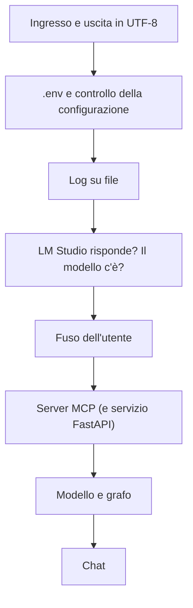
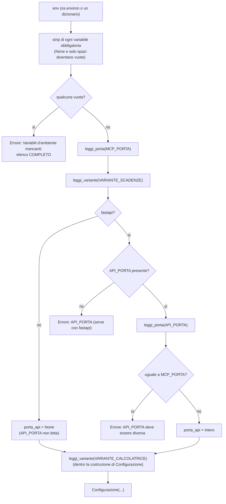
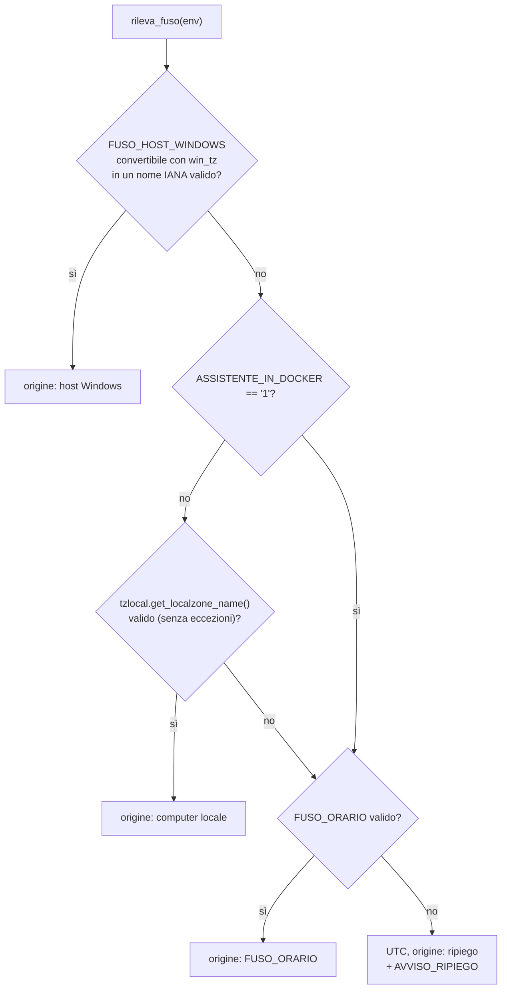
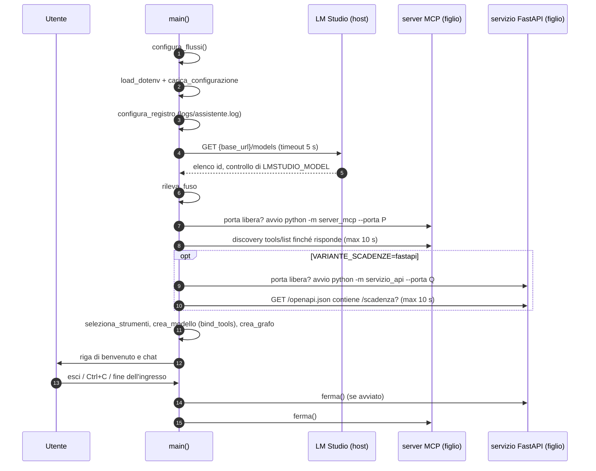
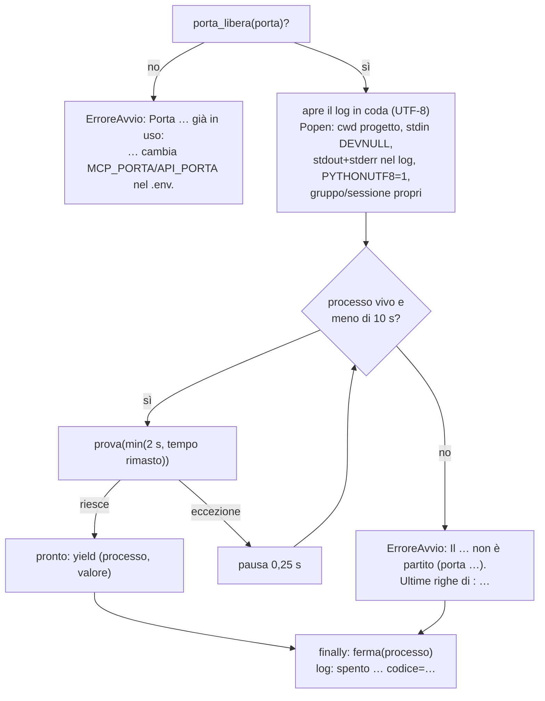
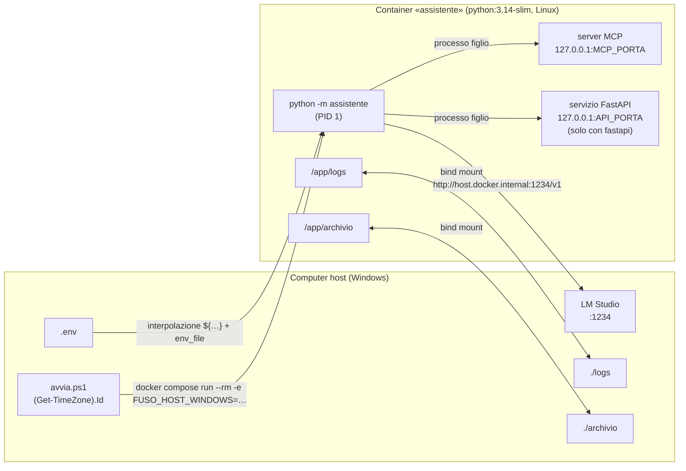
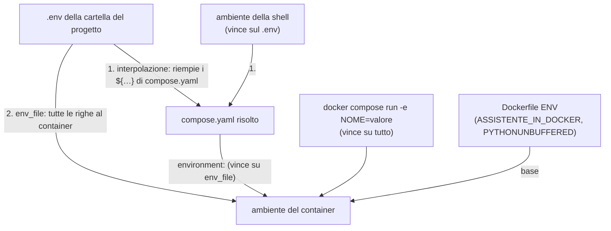
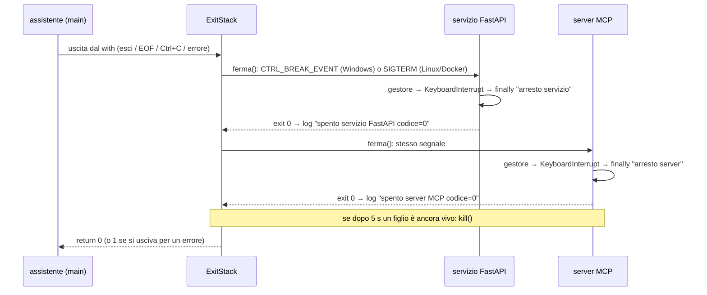

# 08 — Configurazione, avvio e Docker

> Percorso di studio: [00 Indice](00-indice.md) · precedente: [07 — I dieci strumenti](07-gli-strumenti.md) · **08** · successivo: [09 — Test e verifiche](09-test-e-verifiche.md)

## Scheda in 5 minuti

**Di che cosa parla.** Questo capitolo spiega come l'assistente parte, con quale configurazione, e come si ferma. Vale sia per l'avvio diretto con Python sia per l'avvio con Docker. Serve a capire perché l'assistente a volte si rifiuta di partire, e che cosa fare.

**Le idee chiave**

1. **La configurazione sta fuori dal codice.** Indirizzo di LM Studio, modello, porte e varianti arrivano solo da variabili d'ambiente. In avvio diretto si leggono dal file `.env`; in Docker le passa Compose. Così si cambia configurazione senza toccare il programma. → sezione 1
2. **Il controllo è severo, ma dice che cosa fare.** Le variabili mancanti compaiono tutte insieme, così il `.env` si sistema in un colpo solo. Per un valore sbagliato, il messaggio elenca i valori ammessi. → sezione 2
3. **Il fuso dell'utente si cerca in quattro posti.** Prima il fuso di Windows che `avvia.ps1` passa al container, poi quello del computer, poi `FUSO_ORARIO`. Se non trova niente usa UTC, ma lo dice sempre con un avviso. → sezione 3
4. **Pipe e file usano UTF-8.** Una pipe passa l'uscita di un comando come ingresso a un altro. Su Windows, in quel caso, Python userebbe una vecchia codifica, cp1252. Un piccolo modulo passa a UTF-8: così «esci» funziona e un'emoji non fa crollare la chat. → sezione 4
5. **Prima i controlli che costano poco.** L'ordine è: configurazione, log, LM Studio, fuso. Solo alla fine partono i processi figli, cioè i programmi che l'assistente avvia da sé. Un figlio è «pronto» solo quando risponde davvero, entro 10 secondi. → sezione 5
6. **In Docker tutto sta in un container, tranne LM Studio.** Assistente, server MCP e servizio FastAPI girano insieme e si parlano su `127.0.0.1`: nessuna porta va aperta. LM Studio resta sul computer host. Lo script `avvia.ps1` passa al container il fuso di Windows. → sezione 7
7. **Spegnere vuol dire chiedere, aspettare, imporre.** L'assistente chiede ai figli di chiudersi e aspetta 5 secondi. Solo se sono ancora vivi li uccide. Il figlio trasforma la richiesta in un'uscita normale, con codice 0 e una riga nel log. → sezione 8
8. **Il servizio dell'agente ha un container suo** (10 novembre). Il servizio Compose `agente` usa la stessa immagine, avvia il suo server MCP e pubblica `AGENTE_PORTA` solo su `127.0.0.1` dell'host; dentro ascolta su `0.0.0.0` (`AGENTE_HOST`). Si avvia con `avvia-agente.ps1`. → sezione 7.9

**Il quadro**



**Da sapere a memoria**

| Cosa | Valore | Dove |
|---|---|---|
| Variabili sempre obbligatorie | `LMSTUDIO_BASE_URL`, `LMSTUDIO_MODEL`, `MCP_PORTA`, `VARIANTE_CALCOLATRICE`, `VARIANTE_SCADENZE` | `assistente/configurazione.py:6` |
| Porte ammesse | da 1024 a 65535, estremi compresi | `assistente/configurazione.py:9-10` |
| Chi vince tra `.env` e ambiente | l'ambiente: `load_dotenv(override=False)` | `assistente/__main__.py:23` |
| Attese dei processi figli | avvio al massimo 10 s, arresto 5 s, una prova ogni 0,25 s | `assistente/avvio_server.py:25-27` |
| Nel container il fuso del sistema non si usa | `ENV ASSISTENTE_IN_DOCKER=1` | `Dockerfile:4` |
| Fuso dell'host passato al container | `-e FUSO_HOST_WINDOWS=$fuso` | `avvia.ps1:13` |

**Se te lo chiedono all'orale**

- *Perché ci sono due indirizzi di LM Studio?* Dentro il container `localhost` è il container stesso. Docker usa quindi l'indirizzo con `host.docker.internal`, che Compose passa al container come `LMSTUDIO_BASE_URL`: il codice Python resta identico.
- *Perché esiste `avvia.ps1`?* Nel container il fuso del sistema è UTC. Lo script legge il fuso di Windows sull'host e lo passa al container, dove Python lo traduce nel nome giusto.
- *Che cosa vuol dire che il server MCP è «pronto»?* Che ha risposto alla richiesta dell'elenco degli strumenti, la discovery. Un processo acceso non basta; l'attesa massima è di 10 secondi.

Per i dettagli continua con il resto del capitolo: le idee rimandano alle sezioni con «→ sezione N».

---

Questo documento spiega **come l'assistente parte, con quale configurazione, e come si ferma**. In ordine:

1. da dove prende la configurazione (`.env`) e come la controlla (`configurazione.py`);
2. come capisce il fuso orario dell'utente (`fuso.py`);
3. perché sistema la codifica di ingresso e uscita (`console.py`);
4. in che ordine accende i suoi pezzi (`__main__.py`, `avvio.py`, `avvio_server.py`);
5. tutti i modi di avvio: diretto, solo server MCP, solo servizio FastAPI, Docker;
6. come gira dentro Docker (`Dockerfile`, `compose.yaml`) e perché esiste `avvia.ps1`;
7. come spegne i processi figli in modo ordinato (segnali `SIGBREAK` e `SIGTERM`).

**File coinvolti:**

- configurazione: `.env.example`, `.env` (solo locale), `.gitignore`, `.dockerignore`;
- codice dell'assistente: `assistente/configurazione.py`, `assistente/fuso.py`, `assistente/console.py`, `assistente/__main__.py`, `assistente/avvio.py`, `assistente/avvio_server.py`, `assistente/errori.py`;
- avvio dei processi figli: `server_mcp/__main__.py`, `servizio_api/__main__.py`;
- Docker: `Dockerfile`, `compose.yaml`, `avvia.ps1`.

Tutti i riferimenti `percorso:riga` sono relativi a `assistente-laboratorio/` e corrispondono al codice attuale. Gli esempi marcati «eseguito» sono stati prodotti davvero per questo documento, con piccoli script nella cartella di prova `08-configurazione-avvio-docker` (fuori dal progetto), senza LM Studio, senza rete e senza toccare `logs/` e `archivio/`.

---

## In breve: cosa sapere a memoria

| Domanda | Risposta breve |
|---|---|
| Da dove arriva la configurazione? | Solo da variabili d'ambiente. In avvio diretto `python-dotenv` le carica dal `.env`. In Docker le passa Compose. Nel codice non c'è nessun indirizzo e nessun nome di modello. |
| Quali variabili sono obbligatorie? | Sempre: `LMSTUDIO_BASE_URL`, `LMSTUDIO_MODEL`, `MCP_PORTA`, `VARIANTE_CALCOLATRICE`, `VARIANTE_SCADENZE`. `API_PORTA` solo con `VARIANTE_SCADENZE=fastapi`. `LMSTUDIO_BASE_URL_DOCKER` solo per Docker. `FUSO_ORARIO` mai. |
| Chi vince tra `.env` e ambiente? | L'ambiente: `load_dotenv(override=False)` non sovrascrive una variabile già impostata. |
| Come si sceglie il fuso? | In quest'ordine: `FUSO_HOST_WINDOWS` → fuso del computer (solo fuori da Docker) → `FUSO_ORARIO` → `UTC` con avviso. Mai UTC in silenzio. |
| Perché `console.py`? | Su Windows le pipe usano cp1252: il BOM di PowerShell rompe «esci» e un'emoji fa crollare la sessione. Per questo ingresso e uscita rediretti passano a UTF-8. |
| Ordine di avvio? | flussi → `.env` → configurazione → log → LM Studio → fuso → server MCP (e FastAPI) → selezione degli strumenti → modello e grafo → chat. |
| Perché `avvia.ps1`? | Nel container il fuso è UTC. Lo script legge il fuso di Windows e lo passa con `-e FUSO_HOST_WINDOWS=…`. |
| Perché nessuna porta pubblicata? | Server MCP e servizio FastAPI girano **nello stesso container** dell'assistente, su `127.0.0.1`. |
| `:?` e `:-` in `compose.yaml`? | `${X:?msg}` vuol dire obbligatoria: se manca, Compose si ferma prima di creare il container. `${X:-}` vuol dire facoltativa, con la stringa vuota come valore predefinito. |
| Come si spengono i figli? | Su Windows con `CTRL_BREAK_EVENT` (nel figlio arriva come `SIGBREAK`), su Linux e in Docker con `SIGTERM`. Dopo 5 secondi, se il figlio è ancora vivo, `kill()`. |
| Codici di uscita? | `0` per l'uscita normale o con Ctrl+C. `1` per un errore di configurazione, di LM Studio o di avvio, con un messaggio `Errore: …` e senza traceback. |
| Stato attuale del `.env` locale | Contiene tutte le otto variabili di `.env.example` e supera il controllo della configurazione. Un `.env` fermo alla lezione 3, con quattro righe, fermerebbe l'avvio (vedi [1.5](#15-stato-attuale-del-env-di-questo-computer)). |

---

## 1. La configurazione: `.env` ed `.env.example`

### 1.1 I due file e la regola di base

- **`.env.example`** è versionato e senza credenziali (LM Studio non ne chiede). Fa da modello e si copia con `Copy-Item .env.example .env`, come indica il README.
- **`.env`** è il file reale. Sta fuori da Git (`.gitignore`, riga 1) e fuori dall'immagine Docker (`.dockerignore`, riga 1).
- La regola viene da `CLAUDE.md`: l'indirizzo del server e l'identificativo del modello arrivano **solo** da variabili d'ambiente, e l'identificativo è quello restituito da `GET /v1/models`, mai inventato. Il progetto estende la regola a porte e varianti, che sono obbligatorie e senza valore predefinito «per coerenza con la regola nessun valore di configurazione nel codice» (specifica della lezione 5, sezione 6).

Il file `.env.example` completo (9 righe di valori e commenti):

```dotenv
# Copia questo file in .env e adatta i valori. Nessuna credenziale necessaria.
LMSTUDIO_BASE_URL=http://localhost:1234/v1
LMSTUDIO_BASE_URL_DOCKER=http://host.docker.internal:1234/v1
# Identificativo restituito da GET /v1/models
LMSTUDIO_MODEL=google/gemma-4-e2b
# Riserva manuale se il fuso non viene rilevato
FUSO_ORARIO=Europe/Rome
# Porta locale del server MCP avviato dall'assistente (intero tra 1024 e 65535)
MCP_PORTA=8765
# Variante della calcolatrice vista dal modello: mcp (server MCP) oppure locale (@tool nell'assistente)
VARIANTE_CALCOLATRICE=mcp
# Variante di calcola_scadenza vista dal modello: mcp (server MCP) oppure fastapi (servizio HTTP + wrapper)
VARIANTE_SCADENZE=mcp
# Porta locale del servizio FastAPI, usata solo con VARIANTE_SCADENZE=fastapi (diversa da MCP_PORTA)
API_PORTA=8766
```

Il file è cresciuto un pezzo alla volta, insieme al progetto (`git log --follow -- .env.example`):

| Commit | Righe aggiunte |
|---|---|
| `2cac823` (lezione 3) | `LMSTUDIO_BASE_URL`, `LMSTUDIO_BASE_URL_DOCKER`, `LMSTUDIO_MODEL`, `FUSO_ORARIO` |
| `06cba52` (passo 1, server MCP) | `MCP_PORTA` |
| `04574ee` (passo 2, calcolatrice) | `VARIANTE_CALCOLATRICE` |
| `9e39a71` (passo 3, scadenze) | `VARIANTE_SCADENZE`, `API_PORTA` |

### 1.2 Tutte le variabili, una per una

| Variabile | Obbligatoria | Chi la legge | Controllo | Messaggio se manca o è sbagliata |
|---|---|---|---|---|
| `LMSTUDIO_BASE_URL` | sì | `configurazione.py`, poi `modello.py` | Non vuota (`configurazione.py:45-53`). La forma dell'URL la controlla `_controlla_indirizzo` (`modello.py:27-39`). | `Variabili d'ambiente mancanti: …` oppure `LMSTUDIO_BASE_URL non è un indirizzo valido: '…'. Esempio: http://localhost:1234/v1` |
| `LMSTUDIO_MODEL` | sì | `configurazione.py`, `modello.py` | Non vuota. Poi deve comparire tra gli `id` di `GET {base_url}/models` (`modello.py:66-76`). | `Il modello '…' non è disponibile su LM Studio. Modelli disponibili: …. Imposta LMSTUDIO_MODEL con uno di questi.` |
| `MCP_PORTA` | sì | `configurazione.py:54` | Solo cifre e valore tra 1024 e 65535 (`leggi_porta`, righe 28-34). | `MCP_PORTA non valida: 'otto'. Usa un numero intero tra 1024 e 65535, per esempio 8765.` |
| `VARIANTE_CALCOLATRICE` | sì | `configurazione.py:71-73` | `mcp` o `locale`, ignorando maiuscole e spazi (`leggi_variante`, righe 37-41). | `VARIANTE_CALCOLATRICE non valida: 'remota'. Valori ammessi: mcp, locale.` |
| `VARIANTE_SCADENZE` | sì | `configurazione.py:55` | `mcp` o `fastapi`, con le stesse regole. | `VARIANTE_SCADENZE non valida: 'HTTP'. Valori ammessi: mcp, fastapi.` |
| `API_PORTA` | solo con `fastapi` | `configurazione.py:57-66` | Come `MCP_PORTA`, e in più diversa da `MCP_PORTA`. Con `mcp` non viene **nemmeno letta**. | `Variabili d'ambiente mancanti: API_PORTA (serve con VARIANTE_SCADENZE=fastapi). …` oppure `API_PORTA deve essere diversa da MCP_PORTA.` |
| `AGENTE_PORTA` | solo per `python -m servizio_agente` (lezione 6, step 6) | `leggi_porta_agente` in `configurazione.py` | Come `MCP_PORTA`, e in più diversa da `MCP_PORTA` e `API_PORTA`. La CLI non la legge. | `Variabili d'ambiente mancanti: AGENTE_PORTA (serve al servizio HTTP dell'agente). …` |
| `LMSTUDIO_BASE_URL_DOCKER` | solo per Docker | **Compose**, non Python | `:?` in `compose.yaml:7` | Compose si ferma prima di creare il container (vedi [7.4](#74-composeyaml-riga-per-riga)). |
| `FUSO_ORARIO` | no | `fuso.py:47-50` | Deve essere un nome IANA esatto (`è_fuso_valido`). | Nessun messaggio proprio. Se non è valida viene ignorata, e se non resta nient'altro si usa UTC con l'avviso. |

Altre variabili **non si scrivono nel `.env`**: le imposta qualcun altro.

| Variabile | Chi la imposta | A che cosa serve |
|---|---|---|
| `FUSO_HOST_WINDOWS` | `avvia.ps1:13` (`-e FUSO_HOST_WINDOWS=$fuso`) | Nome Windows del fuso dell'host, per esempio `W. Europe Standard Time`. |
| `ASSISTENTE_IN_DOCKER` | `Dockerfile:4` (`ENV ASSISTENTE_IN_DOCKER=1`) | Dice a `fuso.py` di **non** usare il fuso del sistema, che nel container è UTC. |
| `PYTHONUNBUFFERED` | `Dockerfile:5` | Fa uscire l'output di Python senza buffer, così con `-T` (pipe) le righe compaiono subito. |
| `PYTHONUTF8` | `avvio_server.py:111`, solo nell'ambiente dei processi figli | Server MCP e servizio FastAPI scrivono il loro output (cioè i log) in UTF-8 anche su Windows. |

### 1.3 Come viene letto il `.env` (python-dotenv 1.2.4)

```python
load_dotenv(override=False)  # le variabili già impostate hanno la precedenza   (assistente/__main__.py:23)
config = carica_configurazione(os.environ)                                    # (assistente/__main__.py:24)
```

Quattro dettagli da saper spiegare.

1. **Dove lo cerca.** Senza un percorso esplicito, `load_dotenv` chiama `find_dotenv()`. Nel sorgente installato nel `.venv` (`dotenv/main.py`, funzione `find_dotenv`) si vede che la ricerca parte dalla cartella del file Python che ha chiamato `load_dotenv`, cioè `assistente/`, e sale verso la radice finché trova un `.env`. Così trova `assistente-laboratorio/.env` anche se il comando è lanciato da un'altra cartella. Fanno eccezione la REPL interattiva e l'esecuzione sotto un debugger: lì la ricerca parte dalla cartella corrente.
2. **Chi vince.** Con `override=False` una variabile già presente nell'ambiente **non** viene sovrascritta dal `.env`. Esempio eseguito:

   ```python
   os.environ["VARIANTE_CALCOLATRICE"] = "locale"
   load_dotenv(stream=io.StringIO("VARIANTE_CALCOLATRICE=mcp\nVARIANTE_SCADENZE=mcp\n"), override=False)
   # → VARIANTE_CALCOLATRICE=locale  VARIANTE_SCADENZE=mcp
   # con override=True invece VARIANTE_CALCOLATRICE diventerebbe mcp
   ```

   Di conseguenza in PowerShell si potrebbe provare una variante senza toccare il `.env`, con `$env:VARIANTE_CALCOLATRICE="locale"; python -m assistente`. È una conseguenza del codice, ma il README non la riporta come comando verificato. Il modo documentato è cambiare il `.env` e riavviare. Le prove reali usano proprio questo meccanismo: forzano le varianti nell'ambiente del processo di test.
3. **Il formato.** Esempio eseguito con `dotenv_values`: i commenti `#` a inizio riga sono ignorati, `B = due # nota` dà `due`, le virgolette si tolgono (`C="tre quattro"` dà `tre quattro`) e `D=` dà la stringa vuota. Per `configurazione.py` una stringa vuota equivale a una variabile mancante.
4. **In Docker il `.env` non c'è.** È escluso dall'immagine (`.dockerignore`) e non viene montato. Nel container `find_dotenv` sale da `/app/assistente` fino a `/` e non trova niente, quindi `load_dotenv` non fa nulla. Le variabili arrivano da Compose (`env_file: .env` ed `environment:`, vedi [7.4](#74-composeyaml-riga-per-riga)).

### 1.4 Perché il messaggio dice «aggiungi» e non «copia»

Il messaggio delle variabili mancanti chiede di *aggiungere* le righe prendendole da `.env.example`, e di copiare il file solo se il `.env` non esiste ancora. Chi ha già un `.env` non deve sovrascriverlo e perdere i propri valori. Lo controlla `test_variabili_mancanti` (`tests/test_configurazione.py:16-28`), che verifica la presenza di «Aggiungi» e l'assenza di «Copia .env.example in .env». La correzione è del commit `8ff0864`.

### 1.5 Stato attuale del `.env` di questo computer

Dal 9 novembre `.env.example` ha anche `AGENTE_PORTA=8767` (servizio HTTP dell'agente), aggiunta anche al `.env` reale. Prima dello step 6 il `.env` reale conteneva tutte le otto variabili di `.env.example`, comprese `MCP_PORTA`, `VARIANTE_CALCOLATRICE`, `VARIANTE_SCADENZE` e `API_PORTA`. Passato a `carica_configurazione`, senza avviare nulla, viene accettato (verificato il 2026-11-09).

Un `.env` fermo alla lezione 3 contiene invece solo quattro chiavi: `LMSTUDIO_BASE_URL`, `LMSTUDIO_BASE_URL_DOCKER`, `LMSTUDIO_MODEL` e `FUSO_ORARIO`. Passandolo a `carica_configurazione`, senza avviare nulla, il risultato è (eseguito):

```
Variabili d'ambiente mancanti: MCP_PORTA, VARIANTE_CALCOLATRICE, VARIANTE_SCADENZE. Aggiungi le righe mancanti al file .env, prendendole da .env.example (se il .env non esiste ancora, crealo copiando .env.example). L'identificativo del modello è quello restituito da GET /v1/models.
```

Il checkpoint conclusivo segnalava l'aggiornamento del `.env` come attività dell'utente (`docs/superpowers/checkpoint/2026-11-08-docker-docs.md`, «Da fare», punto 2): tutte le prove sono state fatte passando le variabili solo al processo di test. Le righe da avere nel `.env` sono `MCP_PORTA=8765`, `VARIANTE_CALCOLATRICE=mcp`, `VARIANTE_SCADENZE=mcp` e `API_PORTA=8766`, oggi presenti. Senza queste righe si fermano sia `python -m assistente` sia Docker: il primo con l'errore qui sopra, il secondo con `required variable MCP_PORTA is missing a value`.

---

## 2. `assistente/configurazione.py` nel dettaglio

### 2.1 Gli elementi del modulo

| Elemento | Riga | Ruolo |
|---|---|---|
| `OBBLIGATORIE` | 6 | Le cinque variabili sempre richieste, nell'ordine in cui compaiono nel messaggio. |
| `VARIANTI_CALCOLATRICE`, `VARIANTI_SCADENZE` | 7-8 | Valori ammessi: `("mcp", "locale")` e `("mcp", "fastapi")`. |
| `PORTA_MINIMA`, `PORTA_MASSIMA` | 9-10 | 1024 e 65535. Niente porte privilegiate (sotto 1024), che su Linux richiederebbero permessi speciali. |
| `Configurazione` | 13-21 | Dataclass `frozen=True`: una volta creata non si può modificare. I valori predefiniti delle varianti (`"mcp"`) e `porta_api=None` servono **solo** a costruirla comodamente nei test; nell'ambiente le variabili restano obbligatorie (commento alla riga 18). |
| `ErroreConfigurazione` | 24-25 | Eccezione propria, catturata da `main()`. |
| `leggi_porta(nome, valore)` | 28-34 | Controlla `valore.isdigit()` e l'intervallo, poi restituisce `int`. |
| `leggi_variante(nome, valore, ammessi)` | 37-41 | Applica `strip().lower()` e controlla che il valore sia tra gli ammessi. |
| `carica_configurazione(env)` | 44-76 | Il controllo completo. Riceve un `Mapping`, quindi nei test basta un dizionario e non serve toccare `os.environ`. |

### 2.2 Il flusso dei controlli (nell'ordine del codice)



Le scelte da notare:

- **Le mancanti tutte insieme, gli errori di valore uno alla volta.** Il controllo delle mancanti elenca *tutte* le variabili vuote: chi ha un `.env` vecchio lo sistema in un colpo solo. Gli errori di valore invece si fermano al primo. Con `MCP_PORTA=x` e `VARIANTE_SCADENZE=y` compare solo l'errore di `MCP_PORTA` (eseguito).
- **Una stringa di soli spazi conta come mancante.** `(env.get(nome) or "").strip()` (riga 45) trasforma sia `None` sia `"   "` in `""`.
- **Gli spazi intorno ai valori non danno fastidio.** `MCP_PORTA=" 8765 "` e `VARIANTE_CALCOLATRICE="  LOCALE "` sono accettati: il controllo delle mancanti ha già tolto gli spazi alla porta, e `leggi_variante` riporta la variante in minuscolo.
- **`VARIANTE_CALCOLATRICE` si controlla per ultima**, perché `leggi_variante` è chiamata dentro gli argomenti di `Configurazione(...)` (righe 71-73). Se `API_PORTA` manca con `fastapi`, quell'errore compare prima di un eventuale errore sulla calcolatrice.

### 2.3 Esempi reali di messaggi (eseguito)

| Ambiente di prova | Risultato |
|---|---|
| tutto corretto (valori di `.env.example`) | `Configurazione(base_url='http://localhost:1234/v1', modello='google/gemma-4-e2b', porta_mcp=8765, variante_calcolatrice='mcp', variante_scadenze='mcp', porta_api=None)` |
| `VARIANTE_CALCOLATRICE="  LOCALE "`, `MCP_PORTA=" 8765 "` | accettato: `variante_calcolatrice='locale'`, `porta_mcp=8765` |
| ambiente vuoto | `Variabili d'ambiente mancanti: LMSTUDIO_BASE_URL, LMSTUDIO_MODEL, MCP_PORTA, VARIANTE_CALCOLATRICE, VARIANTE_SCADENZE. Aggiungi le righe mancanti al file .env, prendendole da .env.example (se il .env non esiste ancora, crealo copiando .env.example). L'identificativo del modello è quello restituito da GET /v1/models.` |
| `LMSTUDIO_MODEL="   "` | `Variabili d'ambiente mancanti: LMSTUDIO_MODEL. …` |
| `MCP_PORTA` = `80`, `-8765`, `70000`, `8765.0`, `otto` | `MCP_PORTA non valida: '…'. Usa un numero intero tra 1024 e 65535, per esempio 8765.` |
| `MCP_PORTA` = `1024` o `65535` | accettati: gli estremi sono compresi |
| `VARIANTE_CALCOLATRICE=remota` | `VARIANTE_CALCOLATRICE non valida: 'remota'. Valori ammessi: mcp, locale.` |
| `VARIANTE_SCADENZE=" HTTP "` | `VARIANTE_SCADENZE non valida: 'HTTP'. Valori ammessi: mcp, fastapi.` (il messaggio mostra il valore senza spazi ma con le maiuscole originali) |
| `VARIANTE_SCADENZE=fastapi` senza `API_PORTA` | `Variabili d'ambiente mancanti: API_PORTA (serve con VARIANTE_SCADENZE=fastapi). Aggiungila al file .env, per esempio API_PORTA=8766.` |
| `fastapi` con `API_PORTA=8765` (uguale a `MCP_PORTA`) | `API_PORTA deve essere diversa da MCP_PORTA.` |
| `VARIANTE_SCADENZE=FastAPI`, `API_PORTA=8766` | accettato: `variante_scadenze='fastapi'`, `porta_api=8766` |
| `fastapi` con `API_PORTA=abc` | `API_PORTA non valida: 'abc'. Usa un numero intero tra 1024 e 65535, per esempio 8765.` |
| `mcp` con `API_PORTA=abc` | accettato, `porta_api=None` (`API_PORTA` non viene letta) |

**Piccole curiosità del codice** (non sono bug pratici, ma all'orale fanno capire che hai letto davvero):

- Il messaggio di `API_PORTA non valida` propone come esempio `8765`, perché `leggi_porta` usa lo stesso testo per tutte e due le porte. Con i valori di `.env.example`, però, `8765` coincide con `MCP_PORTA`. Il messaggio di `API_PORTA` mancante propone invece correttamente `8766`.
- `str.isdigit()` è vero anche per cifre Unicode non ASCII. `"１２３４５"` (cifre a larghezza piena) viene accettato come `12345`. `"²"` passa `isdigit()`, poi `int("²")` solleva un `ValueError` che `main()` non cattura, e il programma termina con un traceback. Scrivendo un `.env` normale questi casi non capitano.

### 2.4 Che cosa *non* controlla `configurazione.py`

| Controllo | Chi lo fa | Quando |
|---|---|---|
| Forma dell'URL di LM Studio | `_controlla_indirizzo` (`modello.py:27-39`): schema `http` o `https`, nome dell'host presente, porta numerica | all'inizio di `verifica_server`, **prima** di qualsiasi richiesta |
| Esistenza del modello | `verifica_server` (`modello.py:42-76`): `GET {base_url}/models` con timeout di 5 secondi, poi cerca `LMSTUDIO_MODEL` tra gli `id` | passo 5 dell'avvio |
| Porte libere | `porta_libera` (`avvio_server.py:35-47`) | al momento di avviare ciascun processo |
| Validità di `FUSO_ORARIO` | `rileva_fuso` (`fuso.py`) | passo 6; un valore sbagliato non è un errore, si passa oltre |

Esempi eseguiti di `verifica_server`, con una funzione di lettura finta passata come `leggi_json` (nessuna richiesta di rete):

| Situazione | Messaggio |
|---|---|
| `http://localhost:1234v1` | `LMSTUDIO_BASE_URL non è un indirizzo valido: 'http://localhost:1234v1'. Esempio: http://localhost:1234/v1` (nessuna richiesta parte) |
| `localhost:1234/v1` (manca `http://`) | stesso messaggio |
| `http://localhost:1234/v1/` (barra finale) | accettato: `rstrip("/")` evita il doppio `//models` |
| connessione rifiutata | `Impossibile raggiungere LM Studio all'indirizzo http://localhost:1234/v1/models ([Errno 10061] …). Controlla che LM Studio sia aperto con il server attivo e che LMSTUDIO_BASE_URL sia corretto.` |
| modello `gemma` assente | `Il modello 'gemma' non è disponibile su LM Studio. Modelli disponibili: google/gemma-4-e2b, qwen/qwen3.5-9b. Imposta LMSTUDIO_MODEL con uno di questi.` |
| elenco vuoto | `… Modelli disponibili: (nessuno). …` |
| JSON senza `data` | `Risposta inattesa da http://localhost:1234/v1/models: manca l'elenco dei modelli.` |

Gli identificativi disponibili si vedono con `(Invoke-RestMethod http://localhost:1234/v1/models).data.id` (README, Configurazione).

---

## 3. `assistente/fuso.py`: il fuso dell'utente

### 3.1 Il problema

Lo strumento `ora_corrente(fuso)` vuole **sempre** un fuso IANA esplicito (vedi [07](07-gli-strumenti.md)). Quando l'utente chiede «Che ore sono?» senza nominare un luogo, il modello deve conoscere il fuso *dell'utente*. Il fuso viene rilevato **una sola volta all'avvio** (`__main__.py:27`). Poi viene mostrato nella riga di benvenuto e passato a ogni turno nello stato del grafo, dove finisce nel messaggio di sistema (vedi [04](04-grafo-langgraph.md)). Se il fuso del computer cambia a programma aperto, l'assistente non se ne accorge: è una decisione presa con l'utente (specifica iniziale, sezione 5.3).

La difficoltà è Docker. Dentro il container `tzlocal` vedrebbe il fuso del container (UTC), non quello dell'utente.

### 3.2 L'ordine di rilevamento



Il codice (`assistente/fuso.py:31-53`) segue lo schema alla lettera:

```python
nome_windows = (env.get("FUSO_HOST_WINDOWS") or "").strip()
candidato = win_tz.get(nome_windows)                      # nome Windows → nome IANA (None se sconosciuto)
if candidato and è_fuso_valido(candidato):
    return RisultatoFuso(candidato, "host Windows")
if (env.get("ASSISTENTE_IN_DOCKER") or "").strip() != "1":
    candidato = _fuso_locale_sicuro(fuso_locale)          # tzlocal, eccezioni trasformate in None
    ...
```

I pezzi:

| Elemento | Righe | Cosa fa |
|---|---|---|
| import di `get_localzone_name` e `win_tz` | 6-7 | `win_tz` (da `tzlocal.windows_tz`) è un dizionario Python con 142 voci che traduce i nomi Windows in nomi IANA. È codice puro, quindi funziona anche su Linux, cioè dentro il container. |
| import di `è_fuso_valido` | 9 | Da `logica/orologio.py:17-19`: accetta solo nomi **esatti**, maiuscole comprese, presenti in `zoneinfo.available_timezones()` (l'elenco è calcolato una volta, con `@cache`). Su Windows il database dei fusi lo fornisce il pacchetto `tzdata` (versione 2026.6 in `requirements.txt`). |
| `AVVISO_RIPIEGO` | 11-14 | Il testo dell'avviso per UTC. |
| `RisultatoFuso` | 17-21 | Dataclass immutabile: `fuso`, `origine` (`"host Windows"`, `"computer locale"`, `"FUSO_ORARIO"` o `"ripiego"`) e `avviso` (solo nel ripiego). |
| `_fuso_locale_sicuro` | 24-28 | Trasforma in `None` qualsiasi eccezione di `tzlocal`: un rilevamento fallito porta al passo successivo, non a un crash. |
| `rileva_fuso(env, fuso_locale=get_localzone_name)` | 31-53 | Il parametro `fuso_locale` permette ai test di passare una funzione finta, così si prova la logica senza dipendere dal computer (`tests/test_fuso.py`, 9 test). |

### 3.3 Esempi reali (eseguito su questo computer, Windows, fuso dell'Europa centrale)

| Ambiente passato | Risultato |
|---|---|
| `FUSO_HOST_WINDOWS="W. Europe Standard Time"` | `Europe/Berlin`, `host Windows` |
| `FUSO_HOST_WINDOWS="GMT Standard Time"` | `Europe/London`, `host Windows` |
| `FUSO_HOST_WINDOWS="Tokyo Standard Time"` | `Asia/Tokyo`, `host Windows` |
| `FUSO_HOST_WINDOWS="Pippo Time"`, `ASSISTENTE_IN_DOCKER=1`, `FUSO_ORARIO=Europe/Rome` | `Europe/Rome`, `FUSO_ORARIO` (nome Windows sconosciuto: si passa oltre) |
| `{}` con `fuso_locale=lambda: "Europe/Rome"` | `Europe/Rome`, `computer locale` |
| `{}` con il vero `tzlocal` | `Europe/Berlin`, `computer locale` |
| `FUSO_ORARIO=Europe/Rome` con un `tzlocal` che solleva un'eccezione | `Europe/Rome`, `FUSO_ORARIO` |
| `{}` con un `tzlocal` che restituisce `None` | `UTC`, `ripiego`, con avviso |
| `ASSISTENTE_IN_DOCKER=1`, `FUSO_ORARIO=Europe/Rome` | `Europe/Rome`, `FUSO_ORARIO` |
| `ASSISTENTE_IN_DOCKER=1`, `FUSO_ORARIO=europe/rome` | `UTC`, `ripiego`, con avviso (il nome non è esatto) |
| `ASSISTENTE_IN_DOCKER=1`, `FUSO_ORARIO=CET` | `CET`, `FUSO_ORARIO` (`CET` è nel database IANA) |
| `ASSISTENTE_IN_DOCKER=1` e basta | `UTC`, `ripiego`, con avviso |
| `ASSISTENTE_IN_DOCKER=true` con `tzlocal` finto | `Europe/Rome`, `computer locale`: conta solo il valore esatto `1` |

Il testo dell'avviso:

```
ATTENZIONE: fuso orario non rilevato, uso UTC. Con Docker avvia con avvia.ps1, oppure imposta FUSO_ORARIO nel file .env (per esempio Europe/Rome).
```

Due osservazioni che derivano dal codice:

- `FUSO_HOST_WINDOWS` ha la priorità **anche fuori da Docker**: il primo passo non controlla `ASSISTENTE_IN_DOCKER`. Normalmente in avvio diretto nessuno la imposta, quindi si usa il fuso del computer.
- `FUSO_ORARIO` vale solo come **riserva**: in avvio diretto, se `tzlocal` funziona, non viene usata. Per questo il README la descrive come «fuso IANA di riserva».

### 3.4 «Perché Europe/Berlin se sono in Italia?»

Windows chiama il fuso dell'Europa centrale `W. Europe Standard Time` (lo conferma `(Get-TimeZone).Id` su questo computer). La tabella standard (CLDR) usata da `tzlocal` lo traduce in `Europe/Berlin`. Roma e Berlino hanno la stessa ora e cambiano l'ora legale nello stesso giorno, quindi il risultato è corretto. Il README lo spiega nell'ultima voce della Diagnosi.

### 3.5 Dove si vede il risultato

`esegui_sessione` (`terminale.py:51-57`) stampa la riga di benvenuto. Esempio dal README (avvio diretto con pipe):

```
Assistente del laboratorio
Fuso orario: Europe/Berlin (computer locale)
Strumenti: converti_unita (mcp), ora_corrente (mcp), calcola (mcp), calcola_scadenza (mcp), search_catalog (mcp), get_item (mcp), add_note (mcp), list_notes (mcp), delete_note (mcp), get_weather (mcp)
Scrivi «esci» o premi Ctrl+C per uscire.
```

Nel ripiego, dopo la riga degli strumenti compare anche l'avviso (`terminale.py:55-56`).

---

## 4. `assistente/console.py`: UTF-8 per pipe e file

### 4.1 Il problema (Windows)

Quando ingresso o uscita **non** sono un terminale interattivo, Python su Windows usa la codifica ANSI di sistema, **cp1252**. Succede con una pipe come `"…", "esci" | python -m assistente`, con un file, oppure quando un test cattura l'output. Il commit `a11091c` descrive tre guasti:

1. **«esci» non chiudeva la sessione.** PowerShell mette davanti all'ingresso il BOM UTF-8, cioè i byte `EF BB BF`. Letti in cp1252 diventano tre caratteri (``), e la prima riga diventa `esci` invece di `esci`.
2. **Gli accenti si guastavano**, anche nel testo delle note salvate nell'archivio.
3. **Un'emoji faceva crollare la sessione.** Con un'uscita cp1252, `print` di una risposta con 🙂 solleva `UnicodeEncodeError`.

### 4.2 La soluzione

```python
def configura_flussi(ingresso: TextIO | None = None, uscita: TextIO | None = None) -> None:
    ingresso = ingresso if ingresso is not None else sys.stdin
    uscita = uscita if uscita is not None else sys.stdout
    if ingresso is not None and not ingresso.isatty() and hasattr(ingresso, "reconfigure"):
        ingresso.reconfigure(encoding="utf-8-sig", errors="replace")  # utf-8-sig toglie il BOM iniziale
    if uscita is not None and not uscita.isatty() and hasattr(uscita, "reconfigure"):
        uscita.reconfigure(encoding="utf-8", errors="replace")
```
(`assistente/console.py:13-19`)

| Dettaglio | Perché |
|---|---|
| `not ... isatty()` | Un terminale interattivo resta com'è, perché la console di Windows gestisce già l'Unicode. Lo controlla `test_terminale_interattivo_lasciato_com_e`. |
| `utf-8-sig` in lettura | Toglie il BOM se c'è; se non c'è, funziona come `utf-8`. |
| `utf-8` in scrittura | In uscita non si vuole scrivere un BOM. |
| `errors="replace"` | Un byte non valido diventa un carattere sostitutivo invece di sollevare un'eccezione. |
| `hasattr(..., "reconfigure")` | Prudenza: un flusso sostituito, per esempio nei test, potrebbe non avere il metodo. |
| `is not None` | `sys.stdin` può valere `None`, per esempio in un processo senza console. |
| chiamata come **prima istruzione** di `main()` (`__main__.py:21`) | Va fatta prima di qualunque lettura o scrittura. |

### 4.3 Prima e dopo: esempio eseguito

Un piccolo script figlio legge una riga e stampa un'emoji. Gli inviamo in pipe i byte `EF BB BF` seguiti da `esci\n`:

| | Riga letta | È `esci`? | Codifiche stdin / stdout / stderr | Emoji |
|---|---|---|---|---|
| senza `configura_flussi` | `'esci'` | `False` | `cp1252` / `cp1252` / `cp1252` | `CRASH: UnicodeEncodeError` |
| con `configura_flussi` | `'esci'` | `True` | `utf-8-sig` / `utf-8` / `cp1252` | `emoji: 🙂` |

Curiosità: anche lo script che lanciava la prova è crollato con lo stesso `UnicodeEncodeError` (carattere ``) quando ha provato a stampare il risultato sulla propria uscita rediretta, finché non gli è stato aggiunto `sys.stdout.reconfigure(encoding="utf-8")`. È esattamente il problema che `console.py` risolve.

Anche `terminale.py:62-63` toglie il carattere BOM (`U+FEFF`) dalla riga letta, perché `.strip()` non lo considera uno spazio. Le due difese sono complementari:

- `console.py` lavora sui **byte** e corregge una decodifica sbagliata;
- `terminale.py` lavora sul **testo** e copre il caso in cui il BOM arrivi comunque come carattere `U+FEFF`, per esempio se qualcuno passa a `esegui_sessione` una funzione `leggi` diversa.

### 4.4 Che cosa non fa

`configura_flussi` **non tocca `stderr`**: rediretto, su Windows resta in cp1252 (lo conferma la tabella sopra). Le lettere accentate dei messaggi `Errore: …` si possono codificare in cp1252 e su `stderr` Python usa `errors="backslashreplace"`, quindi non c'è crash. Però chi legge quei byte come UTF-8 vede caratteri sostitutivi. Nell'esempio della [sezione 5.3](#53-esempi-eseguiti-di-avvio-fallito) la «è» arriva come byte `E8` (cp1252) e, decodificata in UTF-8, compare come `�`. Per i processi figli vale invece `PYTHONUTF8=1` (`avvio_server.py:111`).

In Docker, su Linux, `configura_flussi` interviene solo quando non c'è un terminale, cioè con `-T`. Il risultato è lo stesso: UTF-8 e BOM tolto.

---

## 5. `assistente/__main__.py`: la sequenza di avvio

### 5.1 Il codice

```python
def main() -> int:
    configura_flussi()  # pipe e file in UTF-8 (su Windows sarebbero cp1252)
    try:
        load_dotenv(override=False)  # le variabili già impostate hanno la precedenza
        config = carica_configurazione(os.environ)
        configura_registro(LOG_ASSISTENTE)
        verifica_server(config.base_url, config.modello)
        fuso = rileva_fuso(os.environ)
        with prepara_strumenti(config) as strumenti:
            grafo = crea_grafo(crea_modello(config, strumenti), strumenti)
            esegui_sessione(grafo, fuso, origini=origini(strumenti), parametri=parametri(strumenti))
    except (ErroreConfigurazione, ErroreServer, ErroreAvvio) as errore:
        print(f"Errore: {errore}", file=sys.stderr)
        return 1
    except KeyboardInterrupt:
        print("\nArrivederci.")
        return 0
    return 0
```
(`assistente/__main__.py:20-37`; alle righe 40-41 c'è `if __name__ == "__main__": sys.exit(main())`.)

`python -m assistente` esegue il modulo `assistente/__main__.py` del pacchetto. Gli `import` in cima al file (righe 3-17) caricano subito LangGraph, LangChain e gli altri moduli, **prima** di `main()`. Se manca una dipendenza, l'errore è un `ModuleNotFoundError` con traceback, non un messaggio `Errore: …`. In quel caso si rimedia con `pip install -r requirements-dev.txt`.

### 5.2 Passo per passo



| # | Passo | Dove | Che cosa può andare storto | Messaggio ed esito |
|---|---|---|---|---|
| 1 | Flussi in UTF-8 | `console.py` | — | — |
| 2 | Lettura del `.env` | `python-dotenv` | file assente: qui nessun errore, se ne accorge il passo 3 | — |
| 3 | Configurazione | `configurazione.py` | variabile mancante o non valida | `Errore: Variabili d'ambiente mancanti: …`, codice 1 |
| 4 | Log su file | `registro.py:26-38` | — (crea `logs/` se manca) | — |
| 5 | Verifica di LM Studio | `modello.py:42-76` | LM Studio spento, URL sbagliato, modello assente | `Errore: Impossibile raggiungere LM Studio…` oppure `Errore: Il modello '…' non è disponibile…`, codice 1 |
| 6 | Fuso | `fuso.py` | non fallisce mai: al peggio usa UTC con avviso | — |
| 7 | Server MCP | `avvio.py:34-36` → `avvio_server.py:153-170` | porta occupata, processo che non parte, catalogo vuoto | `Errore: Porta 8765 già in uso: chiudi il programma che la usa o cambia MCP_PORTA nel .env.`, `Errore: Il server MCP non è partito (porta …). Ultime righe di …`, `Errore: Il server MCP non espone nessuno strumento.`, codice 1 |
| 8 | Servizio FastAPI (solo con `fastapi`) | `avvio.py:38-40` → `avvio_server.py:183-205` | porta occupata, nessuna risposta | come sopra, con `API_PORTA` e `servizio FastAPI`; il server MCP già avviato viene spento |
| 9 | Selezione degli strumenti | `varianti.py` | nome duplicato | `Errore: Strumento '…' presente due volte…`, codice 1 |
| 10 | Modello e grafo | `modello.py:79-87`, `grafo.py` | — (nessuna chiamata di rete in questo passo) | — |
| 11 | Chat | `terminale.py` | un errore durante un turno **non** chiude la chat | `Errore: …` nel terminale, poi la chat continua |

**Perché quest'ordine.** Prima vengono i controlli che costano poco e non lasciano tracce:

- La configurazione si controlla **prima** di aprire il log: un `.env` sbagliato non crea nemmeno `logs/`.
- LM Studio si verifica **prima** di avviare i processi: se manca il modello, non c'è niente da spegnere.
- Il fuso si rileva dopo LM Studio. Non può fallire e non dipende da nulla, quindi la sua posizione è indifferente.
- I processi figli partono per ultimi, dentro un `with`: qualunque cosa succeda dopo, all'uscita dal blocco vengono spenti.

### 5.3 Esempi eseguiti di avvio fallito

Script di prova: `main()` lanciato in un processo separato, con `load_dotenv` sostituito da una funzione vuota (per non leggere il `.env` vero) e solo alcune variabili nell'ambiente. Nessuna richiesta di rete parte, perché l'errore arriva al passo 3, e nessun file di log viene creato.

```
# solo LMSTUDIO_BASE_URL, LMSTUDIO_MODEL e MCP_PORTA
Errore: Variabili d'ambiente mancanti: VARIANTE_CALCOLATRICE, VARIANTE_SCADENZE. Aggiungi le righe mancanti al file .env, prendendole da .env.example (se il .env non esiste ancora, crealo copiando .env.example). L'identificativo del modello � quello restituito da GET /v1/models.
codice di uscita: 1

# tutte presenti, ma MCP_PORTA=80
Errore: MCP_PORTA non valida: '80'. Usa un numero intero tra 1024 e 65535, per esempio 8765.
codice di uscita: 1
```

Il `�` al posto di «è» è l'effetto di `stderr` in cp1252 descritto in [4.4](#44-che-cosa-non-fa). Non c'è traceback: `main()` stampa soltanto il messaggio. I test `test_porta_occupata_esce_con_errore` e `test_porta_mancante` (`tests/test_avvio_unico.py:82-102`) controllano proprio che in `stderr` ci sia `Errore: …` e non `Traceback`.

### 5.4 `prepara_strumenti`: avviare e spegnere insieme

`assistente/avvio.py:21-46` è un *context manager* costruito con un `ExitStack`:

```python
with ExitStack() as pila:
    server = pila.enter_context(
        avvia_server_mcp(config.porta_mcp, log_server or LOG_SERVER, comando=comando_server)
    )
    url_api = None
    if config.variante_scadenze == "fastapi":
        servizio = pila.enter_context(avvia_servizio_api(config.porta_api, log_api or LOG_API))
        url_api = servizio.url
    ...
    strumenti = seleziona_strumenti(server.strumenti, crea_sostituti(config, url_api=url_api))
    yield strumenti
```

- **`ExitStack`** tiene una pila di context manager aperti **in modo condizionale** (il servizio FastAPI c'è solo con `fastapi`). All'uscita li chiude **in ordine inverso**. Se il servizio FastAPI non parte, la pila chiude anche il server MCP già avviato: lo verifica `test_servizio_che_non_parte_spegne_tutto` (`tests/test_avvio_unico.py:146`).
- **Gli stessi parametri servono alle prove.** `log_server`, `log_api` e `comando_server` permettono ai test e alle prove reali di usare log e archivio temporanei senza cambiare il percorso di avvio. Il docstring lo dice esplicitamente: il percorso è lo stesso di `python -m assistente`.

**Esempio eseguito** con `prepara_strumenti` vero:

- due porte libere scelte dal sistema;
- log e archivio delle note in una cartella temporanea;
- varianti `locale` e `fastapi`;
- nessun modello.

Risultato:

```
pronto in 2.7 s
Strumenti: converti_unita (mcp), ora_corrente (mcp), search_catalog (mcp), get_item (mcp), add_note (mcp), list_notes (mcp), delete_note (mcp), get_weather (mcp), calcola (locale), calcola_scadenza (fastapi)
```

Il log dell'assistente prodotto:

```
2026-11-09 04:28:21 avviato server MCP porta=58373 pid=14768
2026-11-09 04:28:22 catalogo strumenti=['converti_unita', 'ora_corrente', 'calcola', 'calcola_scadenza', 'search_catalog', 'get_item', 'add_note', 'list_notes', 'delete_note', 'get_weather']
2026-11-09 04:28:22 avviato servizio FastAPI porta=58374 pid=23612
2026-11-09 04:28:23 varianti calcolatrice=locale scadenze=fastapi
2026-11-09 04:28:23 strumenti al modello=['converti_unita', 'ora_corrente', 'search_catalog', 'get_item', 'add_note', 'list_notes', 'delete_note', 'get_weather', 'calcola', 'calcola_scadenza']
2026-11-09 04:28:23 spento servizio FastAPI codice=0
2026-11-09 04:28:23 spento server MCP codice=0
```

Da notare:

- il **catalogo** del server contiene sempre tutti e dieci gli strumenti;
- l'elenco **al modello** sostituisce `calcola` e `calcola_scadenza` con le versioni `locale` e `fastapi`, messe in fondo (`seleziona_strumenti`, `varianti.py`);
- lo **spegnimento** avviene in ordine inverso: prima FastAPI, poi il server MCP, tutti e due con codice 0.

Negli altri due log compaiono le righe `avvio server porta=…` e `arresto server` (server MCP) e `avvio servizio porta=…` e `arresto servizio` (FastAPI).

### 5.5 `processo_in_attesa`: il ciclo di vita di ogni processo figlio

Server MCP e servizio FastAPI passano entrambi per `processo_in_attesa` (`avvio_server.py:85-139`). Cambiano solo il comando, la descrizione, il nome della variabile della porta e la «prova di prontezza».



1. **Porta libera?** `porta_libera` (righe 35-47) prova un `bind` su `127.0.0.1` senza `SO_REUSEADDR`, poi una connessione. Su Windows il `bind` su `127.0.0.1` riesce anche se un altro programma ascolta su `0.0.0.0`: se qualcuno risponde alla connessione, la porta è comunque occupata. È la correzione del commit `9c7e599`, verificata da `test_porta_occupata_su_tutte_le_interfacce`.
2. **Avvio** con `subprocess.Popen` (righe 105-113):
   - `cwd=CARTELLA_PROGETTO`: la cartella del progetto, in Docker `/app`;
   - `stdin=subprocess.DEVNULL`: il figlio non legge l'ingresso destinato alla chat;
   - `stdout` e `stderr` vanno nel file di log, così nel terminale non compare l'output del figlio (`test_nessun_output_nel_terminale`);
   - `env={**os.environ, "PYTHONUTF8": "1"}`: il figlio eredita la configurazione e scrive in UTF-8;
   - `**_opzioni_processo()`: il figlio ha un gruppo di processi (Windows) o una sessione (Linux) propri, vedi [8.3](#83-perché-il-figlio-ha-un-gruppo-di-processi-proprio).
3. **Attesa di prontezza** fino a `ATTESA_AVVIO = 10.0` secondi, con pause di `PAUSA_TRA_PROVE = 0.25` (righe 25-27). Non basta un processo acceso, e nemmeno un HTTP 200:
   - per il server MCP la prova è una **discovery riuscita** (`scopri_strumenti`, cioè `tools/list`);
   - per il servizio FastAPI la prova è un `/openapi.json` che descrive `/scadenza` (righe 191-194).
4. **Se il processo non diventa pronto** (è morto oppure il tempo è scaduto): `ErroreAvvio` con le ultime 10 righe del log (`ultime_righe`, righe 50-55).
5. **Nel `finally`** c'è sempre `ferma(processo)`, e il log dell'assistente riceve `spento <descrizione> codice=<n>`.

I dettagli del protocollo MCP sono in [05](05-mcp-in-pratica.md), le varianti in [06](06-tre-varianti.md).

---

## 6. Tutti i modi di avvio

### 6.1 Tabella riassuntiva

Tutti i comandi sono per PowerShell, dalla cartella `assistente-laboratorio/`, con l'ambiente attivato (`.\.venv\Scripts\Activate.ps1`) per quelli in Python.

| Modo | Comando | Fuso mostrato | Note |
|---|---|---|---|
| Avvio diretto interattivo | `python -m assistente` | `… (computer locale)` | Uso normale. Serve LM Studio acceso con il modello di `LMSTUDIO_MODEL`. |
| Avvio diretto con pipe | `"che ore sono a Tokyo?", "quanti metri sono 2,5 km?", "esci" \| python -m assistente` | `… (computer locale)` | Eseguito per il README, dove c'è l'output. Qui entra in gioco `console.py`. |
| Solo il server MCP | `python -m server_mcp --porta 8765` | — | Ascolta su `http://127.0.0.1:8765/mcp`; si prova con MCP Inspector. Usa l'archivio **reale** delle note. |
| Solo il server, archivio di prova | `python -m server_mcp --porta 8765 --note prova.sqlite3` | — | Non tocca `archivio/note.sqlite3`. |
| Solo il servizio FastAPI | `python -m servizio_api --porta 8766` | — | Pagine `http://127.0.0.1:8766/openapi.json` e `http://127.0.0.1:8766/docs`. |
| Docker, modo documentato | `docker compose build` e poi `.\avvia.ps1` | `… (host Windows)` | L'avvio interattivo da tastiera è ancora **da confermare** (README e checkpoint del passo 7). |
| Docker con pipe tramite lo script | `avvia.ps1 -SenzaTty` | `… (host Windows)` | Usato dalla prova reale Docker. |
| Docker senza lo script | `"Che ore sono?", "esci" \| docker compose run --rm -T assistente` | `Europe/Rome (FUSO_ORARIO)` | Se manca anche `FUSO_ORARIO`: UTC con avviso. |
| Docker, servizio dell'agente | `.\avvia-agente.ps1` (oppure `docker compose up --build agente`) | `… (host Windows)` (senza lo script: `FUSO_ORARIO`) | HTTP su `http://127.0.0.1:8767`; Ctrl+C ferma il container in modo ordinato (vedi [7.9](#79-il-servizio-dellagente-in-docker)). |
| Docker con varianti | `"Che tempo fa a Udine?", "esci" \| docker compose run --rm -T -e VARIANTE_SCADENZE=fastapi -e API_PORTA=8766 -e VARIANTE_CALCOLATRICE=locale assistente` | `Europe/Rome (FUSO_ORARIO)` | Varianti forzate senza cambiare il `.env` (vedi [7.7](#77-le-varianti-nel-container-con--e)). |

**Come si esce.** Si scrive `esci` (maiuscole indifferenti), si preme Ctrl+C, oppure finisce l'ingresso (EOF, come a fine pipe). In tutti i casi il server viene spento (README, «Avvio diretto»).

### 6.2 Server e servizio da soli

Qui la porta **non** arriva dal `.env`. Arriva dalla riga di comando: `--porta` è obbligatoria (`argparse`, `required=True`).

| | `server_mcp/__main__.py` | `servizio_api/__main__.py` |
|---|---|---|
| Argomenti | `--porta` (obbligatoria), `--note` (facoltativo; predefinito `archivio/note.sqlite3`, `logica/note.py:19`) — righe 26-29 | `--porta` (obbligatoria) — righe 27-29 |
| Log | `logging.basicConfig` su `stderr`, formato `%(asctime)s %(levelname)s %(name)s %(message)s` — righe 31-33 | uguale, logger `servizio_api` |
| Avvio | `crea_server(...).run(transport="http", host="127.0.0.1", port=…, path="/mcp", show_banner=False, stateless_http=True, json_response=True, log_level="warning")` — righe 39-48 | `uvicorn.run(crea_app(), host="127.0.0.1", port=…, log_level="warning", access_log=False)` — riga 38 |
| Arresto | gestore di `SIGBREAK`/`SIGTERM`, `except KeyboardInterrupt: pass`, `finally: registro.info("arresto server")` | uguale, con `"arresto servizio"` |

Tutti e due ascoltano solo su `127.0.0.1`, quindi non sono raggiungibili da altri computer. Avviati a mano, il loro log va sul terminale (`stderr`). Quando li avvia l'assistente, invece, va nei file `logs/server_mcp.log` e `logs/servizio_api.log`, perché `Popen` redirige `stdout` e `stderr`. Per fermarli a mano basta Ctrl+C, che arriva come `KeyboardInterrupt` ed esegue il blocco `finally`.

Esempio di richiesta al servizio (README): `http://127.0.0.1:8766/scadenza?data_inizio=2026-12-23&giorni=3&lavorativi=true`. Gli errori sono risposte `400` con `{"errore": "..."}` in italiano.

---

## 7. Docker

### 7.1 L'architettura nel container



Un solo container contiene l'agente, il server MCP e, quando serve, il servizio FastAPI (specifica della lezione 5, sezione 9). LM Studio **non** si containerizza e resta sull'host (`CLAUDE.md`). Il meteo usa la rete del container per raggiungere Open-Meteo.

### 7.2 `Dockerfile` riga per riga

```dockerfile
FROM python:3.14-slim

# ASSISTENTE_IN_DOCKER: il fuso del container (UTC) non è quello dell'utente, quindi non va usato.
ENV ASSISTENTE_IN_DOCKER=1 \
    PYTHONUNBUFFERED=1

WORKDIR /app

COPY requirements.txt .
RUN pip install --no-cache-dir -r requirements.txt

COPY assistente/ assistente/
COPY logica/ logica/
COPY server_mcp/ server_mcp/
COPY servizio_api/ servizio_api/
COPY risorse/ risorse/

CMD ["python", "-m", "assistente"]
```

| Righe | Istruzione | Perché |
|---|---|---|
| 1 | `FROM python:3.14-slim` | Stessa serie di Python usata in locale, nella variante leggera (specifica iniziale, sezione 7). |
| 3-5 | `ENV ASSISTENTE_IN_DOCKER=1 PYTHONUNBUFFERED=1` | La prima fa saltare a `fuso.py` il fuso del sistema. La seconda fa uscire l'output senza buffer: con `-T` lo `stdout` è una pipe, e senza questa variabile Python lo accumulerebbe a blocchi. |
| 7 | `WORKDIR /app` | Tutto sta in `/app`. Quindi `CARTELLA_LOG` diventa `/app/logs` (`registro.py:8`), l'archivio delle note `/app/archivio/note.sqlite3` (`logica/note.py:19`) e `CARTELLA_PROGETTO` `/app` (`avvio_server.py:28`). |
| 9-10 | `COPY requirements.txt .` e `RUN pip install --no-cache-dir -r requirements.txt` | Le dipendenze si copiano **prima** del codice, così Docker riusa lo strato già costruito quando cambia solo il codice. `--no-cache-dir` tiene l'immagine più piccola. Si installa solo `requirements.txt`, senza pytest. |
| 12-16 | `COPY assistente/ logica/ server_mcp/ servizio_api/ risorse/` | Solo i pacchetti Python e i dati versionati (catalogo dei corsi, festività). Niente test, documenti, log o note. |
| 18 | `CMD ["python", "-m", "assistente"]` | Forma *exec* (lista JSON): Python è direttamente il processo principale (PID 1), senza una shell in mezzo. |

Una conseguenza pratica: `risorse/catalogo_corsi.json` e `risorse/festivita_italia.json` sono **dentro l'immagine**. Dopo averli modificati serve `docker compose build` (README, Diagnosi, voce «Il catalogo»). Lo stesso vale per qualsiasi modifica al codice.

### 7.3 `.dockerignore`

```
.env
.venv
tests
docs
__pycache__
.pytest_cache
.git
logs
archivio
*.riserva-prova-docker
*.da-eliminare-*
```

Le esclusioni riducono il *contesto di build*, cioè i file inviati a Docker, e servono a tre scopi:

- **riservatezza**: il `.env` non finisce mai nell'immagine;
- **dimensione**: niente `.venv` (centinaia di MB) e niente cache;
- **dati dell'utente**: `logs` e `archivio` arrivano dai volumi, non dall'immagine.

Le ultime due voci escludono le cartelle temporanee create dalla prova Docker, che sposta da parte `logs/` e `archivio/` dell'utente (vedi [09](09-test-e-verifiche.md)). Le stesse voci sono anche in `.gitignore`.

### 7.4 `compose.yaml` riga per riga

```yaml
services:
  assistente:
    build: .
    env_file: .env
    environment:
      # Dentro il container LM Studio si raggiunge con un indirizzo diverso: lo si prende dal .env.
      LMSTUDIO_BASE_URL: ${LMSTUDIO_BASE_URL_DOCKER:?Imposta LMSTUDIO_BASE_URL_DOCKER nel file .env}
      # Il server MCP gira nello stesso container: la porta non va pubblicata.
      MCP_PORTA: ${MCP_PORTA:?Imposta MCP_PORTA nel file .env, per esempio MCP_PORTA=8765}
      VARIANTE_CALCOLATRICE: ${VARIANTE_CALCOLATRICE:?Imposta VARIANTE_CALCOLATRICE nel file .env (mcp oppure locale)}
      VARIANTE_SCADENZE: ${VARIANTE_SCADENZE:?Imposta VARIANTE_SCADENZE nel file .env (mcp oppure fastapi)}
      # Il servizio FastAPI, se usato, gira anch'esso nel container: la porta non va pubblicata.
      API_PORTA: ${API_PORTA:-}
    volumes:
      # I log restano leggibili sull'host anche dopo --rm.
      - ./logs:/app/logs
      # Le note restano sull'host e sopravvivono al container --rm.
      - ./archivio:/app/archivio
    extra_hosts:
      - "host.docker.internal:host-gateway"
    stdin_open: true
    tty: true
```

| Chiave (riga) | Significato |
|---|---|
| `build: .` (3) | L'immagine si costruisce dal `Dockerfile` della cartella. Compose la chiama *nome del progetto* + *nome del servizio*. Il nome del progetto è quello della cartella, quindi l'immagine è `assistente-laboratorio-assistente`, il nome usato dalla prova reale (`tests/test_reale_docker.py:25`). |
| `env_file: .env` (4) | Passa **tutte** le variabili del `.env` all'ambiente del container: `LMSTUDIO_MODEL`, `FUSO_ORARIO` e le altre. |
| `environment:` (5-13) | Imposta o **sostituisce** alcune variabili, con precedenza su `env_file`. Il `LMSTUDIO_BASE_URL=http://localhost:1234/v1` del `.env` viene rimpiazzato dal valore di `LMSTUDIO_BASE_URL_DOCKER`. |
| `${VAR:?messaggio}` (7, 9-11) | **Interpolazione obbligatoria.** Se `VAR` non è impostata **o è vuota**, Compose si ferma *prima* di creare il container e mostra `required variable VAR is missing a value: <messaggio>`. |
| `${API_PORTA:-}` (13) | **Valore predefinito vuoto.** Se `API_PORTA` manca, nel container vale `""`. Non è obbligatoria perché serve solo con `fastapi`, e in quel caso il controllo lo fa Python (`Variabili d'ambiente mancanti: API_PORTA …`). |
| `volumes:` (14-18) | Due *bind mount*: le cartelle `./logs` e `./archivio` dell'host compaiono nel container come `/app/logs` e `/app/archivio`. Log e note **sopravvivono a `--rm`** e si leggono dall'host. Se le cartelle mancano, vengono create (verificato dalla prova `test_varianti_in_docker`, README). |
| `extra_hosts: host.docker.internal:host-gateway` (19-20) | Fa risolvere il nome `host.docker.internal` all'indirizzo dell'host. Docker Desktop lo definisce già da sé; la riga c'è «per compatibilità» (specifica iniziale, sezione 7), cioè per i motori Docker che non lo definiscono, come Docker su Linux. |
| `stdin_open: true`, `tty: true` (21-22) | Equivalgono a `docker run -i -t`: ingresso aperto e pseudo-terminale. Servono per chattare da tastiera. Con una pipe il terminale va disattivato con `-T`. |
| (nessuna voce `ports:`) | Scelta voluta. Server e servizio ascoltano su `127.0.0.1` **dentro** il container e li usa solo l'assistente, che sta nello stesso container. Pubblicarli non servirebbe e li esporrebbe. Del resto `docker compose run` non pubblica le porte del servizio, a meno di aggiungere `--service-ports`. |

**Esempi eseguiti con `docker compose config`.** Il comando legge `compose.yaml` e `.env`, calcola la configurazione finale e la stampa, senza costruire né avviare nulla. Le prove sono state fatte su una **copia** di `compose.yaml` in una cartella temporanea, con `.env` di prova.

Con un `.env` uguale a `.env.example`, l'ambiente finale del container (estratto) è:

```yaml
    environment:
      API_PORTA: "8766"
      FUSO_ORARIO: Europe/Rome
      LMSTUDIO_BASE_URL: http://host.docker.internal:1234/v1     # sostituito da environment:
      LMSTUDIO_BASE_URL_DOCKER: http://host.docker.internal:1234/v1
      LMSTUDIO_MODEL: google/gemma-4-e2b
      MCP_PORTA: "8765"
      VARIANTE_CALCOLATRICE: mcp
      VARIANTE_SCADENZE: mcp
    extra_hosts:
      - host.docker.internal=host-gateway
```

Con un `.env` della lezione 3 (le sole quattro righe di allora, senza porte e varianti):

```
error while interpolating services.assistente.environment.MCP_PORTA: required variable MCP_PORTA is missing a value: Imposta MCP_PORTA nel file .env, per esempio MCP_PORTA=8765
error while interpolating services.assistente.environment.VARIANTE_CALCOLATRICE: required variable VARIANTE_CALCOLATRICE is missing a value: Imposta VARIANTE_CALCOLATRICE nel file .env (mcp oppure locale)
error while interpolating services.assistente.environment.VARIANTE_SCADENZE: required variable VARIANTE_SCADENZE is missing a value: Imposta VARIANTE_SCADENZE nel file .env (mcp oppure fastapi)
```

Altri risultati osservati:

- senza `LMSTUDIO_BASE_URL_DOCKER`: `required variable LMSTUDIO_BASE_URL_DOCKER is missing a value: Imposta LMSTUDIO_BASE_URL_DOCKER nel file .env`;
- con `VARIANTE_SCADENZE=` (vuota): stesso errore di una variabile mancante, perché `:?` copre anche il valore vuoto;
- senza `API_PORTA`: `API_PORTA: ""`, nessun errore;
- con `VARIANTE_CALCOLATRICE=locale` nell'ambiente della shell e `mcp` nel `.env`: il risultato è `VARIANTE_CALCOLATRICE: locale`, perché nell'interpolazione l'ambiente della shell vince sul `.env`.

Nota: `LMSTUDIO_MODEL` non ha un `:?`. Se manca, Compose non se ne accorge e il container parte, ma poi `configurazione.py` lo segnala con `Variabili d'ambiente mancanti: LMSTUDIO_MODEL`.

**Da dove prende Compose i valori: due usi dello stesso `.env`.**



Per questo, se nel `.env` manca `LMSTUDIO_BASE_URL_DOCKER`, l'errore arriva da Compose e non da Python (README, Diagnosi).

### 7.5 Come il container raggiunge LM Studio

- Dentro il container, `localhost` è il container stesso, non il computer host: `http://localhost:1234/v1` non funzionerebbe.
- Per questo le variabili sono due. `LMSTUDIO_BASE_URL` serve all'avvio diretto. `LMSTUDIO_BASE_URL_DOCKER=http://host.docker.internal:1234/v1` viene passata al container **con il nome** `LMSTUDIO_BASE_URL`. Così il codice Python è identico nei due casi, e nemmeno `compose.yaml` contiene indirizzi scritti a mano (specifica iniziale, sezione 6).
- La specifica prevedeva un rischio: LM Studio poteva accettare solo connessioni da `localhost`. Il README riporta che su questo computer **non è servito** attivare in LM Studio l'opzione per servire sulla rete locale. Se il container non raggiunge LM Studio mentre dall'host funziona, è la prima cosa da provare.

### 7.6 `avvia.ps1` e perché esiste

```powershell
# Avvia l'assistente con Docker Compose passando al container il fuso orario di Windows.
# Uso: .\avvia.ps1
# -SenzaTty serve solo alla prova automatica, quando l'ingresso arriva da una pipe.
param([switch]$SenzaTty)

Set-Location -Path $PSScriptRoot

$fuso = (Get-TimeZone).Id
$argomenti = @('compose', 'run', '--rm')
if ($SenzaTty) {
    $argomenti += '-T'
}
$argomenti += @('-e', "FUSO_HOST_WINDOWS=$fuso", 'assistente')

& docker @argomenti
exit $LASTEXITCODE
```

| Riga | Cosa fa |
|---|---|
| 4 `param([switch]$SenzaTty)` | Opzione facoltativa. Senza, il comando usa il terminale (`tty: true`). Con `-SenzaTty` si aggiunge `-T`, necessario quando l'ingresso arriva da una pipe (la prova automatica). |
| 6 `Set-Location -Path $PSScriptRoot` | Va nella cartella dello script, così funziona anche lanciato da un'altra cartella: Compose cerca `compose.yaml` e `.env` nella cartella corrente. |
| 8 `(Get-TimeZone).Id` | Nome Windows del fuso, per esempio `W. Europe Standard Time`. |
| 9-13 | Costruisce gli argomenti: `compose run --rm [-T] -e FUSO_HOST_WINDOWS=… assistente`. |
| 15 `& docker @argomenti` | *Splatting*: passa l'array come argomenti separati, senza problemi di virgolette anche se il nome del fuso contiene spazi. |
| 16 `exit $LASTEXITCODE` | Restituisce il codice di uscita del container, che è quello di `main()`: 0 oppure 1. |

**Perché esiste.** Nel container il fuso del sistema è UTC, e da lì `tzlocal` non può vedere il fuso dell'utente. La specifica considera un fallimento che «in Docker l'assistente dica l'ora in UTC senza avvisare». Lo script legge il fuso **sull'host** e lo passa come nome Windows; `fuso.py` lo converte **nel container** con `win_tz`. Il risultato è `Fuso orario: Europe/Berlin (host Windows)`.

**Perché la conversione avviene nel container e non nello script.** Lo script resta di poche righe: legge solo `(Get-TimeZone).Id`. La logica di conversione sta in Python, dove la provano i test automatici (`tests/test_fuso.py`). `win_tz` è una tabella Python pura e funziona anche su Linux.

**Perché `run --rm` e non `up`.** `docker compose run` avvia un container usa e getta per un comando interattivo e accetta `-e` per aggiungere variabili. `--rm` elimina il container all'uscita. Quello che deve restare, cioè log e note, sta nei volumi.

**Se PowerShell blocca gli script** («l'esecuzione di script è disabilitata»): si usa `powershell -NoProfile -ExecutionPolicy Bypass -File .\avvia.ps1`. L'opzione vale solo per quel comando e non cambia le impostazioni del sistema. È anche il modo in cui lo lancia la prova reale (`tests/test_reale_docker.py:77`).

### 7.7 Le varianti nel container con `-e`

```powershell
"Che tempo fa a Udine?", "esci" | docker compose run --rm -T -e VARIANTE_SCADENZE=fastapi -e API_PORTA=8766 -e VARIANTE_CALCOLATRICE=locale assistente
```

- `-e NOME=valore` di `docker compose run` **sostituisce** nel container il valore che arriverebbe da `environment:` o da `env_file`. Così si provano le varianti senza toccare il `.env`.
- **Attenzione:** l'interpolazione con `:?` di `compose.yaml` avviene comunque, e `-e` non la soddisfa. Nel `.env` (o nell'ambiente della shell) devono quindi esserci `MCP_PORTA`, `VARIANTE_CALCOLATRICE` e `VARIANTE_SCADENZE`, anche se poi `-e` li sostituisce. Per questo la prova reale passa a Compose `ENV_COME_DA_DOTENV = {"MCP_PORTA": "8765", "VARIANTE_CALCOLATRICE": "mcp", "VARIANTE_SCADENZE": "mcp"}` (`tests/test_reale_docker.py:29`).
- Con `fastapi` il servizio FastAPI parte **nello stesso container**, su `127.0.0.1:8766`, senza porte pubblicate. Il file `servizio_api.log` compare in `./logs` sull'host.
- Senza `avvia.ps1` non c'è `FUSO_HOST_WINDOWS`, quindi si usa `FUSO_ORARIO`. La prova reale con le varianti aggiunge anche `-e FUSO_HOST_WINDOWS=…` (`tests/test_reale_docker.py:107`).

### 7.8 Che cosa è stato verificato in Docker

Dal checkpoint del passo 7 (2026-11-08) e dal README: **6 prove Docker su 6** nel giro completo. Le prove si lanciano solo con `python -m pytest --docker -m docker -v -s` e non sono state rieseguite per questo documento.

| Prova (`tests/test_reale_docker.py`) | Che cosa dimostra |
|---|---|
| `test_avvio_con_lo_script` | Con `avvia.ps1 -SenzaTty`: `Fuso orario: <win_tz[fuso di Windows]> (host Windows)`, chiamata a `ora_corrente`, nessun `ripiego`, codice 0. |
| `test_avvio_senza_lo_script_usa_fuso_orario` | Con `docker compose run --rm -T`: `(FUSO_ORARIO)`. |
| `test_convertitore_in_docker` | Le righe `tool=converti_unita` sono in `logs/` **sull'host**, e c'è `spento server MCP codice=0`: l'arresto nel container è ordinato. |
| `test_varianti_in_docker` | `calcola (locale)` e `calcola_scadenza (fastapi)`, meteo con la rete del container, `arresto servizio` e `arresto server` nei log. È anche la prima esecuzione senza `logs/` e `archivio/`, che vengono create. |
| `test_note_persistono_nel_volume` | Una nota scritta in un container si rilegge da un container nuovo, e il file esiste sull'host. |
| `test_meteo_senza_rete_nel_container` | Con `docker run --network none` il meteo risponde subito `Servizio meteo non disponibile`. |

**Non ancora verificato:** l'avvio interattivo da tastiera di `.\avvia.ps1`, perché tutte le prove usano una pipe.

**Da non fare:** usare nello stesso momento l'assistente avviato direttamente e quello in Docker. Condividono `archivio/note.sqlite3` attraverso il volume, e su Windows i blocchi di SQLite tra host e container non sono affidabili (README, Diagnosi, voce «Le note»).

---

### 7.9 Il servizio dell'agente in Docker

Dal 10 novembre (specifica `docs/superpowers/specs/2026-11-10-docker-agente-design.md`) il
`Dockerfile` copia anche `servizio_agente/` e `compose.yaml` ha un secondo servizio:

| Riga di `agente` | Perché |
|---|---|
| `build: .` | stessa immagine della CLI: Compose la etichetta `assistente-laboratorio-agente` |
| `command: ["python", "-m", "servizio_agente"]` | al posto della CLI parte il servizio HTTP |
| `AGENTE_PORTA: ${AGENTE_PORTA:?…}` | obbligatoria, con un messaggio se manca nel `.env` |
| `AGENTE_HOST: 0.0.0.0` | nel container la porta pubblicata arriva dall'interfaccia di rete, non da `127.0.0.1`: con il valore predefinito il servizio sarebbe irraggiungibile |
| `FUSO_HOST_WINDOWS: ${FUSO_HOST_WINDOWS:-}` | lo imposta `avvia-agente.ps1`; vuoto se si usa Compose a mano |
| `ports: "127.0.0.1:${AGENTE_PORTA}:${AGENTE_PORTA}"` | pubblicata solo sull'host locale: il servizio non ha autenticazione |
| volumi `./logs` e `./archivio`, `extra_hosts` | come per la CLI |

Il server MCP resta nel container del servizio, come nella CLI: ogni container ha il suo, sulla
sua rete interna, quindi CLI e servizio possono girare insieme senza conflitti di porta. Si
condividono invece `logs/` e `archivio/` sull'host.

**Arresto.** `Ctrl+C` su `docker compose up` (o `docker compose stop`) manda `SIGTERM`. Uvicorn
chiude il server HTTP, il gestore di `servizio_agente/__main__.py` trasforma il segnale in uscita
normale e `prepara_strumenti` spegne il server MCP. Prova Docker del 10 novembre: codice di uscita
del container 0, nel log `arresto servizio agente` e `spento server MCP codice=0`.

**Prova reale** (`tests/test_reale_docker_agente.py`, con `--docker`): `docker compose up -d agente`;
`/salute` dall'host con `fuso: Europe/Berlin` (dal fuso di Windows); «Quanti metri sono 2,5 km?» →
«2,5 km sono 2500 metri.» con `converti_unita` via MCP; la poesia → il rifiuto del file; arresto
ordinato come sopra. Come le altre prove Docker, sposta da parte `logs/` e `archivio/`.

## 8. Arresto ordinato e segnali

### 8.1 Come si esce dall'assistente

| Evento | Chi lo gestisce | Effetto |
|---|---|---|
| L'utente scrive `esci` (maiuscole indifferenti) | `terminale.py:68-69` | esce dal ciclo e stampa `Arrivederci.` |
| Fine dell'ingresso (EOF, per esempio a fine pipe) | `terminale.py:64-65` (`EOFError`) | come sopra |
| Ctrl+C mentre si aspetta l'input o durante un turno | `terminale.py:64-65` e `73-74` | come sopra |
| Ctrl+C durante l'avvio (per esempio mentre si aspetta il server) | `__main__.py:34-36` | stampa `\nArrivederci.`, codice 0 |
| Errore di configurazione, di LM Studio o di avvio | `__main__.py:31-33` | `Errore: …` su `stderr`, codice 1 |

In **tutti** questi casi si esce dal blocco `with prepara_strumenti(...)`. L'`ExitStack` chiude i context manager in ordine inverso, prima il servizio FastAPI e poi il server MCP, e ognuno esegue `ferma()` nel proprio `finally`.

### 8.2 `ferma()`: chiedere, aspettare, imporre

```python
def ferma(processo: subprocess.Popen, attesa: float = ATTESA_ARRESTO) -> None:   # ATTESA_ARRESTO = 5.0
    if processo.poll() is None:
        try:
            if sys.platform == "win32":
                processo.send_signal(signal.CTRL_BREAK_EVENT)
            else:
                processo.terminate()                       # SIGTERM
        except OSError:
            pass
    try:
        processo.wait(attesa)
    except subprocess.TimeoutExpired:
        pass
    finally:
        # Anche se l'attesa è interrotta (per esempio da un secondo Ctrl+C), il processo non resta orfano.
        if processo.poll() is None:
            processo.kill()
            processo.wait()
```
(`assistente/avvio_server.py:58-76`)

1. **Chiedere.** Su Windows si manda `CTRL_BREAK_EVENT`, che nel figlio arriva come segnale `SIGBREAK`. Su Linux, e quindi **dentro il container**, si usa `terminate()`, cioè `SIGTERM`. Su Windows non si usa `terminate()` perché lì equivale a `TerminateProcess`: un'uccisione immediata, senza blocchi `finally` e senza la riga di arresto nel log.
2. **Aspettare** fino a 5 secondi.
3. **Imporre.** Se il processo è ancora vivo, `kill()`. Il `kill` sta nel `finally`: anche se l'attesa viene interrotta da un secondo Ctrl+C, il processo non resta orfano. Lo verifica `test_ctrl_c_durante_l_arresto_uccide_comunque` (`tests/test_avvio_server.py:176`, commit `9c7e599`). In quel caso il `KeyboardInterrupt` risale fino a `main()`, che lo trasforma in `Arrivederci.` con codice 0.

### 8.3 Perché il figlio ha un gruppo di processi proprio

```python
def _opzioni_processo() -> dict:
    if sys.platform == "win32":
        return {"creationflags": subprocess.CREATE_NEW_PROCESS_GROUP}
    return {"start_new_session": True}
```
(`avvio_server.py:79-82`)

- **Windows.** `CTRL_BREAK_EVENT` si invia a un *gruppo di processi*. Con `CREATE_NEW_PROCESS_GROUP` (valore `512`) il server ha un gruppo tutto suo: il segnale colpisce solo lui, non l'assistente né la console. Inoltre un processo creato così non riceve il Ctrl+C premuto nella console. Quando l'utente preme Ctrl+C, quindi, lo riceve solo l'assistente, ed è l'assistente a decidere quando e come spegnere il figlio.
- **Linux e Docker.** `start_new_session=True` mette il figlio in una nuova sessione. Il Ctrl+C del terminale (`SIGINT` al gruppo in primo piano) non lo raggiunge direttamente, e anche qui lo spegnimento passa da `ferma()`.

### 8.4 Il lato del figlio: `SIGBREAK` e `SIGTERM` diventano un'uscita normale

```python
def _arresto_su_segnale(numero, frame):
    """Uvicorn chiude in modo ordinato e poi rilancia il segnale ricevuto: qui diventa un'uscita normale."""
    raise KeyboardInterrupt

def _installa_segnali_di_arresto() -> None:
    # SIGBREAK: CTRL_BREAK_EVENT inviato dall'assistente su Windows; SIGTERM: arresto in Docker/Linux.
    # Senza questo gestore il processo uscirebbe con codice 3 senza eseguire il blocco finally.
    for nome in ("SIGBREAK", "SIGTERM"):
        if hasattr(signal, nome):
            signal.signal(getattr(signal, nome), _arresto_su_segnale)
```
(`server_mcp/__main__.py:12-22`; identico in `servizio_api/__main__.py:13-23`)

```python
    _installa_segnali_di_arresto()
    try:
        crea_server(**opzioni).run(transport="http", host="127.0.0.1", ...)
    except KeyboardInterrupt:
        pass  # arresto richiesto: uscita con codice 0
    finally:
        registro.info("arresto server")
```
(`server_mcp/__main__.py:36-52`)

**Il problema risolto** (commit `b320bf1`). Uvicorn, il server HTTP che sta sotto sia FastMCP sia FastAPI, chiudeva in modo ordinato e poi **rilanciava** il segnale ricevuto con il gestore predefinito. Il processo usciva con **codice 3** senza eseguire il `finally`, quindi le righe `arresto server` e `arresto servizio` non comparivano mai nei log, contro quanto dicevano README e specifica.

**La soluzione.** Un gestore proprio per `SIGBREAK` e `SIGTERM` trasforma il segnale in `KeyboardInterrupt`. L'eccezione viene catturata, il `finally` scrive la riga di arresto e il processo esce con codice 0.

- `hasattr(signal, nome)` serve perché `SIGBREAK` esiste **solo su Windows**. Su Python 3.14 per Windows esistono sia `SIGBREAK` sia `SIGTERM`, e `signal.CTRL_BREAK_EVENT` vale `1` (eseguito).
- Lo provano `test_arresto_ordinato_registrato` (`tests/test_avvio_server.py:131-137`: codice 0 e `arresto server` nel log) e `test_arresto_ordinato_registrato_servizio`. In Docker lo prova la riga `spento server MCP codice=0` controllata da `test_convertitore_in_docker`.

**Esempio eseguito** con la funzione `ferma()` vera e un piccolo figlio che dorme in un ciclo, avviato con `_opzioni_processo()`:

| Figlio | Codice di uscita | Durata di `ferma()` | `finally` eseguito? |
|---|---|---|---|
| senza gestore di `SIGBREAK` | `3221225786` (`0xC000013A`, cioè `STATUS_CONTROL_C_EXIT`) | 0,00 s | **no** |
| con il gestore che solleva `KeyboardInterrupt` | `0` | 0,11 s | sì: `finally eseguito: arresto` |
| che ignora `SIGBREAK` (`SIG_IGN`), con `attesa=1.0` | `1` (ucciso con `kill`) | 1,01 s | no |

La prima riga mostra perché il gestore serve. Il codice nel caso reale con uvicorn era 3, non `0xC000013A`, ma l'effetto è lo stesso: nessun `finally` e nessuna riga di arresto. La terza riga mostra la rete di sicurezza: un processo che non collabora viene comunque terminato.

### 8.5 La sequenza completa di arresto



### 8.6 Da sapere su Docker (comportamento generale, non provato nel progetto)

Nel container l'assistente è il processo con PID 1. Non installa un gestore per `SIGTERM`: gestisce solo `KeyboardInterrupt`, cioè `SIGINT`. Su Linux un PID 1 senza gestore ignora `SIGTERM`. Un `docker stop` lanciato dall'esterno aspetterebbe quindi il tempo di grazia (10 secondi per impostazione predefinita) e poi userebbe `SIGKILL`, senza arresto ordinato dei figli. È un comportamento generale di Docker, non un caso provato qui.

Il progetto invece esce **dall'interno**: con `esci`, con la fine dell'ingresso o con Ctrl+C (che con il terminale arriva al PID 1 come `SIGINT`). `main()` spegne i figli con `ferma()` e, grazie a `--rm`, il container si chiude da solo. Le prove Docker verificano proprio questo percorso: codice 0 e righe di arresto nei log.

---

## 9. Diagnosi rapida di configurazione e avvio

Il quadro completo, con tutti i livelli, è in [10 — Log e diagnosi](10-log-e-diagnosi.md). Qui ci sono solo i messaggi di questa parte, nell'ordine in cui possono comparire.

| Messaggio | Chi lo produce | Causa | Rimedio |
|---|---|---|---|
| `required variable … is missing a value: Imposta …` | Compose | manca nel `.env` una variabile con `:?`, oppure è vuota | aggiungerla al `.env`, come in `.env.example` |
| `ModuleNotFoundError: No module named …` (con traceback) | Python, agli `import` | ambiente virtuale non attivo o dipendenze mancanti | `.\.venv\Scripts\Activate.ps1`, poi `python -m pip install -r requirements-dev.txt` |
| `Errore: Variabili d'ambiente mancanti: …` | `configurazione.py` | `.env` assente o righe mancanti (tipico di un `.env` precedente al server MCP) | aggiungere le righe da `.env.example` |
| `MCP_PORTA non valida` / `API_PORTA non valida` | `configurazione.py` | non è un intero tra 1024 e 65535 | correggere il `.env` |
| `VARIANTE_… non valida` | `configurazione.py` | valore non ammesso | `mcp`/`locale` oppure `mcp`/`fastapi` |
| `API_PORTA deve essere diversa da MCP_PORTA.` | `configurazione.py` | stessa porta | cambiarne una (per esempio `8766`) |
| `LMSTUDIO_BASE_URL non è un indirizzo valido` | `modello.py` | URL scritto male | per esempio `http://localhost:1234/v1` |
| `Impossibile raggiungere LM Studio all'indirizzo …` | `modello.py` | LM Studio chiuso, server non attivo o URL sbagliato; in Docker anche l'opzione di rete di LM Studio | avviare il server di LM Studio, controllare l'URL |
| `Il modello '…' non è disponibile su LM Studio. Modelli disponibili: …` | `modello.py` | `LMSTUDIO_MODEL` non è tra gli `id` | `(Invoke-RestMethod http://localhost:1234/v1/models).data.id` |
| `Porta … già in uso: … cambia MCP_PORTA nel .env.` | `avvio_server.py` | un altro programma, o un server rimasto acceso | chiuderlo o cambiare porta |
| `Il server MCP non è partito (porta …). Ultime righe di …` | `avvio_server.py` | interprete, dipendenze, catalogo non valido | leggere le righe riportate |
| `Il servizio FastAPI non è partito (porta …)` | `avvio_server.py` | dipendenze (`fastapi`, `uvicorn`) | leggere `logs/servizio_api.log` |
| `ATTENZIONE: fuso orario non rilevato, uso UTC…` | `fuso.py`, nel benvenuto | Docker senza `avvia.ps1` e senza un `FUSO_ORARIO` valido (attenzione alle maiuscole) | usare `avvia.ps1` o impostare `FUSO_ORARIO` |
| «l'esecuzione di script è disabilitata» | PowerShell | criterio di esecuzione | `powershell -NoProfile -ExecutionPolicy Bypass -File .\avvia.ps1` |

---

## 10. Domande da orale

**Perché porte e varianti sono obbligatorie e non hanno un valore predefinito nel codice?**
Per coerenza con la regola «nessun valore di configurazione nel codice» (specifica della lezione 5, sezione 6). E un valore mancante produce un errore chiaro, che elenca i valori validi, invece di un comportamento diverso da quello atteso senza che nessuno se ne accorga.

**Perché `carica_configurazione` riceve un `Mapping` e non legge direttamente `os.environ`?**
Per poterla provare con un semplice dizionario, senza modificare l'ambiente del processo. È la stessa idea di `rileva_fuso(env, fuso_locale=…)`: le dipendenze esterne entrano come parametri.

**Chi vince se una variabile è sia nell'ambiente sia nel `.env`?**
L'ambiente, perché `load_dotenv(override=False)` non sovrascrive. In Compose vale lo stesso per l'interpolazione: l'ambiente della shell vince sul `.env`. Nel container, invece, vince `-e`, poi `environment:`, poi `env_file`.

**Che differenza c'è tra `${VAR:?…}` e `${VAR:-}` in `compose.yaml`?**
Con `:?` la variabile è obbligatoria: se è assente o vuota, Compose si ferma con il messaggio indicato prima di creare il container. Con `:-` c'è un valore predefinito, qui la stringa vuota. `API_PORTA` usa `:-` perché serve solo con `fastapi`, e in quel caso il controllo lo fa Python.

**Se uso `-e VARIANTE_CALCOLATRICE=locale`, perché il `.env` deve comunque avere `VARIANTE_CALCOLATRICE`?**
Perché l'interpolazione `:?` di `compose.yaml` viene valutata prima, e indipendentemente da `-e`. `-e` sostituisce il valore nel container, ma non soddisfa il controllo sul file YAML.

**Perché due indirizzi di LM Studio?**
Nel container `localhost` è il container stesso. `LMSTUDIO_BASE_URL_DOCKER` (`host.docker.internal`) viene passata al container con il nome `LMSTUDIO_BASE_URL`, così il codice Python è identico nei due avvii.

**Perché non si usa `tzlocal` anche nel container?**
Perché restituirebbe il fuso del container, cioè UTC. `ASSISTENTE_IN_DOCKER=1`, impostata nel `Dockerfile`, fa saltare quel passo. Il fuso giusto arriva da `avvia.ps1` (`FUSO_HOST_WINDOWS`) oppure da `FUSO_ORARIO`.

**Dove avviene la conversione da nome Windows a nome IANA, e perché lì?**
Nel container, in `fuso.py`, con la tabella `win_tz` di `tzlocal`. È codice Python puro e funziona anche su Linux. Così lo script resta semplicissimo e la logica è coperta dai test automatici.

**Perché `console.py` usa `utf-8-sig` per l'ingresso e `utf-8` per l'uscita?**
`utf-8-sig` toglie il BOM che PowerShell mette all'inizio dell'ingresso in pipe; senza BOM funziona come `utf-8`. In uscita non si vuole scrivere un BOM, quindi basta `utf-8`. Un terminale interattivo non viene toccato.

**Perché l'assistente controlla LM Studio prima di avviare il server MCP?**
Perché è un controllo che costa poco: se fallisce, non c'è nessun processo da spegnere, e l'utente vede subito il problema più probabile.

**Che cosa vuol dire che il server è «pronto»?**
Che la discovery `tools/list` è riuscita, non solo che il processo è acceso o che risponde con un HTTP 200. Per il servizio FastAPI vuol dire che `/openapi.json` descrive `/scadenza`. L'attesa massima è di 10 secondi.

**Perché le porte non sono pubblicate?**
Server MCP e servizio FastAPI sono processi figli dell'assistente nello **stesso** container e ascoltano su `127.0.0.1`. Nessuno fuori dal container deve raggiungerli.

**A che cosa serve l'`ExitStack` in `prepara_strumenti`?**
A tenere aperti un numero variabile di processi (il servizio FastAPI c'è solo con `fastapi`) e a chiuderli in ordine inverso in ogni caso, anche quando il secondo fallisce mentre il primo è già partito.

**Che cosa succede se il server MCP non si spegne?**
`ferma()` aspetta 5 secondi dopo il segnale, poi usa `kill()`. Il `kill` sta in un `finally`, quindi avviene anche se l'attesa viene interrotta da un secondo Ctrl+C.

**Perché su Windows `CTRL_BREAK_EVENT` e non `terminate()`?**
Su Windows `terminate()` uccide il processo all'istante, senza `finally`, e non è possibile inviare un vero `SIGTERM`. `CTRL_BREAK_EVENT`, inviato a un gruppo di processi creato con `CREATE_NEW_PROCESS_GROUP`, arriva al figlio come `SIGBREAK`, che il figlio può gestire.

**Perché il server installa un gestore per `SIGBREAK`/`SIGTERM` che solleva `KeyboardInterrupt`?**
Senza il gestore, uvicorn rilanciava il segnale con il gestore predefinito: il processo usciva con codice 3 senza eseguire il `finally`, e la riga `arresto server` non finiva nel log. Con il gestore l'uscita è ordinata, con codice 0 e riga di arresto.

**Come fa `avvia.ps1` a funzionare da qualunque cartella e a riportare l'esito?**
`Set-Location -Path $PSScriptRoot` porta nella cartella dello script, dove Compose trova `compose.yaml` e `.env`. `exit $LASTEXITCODE` restituisce il codice di uscita del container.

**Se modifico il catalogo dei corsi, basta riavviare Docker?**
No. `risorse/` viene copiata nell'immagine dal `Dockerfile`, quindi serve prima `docker compose build`. In avvio diretto basta riavviare l'assistente.

---

## Riferimenti

- **Codice:** `assistente/__main__.py`, `assistente/configurazione.py`, `assistente/fuso.py`, `assistente/console.py`, `assistente/avvio.py`, `assistente/avvio_server.py`, `assistente/errori.py`, `assistente/modello.py`, `assistente/registro.py`, `assistente/terminale.py`, `assistente/varianti.py`, `logica/orologio.py`, `server_mcp/__main__.py`, `servizio_api/__main__.py`.
- **File di progetto:** `.env.example`, `.gitignore`, `.dockerignore`, `Dockerfile`, `compose.yaml`, `avvia.ps1`, `requirements.txt` (`python-dotenv==1.2.4`, `tzlocal==5.4.5`, `tzdata==2026.6`).
- **Test:** `tests/test_configurazione.py`, `tests/test_fuso.py` e `tests/test_console.py` (rieseguiti per questo documento: 33 superati); `tests/test_avvio_unico.py`, `tests/test_avvio_server.py`, `tests/test_avvio_servizio_api.py`, `tests/test_reale_docker.py` (letti, non rieseguiti).
- **Documenti:**
  - `README.md`: sezioni Configurazione, Avvio diretto, Avvio con Docker, Diagnosi;
  - `../CLAUDE.md`: scelte tecniche;
  - `docs/superpowers/specs/2026-11-02-assistente-laboratorio-design.md`: sezioni 5.3, 6 e 7;
  - `docs/superpowers/specs/2026-11-03-convertitore-unita-mcp-design.md`: sezione 5.3, avvio e arresto;
  - `docs/superpowers/specs/2026-11-08-strumenti-lezione-5-design.md`: sezioni 6, 7 e 9;
  - `docs/superpowers/plans/2026-11-08-passo-7-docker-documentazione.md`;
  - `docs/superpowers/checkpoint/2026-11-08-docker-docs.md`.
- **Commit citati:**

  | Commit | Contenuto |
  |---|---|
  | `2cac823` | configurazione e fuso |
  | `9afc939` | Dockerfile, Compose e `avvia.ps1` |
  | `06cba52` | avvio unico con il server MCP |
  | `04574ee`, `9e39a71` | variabili delle varianti |
  | `8ff0864` | messaggio «aggiungi» per il `.env` |
  | `9c7e599` | porta occupata su `0.0.0.0`, nessun processo orfano |
  | `b320bf1` | arresto ordinato con codice 0 |
  | `a11091c` | UTF-8 per pipe e file |

---

## Scaletta per le slide

Una presentazione di circa 10 slide su questo capitolo. Ogni slide: titolo, tre punti brevi, che cosa mostrare.

### Slide 1 · Come parte e come si ferma l'assistente
- Configurazione, avvio e arresto: diretto o con Docker
- Gli errori si scoprono prima di avviare qualcosa
- All'uscita nessun processo resta acceso

*Da mostrare:* la tabella «In breve: cosa sapere a memoria» in cima al capitolo.

### Slide 2 · Il file `.env`
- Configurazione solo da variabili d'ambiente, mai nel codice
- `.env.example` è il modello versionato; `.env` resta fuori da Git
- L'ambiente vince sul `.env`, grazie a `override=False`

*Da mostrare:* il file `.env.example` della sezione 1.1 e la tabella delle variabili della sezione 1.2.

### Slide 3 · Il controllo della configurazione
- Le variabili mancanti sono elencate tutte insieme
- Gli errori di valore uno alla volta, con i valori ammessi
- `API_PORTA` serve solo con la variante `fastapi`

*Da mostrare:* il diagramma del flusso dei controlli della sezione 2.2.

### Slide 4 · Il fuso dell'utente
- Rilevato una sola volta, all'avvio
- Ordine: Windows dall'host, computer, `FUSO_ORARIO`, UTC
- UTC mai in silenzio: compare sempre un avviso

*Da mostrare:* il diagramma dell'ordine di rilevamento della sezione 3.2.

### Slide 5 · UTF-8 per pipe e file
- Su Windows le pipe usano la codifica cp1252
- Prima: «esci» non chiudeva, un'emoji faceva crollare tutto
- `configura_flussi` passa a UTF-8, ma non tocca il terminale

*Da mostrare:* la tabella «prima e dopo» della sezione 4.3.

### Slide 6 · La sequenza di avvio
- Prima i controlli economici, poi i processi figli
- «Pronto» vuol dire discovery riuscita, entro 10 secondi
- L'`ExitStack` spegne tutto in ordine inverso

*Da mostrare:* il diagramma di sequenza della sezione 5.2.

### Slide 7 · Un solo container
- Assistente, server MCP e FastAPI nello stesso container
- Si parlano su `127.0.0.1`: nessuna porta pubblicata
- LM Studio resta sull'host, raggiunto con `host.docker.internal`

*Da mostrare:* il diagramma dell'architettura della sezione 7.1.

### Slide 8 · `compose.yaml` e `avvia.ps1`
- `${X:?…}`: variabile obbligatoria, Compose si ferma subito
- `-e` cambia un valore nel container senza toccare `.env`
- `avvia.ps1` passa al container il fuso di Windows

*Da mostrare:* il codice di `avvia.ps1:8-16` e il diagramma «due usi dello stesso `.env`» della sezione 7.4.

### Slide 9 · Spegnere con ordine
- Windows: `CTRL_BREAK_EVENT`; Linux e Docker: `SIGTERM`
- Dopo 5 secondi, se il figlio è vivo, `kill()`
- Il figlio esce con codice 0 e scrive l'arresto nel log

*Da mostrare:* il codice di `ferma()` in `assistente/avvio_server.py:58-76` e il diagramma della sezione 8.5.

### Slide 10 bis · Il servizio dell'agente in Docker
- Secondo servizio Compose `agente`, stessa immagine
- Porta pubblicata solo su `127.0.0.1`, dentro `AGENTE_HOST=0.0.0.0`
- `avvia-agente.ps1`; Ctrl+C ferma tutto con codice 0

*Da mostrare:* la tabella della sezione 7.9.

### Slide 10 · Che cosa ricordare
- Configurazione fuori dal codice, controllata per prima
- Avvio dal controllo più economico al più costoso
- Docker: un container, LM Studio fuori, fuso da `avvia.ps1`

*Da mostrare:* un nuovo schema a tre colonne, «configurazione», «avvio», «arresto», con le due o tre parole chiave di ciascuna.

---

> Continua con [09 — Test e verifiche](09-test-e-verifiche.md) · Torna all'[indice](00-indice.md)
