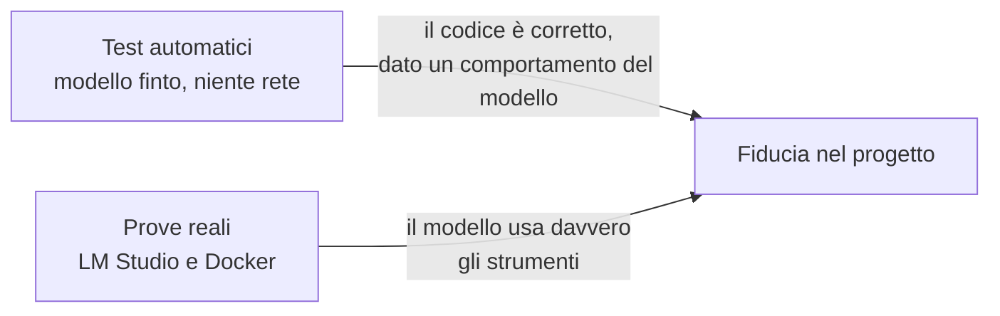
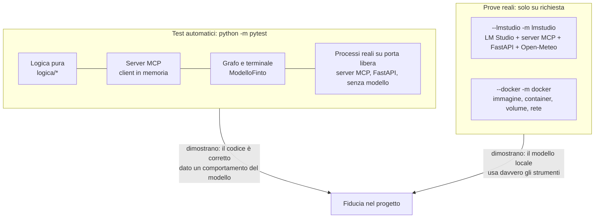
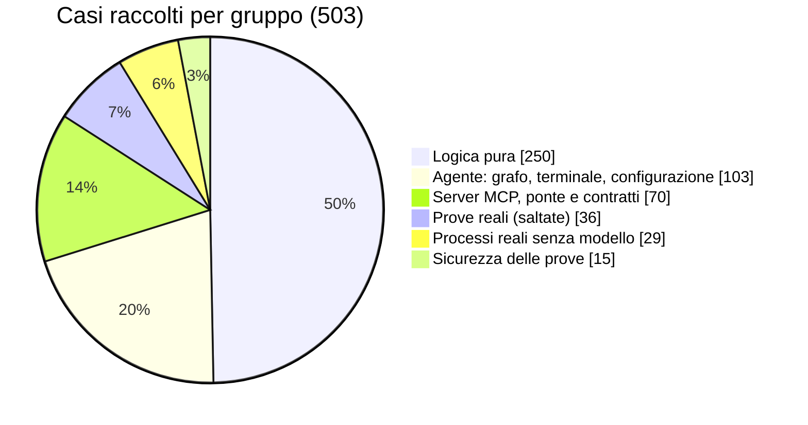
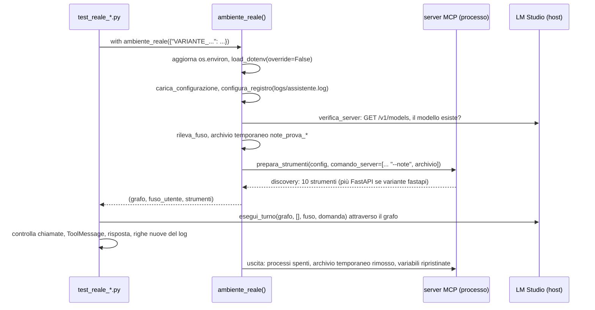
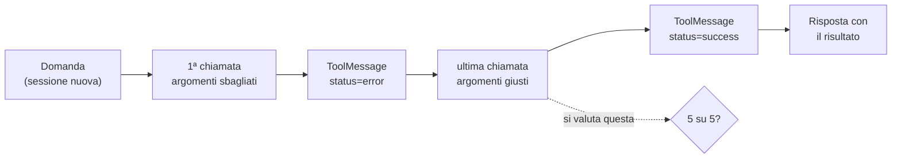
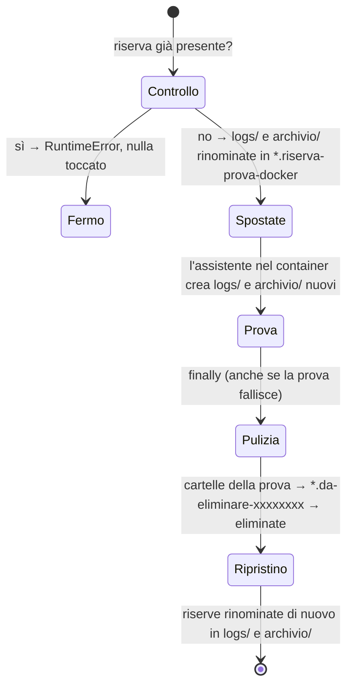
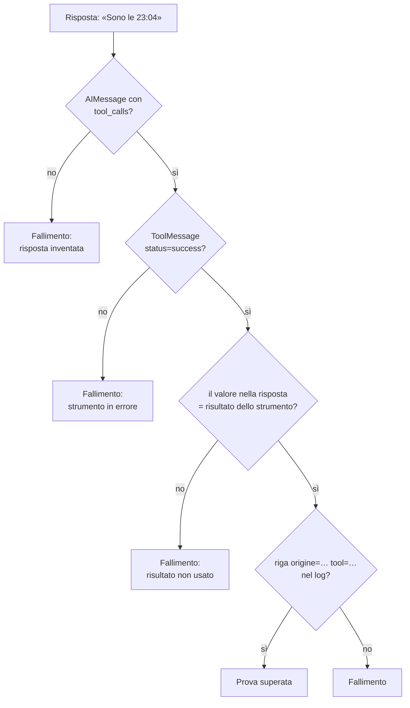
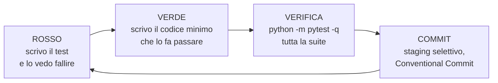

# 09 — Test e verifiche

> Percorso di studio: [00 Indice](00-indice.md) · precedente: [08 Configurazione, avvio e Docker](08-configurazione-avvio-docker.md) · successivo: [10 Log, diagnosi e limiti noti](10-log-e-diagnosi.md)

## Scheda in 5 minuti

**Di che cosa parla.** Questo capitolo spiega come si dimostra che il progetto funziona. Ci sono test automatici, che girano sempre, e prove reali, che usano davvero il modello. Serve a capire che cosa prova ciascuno e perché i primi, da soli, non bastano.

**Le idee chiave**

1. **Due tipi di verifica, tenuti separati.** I test automatici girano in uno o due minuti, senza modello e senza rete. Le prove reali usano LM Studio, Docker e Internet, e partono solo su richiesta. I primi danno sempre lo stesso esito; le seconde possono cambiare da un giorno all'altro. → sezione 2
2. **Le prove reali non partono per sbaglio.** Ogni prova reale ha un marcatore, cioè un'etichetta come `lmstudio` o `docker`. Senza l'opzione `--lmstudio` o `--docker` risulta sempre saltata. L'opzione è l'interruttore, `-m` è il filtro: servono tutti e due. → sezione 3
3. **I doppi di test sostituiscono le parti esterne.** Un doppio di test prende il posto di una dipendenza vera, come il modello o la rete. `ModelloFinto`, per esempio, recita un copione di risposte preparate. Funziona perché il codice riceve le sue dipendenze come parametri. → sezione 5
4. **Nessun test tocca le note dell'utente.** I test automatici usano cartelle temporanee e porte scelte dal sistema operativo. Le prove reali usano sempre un archivio delle note temporaneo. La prova Docker sposta da parte `logs/` e `archivio/` e li rimette sempre a posto. → sezioni 6, 8 e 10
5. **Una risposta simulata non prova niente sul modello.** Con `ModelloFinto` il comportamento del modello lo scrive chi scrive il test. Nelle prove reali Gemma ha detto «Ho salvato la nota» senza salvarla. Nessun test automatico poteva scoprirlo. → sezione 11
6. **Le prove reali cercano evidenze, non belle risposte.** Contano la richiesta dello strumento, l'esito `success`, il valore ripetuto nella risposta e la riga nel log. Il modello può sbagliare e correggersi: si valuta l'ultima chiamata del turno. → sezione 9
7. **Il metodo è il TDD, lo sviluppo guidato dai test.** Prima si scrive il test e lo si vede fallire, poi il codice minimo che lo fa passare. Anche ogni correzione parte da un test che riproduce il difetto. → sezione 13

**Il quadro**



**Da sapere a memoria**

| Cosa | Valore | Dove |
|---|---|---|
| Esito della suite, 2026-11-09 | 503 raccolti: 467 passati, 36 saltati (30 `lmstudio`, 6 `docker`) | `python -m pytest`, → sezione 1 |
| Opzioni che attivano le prove reali | `--lmstudio`, `--docker` | `tests/conftest.py:4-6` |
| Salto automatico se manca l'opzione | `pytest_collection_modifyitems` | `tests/conftest.py:9-16` |
| Il modello finto | `ModelloFinto`: risposte preparate, restituite in ordine | `tests/finti.py:13-25` |
| Giri massimi con gli strumenti in un turno | `MAX_GIRI_STRUMENTO = 3` | `assistente/grafo.py:20` |
| Esito dello step 7, 2026-11-10 | `python -m pytest`: 625 passati, 64 saltati (dopo la revisione finale); `--docker -m docker`: 23 passati; `--lmstudio --docker tests/test_reale_backend.py`: 4 passati | → sezione 10.4 |
| Esito dello step 8, 2026-11-12 | `python -m pytest`: 625 passati, 73 saltati; `--docker -m docker`: 31 passati; `--lmstudio --docker -m "lmstudio and docker"`: 5 passati; `npm test`: 85 passati in 9 file | → sezione 10.5 |
| Ambiente comune delle prove reali | `ambiente_reale()`, con archivio delle note temporaneo | `tests/reale.py:32-63` |

**Se te lo chiedono all'orale**

- *Perché le prove reali sono saltate di default?* Dipendono da LM Studio, Docker e rete, sono lente e non danno sempre lo stesso esito. `conftest.py` le salta se manca `--lmstudio` o `--docker`.
- *Perché un test con il modello finto non prova che Gemma usa lo strumento?* Perché il comportamento del modello l'ha scritto il test. Lo dimostrano solo le evidenze di una prova reale: richiesta dello strumento, risultato, log.
- *Che cosa vuol dire «conta l'ultima chiamata del turno»?* Il modello può sbagliare, ricevere l'errore e correggersi entro 3 giri. Si valuta l'ultima chiamata; fa eccezione l'orologio, dove conta la prima.

Per i dettagli continua con il resto del capitolo: le idee rimandano alle sezioni con «→ sezione N».

---

Questo documento spiega **come si dimostra che il progetto funziona**. Le verifiche sono di due tipi,
tenuti volutamente separati:

- i **test automatici** girano sempre, in uno o due minuti. Non usano il modello né la rete e non
  toccano i dati dell'utente;
- le **prove reali** si attivano solo su richiesta esplicita. Usano davvero LM Studio, il server MCP,
  il servizio FastAPI, Open-Meteo e Docker.

All'orale devi saper spiegare perché servono entrambi e perché i primi non bastano. In breve:
**i test automatici dimostrano che il nostro codice si comporta bene davanti a un certo
comportamento del modello. Le prove reali dimostrano che il modello locale si comporta davvero
così.**

---

## 1. I numeri in breve

Ho eseguito `python -m pytest -q -rs` il 2026-11-09, durante la stesura di questo documento, sul
commit `9aa287a`. È l'ultimo commit di `dev-revisione`, che lo stesso giorno è stato unito in `main`
con il merge `846b02a`: il codice è identico, quindi i numeri valgono anche per `main`.

| Voce | Valore |
|---|---|
| Elementi raccolti da pytest | **503** |
| Passati | **467** |
| Saltati (`skipped`), cioè le prove reali | **36**: 30 con marcatore `lmstudio`, 6 con marcatore `docker` |
| Tempo | `63.06s` in questa esecuzione. In un'esecuzione precedente, con la macchina più carica, `133.51s` |
| Avvisi | 13 `DeprecationWarning` di una libreria esterna (`langsmith`), non del progetto |
| File di test (`tests/test_*.py`) | 37, più 6 moduli di supporto |
| Codice di uscita | `0` |
| Log reali in `logs/` | stessa dimensione in byte prima e dopo la suite: i test automatici non li toccano |

Per l'ultima riga ho registrato con `stat` la dimensione di `logs/assistente.log`,
`logs/server_mcp.log` e `logs/servizio_api.log` prima della suite e dopo. I valori erano identici
(182600, 349117 e 8064 byte).

L'ultimo checkpoint del progetto (`docs/superpowers/checkpoint/2026-11-08-docker-docs.md`) riporta
419 passati e 36 saltati. Da allora i passati sono cresciuti, perché ogni commit di correzione
successivo (`7871ef7`…`ddd4e45`) ha aggiunto test di regressione. L'ultimo commit di correzione
(`9aa287a`) ha riportato gli elementi `docker` da 7 a 6 (vedi §13.4).

---

## 2. La strategia: due mondi separati



| | Test automatici | Prove reali |
|---|---|---|
| Comando | `python -m pytest` | `python -m pytest --lmstudio -m lmstudio -v -s` oppure `--docker -m docker -v -s` |
| Modello | `ModelloFinto` con risposte preparate | quello indicato da `LMSTUDIO_MODEL` nel `.env` |
| Rete | vietata: ogni richiesta HTTP verso l'esterno è simulata o fa fallire il test | usata: LM Studio sull'host, Open-Meteo per il meteo |
| Archivio delle note | sempre temporaneo (`tmp_path`, `tempfile`) | sempre temporaneo (`tests/reale.py`), mai `archivio/note.sqlite3` |
| Log | in cartelle temporanee (`tmp_path`) o catturati in memoria (`caplog`) | scritti davvero in `logs/` e letti come prova |
| Porte | scelte dal sistema operativo (fixture `porta`) | quelle del `.env` (`MCP_PORTA`, `API_PORTA`) |
| Esito | deterministico: stesso codice, stesso risultato | dipende dal modello: può variare da un'esecuzione all'altra |
| Durata | uno o due minuti | minuti (ogni domanda è una vera generazione del modello) |
| Quando | sempre, prima di ogni commit | a fine passo, o quando cambiano il modello, le descrizioni o il messaggio di sistema |

Questa separazione la chiede `../CLAUDE.md` nella sezione «Test e verifiche»:

- test automatici ripetibili che non richiedono un modello attivo;
- prove reali con LM Studio e con Docker tenute separate e attivate esplicitamente;
- «Una risposta simulata non dimostra che il modello locale sappia usare lo strumento».

---

## 3. Come pytest sa che cosa saltare

### 3.1 `pytest.ini`

```ini
[pytest]
testpaths = tests
pythonpath = .
markers =
    lmstudio: prova reale con LM Studio
    docker: prova reale con Docker
```

- `testpaths = tests`: senza argomenti pytest cerca solo in `tests/`.
- `pythonpath = .`: la radice del progetto entra in `sys.path`. I test possono quindi scrivere
  `from assistente.grafo import …`, `from logica.note import …` e `from tests.finti import …`.
- `markers`: registra i due marcatori. Senza registrazione pytest darebbe un avviso «unknown mark».

L'unica dipendenza in più per i test è `pytest==9.2.0`, in `requirements-dev.txt`. Il file include
anche `requirements.txt` con `-r requirements.txt`.

### 3.2 `tests/conftest.py`: le due opzioni e il salto automatico

```python
def pytest_addoption(parser):                                      # tests/conftest.py:4
    parser.addoption("--lmstudio", action="store_true", help="esegue le prove reali con LM Studio")
    parser.addoption("--docker", action="store_true", help="esegue le prove reali con Docker")

def pytest_collection_modifyitems(config, items):                  # tests/conftest.py:9
    for marcatore in ("lmstudio", "docker"):
        if config.getoption(f"--{marcatore}"):
            continue
        salta = pytest.mark.skip(reason=f"prova reale: usare --{marcatore}")
        for item in items:
            if marcatore in item.keywords:
                item.add_marker(salta)
```

Ogni file di prova reale dichiara a livello di modulo `pytestmark = pytest.mark.lmstudio` (o
`pytest.mark.docker`), così il marcatore vale per tutti i test del file. Dopo la raccolta, l'hook
aggiunge uno `skip` a ogni elemento marcato, a meno che sia stata data l'opzione corrispondente.

Lavorano insieme **due meccanismi distinti**:

| Comando | Che cosa succede |
|---|---|
| `python -m pytest` | raccoglie tutti i test; le prove reali risultano `skipped` con il motivo `prova reale: usare --lmstudio` (o `--docker`) |
| `python -m pytest -m lmstudio` | seleziona solo le prove reali (**30/503 raccolti, 473 deselezionati**, verificato con `--collect-only`), ma senza `--lmstudio` restano saltate |
| `python -m pytest --lmstudio` | toglie il salto, ma esegue **anche** tutti i test automatici |
| `python -m pytest --lmstudio -m lmstudio` | il comando giusto: solo le prove reali con LM Studio, eseguite davvero |

Quindi `--lmstudio` è l'**interruttore di sicurezza**, mentre `-m lmstudio` è il **filtro**. Lo stesso
vale per `--docker -m docker` (6/503 raccolti, 497 deselezionati). Senza l'opzione una prova reale è
sempre saltata, quindi non può partire per sbaglio.

---

## 4. Mappa di tutti i file in `tests/`

Il numero tra parentesi è quello dei casi raccolti da pytest. Un test parametrizzato conta una volta
per ogni combinazione. La somma delle tabelle dà 503.



### 4.1 Moduli di supporto (non sono test)

| File | Ruolo |
|---|---|
| `conftest.py` | opzioni `--lmstudio`/`--docker`, salto automatico, fixture `porta` e `popen_registrati` (§6) |
| `finti.py` | i doppi del modello e degli strumenti: `ModelloFinto`, `chiamata`, `chiamata_orologio`, `strumento_finto`, `orologio_finto` (§5) |
| `reale.py` | `ambiente_reale()`: lo stesso percorso di `python -m assistente`, senza terminale e con un archivio delle note temporaneo (§8) |
| `cartelle_da_parte.py` | sposta da parte `logs/` e `archivio/` dell'utente durante la prova Docker e li ripristina sempre (§10.2) |
| `processi.py` | `esegui_con_limite()`: un limite di tempo che termina l'intero albero dei processi, anche su Windows (§10.3) |
| `server_vuoto.py` | un server FastMCP **senza strumenti**, avviato come processo vero per provare l'errore «catalogo vuoto» |

### 4.2 Logica pura (`logica/`): nessun processo, nessuna rete — 250 casi

| File | Che cosa verifica |
|---|---|
| `test_orologio.py` (14) | `ora_corrente` con istante fisso (Roma, Tokyo, New York, ora legale); fusi non validi (`Mars/Olympus`, `Roma`, `europe/rome`, `../../etc/passwd`, `""`, `None`, `3`); `è_fuso_valido`; `ErroreConversione` sottoclasse di `ErroreStrumento` |
| `test_conversioni.py` (37) | risultati e tipi (`2500` intero, `0.75` decimale), temperature, unità sconosciute con l'elenco delle ammesse, grandezze diverse, zero assoluto, numeri enormi, interi lunghi esatti, nessun artefatto della virgola mobile |
| `test_calcolatrice.py` (48) | precedenze; decimali esatti (`0.1 + 0.2` dà `0.3`); espressioni «d'attacco» rifiutate (`__import__('os')`, `().__class__`, `abs(-1)`, `9 ** 9 ** 9`, `2 ** 10000`); rifiutate anche le scritture fuori dalle regole (`1e3`, `0x10`, `1_000`, `7 // 2`, la virgola `2,5`); divisione per zero; interi grandi esatti; nessun arrotondamento silenzioso; `0 ** 0` vale 1 |
| `test_numeri.py` (12) | `numero_json`: intero solo se esatto; testo se un numero JSON perderebbe cifre; arrotondamento a 15 cifre |
| `test_scadenze.py` (37) | l'esempio della specifica (23/12/2026 più 3 giorni lavorativi dà 29/12/2026); weekend, Pasquetta, cambio d'anno, `giorni = 0`; date e tipi non validi (anche la cifra a larghezza piena `２026-01-01`); anni fuori dal 2026–2028; file delle festività; data massima |
| `test_catalogo.py` (36) | ricerca per parole, sede e codice; `max_results` ai limiti e nullo; nessun risultato; dettaglio; codice inesistente («Usa prima search_catalog»); file reale; cataloghi malformati |
| `test_note.py` (34) | archivio SQLite su `tmp_path`: aggiunta, elenco dalla più recente, limite, eliminazione; ID inesistente senza effetti; ID mai riusati; persistenza dopo la riapertura; archivio non accessibile o corrotto; ID enormi; eliminazione concorrente; caratteri non validi |
| `test_meteo.py` (32) | `meteo_attuale` con HTTP simulato (`MockTransport`): risultato, città ambigua (al massimo 4 alternative, solo omonimi), parametri della richiesta, scarti orari; errori di rete distinti da «Città non trovata»; timeout; JSON non valido; scadenza totale di 8 s, inferiore ai 10 s del ponte MCP; nomi non inviabili |

### 4.3 Server MCP, ponte e contratti tra varianti — 70 casi

| File | Che cosa verifica |
|---|---|
| `test_server_mcp.py` (27) | con il **client MCP in memoria** (`con_client`): nome del server; catalogo con esattamente dieci strumenti, schemi e descrizioni; una chiamata riuscita e un errore MCP per ogni strumento; log `tool=… esito=…`; effetti delle note su un archivio temporaneo; la rete di sicurezza `esegui_registrato` per gli errori imprevisti; la regola «chiedi conferma» nella descrizione di `delete_note` |
| `test_client_mcp.py` (5) | il **ponte sincrono** `avvolgi` (`assistente/client_mcp.py:57`), con un tool asincrono finto come quelli dell'adattatore MCP: contratto copiato (nome, descrizione, schema, `origine: mcp`); `ToolException` diventa `tipo: "strumento"`; `ExceptionGroup` con `ConnectionRefusedError` o `OSError`, anche annidati, diventa `tipo: "collegamento"` («Server MCP non raggiungibile»); timeout di 0,1 s («nessuna risposta entro 0.1 secondi») |
| `test_calcolatrice_locale.py` (11) | la variante locale di `calcola` ha **lo stesso contratto** della variante MCP (nome, descrizione, schema) e dà **gli stessi esiti**, anche con i tipi sbagliati |
| `test_wrapper_scadenze.py` (18) | il wrapper HTTP delle scadenze ha lo stesso contratto del catalogo MCP; parità di esiti con la variante MCP usando il `TestClient`; parametri inviati. Errori tradotti senza mai sollevare eccezioni: `400` con JSON → `strumento`; `503`, risposta non JSON, `ConnectError`, `ReadTimeout` → `collegamento`; `500` con JSON d'errore → `strumento`; argomenti impossibili da inviare → `strumento` |
| `test_servizio_api.py` (9) | il servizio FastAPI con il `TestClient`: `200` corretto; `400` con testo italiano uguale a quello della logica; errori di tipo in italiano che nominano il parametro; `/openapi.json` che descrive `/scadenza`; errore imprevisto → `500` in italiano |

### 4.4 Agente: grafo, terminale, modello, configurazione — 103 casi

| File | Che cosa verifica |
|---|---|
| `test_grafo.py` (26) | messaggio di sistema (fuso, catalogo, note, conferma prima di eliminare, meteo, divieto di dichiarare azioni non eseguite); instradamento (`__end__`, `strumenti`, `limite` con `MAX_GIRI_STRUMENTO == 3`); risposta diretta; ciclo modello → strumento → modello; cronologia tra turni (e non modificata); giri che ripartono a ogni turno; limite raggiunto con cronologia valida; strumento sconosciuto; JSON malformato (`invalid_tool_calls`); argomenti mancanti o in più rifiutati in italiano **prima** di eseguire; righe di log con `origine`, `esito`, `call_id` |
| `test_terminale.py` (18) | `esegui_sessione` con ingresso e uscita simulati: `esci` (anche con il BOM di una pipe PowerShell), righe vuote, EOF, Ctrl+C in lettura e durante la risposta; benvenuto con fuso e strumenti; riga `[strumento · origine: argomenti]` prima della risposta, con gli argomenti nell'ordine dello schema; nessuna riga per uno strumento fallito; risposta vuota; un errore del modello non lascia il messaggio nella cronologia |
| `test_modello.py` (16) | `verifica_server` con un `LettoreFinto` al posto di `GET /v1/models`: modello presente o assente (con l'elenco dei disponibili), server irraggiungibile, risposte malformate o non JSON, indirizzi scritti male; `crea_modello` collega gli strumenti |
| `test_configurazione.py` (21) | variabili mancanti o vuote; porte non valide; varianti ammesse (`mcp`/`locale`, `mcp`/`fastapi`); `API_PORTA` obbligatoria solo con `fastapi` e diversa da `MCP_PORTA` |
| `test_fuso.py` (9) | ordine di rilevamento del fuso: `FUSO_HOST_WINDOWS` → fuso del computer (non in Docker) → `FUSO_ORARIO` → `UTC` con avviso |
| `test_varianti.py` (8) | `seleziona_strumenti`: un solo strumento per nome, il sostituto prende il posto della versione MCP, nomi duplicati → `ErroreAvvio`; poi `origini`, `parametri`, `crea_sostituti` |
| `test_registro.py` (2) | formato delle righe di log (`chiave=valore`, JSON compatto, a capo tolti); `configura_registro` crea la cartella ed è idempotente |
| `test_console.py` (3) | ingresso e uscita rediretti in UTF-8 (non cp1252), BOM tolto, nessun crash con le emoji; un terminale interattivo non viene riconfigurato |

### 4.5 Processi reali senza modello (avvio, attesa, arresto) — 29 casi

Questi test avviano **processi veri** (`python -m server_mcp`, `python -m servizio_api`) su una porta
libera, con il log in `tmp_path`. Sono i più lenti della suite.

| File | Che cosa verifica |
|---|---|
| `test_avvio_server.py` (14) | ciclo completo del server MCP: discovery, chiamata, errore controllato, nessun processo orfano, errore `collegamento` dopo l'arresto. Poi: log in UTF-8; nessun output nel terminale (`capfd`); porta occupata, anche su `0.0.0.0`; server che non parte (con le righe di `stderr` nel messaggio) o che non risponde; catalogo vuoto (`server_vuoto.py`); Ctrl+C durante l'avvio o l'arresto; persistenza delle note dopo il riavvio; arresto ordinato con codice 0 e riga «arresto server» |
| `test_avvio_servizio_api.py` (6) | lo stesso per il servizio FastAPI: costanti, ciclo completo con il wrapper, nessun output, porta occupata, servizio che non risponde, arresto ordinato |
| `test_avvio_unico.py` (8) | `main()` di `python -m assistente` con il server MCP reale ma il modello finto: riga «Strumenti:», chiamata vera attraverso il server; porta occupata o mancante (uscita `1` senza traceback); varianti `locale`, `mcp` e `fastapi` (due processi, entrambi spenti); se il servizio non parte si spegne anche il server MCP |
| `test_prepara_strumenti.py` (1) | `prepara_strumenti` con un comando del server personalizzato e un archivio temporaneo: è il meccanismo usato dalle prove reali |

### 4.6 Sicurezza delle prove stesse — 15 casi

| File | Che cosa verifica |
|---|---|
| `test_reale_ambiente.py` (4) | **non** è una prova reale: non ha marcatori e gira sempre. Verifica che l'archivio delle prove reali non sia mai `PERCORSO_NOTE`, che venga rimosso dopo l'uso e che `con_client` non lasci cartelle in `%TEMP%` |
| `test_cartelle_da_parte.py` (8) | lo spostamento di `logs/` e `archivio/` non perde né nasconde dati: ripristino anche se la prova fallisce; riserva già presente → stop senza toccare nulla; rinomina che fallisce a metà; cancellazione bloccata; residui segnalati; riserve e residui ignorati da Git e da Docker |
| `test_processi.py` (2) | `esegui_con_limite` termina entro il limite anche se il figlio ha avviato un «nipote» che tiene aperte le pipe; un comando normale passa l'ingresso e restituisce l'uscita |
| `test_requisiti.py` (1) | ogni pacchetto importato direttamente dal codice ha la versione fissata in `requirements.txt` (`pydantic`, `starlette`, `httpx`, `fastapi`, `uvicorn`, `fastmcp`, `mcp`, `langchain-mcp-adapters`) |

### 4.7 Prove reali (saltate di default) — 36 casi

| File | Marcatore | Casi | Che cosa prova |
|---|---|---|---|
| `test_reale_lmstudio.py` | `lmstudio` | 6 | orologio: 5 domande su ora e data, più l'errore controllato |
| `test_reale_convertitore.py` | `lmstudio` | 5 | 5 conversioni |
| `test_reale_calcolatrice.py` | `lmstudio` | 4 | «Quanto fa (3+4)*2?» con `mcp` e con `locale`, più l'errore controllato in entrambe |
| `test_reale_scadenze.py` | `lmstudio` | 4 | la scadenza del 23/12/2026 con `mcp` e con `fastapi`, più l'errore controllato in entrambe |
| `test_reale_catalogo.py` | `lmstudio` | 4 | ricerca con risultati, senza risultati, ricerca e poi dettaglio, errore controllato |
| `test_reale_note.py` | `lmstudio` | 5 | aggiunta ed ID inesistente, persistenza dopo il riavvio, due casi solo osservati, errore controllato |
| `test_reale_meteo.py` | `lmstudio` | 2 | «Che tempo fa a Udine?» (serve la rete), più l'errore controllato |
| `test_reale_docker.py` | `docker` | 6 | avvio con lo script e senza, convertitore, varianti, volume delle note, meteo senza rete |

---

## 5. I doppi di test

Un **doppio di test** prende il posto di una dipendenza vera (il modello, la rete, un processo). Serve
a rendere il test veloce, ripetibile e indipendente dall'esterno. Il progetto ne usa diversi tipi:

- **stub**: risponde con valori preparati (`ModelloFinto`, `strumento_finto`);
- **fake**: un'implementazione vera ma semplificata (`orologio_finto`, il client MCP in memoria, `TestClient`);
- **trasporti simulati**: intercettano le richieste HTTP (`httpx.MockTransport`);
- **sostituzioni con `monkeypatch`**: rimpiazzano una funzione per la durata di un test.

Il codice di produzione è scritto apposta per renderlo possibile. Le dipendenze esterne arrivano come
**parametri con un valore predefinito** (*iniezione delle dipendenze*):

| Punto del codice | Parametro iniettabile | Che cosa lo sostituisce nei test |
|---|---|---|
| `crea_grafo(modello, strumenti)` (`assistente/grafo.py:141`) | `modello`, `strumenti` | `ModelloFinto`, strumenti finti |
| `crea_server(*, adesso, percorso_note, http)` (`server_mcp/server.py:116`) | istante, archivio, client HTTP | istante fisso, `tmp_path`, `http_senza_rete()` |
| `ArchivioNote(percorso, adesso)` (`logica/note.py:54`) | file e orologio | `tmp_path`, istante fisso |
| `ora_corrente(fuso, adesso)` (`logica/orologio.py:33`) | l'istante | istante fisso |
| `meteo_attuale(city, http, timeout, tempo_totale)` (`logica/meteo.py:115`) | client HTTP e tempi | `MockTransport`, `tempo_totale=0.3` |
| `crea_wrapper_scadenze(url_base, http, timeout)` (`assistente/wrapper_scadenze.py:35`) | client HTTP | `MockTransport` o `TestClient` |
| `verifica_server(..., leggi_json=...)` (`assistente/modello.py:42`) | la lettura di `/v1/models` | `LettoreFinto` |
| `rileva_fuso(env, fuso_locale)` (`assistente/fuso.py:31`) | variabili e fuso del sistema | dizionari e funzioni di prova |
| `esegui_sessione(grafo, fuso, leggi, scrivi, ...)` (`assistente/terminale.py:41`) | `input` e `print` | liste di righe |
| `avvia_server_mcp(porta, percorso_log, attesa, comando)` (`assistente/avvio_server.py:154`) | tempo di attesa e comando | comandi che falliscono, dormono o espongono zero strumenti |
| `prepara_strumenti(config, log_server, log_api, comando_server)` (`assistente/avvio.py:22`) | log e comando del server | `tmp_path`; un comando con `--note <archivio temporaneo>` |
| `avvolgi(strumento, timeout)` (`assistente/client_mcp.py:57`) | il timeout del ponte | `timeout=0.1` |

### 5.1 `ModelloFinto` (`tests/finti.py:13`)

```python
class ModelloFinto:
    def __init__(self, risposte: list[AIMessage | BaseException]):
        self.risposte = list(risposte)
        self.chiamate: list[list[BaseMessage]] = []

    def invoke(self, messaggi, config=None) -> AIMessage:
        self.chiamate.append(list(messaggi))
        if not self.risposte:
            raise AssertionError("il modello finto non ha più risposte preparate")
        risposta = self.risposte.pop(0)
        if isinstance(risposta, BaseException):
            raise risposta
        return risposta
```

Il grafo chiede al modello un solo metodo, `.invoke(messaggi) -> AIMessage` (`assistente/grafo.py:142`
e `:146`). `ModelloFinto` ha esattamente quel metodo, quindi il grafo non distingue il finto dal
`ChatOpenAI` vero (*duck typing*). Contano tre dettagli:

1. **Copione**: restituisce le risposte nell'ordine in cui le hai preparate. È il test a decidere se
   il «modello» chiede uno strumento, risponde subito o produce JSON malformato.
2. **Registrazione**: `chiamate` conserva la lista dei messaggi ricevuti a ogni invocazione. Così il
   test controlla che cosa il grafo ha mandato al modello: il `SystemMessage` col fuso in prima
   posizione, il `ToolMessage` nella seconda chiamata, la cronologia del turno precedente.
3. **Eccezioni e copione esaurito**: un'eccezione nella lista viene sollevata (per esempio
   `RuntimeError("server giù")` o `KeyboardInterrupt()` in `test_terminale.py`). Se il grafo chiama
   il modello più volte del previsto, il test fallisce subito con `AssertionError` invece di restare
   appeso. Prova eseguita: un copione con una sola richiesta di strumento e nessuna risposta finale
   dà `AssertionError: il modello finto non ha più risposte preparate`, perché dopo lo strumento il
   grafo torna al modello.

### 5.2 `chiamata` e `chiamata_orologio` (`tests/finti.py:35`, `:28`)

Costruiscono un `AIMessage` con `tool_calls`, come lo produrrebbe un modello che chiede uno strumento:

```python
chiamata("converti_unita", {"valore": 2.5, "da": "km", "a": "m"}, "m1")
# AIMessage(content="", tool_calls=[{"name": "converti_unita", "args": {...}, "id": "m1", "type": "tool_call"}])
```

L'`id` serve a verificare la **correlazione**: ogni `ToolMessage` deve avere `tool_call_id` uguale
all'`id` della richiesta.

### 5.3 `strumento_finto` (`tests/finti.py:40`)

È uno `StructuredTool` che restituisce sempre la stessa stringa, con l'origine nei metadati (`mcp`
per default):

```python
schema = {"type": "object", "properties": {}, "additionalProperties": True}
return StructuredTool(name=nome, description="finto", args_schema=schema, func=esegui, metadata={"origine": origine})
```

Simula uno strumento che risponde con successo (`'{"risultato": 2500}'`), con un errore dello
strumento (`'{"errore": …, "tipo": "strumento"}'`) o con un errore di collegamento
(`"tipo": "collegamento"`). Così si verifica che il grafo marchi `status` ed `esito` giusti
(`assistente/grafo.py:66-74`). Prova eseguita con `'{"errore": "Server MCP non raggiungibile",
"tipo": "collegamento"}'`: il `ToolMessage` ha `status=error` e il log riporta
`esito=errore_collegamento`.

Nota tecnica: lo schema ha `additionalProperties: True`. È l'unico caso in cui il controllo
dell'host sugli argomenti in più viene saltato (`assistente/grafo.py:96`), quindi lo strumento finto
accetta qualunque argomento. Nessuno strumento vero del progetto lo fa.

### 5.4 `orologio_finto` (`tests/finti.py:50`)

```python
def orologio_finto(istante: datetime) -> BaseTool:
    def ora_corrente(fuso: str) -> str:
        try:
            return json.dumps(logica_ora_corrente(fuso, istante), ensure_ascii=False)
        except ErroreStrumento as errore:
            return json.dumps({"errore": str(errore), "tipo": "strumento"}, ensure_ascii=False)
    return StructuredTool.from_function(func=ora_corrente, name="ora_corrente", description="finto",
                                        metadata={"origine": "mcp"})
```

È un *fake* fedele: usa **la stessa logica** del server (`logica.orologio.ora_corrente`) con un
istante fisso e restituisce gli errori **nello stesso formato** del ponte MCP. Ho verificato che, con
lo stesso istante, il risultato coincide con quello del server MCP vero in memoria:

```text
con_client(lambda c: c.call_tool("ora_corrente", {"fuso": "Asia/Tokyo"}), adesso=lambda: ISTANTE).structured_content
  == json.loads(orologio_finto(ISTANTE).invoke({"fuso": "Asia/Tokyo"}))      →  True
{'fuso': 'Asia/Tokyo', 'data_ora': '2026-11-02T23:04:05+09:00', 'scarto_utc': '+09:00', 'giorno_settimana': 'lunedì'}
```

L'istante fisso (`ISTANTE = datetime(2026, 11, 2, 14, 4, 5, tzinfo=timezone.utc)`, un lunedì, in
`tests/test_grafo.py:19`) rende i test indipendenti dal giorno in cui girano: a Tokyo sono sempre le
`23:04:05`.

### 5.5 `http_senza_rete` (`tests/test_server_mcp.py:31`)

```python
def http_senza_rete() -> httpx.Client:
    def vietato(richiesta):
        raise AssertionError(f"richiesta di rete nei test: {richiesta.url}")
    return httpx.Client(transport=httpx.MockTransport(vietato))
```

`con_client` lo passa al server come `http` per default. Qualsiasi richiesta (in pratica quelle del
meteo verso Open-Meteo) solleva `AssertionError`. Prova eseguita:

```text
http_senza_rete().get("https://api.open-meteo.com/v1/forecast")
AssertionError: richiesta di rete nei test: https://api.open-meteo.com/v1/forecast
```

Dentro il server l'`AssertionError` viene catturata dalla rete di sicurezza `esegui_registrato`
(`server_mcp/server.py:98-109`). Una chiamata a `get_weather` senza HTTP simulato dà quindi un errore
MCP (prova eseguita: `is_error=True`, testo `Errore interno dello strumento get_weather:
AssertionError.`), con il traceback nel log. Un test che si aspetta un meteo riuscito fallisce, e la
rete non viene mai toccata.

### 5.6 `httpx.MockTransport`

È un trasporto di `httpx` che non apre nessuna connessione. Chiama una funzione Python con la
richiesta e restituisce la `httpx.Response` che quella funzione costruisce, oppure solleva
l'eccezione che solleva lei. Gli usi nel progetto:

| Dove | Gestore | Che cosa simula |
|---|---|---|
| `test_meteo.py`, funzione `client(geo, forecast, richieste)` | sceglie la risposta in base a `richiesta.url.host` | geocoding e previsione di Open-Meteo: JSON, codici di stato, testo non JSON, `ConnectError`, `ReadTimeout`; può anche registrare le richieste per controllarne i parametri |
| `test_meteo.py::test_scadenza_totale_anche_con_risposte_lente` | `time.sleep(0.5)` prima di rispondere | un servizio lento: con `tempo_totale=0.3` l'errore arriva in meno di 0,45 s |
| `test_server_mcp.py`, `http_meteo(geo, forecast)` | come sopra, ma passato a `crea_server(http=...)` | il meteo attraverso il server MCP |
| `test_wrapper_scadenze.py`, `wrapper_finto(gestore)` | `400`, `503`, `500`, testo non JSON, eccezioni | il servizio FastAPI che risponde male o non risponde (URL finto `http://servizio.test`) |

Esempio eseguito:

```text
wrapper con MockTransport che risponde 503
→ {"errore": "Servizio scadenze non raggiungibile: risposta non valida (HTTP 503).", "tipo": "collegamento"}
```

### 5.7 `TestClient` di FastAPI

`fastapi.testclient.TestClient(crea_app())` esegue l'applicazione ASGI **nello stesso processo**,
senza aprire porte. È a sua volta un `httpx.Client`, quindi si usa in due modi:

- direttamente, in `test_servizio_api.py`: `client.get("/scadenza", params=...)`;
- come `http` del wrapper, in `test_wrapper_scadenze.py::test_parita_con_la_variante_mcp`:
  `crea_wrapper_scadenze("http://testserver", http=TestClient(crea_app()))`. Così wrapper e servizio
  veri parlano tra loro senza rete, e il risultato si confronta con quello di `con_client` sulla
  variante MCP.

Il wrapper passa sempre `timeout` a ogni richiesta, e il `TestClient` avvisa che lo ignora. Per questo
il test ha `@pytest.mark.filterwarnings("ignore:You should not use the 'timeout' argument with the TestClient")`.

Esempio eseguito:

```text
GET /scadenza?data_inizio=2026-12-23&giorni=3&lavorativi=true
→ 200 {"data_inizio":"2026-12-23","giorni":3,"lavorativi":true,"scadenza":"2026-12-29","giorno_settimana":"martedì",
       "festivita_saltate":["2026-12-25 Natale","2026-12-26 Santo Stefano"],"nota":"Calcolo indicativo: non ha valore legale."}
GET /scadenza?data_inizio=2026-02-30&giorni=1&lavorativi=true
→ 400 {"errore":"Data non valida: '2026-02-30'. Usa il formato AAAA-MM-GG, per esempio 2026-12-23."}
```

### 5.8 Il client MCP in memoria: `con_client` (`tests/test_server_mcp.py:40`)

```python
def con_client(funzione, **opzioni):
    opzioni.setdefault("http", http_senza_rete())
    async def corpo():
        async with Client(crea_server(**opzioni)) as client:
            return await funzione(client)
    if "percorso_note" in opzioni:
        return asyncio.run(corpo())
    with tempfile.TemporaryDirectory(ignore_cleanup_errors=True) as cartella:
        opzioni["percorso_note"] = Path(cartella) / "note.sqlite3"
        return asyncio.run(corpo())
```

`fastmcp.Client` riceve **l'oggetto server** invece di un URL e parla con lui in memoria. Il
protocollo MCP è quello vero (`tools/list`, `tools/call`), ma non ci sono processi né porte. Le
garanzie sono tre:

- **nessuna rete**: `http_senza_rete()` per default;
- **nessun archivio reale**: se il test non indica `percorso_note`, si usa una cartella temporanea
  nuova, eliminata alla fine (lo verifica `test_reale_ambiente.py::test_con_client_non_lascia_cartelle_temporanee`);
- **iniezione**: le opzioni arrivano a `crea_server`, per esempio `adesso=lambda: istante`.

`test_calcolatrice_locale.py`, `test_wrapper_scadenze.py` e `test_reale_ambiente.py` lo riusano per
confrontare le varianti con il catalogo MCP. Esempio eseguito:

```text
con_client(lambda c: c.list_tools())  →  10 strumenti:
['add_note', 'calcola', 'calcola_scadenza', 'converti_unita', 'delete_note', 'get_item',
 'get_weather', 'list_notes', 'ora_corrente', 'search_catalog']

con_client(lambda c: c.call_tool("ora_corrente", {"fuso": "Mars/Olympus"}, raise_on_error=False))
→ is_error=True, testo="Fuso orario sconosciuto: 'Mars/Olympus'. Usa un nome IANA, per esempio 'Europe/Rome'.",
  structured_content=None
```

### 5.9 Altri doppi

| Doppio | Dove | Che cosa sostituisce |
|---|---|---|
| `finto(corpo)` | `test_client_mcp.py:12` | un tool **asincrono** (`coroutine=corpo`, `response_format="content_and_artifact"`), come quelli prodotti da `langchain-mcp-adapters`; serve a provare il ponte sincrono senza server |
| `LettoreFinto` | `test_modello.py:13` | la lettura HTTP di `GET /v1/models` in `verifica_server`; registra gli URL letti e può sollevare `URLError`, `TimeoutError`… |
| `ProcessoLento` | `test_avvio_server.py:150` | un `Popen` che non si chiude e il cui primo `wait` è interrotto da Ctrl+C: prova che `ferma` uccide comunque il processo |
| comandi di prova | `test_avvio_server.py` | `python -c "...sys.exit(1)"` (non parte), `python -c "time.sleep(60)"` (non risponde), `server_vuoto.py` (zero strumenti) |
| `monkeypatch` su `main()` | fixture `ambiente`, `test_avvio_unico.py:15-58` | `load_dotenv` (niente `.env` reale), `verifica_server` (niente LM Studio), `crea_modello` (restituisce un `ModelloFinto`), `esegui_sessione` (righe preparate), percorsi dei log in `tmp_path` |
| `monkeypatch` su `shutil.rmtree` e `Path.rename` | `test_cartelle_da_parte.py` | file bloccati come su Windows, per provare i percorsi di errore |
| `ConnessioneConcorrente` | `test_note.py:133` | una connessione SQLite in cui «un altro processo» elimina la nota appena prima del `DELETE` |

---

## 6. Le fixture

### 6.1 `porta` (`tests/conftest.py:19`)

```python
@pytest.fixture
def porta():
    import socket
    with socket.socket() as s:
        s.bind(("127.0.0.1", 0))
        return s.getsockname()[1]
```

Con la porta `0` il sistema operativo sceglie una porta libera. La fixture legge il numero, chiude il
socket e lo restituisce. I test che avviano processi veri non usano mai `8765` o `8766`, quindi
possono girare anche mentre l'assistente è acceso. Quando servono due porte diverse (variante
`fastapi`), `test_avvio_unico.py` usa `porta_libera_diversa(da)`, che ripete la scelta finché la porta
non è diversa da quella del server MCP.

### 6.2 `popen_registrati` (`tests/conftest.py:29`)

```python
monkeypatch.setattr(avvio_server.subprocess, "Popen", registra)
return creati
```

Sostituisce `subprocess.Popen` dentro `assistente.avvio_server` con una funzione che chiama
l'originale e **registra** ogni processo creato. Alla fine il test controlla
`all(p.poll() is not None for p in creati)`. `poll()` restituisce `None` finché il processo è vivo,
quindi la condizione significa **nessun processo orfano**. La fixture si usa nei casi di errore:
server che non risponde, catalogo vuoto, Ctrl+C durante l'avvio, servizio FastAPI che non parte
mentre il server MCP è già acceso.

### 6.3 Fixture di pytest usate

| Fixture | Che cosa offre | Esempi |
|---|---|---|
| `tmp_path` | una cartella temporanea nuova per ogni test | archivi delle note, log dei server, cataloghi malformati |
| `tmp_path_factory` | cartelle temporanee condivise tra più test | `test_reale_note.py`: un archivio per tutto il modulo, per provare la persistenza tra un caso e l'altro |
| `monkeypatch` | sostituzioni annullate a fine test | variabili d'ambiente, funzioni, attributi |
| `caplog` | cattura i record di `logging` | `"origine=mcp" in caplog.text`, `"esito=errore_tool" in caplog.text` |
| `capsys` / `capfd` | catturano l'uscita del processo Python o dei descrittori di file | `capfd.readouterr() == ("", "")`: il server figlio non scrive nel terminale della chat |
| fixture di modulo (`scope="module"`) | una sola preparazione per tutti i test del file | nelle prove reali un solo server MCP per modulo, con una sessione nuova per ogni domanda; in Docker una sola `docker compose build` |

---

## 7. Esempi reali: il grafo con il modello finto

Ho eseguito questi script nella cartella di prova, con `python -I`, usando la logica pura e
`tests/finti.py`. Il primo ripete `test_grafo.py::test_ciclo_con_orologio`:

```python
m = ModelloFinto([chiamata_orologio("Asia/Tokyo", "c1"), AIMessage("Sono le 23:04.")])
g = crea_grafo(m, [orologio_finto(ISTANTE)])
cr = esegui_turno(g, [], "Europe/Rome", "Che ore sono a Tokyo?")
```

Uscita:

```text
LOG assistente.strumenti: origine=mcp tool=ora_corrente call_id=c1 argomenti={"fuso":"Asia/Tokyo"} esito=ok
    risultato={"fuso": "Asia/Tokyo", "data_ora": "2026-11-02T23:04:05+09:00", ...} tool_message.call_id=c1
HumanMessage 'Che ore sono a Tokyo?'
AIMessage    ''   tool_calls=[{'name': 'ora_corrente', 'args': {'fuso': 'Asia/Tokyo'}, 'id': 'c1', ...}]
ToolMessage  '{"fuso": "Asia/Tokyo", "data_ora": "2026-11-02T23:04:05+09:00", ...}'   status=success
AIMessage    'Sono le 23:04.'
chiamate al modello: 2 → nella seconda: ['SystemMessage', 'HumanMessage', 'AIMessage', 'ToolMessage']
```

Che cosa dimostra:

- il grafo ha seguito `modello → strumenti → modello → END`;
- lo strumento è stato **eseguito davvero** dal programma: il `ToolMessage` contiene l'ora calcolata
  dalla logica;
- la correlazione `call_id=c1` ↔ `tool_message.call_id=c1` è corretta;
- alla seconda chiamata il modello riceve il risultato dello strumento;
- il messaggio di sistema è in testa alle chiamate al modello, ma **non** finisce nella cronologia.

Altri tre esperimenti eseguiti:

| Copione del `ModelloFinto` | Uscita reale | Test corrispondente |
|---|---|---|
| quattro `chiamata_orologio` di fila (`c1`…`c4`) | tre righe `esito=ok`, poi `call_id=c4 … esito=limite`; il penultimo messaggio è un `ToolMessage` con `status=error` e `{"errore": "limite di chiamate raggiunto"}`, l'ultimo è `TESTO_LIMITE` | `test_limite_raggiunto`, `test_limite_registrato` |
| `chiamata("ora_corrente", {"fuso": "Asia/Tokyo", "formato": "24h"})` | `status=error`, `{"errore": "Argomenti non previsti per ora_corrente: formato. Usa solo: fuso.", "tipo": "strumento"}`, log `esito=errore_tool`; lo strumento non viene eseguito | `test_argomento_in_piu_rifiutato_in_italiano` |
| una sola `chiamata_orologio`, senza risposta finale | `AssertionError: il modello finto non ha più risposte preparate` | (proprietà di `ModelloFinto`) |

Nel caso del limite ogni richiesta ha il suo `ToolMessage`, anche quella non eseguita. Così la
cronologia resta valida per l'API OpenAI, che rifiuta una richiesta di strumento senza risposta. Il
grafo è descritto in dettaglio in [04 Il grafo LangGraph](04-grafo-langgraph.md).

---

## 8. `tests/reale.py`: l'ambiente delle prove reali



Punti chiave di `ambiente_reale` (`tests/reale.py:32-63`):

- **Stesso percorso del programma vero**: usa `carica_configurazione`, `verifica_server`,
  `rileva_fuso`, `prepara_strumenti`, `crea_modello` e `crea_grafo`, cioè le stesse funzioni di
  `assistente/__main__.py`. Manca solo il ciclo del terminale. Una prova reale riuscita prova quindi
  il codice che l'utente esegue.
- **`variabili` vince sul `.env`**: le variabili passate entrano in `os.environ` **prima** di
  `load_dotenv(override=False)`, che non sovrascrive quelle già presenti. Così un test forza
  `VARIANTE_CALCOLATRICE=locale` senza modificare il `.env` dell'utente. Nel `finally` i valori
  precedenti vengono ripristinati.
- **Archivio delle note sempre temporaneo**: `archivio_per_prove(None)` crea
  `…/note_prova_XXXX/note.sqlite3` con `tempfile.mkdtemp`, e il server parte con `--note <archivio>`.
  Il motivo è scritto nella docstring: il modello vero potrebbe chiamare `add_note` o `delete_note`
  anche durante una domanda sull'ora. `rimuovi_archivio_temporaneo` elimina solo le cartelle che
  iniziano con `note_prova_`, mai altro.
- **Archivio indicato**: `test_reale_note.py` passa `archivio_note=...` per riusare lo stesso
  archivio tra più casi (riavvio del server) senza che venga cancellato.
- **Stampa di riepilogo**: `modello: … · fuso utente: … · strumenti: [...]`, visibile con `-s`.

`posizione_log()` e `righe_del_log(dopo)` (`tests/reale.py:66-74`) leggono i byte aggiunti a
`logs/assistente.log` **dopo** l'inizio del caso. Così un'asserzione sul log, per esempio
`"origine=mcp tool=ora_corrente" in righe_del_log(inizio_log)`, considera solo le righe di quel caso e
non quelle di esecuzioni precedenti. `test_reale_scadenze.py` fa lo stesso con
`logs/servizio_api.log` (funzioni `dimensione` e `righe_dopo`).

---

## 9. Le prove reali con LM Studio: casi e criteri

### 9.1 Il criterio generale: conta l'ultima chiamata del turno

Il criterio è stato deciso con l'utente nella specifica del convertitore
(`docs/superpowers/specs/2026-11-03-convertitore-unita-mcp-design.md`, sezione 10). La specifica della
lezione 5 (sezione 13) lo estende a tutti gli strumenti:

- **5 su 5**: ogni caso deve riuscire;
- ogni caso parte da una **sessione nuova** (`esegui_turno(grafo, [], …)`), così la risposta non può
  venire da un turno precedente;
- **la correzione è ammessa**: se il modello sbaglia gli argomenti, riceve l'errore dello strumento
  e si corregge entro il limite di 3 giri, il caso vale. Per questo **conta l'ultima chiamata del
  turno** (`chiamate[-1]`), che deve:
  1. chiamare lo strumento giusto con gli argomenti giusti;
  2. avere un `ToolMessage` con `status == "success"` e il risultato atteso;
  3. portare a una risposta testuale che contiene quel risultato.



I tentativi falliti prima della correzione non fanno fallire il test, ma vengono stampati con `-s`
(una riga `chiamata: … -> error …` per ciascuno). Il resoconto li deve riportare.

Le prove applicano il criterio in modi leggermente diversi, e conviene saperlo:

| Prova | Quale chiamata si valuta | Controllo sul log |
|---|---|---|
| orologio | la **prima** (`chiamate[0]`): deve essere già `ora_corrente` con il fuso giusto. È più severa: nessuna correzione sul fuso | `origine=mcp tool=ora_corrente` |
| convertitore, calcolatrice, scadenze, meteo | l'**ultima** chiamata a quello strumento | `origine=<variante> tool=<nome>` per convertitore, calcolatrice e scadenze; nessuno per il meteo |
| catalogo | l'ultimo risultato **riuscito** di `search_catalog` o `get_item` | nessuno: conta che non ci siano codici inventati |
| note | il numero di chiamate (`add_note` **una sola volta**), l'esito di `delete_note` e lo **stato dell'archivio**, riletto con `ArchivioNote(archivio).elenca()` | nessuno: l'archivio è un'evidenza più forte |

### 9.2 I casi, file per file

| File | Domanda | Che cosa si controlla |
|---|---|---|
| `test_reale_lmstudio.py` | «Che ore sono?», «Che giorno è oggi?», «Che ore sono a Tokyo?», «Che ora è adesso a New York?», «Dimmi l'ora attuale a Londra.» | la prima chiamata è `ora_corrente` con il fuso atteso: quello dell'utente se la domanda non nomina un luogo, altrimenti `Asia/Tokyo`, `America/New_York`, `Europe/London`. Almeno un risultato valido. Per le domande sull'ora, l'ora della risposta (`09:04`, `9:04`, `09.04`, `9.04`, anche al minuto successivo) coincide con `data_ora` dello strumento. Per «Che giorno è oggi?» la risposta contiene il giorno della settimana o il giorno del mese restituiti |
| `test_reale_convertitore.py` | 2,5 km → m, 750 ml → l, 3 kg → g, 100 °F → °C, 37 °C → °F | ultima chiamata con `valore`, `da` e `a` esatti; risultato `2500`, `0.75`, `3000`, `37.78`, `98.6`. Il numero deve comparire nella risposta come parola intera (`numero_nel_testo`: «0.75» non vale dentro «10.75»), con punto o virgola, con il separatore delle migliaia per i valori ≥ 1000, arrotondato a un decimale solo per le temperature |
| `test_reale_calcolatrice.py` | «Quanto fa (3+4)*2?» con `VARIANTE_CALCOLATRICE` = `mcp` e `locale` | l'origine di `calcola` tra gli strumenti è quella forzata; ultimo risultato `14`; `14` nella risposta; `origine=<variante> tool=calcola` nel log |
| `test_reale_scadenze.py` | «Se parto il 23 dicembre 2026, quando scadono 3 giorni lavorativi?» con `mcp` e `fastapi` | argomenti `2026-12-23`, `3`, `lavorativi` vero; scadenza `2026-12-29`; `29` nella risposta; `endpoint=/scadenza` in `logs/servizio_api.log` **solo** con `fastapi` (con `mcp` la riga deve mancare) |
| `test_reale_catalogo.py` | «Quali corsi di Python ci sono nel catalogo?»; «C'è un corso di astrofisica?»; «Quante ore dura il corso di Deep Learning e LLM?» | ricerca con «python» e almeno 2 risultati, citati nella risposta; zero risultati e **nessun codice inventato** (ogni codice tipo `XX-00` nella risposta deve esistere nel catalogo); `search_catalog` **prima** di `get_item`, dettaglio `DLL-01`, `120` nella risposta |
| `test_reale_note.py` | «Ricordami di consegnare il report venerdì», «Elimina la nota 99», poi riavvio e «Quali note ho salvato?» | **una sola** `add_note` con «report»; `delete_note` con `99` e `status == "error"`; nell'archivio resta una nota; dopo il riavvio del server `list_notes` la ritrova e la risposta la cita |
| `test_reale_meteo.py` | «Che tempo fa a Udine?» | ultima `get_weather` con «udine», riuscita; risposta con «Udine» e la temperatura restituita (con un decimale, intera o completa, con punto o virgola) |

### 9.3 Casi solo osservati

Due casi di `test_reale_note.py` **non hanno asserzioni** sul comportamento del modello: stampano
un'osservazione e passano sempre.

- `test_eliminazione_senza_id_solo_osservata`: «Elimina la nota sul report». Riporta se il modello ha
  elencato le note prima di eliminare.
- `test_eliminazione_ambigua_solo_osservata`: due note sul report e la stessa richiesta. Riporta
  quante note sono rimaste.

Il comportamento corretto (chiedere quale nota eliminare e chiedere conferma) dipende solo dal
modello, guidato dal messaggio di sistema. Il codice non lo può garantire, quindi non lo si spaccia
per verificato. Lo stesso vale per la richiesta di nota in `test_reale_docker.py::test_varianti_in_docker`
(`osservazione: il modello ha chiamato davvero add_note: …`).

### 9.4 L'errore controllato (slide 23)

Per ogni strumento c'è un caso che **non passa dal modello**. Il test prende lo strumento dalla lista
preparata da `ambiente_reale`, quindi attraversa il ponte MCP vero, il servizio FastAPI vero o la
variante locale. Poi lo invoca direttamente con un input non valido.

| Strumento | Input non valido | Controllo |
|---|---|---|
| `ora_corrente` | `fuso="Mars/Olympus"` | `tipo == "strumento"`, «Fuso orario sconosciuto», nessun `data_ora` |
| `calcola` (`mcp` e `locale`) | `"__import__('os')"` | `tipo == "strumento"`, nessun `risultato` |
| `calcola_scadenza` (`mcp` e `fastapi`) | `data_inizio="2026-02-30"` | `tipo == "strumento"`, «Data non valida», nessuna `scadenza` |
| `get_item` | `code="XX-99"` | `tipo == "strumento"`, «Usa prima search_catalog» |
| `delete_note` | `note_id=12345` | `tipo == "strumento"`, «niente è stato eliminato» |
| `get_weather` | `city="Xqzvbnmlkj"` | `tipo == "strumento"`, «Città non trovata» |

Il criterio è sempre lo stesso: **un errore senza un falso risultato**. Il campo `tipo` distingue un
errore dello strumento (`strumento`: l'input è sbagliato e il modello può correggersi) da un problema
di collegamento (`collegamento`: server spento, timeout). Se lo strumento restituisse un risultato
plausibile per un input sbagliato, il modello lo riferirebbe come vero. Lo stesso controllo, su
processi veri ma senza modello, esiste anche tra i test automatici
(`test_avvio_server.py::test_ciclo_completo`, con l'unità `"Mars"`).

---

## 10. Le prove reali con Docker

### 10.1 I sei casi

`tests/test_reale_docker.py` richiede Docker Desktop, LM Studio e il `.env`. La fixture di modulo
`immagine` (`autouse=True`) esegue `docker compose build` una volta sola, con un limite di 900 s. Alla
fine rimuove i container dell'immagine rimasti accesi, per esempio dopo un limite scaduto.

| Test | Comando | Controlli |
|---|---|---|
| `test_avvio_con_lo_script` | `avvia.ps1 -SenzaTty` con ingresso `Che ore sono?` / `esci` | uscita `0`; `Fuso orario: <IANA> (host Windows)`, uguale al fuso di Windows tradotto con `win_tz`; riga `[ora_corrente · mcp:`; `Arrivederci.`; nessun «ripiego» |
| `test_avvio_senza_lo_script_usa_fuso_orario` | `docker compose run --rm -T assistente` | uscita `0`; il fuso viene da `(FUSO_ORARIO)` |
| `test_convertitore_in_docker` | `avvia.ps1 -SenzaTty`, «Quanti metri sono 2,5 km?» | `converti_unita (mcp)` e `[converti_unita · mcp:` nell'uscita; `tool=converti_unita` in `logs/assistente.log` e `logs/server_mcp.log` **sull'host**; `spento server MCP codice=0` (arresto ordinato nel container) |
| `test_varianti_in_docker` | `compose run` con `VARIANTE_SCADENZE=fastapi`, `VARIANTE_CALCOLATRICE=locale` | `calcola_scadenza (fastapi)`, `calcola (locale)`, righe di scadenza e meteo; `endpoint=/scadenza` e `arresto servizio` in `servizio_api.log`; `get_weather … esito=ok` e `arresto server` in `server_mcp.log`; la nota è solo osservata |
| `test_note_persistono_nel_volume` | due `compose run` con `python -c` | la nota scritta nel primo container compare in `archivio/note.sqlite3` sull'host e viene riletta da un container nuovo |
| `test_meteo_senza_rete_nel_container` | `docker run --rm --network none … python -c …` | «ERRORE: Servizio meteo …» e non «Città non trovata»; durata ≤ 8,5 s |

L'ultimo test **non** copre il caso «rete presente ma Internet assente», in cui scatterebbe la
scadenza totale di 8 secondi. La docstring lo dichiara: quel caso è verificato solo dai test
automatici (`test_meteo.py::test_scadenza_totale_anche_con_risposte_lente`). I dettagli di Docker
sono in [08 Configurazione, avvio e Docker](08-configurazione-avvio-docker.md).

Due dettagli tecnici della prova:

- `ENV_COME_DA_DOTENV = {"MCP_PORTA": "8765", "VARIANTE_CALCOLATRICE": "mcp", "VARIANTE_SCADENZE": "mcp"}`
  dà i valori all'interpolazione di `compose.yaml` se il `.env` non li ha. In `esegui` le variabili
  già presenti nell'ambiente hanno la precedenza (`{**ENV_COME_DA_DOTENV, **os.environ}`). Le
  varianti arrivano solo dai `-e` di `compose_con_varianti`.
- `IMMAGINE = "assistente-laboratorio-assistente"` è il nome che Compose dà al servizio
  «assistente». Il checkpoint finale lo segnala come limite minore: il nome è fisso nel test.

### 10.2 `tests/cartelle_da_parte.py`: mai perdere i dati dell'utente

Le prove Docker avviano l'assistente vero, che scrive in `logs/` e (tramite il volume) in
`archivio/`. Il modulo serve a due cose: non mescolare i dati della prova con quelli dell'utente, e
avere log «nuovi» che contengono solo la prova. `cartelle_da_parte(base, ("logs", "archivio"))` è un
context manager che:

1. **controlla prima** che non esista già una riserva `logs.riserva-prova-docker`, cioè un avanzo di
   una prova interrotta. Se esiste, si ferma con `RuntimeError` senza toccare nulla;
2. **rinomina** le cartelle esistenti in `<nome>.riserva-prova-docker`, dentro il blocco protetto:
   se una rinomina fallisce a metà, il `finally` annulla quelle già fatte;
3. alla fine **elimina solo ciò che la prova ha creato**: le cartelle il cui originale è stato
   spostato, o che all'inizio non esistevano. Prima le rinomina in
   `<nome>.da-eliminare-<8 cifre esadecimali>`, così un file bloccato non impedisce il ripristino. Se
   non riesce a eliminarle lo scrive su `stderr` («cancellala a mano»);
4. **ripristina ogni riserva** per conto suo e alla fine riporta insieme tutti gli errori di
   ripristino.



Le riserve e i residui sono ignorati da Git (`*.riserva-prova-docker/` e `*.da-eliminare-*/` in
`.gitignore`) e da Docker (`.dockerignore`), e due test lo verificano. Gli otto test di
`test_cartelle_da_parte.py` simulano su `tmp_path` i casi difficili, compresi i file bloccati di
Windows. Secondo il checkpoint finale, uno di questi test ha colto un caso pericoloso nella prima
versione della correzione, prima del commit.

### 10.3 `tests/processi.py`: un limite di tempo che vale davvero

Il problema è spiegato nella docstring e nel commit `ddd4e45`. Su Windows
`subprocess.run(timeout=...)` termina solo il processo diretto. Se questo ha avviato altri processi
che tengono aperte le pipe (PowerShell → `docker.exe`), la lettura dell'uscita resta appesa senza
limite.

```python
def esegui_con_limite(comando, ingresso, limite, **opzioni) -> Esito:      # tests/processi.py:33
    gruppo = {"creationflags": subprocess.CREATE_NEW_PROCESS_GROUP} if sys.platform == "win32" else {"start_new_session": True}
    processo = subprocess.Popen(comando, stdin=PIPE, stdout=PIPE, stderr=PIPE, text=True,
                                encoding="utf-8", errors="replace", **gruppo, **opzioni)
    try:
        uscita, errori = processo.communicate(ingresso, timeout=limite)
        return Esito(processo.returncode, uscita, errori, scaduto=False)
    except subprocess.TimeoutExpired:
        _termina_albero(processo)          # Windows: taskkill /T /F /PID <pid>; altrove: os.killpg
        ...
        return Esito(processo.returncode, uscita or "", errori or "", scaduto=True)
```

La funzione restituisce un `Esito` (`returncode`, `stdout`, `stderr`, `scaduto`). Nelle prove Docker
il limite è `LIMITE = 300` secondi, e l'asserzione `assert not risultato.scaduto` trasforma un blocco
in un fallimento leggibile. `test_processi.py` lo verifica con un figlio che avvia un «nipote» che
dorme 60 secondi: con un limite di 2 secondi l'esecuzione termina in meno di 20.

---

### 10.4 Lo step 7: database di prova e prove del back-end

Il back-end ha aggiunto test di tre famiglie (esiti del 10 novembre 2026: `python -m pytest` 618 passati, 625 dopo le correzioni della revisione finale, e
64 saltati; `--docker -m docker` 23 passati e 4 saltati, perché `tests/test_reale_backend.py` ha il
marcatore `lmstudio` **e** `docker` e chiede entrambe le opzioni; `--lmstudio -m lmstudio` 36 passati e 1
fallito, `test_reale_meteo.py::test_il_modello_usa_il_meteo` per «nessuna risposta entro 8 secondi» del
servizio meteo esterno, rieseguito da solo 2 passati; `--lmstudio --docker tests/test_reale_backend.py` 4
passati).

| Famiglia | File | Che cosa prova |
|---|---|---|
| Contratto dell'archivio | `tests/test_archivio_chat.py` | gli stessi test girano su `ArchivioInMemoria` (`tests/finti_backend.py`) e su `ArchivioPostgres` (parametro `postgres`, marcatore `docker`): le due implementazioni hanno lo stesso comportamento |
| Back-end con agente finto | `tests/test_servizio_backend.py`, `tests/test_turni.py`, `tests/test_client_agente.py`, `tests/test_servizio_agente_stream.py` | rotte, codici, `409`, salvataggio solo dopo `fine`, niente dopo `errore`, salvataggio anche con client scollegato, log senza testi |
| Database spento | `tests/test_archivio_postgres_spento.py` | `DatabaseNonRaggiungibile` senza avviare nessun container |
| Evidenza | `tests/test_reale_docker_backend.py` (`--docker`) | chat, messaggi e progetto identici dopo il riavvio di back-end e database |
| Prova reale | `tests/test_reale_backend.py` (`--lmstudio --docker`) | agente vero, back-end e database di prova |

**Il database di prova è separato** (`tests/postgres_prova.py`). `database_di_prova()` avvia il servizio
`database` in un progetto Compose a parte (`-p assistente-laboratorio-prova`), con porta libera, password
di prova e volume suo, e alla fine fa `down -v` solo su quel progetto. Restituisce un `DatabaseProva`
(`dsn` e `env`, perché `ferma` e `riavvia` servono lo stesso progetto). Il container e il volume
dell'utente non vengono né fermati né letti: le prove funzionano anche con il suo database acceso.

**La lingua delle istruzioni.** Il risultato di «(3+4)*2» è «14», che non ha lingua: la prova con le
istruzioni «rispondi sempre in inglese» chiede il giorno della settimana e verifica che compaia un nome
inglese e nessuno italiano. È una prova su un modello piccolo: se fallisce, è un esito da riportare.

### 10.5 Lo step 8: Vitest nel front-end e Playwright nel browser

Il front-end ha due livelli di prova, più il contratto di Compose ([15, sezione 9](15-chat-nel-browser.md#9-le-prove-con-vitest-e-playwright)).

| Livello | Dove | Che cosa prova | Come si lancia |
|---|---|---|---|
| **Vitest** | `frontend/src/**/*.test.ts`, 9 file e 85 test | lettore SSE, API con un `fetch` finto, markdown sicuro, temi, `StatoApp` con un'API finta, manifest, sorgenti in UTF-8; senza browser e senza rete | `cd frontend; npm test` |
| **Tipi** | `svelte-check` | 231 file, 0 errori, 0 avvisi | `npm run check` |
| **Contratto di Compose** | `tests/test_compose_frontend.py` (marcatore `docker`) | porta solo su `127.0.0.1`, valore predefinito di `FRONTEND_PORTA` | `python -m pytest --docker tests/test_compose_frontend.py` |
| **Playwright, agente finto** | `tests/test_reale_browser.py` (marcatore `docker`), 6 prove | conversazione completa, progetto con istruzioni, ricerca ed eliminazione, agente spento, striscia del back-end spento, app installabile | `python -m pytest --docker tests/test_reale_browser.py -v -s` |
| **Playwright, LM Studio** | `tests/test_reale_browser_lmstudio.py` (marcatori `lmstudio` **e** `docker`) | «Quanto fa (3+4)*2?» con l'agente vero: riga di `calcola`, risposta a pezzi | `python -m pytest --lmstudio --docker tests/test_reale_browser_lmstudio.py -v -s` |

- **Marcatori combinati.** Come `test_reale_backend.py`, l'ultima prova ha due marcatori: con la sola
  `--docker` resta saltata, per questo `--docker -m docker` ha 31 passati e 5 saltati (le 4 prove del
  back-end e questa). Per lanciare solo le prove con entrambi: `-m "lmstudio and docker"`; per le
  prove con LM Studio senza Docker: `-m "lmstudio and not docker"`.
- **Chromium si installa una volta**: `python -m playwright install chromium` (Playwright è solo una
  dipendenza di sviluppo, `playwright==1.65.0`).
- **Ambiente separato dall'utente.** `tests/frontend_prova.py` avvia nginx in un progetto Compose a parte
  (`assistente-laboratorio-prova-frontend`) e il database di prova della sezione 10.4; la chat dell'utente,
  il suo container e il suo volume non si toccano. Gli elementi della pagina si trovano con l'attributo
  `data-test`.
- **Esito del 12 novembre 2026:** `--lmstudio -m "lmstudio and not docker"` ha dato 35 passati e 2 falliti
  (`converti_unita` chiamata con `litri`; `list_notes` al posto di `delete_note`): comportamento del modello,
  riesecuzione dei due file 10 passati.

## 11. Perché una risposta simulata non dimostra che il modello usa lo strumento

È un **anti-obiettivo** scritto nella prima specifica
(`docs/superpowers/specs/2026-11-02-assistente-laboratorio-design.md`, sezione 4). Il progetto
fallisce se «I test passano solo grazie a risposte simulate e vengono presentati come prova che
Gemma sa usare lo strumento». Le specifiche successive ripetono lo stesso anti-obiettivo.

Il motivo si vede con un esperimento eseguito nella cartella di prova:

```python
m = ModelloFinto([AIMessage("Sono le 15:04.")])          # nessuna richiesta di strumento
cr = esegui_turno(crea_grafo(m, [orologio_finto(ISTANTE)]), [], "Europe/Rome", "Che ore sono?")
# → ['HumanMessage', 'AIMessage'] Sono le 15:04.
```

Il grafo accetta senza problemi una risposta **inventata**: l'ora sembra giusta, ma nessuno
strumento è stato chiamato. Con un altro copione (`chiamata_orologio(...)` e poi la risposta) lo
stesso grafo mostrerebbe lo strumento usato correttamente. **Il comportamento del «modello» lo ha
scritto chi ha scritto il test.** Quindi:

| Un test con `ModelloFinto` dimostra | Un test con `ModelloFinto` **non** dimostra |
|---|---|
| che **se** il modello chiede `ora_corrente`, il grafo esegue davvero lo strumento e gli restituisce il risultato | che il modello **chieda** davvero `ora_corrente` |
| che il `ToolMessage` è correlato all'`id` della richiesta | che il modello scelga il fuso IANA giusto per «Tokyo» |
| che il limite di giri chiude la cronologia in modo valido | che il modello usi il risultato invece di inventare |
| che gli argomenti mancanti o inventati sono rifiutati in italiano | che il modello si corregga dopo l'errore |
| che il log riporta `origine` ed `esito` | che il modello non dichiari azioni mai fatte |

L'ultima riga non è teorica. Nel checkpoint finale, con `google/gemma-4-e2b` e dieci strumenti,
l'ultimo giro completo delle prove reali ha dato **28 su 30**. In due casi il modello ha risposto
«Ho salvato la nota» **senza chiamare `add_note`**, e dopo il riavvio l'archivio era vuoto. La prova
della sola aggiunta, ripetuta, è riuscita 2 volte su 3. Nessun test automatico avrebbe potuto
scoprirlo, perché nei test automatici il modello fa esattamente ciò che dice il copione.

Per questo le prove reali cercano **evidenze indipendenti dalla risposta testuale**:

1. nella cronologia c'è un `AIMessage` con `tool_calls`: la richiesta è venuta dal modello;
2. c'è un `ToolMessage` con `status == "success"` e il risultato calcolato dal programma;
3. il numero o l'ora nella risposta **coincide** con quel risultato;
4. il log contiene `origine=… tool=…`: lo strumento è passato dal nodo `strumenti`. Per le note si
   rilegge lo stato finale dell'archivio con `ArchivioNote(archivio).elenca()`.

Una risposta «giusta» senza questi elementi è un fallimento: il modello può aver indovinato o
inventato.



---

## 12. Comandi ed esiti

### 12.1 Comandi (PowerShell, dalla cartella `assistente-laboratorio/`)

```powershell
.\.venv\Scripts\Activate.ps1

python -m pytest                                   # tutta la suite automatica (le prove reali risultano skipped)
python -m pytest -q                                # uscita compatta: un carattere per test
python -m pytest -rs                               # elenca anche i motivi dei salti
python -m pytest --collect-only -q                 # elenca i test senza eseguirli (503)
python -m pytest tests/test_grafo.py -v            # un solo file, un test per riga
python -m pytest tests/test_grafo.py::test_limite_raggiunto -v   # un solo test
python -m pytest -k "meteo" -v                     # i test il cui nome contiene "meteo"

python -m pytest --lmstudio -m lmstudio -v -s      # prove reali con LM Studio (LM Studio acceso, .env completo)
python -m pytest --docker -m docker -v -s          # prove reali con Docker (Docker Desktop e LM Studio accesi)
python -m pytest --lmstudio --docker -m "lmstudio and docker" -v -s   # prove con entrambi (back-end, chat nel browser)

cd frontend; npm test; npm run check; cd ..        # prove del front-end (Vitest e svelte-check)
python -m playwright install chromium              # una volta sola, per le prove nel browser
python -m pytest --docker tests/test_reale_browser.py -v -s
```

Le opzioni:

- `-v` (*verbose*): una riga per test con `PASSED`, `FAILED`, `SKIPPED`;
- `-q` (*quiet*): solo i caratteri di avanzamento e il riepilogo;
- `-s`: non cattura l'uscita, quindi si vedono le `print` delle prove reali (domanda, chiamate,
  risultati, risposta). **Sono le evidenze per il resoconto**;
- `-rs`: in fondo, l'elenco dei test saltati con il motivo;
- `-m <marcatore>`: seleziona per marcatore; `-k <testo>`: seleziona per nome.

Precauzioni per le prove reali:

- usano le porte del `.env` (`MCP_PORTA`, più `API_PORTA` con `fastapi`) e scrivono in `logs/`. Non
  vanno lanciate mentre l'assistente è acceso, perché l'avvio fallirebbe con «Porta … già in uso»;
- durante la prova Docker non si usa l'assistente, perché `logs/` e `archivio/` sono spostati da parte;
- il meteo reale richiede Internet.

### 12.2 Come leggere l'esito

Uscita reale della suite automatica del 2026-11-09 (senza le righe degli avvisi):

```text
........................................................................ [ 14%]
........................................................................ [ 28%]
........................................................................ [ 42%]
........................................................................ [ 57%]
...........................................................sssssssssssss [ 71%]
sssssssssssssssssssssss................................................. [ 85%]
.......................................................................  [100%]
=========================== short test summary info ===========================
SKIPPED [2] tests\test_reale_calcolatrice.py:21: prova reale: usare --lmstudio
SKIPPED [2] tests\test_reale_calcolatrice.py:44: prova reale: usare --lmstudio
SKIPPED [4] tests\test_reale_catalogo.py: prova reale: usare --lmstudio
SKIPPED [5] tests\test_reale_convertitore.py:56: prova reale: usare --lmstudio
SKIPPED [6] tests\test_reale_docker.py: prova reale: usare --docker
SKIPPED [5] tests\test_reale_lmstudio.py:46: prova reale: usare --lmstudio
SKIPPED [1] tests\test_reale_lmstudio.py: prova reale: usare --lmstudio
SKIPPED [2] tests\test_reale_meteo.py: prova reale: usare --lmstudio
SKIPPED [5] tests\test_reale_note.py: prova reale: usare --lmstudio
SKIPPED [2] tests\test_reale_scadenze.py:34: prova reale: usare --lmstudio
SKIPPED [2] tests\test_reale_scadenze.py:66: prova reale: usare --lmstudio
467 passed, 36 skipped, 13 warnings in 63.06s (0:01:03)
```

La colonna di `s` cade a metà perché pytest esegue i file in ordine alfabetico: i `test_reale_*`
stanno tra `test_prepara_strumenti` e `test_registro`. Il numero dopo i due punti (per esempio `:21`)
è la riga del test parametrizzato. Quando manca, sono test raccolti nel modulo con
`pytestmark`.

| Simbolo / parola | Significato |
|---|---|
| `.` / `PASSED` | test riuscito |
| `s` / `SKIPPED` | test saltato: qui sono le prove reali senza `--lmstudio` o `--docker`. Non è un errore |
| `F` / `FAILED` | un'asserzione è falsa: pytest mostra il punto esatto e i valori confrontati (esempio al §13.2) |
| `E` / `ERROR` | il test non è riuscito nemmeno a partire (fixture mancante, eccezione nella preparazione) |
| `deselected` | escluso da `-m` o `-k`: non viene eseguito |
| `warnings` | avvisi: i 13 attuali vengono da `langsmith` (`asyncio.iscoroutinefunction`, deprecata in Python 3.14), non dal progetto |

Il codice di uscita di pytest è `0` se tutto è passato o saltato, `1` se c'è almeno un fallimento,
`2` se l'esecuzione è stata interrotta e `5` se nessun test è stato raccolto.

Per una prova reale l'uscita con `-s` ha questa forma (dalle `print` del codice, per esempio
`tests/test_reale_convertitore.py:66-70`). Qui sotto i valori sono illustrativi, perché questa prova
non è stata eseguita durante la stesura:

```text
modello: <LMSTUDIO_MODEL> · fuso utente: <fuso> · strumenti: ['converti_unita', 'ora_corrente', ...]
  domanda:   Quanti metri sono 2,5 km?
  chiamata:  {'valore': 2.5, 'da': 'km', 'a': 'm'} -> success {"valore":2.5,...,"risultato":2500,...}
  risposta:  2,5 km sono 2500 metri.
PASSED
```

Più righe `chiamata:` nello stesso caso indicano che il modello si è corretto dopo un errore. Il caso
passa lo stesso (conta l'ultima chiamata), ma va riportato.

### 12.3 Che cosa fare se qualcosa fallisce

- **Fallisce un test automatico**: è un difetto del codice (o del test), sempre riproducibile.
  Leggi il messaggio, rilancia il singolo test con `-v` e correggi. La diagnosi è in
  [10 Log, diagnosi e limiti noti](10-log-e-diagnosi.md).
- **Fallisce una prova reale**: prima guarda **che cosa** ha fatto il modello (le righe
  `chiamata:` con `-s`). Se il modello non ha chiamato lo strumento o ha sbagliato, la regola delle
  specifiche è: al massimo un paio di ritocchi alle descrizioni e al messaggio di sistema, poi si
  riporta l'esito con le evidenze. **Il cambio di modello lo decide l'utente**, cambiando solo
  `LMSTUDIO_MODEL`.
- **Una prova reale va in errore all'avvio** (`ErroreServer`, `ErroreAvvio`): LM Studio è spento, il
  modello non è caricato o la porta è occupata. È un problema di ambiente, non un difetto del modello.

---

## 13. Il metodo: TDD (*test-driven development*)

Il progetto è stato costruito con la skill Superpowers `test-driven-development`, come chiede
`../CLAUDE.md` («Procedere per incrementi piccoli, ciascuno verificato prima del commit»).



### 13.1 Un task tipico

Ogni task dei piani in `docs/superpowers/plans/` ha la stessa sequenza. Esempio dal piano del passo 2
(`2026-11-08-passo-2-calcolatrice.md`, Task 1):

1. **Step 1: scrivere i test** (`tests/test_calcolatrice.py`, con `test_calcoli`, `test_rifiuti`, `test_non_testo`);
2. **Step 2:** `python -m pytest tests/test_calcolatrice.py -v`. **Atteso: FAIL**;
3. **Step 3: implementare `calcola`**, seguendo le regole scritte nel piano;
4. **Step 4:** `python -m pytest tests/test_calcolatrice.py -v`. **Atteso: tutti PASS**;
5. **Step 5:** commit `feat(logica): aggiungi la calcolatrice sicura senza eval` (`7c1c753`).

Vedere il test fallire **prima** di scrivere il codice dimostra che il test controlla davvero
qualcosa: un test che passa anche senza il codice nuovo non protegge nulla. Dopo ogni task si
rilancia **tutta** la suite (`python -m pytest -q`), per accorgersi subito se una modifica ha rotto
altro.

### 13.2 Prova pratica: un difetto introdotto apposta viene colto

Per mostrarlo ho fatto un esperimento nella cartella di prova, senza modificare il progetto. Uno
script sostituisce in memoria `_argomenti_in_piu` del grafo con una versione «difettosa» che non
segnala mai argomenti in più. Poi lancia `pytest.main` su
`tests/test_grafo.py::test_argomento_in_piu_rifiutato_in_italiano`:

```text
>       assert risultato.status == "error" and eseguito == []
E       AssertionError: assert ('success' == 'error'
tests\test_grafo.py:270: AssertionError
------------------------------ Captured log call ------------------------------
INFO     assistente.strumenti:grafo.py:107 origine=mcp tool=ora_corrente call_id=x1
         argomenti={"fuso":"Europe/Rome","formato":"24h"} esito=ok risultato={} tool_message.call_id=x1
FAILED tests/test_grafo.py::test_argomento_in_piu_rifiutato_in_italiano - Ass...
1 failed in 0.22s
```

Senza il controllo dell'host, l'argomento inventato `formato` arriva allo strumento, che viene
eseguito (`esito=ok`). Il test se ne accorge. Con il codice vero lo stesso test passa: è la fase
«rosso → verde» vista al contrario.

### 13.3 Le correzioni partono da un test di regressione

Lo stesso metodo vale per le **correzioni**: ogni difetto trovato in revisione ha prima un test che lo
riproduce (rosso), poi la correzione (verde). I checkpoint dei passi lo ripetono ogni volta
(«corretti con test che prima fallivano»). Nel log Git si riconosce perché i commit `fix(...)`
toccano insieme il codice e il suo test:

| Commit | Difetto | Test di regressione |
|---|---|---|
| `7a366f5` fix(grafo) | le chiamate con argomenti non JSON lasciavano la cronologia invalida | `test_chiamata_con_json_malformato`, `test_limite_chiude_anche_le_chiamate_malformate` |
| `02ce50d` fix(server) | `1e30 °C → °F` sollevava `InvalidOperation` | il caso «troppo grande» di `test_conversioni.py` («I nuovi test fallivano sul codice vecchio», checkpoint della documentazione iniziale) |
| `5bed890` fix(grafo) | un argomento inventato arrivava al server MCP e tornava un errore pydantic in inglese | `test_argomento_in_piu_rifiutato_in_italiano`, `test_argomento_in_piu_anche_per_la_variante_locale` |
| `9c7e599` fix(avvio) | una porta occupata su `0.0.0.0` non veniva riconosciuta; un Ctrl+C durante l'arresto lasciava un processo orfano | `test_porta_occupata_su_tutte_le_interfacce`, `test_ctrl_c_durante_l_arresto_uccide_comunque` |
| `a11091c` fix(terminale) | ingresso e uscita rediretti in cp1252, BOM, crash con le emoji | `test_console.py` |
| `82007eb` fix(strumenti) | input estremi (ID enormi, testi lunghissimi, surrogati) con errori non uniformi tra le varianti | casi nuovi in `test_meteo.py`, `test_note.py`, `test_scadenze.py`, `test_servizio_api.py`, `test_wrapper_scadenze.py` |
| `ddd4e45` fix(test) | il limite di tempo delle prove Docker non valeva su Windows | `test_processi.py` |

### 13.4 Anche i test hanno avuto un difetto: `9aa287a`

Un caso istruttivo, appena prima della stesura di questo documento. In `tests/test_reale_docker.py`
la funzione di aiuto che legge un log si chiamava `testo_del_log(nome)`. pytest raccoglie come test
**ogni funzione che inizia con `test`**, quindi la elencava come settimo elemento `docker`. Senza
`--docker` era solo un `skipped` in più (37 invece di 36). Con `--docker` sarebbe risultata `ERROR`,
perché pytest avrebbe cercato una fixture chiamata `nome`. Il commit `9aa287a`
(«fix(test): la funzione di supporto delle prove Docker non viene più raccolta come test») l'ha
rinominata `leggi_log` (`tests/test_reale_docker.py:69`). La lezione: nei file di test le funzioni di
supporto non devono iniziare con `test`.

### 13.5 Le prove reali stanno fuori dal ciclo

Le prove reali **non** fanno parte del ciclo rosso-verde, perché non sono deterministiche. Si
eseguono alla fine di ogni passo (lo Step «prove reali» dei piani), e il loro esito va nel checkpoint
del passo, nelle sezioni «Fatto», «Da fare» e «Stato attuale».

---

## 14. Limiti noti e cose da sapere

- **Le prove reali non sono deterministiche**: lo stesso comando può dare 30/30 un giorno e 28/30 il
  giorno dopo. Ultimi esiti registrati nei checkpoint: LM Studio **28 su 30** con
  `google/gemma-4-e2b` (i due falliti sono le note dichiarate e non salvate), Docker **6 su 6**.
  Durante la stesura di questo documento le prove reali **non** sono state eseguite (né `--lmstudio`
  né `--docker`): quei numeri vengono dal checkpoint, non da me.
- **Non verificati**, secondo il checkpoint finale: l'avvio interattivo da tastiera di `.\avvia.ps1`
  (verificato solo con l'ingresso da una pipe) e il meteo con rete presente ma senza Internet
  (coperto solo dai test automatici).
- **La prova Docker dopo `9aa287a`** non risulta rieseguita nei checkpoint. La modifica è una
  rinomina, e la raccolta (`--collect-only -m docker`) dà 6 elementi, ma l'esecuzione con Docker resta
  da fare.
- **Alcuni controlli della prova Docker sono deboli** (riga di arresto, esito del meteo) e il nome
  dell'immagine è fisso nel test. Il checkpoint finale li rimanda come minori.
- **La fixture `porta`** chiude il socket prima di restituire il numero, quindi in teoria un altro
  programma potrebbe occupare la porta in quell'istante. Il caso è improbabile e, se capitasse,
  darebbe un errore chiaro («Porta … già in uso»).
- **`test_wrapper_scadenze.py::test_servizio_spento_senza_eccezioni`** si collega a
  `http://127.0.0.1:9`, una porta locale dove non ascolta nessuno. È una connessione locale rifiutata,
  non una richiesta verso Internet.
- **I test con processi veri sono lenti**: ogni avvio attende una discovery MCP riuscita. Sono la
  parte principale del minuto o due della suite.
- **I test non entrano nell'immagine Docker**: `.dockerignore` esclude `tests` e `docs`. Le prove
  Docker girano sull'host e comandano il container dall'esterno.
- **Le prove reali scrivono nei log veri** (`logs/assistente.log`, `logs/server_mcp.log`,
  `logs/servizio_api.log`). È voluto, perché il log è una delle evidenze. I test automatici invece
  usano `tmp_path` o `caplog`: l'ho verificato confrontando la dimensione dei tre file prima e dopo la
  suite (§1).

---

## 15. Domande di ripasso

1. **Perché le prove reali sono saltate di default e come si attivano?** Dipendono da LM Studio,
   Docker e rete, sono lente e non deterministiche. `conftest.py` aggiunge `skip` agli elementi
   marcati se manca `--lmstudio` o `--docker`; `-m` seleziona solo quelli.
2. **Che cosa fa `ModelloFinto` e perché il grafo lo accetta?** Restituisce risposte preparate e
   registra i messaggi ricevuti. Il grafo chiede solo un metodo `.invoke(messaggi) -> AIMessage`.
3. **Che differenza c'è tra `strumento_finto` e `orologio_finto`?** Il primo restituisce sempre la
   stessa stringa (stub). Il secondo usa la logica vera con un istante fisso e restituisce gli errori
   nel formato del ponte (fake fedele).
4. **Come si garantisce che nessun test automatico usi la rete?** Con l'HTTP iniettato:
   `http_senza_rete()` (ogni richiesta solleva `AssertionError`), `MockTransport` con risposte
   preparate, `TestClient` nello stesso processo, client MCP in memoria.
5. **Come si garantisce che nessun test tocchi `archivio/note.sqlite3`?** `con_client` usa una
   cartella temporanea per default; `ambiente_reale` passa sempre `--note <archivio temporaneo>`;
   `test_reale_ambiente.py` lo verifica; la prova Docker sposta da parte `archivio/`.
6. **Che cosa vuol dire «conta l'ultima chiamata del turno»?** Il modello può sbagliare, ricevere
   l'errore e correggersi entro 3 giri. Si valuta l'ultima chiamata a quello strumento, che deve
   avere argomenti giusti, esito `success` e risultato riportato nella risposta. Fa eccezione
   l'orologio, dove si valuta la prima chiamata.
7. **Che cos'è l'errore controllato?** Un'invocazione diretta dello strumento, senza modello, con un
   input non valido. Deve dare un errore `tipo: "strumento"` e nessun campo di risultato.
8. **Perché un test con risposta simulata non prova che Gemma usa lo strumento?** Perché il
   comportamento del modello lo scrive il test. Nelle prove reali Gemma ha dichiarato «Ho salvato la
   nota» senza chiamare `add_note`. Solo le evidenze (`tool_calls`, `ToolMessage`, log, archivio) lo
   rivelano.
9. **A che cosa servono `porta` e `popen_registrati`?** La prima dà porte libere scelte dal sistema.
   La seconda permette di verificare che ogni processo avviato sia spento alla fine
   (`poll() is not None`).
10. **Perché esiste `tests/processi.py`?** Perché su Windows `subprocess.run(timeout=...)` non termina
    i processi nipoti che tengono aperte le pipe. `esegui_con_limite` termina l'intero albero con
    `taskkill /T /F`.
11. **Qual è il ciclo TDD seguito?** Test scritto e visto fallire, codice minimo, suite intera verde,
    commit selettivo. Ogni correzione parte da un test di regressione che riproduce il difetto.
12. **Perché una funzione di supporto in un file di test non deve iniziare con `test`?** Perché pytest
    la raccoglierebbe come test. È successo con `testo_del_log`, corretto in `9aa287a`.

---

> Vedi anche: [03 Il viaggio di una richiesta](03-viaggio-di-una-richiesta.md) · [05 MCP in pratica](05-mcp-in-pratica.md) · [06 Le tre varianti](06-tre-varianti.md) · [07 I dieci strumenti](07-gli-strumenti.md) · [11 Storia del progetto](11-storia-del-progetto.md) · [12 Glossario e domande](12-glossario-e-domande.md)

---

## Scaletta per le slide

Una presentazione di circa 10 slide su questo capitolo. Ogni slide: titolo, tre punti brevi, che cosa mostrare.

### Slide 1 · Come si dimostra che il progetto funziona
- Due verifiche: test automatici e prove reali
- I primi provano il codice, le seconde il modello
- Servono entrambe: nessuna basta da sola

*Da mostrare:* il diagramma «due mondi separati» della sezione 2.

### Slide 2 · I numeri della suite
- 503 elementi raccolti: 467 passati, 36 saltati
- I saltati sono le prove reali: 30 LM Studio, 6 Docker
- Uno o due minuti, senza modello né rete

*Da mostrare:* la tabella della sezione 1 e il grafico a torta della sezione 4.

### Slide 3 · Interruttore e filtro
- `--lmstudio` e `--docker` tolgono il salto automatico
- `-m lmstudio` e `-m docker` scelgono solo le prove reali
- Senza l'opzione una prova reale non parte mai

*Da mostrare:* il codice di `tests/conftest.py:4-16` e la tabella dei comandi della sezione 3.2.

### Slide 4 · I doppi di test
- Prendono il posto di modello, rete e processi
- `ModelloFinto` recita un copione e registra i messaggi ricevuti
- `MockTransport`, `TestClient` e client MCP in memoria: niente rete

*Da mostrare:* il codice di `ModelloFinto` in `tests/finti.py:13-25`.

### Slide 5 · Codice scritto per essere provato
- Le dipendenze esterne arrivano come parametri
- Nei test: istanti fissi, archivi temporanei, HTTP simulato
- Il programma vero usa i valori predefiniti

*Da mostrare:* la tabella dei parametri iniettabili all'inizio della sezione 5.

### Slide 6 · Il grafo con il modello finto
- Copione: richiesta di `ora_corrente`, poi la risposta finale
- Lo strumento viene eseguito davvero dal programma
- Il `call_id` della richiesta e del risultato coincidono

*Da mostrare:* l'esempio eseguito della sezione 7, con le righe di log e i messaggi della cronologia.

### Slide 7 · Le prove reali
- Stesso percorso di `python -m assistente`, senza terminale
- Ogni domanda parte da una sessione nuova
- Conta l'ultima chiamata: il modello può correggersi

*Da mostrare:* il diagramma di sequenza di `ambiente_reale` della sezione 8 e quello del criterio della sezione 9.1.

### Slide 8 · Una risposta simulata non basta
- Il grafo accetta anche un'ora inventata dal «modello»
- Gemma ha detto «Ho salvato la nota» senza salvarla
- Servono evidenze: `tool_calls`, `ToolMessage`, risposta, log

*Da mostrare:* la tabella «dimostra / non dimostra» e il diagramma delle evidenze della sezione 11.

### Slide 9 · Il metodo TDD
- Rosso: test scritto e visto fallire
- Verde: codice minimo, poi tutta la suite e il commit
- Ogni correzione parte da un test di regressione

*Da mostrare:* il diagramma del ciclo della sezione 13 e il difetto introdotto apposta della sezione 13.2.

### Slide 10 · Che cosa ricordare
- Test automatici: codice corretto, dato un comportamento del modello
- Prove reali: il modello usa davvero gli strumenti
- Una risposta giusta senza evidenze è un fallimento

*Da mostrare:* il diagramma «Il quadro» della Scheda in 5 minuti, in cima al capitolo.
