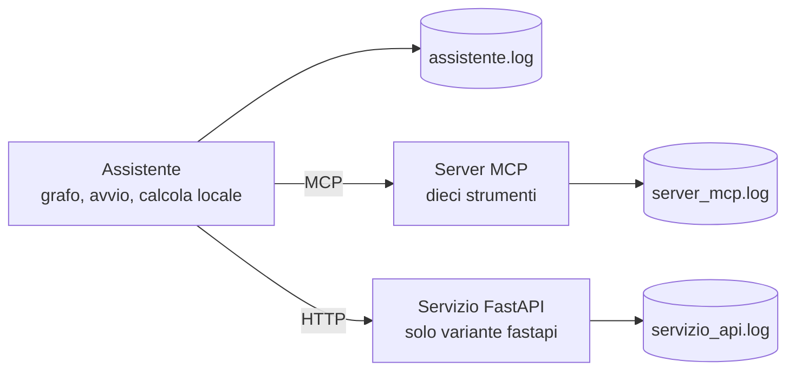
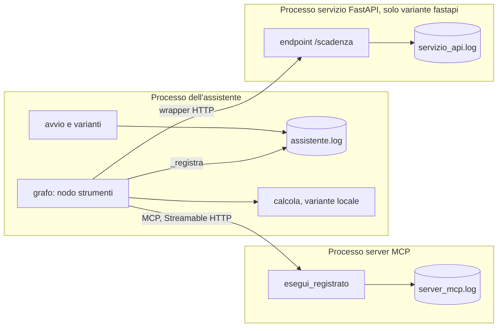
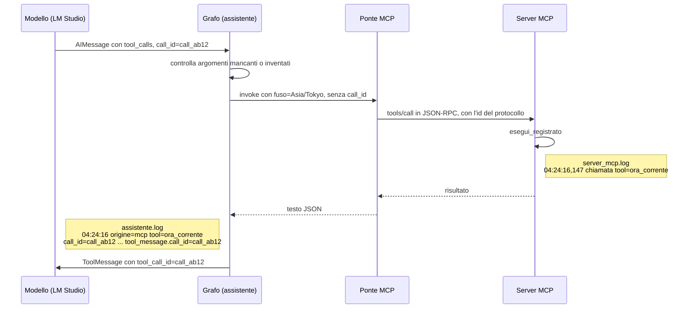
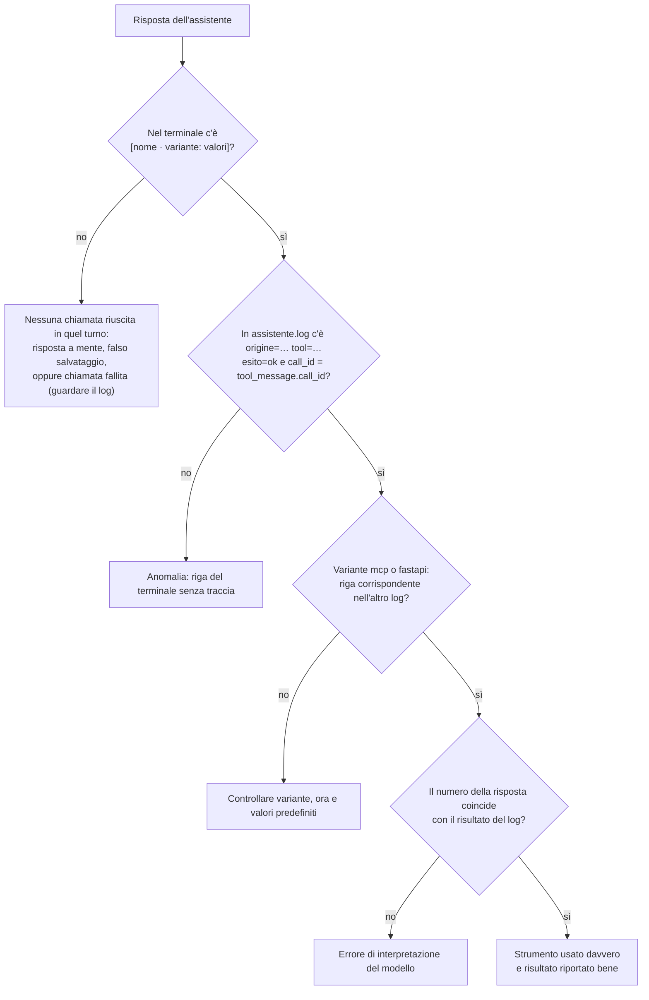
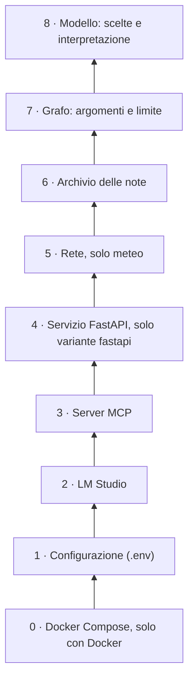
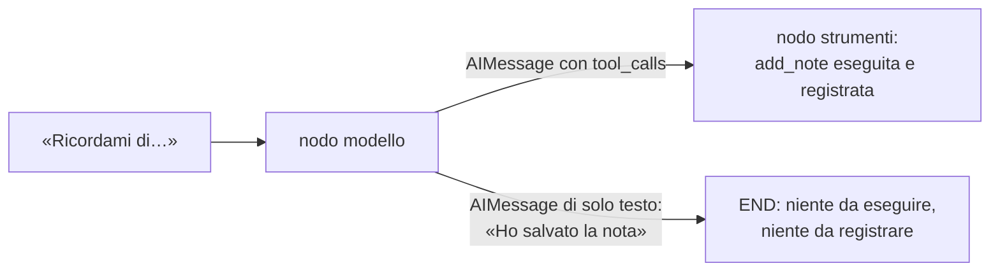
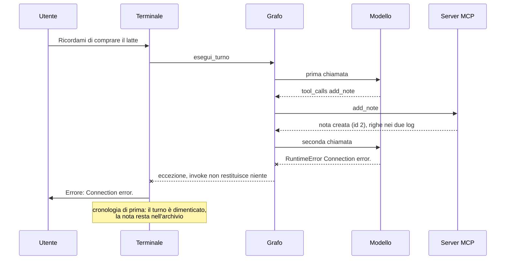

# Log, diagnosi e limiti noti

[← Indice](00-indice.md) · Prima: [09 Test e verifiche](09-test-e-verifiche.md) · Dopo: [11 Storia del progetto](11-storia-del-progetto.md)

## Scheda in 5 minuti

**Di che cosa parla.** Questo capitolo spiega come si controlla l'assistente. Mostra dove restano le tracce delle chiamate, come si cerca un guasto e che cosa il codice non può impedire. Serve a rispondere a una domanda semplice: lo strumento è stato usato davvero?

**Le idee chiave**

1. **Una risposta giusta non basta.** Il modello può scrivere un'ora o un risultato senza chiamare nessuno strumento. La prova è una riga di log: quale strumento, con quali argomenti, con quale risultato. → sezione 1
2. **Ogni processo scrive il suo file.** L'assistente scrive `assistente.log`, il server MCP `server_mcp.log`, il servizio FastAPI `servizio_api.log`. Il terzo esiste solo con la variante `fastapi`. La calcolatrice locale lascia traccia solo nel primo, perché non c'è un altro processo. → sezione 1
3. **Una chiamata, una riga con sette campi.** La riga dice quale variante ha risposto (`origine`), che cosa ha chiesto il modello e che cosa è tornato. Due campi ripetono lo stesso identificativo: se coincidono, il risultato è tornato alla richiesta giusta. → sezione 2
4. **Cinque esiti possibili.** Sono `ok`, `errore_tool`, `errore_collegamento`, `strumento_sconosciuto` e `limite`. Il terminale mostra solo le chiamate riuscite. Una chiamata fallita, quindi, si vede soltanto nel log. → sezione 2
5. **I log si incrociano per strumento, argomenti e ora.** L'identificativo della chiamata nasce nel modello e non arriva al server. Per collegare due righe si guardano il nome, gli argomenti e l'ora vicina. → sezione 5
6. **I guasti si cercano dal basso.** Prima Docker e il file `.env`, poi LM Studio, poi server, rete, archivio, grafo e infine il modello. Se LM Studio è spento, nessuna istruzione al modello può aiutare. Gli errori dei primi livelli compaiono solo nel terminale. → sezione 6
7. **Alcuni limiti si possono solo vedere.** Il modello da 2B a volte dice «Ho salvato la nota» senza chiamare lo strumento. Il codice non può impedirlo, ma i log vuoti lo smascherano. → sezione 7

**Il quadro**



**Da sapere a memoria**

| Cosa | Valore | Dove |
|---|---|---|
| I file di log | `logs/assistente.log`, `logs/server_mcp.log`, `logs/servizio_api.log` (più `logs/servizio_backend.log` dal back-end delle chat, capitolo 14 §8) | `assistente/registro.py:8-11` |
| Riga di una chiamata | sette campi, da `origine` a `tool_message.call_id` | `assistente/grafo.py:106-119` |
| Scelta tra `ok`, `errore_tool`, `errore_collegamento` | chiave `errore` e campo `tipo` del JSON restituito | `assistente/grafo.py:66-74` |
| Il terminale stampa | solo i `ToolMessage` con `status` diverso da `error` | `assistente/terminale.py:32` |
| Giri di strumento per turno | 3 (`MAX_GIRI_STRUMENTO`) | `assistente/grafo.py:20` |
| Tempi massimi | ponte MCP 10 s; meteo 8 s in tutto | `assistente/client_mcp.py:16`, `logica/meteo.py:20` |

**Se te lo chiedono all'orale**

- *Come dimostri che il modello ha usato davvero uno strumento?* Cerco la riga nel terminale e la riga con `esito=ok` in `assistente.log`, con i due id uguali. Per MCP e FastAPI cerco anche la riga nel log dell'altro processo.
- *Perché il `call_id` non compare in `server_mcp.log`?* Il ponte manda al server solo gli argomenti. Le due righe si collegano per strumento, argomenti e ora.
- *L'avvio fallisce e `assistente.log` non ha righe nuove: dove guardi?* Nel messaggio `Errore: …` del terminale. Il guasto è nella configurazione o in LM Studio, che non scrivono nel log.

Per i dettagli continua con il resto del capitolo: le idee rimandano alle sezioni con «→ sezione N».

---

Questo documento risponde a tre domande da orale:

1. **Come dimostro che il modello ha usato davvero uno strumento?** Con i log: una risposta plausibile non basta.
2. **Quando qualcosa non funziona, da dove comincio?** Dalla diagnosi per livelli, dal basso verso l'alto.
3. **Che cosa il progetto non sa fare, o non può impedire?** Dai limiti noti, compresi quelli del modello da 2B.

Il viaggio completo di una chiamata è in [03](03-viaggio-di-una-richiesta.md). Il ponte MCP e l'avvio dei processi sono in [05](05-mcp-in-pratica.md), le varianti in [06](06-tre-varianti.md), i test in [09](09-test-e-verifiche.md). Qui si guarda tutto dal punto di vista di chi deve **verificare e riparare**.

> **Come sono stati ottenuti gli esempi.** Le righe di log e i messaggi d'errore di questo documento sono **reali**: li ha prodotti il codice del progetto, eseguito da piccoli script di prova in una cartella temporanea, mai in `logs/`. Gli script usavano:
> - il grafo vero e il modello finto di `tests/finti.py`;
> - il server FastMCP vero, in memoria e senza rete (come `con_client` in `tests/test_server_mcp.py`), chiamato attraverso il ponte vero `avvolgi`;
> - l'app FastAPI vera, tramite `TestClient`, che gira nello stesso processo e non apre porte;
> - `processo_in_attesa` vero, con processi figli finti e il controllo della porta sostituito, così nessuna porta viene aperta.
>
> Due cose non sono «di produzione». Gli identificativi come `call_ab12` li ha scelti lo script: quelli veri li genera LM Studio. L'orologio del server ha ricevuto un **istante fisso** (2026-11-08 19:13 UTC), quindi l'ora nel risultato non coincide con l'ora all'inizio della riga. Dove un esempio è **ricostruito** dai formati del codice, perché richiederebbe LM Studio o porte vere, è detto esplicitamente.

---

## 1. Perché tre file di log

Il `CLAUDE.md` lo dice in modo netto: *una risposta simulata non dimostra che il modello locale sappia usare lo strumento*. La stessa regola vale per le risposte vere. Se l'assistente scrive «Sono le 04:13 a Tokyo», l'ora potrebbe essere inventata. La prova è una riga di log che dice: questo strumento è stato chiamato, con questi argomenti, e ha restituito questo risultato.

Ci sono fino a tre processi, e ciascuno scrive il **proprio** file nella cartella `logs/` (i percorsi sono costanti in `assistente/registro.py:8-11`):

| File | Chi lo scrive | Quando esiste | Come nasce |
|---|---|---|---|
| `logs/assistente.log` | il processo dell'assistente (grafo, avvio, varianti) | sempre, dopo una configurazione valida | `configura_registro()` aggiunge un `FileHandler` al logger `assistente` (`assistente/registro.py:26-38`) |
| `logs/server_mcp.log` | il processo del server MCP | sempre: il server parte a ogni avvio | l'assistente avvia il server con stdout e stderr rediretti nel file (`assistente/avvio_server.py:101-113`) |
| `logs/servizio_api.log` | il processo del servizio FastAPI | solo con `VARIANTE_SCADENZE=fastapi` | stesso meccanismo, con `avvia_servizio_api` (`assistente/avvio_server.py:183-205`) |
| `logs/servizio_backend.log` | il back-end delle chat (lezione 6) | solo con `python -m servizio_backend` | non fa parte di questo capitolo: vedi il capitolo 14 §8 |

Caratteristiche comuni:

- **Le righe si aggiungono in coda** (`mode="a"`, `assistente/registro.py:34`; `open(percorso_log, "a", …)`, `assistente/avvio_server.py:102`). I file crescono di sessione in sessione e non c'è rotazione: è una scelta dichiarata nella specifica del convertitore (`docs/superpowers/specs/2026-11-03-convertitore-unita-mcp-design.md`, §5.6: «Nessuna rotazione»).
- **Codifica UTF-8.** L'assistente la imposta sul `FileHandler`; ai processi figli passa `PYTHONUTF8=1` (`assistente/avvio_server.py:111`).
- **La cartella è fuori da Git** (`.gitignore`) e fuori dall'immagine Docker (`.dockerignore`). Con Docker viene montata dall'host (`compose.yaml`: `./logs:/app/logs`), così i log restano anche dopo `--rm`.
- **Nel terminale della chat non finisce niente.** Il logger `assistente` ha `propagate = False` (`assistente/registro.py:38`), e le librerie client `mcp`, `httpx` e `httpcore` sono portate al livello `ERROR` (`assistente/client_mcp.py:22-23`).



La conseguenza da ricordare: **una chiamata `calcola` in variante `locale` compare solo in `assistente.log`**, perché non c'è un altro processo. È proprio la differenza che le varianti servono a mostrare (specifica della lezione 5, §8; vedi [06](06-tre-varianti.md)).

---

## 2. `logs/assistente.log`, il registro dell'host

### 2.1 Formato

```python
# assistente/registro.py:35
logging.Formatter("%(asctime)s %(message)s", datefmt="%Y-%m-%d %H:%M:%S")
```

Ogni riga ha **data e ora al secondo**, senza millisecondi né livello, seguite dal messaggio. Le righe delle chiamate usano `formatta()` (`assistente/registro.py:14-23`), che produce coppie `chiave=valore` separate da spazi, con due regole:

- una **stringa** viene scritta così com'è, con gli a capo (`\r`, `\n`) sostituiti da spazi: una chiamata resta sempre su una riga;
- **gli altri valori** (dizionari, numeri, `None`) diventano JSON compatto, senza spazi e con gli accenti leggibili (`ensure_ascii=False`, `separators=(",", ":")`).

Il test `tests/test_registro.py` lo verifica con questo risultato atteso:

```
tool=x argomenti={"valore":2.5,"da":"°C"} risultato=a b
```

`configura_registro` è **idempotente**: se il gestore per quel file esiste già, non ne aggiunge un secondo, così le righe non si duplicano (`assistente/registro.py:30-32`).

### 2.2 Quando si comincia a scrivere

In `assistente/__main__.py:20-37` l'ordine è questo:

1. `configura_flussi()`: ingresso e uscita rediretti in UTF-8;
2. `load_dotenv(override=False)` e `carica_configurazione`;
3. `configura_registro(LOG_ASSISTENTE)`;
4. `verifica_server` (LM Studio);
5. `rileva_fuso`;
6. `prepara_strumenti`, cioè l'avvio dei processi;
7. la chat.

Da questo ordine discende un fatto importante per la diagnosi: **gli errori di configurazione e di LM Studio non finiscono in nessun log**. Arrivano solo sul terminale, su stderr, come `Errore: …`, e il programma esce con codice 1 (`assistente/__main__.py:31-33`). Se dopo un avvio fallito `assistente.log` non contiene niente di nuovo, il problema sta nei primi livelli (§6).

### 2.3 Righe di avvio e arresto

Vengono dai logger `assistente.avvio` (in `avvio_server.py` e in `avvio.py`), figli di `assistente`, quindi finiscono nello stesso file. Usano la formattazione `%` e non `formatta()`:

| Riga | Codice | Quando |
|---|---|---|
| `avviato <descrizione> porta=<p> pid=<pid>` | `assistente/avvio_server.py:114` | subito dopo `Popen`, **prima** dell'attesa |
| `catalogo strumenti=[...]` | `assistente/avvio_server.py:169` | discovery riuscita, con i nomi scoperti |
| `varianti calcolatrice=<v> scadenze=<v>` | `assistente/avvio.py:41-43` | dopo l'avvio dei processi |
| `strumenti al modello=[...]` | `assistente/avvio.py:45` | dopo la selezione delle varianti |
| `spento <descrizione> codice=<n>` | `assistente/avvio_server.py:138` | all'uscita, **in ogni caso** (blocco `finally`), anche se l'avvio è fallito |

`<descrizione>` vale `server MCP` oppure `servizio FastAPI`.

**Righe reali** di `processo_in_attesa`, con processi figli finti. Il primo figlio crolla subito (catalogo non valido, §3.4). Il secondo resta acceso e va spento:

```
2026-11-09 04:26:05 avviato server MCP porta=8765 pid=24272
2026-11-09 04:26:05 spento server MCP codice=1
2026-11-09 04:26:05 avviato server MCP porta=8765 pid=1444
2026-11-09 04:26:11 spento server MCP codice=1
```

Si leggono così:

- **Prima coppia.** Il processo è morto da solo con codice 1, per l'eccezione. La riga `spento` c'è comunque: il `finally` gira anche quando l'avvio fallisce.
- **Seconda coppia.** Tra le due righe passano 6 secondi. `ferma()` ha inviato `CTRL_BREAK_EVENT`, ha atteso i 5 secondi di `ATTESA_ARRESTO` e poi ha ucciso il processo con `kill()`: per questo il codice è 1 e non 0 (`assistente/avvio_server.py:58-76`). Nella prova il segnale non è arrivato al figlio. Probabilmente lo script girava senza una console condivisa, che `CTRL_BREAK_EVENT` richiede. Resta comunque un esempio reale del percorso «arresto forzato».

**Una sessione completa** con `VARIANTE_CALCOLATRICE=locale` e `VARIANTE_SCADENZE=fastapi` produrrebbe queste righe, nell'ordine. Sono **ricostruite dai formati** (servono porte e processi veri), con date e pid di fantasia:

```
2026-11-08 20:00:01 avviato server MCP porta=8765 pid=11111
2026-11-08 20:00:03 catalogo strumenti=['converti_unita', 'ora_corrente', 'calcola', 'calcola_scadenza', 'search_catalog', 'get_item', 'add_note', 'list_notes', 'delete_note', 'get_weather']
2026-11-08 20:00:03 avviato servizio FastAPI porta=8766 pid=22222
2026-11-08 20:00:04 varianti calcolatrice=locale scadenze=fastapi
2026-11-08 20:00:04 strumenti al modello=['converti_unita', 'ora_corrente', 'search_catalog', 'get_item', 'add_note', 'list_notes', 'delete_note', 'get_weather', 'calcola', 'calcola_scadenza']
...
2026-11-08 20:10:00 spento servizio FastAPI codice=0
2026-11-08 20:10:01 spento server MCP codice=0
```

Quattro dettagli da saper spiegare:

- **Il catalogo contiene sempre dieci nomi**, nell'ordine di registrazione in `server_mcp/server.py:128-193`. Il server espone tutto. È l'host a togliere `calcola` e `calcola_scadenza` e ad aggiungere **in fondo** i sostituti (`assistente/varianti.py:32-34`). Lo stesso ordine compare nella riga `Strumenti:` del terminale (§7.4).
- **Lo spegnimento segue l'ordine inverso dell'avvio.** L'`ExitStack` di `prepara_strumenti` chiude per primo l'ultimo contesto aperto (`assistente/avvio.py:33-39`).
- **`codice=0` è l'arresto ordinato.** Prima della correzione `b320bf1`, su Windows risultava `codice=3` e mancavano le righe `arresto server` e `arresto servizio`, perché Uvicorn rilanciava il segnale con il gestore predefinito. Ora `SIGBREAK` e `SIGTERM` diventano `KeyboardInterrupt` (`server_mcp/__main__.py:12-22`, uguale in `servizio_api/__main__.py:13-23`).
- **Un `codice` diverso da 0** può voler dire due cose: il processo è morto da solo (crash) oppure è stato ucciso dopo 5 secondi. Per distinguerle si guarda l'ora tra `avviato` e `spento` e la fine di `server_mcp.log`.

### 2.4 La riga di una chiamata: i campi

Ogni chiamata a uno strumento, eseguita o rifiutata, passa da `_registra()` (`assistente/grafo.py:106-119`). La funzione scrive una riga con sette campi, sempre in quest'ordine:

| Campo | Significato | Da dove viene |
|---|---|---|
| `origine` | variante dello strumento: `mcp`, `locale`, `fastapi`, oppure `sconosciuta` | `strumento.metadata["origine"]`, messo dal ponte (`client_mcp.py:76`), dalla calcolatrice locale (`calcolatrice_locale.py:33`) o dal wrapper (`wrapper_scadenze.py:78`) |
| `tool` | nome dello strumento chiesto dal modello | `chiamata["name"]` |
| `call_id` | identificativo della richiesta generato dal modello | `chiamata["id"]` |
| `argomenti` | argomenti **come li ha mandati il modello**, in JSON compatto | `chiamata["args"]` |
| `esito` | uno dei cinque valori qui sotto | calcolato nel nodo |
| `risultato` | il contenuto restituito al modello: il risultato oppure `{"errore": …}` | il contenuto del `ToolMessage` |
| `tool_message.call_id` | l'id del `ToolMessage` che chiude la richiesta | `messaggio.tool_call_id` |

**I due id devono coincidere.** Così si dimostra che il risultato è tornato al modello agganciato alla richiesta giusta. Il protocollo del tool calling lo esige: ogni richiesta del modello va chiusa da un `ToolMessage` con lo stesso id, altrimenti la cronologia non è valida (vedi [04](04-grafo-langgraph.md)).

Un dettaglio su `origine`: `sconosciuta` compare per uno strumento inesistente e per gli argomenti non JSON (`grafo.py:154`, `:127`). Se invece uno strumento esiste ma non ha `metadata`, il nodo `strumenti` scrive `locale` (`grafo.py:157`, coerente con `varianti.origini`). Nel progetto tutti gli strumenti hanno `metadata`, quindi il caso non si presenta.

I cinque valori di `esito`:

| `esito` | Quando | `status` del ToolMessage | Riga nel terminale |
|---|---|---|---|
| `ok` | lo strumento ha risposto senza chiave `errore` | `success` | sì, `[tool · origine: valori]` |
| `errore_tool` | errore dello strumento (input non valido, nota inesistente…), argomenti mancanti o inventati, argomenti non JSON, eccezione di `invoke` | `error` | no |
| `errore_collegamento` | il JSON d'errore ha `"tipo": "collegamento"`: server MCP o servizio FastAPI irraggiungibili o fuori tempo | `error` | no |
| `strumento_sconosciuto` | il modello ha chiesto un nome che non esiste | `error` | no |
| `limite` | richiesta arrivata dopo 3 giri di strumento: **non eseguita** | `error` | no |

La classificazione tra `ok`, `errore_tool` ed `errore_collegamento` la fa `_esito()` (`assistente/grafo.py:66-74`), leggendo il JSON restituito: se c'è la chiave `errore`, `tipo == "collegamento"` dà `errore_collegamento` e tutto il resto dà `errore_tool`. Lo `status` è `success` solo con `esito=ok` (`assistente/grafo.py:184`). Il terminale stampa soltanto le chiamate con `status` diverso da `error` (`assistente/terminale.py:32`). Quindi **una chiamata fallita si vede solo nel log**.

### 2.5 Esempi reali, caso per caso

Queste righe le ha prodotte lo script di prova, con le varianti `calcola · locale` e `calcola_scadenza · fastapi`. Per leggibilità sono raggruppate per caso.

**Chiamate riuscite**, una per variante:

```
2026-11-09 04:24:16 origine=mcp tool=ora_corrente call_id=call_ab12 argomenti={"fuso":"Asia/Tokyo"} esito=ok risultato={"fuso":"Asia/Tokyo","data_ora":"2026-11-09T04:13:00+09:00","scarto_utc":"+09:00","giorno_settimana":"lunedì"} tool_message.call_id=call_ab12
2026-11-09 04:24:16 origine=mcp tool=converti_unita call_id=call_cd34 argomenti={"valore":2.5,"da":"km","a":"m"} esito=ok risultato={"valore":2.5,"da":"km","a":"m","risultato":2500,"grandezza":"lunghezza"} tool_message.call_id=call_cd34
2026-11-09 04:24:16 origine=locale tool=calcola call_id=call_qr44 argomenti={"espressione":"(3+4)*2"} esito=ok risultato={"espressione": "(3+4)*2", "risultato": 14} tool_message.call_id=call_qr44
2026-11-09 04:24:16 origine=fastapi tool=calcola_scadenza call_id=call_st55 argomenti={"data_inizio":"2026-12-23","giorni":3,"lavorativi":true} esito=ok risultato={"data_inizio":"2026-12-23","giorni":3,"lavorativi":true,"scadenza":"2026-12-29","giorno_settimana":"martedì","festivita_saltate":["2026-12-25 Natale","2026-12-26 Santo Stefano"],"nota":"Calcolo indicativo: non ha valore legale."} tool_message.call_id=call_st55
```

**Errori dello strumento.** Lo strumento ha girato e ha rifiutato l'input:

```
2026-11-09 04:24:16 origine=mcp tool=delete_note call_id=call_gh78 argomenti={"note_id":99} esito=errore_tool risultato={"errore": "Nessuna nota con ID 99: niente è stato eliminato.", "tipo": "strumento"} tool_message.call_id=call_gh78
2026-11-09 04:24:16 origine=mcp tool=ora_corrente call_id=call_ij90 argomenti={"fuso":"Mars/Olympus"} esito=errore_tool risultato={"errore": "Fuso orario sconosciuto: 'Mars/Olympus'. Usa un nome IANA, per esempio 'Europe/Rome'.", "tipo": "strumento"} tool_message.call_id=call_ij90
2026-11-09 04:24:16 origine=fastapi tool=calcola_scadenza call_id=call_uv66 argomenti={"data_inizio":"2026-02-30","giorni":3,"lavorativi":true} esito=errore_tool risultato={"errore": "Data non valida: '2026-02-30'. Usa il formato AAAA-MM-GG, per esempio 2026-12-23.", "tipo": "strumento"} tool_message.call_id=call_uv66
```

**Rifiuti dell'host, prima di eseguire.** Argomento mancante, argomento inventato, strumento inesistente, argomenti non JSON:

```
2026-11-09 04:24:16 origine=fastapi tool=calcola_scadenza call_id=call_kl11 argomenti={"data_inizio":"2026-12-23","giorni":3} esito=errore_tool risultato={"errore": "Argomenti mancanti per calcola_scadenza: lavorativi. Riprova indicando tutti gli argomenti richiesti.", "tipo": "strumento"} tool_message.call_id=call_kl11
2026-11-09 04:24:16 origine=mcp tool=converti_unita call_id=call_mn22 argomenti={"valore":2.5,"da":"km","a":"m","precisione":2} esito=errore_tool risultato={"errore": "Argomenti non previsti per converti_unita: precisione. Usa solo: valore, da, a.", "tipo": "strumento"} tool_message.call_id=call_mn22
2026-11-09 04:24:16 origine=sconosciuta tool=meteo_domani call_id=call_op33 argomenti={"city":"Udine"} esito=strumento_sconosciuto risultato={"errore": "Strumento sconosciuto: 'meteo_domani'."} tool_message.call_id=call_op33
2026-11-09 04:24:16 origine=sconosciuta tool=calcola call_id=call_wx77 argomenti={espressione: 3+ esito=errore_tool risultato={"errore": "Argomenti non validi: devono essere un oggetto JSON con gli argomenti dello strumento."} tool_message.call_id=call_wx77
```

**Limite di giri.** Il modello finto chiede l'orologio quattro volte di seguito. Le prime tre richieste vengono eseguite, la quarta viene chiusa senza eseguirla (il JSON completo del risultato, uguale nelle tre righe, è abbreviato in `{...}`):

```
2026-11-09 04:24:16 origine=mcp tool=ora_corrente call_id=call_l1 argomenti={"fuso":"Europe/Rome"} esito=ok risultato={...} tool_message.call_id=call_l1
2026-11-09 04:24:16 origine=mcp tool=ora_corrente call_id=call_l2 argomenti={"fuso":"Europe/Rome"} esito=ok risultato={...} tool_message.call_id=call_l2
2026-11-09 04:24:16 origine=mcp tool=ora_corrente call_id=call_l3 argomenti={"fuso":"Europe/Rome"} esito=ok risultato={...} tool_message.call_id=call_l3
2026-11-09 04:24:16 origine=mcp tool=ora_corrente call_id=call_l4 argomenti={"fuso":"Europe/Rome"} esito=limite risultato={"errore": "limite di chiamate raggiunto"} tool_message.call_id=call_l4
```

**Errori di collegamento.** Lo script li ha simulati: un server che rifiuta la connessione, un server che non risponde (con il tempo massimo ridotto a 0,2 secondi per non aspettarne 10) e un servizio FastAPI spento:

```
2026-11-09 04:24:16 origine=mcp tool=converti_unita call_id=call_yz88 argomenti={"valore":1,"da":"km","a":"m"} esito=errore_collegamento risultato={"errore": "Server MCP non raggiungibile: ConnectError: All connection attempts failed", "tipo": "collegamento"} tool_message.call_id=call_yz88
2026-11-09 04:24:16 origine=mcp tool=converti_unita call_id=call_za99 argomenti={"valore":1,"da":"km","a":"m"} esito=errore_collegamento risultato={"errore": "Server MCP: nessuna risposta entro 0.2 secondi.", "tipo": "collegamento"} tool_message.call_id=call_za99
2026-11-09 04:24:16 origine=fastapi tool=calcola_scadenza call_id=call_zb00 argomenti={"data_inizio":"2026-12-23","giorni":3,"lavorativi":true} esito=errore_collegamento risultato={"errore": "Servizio scadenze non raggiungibile: ConnectError: [WinError 10061] Impossibile stabilire la connessione", "tipo": "collegamento"} tool_message.call_id=call_zb00
```

Con i tempi massimi veri il testo diventa `Server MCP: nessuna risposta entro 10 secondi.` (`assistente/client_mcp.py:16`, `:65-66`) oppure `Servizio scadenze: nessuna risposta entro 5 secondi.` (`assistente/wrapper_scadenze.py:19`, `:60-61`).

### 2.6 Che cosa notare in questi esempi

1. **`origine` dice quale variante l'host ha scelto, non che la chiamata sia arrivata.** La riga `call_kl11` ha `origine=fastapi`, ma la chiamata non è mai partita: il nodo `strumenti` l'ha rifiutata per l'argomento mancante (`assistente/grafo.py:159-166`). Per sapere se è arrivata si guardano l'`esito` e il log dell'altro processo (§5).
2. **Argomenti inventati e mancanti si fermano nell'host, uguali per ogni variante.** Il controllo usa lo schema dello strumento (`_argomenti_mancanti` e `_argomenti_in_piu`, `assistente/grafo.py:82-99`). È nato da due problemi. Un argomento mancante dava un errore pydantic in inglese (correzione `ec2b384`). Un argomento in più arrivava a FastMCP, che rispondeva con un errore in inglese e senza riga nel log, mentre la variante `@tool` lo ignorava (correzione `5bed890`).
3. **Con argomenti non JSON, `argomenti` contiene il testo grezzo.** La chiamata arriva da `invalid_tool_calls`, dove `args` è una stringa, e `origine` vale `sconosciuta` (`assistente/grafo.py:122-129`). Anche questa richiesta va chiusa con un `ToolMessage`, altrimenti la cronologia resterebbe invalida.
4. **Il JSON degli errori ha gli spazi** (`"errore": "…"`), quello dei risultati MCP no. Gli errori sono prodotti da `json.dumps` con i separatori predefiniti (`client_mcp.py:27`, `grafo.py:58`, `grafo.py:103`). I risultati MCP sono il testo compatto del server (`server_mcp/server.py:94-95`). Anche il risultato della calcolatrice locale ha gli spazi (`calcolatrice_locale.py:29`): è una differenza di forma nota e rimandata (checkpoint del passo 2).
5. **Il limite si vede dal quarto `call_id`.** Le tre chiamate precedenti sono `ok`, quindi sono state eseguite davvero (§7.4).
6. **L'ora nel `risultato` dell'orologio non è l'ora della riga**: qui l'istante era fisso. Con il server vero `adesso` è `ora_utc` (`server_mcp/server.py:118`), quindi le due ore coincidono, a parte il fuso.
7. **I log contengono i dati dell'utente**: testi delle note, città, espressioni. Restano sul disco, fuori da Git.

---

### 2.7 Le righe del router e dei nodi (lezione 6)

Dalla lezione 6 ogni turno comincia con la riga del router (logger `assistente.router`) e ogni
passaggio dall'agente lascia `nodo=modello` (logger `assistente.grafo`). Una domanda fuori ambito
lascia invece `nodo=rifiuto` e **nessuna** riga `nodo=modello`: l'assenza è la prova che l'agente non
è partito. Prova reale del 9 novembre:

```text
2026-11-09 15:39:12 nodo=router categoria=conversazione motivo=La richiesta riguarda la conversione di un orario tra diverse località. esito=ok
2026-11-09 15:39:12 nodo=modello giri_strumento=0
2026-11-09 15:39:37 origine=mcp tool=ora_corrente call_id=… argomenti={"fuso":"Asia/Tokyo"} esito=ok …
2026-11-09 15:39:37 nodo=modello giri_strumento=1
2026-11-09 15:40:12 nodo=router categoria=fuori_ambito motivo=La richiesta riguarda la creazione di un testo creativo (una poesia), che è classificato come fuori ambito. esito=ok
2026-11-09 15:40:12 nodo=rifiuto
```

Se l'output del router non è valido la riga diventa `nodo=router categoria=conversazione motivo=
esito=errore errore=…` e la domanda passa all'agente. Dettagli in
[04 — sezione 21](04-grafo-langgraph.md#21-lezione-6-il-router-dellambito).

## 3. `logs/server_mcp.log`, il registro del server

### 3.1 Formato

Il server è un processo separato, avviato dall'assistente con `python -m server_mcp --porta <MCP_PORTA>` (`assistente/avvio_server.py:159`). Configura il logging così:

```python
# server_mcp/__main__.py:31-33
logging.basicConfig(
    level=logging.INFO, format="%(asctime)s %(levelname)s %(name)s %(message)s", stream=sys.stderr
)
```

Rispetto ad `assistente.log` ci sono i **millisecondi** (`04:24:16,147`), il **livello** (`INFO`, `ERROR`) e il **nome del logger** (`server_mcp`). Lo stderr del processo è rediretto nel file insieme allo stdout (`stderr=subprocess.STDOUT`, `assistente/avvio_server.py:110`). Nel file finisce quindi anche l'output delle librerie: avvisi di Uvicorn (livello `warning`, `server_mcp/__main__.py:47`), messaggi di FastMCP e traceback di un crash.

### 3.2 Le righe

| Riga | Codice | Quando |
|---|---|---|
| `INFO server_mcp avvio server porta=<p>` | `server_mcp/__main__.py:35` | all'avvio del processo |
| `INFO server_mcp chiamata tool=<nome> argomenti=<json> esito=ok risultato=<json>` | `server_mcp/server.py:108` | chiamata riuscita |
| `INFO server_mcp chiamata tool=<nome> argomenti=<json> esito=errore messaggio=<testo>` | `server_mcp/server.py:103` | `ErroreStrumento`, cioè un errore previsto con un messaggio in italiano |
| `ERROR server_mcp chiamata tool=<nome> argomenti=<json> esito=errore imprevisto` + traceback | `server_mcp/server.py:105-107` | qualsiasi altra eccezione: al modello arriva `Errore interno dello strumento <nome>: <Tipo>.` |
| `INFO server_mcp modifica note operazione=aggiunta id=<n>` | `server_mcp/server.py:178` | dopo un `add_note` riuscito |
| `INFO server_mcp modifica note operazione=eliminazione id=<n>` | `server_mcp/server.py:188` | dopo un `delete_note` riuscito |
| `INFO server_mcp arresto server` | `server_mcp/__main__.py:52` | nel `finally`, all'arresto ordinato |

`esegui_registrato()` (`server_mcp/server.py:98-109`) è l'unico punto da cui passano tutti e dieci gli strumenti: nessuna chiamata può arrivare al server senza lasciare una riga. La riga `modifica note` è un requisito della specifica: tra gli anti-obiettivi c'è «Note modificate senza traccia» (specifica della lezione 5, §4). Viene scritta **solo dopo** un'operazione riuscita: se `esegui_registrato` solleva l'errore, la riga successiva non viene raggiunta.

### 3.3 Esempi reali

Sono le righe prodotte dalle chiamate del §2.5 che sono arrivate davvero al server, più quelle dello scenario del §7.4:

```
2026-11-09 04:24:16,147 INFO server_mcp chiamata tool=ora_corrente argomenti={"fuso":"Asia/Tokyo"} esito=ok risultato={"fuso":"Asia/Tokyo","data_ora":"2026-11-09T04:13:00+09:00","scarto_utc":"+09:00","giorno_settimana":"lunedì"}
2026-11-09 04:24:16,158 INFO server_mcp chiamata tool=converti_unita argomenti={"valore":2.5,"da":"km","a":"m"} esito=ok risultato={"valore":2.5,"da":"km","a":"m","risultato":2500,"grandezza":"lunghezza"}
2026-11-09 04:24:16,178 INFO server_mcp chiamata tool=add_note argomenti={"text":"consegnare il report venerdì"} esito=ok risultato={"id":1,"testo":"consegnare il report venerdì","creata":"2026-11-09T03:24:16+00:00","esito":"nota creata"}
2026-11-09 04:24:16,179 INFO server_mcp modifica note operazione=aggiunta id=1
2026-11-09 04:24:16,192 INFO server_mcp chiamata tool=delete_note argomenti={"note_id":99} esito=errore messaggio=Nessuna nota con ID 99: niente è stato eliminato.
2026-11-09 04:24:16,204 INFO server_mcp chiamata tool=ora_corrente argomenti={"fuso":"Mars/Olympus"} esito=errore messaggio=Fuso orario sconosciuto: 'Mars/Olympus'. Usa un nome IANA, per esempio 'Europe/Rome'.
2026-11-09 04:24:16,550 INFO server_mcp chiamata tool=list_notes argomenti={"limit":10} esito=ok risultato={"note":[{"id":2,"testo":"comprare il latte","creata":"2026-11-09T03:24:16+00:00"},{"id":1,"testo":"consegnare il report venerdì","creata":"2026-11-09T03:24:16+00:00"}],"totale_archivio":2}
```

Cose da notare:

- **Mancano** le chiamate rifiutate dall'host (argomento mancante, argomento inventato, strumento sconosciuto, argomenti non JSON), la quarta richiesta del limite, `calcola` in variante locale e `calcola_scadenza` in variante FastAPI. Delle quattro richieste del limite, nel server compaiono solo le tre eseguite.
- **`list_notes`** è arrivato dal modello con `argomenti={}` (in `assistente.log`: `argomenti={}`). Il server registra `{"limit":10}`, perché ha già applicato il valore predefinito (`server_mcp/server.py:182-183`). Lo stesso vale per `search_catalog` con `max_results` (predefinito 5). Nel confronto tra i due log gli argomenti possono quindi differire per i valori predefiniti.
- **L'esito ha nomi diversi.** Nel server è solo `ok` o `errore`. La distinzione tra `errore_tool` ed `errore_collegamento` esiste solo lato host: un errore di collegamento, per definizione, non arriva al server.
- **Righe della libreria.** A ogni errore di uno strumento FastMCP scrive su stderr anche un messaggio suo, nel proprio formato. Nella prova è comparso così: `[11/09/26 04:24:16] Error calling tool 'delete_note'`. Nel processo vero lo stderr va nel file, quindi ci si possono aspettare righe di questo tipo mescolate alle righe `server_mcp`.
- **`creata` è in UTC** (`+00:00`), mentre l'ora all'inizio della riga è l'ora locale del processo (qui CET, +01:00: 03:24 UTC = 04:24 locali).

**Errore imprevisto** (riga `ERROR` con traceback). Lo script ha chiamato `esegui_registrato` con un calcolo che divide per zero. Al modello arriva `Errore interno dello strumento get_item: ZeroDivisionError.`, e nel log c'è il traceback completo (il percorso dello script è abbreviato):

```
2026-11-09 04:26:11,787 ERROR server_mcp chiamata tool=get_item argomenti={"code":"DLL-01"} esito=errore imprevisto
Traceback (most recent call last):
  File "…\assistente-laboratorio\server_mcp\server.py", line 101, in esegui_registrato
    risultato = calcolo()
  File "…\esempi_extra.py", line 96, in <lambda>
    esegui_registrato("get_item", {"code": "DLL-01"}, lambda: 1 / 0)
ZeroDivisionError: division by zero
```

È la «rete di sicurezza» introdotta nel passo 5 (commit `2c067fd`): prima un ID enorme mandava al modello un errore in inglese e non lasciava righe nel log.

**Un a capo nell'argomento spezza la riga.** `formatta` toglie gli a capo nelle righe dell'assistente. Il server invece scrive `messaggio=%s` così com'è. Con il fuso `"Mars\nOlympus"` la riga reale è diventata due:

```
2026-11-09 04:26:11,984 INFO server_mcp chiamata tool=ora_corrente argomenti={"fuso":"Mars\nOlympus"} esito=errore messaggio=Fuso orario sconosciuto: 'Mars
Olympus'. Usa un nome IANA, per esempio 'Europe/Rome'.
```

Nel campo `argomenti` l'a capo è protetto, perché il JSON lo scrive come `\n`. Nel `messaggio` no. È un difetto minore rimandato nel checkpoint del passo 3 («gli a capo dell'input non vengono neutralizzati nei log»).

### 3.4 Un crash all'avvio

Se il server non parte, per esempio perché il catalogo non è valido, il traceback finisce in `server_mcp.log`. L'assistente aspetta al massimo 10 secondi (`ATTESA_AVVIO`) e poi riporta le **ultime 10 righe** del file nel messaggio d'errore (`ultime_righe`, `assistente/avvio_server.py:50-55`, usata a `:128-133`). Messaggio reale, ottenuto con un processo figlio che carica un catalogo temporaneo con `"durata_ore": "tante"` (percorsi abbreviati):

```
Errore: Il server MCP non è partito (porta 8765). Ultime righe di …\logs_extra\server_mcp_crash.log:
2026-11-09 04:26:05,578 INFO server_mcp avvio server porta=8765
Traceback (most recent call last):
  …
  File "…\assistente-laboratorio\logica\catalogo.py", line 49, in carica_catalogo
    raise ValueError(f"Catalogo non valido in {percorso}: corso {posizione}, campo '{campo}'.")
ValueError: Catalogo non valido in …\catalogo_corsi.json: corso 1, campo 'durata_ore'.
```

Il checkpoint del passo 4 riporta di aver verificato a mano lo stesso caso con il server vero.

Due casi limite di `ultime_righe`, anch'essi verificati: se il file non si può leggere, al posto delle righe compare `(log non leggibile)`; se è vuoto, `(log vuoto)`. Poiché il file è in coda, **le 10 righe possono includere righe di sessioni precedenti**: è un difetto minore noto (checkpoint del passo 1).

---

## 4. `logs/servizio_api.log`, il registro del servizio FastAPI

Esiste solo con `VARIANTE_SCADENZE=fastapi`. Il formato è lo stesso del server (`servizio_api/__main__.py:31-33`), con logger `servizio_api`. Uvicorn gira con `log_level="warning"` e `access_log=False` (`servizio_api/__main__.py:38`): le righe di accesso HTTP del tipo «GET /scadenza 200» non ci sono, ci sono solo quelle del progetto.

| Riga | Codice |
|---|---|
| `INFO servizio_api avvio servizio porta=<p>` | `servizio_api/__main__.py:35` |
| `INFO servizio_api richiesta endpoint=/scadenza argomenti=<json> esito=ok risultato=<json>` | `servizio_api/app.py:62-64` |
| `INFO servizio_api richiesta endpoint=/scadenza argomenti=<json> esito=errore messaggio=<testo>` | `servizio_api/app.py:31`: errore della logica o di validazione, risposta HTTP 400 |
| `ERROR servizio_api richiesta endpoint=/scadenza argomenti=<json> esito=errore imprevisto` + traceback | `servizio_api/app.py:59`: risposta HTTP 500 |
| `INFO servizio_api arresto servizio` | `servizio_api/__main__.py:42` |

Esempi reali, prodotti con `TestClient`:

```
2026-11-09 04:24:16,233 INFO servizio_api richiesta endpoint=/scadenza argomenti={"data_inizio":"2026-12-23","giorni":3,"lavorativi":true} esito=ok risultato={"data_inizio":"2026-12-23","giorni":3,"lavorativi":true,"scadenza":"2026-12-29","giorno_settimana":"martedì","festivita_saltate":["2026-12-25 Natale","2026-12-26 Santo Stefano"],"nota":"Calcolo indicativo: non ha valore legale."}
2026-11-09 04:24:16,246 INFO servizio_api richiesta endpoint=/scadenza argomenti={"data_inizio":"2026-02-30","giorni":3,"lavorativi":true} esito=errore messaggio=Data non valida: '2026-02-30'. Usa il formato AAAA-MM-GG, per esempio 2026-12-23.
2026-11-09 04:26:12,037 INFO servizio_api richiesta endpoint=/scadenza argomenti={"data_inizio":"2026-12-23","giorni":"tre","lavorativi":"true"} esito=errore messaggio=Argomenti non validi per calcola_scadenza: giorni: valore non valido
2026-11-09 04:26:12,053 INFO servizio_api richiesta endpoint=/scadenza argomenti={"data_inizio":"2026-12-23"} esito=errore messaggio=Argomenti non validi per calcola_scadenza: giorni: mancante; lavorativi: mancante
2026-11-09 04:26:12,073 ERROR servizio_api richiesta endpoint=/scadenza argomenti={"data_inizio":"9999-12-31","giorni":3,"lavorativi":false} esito=errore imprevisto
Traceback (most recent call last):
  File "…\assistente-laboratorio\servizio_api\app.py", line 55, in scadenza
    risultato = calcola_scadenza(data_inizio, giorni, lavorativi)
  …
OverflowError: date value out of range
```

Per ottenere l'ultima riga lo script ha sostituito `calcola_scadenza` con una funzione che solleva `OverflowError`. La logica vera oggi rifiuta già le date oltre il 9999-12-31 con un errore italiano (commit `82007eb`).

Due dettagli sottili:

- **Quando la validazione di FastAPI fallisce**, il gestore `validazione_in_italiano` (`servizio_api/app.py:38-45`) registra i parametri della query **così come sono arrivati**, cioè come testo (`"giorni":"tre"`, `"lavorativi":"true"`). Quando la validazione riesce registra i valori già convertiti (`3`, `true`). Il messaggio è in italiano e lo stato è 400, non il 422 in inglese che FastAPI darebbe da solo.
- **Nella variante FastAPI la riga dell'host e quella del servizio hanno argomenti identici** solo se il modello ha mandato i tipi giusti. Il wrapper trasforma tutto in testo per la query (`_parametro`, `assistente/wrapper_scadenze.py:28-32`) e il servizio lo riconverte.

Il wrapper traduce le risposte così (`assistente/wrapper_scadenze.py:53-76`). Tutti i testi qui sotto sono uscite reali:

| Risposta del servizio | Contenuto per il modello | `esito` in `assistente.log` |
|---|---|---|
| 200 con JSON | il JSON compatto | `ok` |
| 400 o 500 con `{"errore": …}` | `{"errore": "Errore interno dello strumento calcola_scadenza: OverflowError.", "tipo": "strumento"}` (esempio di 500) | `errore_tool` |
| altro stato o corpo non JSON | `{"errore": "Servizio scadenze non raggiungibile: risposta non valida (HTTP 404).", "tipo": "collegamento"}` | `errore_collegamento` |
| eccezione di rete | `{"errore": "Servizio scadenze non raggiungibile: ConnectError: …", "tipo": "collegamento"}` | `errore_collegamento` |
| tempo scaduto | `{"errore": "Servizio scadenze: nessuna risposta entro 5 secondi.", "tipo": "collegamento"}` | `errore_collegamento` |
| URL impossibile da costruire (valore lunghissimo, surrogati Unicode) | `{"errore": "Argomenti non validi per calcola_scadenza: valore troppo lungo o con caratteri non validi.", "tipo": "strumento"}` | `errore_tool` |

Il 500 con `{"errore": …}` conta come errore dello strumento: il servizio è acceso e ha risposto, quindi non è un problema di collegamento. Prima del commit `82007eb` veniva presentato, sbagliando, come «non raggiungibile».

---

## 5. Incrociare i log

### 5.1 Perché il `call_id` non arriva al server

Il `call_id` è un'informazione **del modello**. LM Studio lo genera dentro la risposta con le `tool_calls`, e serve solo a legare la richiesta al `ToolMessage` nella cronologia. Il ponte chiama lo strumento MCP passando **solo gli argomenti**:

```python
# assistente/client_mcp.py:62
contenuto = asyncio.run(asyncio.wait_for(strumento.ainvoke(argomenti), timeout))
```

Nel protocollo MCP la richiesta `tools/call` viaggia in JSON-RPC, con un **suo** id che non ha niente a che fare con il `call_id`. La specifica del convertitore (§5.4) lo dichiara esplicitamente, citando la slide 12: «Il server non riceve il `tool_call_id`». In più il server gira con `stateless_http=True` (`server_mcp/__main__.py:45`): ogni chiamata è una richiesta indipendente, senza una sessione a cui agganciarsi. Lo stesso vale per FastAPI: il wrapper manda solo `data_inizio`, `giorni` e `lavorativi` come parametri della query (`assistente/wrapper_scadenze.py:52`).

### 5.2 Come si confrontano allora

Si confrontano **strumento, argomenti e ora** (README, sezione «Log»):

| Criterio | Attenzione a |
|---|---|
| **strumento** | `tool=<nome>` in entrambi i file |
| **argomenti** | Possono differire per i valori predefiniti che il server aggiunge (`list_notes`, `search_catalog`). Il server registra con `_json`, l'assistente con `formatta`: entrambi producono JSON compatto, quindi a parità di valori il testo coincide |
| **ora** | `assistente.log` è al secondo, `server_mcp.log` al millesimo. La riga del server viene **prima**, perché l'host scrive la sua solo dopo aver ricevuto il risultato (`_registra` è chiamata dopo `invoke`, `assistente/grafo.py:174-186`) |
| **fuso dell'ora** | `asctime` usa l'ora locale del processo. In Docker assistente e server girano nello stesso container, quindi i due file sono coerenti tra loro. Il container però è in UTC (lo dice il commento del `Dockerfile`, e `compose.yaml` non imposta `TZ`). L'ora delle righe scritte dal container dovrebbe quindi essere UTC, diversa dall'orologio di Windows. È una deduzione dal codice, non una verifica |



### 5.3 Dove compare ogni caso

| Caso | Terminale | `assistente.log` | `server_mcp.log` | `servizio_api.log` |
|---|---|---|---|---|
| strumento MCP riuscito | `[tool · mcp: …]` | `origine=mcp … esito=ok` | `esito=ok` | — |
| errore dello strumento MCP | niente | `esito=errore_tool` | `esito=errore messaggio=…` | — |
| errore imprevisto nel server | niente | `esito=errore_tool` (`Errore interno dello strumento …`) | riga `ERROR` + traceback | — |
| `calcola` locale | `[calcola · locale: …]` | `origine=locale` | **niente** | — |
| scadenze FastAPI | `[calcola_scadenza · fastapi: …]` | `origine=fastapi` | **niente** | `endpoint=/scadenza esito=ok` |
| argomento mancante o inventato | niente | `esito=errore_tool` (`Argomenti mancanti` / `non previsti`) | niente | niente |
| strumento sconosciuto, argomenti non JSON | niente | `origine=sconosciuta` | niente | niente |
| richiesta oltre il limite | solo il testo fisso del limite | `esito=limite` | niente | niente |
| server o servizio caduto | niente | `esito=errore_collegamento` | niente (o il traceback del crash) | niente |
| nota aggiunta o eliminata | `[add_note · mcp: …]` | `esito=ok` | `esito=ok` **+** `modifica note operazione=…` | — |
| il modello **dice** di aver usato lo strumento ma non l'ha chiamato | niente | **niente** | **niente** | **niente** |

L'ultima riga è il punto più importante di tutto il documento (§7.1).

### 5.4 Procedura: «lo strumento è stato usato davvero?»



1. **Nel terminale** c'è la riga `[nome · variante: valori]`? Se manca, nessuna chiamata a quello strumento è riuscita in quel turno. Il terminale prende i valori dagli argomenti del modello, nell'ordine dello schema (`_valori`, `assistente/terminale.py:14-17`). Per questo `list_notes` chiamato senza argomenti appare come `[list_notes · mcp: ]`.
2. **In `assistente.log`** c'è una riga `origine=<mcp|locale|fastapi> tool=<nome>` con `esito=ok`, e `call_id` uguale a `tool_message.call_id`? Le prove reali controllano proprio la stringa `origine=<variante> tool=<nome>` nelle righe aggiunte durante la prova (`righe_del_log`, `tests/reale.py:66-70`, usata per esempio in `tests/test_reale_calcolatrice.py:41`).
3. **Nel log dell'altro processo** c'è la riga corrispondente, cioè stesso strumento, argomenti compatibili e ora vicina? Per le note c'è anche `modifica note`?
4. **Il numero della risposta** coincide con il `risultato` del log? Se il log è giusto e la risposta è sbagliata, il problema è l'interpretazione del modello.

Per leggere i log da PowerShell bastano i comandi standard di Windows. Non fanno parte del progetto: servono solo a cercare nei file.

```powershell
Get-Content logs\assistente.log -Encoding UTF8 -Tail 20
Select-String -Path logs\assistente.log -Pattern "tool=add_note" -Encoding UTF8
Select-String -Path logs\server_mcp.log -Pattern "modifica note" -Encoding UTF8
```

---

## 6. Diagnosi per livelli

Il principio, dal README (sezione «Diagnosi»): **si procede dal basso**. Un errore di un livello basso non si risolve cambiando il messaggio di sistema: se LM Studio è spento, nessuna istruzione al modello può aiutare.



Dove si manifesta ogni livello:

| Livelli | Quando | Come appare | Dove guardare |
|---|---|---|---|
| 0 | prima di Python | messaggio di Docker Compose | terminale |
| 1–2 | all'avvio, prima della chat | `Errore: …` su stderr, codice di uscita 1 | **solo** terminale (nessun log) |
| 3–4 all'avvio | all'avvio, prima della chat | `Errore: …` su stderr, codice 1; i processi già avviati vengono spenti dall'`ExitStack` | terminale, `assistente.log` (`avviato`/`spento`), `server_mcp.log` o `servizio_api.log` |
| 3–7 durante la chat | in un turno | contenuto di un `ToolMessage`, che il modello riceve e di solito riferisce | `assistente.log` (`esito`), log dell'altro processo |
| 2 durante la chat | in un turno | `Errore: …` nel terminale e turno scartato (§7.4) | terminale |
| 8 | in un turno | comportamento del modello | confronto tra risposta, terminale e log |

Gli errori di avvio escono **senza traceback**: `__main__` cattura `ErroreConfigurazione`, `ErroreServer` ed `ErroreAvvio` e stampa solo il messaggio (`assistente/__main__.py:31-33`). Un `Ctrl+C` durante l'avvio stampa `Arrivederci.` ed esce con codice 0 (`:34-36`).

Tutti i messaggi qui sotto sono testi reali, ottenuti chiamando le funzioni del progetto con valori di prova. Dove servivano un server o una rete, la risposta è stata simulata.

### Livello 0 — Docker Compose

`compose.yaml` usa la sintassi `${VAR:?messaggio}`: se una variabile manca nel `.env`, Compose si ferma **prima** di avviare Python e mostra il messaggio scritto nel file. Il testo esatto che circonda il messaggio dipende dalla versione di Compose. Il README riporta la forma `required variable MCP_PORTA is missing a value`.

| Messaggio | Cosa fare |
|---|---|
| `required variable LMSTUDIO_BASE_URL_DOCKER is missing a value` (+ `Imposta LMSTUDIO_BASE_URL_DOCKER nel file .env`) | aggiungere `LMSTUDIO_BASE_URL_DOCKER=http://host.docker.internal:1234/v1` al `.env` |
| `required variable MCP_PORTA is missing a value` (+ `Imposta MCP_PORTA nel file .env, per esempio MCP_PORTA=8765`) | aggiungere la riga da `.env.example`; lo stesso per `VARIANTE_CALCOLATRICE` e `VARIANTE_SCADENZE` |
| `.\avvia.ps1` bloccato dalla politica di esecuzione degli script | `powershell -NoProfile -ExecutionPolicy Bypass -File .\avvia.ps1`, che vale solo per quel comando |
| `Fuso orario: UTC (ripiego)` più l'avviso `ATTENZIONE: fuso orario non rilevato, uso UTC. Con Docker avvia con avvia.ps1, oppure imposta FUSO_ORARIO nel file .env (per esempio Europe/Rome).` | avviare con `avvia.ps1`, che passa `FUSO_HOST_WINDOWS`, oppure impostare `FUSO_ORARIO` (`assistente/fuso.py:11-14`, `:47-53`) |

`API_PORTA` in `compose.yaml` è facoltativa (`${API_PORTA:-}`): se manca e si sceglie `fastapi`, l'errore arriva dal livello 1.

### Livello 1 — Configurazione

La funzione è `carica_configurazione` (`assistente/configurazione.py:44-76`). Questi errori **non sono nei log**, perché il registro non è ancora configurato.

| Messaggio reale | Causa |
|---|---|
| `Variabili d'ambiente mancanti: MCP_PORTA, VARIANTE_CALCOLATRICE, VARIANTE_SCADENZE. Aggiungi le righe mancanti al file .env, prendendole da .env.example (se il .env non esiste ancora, crealo copiando .env.example). L'identificativo del modello è quello restituito da GET /v1/models.` | `.env` creato prima del server MCP e mai aggiornato, oppure una variabile vuota |
| `MCP_PORTA non valida: '80'. Usa un numero intero tra 1024 e 65535, per esempio 8765.` | porta fuori intervallo o non scritta solo con cifre |
| `VARIANTE_CALCOLATRICE non valida: 'remota'. Valori ammessi: mcp, locale.` | valore sbagliato (lo stesso per `VARIANTE_SCADENZE`, con `mcp, fastapi`); maiuscole e spazi sono tollerati |
| `Variabili d'ambiente mancanti: API_PORTA (serve con VARIANTE_SCADENZE=fastapi). Aggiungila al file .env, per esempio API_PORTA=8766.` | variante `fastapi` senza porta |
| `API_PORTA deve essere diversa da MCP_PORTA.` | porte uguali |

Le variabili già presenti nell'ambiente vincono sul `.env` (`load_dotenv(override=False)`, `assistente/__main__.py:23`). Se il `.env` sembra giusto ma l'errore resta, conviene controllare se la variabile è impostata nella sessione di PowerShell (`$env:MCP_PORTA`).

### Livello 2 — LM Studio

`verifica_server` (`assistente/modello.py:42-76`) chiede `GET <LMSTUDIO_BASE_URL>/models` con un tempo massimo di 5 secondi e controlla che il modello configurato sia nell'elenco.

| Messaggio reale | Cosa controllare |
|---|---|
| `LMSTUDIO_BASE_URL non è un indirizzo valido: 'http://localhost:1234v1'. Esempio: http://localhost:1234/v1` | indirizzo scritto male; viene rifiutato prima di qualsiasi richiesta (`_controlla_indirizzo`, `:27-39`) |
| `Impossibile raggiungere LM Studio all'indirizzo http://localhost:1234/v1/models (<urlopen error [Errno 10061] Impossibile stabilire la connessione>). Controlla che LM Studio sia aperto con il server attivo e che LMSTUDIO_BASE_URL sia corretto.` | LM Studio chiuso o server non attivo. Il testo tra parentesi dipende dal sistema; qui la connessione rifiutata era simulata |
| `Risposta HTTP non valida da LM Studio all'indirizzo http://localhost:1234/v1/models (RemoteDisconnected('Remote end closed connection without response')). Controlla LMSTUDIO_BASE_URL.` | all'indirizzo risponde qualcosa che non parla HTTP correttamente (`:53-57`) |
| `Risposta non valida da http://localhost:1234/v1/models: Expecting value: line 1 column 1 (char 0)` | all'indirizzo risponde un servizio che non restituisce JSON |
| `Risposta inattesa da http://localhost:1234/v1/models: manca l'elenco dei modelli.` | JSON senza il campo `data` |
| `Il modello 'gemma-4' non è disponibile su LM Studio. Modelli disponibili: google/gemma-4-e2b, text-embedding-nomic-embed-text-v1.5. Imposta LMSTUDIO_MODEL con uno di questi.` | identificativo inventato o scritto male: va copiato da `(Invoke-RestMethod http://localhost:1234/v1/models).data.id` |
| la prima risposta è lenta | il modello è scaricato ma non ancora caricato in memoria: il primo messaggio lo carica |
| (Docker) `Impossibile raggiungere LM Studio all'indirizzo http://host.docker.internal:1234/v1/models (…)` | server di LM Studio attivo? Se funziona da fuori ma non dal container, attivare in LM Studio l'opzione per servire sulla rete locale (sul computer del progetto non è servito) |

**Durante la chat** il collegamento al modello passa da `ChatOpenAI`, con `timeout=120` e `max_retries=1` (`assistente/modello.py:79-87`). Se LM Studio si chiude o non risponde in tempo, l'eccezione della libreria `openai` risale fino al terminale, che stampa `Errore: <messaggio>` e **scarta il turno** (`assistente/terminale.py:75-78`). I messaggi predefiniti della libreria sono `Connection error.` e `Request timed out.`: li ho letti nel sorgente installato in `.venv` (`openai/_exceptions.py`), non osservati in una prova.

### Livello 3 — Server MCP

L'avvio passa da `processo_in_attesa` e `avvia_server_mcp` (`assistente/avvio_server.py:85-170`). Il server è considerato pronto solo quando la **discovery** `tools/list` riesce entro 10 secondi: un processo acceso o un HTTP 200 non bastano.

| Messaggio reale | Cosa controllare |
|---|---|
| `Porta 8765 già in uso: chiudi il programma che la usa o cambia MCP_PORTA nel .env.` | Un altro programma, o un server rimasto acceso. `porta_libera` prova il bind su 127.0.0.1 **e** una connessione, perché su Windows il bind riesce anche se qualcuno ascolta su 0.0.0.0 (commit `9c7e599`, `:35-47`). Nessuna riga `avviato`: il controllo viene prima di `Popen` |
| `Il server MCP non è partito (porta 8765). Ultime righe di …server_mcp.log:` + righe | interprete, dipendenze (`pip install -r requirements-dev.txt`), catalogo o festività non validi (§3.4) |
| `Il server MCP non espone nessuno strumento.` | versioni di `fastmcp`, `mcp` e `langchain-mcp-adapters` diverse da `requirements.txt` |
| `Strumento 'calcola' presente due volte: ogni strumento deve arrivare al modello da una sola variante.` | errore nella selezione delle varianti (`assistente/varianti.py:35-42`); non dipende dall'utente |

Durante la chat (`assistente/client_mcp.py:57-77`):

| Contenuto del ToolMessage | Significato |
|---|---|
| `{"errore": "Server MCP non raggiungibile: <Tipo>: <messaggio>", "tipo": "collegamento"}` | il server è caduto. L'assistente **non lo riavvia**: si guarda `server_mcp.log` e si riavvia la sessione |
| `{"errore": "Server MCP: nessuna risposta entro 10 secondi.", "tipo": "collegamento"}` | server bloccato |
| `{"errore": "<messaggio italiano>", "tipo": "strumento"}` | il server funziona: è l'input a essere rifiutato |
| `{"errore": "Errore interno dello strumento <nome>: <Tipo>.", "tipo": "strumento"}` | difetto nel codice dello strumento: traceback in `server_mcp.log` |

Il ponte **non solleva mai eccezioni verso il grafo**: trasforma tutto in una stringa JSON (docstring di `client_mcp.py:1-6`). Per questo un problema del server non interrompe mai il turno.

### Livello 4 — Servizio FastAPI (solo `VARIANTE_SCADENZE=fastapi`)

Il servizio è pronto quando `/openapi.json` descrive `/scadenza` (`assistente/avvio_server.py:191-194`), non al primo HTTP 200.

| Messaggio | Cosa controllare |
|---|---|
| `Porta 8766 già in uso: chiudi il programma che la usa o cambia API_PORTA nel .env.` | porta occupata |
| `Il servizio FastAPI non è partito (porta 8766). Ultime righe di …servizio_api.log:` | dipendenze `fastapi` e `uvicorn` |
| `Variante FastAPI delle scadenze richiesta, ma il servizio non è stato avviato.` | errore interno di avvio (`assistente/varianti.py:26-27`) |
| durante la chat: `Servizio scadenze non raggiungibile: …` / `Servizio scadenze: nessuna risposta entro 5 secondi.` | servizio caduto o bloccato: vedere `servizio_api.log`. Nessun riavvio |
| durante la chat: `Servizio scadenze non raggiungibile: risposta non valida (HTTP n).` | alla porta risponde qualcosa che non è il servizio, oppure una risposta fuori contratto |

### Livello 5 — Rete (solo `get_weather`)

`logica/meteo.py` distingue la rete dal nome della città. I tempi sono 4 secondi per ogni fase di httpx (`TIMEOUT_METEO`, `:17`) e **8 secondi in tutto** (`TEMPO_TOTALE`, `:20`). Il totale resta sotto i 10 secondi del ponte MCP: così un problema di rete arriva come errore del meteo e non come `Server MCP: nessuna risposta` (correzione `4c30798`).

| Messaggio | Significato |
|---|---|
| `Servizio meteo non disponibile: …` (`:75`, `:77`) | nessuna rete, DNS o un errore HTTP. In un container senza rete arriva subito: «0,0 secondi» nel checkpoint conclusivo |
| `Servizio meteo: nessuna risposta entro 4 secondi.` / `… entro 8 secondi.` (`:73`, `:124`) | rete lenta, oppure Open-Meteo non risponde |
| `Risposta non valida dal servizio meteo: ….` (`:61`) | risposta inattesa di Open-Meteo |
| `Città non trovata: '<nome>'.` (`:146`) | **la rete funziona**: il nome non corrisponde a nessuna località |

### Livello 6 — Archivio delle note

`Archivio delle note non accessibile: <dettaglio>.` (`logica/note.py:67`) significa che il file `archivio/note.sqlite3` è bloccato o danneggiato, oppure che la cartella non è scrivibile. Il dettaglio resta in inglese, come lo dà SQLite: è un difetto minore rimandato (checkpoint del passo 5). Da evitare: l'assistente avviato direttamente e quello in Docker **nello stesso momento**. Condividono il file, e su Windows i blocchi di SQLite tra host e container non sono affidabili (README). Gli altri errori delle note (`Il testo della nota è vuoto.`, `Nessuna nota con ID 99: niente è stato eliminato.`…) non sono guasti: sono risposte dello strumento a un input sbagliato.

### Livello 7 — Grafo: argomenti e limite

Sono gli errori che l'host produce da solo, prima di eseguire o al posto di eseguire (`assistente/grafo.py:149-201`):

| Contenuto | Esito | Codice |
|---|---|---|
| `Argomenti mancanti per <tool>: <nomi>. Riprova indicando tutti gli argomenti richiesti.` | `errore_tool` | `:161-166` |
| `Argomenti non previsti per <tool>: <nomi>. Usa solo: <previsti>.` | `errore_tool` | `:167-172` |
| `Argomenti non validi: devono essere un oggetto JSON con gli argomenti dello strumento.` | `errore_tool`, origine `sconosciuta` | `:24`, `:188` |
| `Strumento sconosciuto: '<nome>'.` | `strumento_sconosciuto` | `:153-155` |
| `Argomenti non validi per <tool>: <eccezione>` | `errore_tool`: un'eccezione sollevata da `invoke`, la rete di sicurezza | `:177-179` |
| `limite di chiamate raggiunto`, più la risposta fissa `Non sono riuscito a completare la richiesta: troppe chiamate agli strumenti. Prova a riformularla.` | `limite` | `:191-201` |

Il controllo di argomenti mancanti e in più si basa sullo schema dello strumento: nessuno strumento del progetto ammette argomenti liberi (`additionalProperties: true`, `:96`). Se il limite scatta spesso con domande semplici, il modello sta ripetendo le chiamate: non è un problema di collegamento.

### Livello 8 — Modello

Arrivati qui, tutto il resto funziona: il problema è che cosa il modello decide di fare.

| Sintomo | Diagnosi | Cosa provare |
|---|---|---|
| strumento nel catalogo ma nessuna chiamata (nessuna riga `[… · mcp: …]`, nessuna riga `origine=…` nel log) | il modello ha risposto «a mente» | riformulare; controllare la descrizione dello strumento e il messaggio di sistema; provare un modello più grande |
| risultato giusto nel log, risposta sbagliata | errore di interpretazione del modello | confrontare il `risultato` con la risposta |
| dopo un `errore_tool` il modello non riprova | comportamento del modello | riformulare indicando il dato corretto |
| il modello dice di aver salvato o eliminato qualcosa che nel log non c'è | falsa dichiarazione (§7.1) | controllare con «Quali note ho?» (`list_notes`); riprovare |
| `(nessuna risposta dal modello)` nel terminale | l'ultimo messaggio del modello è vuoto (`assistente/terminale.py:11`, `:83-84`) | riprovare la domanda |

Le leve a disposizione sono poche e note: le **descrizioni** degli strumenti (`server_mcp/server.py:43-89`), il **messaggio di sistema** (`assistente/grafo.py:35-54`) e il **modello**. Il modello si cambia solo con `LMSTUDIO_MODEL`, e la scelta spetta all'utente.

---

## 7. Limiti noti e comportamenti del modello osservati

Tutto quello che segue è documentato nei checkpoint (`docs/superpowers/checkpoint/`) e nel README, sezione «Diagnosi». Il §7.4 è invece una dimostrazione eseguita per questo documento. Il modello provato è sempre `google/gemma-4-e2b`, da circa 2 miliardi di parametri.

### 7.1 Il falso salvataggio di una nota

**Che cosa succede.** L'utente scrive «Ricordami di consegnare il report venerdì». Il modello risponde «Ho salvato la nota» **senza aver chiamato `add_note`**. La nota non esiste.

**Quanto spesso.** Nell'ultimo giro completo delle prove reali (passo 7) il risultato è stato 28 su 30. I due fallimenti erano proprio questo caso, e dopo il riavvio l'archivio risultava vuoto. Nella misura ripetuta della sola prova di aggiunta la chiamata è riuscita 2 volte su 3. Il README riassume: «circa una volta su tre nelle prove».

**Come si riconosce.** Mancano tutte le tracce:

- nel terminale manca la riga `[add_note · mcp: …]`;
- in `assistente.log` manca la riga `origine=mcp tool=add_note`;
- in `server_mcp.log` manca `modifica note operazione=aggiunta`.

**Perché il codice non può impedirlo.** Nel tool calling è il **modello** a decidere se produrre una richiesta di strumento. Se genera solo testo, `instrada_dopo_modello` trova un `AIMessage` senza `tool_calls` e chiude il turno (`assistente/grafo.py:132-138`). Il codice non ha niente da eseguire e niente da registrare.



Le contromisure adottate riducono il problema ma non lo eliminano:

- il messaggio di sistema dice: *«Non dire mai di aver salvato, eliminato, calcolato o cercato qualcosa senza aver chiamato lo strumento in questo turno: se non hai chiamato lo strumento, non l'hai fatto.»* (`assistente/grafo.py:45-46`, introdotto nel commit `fe2048d`);
- la descrizione di `add_note` spiega quando usarla (`server_mcp/server.py:74-77`);
- la riga del terminale rende **visibile** l'assenza della chiamata.

Il codice non tenta di riconoscere la frase «ho salvato» per forzare una chiamata. Il checkpoint conclusivo lo dice chiaramente: il codice rende il problema visibile, ma non può impedirlo, e la decisione sul modello spetta all'utente.

### 7.2 Calcolo a mente e mancati nuovi tentativi

Il messaggio di sistema chiede di usare sempre gli strumenti per conversioni e calcoli, senza farli a mente (`assistente/grafo.py:43-44`). Il checkpoint del passo 5 riporta due casi, comparsi dopo che il messaggio di sistema era diventato più lungo:

- **calcolatrice locale**: alla domanda «Quanto fa (3+4)*2?» il modello ha risposto «14» **a mente**. Il numero era giusto, ma senza una chiamata non si può dire che lo strumento abbia funzionato. La prova reale lo considera un fallimento, perché cerca la riga `origine=locale tool=calcola`;
- **«750 ml in litri»**: il modello ha passato `litri` come unità, ha ricevuto l'errore `Unità sconosciuta` e **non ha riprovato** con `l`.

Rieseguiti tre volte, i due casi sono passati tutte e tre le volte (6 su 6). Il checkpoint li classifica come «variabilità del modello, non una regressione del codice».

### 7.3 Variabilità del modello da 2B con dieci strumenti

A ogni chiamata il modello riceve il messaggio di sistema (una decina di regole) e gli schemi di tutti gli strumenti. Più strumenti e più regole significano più occasioni di errore per un modello piccolo. I risultati delle prove reali con LM Studio raccolti nei checkpoint:

| Passo | Strumenti visibili al modello | Prove reali LM Studio | Note |
|---|---|---|---|
| 1 — infrastruttura MCP | 2 | orologio 5/5 + errore controllato; convertitore 5/5 | «ora a Londra»: ora giusta, ma il modello ha scritto «13 novembre» invece dell'8 (la prova controlla solo l'ora) |
| 2 — calcolatrice | 3 | 15/15 | |
| 3 — scadenze | 4 | 19/19 | |
| 4 — catalogo | 6 | 23/23 | il modello ha cercato «Deep Learning LLM», e così è emerso il difetto della ricerca a più parole |
| 5 — note | 9 | 27/27, poi 26/28 dopo le correzioni | i due casi del §7.2. Prima della correzione il modello aveva eliminato l'unica nota corrispondente senza chiedere |
| 6 — meteo | 10 | 30/30 | |
| 7 — Docker e documentazione | 10 | 28/30 | i due falsi salvataggi del §7.1 |

Altre osservazioni utili:

- **Eliminazione senza ID.** La regola chiede di elencare le note e di chiedere conferma prima di eliminare (`assistente/grafo.py:49-51`). Dopo la correzione, con una nota sola e con due note simili, il modello ha elencato e chiesto. Il README avverte però che «con una sola nota corrispondente un modello piccolo può eliminarla direttamente». Le prove `test_eliminazione_senza_id_solo_osservata` e `test_eliminazione_ambigua_solo_osservata` (`tests/test_reale_note.py:64`, `:81`) **osservano e riportano**, ma non falliscono: il risultato dipende dal modello, non dal codice. La conferma umana obbligatoria nel grafo è stata esclusa di proposito, perché anticiperebbe l'intervento umano delle lezioni successive (checkpoint del passo 5).
- **La regola «in questo turno»** del messaggio di sistema può essere letta in modo troppo stretto: è un difetto minore rimandato (checkpoint conclusivo).
- **La soluzione proposta** è sempre la stessa: provare un modello più grande cambiando solo `LMSTUDIO_MODEL`. Il codice non cambia, perché nome, descrizione e schema degli strumenti arrivano dalla discovery.

### 7.4 Il turno che fallisce dopo uno strumento già eseguito

È un limite **del codice**, non del modello, e conviene saperlo spiegare bene.

**Come funziona un turno.** `esegui_turno` chiama `grafo.invoke(...)` e restituisce la cronologia **solo alla fine** (`assistente/grafo.py:214-223`). Gli strumenti non sollevano mai eccezioni verso il grafo: il ponte, il wrapper e il nodo `strumenti` trasformano tutto in un `ToolMessage`. L'unico nodo che può far fallire un turno a metà è quindi `nodo_modello`, per esempio alla seconda chiamata, se LM Studio si è chiuso. In quel caso `invoke` non restituisce niente. Il terminale cattura l'eccezione, stampa `Errore: …` e **tiene la cronologia di prima** (`assistente/terminale.py:71-78`):

```python
try:
    nuova = esegui_turno(grafo, cronologia, fuso.fuso, testo)
except KeyboardInterrupt:
    break
except Exception as eccezione:
    # La cronologia resta quella di prima: il messaggio fallito non viene conservato.
    scrivi(f"Errore: {eccezione}")
    continue
```

La scelta viene dalla prima specifica (`2026-11-02-assistente-laboratorio-design.md`, §5.1): il messaggio che ha causato l'errore non resta nella cronologia. Era pensata quando c'era solo l'orologio, che non ha effetti. Con gli **strumenti con effetti** ha una conseguenza: se lo strumento è già stato eseguito, il suo effetto resta (la nota è salvata o eliminata), mentre la conversazione lo dimentica.



**Dimostrazione reale**, con il terminale vero, il grafo vero, il server MCP in memoria e il modello finto. La prima risposta del modello chiede `add_note`, la seconda solleva `RuntimeError("Connection error.")`. Uscita del terminale:

```
Assistente del laboratorio
Fuso orario: Europe/Rome (computer locale)
Strumenti: converti_unita (mcp), ora_corrente (mcp), search_catalog (mcp), get_item (mcp), add_note (mcp), list_notes (mcp), delete_note (mcp), get_weather (mcp), calcola (locale), calcola_scadenza (fastapi)
Scrivi «esci» o premi Ctrl+C per uscire.
Errore: Connection error.
[list_notes · mcp: ]
Assistente: Hai due note: 2 comprare il latte, 1 consegnare il report venerdì.
Arrivederci.
```

E intanto nei log:

```
assistente.log  2026-11-09 04:24:16 origine=mcp tool=add_note call_id=call_n1 argomenti={"text":"comprare il latte"} esito=ok risultato={"id":2,"testo":"comprare il latte","creata":"2026-11-09T03:24:16+00:00","esito":"nota creata"} tool_message.call_id=call_n1
server_mcp.log  2026-11-09 04:24:16,538 INFO server_mcp chiamata tool=add_note argomenti={"text":"comprare il latte"} esito=ok risultato={"id":2,…}
server_mcp.log  2026-11-09 04:24:16,538 INFO server_mcp modifica note operazione=aggiunta id=2
```

Che cosa si vede:

- **Nel terminale manca la riga `[add_note · mcp: comprare il latte]`.** Le righe degli strumenti si stampano solo per un turno completato (`assistente/terminale.py:80-81`). L'utente vede solo `Errore: Connection error.`, eppure la nota è stata salvata.
- **Al turno dopo il modello non sa niente.** Alla terza chiamata il modello finto ha ricevuto solo `[SystemMessage, HumanMessage("Quali note ho?")]`: la richiesta precedente e la chiamata ad `add_note` non sono nella cronologia.
- **Rischio di duplicati.** Un utente che, vedendo l'errore, ripete «Ricordami di comprare il latte» crea una seconda nota identica. Lo stesso schema vale per `delete_note`: la nota viene eliminata, ma l'utente vede solo l'errore.
- **La traccia affidabile sono i log**, non il terminale. La riga `esito=ok` in `assistente.log` viene scritta dentro il nodo `strumenti`, prima che il turno finisca.

Casi simili:

- **`Ctrl+C` durante un turno** chiude la sessione (`assistente/terminale.py:73-74`). Se lo strumento era già partito, il suo effetto resta.
- **Il limite di giri** è diverso: il turno finisce normalmente con il testo fisso, e le tre chiamate eseguite restano nella cronologia e nel terminale. Se erano tre `add_note`, le note salvate sono tre.

Il progetto non ha una correzione per questo caso. Le strade possibili sarebbero due: conservare la cronologia parziale, oppure segnalare all'utente gli strumenti con effetti già eseguiti. Nessuna delle due rientra nei requisiti concordati. Nei documenti di progetto il caso non compare come difetto aperto, quindi all'orale va presentato come limite noto, dimostrabile con i log.

### 7.5 Altri limiti del codice e dei log

| Limite | Dettaglio | Fonte |
|---|---|---|
| nessun riavvio automatico | se il server MCP o il servizio FastAPI cadono, ogni chiamata successiva dà `errore_collegamento` fino al riavvio della sessione | specifica del convertitore §5.3; specifica della lezione 5 §7 |
| nessuna rotazione dei log | I file crescono a ogni sessione, anche durante le prove reali. Queste scrivono in `logs/assistente.log` e leggono solo le righe aggiunte (`posizione_log` e `righe_del_log`, `tests/reale.py:66-74`) | specifica del convertitore §5.6 |
| ultime righe «vecchie» | l'errore «non è partito» può mostrare righe di sessioni precedenti | checkpoint del passo 1 |
| a capo nei messaggi del server | un input con un a capo spezza la riga di `server_mcp.log` (esempio reale al §3.3) | checkpoint del passo 3 (rimandato) |
| dati personali nei log | testi delle note, città e risultati completi restano in chiaro nei file | codice di `_registra` ed `esegui_registrato` |
| errori iniziali senza log | configurazione, LM Studio ed errori di avvio vanno solo su stderr | `assistente/__main__.py:25`, `:31-33` |
| più sessioni insieme | due sessioni (diretta e Docker) scrivono negli stessi file e nello stesso archivio: righe mescolate e blocchi SQLite inaffidabili | README |
| FastAPI più tollerante | nella variante HTTP `lavorativi="yes"` o `giorni="3.0"` vengono accettati, mentre la variante MCP li rifiuta | README, checkpoint del passo 3 |
| `Fuso orario: Europe/Berlin` in Italia | Windows chiama il fuso `W. Europe Standard Time`, che la tabella standard traduce in `Europe/Berlin`: è la stessa ora di Roma | README, `assistente/fuso.py:36-39` |

---

## 8. Che cosa resta non verificato

Il `CLAUDE.md` chiede di dire che cosa è stato eseguito, con quale esito, e che cosa resta da provare. Ecco lo stato secondo i documenti di progetto:

| Elemento | Stato |
|---|---|
| avvio **interattivo da tastiera** di `.\avvia.ps1` | **non verificato**: provato solo con l'ingresso da una pipe (`avvia.ps1 -SenzaTty` e `docker compose run --rm -T`). Il README lo segnala |
| meteo con **rete presente ma senza Internet** | **non verificato** dal vivo: la scadenza di 8 secondi è coperta solo dai test automatici, con risposte simulate. Il container **senza rete** invece è stato provato |
| prove reali **dopo le correzioni finali** (da `7871ef7` a `9aa287a`, successive al checkpoint conclusivo) | Coperte dai test automatici aggiunti con ciascuna correzione. Nei documenti di progetto non è registrata una nuova esecuzione completa delle prove reali con LM Studio e Docker dopo queste correzioni |
| comportamento del modello | **non garantibile**: le prove reali misurano un campione (30 domande) e il modello da 2B fallisce in modo intermittente (§7.1–7.3) |
| testi esatti degli errori di LM Studio durante la chat | ricavati dal sorgente della libreria `openai`, non da una prova documentata; il comportamento con un modello scaricato da LM Studio a sessione in corso non è descritto |
| ora dei log scritti dal container | dedotta dal codice (container in UTC), non verificata (§5.2) |
| difetti minori rimandati | Elencati nei checkpoint. Tra questi: controlli deboli in alcune prove Docker, il nome dell'immagine fisso nel test, la regola «in questo turno», il JSON con o senza spazi tra le varianti, il dettaglio grezzo degli errori SQLite, gli a capo non neutralizzati nel log del server |

Oggi `python -m pytest --collect-only` raccoglie **503 test**, di cui 36 sono prove reali (30 `lmstudio` e 6 `docker`) che risultano `skipped` se non vengono richieste. Come si attivano `--lmstudio` e `--docker` è spiegato in [09 Test e verifiche](09-test-e-verifiche.md). Le decisioni che hanno portato a questi limiti sono in [11 Storia del progetto](11-storia-del-progetto.md).

---

## 9. Scheda rapida: sintomo → dove guardare

| Sintomo | Livello | Primo posto dove guardare |
|---|---|---|
| Compose si ferma con `required variable … is missing a value` | 0 | `.env` contro `.env.example` |
| `Errore: Variabili d'ambiente mancanti …` / `… non valida` | 1 | `.env` e variabili della sessione PowerShell |
| `Errore: Impossibile raggiungere LM Studio …` / `Il modello '…' non è disponibile …` | 2 | LM Studio, `LMSTUDIO_BASE_URL`, `GET /v1/models` |
| `Errore: Porta … già in uso` | 3–4 | programma che usa la porta, `MCP_PORTA` / `API_PORTA` |
| `Errore: Il server MCP non è partito …` | 3 | righe riportate nel messaggio, `server_mcp.log` |
| in chat, `esito=errore_collegamento` nel log | 3–4 | `server_mcp.log` / `servizio_api.log`, poi riavvio della sessione |
| `Servizio meteo non disponibile` / `nessuna risposta entro …` | 5 | rete del computer o del container |
| `Archivio delle note non accessibile` | 6 | `archivio/note.sqlite3`, altre sessioni aperte |
| `esito=errore_tool` con `Argomenti mancanti` / `non previsti` | 7 | richiesta del modello (campo `argomenti`) |
| testo fisso «troppe chiamate agli strumenti» | 7 | righe `esito=limite`: il modello ripete le chiamate |
| risposta senza la riga `[… · …]` nel terminale | 8 | `assistente.log`: se manca `origine=… tool=…`, lo strumento non è stato usato |
| `Errore: Connection error.` durante la chat | 2 | LM Studio; poi i log, per scoprire strumenti già eseguiti nel turno perso (§7.4) |

---

## 10. Domande di ripasso

1. **Perché una risposta corretta non prova che lo strumento sia stato usato?**
   Perché il modello può generare il risultato da solo, come nel caso di «14» calcolato a mente. Servono la riga `origine=… tool=…` con `esito=ok` in `assistente.log`, la riga corrispondente nel log del processo che ha eseguito e la riga nel terminale.
2. **Quali sono i cinque esiti e chi li decide?**
   `ok`, `errore_tool`, `errore_collegamento`, `strumento_sconosciuto` e `limite`. Li decide il nodo `strumenti` (o il nodo `limite`) nel grafo. Tra i primi tre sceglie `_esito`, leggendo il JSON restituito: chiave `errore` e `tipo`.
3. **Perché il `call_id` non compare in `server_mcp.log`? Come si collegano le due righe?**
   Il ponte passa al server solo gli argomenti, e MCP usa il proprio id JSON-RPC. Le righe si collegano per strumento, argomenti (attenzione ai valori predefiniti) e ora: la riga del server viene prima.
4. **Con `VARIANTE_CALCOLATRICE=locale`, in quali log compare `calcola`?**
   Solo in `assistente.log`, con `origine=locale`.
5. **L'avvio fallisce e `assistente.log` non contiene niente di nuovo. Dove guardi?**
   Nel messaggio `Errore: …` del terminale. Il problema è nei livelli 1 o 2 (configurazione o LM Studio): il primo viene prima di `configura_registro`, il secondo non scrive nel log.
6. **Che cosa significa `origine=fastapi … esito=errore_tool` senza una riga in `servizio_api.log`?**
   L'host ha rifiutato la chiamata prima di inviarla: argomento mancante o inventato.
7. **Il modello dice «Ho salvato la nota». Come verifichi?**
   Cerchi `[add_note · mcp: …]` nel terminale, `tool=add_note` in `assistente.log` e `modifica note operazione=aggiunta` in `server_mcp.log`. In alternativa chiedi l'elenco delle note.
8. **Che cosa succede se LM Studio cade dopo che `add_note` è stato eseguito?**
   La nota resta salvata, ma il terminale mostra solo `Errore: …` e la cronologia torna a prima del turno. Il modello non ne sa niente, e ripetere la richiesta crea un duplicato. La prova è nei log.
9. **Perché la scadenza totale del meteo è 8 secondi e non 10?**
   Per restare sotto i 10 secondi del ponte MCP: così un problema di rete arriva come `Servizio meteo: …` e non come `Server MCP: nessuna risposta`.
10. **Nel log trovi `spento server MCP codice=1`. Che cosa può essere successo?**
    Il processo è crollato da solo, oppure non si è chiuso entro 5 secondi ed è stato ucciso da `ferma()`. Si guarda il tempo tra `avviato` e `spento` e la fine di `server_mcp.log`. L'arresto ordinato dà `codice=0`, preceduto dalla riga `arresto server`.
11. **Perché una riga di `server_mcp.log` può risultare spezzata in due?**
    Perché il server scrive il messaggio d'errore così com'è. Se l'input del modello contiene un a capo, il messaggio lo ripete. L'assistente invece lo neutralizza con `formatta`.

Altre domande e il glossario sono in [12 Glossario e domande](12-glossario-e-domande.md).

---

## Scaletta per le slide

Una presentazione di circa 9 slide su questo capitolo. Ogni slide: titolo, tre punti brevi, che cosa mostrare.

### Slide 1 · Perché servono i log
- Una risposta plausibile non prova che lo strumento abbia girato
- Il modello può inventare un'ora o un risultato
- La prova è una riga di log con argomenti e risultato

*Da mostrare:* le tre domande da orale all'inizio del capitolo, poi l'ultima riga della tabella della sezione 5.3.

### Slide 2 · Tre processi, tre file
- Assistente, server MCP e servizio FastAPI scrivono file separati
- `servizio_api.log` esiste solo con la variante `fastapi`
- `calcola` in variante locale compare solo in `assistente.log`

*Da mostrare:* il diagramma e la tabella della sezione 1.

### Slide 3 · La riga di una chiamata
- Sette campi, sempre nello stesso ordine
- `origine` dice quale variante ha scelto l'host
- `call_id` e `tool_message.call_id` devono coincidere

*Da mostrare:* il codice di `assistente/grafo.py:106-119` e una riga riuscita della sezione 2.5.

### Slide 4 · Cinque esiti
- `ok`, `errore_tool`, `errore_collegamento`, `strumento_sconosciuto`, `limite`
- Il campo `tipo` separa errore dell'input ed errore di rete
- Il terminale mostra solo le chiamate riuscite

*Da mostrare:* la tabella degli esiti della sezione 2.4 e il codice di `assistente/grafo.py:66-74`.

### Slide 5 · Incrociare i log
- Il `call_id` nasce nel modello e non arriva al server
- Si confrontano strumento, argomenti e ora
- La riga del server viene prima di quella dell'host

*Da mostrare:* il diagramma di sequenza della sezione 5.2.

### Slide 6 · Lo strumento è stato usato davvero?
- Primo controllo: la riga `[nome · variante: valori]` nel terminale
- Poi `esito=ok` in `assistente.log` e la riga dell'altro processo
- Infine: il numero della risposta coincide con il risultato?

*Da mostrare:* il diagramma di flusso della sezione 5.4.

### Slide 7 · Diagnosi per livelli
- Si parte dal basso: Docker, `.env`, LM Studio
- Poi server, servizio, rete, archivio, grafo, modello
- Errori di configurazione e di LM Studio: solo nel terminale

*Da mostrare:* il diagramma e la tabella «Dove si manifesta ogni livello» della sezione 6.

### Slide 8 · Limiti noti
- Falso salvataggio: «Ho salvato la nota» senza nessuna chiamata
- Il codice non può impedirlo, i log lo rendono visibile
- Turno fallito dopo uno strumento: l'effetto resta, la cronologia no

*Da mostrare:* il diagramma della sezione 7.1 e il diagramma di sequenza della sezione 7.4.

### Slide 9 · Che cosa ricordare
- Senza una riga di log, lo strumento non è stato usato
- Una chiamata fallita si vede solo nel log
- I guasti si cercano dal basso verso l'alto

*Da mostrare:* la scheda rapida «sintomo → dove guardare» della sezione 9.
