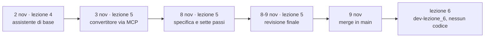
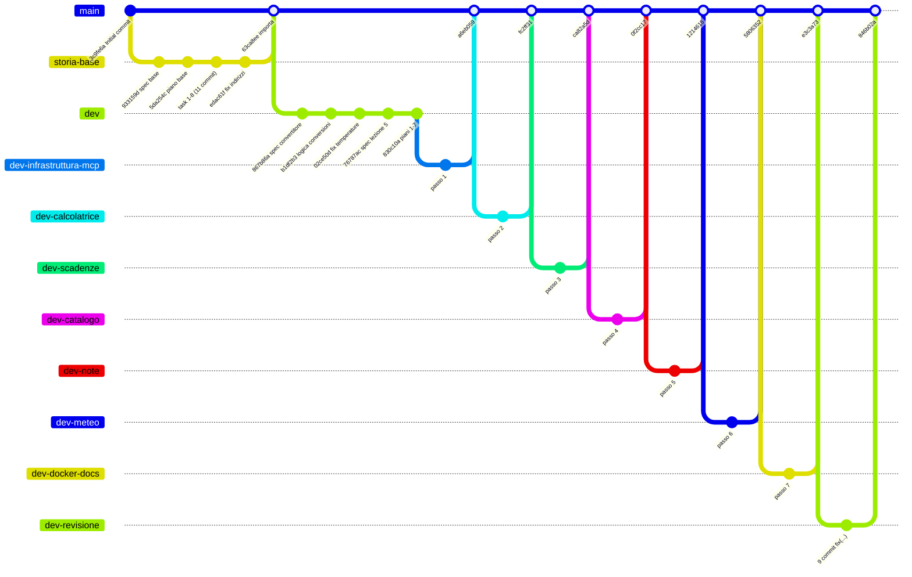
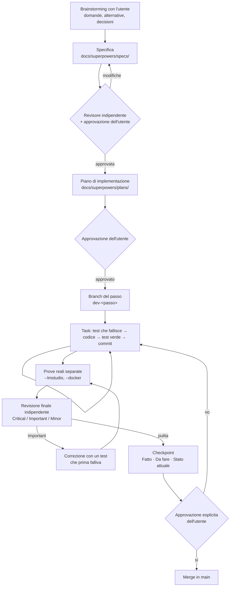

# Storia del progetto e decisioni

[← Indice](00-indice.md) · Prima: [10 Log, diagnosi e limiti noti](10-log-e-diagnosi.md) · Dopo: [12 Glossario e domande](12-glossario-e-domande.md)

## Scheda in 5 minuti

**Di che cosa parla.** Gli altri capitoli spiegano com'è fatto il progetto; questo racconta come ci si è arrivati. Segue le fasi dal 2 al 9 novembre, con le scelte fatte e i difetti corretti. All'orale serve a raccontare la cronologia senza confondere le fasi.

**Le idee chiave**

1. **Ogni fase segue lo stesso metodo.** Prima si discute con l'utente, poi si scrivono specifica e piano. Il codice arriva solo dopo la sua approvazione. Ogni passo finisce con una revisione indipendente e un checkpoint, cioè un resoconto scritto. → sezione 2
2. **Lezione 4: l'assistente di base, 2 novembre.** È una chat da terminale con un grafo LangGraph esplicito e un solo strumento, l'orologio. Il modello gira in LM Studio e l'avvio funziona anche con Docker. Il numero della lezione si deduce dalle slide della lezione 6. → sezione 3
3. **Lezione 5, primo passo: il convertitore via MCP, 3 novembre.** Lo strumento esce dal programma e va in un server separato. L'assistente lo trova da solo con la discovery, cioè chiedendo al server l'elenco degli strumenti. Quel giorno si completa solo la logica di conversione. → sezione 4
4. **Lezione 5: la specifica dell'8 novembre.** L'utente vuole un solo server MCP per tutti gli strumenti, orologio compreso: dieci nomi in tutto. Vuole anche confrontare tre modi di collegare uno strumento. Ogni scelta che l'utente non ha chiesto è segnata «scelta mia». → sezione 5
5. **Lezione 5: sette passi, un branch ciascuno.** Ogni passo ha test, prove reali, revisione, checkpoint e un merge approvato dall'utente. Le prove reali mostrano un limite: con dieci strumenti il modello da 2B a volte dichiara un'azione senza farla. → sezioni 6 e 9
6. **Lezione 5: la revisione finale, poi l'unione.** Nella notte tra l'8 e il 9 novembre nove correzioni toccano tutto il progetto. Il 9 novembre, rilanciati i test, la revisione entra in `main`. → sezione 7
7. **Lezione 6: appena iniziata.** Esiste solo il branch `dev-lezione_6`. Router, revisore e riassunto della cronologia sono ancora da specificare. → sezione 7.11

**Il quadro**



**Da sapere a memoria**

| Cosa | Valore | Dove |
|---|---|---|
| Assistente di base | 2 nov., 8 task, un solo strumento | `docs/superpowers/specs/2026-11-02-assistente-laboratorio-design.md` |
| Convertitore via MCP | 3 nov., completato solo il Task 1 | `docs/superpowers/specs/2026-11-03-convertitore-unita-mcp-design.md` |
| Specifica della lezione 5 | 8 nov., dieci strumenti, tre varianti, sette passi | `docs/superpowers/specs/2026-11-08-strumenti-lezione-5-design.md` |
| Merge dei sette passi | 8 nov., dalle 14:35 alle 20:58 | da `a6eb059` a `e3c3a73` |
| Revisione finale | 9 commit `fix(...)`, uniti in `main` il 9 nov. | da `7871ef7` a `9aa287a`, merge `846b02a` |
| Test | 503 raccolti; il 9 nov. 467 passati e 36 saltati | `python -m pytest` |

**Se te lo chiedono all'orale**

- *Perché i passi 2–7 partono da `main` e non da `dev`?* Perché `dev` non conteneva il passo 1, unito solo in `main`. Partire da `dev` avrebbe perso lavoro già approvato; poi `dev` è stato riallineato.
- *Quale decisione dell'utente ha ribaltato una specifica?* L'orologio nel server MCP, insieme a tutti gli altri strumenti. La specifica del convertitore lo voleva locale.
- *Che cosa non può impedire il codice?* Che il modello dica «Ho salvato la nota» senza chiamare `add_note`. Però lo rende visibile: mancano la riga nel terminale e le righe nei log.

Per i dettagli continua con il resto del capitolo: le idee rimandano alle sezioni con «→ sezione N».

---

Gli altri documenti spiegano **com'è fatto** il progetto. Questo spiega **come ci si è arrivati e perché**. All'orale servono soprattutto tre cose:

1. raccontare la cronologia senza confondere le fasi: assistente di base, convertitore, lezione 5 in sette passi, revisione finale;
2. motivare le scelte, distinguendo quelle **decise dall'utente** da quelle **proposte dall'esecutore** (nei documenti sono segnate *«scelta mia»*);
3. raccontare i difetti trovati dalle revisioni: che cosa succedeva, perché, come è stato corretto.

> **Fonti e metodo.** La cronologia viene da `git log` e `git show` (solo lettura), dalle tre specifiche in `docs/superpowers/specs/`, dai nove piani in `docs/superpowers/plans/` e dagli otto checkpoint in `docs/superpowers/checkpoint/`. Ogni correzione descritta qui è stata confrontata con il codice attuale, e i riferimenti `percorso:riga` puntano a quel codice.
>
> Gli esempi «prima/dopo» sono **reali**. Uno script in una cartella temporanea ha eseguito:
> - il codice attuale;
> - le versioni precedenti dei moduli corretti, estratte con `git show <commit>^:<file>`;
> - il modello finto di `tests/finti.py`;
> - il server MCP in memoria (`con_client` di `tests/test_server_mcp.py`, che vieta la rete);
> - l'app FastAPI tramite `TestClient`.
>
> Niente LM Studio, niente Docker, nessuna porta e nessuna richiesta di rete. Gli **esiti delle prove reali** con LM Studio e Docker invece non sono stati rieseguiti: sono citati dai checkpoint, con la loro data.

---

## Indice del documento

- [Scheda in 5 minuti](#scheda-in-5-minuti)

1. [Il quadro in una pagina](#1-il-quadro-in-una-pagina)
2. [Il metodo di lavoro: Superpowers](#2-il-metodo-di-lavoro-superpowers)
3. [Fase 0 — L'assistente di base (2 novembre)](#3-fase-0--lassistente-di-base-2-novembre)
4. [Fase 1 — Il convertitore via MCP (3 novembre)](#4-fase-1--il-convertitore-via-mcp-3-novembre)
5. [Fase 2 — La specifica della lezione 5 e i sette piani (8 novembre)](#5-fase-2--la-specifica-della-lezione-5-e-i-sette-piani-8-novembre)
6. [Fase 3 — I sette passi](#6-fase-3--i-sette-passi)
7. [Fase 4 — La revisione finale a tappeto (`dev-revisione`)](#7-fase-4--la-revisione-finale-a-tappeto-dev-revisione)
8. [Registro delle decisioni](#8-registro-delle-decisioni)
9. [Le prove reali nel tempo](#9-le-prove-reali-nel-tempo)
10. [Che cosa resta aperto](#10-che-cosa-resta-aperto)
11. [Domande di ripasso](#11-domande-di-ripasso)

- [Scaletta per le slide](#scaletta-per-le-slide)

---

## 1. Il quadro in una pagina

| Quando | Fase | Che cosa | Commit di riferimento |
|---|---|---|---|
| 2 nov., 14:27–15:12 | 0 | Specifica, piano e 8 task dell'assistente di base: grafo LangGraph, orologio locale, LM Studio, Docker | da `933159d` a `edac61f` |
| 2 nov., 16:50 | 0 | Il progetto, nato in un repository separato, viene importato nel repository `Agente` | `63ca8ee` |
| 3 nov., 14:03–14:19 | 1 | Specifica e piano del convertitore via MCP; Task 1 (logica di conversione) | `867b86a`, `2c783eb`, `b1df2b3` |
| 8 nov., 13:44–13:59 | 2 | Correzione del convertitore, specifica della lezione 5, piani dei sette passi, primo checkpoint | `02ce50d`, `76787ac`, `830c10a` |
| 8 nov., 14:01–20:58 | 3 | Sette passi, ciascuno sul suo branch, con revisione, checkpoint e merge in `main` | merge da `a6eb059` a `e3c3a73` |
| 8 nov., 23:24 – 9 nov., 04:22 | 4 | Revisione finale a tappeto sul branch `dev-revisione`: 9 commit `fix(...)` | da `7871ef7` a `9aa287a` |
| 9 nov., 15:24 | 4 | La revisione viene unita in `main`; poi si apre `dev-lezione_6` per la lezione 6 | `846b02a` |

Numeri utili:
- `main` contiene **85 commit**, di cui 9 merge: l'importazione iniziale, i sette passi e la revisione;
- i test raccolti oggi sono **503**, di cui **36 prove reali** (`--collect-only`, eseguito per questo documento);
- l'ultimo checkpoint registrava **419 passati e 36 saltati**. I test in più sono arrivati con la revisione finale (sezione 7). Il 9 novembre, sullo stesso codice, il risultato è **467 passati e 36 saltati**.



Due dettagli del grafico da saper spiegare:

- **Il passo 1 parte da `dev`, i passi 2–7 da `main`.** La regola diceva «ogni branch parte da `dev`». Però `dev` non conteneva il passo 1, che era stato unito solo in `main`. Partire da `dev` avrebbe perso il lavoro già approvato, quindi l'esecutore è partito da `main` e l'ha dichiarato in ogni checkpoint (per esempio `2026-11-08-calcolatrice.md`, «Stato attuale»). Nel checkpoint finale ha chiesto all'utente se riallineare `dev` o cambiare la regola. Oggi `dev` punta allo stesso commit di `main` (`846b02a`): è stato riallineato.
- **Ogni merge è un commit di merge** (`chore: unisci il passo N (...) in main`), fatto solo dopo l'approvazione esplicita dell'utente. Così in `git log --graph` ogni passo resta riconoscibile come un ramo chiuso.

---

## 2. Il metodo di lavoro: Superpowers

Il `CLAUDE.md` alla radice impone il metodo: usare le skill di **Superpowers** per brainstorming, specifica, piano, implementazione e verifica, e non scrivere codice prima che l'utente abbia approvato la specifica e poi il piano.



### 2.1 Le fasi una per una

| Fase | Che cosa produce | Dove si vede nel progetto |
|---|---|---|
| **Brainstorming** | domande all'utente, alternative, decisioni | nelle specifiche: *«Deciso con l'utente»*, *«Decisioni dell'utente»*, *«Criterio deciso con l'utente»* |
| **Specifica** | che cosa fare e che cosa no, senza codice | 3 file in `specs/`, con sezioni fisse: Intento, Obiettivi, **Non obiettivi**, **Anti-obiettivi**, Comportamento, Configurazione, Docker, Dipendenze, Struttura, Test, Git, **Lasciato al costruttore** |
| **Piano** | come farlo, task per task | 9 file in `plans/`, con **Global Constraints**, **Review Focus** (i casi limite da non dimenticare, ciascuno legato a un test con il suo nome), Task con File, Interfacce e Step a caselle `- [ ]` |
| **Implementazione** | commit piccoli in Conventional Commits italiani | i piani indicano `superpowers:subagent-driven-development` (o `executing-plans`): un task alla volta, con un test che fallisce prima del codice (TDD) |
| **Verifica** | test automatici, prove reali, avvio diretto | `python -m pytest -q`; prove reali solo con `--lmstudio` o `--docker` |
| **Revisione indipendente** | difetti classificati Critical, Important e Minor | nei checkpoint: gli Important si correggono subito, «ciascuno con un test che prima falliva»; i Minor si elencano come **rimandati** |
| **Checkpoint** | resoconto onesto | 8 file in `checkpoint/`, sempre con tre sezioni: **Fatto**, **Da fare**, **Stato attuale** (branch, ultimo commit, test, cosa *non* è verificato) |
| **Merge** | integrazione in `main` | solo dopo un «sì» esplicito dell'utente per quel passo (piano del passo 1, Task 8, Step 6) |

### 2.2 Tre idee del metodo da saper spiegare

**Anti-obiettivi.** Sono i modi in cui il progetto fallirebbe *anche se sembra funzionare*. Per esempio:
- «l'ora è inventata dal modello invece che calcolata dallo strumento» (specifica base, §4);
- «una conversione non valida restituisce comunque un numero» (specifica del convertitore, §4);
- «una città ambigua risolta in silenzio» (specifica della lezione 5, §4).

Molte correzioni delle revisioni nascono proprio da un anti-obiettivo violato in un caso limite. Un esempio è il «numero arrotondato presentato come esatto» della sezione 7.1.

**«Scelta mia».** Ogni volta che la specifica decide qualcosa che l'utente non ha chiesto, l'esecutore lo marca così. L'utente può contestare ogni singola scelta prima di approvare. È una forma di trasparenza: si vede chi ha deciso che cosa (sezione 8).

**Resoconto onesto.** Ogni checkpoint separa ciò che è stato eseguito da ciò che *non* è verificato. Per esempio l'avvio interattivo da tastiera di `.\avvia.ps1` risulta «non verificato» in tutti e otto i checkpoint, e non viene mai dichiarato riuscito. La regola del `CLAUDE.md` è esplicita: «una risposta simulata non dimostra che il modello locale sappia usare lo strumento».

### 2.3 Regole Git applicate

- **Conventional Commits in italiano:** `feat(grafo): ...`, `fix(meteo): ...`, `test(reale): ...`, `docs: ...`, `refactor(logica): ...`, `chore: ...`.
- **Prima di ogni commit:** `git status`, controllo del diff, staging selettivo. Il file `.gitattributes`, cancellato nella copia di lavoro e fuori da `assistente-laboratorio/`, non è mai stato toccato né committato. Tutti i checkpoint lo segnalano come «in sospeso».
- **Nessun push senza richiesta.** Il push su GitHub si fa solo quando l'utente lo chiede esplicitamente.
- **Righe `Co-Authored-By`.** Il piano del 2 novembre le prevedeva. Dal piano del convertitore in poi i Global Constraints dicono **«nessuna riga `Co-Authored-By`»**. Nel repository restano due tracce di una pulizia della storia:
  - il tag `backup-prima-pulizia`, insieme a `refs/original/refs/heads/main`, punta a `7950b53`, una copia della storia del 2 novembre i cui 15 commit hanno ancora la riga `Co-Authored-By`;
  - `main` contiene invece la copia «pulita» (`63ca8ee`), con le stesse date e gli stessi contenuti.

  Si ricava che la storia è stata riscritta (il riferimento `refs/original/` è quello che lascia `git filter-branch`) e che il tag fa da copia di sicurezza.

---

## 3. Fase 0 — L'assistente di base (2 novembre)

È il progetto che precede la lezione su MCP. La repository sta in una cartella chiamata `progetto_lezione_3`, e la specifica del 2 novembre non indica il numero della lezione. La specifica del convertitore la chiama semplicemente «l'assistente descritto in `2026-11-02-assistente-laboratorio-design.md`».

### 3.1 Che cosa chiedeva la specifica

`docs/superpowers/specs/2026-11-02-assistente-laboratorio-design.md` (approvata il 2 novembre):

- chat da terminale con un modello di LM Studio sull'host;
- grafo LangGraph **esplicito**, senza agenti prefabbricati: il piano vieta `create_react_agent` e perfino `ToolNode`;
- cronologia solo in memoria;
- **un solo strumento**, l'orologio `ora_corrente` con fuso esplicito, eseguito davvero dal programma;
- fuso dell'utente rilevato anche in Docker;
- avvio diretto e con Docker Compose.

Gli anti-obiettivi fissano lo spirito di tutto il progetto: niente ora inventata, niente test simulati presentati come prova, niente UTC silenzioso in Docker, niente indirizzi o modelli nel codice, niente grafo nascosto.

### 3.2 Come è stato costruito

Il piano `2026-11-02-assistente-laboratorio.md` ha 8 task, diventati 11 commit in 25 minuti (14:47–15:12), più i due commit di specifica e piano.

| Task | Commit (storia in `main`) | Contenuto |
|---|---|---|
| 1 | `37d08ef` | struttura, `requirements.txt` con versioni fissate, opzioni `--lmstudio` e `--docker`, strumento orologio |
| 2 | `2cac823` | configurazione da variabili d'ambiente e rilevamento del fuso |
| 3 | `699cbe9` | grafo con i nodi `modello`, `strumenti` e `limite` |
| 4 | `f9e9f2a` | verifica di LM Studio (`GET /v1/models`) e client |
| 5 | `5c5f4d7` | terminale e punto di avvio |
| 6 | `1180776` | prova reale con LM Studio (5 domande sull'ora) |
| 7 | `9afc939`, `776d729` | `Dockerfile`, `compose.yaml`, `avvia.ps1`, README |
| 8 | `13fef24` | `CLAUDE.md` aggiornato con struttura e comandi |
| revisione | `7a366f5`, `edac61f` | due correzioni (sotto) |

Le due correzioni finali di questa fase sono ancora nel codice:

- **`7a366f5` fix(grafo): argomenti non JSON.**
  - *Che cosa succedeva:* se il modello produceva argomenti che non sono JSON, LangChain metteva la chiamata in `invalid_tool_calls` invece che in `tool_calls`, e il nodo strumenti la ignorava. La cronologia restava con una richiesta senza risposta, cioè non valida per la chiamata successiva al modello.
  - *Come è stato corretto:* anche quelle chiamate vengono chiuse con un `ToolMessage` di errore (`assistente/grafo.py:61-63` e `:122-129`), e l'instradamento ne tiene conto (`:132-138`).
- **`edac61f` fix(modello): indirizzi scritti male.**
  - *Che cosa succedeva:* un `LMSTUDIO_BASE_URL` come `http://localhost:1234v1` produceva un traceback.
  - *Come è stato corretto:* ora viene rifiutato prima della richiesta, con un esempio corretto (`assistente/modello.py:27-39`).

### 3.3 L'importazione nel repository `Agente`

Alle 16:50 il commit `63ca8ee` (*«Unisce i 14 commit del progetto (prima in un repo separato) nel repo Agente»*) porta tutta la storia dentro il repository attuale, sotto `assistente-laboratorio/`. Per questo `git log --graph` mostra un «Initial commit» (`3c9fe6a`, solo `.gitattributes`) unito a una storia parallela. La specifica, al §11, diceva infatti «repository inizializzata in `progetto_lezione_3/`, branch `master`».

Per questa fase non esiste un checkpoint: la regola dei checkpoint è arrivata l'8 novembre. L'esito della prova reale del 2 novembre non è quindi documentato. Il primo esito con l'orologio è quello del passo 1: 5 su 5.

---

## 4. Fase 1 — Il convertitore via MCP (3 novembre)

### 4.1 La specifica del convertitore

`2026-11-03-convertitore-unita-mcp-design.md` apre la lezione 5 («MCP: dalle funzioni agli strumenti condivisi») con **un solo strumento**, `converti_unita`, e tutta l'infrastruttura che gli serve:

- un server **FastMCP** separato, con trasporto Streamable HTTP solo su `127.0.0.1`;
- discovery con `langchain-mcp-adapters`;
- un **ponte sincrono**, perché il grafo resta sincrono;
- avvio e arresto con un solo comando;
- due file di log;
- diagnosi per livelli.

Decisioni importanti di questa specifica, quasi tutte rimaste nel codice:

| Decisione | Chi | Motivazione |
|---|---|---|
| Aritmetica decimale esatta, mai `100.00000000000001` | anti-obiettivo della specifica | una conversione deve essere esatta |
| `"2.5"` accettato, `"2,5"` rifiutato con la richiesta di usare il punto | scelta dell'esecutore | la virgola è ambigua (`1,000` e `1.000`); i modelli piccoli mandano numeri come testo |
| Unità in un elenco chiuso, pubblicato come `enum` nello schema | scelta dell'esecutore | il modello riceve le unità ammesse con la discovery |
| Errori dello strumento con `isError` di MCP | scelta dell'esecutore | l'errore resta riconoscibile anche a livello di protocollo |
| Pronto vuol dire che `tools/list` riesce, non basta un HTTP 200 | specifica (slide 24) | un processo acceso non è un server MCP che risponde |
| `fastmcp` 3.4.11 + `langchain-mcp-adapters` 0.3.2 + `mcp` 1.30.0 | verificato dal revisore su PyPI | `fastmcp` 4.x richiede `mcp>=2.3`, l'adattatore `mcp<2`: le due ultime versioni non convivono |
| `mcp` fissato anche se è una dipendenza indiretta | scelta dell'esecutore | una 2.x arrivata per sbaglio romperebbe l'adattatore già all'importazione |
| **L'orologio resta locale** | specifica | la slide 3 lo ammette. *Decisione poi ribaltata dall'utente l'8 novembre* |
| Criterio 5 su 5, con correzione ammessa entro il limite di giri | utente | conta l'ultima chiamata del turno |

### 4.2 Il piano e i «fatti verificati nel prototipo»

Il piano `2026-11-03-convertitore-unita-mcp.md` riporta fatti scoperti con un prototipo, «da non riscoprire». Spiegano scelte del codice attuale:

- i tool dell'adattatore sono **solo asincroni** (`invoke` solleva `NotImplementedError`): da qui il ponte con `asyncio.run` (`assistente/client_mcp.py:57-77`);
- con `handle_tool_errors=False`, un risultato MCP con `isError` solleva `ToolException`: il ponte lo traduce in `{"errore": ..., "tipo": "strumento"}` (`client_mcp.py:63-64`);
- un server spento produce un `ExceptionGroup`, da cui `_prima_causa` (`client_mcp.py:30-33`);
- su Windows, `CTRL_BREAK_EVENT` mandato a un processo avviato con `CREATE_NEW_PROCESS_GROUP` lo chiude in circa 0,2 s: da qui `ferma` e `_opzioni_processo` (`assistente/avvio_server.py:58-82`);
- `stateless_http=True, json_response=True, log_level="warning"` evitano rumore nel log del server (`server_mcp/__main__.py:39-47`);
- un parametro `Annotated[Any, WithJsonSchema({...})]` pubblica lo schema voluto e passa alla funzione il valore grezzo, così la validazione la fa la logica, in italiano. È il motivo per cui *tutti* gli strumenti del server hanno parametri `Any` (`server_mcp/server.py:128-193`).

Il 3 novembre si completa solo il **Task 1**: `b1df2b3`, la logica di conversione, allora in `server_mcp/conversioni.py`. Poi il lavoro si ferma fino all'8 novembre.

### 4.3 La correzione dell'8 novembre (`02ce50d`)

Prima di scrivere la nuova specifica, l'esecutore corregge un difetto del Task 1:

- *Che cosa succedeva:* `1e30 °C → °F` sollevava `InvalidOperation` invece di un errore per il modello.
- *Perché:* l'arrotondamento a due decimali (`quantize`) superava la precisione del contesto `Decimal`.
- *Come è stato corretto:* `InvalidOperation` diventa «Risultato troppo grande per essere rappresentato» (`logica/conversioni.py:77-80`).

Esempio reale con il codice attuale:

```text
converti(1e30, "°C", "°F")  →  ErroreConversione: Risultato troppo grande per essere rappresentato.
```

I nuovi test fallivano sul codice vecchio. Dopo la correzione: 98 passati e 7 saltati.

---

## 5. Fase 2 — La specifica della lezione 5 e i sette piani (8 novembre)

### 5.1 Che cosa cambia rispetto al convertitore

L'utente, dopo aver letto la presentazione `LLM_Lez_5`, vuole due cose (`2026-11-08-strumenti-lezione-5-design.md`, §1):

1. **un solo server MCP per tutti gli strumenti**, compreso l'orologio: sei strumenti della slide 25 più l'orologio, per dieci nomi in tutto;
2. **un confronto didattico tra tre modi di collegare uno strumento**: MCP, `@tool` locale e FastAPI con wrapper.

**Decisioni dell'utente** (scritte così nella specifica):
- server MCP unico, con dentro anche l'orologio. Ribalta la decisione del convertitore;
- tre varianti: tutti gli strumenti in MCP, uno solo in locale, uno solo in FastAPI;
- le copie locale e FastAPI sono di due strumenti **diversi**;
- il modello vede **una sola versione** di ogni strumento duplicato, scelta nel `.env`.

**Scelta dell'esecutore:** la calcolatrice va in locale, giorni e scadenze in FastAPI.
- La calcolatrice è un calcolo puro e interno: è il caso in cui la slide 17 dice che la funzione locale è la scelta ragionevole.
- Le scadenze hanno argomenti semplici da passare in una query HTTP e un risultato deterministico, quindi le due varianti si confrontano al valore esatto.

La specifica chiede che le varianti siano **copie esatte**: stesso nome, stessa descrizione, stesso schema, stesso risultato, stessi errori (slide 21). Altrimenti il confronto non è più tra percorsi ma tra strumenti diversi. Da qui vengono molti test di «contratto identico» e diverse correzioni (sezioni 6.2, 6.3 e 7.2).

### 5.2 Altre regole fissate dalla specifica

- **Logica scritta una volta sola**, in moduli puri senza `fastmcp`, `fastapi` o LangChain: è il pacchetto `logica/`. Da qui il `refactor(logica)` `55bb961`, primo commit del passo 1.
- **L'host sceglie le capacità** (slide 11): il server espone sempre tutti e dieci gli strumenti, ed è l'agente a togliere la versione MCP quando la variante è un'altra (`assistente/varianti.py:32-43`).
- **Nomi:** dove le slide fissano i nomi (note, catalogo, meteo) restano in inglese, *«nel modo in cui c'è scritto»*; gli altri sono in italiano.
- **Non obiettivi:** stdio, due server, prompt e resources MCP, RAG sul catalogo («materia della lezione 6»), conferma interattiva prima di eliminare una nota, festività locali.
- **Ordine dei passi** (*scelta mia*): infrastruttura → calcolatrice → scadenze → catalogo → note → meteo → Docker e documentazione. L'infrastruttura si costruisce una volta sola, già pensata per dieci strumenti.
- **Un branch per passo e merge solo su approvazione** (decisione dell'utente). I nomi usano il trattino (`dev-calcolatrice`), perché `dev/...` non si può creare finché esiste il branch `dev`.

### 5.3 Il checkpoint iniziale e le nuove regole

Il primo checkpoint, `2026-11-08-documentazione-iniziale.md` (commit `830c10a`, 13:59), registra:

- la specifica, **rivista da un revisore indipendente e approvata dall'utente**;
- i sette piani, uno per passo. Il vecchio piano del convertitore viene **marcato come sostituito dal Task 2 in poi**: il suo Task 1 resta valido;
- le versioni delle nuove dipendenze, verificate con `pip --dry-run` su Python 3.14.7: `fastapi` 0.162.2, `uvicorn` 0.54.0, `httpx` 0.28.1, `starlette` 1.10.0 come dipendenza indiretta;
- le date di Pasquetta per il file delle festività;
- **le nuove regole in `CLAUDE.md`:** un branch per passo, merge solo su approvazione, checkpoint, e il modello di LM Studio scelto e cambiato dall'utente.

---

## 6. Fase 3 — I sette passi

### 6.0 Riepilogo

| Passo | Branch (parte da) | Merge in `main` | Test automatici a fine passo | LM Studio (`google/gemma-4-e2b`) | Docker |
|---|---|---|---|---|---|
| 1 infrastruttura MCP | `dev-infrastruttura-mcp` (`dev` `830c10a`) | `a6eb059`, 14:35 | 151 passati, 14 saltati | orologio 5/5 + errore controllato; convertitore 5/5 | 3/3 |
| 2 calcolatrice | `dev-calcolatrice` (`main` `a6eb059`) | `fc2ff31`, 15:57 | 213 / 18 | 15/15 | 3/3 al secondo tentativo |
| 3 scadenze | `dev-scadenze` (`fc2ff31`) | `ca82a5d`, 16:40 | 291 / 22 | 19/19 | 3/3 con `fastapi` |
| 4 catalogo | `dev-catalogo` (`ca82a5d`) | `0f2cc17`, 17:13 | 332 / 26 | 23/23 | 3/3 |
| 5 note | `dev-note` (`0f2cc17`) | `1214615`, 18:29 | 377 / 30 | 27/27, poi 26/28 (e 6/6 alla ripetizione) | 3/3 |
| 6 meteo | `dev-meteo` (`1214615`) | `5806352`, 19:25 | 412 / 33 | 30/30 | 3/3 |
| 7 Docker e documentazione | `dev-docker-docs` (`5806352`) | `e3c3a73`, 20:58 | 419 / 36 | 28/30 | 6/6 |

Ogni passo segue la stessa sequenza:
1. Task 0, il branch;
2. i task con i loro commit `feat`, `test` e `refactor`;
3. il task finale con prove reali, documentazione e checkpoint;
4. un commit `fix(...)` con le correzioni della revisione;
5. il commit `docs: aggiungi il checkpoint del passo N`;
6. la richiesta di approvazione e il merge.

Le prove reali sono state fatte **passando le variabili nuove all'ambiente del test**, senza toccare il `.env` dell'utente. Il `.env` è suo: ogni checkpoint gli chiede di aggiungere le righe mancanti.

---

### 6.1 Passo 1 — Infrastruttura MCP, convertitore e orologio nel server

| Task | Commit | Contenuto |
|---|---|---|
| 1 | `55bb961` | pacchetto `logica/`: orologio, conversioni ed `ErroreStrumento` |
| 2 | `8d3af6b` | server FastMCP «Strumenti laboratorio» con `converti_unita` e `ora_corrente` |
| 3 | `aef51e5` | ponte sincrono, selezione degli strumenti, `ErroreAvvio` |
| 4 | `5b28141` | avvio, attesa (discovery) e arresto dei processi, già generico per il futuro servizio FastAPI |
| 5 | `88281c7` | log di ogni chiamata con `origine` ed esito |
| 6 | `06cba52` | `MCP_PORTA`, riga del terminale uniforme, avvio unico, orologio locale rimosso |
| 7 | `03595cf` | prove reali e Docker con il server MCP nel container |
| 8 | `1ee087c` | README e `CLAUDE.md` |
| revisione | `8ff0864` | due correzioni |

**Esiti:**
- LM Studio: orologio via MCP **5/5**, più l'errore controllato `Mars/Olympus`; convertitore **5/5 al primo tentativo**;
- Docker 3/3, con una conversione nel container e le righe di log sull'host;
- avvio diretto con l'ingresso da una pipe.

**Difetti corretti dopo la revisione** (`8ff0864`), nessuno Critical:

| Difetto | Che cosa succedeva | Perché | Correzione |
|---|---|---|---|
| Ordine degli argomenti nel terminale | il modello mandava `{a, da, valore}` e il terminale stampava `[converti_unita · mcp: m, km, 2.5]`, cioè la conversione al contrario | la riga seguiva l'ordine del dizionario scelto dal modello | i valori seguono l'ordine dello schema: `_valori` in `assistente/terminale.py:14-17`, con l'ordine fornito da `parametri` in `assistente/varianti.py:46-48` |
| Messaggio per le variabili mancanti | invitava a copiare `.env.example` sopra il `.env` esistente | il testo era pensato per chi non ha ancora un `.env` | ora dice «Aggiungi le righe mancanti al file .env» (`assistente/configurazione.py:47-53`) |

**Rimandati (Minor):**
- il messaggio «non è partito» può mostrare righe di sessioni precedenti del log;
- su Windows un arresto normale risulta `codice=3` (corretto nella revisione finale, sezione 7.3);
- due lacune nei test.

**Osservazione onesta:** per «ora a Londra» l'ora era giusta, ma il modello ha scritto «13 novembre» invece dell'8. La prova controllava solo l'ora. Nella revisione finale la domanda «Che giorno è oggi?» ha ricevuto un controllo sul giorno (sezione 7.8).

---

### 6.2 Passo 2 — Calcolatrice sicura nelle varianti MCP e locale

| Task | Commit | Contenuto |
|---|---|---|
| 1 | `7c1c753`, `ffadbe5` | `logica/calcolatrice.py`: albero `ast` filtrato su una lista chiusa di nodi, aritmetica `Decimal`, nessun `eval` |
| 2 | `f98ac16` | `calcola` nel server MCP |
| 3 | `fba55b9` | variante locale con `@tool` |
| 4 | `04574ee` | `VARIANTE_CALCOLATRICE` (`mcp`/`locale`) |
| 5 | `7e3a9b9` | prove reali, `compose.yaml`, README |
| revisione | `ae100c8` | interi grandi esatti e stesso schema nelle due varianti |

`ffadbe5` corregge un caso trovato già durante il Task 1: con `0 ** -1`, `Decimal` restituirebbe `Infinity` invece di un errore. Ora dà «Divisione per zero» (`logica/calcolatrice.py:40-41`).

**Esiti:**
- LM Studio 15/15: «Quanto fa (3+4)*2?» dà 14 sia con `mcp` sia con `locale`, e il log mostra l'origine giusta;
- `__import__('os')` dà lo stesso errore nelle due varianti.

**Docker, un episodio da ricordare:** alla prima esecuzione il test con `avvia.ps1` è scaduto. Il container si era chiuso dopo 4 secondi, ma il comando è rimasto appeso per circa 34 minuti. La seconda esecuzione identica è passata, 3/3 in 110 secondi. Il revisore ha ipotizzato una causa: il test resta in attesa delle pipe dei processi figli di PowerShell. È stata confermata e risolta solo nella revisione finale (sezione 7.8).

**Difetti Important corretti** (`ae100c8`):

| Difetto | Che cosa succedeva | Perché | Correzione |
|---|---|---|---|
| Interi grandi arrotondati | `2**200` e `10**60 + 1` risultavano arrotondati, ma presentati come interi esatti | precisione `Decimal` di 50 cifre | `PRECISIONE = 400` (`logica/calcolatrice.py:19-20`): sotto il limite `1e300` ogni intero ha al massimo 300 cifre |
| Variante locale con un contratto diverso | lo schema locale non aveva la descrizione dell'argomento, e un valore non testuale dava un errore pydantic in inglese | la firma era `espressione: str` | stesso `SCHEMA_ESPRESSIONE` del server e parametro `Any`, così l'errore italiano arriva dalla logica (`assistente/calcolatrice_locale.py:24-31`) |

Esempio reale, eseguendo la versione precedente a `ae100c8` (estratta con `git show ae100c8^:...`):

```text
'2 ** 200'     -> 1606938044258990275541962092341162602522202993782800000000000   (prima: cifre finali inventate)
'2 ** 200'     -> 1606938044258990275541962092341162602522202993782792835301376   (oggi: esatto)
'10 ** 60 + 1' -> 1000000000000000000000000000000000000000000000000000000000000   (prima: il +1 è sparito)
```

**Rimandati (Minor):**
- `0 ** 0` dà «troppo grande» invece di 1 (corretto nella sezione 7.1);
- i valori minuscoli diventano 0 senza avviso (corretto nella sezione 7.1);
- il messaggio per `VARIANTE_CALCOLATRICE` mancante non elenca i valori ammessi;
- caratteri invisibili grezzi nel messaggio d'errore;
- JSON locale con gli spazi;
- `max(1,2)` riceve il messaggio sulla virgola.

**Differenza dichiarata nel README:** FastMCP rifiuta un argomento inventato dal modello, `@tool` lo ignora. L'utente l'ha accettata come limite dei framework. La revisione finale l'ha eliminata (sezione 7.2).

---

### 6.3 Passo 3 — Giorni e scadenze nelle varianti MCP e FastAPI

| Task | Commit | Contenuto |
|---|---|---|
| 1 | `93dd585` | `logica/scadenze.py`, `risorse/festivita_italia.json`, schemi condivisi |
| 2 | `406d993` | `calcola_scadenza` nel server MCP |
| 3 | `0761b01` | servizio FastAPI in `servizio_api/` |
| 4 | `4a4061e` | wrapper HTTP scritto a mano con `@tool` |
| 5 | `973eae7` | avvio del servizio: pronto quando `/openapi.json` descrive `/scadenza` |
| 6 | `9e39a71` | `VARIANTE_SCADENZE`, `API_PORTA`; `ExitStack` che spegne tutto se un processo non parte (`assistente/avvio.py:33`) |
| 7 | `99fb952` | prove reali, `Dockerfile`, README |
| revisione | `ec2b384` | 4 ottobre e argomenti mancanti |

**Esiti:**
- LM Studio 19/19, sia prima sia dopo le correzioni;
- la scadenza del 23 dicembre 2026 più 3 giorni lavorativi dà il **29 dicembre 2026, identico byte per byte** nelle due varianti;
- la riga in `logs/servizio_api.log` compare solo con `fastapi`;
- Docker 3/3 con il servizio FastAPI acceso e spento nel container.

**Difetti Important corretti** (`ec2b384`):

| Difetto | Che cosa succedeva | Perché | Correzione |
|---|---|---|---|
| Festività incompleta | le scadenze lavorative di ottobre 2027 e 2028 erano sbagliate | mancava San Francesco, il 4 ottobre, festa nazionale dal 2026 (legge 151/2025) | aggiunto a `risorse/festivita_italia.json` per il 2026, il 2027 e il 2028 |
| Argomento obbligatorio mancante | il modello riceveva un errore pydantic in inglese | FastMCP valida prima di chiamare la funzione | **controllo dell'host** nel nodo strumenti, prima di eseguire e uguale per ogni variante (`assistente/grafo.py:82-85` e `:159-166`) |

Esempi reali con il codice attuale:

```text
calcola_scadenza("2027-10-01", 1, True)
  → scadenza "2027-10-05", festivita_saltate ["2027-10-04 San Francesco"]
grafo con modello finto, chiamata calcola senza argomenti
  → {"errore": "Argomenti mancanti per calcola: espressione. Riprova indicando tutti gli argomenti richiesti.", "tipo": "strumento"}
```

**Decisioni dichiarate nel README:**
- con un argomento mancante la chiamata non arriva né al server né al servizio;
- FastAPI accetta forme che MCP rifiuta (`lavorativi="yes"`, `giorni="3.0"`), perché in una query HTTP ogni valore è testo. La specifica lo prevedeva al §5.4, con «parità piena» solo per gli argomenti del tipo previsto;
- un argomento inventato è rifiutato da MCP e ignorato dal wrapper (fino alla sezione 7.2).

**Rimandati (Minor):**
- surrogati Unicode e URL troppo lunghi non intercettati dal wrapper (sezione 7.6);
- righe di arresto assenti dai log di server e servizio (sezione 7.3);
- a capo dell'input non neutralizzati nei log;
- `additionalProperties` non confrontato nel test di contratto;
- messaggio su `lavorativi` senza i valori ammessi.

---

### 6.4 Passo 4 — Catalogo locale

| Task | Commit | Contenuto |
|---|---|---|
| 1 | `8346335` | `risorse/catalogo_corsi.json` (12 corsi) e `logica/catalogo.py` |
| 2 | `a5528a5` | `search_catalog` e `get_item`; nel messaggio di sistema la regola «non inventare corsi» |
| 3 | `72b2535` | prove reali e documentazione |
| revisione | `b4d0fe5` | ricerca per parole, `max_results` nullo, catalogo validato, nota su Docker |

**Esiti:** LM Studio 23/23 con sei strumenti visibili al modello:
- una ricerca con risultati;
- «Astrofisica» senza risultati e senza corsi inventati;
- ricerca e poi dettaglio nello stesso turno (`DLL-01`, 120 ore).

**Difetti corretti:**

| Difetto | Che cosa succedeva | Perché | Correzione |
|---|---|---|---|
| Ricerca con più parole | «Python base» o «Deep Learning LLM» davano zero risultati, e il modello rispondeva con sicurezza che il corso non c'era. Nella prova reale il modello aveva cercato proprio «Deep Learning LLM» | la query intera era cercata come una sola sottostringa | ogni parola deve comparire in codice, titolo o sede (`logica/catalogo.py:87-92`); con una parola sola nulla cambia |
| Catalogo non valido accettato in silenzio | lista vuota, durata non positiva, codice vuoto o con spazi | validazione incompleta | l'avvio si ferma con «Catalogo non valido …» (`logica/catalogo.py:35-57`) |
| `max_results: null` rifiutato | il modello passa `null` per un argomento facoltativo | `None` non era gestito | `null` vale il predefinito, 5 (`logica/catalogo.py:61-62`) |
| README sbagliato per Docker | dopo una modifica al catalogo serviva `docker compose build` | il file è copiato nell'immagine | README corretto |

Esempio reale con il codice attuale:

```text
cerca(catalogo, "Deep Learning LLM") → totale 1: DLL-01 «Deep Learning e LLM: costruire chatbot e agenti»
cerca(catalogo, "Python base")       → totale 1: PY-01 «Programmazione in Python di base»
```

**Merge approvato in anticipo.** Per questo passo l'utente ha dato l'approvazione prima, a una condizione: «verifiche e revisione pulite». Il checkpoint dichiara che la condizione è rispettata dopo le correzioni, e il merge `0f2cc17` porta la stessa ora del checkpoint (17:13:46).

**Rimandati (Minor):**
- un file salvato con BOM viene rifiutato;
- un argomento in più inventato dal modello dà un errore in inglese, per tutti gli strumenti MCP: «è un lavoro trasversale», fatto nella sezione 7.2;
- con un codice non testuale il messaggio diventa «codice 'None'».

---

### 6.5 Passo 5 — Note persistenti

| Task | Commit | Contenuto |
|---|---|---|
| 1 | `9647213` | `logica/note.py`: SQLite, ID con `AUTOINCREMENT` mai riusati, archivio creato alla prima operazione |
| 2 | `75c0a73` | `add_note`, `list_notes`, `delete_note`; una riga di log per ogni modifica; opzione `--note` |
| 3 | `4831475` | `prepara_strumenti(comando_server=…)`, volume `./archivio` in Docker, prove reali |
| revisione | `2c067fd` | ID enormi, eliminazioni concorrenti, archivio temporaneo nelle prove, conferma prima di eliminare |

**Esiti, con nove strumenti visibili al modello:**
- **prima delle correzioni:** 27/27. Una sola `add_note`; «Elimina la nota 99» dà un errore senza eliminare nulla; dopo il riavvio la nota c'è ancora;
- **dopo le correzioni,** con un messaggio di sistema più lungo: **26/28** al primo giro. La calcolatrice locale ha risposto «14» a mente, e per «750 ml in litri» il modello ha passato `litri`, ha ricevuto l'errore e non ha riprovato. Rieseguiti tre volte ciascuno, i due casi passano: 6/6. Il checkpoint lo classifica come **variabilità del modello, non regressione del codice**;
- **eliminazione senza ID, solo osservata:** prima della correzione il modello aveva eliminato l'unica nota corrispondente senza chiedere; dopo, elenca e chiede quale eliminare.

**Difetti corretti** (`2c067fd`):

| Difetto | Che cosa succedeva | Perché | Correzione |
|---|---|---|---|
| ID enorme | errore in inglese al modello, senza riga di log | SQLite non accetta interi oltre `2**63 - 1`, e l'eccezione sfuggiva alla traduzione | `ID_MASSIMO` dà «nessuna nota» (`logica/note.py:23` e `:107-108`); in più `esegui_registrato` intercetta **qualsiasi** errore imprevisto, per ogni strumento, con un messaggio italiano e una riga di log (`server_mcp/server.py:98-109`) |
| Prove reali sull'archivio vero | le prove degli altri strumenti usavano `archivio/note.sqlite3`, con `delete_note` disponibile al modello | il server partiva con il percorso predefinito | le prove reali avviano il server con `--note` su un archivio temporaneo (`tests/reale.py`) |
| Falsa conferma di eliminazione | se un altro processo aveva già eliminato la nota, l'eliminazione veniva comunque confermata | si controllava solo la `SELECT` iniziale | si verifica `rowcount` del `DELETE` (`logica/note.py:114-116`) |
| Eliminazione senza conferma | il modello eliminava subito l'unica nota corrispondente | il messaggio di sistema non lo vietava | messaggio di sistema e descrizione chiedono di mostrare ID e testo e di aspettare la conferma (`assistente/grafo.py:49-51`, `server_mcp/server.py:81-84`) |

Esempio reale con il codice attuale, su un archivio temporaneo:

```text
elimina(99)       → Nessuna nota con ID 99: niente è stato eliminato.
elimina(2**70)    → Nessuna nota con ID 1180591620717411303424: niente è stato eliminato.
```

**Decisione: niente conferma umana obbligatoria nel grafo prima di `delete_note`.** Anticiperebbe l'intervento umano (*human in the loop*) delle lezioni successive, che i Confini del `CLAUDE.md` vietano. La sicurezza viene da tre cose: eliminazione solo per ID esatto, ID mai riusati e richiesta di conferma nel messaggio di sistema.

**Rischio dichiarato:** con nove strumenti il modello da 2B ogni tanto risponde a mente o non si corregge dopo un errore. Provare un modello più grande lo decide l'utente.

**Rimandati (Minor):**
- le cartelle temporanee dei test restano in `%TEMP%` (sezione 7.7);
- `adesso` non viene passato all'archivio;
- il dettaglio degli errori d'archivio è grezzo;
- un testo non stringa riceve il messaggio «vuoto»;
- mancano alcuni test d'errore via MCP.

---

### 6.6 Passo 6 — Meteo da Open-Meteo

| Task | Commit | Contenuto |
|---|---|---|
| 1 | `f57230e`, `b16aa8d` | `logica/meteo.py`: geocoding e forecast, codici WMO in italiano, errori distinti. **I campi sono stati verificati prima con richieste reali a Open-Meteo** |
| 2 | `0cb67f5` | `get_weather` nel server, con client HTTP iniettabile; i test non usano mai la rete |
| 3 | `1b67be8` | prova reale e documentazione |
| revisione | `4c30798` | scadenza totale di 8 secondi, solo omonimi tra le alternative, `nota` |

**Esiti:**
- LM Studio 30/30 con dieci strumenti, prima e dopo le correzioni;
- logica contro Open-Meteo vero:
  - Udine con lo scarto `+01:00`;
  - «Paris»: scelta Parigi, dichiarata;
  - «Pordenon»: scelta Pordenone, dichiarata;
  - «Forlì»: nessuna alternativa approssimata;
  - città inesistente: «Città non trovata».

**Difetti Important corretti** (`4c30798`):

| Difetto | Che cosa succedeva | Perché | Correzione |
|---|---|---|---|
| Timeout | il revisore ha misurato una chiamata durata 15 secondi: scadeva prima il ponte MCP (10 s), e un problema di rete sembrava un guasto del server | il timeout di httpx vale **per ogni fase** (connessione, lettura…), non per l'intera richiesta, e la risoluzione DNS non ne ha uno | scadenza totale di 8 s con un `ThreadPoolExecutor` (`logica/meteo.py:18-20` e `:115-126`): sotto i 10 s del ponte, così l'errore arriva dal meteo |
| Alternative e sostituzioni | tra le alternative comparivano ricerche approssimate («Forlini» per Forlì), mentre «Pordenon» → «Pordenone» non veniva dichiarata | il geocoding restituisce anche nomi simili | solo omonimi (`logica/meteo.py:179-191`) e un campo `nota` quando il nome scelto è diverso da quello chiesto (`:207-208`) |

Esempi reali con il codice attuale e risposte HTTP simulate (`httpx.MockTransport`, senza rete):

```text
meteo_attuale("Pordenon", …)  → "altre_corrispondenze": [],   ("Pordenonello" scartato: non è un omonimo)
                                 "nota": "Nessuna località chiamata esattamente 'Pordenon': scelta 'Pordenone'."
servizio lento, tempo_totale=2 → Servizio meteo: nessuna risposta entro 2 secondi.   (dopo 2,0 s)
```

**Decisione da approvare:** il campo `nota` non c'era nel formato della specifica (§5.7). L'esecutore l'ha aggiunto per applicare l'anti-obiettivo «nessuna scelta silenziosa», e il checkpoint chiede esplicitamente di approvare il merge «compreso il campo `nota`». Il merge `5806352` vale come approvazione.

**Rimandati (Minor):**
- gli stati HTTP 429 e 407 vengono classificati come «risposta non valida»;
- `DecodingError` diventa «errore interno»;
- il testo grezzo dell'errore di rete resta nel messaggio;
- alternative identiche escluse senza guardare la provincia;
- altri dettagli dei test.

---

### 6.7 Passo 7 — Docker completo e documentazione finale

| Commit | Contenuto |
|---|---|
| `fe2048d` | prova Docker con le varianti `fastapi` e `locale`, volume delle note verificato in modo deterministico, meteo senza rete nel container; README con tabella strumenti/varianti/log e diagnosi per livelli; nel messaggio di sistema la regola **«se non hai chiamato lo strumento, non l'hai fatto»** (`assistente/grafo.py:45-46`) |
| `d92d7bb` | spostamento sicuro di `logs/` e `archivio/` durante la prova Docker (`tests/cartelle_da_parte.py`, con 6 test), comando del README eseguito nella sua forma esatta |

**Esiti:**
- **LM Studio, ultimo giro completo: 28/30.** I due falliti: il modello ha risposto «Ho salvato la nota» **senza chiamare `add_note`**, e dopo il riavvio l'archivio era vuoto. Ripetendo la sola prova di aggiunta, è riuscita 2 volte su 3. Tutti gli altri strumenti e varianti sono passati;
- **Docker 6/6:**
  - con la calcolatrice locale e le scadenze FastAPI la scadenza dà il 29 dicembre 2026;
  - una nota scritta in un container si ritrova sull'host e da un container nuovo;
  - in un container senza rete il meteo risponde subito «Servizio meteo non disponibile… name resolution».

**Difetti corretti** (`d92d7bb`):
- **spostamento delle cartelle più robusto:** annulla le rinomine se qualcosa fallisce a metà, elimina solo le cartelle create dalla prova e ripristina comunque. *Uno dei nuovi test ha colto un caso pericoloso nella prima versione della correzione*, risolto prima del commit: è un esempio concreto del valore del TDD;
- comando Docker del README verificato nella sua forma esatta;
- descrizione del test senza rete resa onesta: dichiara solo quello che misura.

**Il checkpoint conclusivo lascia all'utente:**
- l'approvazione del merge;
- l'aggiornamento del `.env`;
- **la scelta del modello**: con dieci strumenti `gemma-4-e2b` ogni tanto dichiara un'azione senza fare la chiamata. Il codice lo rende visibile (nel terminale manca la riga `[add_note · mcp: …]`), ma non può impedirlo;
- il riallineamento di `dev`;
- le estensioni escluse dalla specifica, se vorrà riprenderle.

Il merge `e3c3a73` arriva alle 20:58.

---

## 7. Fase 4 — La revisione finale a tappeto (`dev-revisione`)

Dopo il merge del passo 7 parte da `e3c3a73` il branch `dev-revisione`. Contiene **9 commit `fix(...)`**: otto tra le 23:24 e le 23:40 dell'8 novembre e uno alle 04:22 del 9. È una revisione di tutto il progetto, non di un singolo passo. Ha trovato difetti trasversali e ha chiuso diversi Minor rimandati nei checkpoint.

Due avvertenze sullo stato:
- **non esiste un checkpoint** di questa fase in `docs/superpowers/checkpoint/`. Quanto segue viene dai messaggi di commit, dai diff e dal codice;
- **`dev-revisione` è stato unito in `main`** il 9 novembre, con il commit `846b02a` (sezione 7.11).

| # | Commit | Area | In una riga |
|---|---|---|---|
| 7.1 | `7871ef7` | logica | nessun numero arrotondato presentato come esatto |
| 7.2 | `5bed890` | grafo | argomenti inventati rifiutati in italiano, per ogni variante |
| 7.3 | `b320bf1` | server e servizio | arresto ordinato con codice 0 e riga di arresto nei log |
| 7.4 | `9c7e599` | avvio | porta occupata su `0.0.0.0` riconosciuta; nessun orfano dopo un secondo Ctrl+C |
| 7.5 | `a11091c` | terminale | ingresso e uscita rediretti in UTF-8 |
| 7.6 | `82007eb` | strumenti | input estremi con errori italiani uguali nelle varianti |
| 7.7 | `7eabf37` | test e dipendenze | `pydantic` e `starlette` fissati; nessuna cartella temporanea lasciata |
| 7.8 | `ddd4e45` | prove reali | limite di tempo vero per Docker, archivio dell'utente mai toccato, asserzioni più strette |
| 7.9 | `9aa287a` | prove reali | una funzione di supporto non viene più raccolta come test |

### 7.1 `7871ef7` — Nessun numero arrotondato presentato come esatto

**Che cosa succedeva.** Esecuzione reale della versione precedente (`git show 7871ef7^:...`) confrontata con quella attuale:

| Ingresso | Prima | Oggi |
|---|---|---|
| `calcola("123456789012345678 + 0.1")` | `123456789012346000`: un **intero con cifre inventate** | `"123456789012345678.1"` |
| `calcola("10 ** -400")` | `0.0` | `"1E-400"` |
| `calcola("0 ** 0")` | errore «Risultato troppo grande.» | `1` |
| `calcola("1 / 7 * 10 ** 20")` | (arrotondato) | `1.42857142857143e+19`: arrotondato, ma un `float`, mai un intero |
| `converti(12345678901234567, "mm", "m")` | `12345678901234.566`: un artefatto del `float` | `"12345678901234.567"` |

**Perché.**
- La vecchia `_numero` arrotondava a 15 cifre significative ogni risultato non intero. Se l'arrotondato era intero, lo restituiva come `int`, e così le cifre perse diventavano zeri «esatti».
- `0 ** 0` in `Decimal` è un'operazione non valida (`InvalidOperation`), che il codice traduceva in «troppo grande».
- Il convertitore moltiplicava per `Decimal(10) ** n` con la precisione predefinita di 28 cifre, e poi passava dal `float`.

**Come è stato corretto.**
- Nuovo modulo `logica/numeri.py` con `numero_json` (`:20-34`). Le sue regole:
  - un valore **esatto** e intero diventa `int`;
  - un valore esatto rappresentabile senza perdita diventa `float`;
  - altrimenti diventa il **testo** esatto;
  - un valore **arrotondato** diventa sempre un `float` a 15 cifre, mai un `int`;
  - un valore arrotondato che diventerebbe 0 dà «Risultato troppo piccolo per essere rappresentato».
- La calcolatrice capisce se c'è stato un arrotondamento dal flag `Inexact` del contesto decimale (`logica/calcolatrice.py:97` e `:104`).
- `esponente == 0` restituisce 1 (`:42-43`).
- Il convertitore usa `scaleb`, uno spostamento esatto della virgola, con precisione 400 (`logica/conversioni.py:58-60`).

**Il compromesso da saper spiegare:** un risultato può arrivare al modello come **stringa** (`"123456789012345678.1"`). È voluto: *meglio un testo vero che un numero con cifre inventate* (docstring di `logica/numeri.py`). Chiude due Minor del passo 2 (`0 ** 0` e i valori minuscoli che diventano 0).

### 7.2 `5bed890` — Argomenti inventati dal modello rifiutati in italiano

**Che cosa succedeva.** Se il modello aggiungeva un argomento che lo schema non prevede:
- la **variante MCP** inoltrava la chiamata al server. FastMCP la rifiutava con un errore pydantic in inglese, che conteneva il nome interno della funzione e un URL, e nel log del server non c'era nessuna riga, perché `esegui_registrato` non veniva mai raggiunta;
- la **variante locale** e il wrapper FastAPI ignoravano l'argomento.

Le varianti non erano più copie. Era la «differenza dichiarata» del passo 2 e il Minor «trasversale» del passo 4.

Esempio reale: il server MCP attuale, interrogato direttamente in memoria, risponde ancora così, perché il controllo è stato messo nell'host e non nel server.

```text
call_tool("calcola", {"espressione": "1+1", "precisione": 2})
isError: True
1 validation error for call[calcola_mcp]
precisione
  Unexpected keyword argument [type=unexpected_keyword_argument, input_value=2, input_type=int]
    For further information visit https://errors.pydantic.dev/2.14/v/unexpected_keyword_argument
```

**Come è stato corretto.** Il nodo strumenti confronta gli argomenti con lo schema **prima di eseguire**, per ogni variante (`assistente/grafo.py:88-99` e `:167-172`). L'unica eccezione sono gli schemi con `additionalProperties: true`, che nel progetto usa solo lo strumento finto dei test (`tests/finti.py:46`). Esempio reale con il grafo vero e il modello finto:

```text
AIMessage   [{'name': 'calcola', 'args': {'espressione': '(3+4)*2', 'precisione': 2}, ...}]
ToolMessage error {"errore": "Argomenti non previsti per calcola: precisione. Usa solo: espressione.", "tipo": "strumento"}
```

La chiamata non arriva né al server né al servizio e compare solo in `logs/assistente.log`. Il README è stato aggiornato: la «differenza dovuta ai framework» non c'è più.

### 7.3 `b320bf1` — Arresto ordinato con codice 0

**Che cosa succedeva.** Allo spegnimento, il server MCP e il servizio FastAPI uscivano con **codice 3**, e le righe «arresto server» e «arresto servizio» non comparivano mai nei log. Il README e la specifica le promettevano. Erano due Minor dei passi 1 e 3.

**Perché.**
1. L'assistente manda `CTRL_BREAK_EVENT` (su Linux e in Docker, `SIGTERM`).
2. Uvicorn lo intercetta, chiude in modo ordinato e poi **rilancia lo stesso segnale con il gestore predefinito**.
3. Il gestore predefinito termina il processo con codice 3, senza eseguire il blocco `finally`.

**Come è stato corretto.** Un gestore per `SIGBREAK` e `SIGTERM` trasforma il segnale in `KeyboardInterrupt`. Questo viene intercettato, il `finally` scrive la riga di arresto e il processo esce con 0 (`server_mcp/__main__.py:12-22` e `:36-52`; uguale in `servizio_api/__main__.py:13-42`). Il nuovo test `test_arresto_ordinato_registrato` controlla `returncode == 0` e la riga nel log. La prova Docker ora verifica `spento server MCP codice=0`.

### 7.4 `9c7e599` — Porta occupata e processi orfani

**Due difetti in `assistente/avvio_server.py`:**

| Difetto | Che cosa succedeva | Correzione |
|---|---|---|
| Porta occupata non riconosciuta | `porta_libera` provava solo un `bind` su `127.0.0.1`. **Su Windows quel bind riesce anche se un altro programma ascolta su `0.0.0.0`**, quindi la porta risultava libera e il messaggio chiaro «Porta … già in uso» non compariva | dopo il bind si prova anche una **connessione**: se qualcuno risponde, la porta è occupata (`:35-47`) |
| Processo orfano | in `ferma`, se l'attesa veniva interrotta, per esempio da un secondo Ctrl+C, il `kill` non veniva eseguito | il `kill` sta in un `finally` (`:68-76`) |

Entrambi violavano anti-obiettivi della specifica del convertitore: «un errore di collegamento che si presenta come altro» e «processi orfani».

### 7.5 `a11091c` — Ingresso e uscita in UTF-8

**Che cosa succedeva.** Con l'ingresso da una pipe di PowerShell, Python su Windows legge e scrive in **cp1252**. Esempio reale, leggendo in cp1252 i byte che PowerShell manda:

```text
'esci\n'                 ← il BOM UTF-8 diventa "": il replace("") del terminale non lo toglie, «esci» non chiude
'Ricordami il caffè\n'     ← l'accento si guasta, e finirebbe così anche nella nota salvata
UnicodeEncodeError: 'charmap' codec can't encode character '\U0001f642'   ← un'emoji nella risposta fa crollare la sessione
```

**Come è stato corretto.** Nuovo modulo `assistente/console.py`. `configura_flussi` (`:13-19`) riconfigura **solo** i flussi che non sono un terminale interattivo:
- ingresso in `utf-8-sig`, che toglie il BOM;
- uscita in `utf-8` con `errors="replace"`.

Viene chiamata come prima cosa in `main` (`assistente/__main__.py:21`). Dopo la correzione, gli stessi byte danno `'esci\n'` e `'Ricordami il caffè\n'`. Un test verifica anche che un terminale interattivo **non** venga toccato.

### 7.6 `82007eb` — Input estremi con errori italiani uguali nelle varianti

| Caso | Prima | Oggi |
|---|---|---|
| Scadenza oltre il 9999-12-31 | `OverflowError`. In MCP diventava «Errore interno», in FastAPI un falso «Servizio scadenze non raggiungibile» (HTTP 500 non JSON) | «La scadenza supera la data massima gestibile (9999-12-31).» (`logica/scadenze.py:86-88`) |
| Errore imprevisto nel servizio FastAPI | presentato dal wrapper come problema di **collegamento** | il servizio risponde 500 con `{"errore": ...}` (`servizio_api/app.py:58-61`), e il wrapper lo tratta come errore dello **strumento** (`assistente/wrapper_scadenze.py:71-73`) |
| Argomenti lunghissimi o con surrogati Unicode (wrapper) | eccezione inglese di httpx | «Argomenti non validi per calcola_scadenza: valore troppo lungo o con caratteri non validi.» (`wrapper_scadenze.py:55-59`) |
| Surrogati nel nome della città o nel testo di una nota | eccezione inglese | messaggi italiani (`logica/meteo.py:133-141`, `logica/note.py:75-78`) |

Esempio reale: il wrapper vero chiama l'app FastAPI vera tramite `TestClient`, nello stesso processo e senza porte.

```text
("9999-12-30", 5, false) → {"errore": "La scadenza supera la data massima gestibile (9999-12-31).", "tipo": "strumento"}
("x\ud800", 3, true)     → {"errore": "Argomenti non validi per calcola_scadenza: valore troppo lungo o con caratteri non validi.", "tipo": "strumento"}
```

Il campo `tipo` conta: decide l'esito nel log (`errore_tool` o `errore_collegamento`, `assistente/grafo.py:66-74`), cioè se la colpa è dell'input o della rete. È l'anti-obiettivo «rete e dominio confusi».

### 7.7 `7eabf37` — Dipendenze fissate e niente residui

- **`pydantic==2.14.2` e `starlette==1.10.0` in `requirements.txt`.** Il codice importa `pydantic` direttamente (`WithJsonSchema` nel server, nel wrapper e nella calcolatrice locale). `starlette` è condivisa da FastAPI e `mcp`, e la specifica chiedeva di controllarne la versione. Il nuovo test `tests/test_requisiti.py` verifica che ogni pacchetto usato direttamente abbia la sua versione fissata.
- **Residui segnalati:** se una cartella della prova Docker non si può eliminare, per esempio per un file bloccato, ora compare un avviso invece del silenzio (`tests/cartelle_da_parte.py:91-92`). Le cartelle `*.da-eliminare-*` sono escluse da Git e dall'immagine.
- **Nessuna cartella temporanea lasciata:** `con_client` usa `TemporaryDirectory` (`tests/test_server_mcp.py`), e le prove reali rimuovono il loro archivio temporaneo. Chiude il Minor del passo 5 sulle cartelle rimaste in `%TEMP%`.

### 7.8 `ddd4e45` — Prove Docker con un limite vero e asserzioni più strette

**La causa del blocco di 34 minuti del passo 2.** `subprocess.run(timeout=…)` termina solo il processo diretto. Se questo ha avviato altri processi che tengono aperte le pipe, come PowerShell → `docker.exe`, la lettura dell'uscita resta appesa senza limite. L'ipotesi del revisore era giusta.

**Correzione:** `tests/processi.py`. Alla scadenza, `esegui_con_limite` (`:33-55`) termina **l'intero albero** dei processi (`taskkill /T /F`, `:23-30`), e la fixture della prova Docker rimuove i container rimasti.

**Archivio dell'utente mai toccato:** le tre prove Docker «storiche» (fuso con lo script, fuso senza script, convertitore) usavano ancora `logs/` e `archivio/` veri. Il modello vero potrebbe chiamare `delete_note` anche durante una domanda sull'ora. Ora anche queste prove spostano da parte le cartelle dell'utente e le ripristinano.

**Asserzioni più strette nelle prove reali:**
- «Che giorno è oggi?» ora verifica che la risposta contenga il giorno della settimana o il giorno del mese restituiti dallo strumento. È l'osservazione «13 novembre» del passo 1;
- i numeri del convertitore si cercano come parole intere: `0.75` non deve essere trovato dentro `10.75`;
- l'arrotondamento a un decimale vale solo per le temperature.

### 7.9 `9aa287a` — Una funzione di supporto raccolta come test

**Che cosa succedeva.** In `tests/test_reale_docker.py` la funzione di supporto si chiamava `testo_del_log(nome)`. Pytest raccoglie come test ogni funzione che **inizia con `test`**, quindi la contava come una prova Docker in più. Con `--docker` sarebbe fallita, perché pytest avrebbe cercato una fixture di nome `nome`.

**Correzione:** rinominata `leggi_log` (`tests/test_reale_docker.py:69`). Per questo oggi i test raccolti sono 503, di cui 36 prove reali: un elemento in meno di prima.

### 7.10 Da Minor rimandato a corretto

| Minor rimandato | Nel checkpoint del | Corretto da |
|---|---|---|
| arresto normale con `codice=3` su Windows | passo 1 | `b320bf1` |
| righe di arresto assenti dai log di server e servizio | passo 3 | `b320bf1` |
| `0 ** 0` dà «troppo grande» | passo 2 | `7871ef7` |
| valori minuscoli che diventano 0 senza avviso | passo 2 | `7871ef7` |
| FastMCP rifiuta un argomento in più, `@tool` lo ignora (differenza dichiarata) | passi 2 e 3 | `5bed890` |
| argomento in più con errore in inglese, «lavoro trasversale» | passo 4 | `5bed890` |
| wrapper che non intercetta URL troppo lunghi o surrogati | passo 3 | `82007eb` |
| cartelle temporanee dei test in `%TEMP%` | passo 5 | `7eabf37` |
| causa ipotetica del blocco Docker (pipe dei figli di PowerShell) | passo 2 | `ddd4e45` |

### 7.11 L'unione in `main`

Il 9 novembre alle 15:24 la revisione entra in `main` con il commit di merge `846b02a`, «chore: unisci la revisione (correzioni a logica, grafo, server, avvio, terminale e test) in main». Prima del merge i test sono stati rilanciati. Su questo stesso codice, il 9 novembre, il risultato è 467 passati e 36 saltati su 503 raccolti. I saltati sono le prove reali, 30 `lmstudio` e 6 `docker`, che si attivano solo su richiesta esplicita.

Il codice di `main` è identico a quello di `dev-revisione`: i riferimenti `percorso:riga` di questo documento restano validi. Dopo il merge `dev` è stato portato allo stesso commit. Il branch `dev-revisione` e i branch dei passi 1–7 sono stati cancellati in locale.

Per la lezione 6 è stato aperto il branch `dev-lezione_6`, che parte da `dev`: router, revisore e riassunto della cronologia sono ancora da specificare.

---

## 8. Registro delle decisioni

Legenda: **U** = decisione dell'utente; **E** = scelta dell'esecutore (*«scelta mia»*), proposta nella specifica e approvata insieme a essa; **R** = decisione nata da una revisione.

### 8.1 Architettura e perimetro

| Decisione | Chi | Dove | Motivazione |
|---|---|---|---|
| Grafo esplicito, senza `create_react_agent` né `ToolNode` | U (CLAUDE.md) + piano base | `assistente/grafo.py:203-211` | stato, nodi e instradamento devono essere riconoscibili nel codice |
| Fuso rilevato una volta sola all'avvio | U | spec. base §5.3; `assistente/fuso.py` | semplicità; cambi di fuso a programma aperto non visti, e lo si dichiara |
| `ASSISTENTE_IN_DOCKER` per saltare `tzlocal` nel container; UTC solo con avviso | E | `assistente/fuso.py:28-40` | in Docker `tzlocal` darebbe il fuso del container (UTC): mai UTC in silenzio |
| Limite di 3 giri di strumento per turno, con cronologia valida | E | `assistente/grafo.py:20` e `:191-201` | evitare cicli; ogni richiesta deve avere il suo `ToolMessage` |
| Messaggio di sistema ricostruito a ogni chiamata, non salvato in cronologia | E | `assistente/grafo.py:146` | contiene sempre il fuso attuale |
| Un errore del modello non lascia in cronologia il messaggio che l'ha causato | E | `assistente/terminale.py:75-78` | la sessione continua pulita |
| Un solo server MCP con tutti gli strumenti, orologio compreso | **U** (8 nov.) | spec. L5 §1 | ribalta la spec. del convertitore («orologio locale») |
| Tre varianti; una sola versione per nome, scelta nel `.env` | **U** | spec. L5 §1 e §6; `assistente/varianti.py` | confronto didattico a parità di contratto |
| Calcolatrice in locale, scadenze in FastAPI | E | spec. L5 §1 | calcolo puro → slide 17; argomenti semplici e risultato deterministico → confronto esatto |
| Logica scritta una volta in `logica/` | spec. L5 §2 | `55bb961` | le varianti cambiano percorso, non significato |
| Pronto = discovery riuscita (MCP) o contratto in `/openapi.json` (FastAPI) | spec. + E | `assistente/avvio_server.py:161-162` e `:191-194` | un HTTP 200 non prova che il servizio sappia fare il suo lavoro (slide 24) |
| Nessun riavvio automatico di un server caduto | E | spec. conv. §5.3 | semplicità; l'errore di collegamento è visibile nel `ToolMessage` |
| Niente stdio, prompt, resources, due server, RAG | spec. (non obiettivi) | spec. L5 §3 | non anticipare le lezioni successive (Confini) |

### 8.2 Contratti degli strumenti

| Decisione | Chi | Motivazione |
|---|---|---|
| `"2.5"` accettato, `"2,5"` rifiutato con la richiesta di usare il punto | E | la virgola è ambigua; vale per tutti gli strumenti |
| Nomi inglesi dove le slide li fissano (`search_catalog`, `add_note`, `get_weather`…) | E | «nel modo in cui c'è scritto» |
| Le scadenze come strumento unico | E | le varianti devono contenere un solo strumento, e meno strumenti aiutano il modello piccolo |
| FastAPI più tollerante sui tipi; parità piena solo per argomenti del tipo previsto | E | in una query HTTP tutto è testo; il wrapper resta «sottile» (slide 19) |
| Niente conferma interattiva prima di `delete_note`; eliminazione solo per ID | E, confermata al passo 5 | la conferma umana è materia delle lezioni successive; ID esatto e `AUTOINCREMENT` evitano ambiguità |
| Campo `nota` nel risultato del meteo | **E, approvata dall'utente con il merge** | anti-obiettivo «nessuna scelta silenziosa» |
| Ricerca nel catalogo per parole e non per frase | R (passo 4) | «Deep Learning LLM» non deve dare zero risultati |
| Controllo degli argomenti mancanti e inventati nell'host | R (passo 3, revisione finale) | stesso messaggio italiano per ogni variante |
| Numeri esatti anche come testo; arrotondati mai come intero | R (revisione finale) | nessuna falsa esattezza |

### 8.3 Processo

| Decisione | Chi | Motivazione |
|---|---|---|
| Niente codice prima dell'approvazione di specifica e piano | U (CLAUDE.md) | controllo dell'utente sul *cosa* prima del *come* |
| Criterio 5 su 5 nelle prove reali, con correzione ammessa entro il limite di giri | U (orologio, convertitore), esteso da E a tutti i casi | una sola risposta riuscita non prova nulla |
| Un branch per passo; merge solo con l'approvazione esplicita | U | ogni passo resta isolato e reversibile |
| Checkpoint con Fatto, Da fare e Stato attuale | U | riprendere il lavoro dopo un'interruzione; resoconto onesto |
| Il modello lo sceglie e lo cambia l'utente | **U** | sostituisce la regola della spec. base («si passa a `qwen/qwen3.5-9b`») |
| Nessuna riga `Co-Authored-By` nei commit | regola dei piani dal 3 novembre | storia «pulita»; resta il tag `backup-prima-pulizia` |
| Branch dei passi 2–7 da `main` invece che da `dev` | E, dichiarata | `dev` non conteneva i passi già uniti; poi `dev` è stato riallineato |
| `.gitattributes` non toccato | E | fuori da `assistente-laboratorio/`; l'utente non ha dato indicazioni |

---

## 9. Le prove reali nel tempo

| Momento | Strumenti visibili | Esito | Note |
|---|---|---|---|
| Passo 1 | 2 | orologio 5/5 + errore controllato; convertitore 5/5 al primo tentativo | «13 novembre» invece dell'8 in una risposta: la prova controllava solo l'ora |
| Passo 2 | 3 | 15/15; calcolatrice 4/4 dopo le correzioni | stesso errore controllato nelle due varianti |
| Passo 3 | 4 | 19/19 prima e dopo le correzioni | scadenza identica byte per byte tra `mcp` e `fastapi` |
| Passo 4 | 6 | 23/23; catalogo 4/4 dopo le correzioni | nessun corso inventato per «Astrofisica» |
| Passo 5 | 9 | 27/27, poi 26/28; i due casi falliti 6/6 alla ripetizione | variabilità del modello; eliminazione senza ID osservata |
| Passo 6 | 10 | 30/30 prima e dopo | meteo reale per Udine |
| Passo 7 | 10 | **28/30**; aggiunta di una nota 2/3 alla ripetizione | il modello dice «Ho salvato la nota» senza chiamare `add_note` |

Che cosa insegna questa tabella:

1. **Più strumenti, meno affidabilità con un modello da 2B.** Da nove strumenti in su sono comparsi i primi fallimenti: risposte a mente, nessun nuovo tentativo dopo un errore, azioni dichiarate e non eseguite.
2. **Il codice non può impedire che il modello menta, ma può renderlo visibile.** Se il terminale non mostra la riga `[add_note · mcp: …]` e `server_mcp.log` non contiene `modifica note operazione=aggiunta`, la nota non esiste. La regola «se non hai chiamato lo strumento, non l'hai fatto» (`assistente/grafo.py:45-46`) riduce il problema ma non lo elimina.
3. **I test con il modello finto non dimostrano niente sul modello vero.** Per questo le prove reali sono separate, attivate esplicitamente e riportate con i loro numeri, compresi i fallimenti.
4. **Ritocchi limitati, poi decide l'utente.** Le specifiche ammettono «al massimo un paio di ritocchi» a descrizioni e messaggio di sistema. Poi si riporta l'esito con le evidenze: la scelta del modello resta all'utente.

---

## 10. Che cosa resta aperto

Elementi ancora aperti, ricontrollati sul codice e sulla repository attuali:

| Tema | Stato |
|---|---|
| Checkpoint della revisione finale | nessun file dedicato: il merge del 9 novembre (`846b02a`, sezione 7.11) è registrato nel checkpoint `2026-11-09-documentazione-studio.md` |
| `.gitattributes` alla radice | ancora cancellato nella copia di lavoro, mai toccato |
| Avvio interattivo da tastiera di `.\avvia.ps1` | mai verificato (le prove usano `-SenzaTty` e l'ingresso da una pipe) |
| Meteo con una rete presente ma senza Internet | la scadenza di 8 s è coperta solo dai test automatici |
| Affidabilità di `google/gemma-4-e2b` con dieci strumenti | limite noto; cambiare modello si fa con `LMSTUDIO_MODEL` e lo decide l'utente |
| Minor ancora presenti | catalogo salvato con BOM rifiutato (`logica/catalogo.py` legge in `utf-8`); HTTP 429/407 del meteo classificati come «risposta non valida» (`logica/meteo.py:78-79`); messaggio per variabili mancanti senza i valori ammessi delle varianti (`assistente/configurazione.py:44-53`); JSON della calcolatrice locale con gli spazi (`assistente/calcolatrice_locale.py:29`); nome dell'immagine fisso nella prova Docker (`tests/test_reale_docker.py:24`); `FUSO_ORARIO` assente dall'elenco delle variabili in `CLAUDE.md` |
| Estensioni escluse dalla specifica | stdio, due server MCP, prompt e resources, conferma umana prima di eliminare: materia di lezioni future |

---

## 11. Domande di ripasso

1. **Perché i passi 2–7 partono da `main` e non da `dev`, come diceva la regola?**
   Perché `dev` non conteneva il passo 1, unito solo in `main`. Partire da `dev` avrebbe perso lavoro già approvato. L'esecutore lo ha dichiarato in ogni checkpoint e ha lasciato la decisione all'utente, che poi ha riallineato `dev`.
2. **Che cosa vuol dire «scelta mia» in una specifica?**
   È una decisione dell'esecutore che l'utente non aveva chiesto, marcata per poterla discutere prima dell'approvazione. Esempi: calcolatrice in locale, limite di 3 giri, `"2,5"` rifiutato.
3. **Quale decisione dell'utente ha ribaltato la specifica del convertitore?**
   L'orologio nel server MCP: un solo server per tutti gli strumenti. Il convertitore prevedeva l'orologio locale.
4. **Racconta un difetto in cui il programma «sembrava funzionare».**
   La ricerca «Deep Learning LLM» dava zero risultati e il modello diceva con sicurezza che il corso non esisteva (passo 4). Oppure `123456789012345678 + 0.1` restituiva `123456789012346000`, un intero con cifre inventate (revisione finale).
5. **Perché gli argomenti inventati si controllano nel grafo e non nel server?**
   Perché solo l'host vede tutte e tre le varianti. Mettendo il controllo lì, il messaggio è identico per MCP, locale e FastAPI, e la chiamata non parte nemmeno. Il server da solo risponde ancora con l'errore pydantic in inglese.
6. **Perché il server usciva con codice 3 e come si è risolto?**
   Uvicorn, dopo l'arresto ordinato, rilanciava il segnale con il gestore predefinito, e il processo moriva senza eseguire il `finally`. Un gestore che trasforma il segnale in `KeyboardInterrupt` porta all'uscita con 0 e alla riga «arresto server».
7. **Che cosa causava il blocco di 34 minuti della prova Docker?**
   `subprocess.run(timeout=…)` termina solo il processo diretto. I figli (PowerShell → `docker.exe`) tenevano aperte le pipe. Ora si termina l'intero albero dei processi.
8. **Perché la scadenza del meteo è di 8 secondi totali?**
   Il timeout di httpx vale per fase, e una chiamata era arrivata a 15 s. Con 8 s totali si resta sotto i 10 del ponte MCP, così un problema di rete non sembra un guasto del server.
9. **Che cosa non può impedire il codice, e come lo rende visibile?**
   Che il modello dica «Ho salvato la nota» senza chiamare `add_note`. Lo si vede perché nel terminale manca la riga `[add_note · mcp: …]` e nel log del server manca `modifica note operazione=aggiunta`.
10. **Perché non c'è una conferma umana obbligatoria prima di eliminare una nota?**
    Perché il *human in the loop* è materia delle lezioni successive, e i Confini vietano di anticiparlo. La sicurezza viene dall'eliminazione solo per ID, dagli ID mai riusati e dalla richiesta di conferma nel messaggio di sistema.
11. **Come si dimostra che una correzione è vera?**
    Con un test che fallisce sul codice vecchio e passa su quello nuovo, come chiede il metodo. Quando serve, si aggiunge una prova reale rieseguita, per esempio la calcolatrice 4/4 dopo le correzioni del passo 2.
12. **Che cos'è il tag `backup-prima-pulizia`?**
    È la copia di sicurezza della storia del 2 novembre, i cui commit avevano ancora la riga `Co-Authored-By`, fatta prima di riscrivere la storia di `main` senza quelle righe.

---

## Scaletta per le slide

Una presentazione di circa 10 slide su questo capitolo. Ogni slide: titolo, tre punti brevi, che cosa mostrare.

### Slide 1 · Come ci si è arrivati
- Gli altri capitoli dicono com'è fatto; questo dice perché
- Quattro fasi dal 2 al 9 novembre, poi la lezione 6
- Decisioni dell'utente, dell'esecutore e delle revisioni, tenute distinte

*Da mostrare:* la tabella «Il quadro in una pagina» della sezione 1.

### Slide 2 · Il metodo Superpowers
- Brainstorming, specifica e piano prima di ogni riga di codice
- Test che fallisce, codice, test verde, commit
- Revisione indipendente, checkpoint, merge solo con il «sì» dell'utente

*Da mostrare:* il diagramma di flusso della sezione 2.

### Slide 3 · Lezione 4: l'assistente di base
- 2 novembre: grafo LangGraph esplicito, LM Studio, Docker
- Un solo strumento, l'orologio, eseguito davvero dal programma
- 8 task in 11 commit, poi l'importazione nel repository `Agente`

*Da mostrare:* la tabella dei task della sezione 3.2.

### Slide 4 · Lezione 5: il convertitore via MCP
- 3 novembre: lo strumento va in un server FastMCP separato
- Discovery degli strumenti e ponte sincrono tra grafo e server
- Completato solo il Task 1, poi una pausa fino all'8

*Da mostrare:* la tabella delle decisioni della sezione 4.1.

### Slide 5 · La specifica dell'8 novembre
- Un solo server MCP con dieci strumenti, orologio compreso
- Tre modi di collegare uno strumento: MCP, `@tool`, FastAPI
- L'host sceglie dal `.env` una sola versione per nome

*Da mostrare:* il codice di `assistente/varianti.py:32-43`, che toglie la versione MCP e aggiunge il sostituto.

### Slide 6 · Sette passi, un branch ciascuno
- Infrastruttura, calcolatrice, scadenze, catalogo, note, meteo, Docker
- Ogni passo: task, prove reali, revisione, checkpoint, merge
- I passi 2–7 partono da `main`, e lo dichiarano

*Da mostrare:* il grafico `gitGraph` della sezione 1 e la tabella riepilogativa della sezione 6.0.

### Slide 7 · Che cosa dicono le prove reali
- Fino a sei strumenti, tutte le prove con LM Studio passano
- Da nove strumenti il modello da 2B comincia a sbagliare
- Falso salvataggio: il codice lo rende visibile, non lo impedisce

*Da mostrare:* la tabella della sezione 9.

### Slide 8 · La revisione finale
- Nove commit `fix(...)` nella notte tra l'8 e il 9 novembre
- Difetti trasversali: numeri inesatti, argomenti inventati, arresto con codice 3
- Chiusi molti difetti minori rimandati nei checkpoint

*Da mostrare:* la tabella dei nove commit all'inizio della sezione 7 e l'esempio «prima/oggi» della sezione 7.1.

### Slide 9 · L'unione in `main` e la lezione 6
- 9 novembre: test rilanciati, poi il merge `846b02a`
- 503 test raccolti: 467 passati, 36 prove reali saltate
- Nuovo branch `dev-lezione_6`: la lezione 6 è ancora da specificare

*Da mostrare:* la sezione 7.11 e l'uscita di `git log --merges --oneline main`, con i nove merge.

### Slide 10 · Che cosa ricordare
- Prima la specifica approvata, poi il codice
- Ogni correzione arriva con un test che prima falliva
- Il modello lo sceglie l'utente; il codice rende visibili gli errori

*Da mostrare:* le tabelle del registro delle decisioni della sezione 8, con la legenda U, E, R.

---

[← Indice](00-indice.md) · Prima: [10 Log, diagnosi e limiti noti](10-log-e-diagnosi.md) · Dopo: [12 Glossario e domande](12-glossario-e-domande.md)
