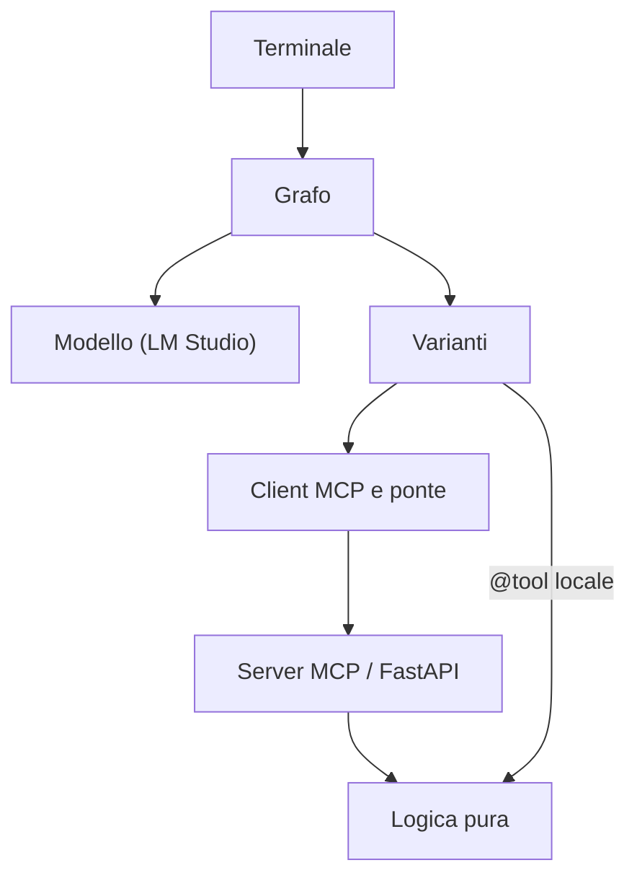
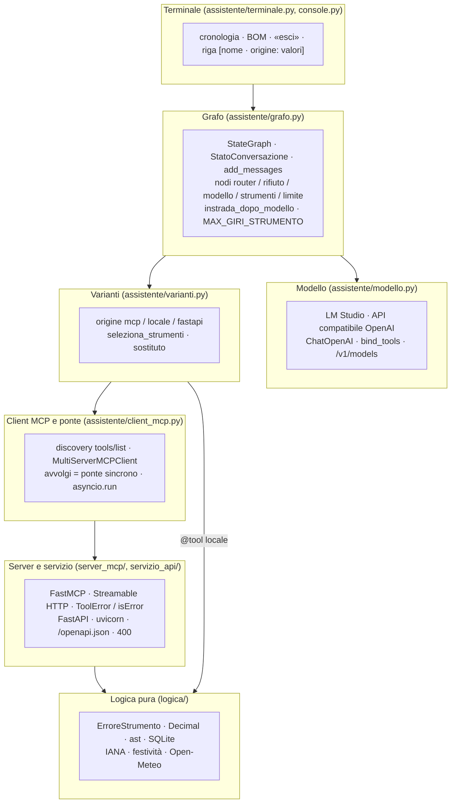

# Glossario e domande di ripasso

## Scheda in 5 minuti

**Di che cosa parla.** Questo capitolo chiude il percorso di studio. Contiene un glossario di 146 termini, le coppie da non confondere, esempi reali e 68 domande di ripasso. Serve per ripassare prima dell'orale e per scoprire che cosa non hai ancora capito.

**I dieci termini più importanti**

1. **LLM locale.** È un modello di linguaggio che gira sul tuo computer, qui servito da LM Studio. → D5, D6
2. **Tool calling.** Il modello chiede uno strumento con nome e argomenti, e il programma lo esegue davvero. → D1
3. **`ToolMessage` e `tool_call_id`.** È il messaggio con il risultato, legato alla richiesta dallo stesso identificativo. → D1, sezione 3
4. **Grafo.** È il flusso di un turno, fatto di nodi e archi: qui i nodi sono `modello`, `strumenti` e `limite`, più `router` e `rifiuto` dalla lezione 6. → D15, D16, D63
5. **MCP.** È il protocollo standard con cui un programma scopre e chiama gli strumenti di un server. → D19
6. **Host.** È l'applicazione che ospita il modello e sceglie quali strumenti dargli: qui è l'assistente. → D19, D29
7. **Discovery.** È la richiesta `tools/list`, che restituisce nome, descrizione e schema di ogni strumento. → D21
8. **Ponte sincrono.** È lo strato che rende usabili dal grafo gli strumenti MCP, che sono asincroni, e risponde sempre con una stringa. → D22
9. **Variante.** È il modo di collegare uno strumento, `mcp`, `locale` o `fastapi`, e il modello ne vede una sola per nome. → D27, D29
10. **Prova reale.** È un test con LM Studio o Docker veri, attivato solo su richiesta: solo questa dice qualcosa sul modello. → D2, D42

**Il quadro**



**Da sapere a memoria**

| Cosa | Valore | Dove |
|---|---|---|
| Giri di strumento per turno | 3 (`MAX_GIRI_STRUMENTO`) | `assistente/grafo.py:24` |
| Tempo massimo di una chiamata MCP | 10 s (`TIMEOUT_CHIAMATA`) | `assistente/client_mcp.py:16` |
| Tempo massimo del modello | 120 s, un solo nuovo tentativo | `assistente/modello.py:84-85` |
| Porte ammesse | da 1024 a 65535, solo cifre | `assistente/configurazione.py:28-34` |
| Lunghezza massima di una nota | 500 caratteri | `logica/note.py:20` |
| Variante di ogni strumento | `metadata["origine"]`, `locale` se manca | `assistente/varianti.py:51-53` |

**Se te lo chiedono all'orale**

- *Che differenza c'è tra `errore_tool` ed `errore_collegamento`?* Nel primo lo strumento ha risposto, ma con un errore, per esempio una data non valida. Nel secondo non ha risposto: server caduto o tempo scaduto.
- *Il `tool_call_id` arriva al server MCP?* No. Collega richiesta e risultato nella cronologia del modello, mentre MCP usa un suo identificativo. Per questo i due log si confrontano per strumento, argomenti e ora.
- *Come si imposta una buona risposta all'orale?* Definisci il termine, dici dove sta nel codice e mostri un esempio reale. Poi spieghi il perché e dichiari i limiti.

Per i dettagli continua con il resto del capitolo: ogni termine ha la sua voce nella sezione 2, e i rimandi «→ D N» portano alle domande della sezione 5.

---

Questo documento chiude il percorso di studio. Ha due parti:

1. un **glossario alfabetico** dei termini tecnici che compaiono nel progetto, ognuno con una definizione breve e il punto del codice in cui lo trovi;
2. **68 domande di ripasso** in stile orale, divise per tema, con una risposta sintetica e il riferimento al file o al documento da rileggere.

I riferimenti `percorso:riga` valgono per il codice attuale di `main`, dove `dev-revisione` è stato unito con il commit `846b02a`: il codice è lo stesso. I percorsi partono dalla cartella `assistente-laboratorio/`.

| Se vuoi approfondire… | leggi |
|---|---|
| i concetti generali (LLM locale, tool calling, agente) | [01 Panoramica e concetti](01-panoramica-e-concetti.md) |
| cartelle e responsabilità | [02 Architettura](02-architettura.md) |
| il percorso completo di una domanda | [03 Il viaggio di una richiesta](03-viaggio-di-una-richiesta.md) |
| stato, nodi e instradamento | [04 Il grafo LangGraph](04-grafo-langgraph.md) |
| server, client, ponte e processi | [05 MCP in pratica](05-mcp-in-pratica.md) |
| MCP, `@tool` locale e FastAPI | [06 Le tre varianti](06-tre-varianti.md) |
| i dieci strumenti | [07 Gli strumenti](07-gli-strumenti.md) |
| `.env`, avvio, Docker e fuso | [08 Configurazione, avvio e Docker](08-configurazione-avvio-docker.md) |
| test automatici e prove reali | [09 Test e verifiche](09-test-e-verifiche.md) |
| log, diagnosi e limiti noti | [10 Log e diagnosi](10-log-e-diagnosi.md) |
| storia e motivazioni delle scelte | [11 Storia del progetto](11-storia-del-progetto.md) |
| il servizio dell'agente, il back-end con PostgreSQL e la chat nel browser (lezione 6) | [13](13-agente-come-servizio.md), [14](14-backend-delle-chat.md), [15](15-chat-nel-browser.md) |
| l'ordine di studio | [00 Indice](00-indice.md) |

---

## 1. Mappa dei termini

Prima dell'elenco alfabetico, ecco dove vivono i termini principali. Ogni riquadro è un livello del progetto. Le frecce seguono il percorso di una chiamata a uno strumento.



---

## 2. Glossario alfabetico

Il glossario contiene 146 voci. Nella colonna «Dove» c'è il primo posto da aprire, non l'elenco completo di tutti gli usi.

### A

| Termine | Definizione | Dove |
|---|---|---|
| `add_messages` | *Reducer* di LangGraph per il campo `messages` dello stato. I messaggi restituiti da un nodo vengono **aggiunti** alla lista invece di sostituirla. | `assistente/grafo.py:40` |
| `add_note` | Strumento che salva una nota persistente (al massimo 500 caratteri). Restituisce `id`, `testo`, `creata` (UTC) ed `esito`. | `server_mcp/server.py:175-179`, `logica/note.py:69-85` |
| Agente | Programma che usa un LLM per decidere quali azioni compiere (qui: quali strumenti chiamare), le esegue davvero e restituisce il risultato al modello. Qui l'agente è l'assistente, nel ruolo di *host* MCP. | `assistente/` |
| `AIMessage` | Messaggio prodotto dal modello. Può contenere testo, richieste di strumento (`tool_calls`) oppure chiamate malformate (`invalid_tool_calls`). | `assistente/grafo.py:15`, `:236` |
| API compatibile con OpenAI | Interfaccia HTTP che imita quella di OpenAI (`/v1/models`, `/v1/chat/completions`). LM Studio la offre, quindi si può usare il client `ChatOpenAI`. | `assistente/modello.py:1`, `:80-87` |
| Archivio delle note | File SQLite `archivio/note.sqlite3`, fuori da Git e dall'immagine Docker. È l'unico stato che sopravvive alla sessione. | `logica/note.py:19`, `.gitignore:7` |
| `ArchivioNote` | Classe che gestisce le note. Ogni operazione apre una connessione, la esegue in una transazione e la chiude sempre. | `logica/note.py:53-119` |
| `ast` (albero sintattico) | Modulo Python che trasforma un testo in un albero di nodi. La calcolatrice lo usa con `mode="eval"` e poi visita solo i nodi ammessi, senza eseguire codice. | `logica/calcolatrice.py:91`, `:47-71` |
| `asyncio.run` | Avvia un ciclo di eventi, esegue una coroutine e lo chiude. Il ponte lo usa a ogni chiamata, perché i tool MCP sono asincroni e il grafo è sincrono. | `assistente/client_mcp.py:62`, `:86` |
| AUTOINCREMENT | Opzione SQLite della chiave primaria: l'ID di una nota eliminata non viene mai riusato. Così un ID vecchio non può indicare una nota nuova. | `logica/note.py:37-40` |
| `avvia.ps1` | Script PowerShell che avvia il container con `docker compose run --rm` e passa il fuso di Windows in `FUSO_HOST_WINDOWS`. Con `-SenzaTty` aggiunge `-T`. | `avvia.ps1:8-15` |
| `avvolgi` | Funzione del ponte. Trasforma un tool MCP asincrono in uno `StructuredTool` sincrono con stesso nome, descrizione e schema, e `metadata={"origine": "mcp"}`. | `assistente/client_mcp.py:57-77` |

### B

| Termine | Definizione | Dove |
|---|---|---|
| `BaseExceptionGroup` | Gruppo di eccezioni (Python 3.11+). Il trasporto MCP può sollevarlo: `_prima_causa` lo scende fino alla prima eccezione vera, per scrivere un messaggio leggibile. | `assistente/client_mcp.py:30-33` |
| `BaseTool` | Classe base di LangChain per gli strumenti. Tutte le varianti producono un `BaseTool`, quindi il grafo le tratta allo stesso modo. | `assistente/varianti.py:9` |
| `bind_tools` | Metodo di `ChatOpenAI` che allega al modello gli schemi degli strumenti. Così il modello sa che esistono e può chiederli. | `assistente/modello.py:87` |
| BOM | *Byte Order Mark* (`U+FEFF`), un carattere invisibile che PowerShell mette all'inizio di una pipe. Va tolto, altrimenti «esci» non verrebbe riconosciuto. | `assistente/console.py:17`, `assistente/terminale.py:63` |

### C

| Termine | Definizione | Dove |
|---|---|---|
| `calcola` | Strumento calcolatrice: espressioni con `+ - * / % **` e parentesi, in aritmetica decimale esatta, senza `eval`. Ha due varianti, `mcp` e `locale`. | `logica/calcolatrice.py:74-105` |
| `calcola_scadenza` | Strumento che aggiunge giorni di calendario o lavorativi a una data ISO. Ha due varianti, `mcp` e `fastapi`. | `logica/scadenze.py:71-112` |
| `call_id` / `tool_call_id` | Identificativo che il modello dà a ogni richiesta di strumento. Il `ToolMessage` di risposta deve riportarlo uguale, altrimenti la cronologia non è valida. Non arriva al server MCP. | `assistente/grafo.py:215-220`, README «Log» |
| Catalogo dei corsi | File JSON versionato con 12 corsi (`codice`, `titolo`, `sede`, `durata_ore`). Il server lo legge e lo valida all'avvio. | `risorse/catalogo_corsi.json`, `logica/catalogo.py:35-57` |
| `closing` | Funzione di `contextlib` che chiude la connessione SQLite all'uscita dal `with`. Il `with connessione` di sqlite3 fa solo commit o rollback, non chiude. | `logica/note.py:62-63` |
| `compose.yaml` | File di Docker Compose: quattro servizi: `assistente` (con `env_file: .env`, variabili obbligatorie, volumi `logs` e `archivio`, `extra_hosts`, `stdin_open` e `tty`, righe 2-22), `agente`, `database` e `frontend`. | `compose.yaml:1-22`, `:26`, `:51`, `:71` |
| `Configurazione` | Dataclass immutabile (`frozen=True`) con indirizzo, modello, porte e varianti, letti dalle variabili d'ambiente. | `assistente/configurazione.py:13-21` |
| `configura_flussi` | Funzione che riconfigura in UTF-8 l'ingresso e l'uscita quando non sono un terminale (pipe o file). L'ingresso usa `utf-8-sig`, che toglie il BOM. | `assistente/console.py:13-19` |
| CORS e stessa origine | Il browser di norma non lascia a una pagina leggere risposte di un'altra *origine* (schema, indirizzo e porta). Con il CORS il server può permetterlo. Qui pagina e `/api` hanno la stessa origine, perché nginx serve i file e inoltra `/api` al back-end: il CORS non serve. | `frontend/nginx/default.conf.template:18-24` |
| Context manager | Oggetto usato con `with`, che garantisce la pulizia all'uscita. Qui servono a spegnere sempre i processi (`@contextmanager`, `ExitStack`). | `assistente/avvio.py:21-46` |
| Conventional Commits | Convenzione per i messaggi di commit (`feat(grafo): …`, `fix(test): …`, `docs: …`). Qui è in italiano. | `../CLAUDE.md`, `git log` |
| CSP (Content-Security-Policy) | Intestazione con cui il server dice al browser da dove la pagina può caricare script, immagini, stili e connessioni. Qui nginx la manda su ogni risposta (`default-src 'self'`, niente media): anche se qualcosa sfugge al filtro del markdown, il browser non carica risorse da altri siti. | `frontend/nginx/sicurezza.conf:8` |
| Cronologia | Lista dei messaggi della sessione, tenuta solo in memoria dal terminale. Si perde all'uscita. Nella chat nel browser la tiene il back-end in PostgreSQL e la rimanda all'agente a ogni turno. Se un turno fallisce, resta quella di prima. | `assistente/terminale.py:59`, `:71-82` |
| `CTRL_BREAK_EVENT` | Segnale che su Windows l'assistente invia al server per chiedergli di chiudersi. Funziona solo se il processo è in un nuovo gruppo (`CREATE_NEW_PROCESS_GROUP`). | `assistente/avvio_server.py:62-63`, `:79-82` |

### D

| Termine | Definizione | Dove |
|---|---|---|
| `Decimal` | Tipo decimale esatto di Python. Calcolatrice e convertitore lo usano, così `0.1 + 0.2` dà `0.3` e non `0.30000000000000004`. | `logica/calcolatrice.py:11`, `logica/conversioni.py:4` |
| `delete_note` | Strumento che elimina una nota **solo per ID esatto**. Con un ID inesistente non elimina nulla e restituisce un errore. | `server_mcp/server.py:185-189`, `logica/note.py:101-119` |
| DOMPurify | Libreria che ripulisce l'HTML. Qui lavora sull'HTML prodotto da `marked` con un **elenco chiuso** di tag e attributi ammessi (niente immagini, audio, video, SVG, moduli, stili). | `frontend/src/lib/markdown.ts:38-42` |
| Discovery | Richiesta `tools/list` con cui il client chiede al server il catalogo degli strumenti (nome, descrizione, schema). Il server è considerato pronto solo quando la discovery riesce. | `assistente/client_mcp.py:80-87`, `assistente/avvio_server.py:161-170` |
| Docker Compose | Strumento che avvia container descritti in un file YAML. Qui avvia l'assistente, il servizio dell'agente, il database e il front-end: LM Studio resta sull'host. | `compose.yaml` |
| `Dockerfile` | Ricetta dell'immagine: `python:3.14-slim`, dipendenze di `requirements.txt` e le cartelle del codice e di `risorse/`. Imposta `ASSISTENTE_IN_DOCKER=1`. | `Dockerfile:1-18` |
| `.dockerignore` | Elenco dei file esclusi dall'immagine: `.env`, `.venv`, `tests`, `docs`, `logs`, `archivio` e altri. | `.dockerignore` |

### E

| Termine | Definizione | Dove |
|---|---|---|
| `END` / `START` | Nodi speciali di LangGraph: l'inizio e la fine del grafo. `END` vale la stringa `"__end__"`. | `assistente/grafo.py:18`, `:243-252` |
| `.env` / `.env.example` | `.env.example` è versionato e non contiene credenziali. `.env` è la copia reale, fuori da Git, letta con `python-dotenv`. | `.env.example`, `assistente/__main__.py:23` |
| `ErroreAvvio` | Eccezione per i problemi che impediscono di aprire la chat: porta occupata, processo che non parte, catalogo vuoto, nomi duplicati. | `assistente/errori.py:4` |
| `ErroreConfigurazione` | Eccezione per variabili d'ambiente mancanti o non valide. Il messaggio dice che cosa correggere. | `assistente/configurazione.py:24` |
| `ErroreServer` | Eccezione per LM Studio irraggiungibile, risposta non valida o modello non disponibile. | `assistente/modello.py:18` |
| `ErroreStrumento` | Eccezione comune a tutta la logica (sottoclasse di `ValueError`), con un messaggio in italiano per il modello. | `logica/errori.py:4` |
| `esegui_registrato` | Funzione del server che esegue lo strumento, scrive la riga di log e trasforma `ErroreStrumento` in `ToolError`. Fa anche da rete di sicurezza per gli errori imprevisti. | `server_mcp/server.py:98-109` |
| `esegui_turno` | Funzione che esegue un turno del grafo partendo da cronologia + nuovo `HumanMessage`, con `giri_strumento=0`. Restituisce la nuova cronologia senza modificare quella passata. | `assistente/grafo.py:256-269` |
| Esito | Classificazione di ogni chiamata nel log: `ok`, `errore_tool`, `errore_collegamento`, `strumento_sconosciuto`, `limite`. | `assistente/grafo.py:81-89`, `:189`, `:233` |
| `eval` | Funzione Python che esegue codice arbitrario. Nella calcolatrice è **vietata** dalla specifica: al suo posto `ast` con una lista chiusa di nodi. | `logica/calcolatrice.py:1-4` |
| `ExitStack` | Context manager che ne raccoglie altri. Se il servizio FastAPI non parte, spegne anche il server MCP già avviato. | `assistente/avvio.py:33` |
| `extra_hosts` / `host.docker.internal` | Nome con cui il container raggiunge il computer host, e quindi LM Studio. `host-gateway` lo fa funzionare anche dove non è predefinito. | `compose.yaml:19-20`, `.env.example:3` |

### F

| Termine | Definizione | Dove |
|---|---|---|
| FastAPI | Framework web Python. Qui espone `GET /scadenza` e genera da solo `/openapi.json` e `/docs`. | `servizio_api/app.py:35-67` |
| FastMCP | Libreria Python per scrivere server MCP con decoratori (`@server.tool`). Il server si chiama «Strumenti laboratorio». | `server_mcp/server.py:10`, `:123` |
| Festività | Festività nazionali italiane 2026–2028 (compreso il 4 ottobre), lette da un file locale versionato. Servono per i giorni lavorativi. | `risorse/festivita_italia.json`, `logica/scadenze.py:39-46` |
| Fixture (pytest) | Funzione che prepara una risorsa per i test, per esempio `porta` (una porta libera scelta dal sistema) e `popen_registrati`. | `tests/conftest.py:19-45` |
| Fuso orario IANA | Nome standard di un fuso, per esempio `Europe/Rome` o `Asia/Tokyo`. È valido solo se scritto esatto, maiuscole comprese. | `logica/orologio.py:17-19` |
| `FUSO_HOST_WINDOWS` | Variabile impostata da `avvia.ps1` con il nome Windows del fuso (per esempio `W. Europe Standard Time`). Viene convertita in IANA con `win_tz`. | `assistente/fuso.py:36-39` |
| `FUSO_ORARIO` | Fuso di riserva nel `.env`, usato se il rilevamento automatico non riesce. | `assistente/fuso.py:48-50`, `.env.example:7` |

### G

| Termine | Definizione | Dove |
|---|---|---|
| Geocoding | Traduzione di un nome di città in coordinate. È la prima delle due richieste del meteo. | `logica/meteo.py:15`, `:143` |
| `get_item` | Strumento che restituisce tutti i dettagli di un corso dato il **codice esatto**. | `logica/catalogo.py:100-105` |
| `get_weather` | Strumento meteo: temperatura in °C, vento in km/h e condizioni da Open-Meteo. Richiede la rete. | `logica/meteo.py:115-209` |
| Giro di strumento | Un passaggio dal nodo `strumenti`. Il contatore `giri_strumento` riparte da 0 a ogni turno. | `assistente/grafo.py:42`, `:224` |
| Grafo | Insieme di nodi e archi che descrive il flusso di un turno. Si costruisce con `StateGraph` e si compila con `.compile()`. | `assistente/grafo.py:160-253` |

### H

| Termine | Definizione | Dove |
|---|---|---|
| Host (MCP) | Applicazione che ospita il modello e decide quali capacità dargli. Qui l'agente controlla gli argomenti prima di eseguire e sceglie una sola variante per nome. | `assistente/varianti.py:3-4`, `assistente/grafo.py:194-195` |
| `httpx` | Client HTTP. Lo usano il wrapper delle scadenze, il meteo e l'attesa del servizio FastAPI. Nei test si usa `MockTransport`, che vieta la rete. | `assistente/wrapper_scadenze.py:12`, `tests/test_server_mcp.py:31-37` |
| HTTP 400 / 422 / 500 | Codici di risposta. Il servizio delle scadenze risponde 400 con `{"errore": …}` in italiano anche dove FastAPI darebbe 422 in inglese. Usa 500 solo per un errore imprevisto. | `servizio_api/app.py:30-32`, `:38-45`, `:58-61` |
| `HumanMessage` | Messaggio dell'utente aggiunto alla cronologia all'inizio di ogni turno. | `assistente/grafo.py:262` |

### I

| Termine | Definizione | Dove |
|---|---|---|
| Idempotente | Che si può ripetere senza effetti in più. `configura_registro` non aggiunge un secondo gestore se il file è già collegato. | `assistente/registro.py:27-33` |
| `Inexact` | Flag del contesto `Decimal`, che diventa vero se un passaggio ha dovuto arrotondare. Allora il risultato viene dato come float a 15 cifre, mai come intero. | `logica/calcolatrice.py:104`, `logica/numeri.py:30-34` |
| Instradamento | Scelta del nodo successivo. `instrada_dopo_modello` restituisce `END`, `"strumenti"` o `"limite"`; `instrada_dopo_router` restituisce `"modello"` o `"rifiuto"`. | `assistente/grafo.py:147-153`, `:156-157` |
| `invalid_tool_calls` | Richieste di strumento con argomenti che non sono JSON valido. Il grafo le chiude con un `ToolMessage` di errore, così la cronologia resta valida. | `assistente/grafo.py:76-79`, `:137-144` |
| `isError` | Campo del risultato MCP che segnala un errore dello strumento. FastMCP lo imposta quando lo strumento solleva `ToolError`. | `server_mcp/server.py:104` |

### J

| Termine | Definizione | Dove |
|---|---|---|
| JSON Schema | Formato che descrive gli argomenti di uno strumento (`type`, `properties`, `required`, `enum`, `minimum`…). È il contratto che il modello legge. | `logica/scadenze.py:22-27`, `logica/catalogo.py:19-30` |
| `json_response` / `stateless_http` | Opzioni del server: risposte JSON semplici invece di uno stream, e nessuna sessione tra una richiesta e l'altra. | `server_mcp/__main__.py:45-46` |

### L

| Termine | Definizione | Dove |
|---|---|---|
| LangChain (`langchain-core`) | Libreria che fornisce messaggi (`AIMessage`, `ToolMessage`…), strumenti (`BaseTool`, `@tool`) e il client `ChatOpenAI`. | `requirements.txt:2-3` |
| `langchain-mcp-adapters` | Adattatore che trasforma gli strumenti di un server MCP in tool LangChain (asincroni). | `assistente/client_mcp.py:13` |
| LangGraph | Libreria per costruire flussi di agenti come grafi con stato. | `assistente/grafo.py:18-19` |
| `limite` (nodo) | Nodo che, dopo 3 giri, chiude le chiamate in sospeso con `status="error"` e aggiunge un testo fisso di scuse. | `assistente/grafo.py:226-236` |
| `list_notes` | Strumento che elenca le note dalla più recente (10 se non indicato, da 1 a 50). Restituisce anche `totale_archivio`. | `logica/note.py:87-99` |
| LLM | *Large Language Model*: modello di linguaggio. Qui gira in locale in LM Studio, per esempio `google/gemma-4-e2b`. | `.env.example:5` |
| LM Studio | Programma che scarica e serve modelli in locale con un'API compatibile con OpenAI (porta predefinita 1234). Resta sull'host, non va containerizzato. | `assistente/modello.py`, README «Requisiti» |
| `localcontext` | Contesto `Decimal` temporaneo. Si usa per alzare la precisione a 400 cifre solo dentro il calcolo. | `logica/calcolatrice.py:95-104` |
| Log | Quattro file in `logs/`: `assistente.log`, `server_mcp.log`, `servizio_api.log` e `servizio_backend.log` (back-end delle chat), con righe `chiave=valore`. | `assistente/registro.py:9-13` |

### M

| Termine | Definizione | Dove |
|---|---|---|
| manifest (web app manifest) | File `manifest.webmanifest` con nome, icone, colori e `display: standalone`. Insieme al service worker rende la chat installabile come app. | `frontend/public/manifest.webmanifest` |
| Marcatore (pytest marker) | Etichetta di un test. `lmstudio` e `docker` segnano le prove reali, che vengono saltate senza `--lmstudio` o `--docker`. | `pytest.ini:4-6`, `tests/conftest.py:9-16` |
| `MAX_GIRI_STRUMENTO` | Numero massimo di giri di strumento per turno: 3. | `assistente/grafo.py:24` |
| MCP | *Model Context Protocol*: protocollo standard con cui un client scopre e chiama gli strumenti esposti da un server. | `server_mcp/`, `assistente/client_mcp.py` |
| MCP Inspector | Client MCP grafico, citato nel README per provare il server da solo. Non fa parte del progetto. | README «Il server MCP da solo» |
| Messaggio di sistema | `SystemMessage` con le regole per il modello: lingua, uso dell'orologio, fuso dell'utente, note, meteo, «se non hai chiamato lo strumento, non l'hai fatto». Non viene salvato nella cronologia. | `assistente/grafo.py:47-69`, `:180` |
| `metadata["origine"]` | Campo di ogni tool che dice da dove arriva: `mcp`, `locale` o `fastapi`. Finisce nel log e nella riga del terminale. | `assistente/client_mcp.py:76`, `assistente/varianti.py:51-53` |
| Modello finto | `ModelloFinto`: restituisce in ordine le risposte preparate e registra i messaggi ricevuti. Rende ripetibili i test del grafo. | `tests/finti.py:13-25` |
| `monkeypatch` | Fixture di pytest che sostituisce temporaneamente funzioni o variabili, per esempio `subprocess.Popen`. | `tests/conftest.py:29-45` |
| `MultiServerMCPClient` | Client di `langchain-mcp-adapters`. Qui ha una sola connessione, `laboratorio`, con trasporto `streamable_http` e `handle_tool_errors=False`. | `assistente/client_mcp.py:82-85` |

### N

| Termine | Definizione | Dove |
|---|---|---|
| Nodo | Funzione del grafo che riceve lo stato e restituisce un aggiornamento parziale (un `dict`). Qui i nodi sono `modello`, `strumenti` e `limite`, più `router` e `rifiuto` davanti all'agente. | `assistente/grafo.py:170-236` |
| `numero_json` | Regola d'uscita dei numeri: intero se esatto e intero, float se esatto e rappresentabile, testo se ha troppe cifre, float a 15 cifre se arrotondato. | `logica/numeri.py:20-34` |

### O

| Termine | Definizione | Dove |
|---|---|---|
| OpenAPI | Descrizione standard di un'API HTTP. FastAPI la genera in `/openapi.json`. L'assistente considera pronto il servizio solo quando vi compare `/scadenza`. | `assistente/avvio_server.py:191-194` |
| Open-Meteo | Servizio meteo pubblico senza chiave. Due richieste: geocoding e forecast. | `logica/meteo.py:15-16` |
| `ora_corrente` | Strumento orologio: data, ora, scarto da UTC e giorno della settimana in un fuso IANA. | `logica/orologio.py:33-43` |
| Origine | Vedi `metadata["origine"]`. | |

### P

| Termine | Definizione | Dove |
|---|---|---|
| Playwright | Libreria che pilota un browser vero. Qui Chromium contro il container nginx, con back-end vero e agente finto: sono le prove nel browser. | `requirements-dev.txt:3`, `tests/test_reale_browser.py` |
| PostgreSQL | Database relazionale. Qui è il servizio Compose `database` (`postgres:18.6-alpine`) con il volume `dati_postgres`, solo su `127.0.0.1`; contiene progetti, chat e messaggi. | `compose.yaml:52`, `servizio_backend/schema.sql:3-27` |
| Ponte sincrono | Strato che rende sincroni i tool MCP asincroni. Non solleva mai eccezioni verso il grafo: restituisce sempre una stringa, con il risultato oppure con l'errore in JSON. | `assistente/client_mcp.py:57-77` |
| `porta_libera` | Controllo della porta in due tempi: `bind` su 127.0.0.1, poi un tentativo di connessione. Su Windows il `bind` riesce anche se un altro programma ascolta su 0.0.0.0. | `assistente/avvio_server.py:35-47` |
| `prepara_strumenti` | Context manager che avvia il server MCP (e, se serve, il servizio FastAPI), seleziona le varianti e spegne tutto all'uscita. | `assistente/avvio.py:21-46` |
| `processo_in_attesa` | Ciclo comune ai due processi: porta libera, avvio con output nel log, prove ripetute fino al successo o alla scadenza, arresto garantito. | `assistente/avvio_server.py:85-139` |
| proxy inverso (nginx) | Server che sta davanti a un altro e gli inoltra le richieste. Qui nginx serve i file della chat e inoltra `/api` al back-end sull'host, togliendo il prefisso, con `proxy_buffering off` perché gli eventi SSE arrivino uno alla volta e con `max_fails=0` perché non metta da parte il back-end dopo un errore. | `frontend/nginx/default.conf.template:1-3`, `:18-24` |
| Prova reale | Test che usa LM Studio o Docker veri. Si attiva solo con `--lmstudio` o `--docker`, altrimenti risulta `skipped`. | `tests/test_reale_*.py` |
| `psycopg` | Libreria Python per PostgreSQL (versione 3). Il back-end la usa con SQL scritto a mano, senza ORM. | `servizio_backend/archivio.py:7`, `requirements.txt:15` |
| PWA (*progressive web app*) | Pagina web che il browser sa installare come app, con finestra e icona proprie. Qui bastano manifest, service worker e un indirizzo sicuro (`127.0.0.1`). | `frontend/public/manifest.webmanifest`, `frontend/public/sw.js` |
| Pydantic (`WithJsonSchema`) | Libreria di validazione. `Annotated[Any, WithJsonSchema(...)]` pubblica lo schema voluto ma lascia passare qualsiasi valore. Così è la logica a dare l'errore in italiano. | `assistente/calcolatrice_locale.py:26`, `server_mcp/server.py:112-113` |
| `PYTHONUTF8` | Variabile che forza Python in modalità UTF-8. Viene passata ai processi figli, così i log sono in UTF-8 anche su Windows. | `assistente/avvio_server.py:111` |

### R

| Termine | Definizione | Dove |
|---|---|---|
| router dell'ambito | Nodo LLM davanti all'agente: decide se la domanda è «conversazione» o «fuori ambito» con un output strutturato; nel secondo caso il nodo `rifiuto` risponde con un testo fisso. Se l'output non è valido, la domanda passa all'agente (`esito=errore` nel log). | `assistente/router.py:25`, `:62`, `assistente/grafo.py:156-157` |
| RAG | *Retrieval-Augmented Generation*. **Non** è nel progetto: il catalogo è ricerca esatta su dati strutturati. Il RAG arriverà nelle lezioni successive. | `logica/catalogo.py:3-4` |
| Rete di sicurezza | `except Exception` finale che trasforma un errore imprevisto in un messaggio italiano registrato nel log, invece di un traceback in inglese. | `server_mcp/server.py:105-107`, `servizio_api/app.py:58-61` |
| `requirements.txt` | Elenco delle dipendenze con versioni fissate (`==`). Un test controlla che i pacchetti importati direttamente ci siano. | `requirements.txt`, `tests/test_requisiti.py` |
| Ripiego | Ultima scelta del fuso: `UTC`, con l'avviso `ATTENZIONE: fuso orario non rilevato…` nella riga di benvenuto. | `assistente/fuso.py:11-14`, `:52-53` |
| Riserva (`.riserva-prova-docker`) | Durante la prova Docker, `logs/` e `archivio/` dell'utente vengono rinominate con questo suffisso e poi ripristinate. | `tests/cartelle_da_parte.py:18`, `:35-67` |

### S

| Termine | Definizione | Dove |
|---|---|---|
| `search_catalog` | Strumento che cerca corsi per parole. Un corso compare se **ogni** parola si trova nel codice, nel titolo o nella sede. | `logica/catalogo.py:79-97` |
| `seleziona_strumenti` | Funzione che toglie la versione MCP di ogni strumento che ha un sostituto e controlla che nessun nome sia duplicato. | `assistente/varianti.py:32-43` |
| service worker | Script che il browser esegue a parte, tra la pagina e la rete. Qui è minimo: non mette niente in cache e lascia passare le richieste, `/api/` compreso; serve solo a rendere la chat installabile. | `frontend/public/sw.js:1-8` |
| Server MCP | Processo separato (`python -m server_mcp --porta …`) che espone i dieci strumenti su `http://127.0.0.1:<porta>/mcp`. | `server_mcp/__main__.py:25-52` |
| SIGBREAK / SIGTERM | Segnali di arresto (Windows / Linux-Docker). Il server li trasforma in `KeyboardInterrupt` ed esce con codice 0. | `server_mcp/__main__.py:12-22` |
| Sostituto | Versione non MCP di uno strumento (`locale` o `fastapi`), che prende il posto di quella MCP con lo stesso nome. | `assistente/varianti.py:17-29` |
| SSE (Server-Sent Events) | Eventi mandati dal server al browser su una sola richiesta HTTP rimasta aperta, in una direzione. Qui `testo`, `strumento`, `fine` ed `errore`: la risposta compare a pezzi. | `assistente/sse.py:7`, `servizio_backend/app.py:224` |
| SQLite | Database in un solo file, incluso in Python (`sqlite3`). Qui conserva le note. | `logica/note.py:10` |
| `StateGraph` | Costruttore del grafo di LangGraph, legato al tipo dello stato. | `assistente/grafo.py:238` |
| `StatoConversazione` | `TypedDict` dello stato: `messages`, `fuso_utente`, `giri_strumento`, più `categoria` e `istruzioni` (facoltativi). | `assistente/grafo.py:39-44` |
| Streamable HTTP | Trasporto MCP su HTTP. Il server lo chiama `transport="http"`, il client `"streamable_http"`. | `server_mcp/__main__.py:40`, `assistente/client_mcp.py:83` |
| `StructuredTool` | Tool LangChain costruito da una funzione e da uno schema degli argomenti. Lo usano il ponte e i test. | `assistente/client_mcp.py:71-77` |
| Svelte e rune | Svelte 5 è il framework della chat; le *rune* (`$state`) dichiarano lo stato che aggiorna la pagina da solo. Lo stato dell'app sta nella classe `StatoApp`. | `frontend/src/lib/stato.svelte.ts:29`, `:38` |
| Superpowers | Metodo di lavoro del corso: brainstorming, specifica, piano, implementazione per piccoli passi, verifica e checkpoint. | `docs/superpowers/` |

### T

| Termine | Definizione | Dove |
|---|---|---|
| Timeout | Tempi massimi: 120 s per il modello, 10 s per una chiamata MCP, 5 s per il wrapper FastAPI, 4 s per fase e 8 s in totale per il meteo, 10 s per l'avvio di un processo, 5 s per l'arresto. | `modello.py:84`, `client_mcp.py:16`, `wrapper_scadenze.py:19`, `meteo.py:17-20`, `avvio_server.py:25-26` |
| `@tool` | Decoratore di LangChain che trasforma una funzione Python in uno strumento. Nome, descrizione e schema vengono dalla firma e dalla docstring. | `assistente/calcolatrice_locale.py:25`, `assistente/wrapper_scadenze.py:45` |
| Tool calling | Capacità del modello di rispondere con una richiesta strutturata di strumento (nome + argomenti JSON) invece che con un testo. Lo strumento lo esegue poi il programma. | `assistente/grafo.py:184-224` |
| `ToolError` | Eccezione di FastMCP. Sollevata da uno strumento, diventa un risultato MCP con `isError`. | `server_mcp/server.py:11`, `:104` |
| `ToolException` | Eccezione di LangChain che l'adattatore MCP solleva quando il risultato ha `isError` (perché `handle_tool_errors=False`). Il ponte la traduce in `tipo: strumento`. | `assistente/client_mcp.py:63-64` |
| `ToolMessage` | Messaggio con il risultato di uno strumento, legato alla richiesta dal `tool_call_id`. Ha `status` `success` o `error`. | `assistente/grafo.py:215-220` |
| Trasporto | Modo in cui client e server MCP si parlano. Qui c'è solo Streamable HTTP: stdio è escluso dalla specifica. | `docs/superpowers/specs/2026-11-08-strumenti-lezione-5-design.md` §3 |
| `TypedDict` | Dizionario con chiavi e tipi dichiarati. Si usa per lo stato del grafo. | `assistente/grafo.py:39` |
| `tzlocal` / `win_tz` | Libreria che legge il fuso del computer, e tabella che traduce i nomi Windows in IANA (`W. Europe Standard Time` → `Europe/Berlin`). | `assistente/fuso.py:6-7` |

### U

| Termine | Definizione | Dove |
|---|---|---|
| UTF-8 | Codifica dei caratteri. Su Windows le pipe sarebbero in cp1252: `configura_flussi` le porta in UTF-8, così accenti ed emoji non rompono la sessione. | `assistente/console.py` |
| uvicorn | Server ASGI che esegue l'applicazione FastAPI (e, internamente, quella di FastMCP). | `servizio_api/__main__.py:38` |

### V

| Termine | Definizione | Dove |
|---|---|---|
| Vitest | Strumento di prova del front-end (`npm test`): prove di logica come lettore SSE, markdown, stato e API; 108 passati il 12/11/2026. | `frontend/package.json:10`, `:24` |
| Variante | Modo di collegare uno strumento: `mcp` (tutti), `locale` (solo `calcola`), `fastapi` (solo `calcola_scadenza`). Si sceglie nel `.env` e il modello ne vede una sola per nome. | `assistente/configurazione.py:7-8`, `assistente/varianti.py` |
| `verifica_server` | Controllo all'avvio: `GET <base_url>/models`, poi verifica che `LMSTUDIO_MODEL` sia nell'elenco. | `assistente/modello.py:42-76` |
| Volume (bind mount) | Cartella dell'host montata nel container (`./logs:/app/logs`, `./archivio:/app/archivio`). Log e note sopravvivono a `--rm`. | `compose.yaml:14-18` |

### W

| Termine | Definizione | Dove |
|---|---|---|
| WMO (codici) | Codici meteo numerici standard usati da Open-Meteo. Qui sono tradotti in italiano (0 = «sereno», 95 = «temporale»…). | `logica/meteo.py:28-57` |
| Wrapper | Strato sottile scritto a mano che traduce una chiamata di strumento in una richiesta HTTP e la risposta in un risultato per il grafo. | `assistente/wrapper_scadenze.py:35-79` |

---

## 3. Coppie da non confondere

All'orale gli errori più frequenti nascono da due termini simili. Ecco le coppie da tenere distinte.

| Coppia | Differenza | Dove |
|---|---|---|
| `errore_tool` / `errore_collegamento` | Il primo: lo strumento ha risposto, ma con un errore di dominio (data non valida, città non trovata). Il secondo: lo strumento non ha risposto (server caduto, timeout). Il grafo li distingue con `"tipo": "collegamento"`. Attenzione: un errore di rete del **meteo** è `errore_tool`, perché il server MCP ha risposto e l'errore viene dallo strumento. | `assistente/grafo.py:66-74`, `logica/meteo.py:68-86` |
| `call_id` del modello / ID della richiesta MCP | Il primo collega `AIMessage` e `ToolMessage` nella cronologia. Il secondo è del protocollo MCP e non coincide. Le tracce dei due log si confrontano per strumento, argomenti e ora. | README «Log» |
| Processo acceso / server pronto | Un processo vivo o un HTTP 200 non bastano. Il server MCP è pronto quando la **discovery** riesce, il servizio FastAPI quando `/openapi.json` descrive `/scadenza`. | `assistente/avvio_server.py:157-170`, `:187-194` |
| Turno / giro | Un turno è una domanda dell'utente con la sua risposta. Un giro è un passaggio dal nodo `strumenti` dentro il turno: al massimo 3. | `assistente/grafo.py:24`, `:256-269` |
| Cronologia / note | Nel terminale la cronologia è in memoria e muore con la sessione; nella chat nel browser sta in PostgreSQL. Le note sono su disco (SQLite) e sopravvivono. | `assistente/terminale.py:59`, `logica/note.py:19` |
| `ToolError` / `ToolException` | `ToolError` lo solleva il **server** (FastMCP). `ToolException` arriva al **client**, sollevata dall'adattatore quando vede `isError`. | `server_mcp/server.py:104`, `assistente/client_mcp.py:63` |
| Variante `locale` / origine `locale` predefinita | `locale` è una variante vera della calcolatrice. È anche il valore di ripiego quando un tool non ha `metadata["origine"]`. | `assistente/varianti.py:51-53` |
| `LMSTUDIO_BASE_URL` / `LMSTUDIO_BASE_URL_DOCKER` | Il primo vale dall'host (`localhost`). Il secondo vale dal container (`host.docker.internal`): Compose lo passa all'app con il nome del primo. | `compose.yaml:7`, `.env.example:2-3` |
| Risposta plausibile / strumento usato | Una frase giusta non prova niente. Lo provano la riga `[nome · origine: …]` nel terminale e la riga `origine=… tool=…` in `logs/assistente.log`. | `assistente/terminale.py:20-38`, README «Log» |

---

## 4. Esempi reali da citare

Questi risultati sono stati ottenuti eseguendo la logica pura, il modello finto (`tests/finti.py`) e il client MCP in memoria (`con_client` di `tests/test_server_mcp.py`), senza LM Studio e senza rete.

**Calcolatrice** (`logica/calcolatrice.py`):

```text
calcola("(3 + 4) * 2")      → {"espressione": "(3 + 4) * 2", "risultato": 14}
calcola("0.1 + 0.2")        → risultato 0.3            (Decimal, non float)
calcola("1 / 3")            → risultato 0.333333333333333   (Inexact: 15 cifre, mai intero)
calcola("__import__('os')") → ERRORE: Carattere non consentito: '_'. …
calcola("2 // 3")           → ERRORE: Operazione non consentita.
calcola("2,5 * 2")          → ERRORE: Usa il punto come separatore decimale, per esempio 2.5.
```

**Scadenza** (`logica/scadenze.py`), con il caso delle prove reali:

```json
{"data_inizio": "2026-12-23", "giorni": 3, "lavorativi": true, "scadenza": "2026-12-29",
 "giorno_settimana": "martedì", "festivita_saltate": ["2026-12-25 Natale", "2026-12-26 Santo Stefano"],
 "nota": "Calcolo indicativo: non ha valore legale."}
```

**Riga di log** prodotta da `formatta` (`assistente/registro.py:15-24`):

```text
origine=mcp tool=calcola call_id=c1 argomenti={"espressione":"(3+4)*2"} esito=ok risultato={"risultato":14}
```

**Grafo con modello finto.** Un turno «che ore sono a Tokyo?» produce `HumanMessage` → `AIMessage` (con `tool_calls` `ora_corrente`, `fuso: Asia/Tokyo`) → `ToolMessage` (`status=success`) → `AIMessage` finale.

Se il modello chiede uno strumento 4 volte di fila, la cronologia ha 10 messaggi: 1 umano, 3 coppie richiesta/risultato, la 4ª richiesta, un `ToolMessage` «limite di chiamate raggiunto» e il testo fisso `TESTO_LIMITE`.

**Controlli dell'host** (`assistente/grafo.py:97-119`, `:192-213`):

```text
argomento inventato  → {"errore": "Argomenti non previsti per ora_corrente: citta. Usa solo: fuso.", "tipo": "strumento"}
strumento inesistente → {"errore": "Strumento sconosciuto: 'inesistente'."}
```

**Client MCP in memoria.** Il catalogo restituisce i 10 nomi. `get_item` con `XX-99` dà `is_error=True` e il testo «Nessun corso con codice 'XX-99'. Usa prima search_catalog per trovare il codice.». `delete_note` con 99 dà «Nessuna nota con ID 99: niente è stato eliminato.».

Con il client HTTP che vieta la rete, `get_weather` risponde «Errore interno dello strumento get_weather: AssertionError.». È la rete di sicurezza di `esegui_registrato` in azione: un errore imprevisto diventa un messaggio italiano, non un traceback.

**Configurazione e fuso:**

```text
MCP_PORTA=80                        → MCP_PORTA non valida: '80'. Usa un numero intero tra 1024 e 65535, per esempio 8765.
API_PORTA uguale a MCP_PORTA        → API_PORTA deve essere diversa da MCP_PORTA.
FUSO_HOST_WINDOWS=W. Europe Standard Time → Europe/Berlin (host Windows)
ASSISTENTE_IN_DOCKER=1, niente altro      → UTC (ripiego) con avviso
```

---

## 5. Domande di ripasso

Prova a rispondere ad alta voce prima di aprire la risposta. Ogni risposta finisce con il riferimento da rileggere.

### 5.1 Concetti

<details>
<summary><b>D1.</b> Che cos'è il tool calling e chi esegue davvero lo strumento?</summary>

Il modello non esegue niente: risponde con un `AIMessage` che contiene `tool_calls` (nome + argomenti JSON + `id`). È il programma, nel nodo `strumenti`, a eseguire lo strumento. Il risultato torna al modello come `ToolMessage` con lo stesso `tool_call_id`.
→ `assistente/grafo.py:184-224`; [01](01-panoramica-e-concetti.md), [03](03-viaggio-di-una-richiesta.md)
</details>

<details>
<summary><b>D2.</b> Perché una risposta simulata non dimostra che il modello sappia usare lo strumento?</summary>

Con il modello finto le richieste di strumento le scriviamo noi (`chiamata_orologio`, `chiamata`). Il test prova che il **grafo** gestisce correttamente la richiesta, non che il **modello locale** la produca. Per questo esistono le prove reali con LM Studio, separate.
→ `tests/finti.py:28-37`, `../CLAUDE.md` «Test e verifiche»; [09](09-test-e-verifiche.md)
</details>

<details>
<summary><b>D3.</b> Dove sta la cronologia e quanto dura?</summary>

In una lista di messaggi in memoria, nella funzione `esegui_sessione`. Ogni turno riceve la cronologia precedente e ne restituisce una nuova, senza modificare quella passata. Alla chiusura si perde: niente persistenza. Le uniche informazioni persistenti sono le note.
→ `assistente/terminale.py:59-82`, `assistente/grafo.py:256-269`
</details>

<details>
<summary><b>D4.</b> Il messaggio di sistema è salvato nella cronologia?</summary>

No. Il nodo `modello` lo ricrea a ogni chiamata e lo mette in testa ai messaggi: `[messaggio_sistema(fuso), *stato["messages"]]`. Così contiene sempre il fuso corrente e non si duplica.
→ `assistente/grafo.py:177-182`
</details>

<details>
<summary><b>D5.</b> Che cosa significa che il modello «resta sull'host»?</summary>

LM Studio gira sul computer dell'utente e non va mai containerizzato. L'assistente lo raggiunge via HTTP: da fuori Docker con `http://localhost:1234/v1`, dal container con `http://host.docker.internal:1234/v1`.
→ `.env.example:2-3`, `compose.yaml:7`; [08](08-configurazione-avvio-docker.md)
</details>

<details>
<summary><b>D6.</b> Perché l'identificativo del modello non si può inventare?</summary>

Perché all'avvio `verifica_server` chiede `GET /models` e controlla che `LMSTUDIO_MODEL` sia nell'elenco. Se non c'è, esce con un errore che elenca i modelli disponibili. L'identificativo giusto è quello restituito dal server.
→ `assistente/modello.py:42-76`
</details>

<details>
<summary><b>D7.</b> Perché serve una chiave API se LM Studio non la controlla?</summary>

La libreria `ChatOpenAI` ne esige una. Il progetto passa il segnaposto `"lm-studio"`, che non è una credenziale.
→ `assistente/modello.py:14-15`, `:83`
</details>

### 5.2 Architettura

<details>
<summary><b>D8.</b> Quali sono le cartelle principali e che cosa contengono?</summary>

- `logica/`: logica pura degli strumenti, senza dipendenze da MCP, FastAPI o LangChain.
- `server_mcp/`: registrazione MCP.
- `servizio_api/`: servizio FastAPI delle scadenze.
- `assistente/`: grafo, modello, client MCP, varianti, avvio dei processi, terminale.
- `risorse/`: dati versionati (catalogo, festività).
- `archivio/` e `logs/`: fuori da Git.

→ `logica/__init__.py:1`, README (paragrafo «Struttura»); [02](02-architettura.md)
</details>

<details>
<summary><b>D9.</b> Perché la logica è separata dalla registrazione MCP?</summary>

Per scriverla una volta sola e riusarla in tutte le varianti. `logica.calcolatrice.calcola` la usano sia il server MCP sia la variante locale; `logica.scadenze.calcola_scadenza` sia il server sia FastAPI. La specifica considera un fallimento la logica duplicata.
→ `server_mcp/server.py:14-29`, `assistente/calcolatrice_locale.py:15-16`, `servizio_api/app.py:17`
</details>

<details>
<summary><b>D10.</b> Descrivi la sequenza di avvio di <code>python -m assistente</code>.</summary>

1. `configura_flussi` (UTF-8 per pipe e file);
2. `load_dotenv(override=False)`;
3. `carica_configurazione`;
4. `configura_registro`;
5. `verifica_server` (LM Studio e modello);
6. `rileva_fuso`;
7. `prepara_strumenti`, che avvia il server MCP (ed eventualmente FastAPI) e seleziona le varianti;
8. `crea_modello` + `crea_grafo`;
9. `esegui_sessione`.

→ `assistente/__main__.py:20-37`
</details>

<details>
<summary><b>D11.</b> Con quale codice esce il programma in caso di errore di avvio?</summary>

Codice 1, con `Errore: …` su stderr, per `ErroreConfigurazione`, `ErroreServer` o `ErroreAvvio`. Con `Ctrl+C` stampa «Arrivederci.» ed esce con 0.
→ `assistente/__main__.py:31-37`
</details>

<details>
<summary><b>D12.</b> Perché <code>load_dotenv(override=False)</code>?</summary>

Perché le variabili già presenti nell'ambiente devono avere la precedenza sul `.env`. Le prove reali e Docker (`-e VARIANTE_…`) forzano le varianti proprio così.
→ `assistente/__main__.py:23`, `tests/reale.py:41-44`
</details>

<details>
<summary><b>D13.</b> Come viene rilevato il fuso dell'utente e quando?</summary>

Una volta sola all'avvio, in quest'ordine:

1. `FUSO_HOST_WINDOWS` convertito con `win_tz`;
2. fuso del computer, ma solo se `ASSISTENTE_IN_DOCKER` non vale `1`;
3. `FUSO_ORARIO`;
4. `UTC` con avviso.

→ `assistente/fuso.py:31-53`
</details>

<details>
<summary><b>D14.</b> Perché in Italia la riga di benvenuto può mostrare <code>Europe/Berlin</code>?</summary>

Windows chiama il fuso dell'Europa centrale `W. Europe Standard Time`, e la tabella standard `win_tz` lo traduce in `Europe/Berlin`. È la stessa ora di Roma.
→ `assistente/fuso.py:36-39`, README «Diagnosi»
</details>

### 5.3 Il grafo (domande trasversali a concetti e architettura)

<details>
<summary><b>D15.</b> Quali campi ha lo stato del grafo?</summary>

- `messages`: lista con il reducer `add_messages`, che aggiunge invece di sostituire;
- `fuso_utente`: stringa;
- `giri_strumento`: contatore dei giri nel turno corrente.

→ `assistente/grafo.py:39-44`; [04](04-grafo-langgraph.md)
</details>

<details>
<summary><b>D16.</b> Disegna il grafo e spiega l'instradamento.</summary>

`START → modello`. Dopo `modello`, `instrada_dopo_modello` sceglie:

- `END` se l'ultimo messaggio non ha richieste di strumento, né valide né malformate;
- `"limite"` se `giri_strumento >= 3`;
- altrimenti `"strumenti"`.

`strumenti → modello`, `limite → END`.
→ `assistente/grafo.py:147-153`, `:238-252`
</details>

<details>
<summary><b>D17.</b> Che cosa fa il nodo <code>limite</code> e perché chiude le chiamate in sospeso?</summary>

Per ogni richiesta rimasta aperta aggiunge un `ToolMessage` con `status="error"` e `{"errore": "limite di chiamate raggiunto"}`, poi un `AIMessage` con `TESTO_LIMITE`. Senza quei `ToolMessage` la cronologia avrebbe richieste senza risposta, e la chiamata successiva al modello sarebbe invalida.
→ `assistente/grafo.py:226-236`
</details>

<details>
<summary><b>D18.</b> Che cosa succede se il modello manda argomenti non JSON?</summary>

Finiscono in `invalid_tool_calls`. L'instradamento li considera comunque richieste e li manda a `strumenti`, che li chiude con `TESTO_NON_JSON` e `status="error"`. Nel log compaiono con `origine=sconosciuta`.
→ `assistente/grafo.py:76-79`, `:137-144`, `:223`
</details>

### 5.4 MCP

<details>
<summary><b>D19.</b> Che cos'è MCP e quali ruoli ci sono nel progetto?</summary>

È un protocollo standard per esporre strumenti a un modello. I ruoli:

- **server**: `server_mcp`, scritto con FastMCP, espone i 10 strumenti;
- **client**: `MultiServerMCPClient` in `client_mcp.py`, fa discovery e chiamate;
- **host**: l'assistente, che decide quali strumenti passare al modello e controlla gli argomenti.

→ `server_mcp/server.py:116-195`, `assistente/client_mcp.py`, `assistente/varianti.py:3-4`; [05](05-mcp-in-pratica.md)
</details>

<details>
<summary><b>D20.</b> Che trasporto usa il server e a quale indirizzo ascolta?</summary>

Streamable HTTP (`transport="http"`), solo su `127.0.0.1`, percorso `/mcp`, con `stateless_http=True` e `json_response=True`. L'indirizzo è `http://127.0.0.1:<MCP_PORTA>/mcp`.
→ `server_mcp/__main__.py:39-48`, `assistente/avvio_server.py:142-143`
</details>

<details>
<summary><b>D21.</b> Che cos'è la discovery e perché decide quando il server è pronto?</summary>

È la richiesta `tools/list`, che restituisce nome, descrizione e schema di ogni strumento. L'assistente ripete la discovery finché riesce, fino a 10 s. Un processo acceso o un HTTP 200 non provano che il server sappia rispondere al protocollo. Con un catalogo vuoto l'avvio fallisce («non espone nessuno strumento»).
→ `assistente/avvio_server.py:154-170`, `:115-127`
</details>

<details>
<summary><b>D22.</b> Perché serve un ponte sincrono e come funziona?</summary>

I tool di `langchain-mcp-adapters` sono solo asincroni, mentre il grafo è sincrono. `avvolgi` crea uno `StructuredTool` sincrono che esegue `asyncio.run(asyncio.wait_for(strumento.ainvoke(argomenti), 10))`. Non solleva mai eccezioni: restituisce sempre una stringa.
→ `assistente/client_mcp.py:57-77`
</details>

<details>
<summary><b>D23.</b> Come viaggia un errore dello strumento dal server al grafo?</summary>

1. La logica solleva `ErroreStrumento`.
2. `esegui_registrato` la registra nel log e la trasforma in `ToolError`.
3. FastMCP risponde con `isError`.
4. L'adattatore (con `handle_tool_errors=False`) solleva `ToolException`.
5. Il ponte restituisce `{"errore": "...", "tipo": "strumento"}`.
6. Il grafo segna `esito=errore_tool` e crea un `ToolMessage` con `status="error"`.

→ `server_mcp/server.py:98-109`, `assistente/client_mcp.py:63-64`, `:84`, `assistente/grafo.py:81-89`
</details>

<details>
<summary><b>D24.</b> E se il server è caduto o non risponde?</summary>

Il ponte cattura `TimeoutError` (dopo 10 s) e scrive «Server MCP: nessuna risposta entro 10 secondi.». Ogni altra eccezione, compresi gli `ExceptionGroup` del trasporto, diventa «Server MCP non raggiungibile: …». In entrambi i casi `tipo: collegamento`, e il grafo registra `esito=errore_collegamento`. L'assistente non riavvia il server.
→ `assistente/client_mcp.py:65-68`, README «Diagnosi»
</details>

<details>
<summary><b>D25.</b> Come viene spento il server all'uscita, anche su Windows?</summary>

`ferma` invia `CTRL_BREAK_EVENT` su Windows (il processo è nato con `CREATE_NEW_PROCESS_GROUP`) oppure `terminate` altrove. Poi aspetta 5 s e, se il processo è ancora vivo, lo uccide con `kill`, anche dopo un secondo `Ctrl+C`. Il server trasforma SIGBREAK/SIGTERM in `KeyboardInterrupt`, esce con codice 0 e scrive «arresto server».
→ `assistente/avvio_server.py:58-82`, `server_mcp/__main__.py:12-52`
</details>

<details>
<summary><b>D26.</b> Perché il controllo della porta fa anche una connessione di prova?</summary>

Su Windows il `bind` su 127.0.0.1 riesce anche se un altro programma ascolta su 0.0.0.0. Se una connessione di prova riceve risposta, la porta è comunque occupata e l'avvio si ferma con «Porta … già in uso».
→ `assistente/avvio_server.py:35-47`, `:97-100`
</details>

### 5.5 Varianti

<details>
<summary><b>D27.</b> Quali sono le tre varianti e quali strumenti le hanno?</summary>

- `mcp`: tutti e dieci gli strumenti, nel server.
- `locale`: solo `calcola`, come funzione `@tool` nel processo dell'assistente.
- `fastapi`: solo `calcola_scadenza`, come servizio HTTP più un wrapper `@tool` scritto a mano.

→ `assistente/configurazione.py:7-8`; [06](06-tre-varianti.md)
</details>

<details>
<summary><b>D28.</b> Perché la calcolatrice in locale e le scadenze in FastAPI?</summary>

La calcolatrice è un calcolo puro e interno: è il caso tipico in cui una funzione locale basta. Le scadenze hanno argomenti semplici da passare in una query HTTP e un risultato deterministico, quindi le due varianti si confrontano al valore esatto.
→ `docs/superpowers/specs/2026-11-08-strumenti-lezione-5-design.md` §1; [11](11-storia-del-progetto.md)
</details>

<details>
<summary><b>D29.</b> Come si garantisce che il modello veda una sola versione per nome?</summary>

`crea_sostituti` costruisce le versioni non MCP richieste dal `.env`. `seleziona_strumenti` toglie dalla lista MCP gli strumenti con lo stesso nome, aggiunge i sostituti e solleva `ErroreAvvio` se un nome compare due volte.
→ `assistente/varianti.py:17-43`
</details>

<details>
<summary><b>D30.</b> Come si vede quale variante è stata usata?</summary>

Ci sono tre segni:

- nella riga di benvenuto: `calcola (locale)`;
- nella riga del terminale: `[calcola · locale: (3+4)*2]`;
- nel log `assistente.log`: `origine=locale`.

Con `locale` la chiamata non compare in `server_mcp.log`. Con `fastapi` compare in `servizio_api.log`.
→ `assistente/terminale.py:53-54`, `:20-38`, README «Varianti di uno strumento»
</details>

<details>
<summary><b>D31.</b> Che cosa ha in più (o in meno) il wrapper FastAPI rispetto alla variante MCP?</summary>

Non c'è discovery: nome, descrizione e schema sono scritti a mano, e un test controlla che coincidano con quelli MCP. Gli errori vengono tradotti così:

- 200 con un oggetto → risultato;
- 400/500 con `errore` → `tipo: strumento`;
- timeout (5 s), rete o risposta strana → `tipo: collegamento`;
- URL impossibile da costruire → `tipo: strumento`.

→ `assistente/wrapper_scadenze.py:1-79`
</details>

<details>
<summary><b>D32.</b> Le due varianti delle scadenze si comportano sempre uguale?</summary>

Per argomenti del tipo giusto danno lo stesso risultato e gli stessi errori. FastAPI però è più tollerante, perché in HTTP i valori viaggiano come testo: accetta `lavorativi="yes"` o `1`, e `giorni="3.0"`, che la variante MCP rifiuta.
→ README «Varianti di uno strumento», `servizio_api/app.py:47-52`
</details>

### 5.6 Strumenti

<details>
<summary><b>D33.</b> Elenca i dieci strumenti con i loro argomenti.</summary>

- `ora_corrente(fuso)`
- `converti_unita(valore, da, a)`
- `calcola(espressione)`
- `calcola_scadenza(data_inizio, giorni, lavorativi)`
- `search_catalog(query, max_results)`
- `get_item(code)`
- `add_note(text)`
- `list_notes(limit)`
- `delete_note(note_id)`
- `get_weather(city)`

→ `server_mcp/server.py:32-41`, `:128-193`; [07](07-gli-strumenti.md)
</details>

<details>
<summary><b>D34.</b> Come fa la calcolatrice a essere sicura senza <code>eval</code>?</summary>

Applica, in ordine, questi controlli:

1. accetta solo testi di al massimo 200 caratteri, con caratteri da `0123456789.+-*/%() `;
2. trasforma il testo in un albero con `ast.parse(mode="eval")`;
3. visita solo `Constant`, `UnaryOp` (`+`, `-`) e `BinOp` (`+ - * / % **`): qualsiasi altro nodo dà «Operazione non consentita»;
4. ammette solo esponenti interi tra -1000 e 1000;
5. rifiuta i risultati con valore assoluto da `1e300` in su.

→ `logica/calcolatrice.py:16-105`
</details>

<details>
<summary><b>D35.</b> Perché <code>1 / 3</code> dà <code>0.333333333333333</code> e non un intero o un numero lunghissimo?</summary>

Il contesto `Decimal` ha precisione 400. Se un passaggio ha arrotondato, il flag `Inexact` è vero e `numero_json` restituisce un float a 15 cifre significative, mai un intero, per non presentare come esatto un valore arrotondato.
→ `logica/calcolatrice.py:95-105`, `logica/numeri.py:20-34`
</details>

<details>
<summary><b>D36.</b> Come si contano i giorni lavorativi in <code>calcola_scadenza</code>?</summary>

Si parte dal giorno **successivo** alla data di inizio. Si contano solo i giorni da lunedì a venerdì che non sono festività nazionali, e le festività incontrate vanno in `festivita_saltate`. Le festività sono disponibili solo per il 2026–2028: uscendo da questi anni si ottiene un errore. Esempio: 2026-12-23 + 3 lavorativi → 2026-12-29.
→ `logica/scadenze.py:71-112`
</details>

<details>
<summary><b>D37.</b> Come cerca <code>search_catalog</code> e che cosa restituisce se non trova nulla?</summary>

Normalizza la query (`casefold`, apostrofo tipografico → semplice) e la divide in parole. Un corso compare se ogni parola è contenuta nel testo «codice titolo sede». Senza risultati restituisce una lista vuota con `totale: 0`, mai un errore né un corso inventato. `max_results` vale 5 se omesso o `null`, da 1 a 20.
→ `logica/catalogo.py:60-97`
</details>

<details>
<summary><b>D38.</b> Quali garanzie offre <code>delete_note</code>?</summary>

- Elimina solo per ID intero positivo.
- Con un ID inesistente risponde «Nessuna nota con ID …: niente è stato eliminato.».
- Gli ID sono `AUTOINCREMENT`, quindi non vengono riusati.
- Se un altro processo ha appena eliminato la nota, il controllo `rowcount != 1` evita un falso successo.
- Ogni modifica riuscita lascia `modifica note operazione=eliminazione id=…` in `server_mcp.log`.

→ `logica/note.py:101-119`, `server_mcp/server.py:185-189`
</details>

<details>
<summary><b>D39.</b> Come distingue il meteo un problema di rete da una città inesistente?</summary>

Timeout ed errori di trasporto diventano «Servizio meteo: nessuna risposta…» o «Servizio meteo non disponibile…». Un elenco vuoto del geocoding diventa «Città non trovata: '…'». Una risposta malformata diventa «Risposta non valida dal servizio meteo». Nessun dato viene mai inventato.
→ `logica/meteo.py:68-86`, `:143-148`
</details>

<details>
<summary><b>D40.</b> Perché il meteo ha due limiti di tempo, 4 s e 8 s?</summary>

Il limite di 4 s vale per ogni fase di `httpx` (connessione, lettura…), ma non limita la durata totale né la risoluzione DNS. Gli 8 s sono la scadenza totale, imposta con un `ThreadPoolExecutor`. Restano sotto i 10 s del ponte, così l'errore arriva dal meteo e non come «Server MCP: nessuna risposta».
→ `logica/meteo.py:17-20`, `:115-126`
</details>

<details>
<summary><b>D41.</b> Che cosa succede se il meteo sceglie una città diversa da quella chiesta?</summary>

Lo dichiara. `altre_corrispondenze` elenca fino a 4 omonimi. Se il nome scelto è diverso da quello richiesto (per esempio `Pordenon` → Pordenone), il risultato contiene una `nota`. Il messaggio di sistema chiede al modello di riferirla.
→ `logica/meteo.py:179-209`, `assistente/grafo.py:64-65`
</details>

### 5.7 Test

<details>
<summary><b>D42.</b> Come si eseguono i test e come sono separate le prove reali?</summary>

`python -m pytest` esegue i test automatici. Le prove reali sono marcate `lmstudio` o `docker` e `conftest.py` le salta se manca l'opzione `--lmstudio` o `--docker`. Per attivarle: `python -m pytest --lmstudio -m lmstudio -v -s` oppure `--docker -m docker`. Al momento della scrittura `pytest --collect-only` raccoglie 503 test, di cui 36 prove reali.
→ `tests/conftest.py:4-16`, `pytest.ini`; [09](09-test-e-verifiche.md)
</details>

<details>
<summary><b>D43.</b> Che cos'è il modello finto e che cosa permette di verificare?</summary>

`ModelloFinto` restituisce, una dopo l'altra, le risposte preparate (messaggi o eccezioni) e registra i messaggi ricevuti. Permette di verificare in modo ripetibile instradamento, limite, cronologia, controlli sugli argomenti e log, senza LM Studio.
→ `tests/finti.py:13-25`, `tests/test_grafo.py`
</details>

<details>
<summary><b>D44.</b> Come si prova l'orologio con un istante controllato?</summary>

`orologio_finto(istante)` usa la stessa logica di `ora_corrente`, ma con un `datetime` fisso invece di `ora_utc`. Anche il server accetta `adesso` iniettabile in `crea_server`.
→ `tests/finti.py:50-61`, `server_mcp/server.py:116-122`
</details>

<details>
<summary><b>D45.</b> Come fanno i test del server a non usare la rete e a non toccare le note reali?</summary>

`con_client` crea un client FastMCP **in memoria** sul server, senza HTTP. Passa `http_senza_rete()`, un `httpx.MockTransport` che fallisce a ogni richiesta, e un archivio delle note in una cartella temporanea.
→ `tests/test_server_mcp.py:31-55`
</details>

<details>
<summary><b>D46.</b> Perché le prove reali usano un archivio delle note temporaneo?</summary>

Il modello potrebbe chiamare `add_note` o `delete_note` anche durante le prove di altri strumenti. `ambiente_reale` avvia il server con `--note` su un file in una cartella `note_prova_…`, poi la elimina.
→ `tests/reale.py:21-63`
</details>

<details>
<summary><b>D47.</b> Che cosa protegge <code>cartelle_da_parte</code> nella prova Docker?</summary>

I dati dell'utente. Rinomina `logs/` e `archivio/` in `*.riserva-prova-docker`, elimina solo le cartelle create durante la prova e poi ripristina gli originali. Se trova una riserva già presente, residuo di una prova interrotta, si ferma senza toccare nulla.
→ `tests/cartelle_da_parte.py:1-67`
</details>

<details>
<summary><b>D48.</b> Perché c'è <code>esegui_con_limite</code> invece di <code>subprocess.run(timeout=…)</code>?</summary>

`subprocess.run` termina solo il processo diretto. Se PowerShell ha avviato `docker.exe`, che tiene aperte le pipe, la lettura resta appesa. `esegui_con_limite` alla scadenza termina l'intero albero dei processi (`taskkill /T /F` su Windows).
→ `tests/processi.py:1-55`
</details>

### 5.8 Docker

<details>
<summary><b>D49.</b> Che cosa contiene l'immagine e che cosa resta fuori?</summary>

Contiene `python:3.14-slim`, le dipendenze di `requirements.txt`, `assistente/`, `logica/`, `server_mcp/`, `servizio_api/` e `risorse/`. Restano fuori, per `.dockerignore`: `.env`, `.venv`, `tests`, `docs`, `logs`, `archivio` e le cartelle di riserva.
→ `Dockerfile:1-18`, `.dockerignore`
</details>

<details>
<summary><b>D50.</b> Perché le porte del server MCP e di FastAPI non sono pubblicate?</summary>

Perché quei processi girano **nello stesso container** dell'assistente e ascoltano su 127.0.0.1: nessuno da fuori deve raggiungerli.
→ `compose.yaml:8-13`, README «Avvio con Docker»
</details>

<details>
<summary><b>D51.</b> A che cosa serve <code>avvia.ps1</code>?</summary>

Dentro il container il fuso di sistema è UTC. Lo script legge `(Get-TimeZone).Id` e lo passa come `FUSO_HOST_WINDOWS`, così la riga di benvenuto mostra `Europe/Berlin (host Windows)`. Avviando senza lo script vale `FUSO_ORARIO`, oppure il ripiego UTC.
→ `avvia.ps1:8-15`, `Dockerfile:3-5`, `assistente/fuso.py:41-46`
</details>

<details>
<summary><b>D52.</b> Come sopravvivono log e note a <code>docker compose run --rm</code>?</summary>

Con due volumi bind: `./logs:/app/logs` e `./archivio:/app/archivio`. Il container viene eliminato, ma i file restano sull'host.
→ `compose.yaml:14-18`
</details>

<details>
<summary><b>D53.</b> Che cosa significa la sintassi <code>${MCP_PORTA:?…}</code> in <code>compose.yaml</code>?</summary>

Rende la variabile obbligatoria. Se manca nel `.env`, Compose si ferma subito con il messaggio indicato (`required variable … is missing a value`). `${API_PORTA:-}` invece vale una stringa vuota se manca.
→ `compose.yaml:7-13`, README «Diagnosi»
</details>

<details>
<summary><b>D54.</b> Quando serve l'opzione <code>-T</code>?</summary>

Quando l'ingresso arriva da una pipe, per esempio `"Che ore sono?", "esci" | docker compose run --rm -T assistente`. Disattiva lo pseudo-terminale. `avvia.ps1 -SenzaTty` la aggiunge.
→ `avvia.ps1:10-12`, README «Avvio con Docker»
</details>

### 5.9 Errori e diagnosi

<details>
<summary><b>D55.</b> In che ordine si diagnostica un problema?</summary>

Per livelli, dal basso:

1. configurazione (`.env`);
2. LM Studio;
3. server MCP;
4. servizio FastAPI (solo con `fastapi`);
5. rete (solo per il meteo);
6. archivio delle note;
7. infine il modello.

Un errore di un livello basso non si risolve cambiando il messaggio di sistema.
→ README «Diagnosi»; [10](10-log-e-diagnosi.md)
</details>

<details>
<summary><b>D56.</b> Che cosa scrive <code>assistente.log</code> per ogni chiamata e perché conta?</summary>

Una riga `chiave=valore` con:

- `origine`, `tool`, `call_id`, `argomenti`;
- `esito`: `ok`, `errore_tool`, `errore_collegamento`, `strumento_sconosciuto` o `limite`;
- `risultato` e `tool_message.call_id`.

È la prova che lo strumento è stato usato davvero. Una risposta plausibile senza questa riga non dimostra niente.
→ `assistente/grafo.py:121-134`, `assistente/registro.py:15-25`
</details>

<details>
<summary><b>D57.</b> Qual è il limite noto più importante e come lo si riconosce?</summary>

Con dieci strumenti, il modello piccolo (`google/gemma-4-e2b`) a volte dichiara un'azione senza chiamare lo strumento. Il caso tipico è «Ho salvato la nota» senza `add_note`: nelle prove circa una volta su tre. Lo si riconosce da tre assenze:

- nel terminale manca `[add_note · mcp: …]`;
- in `server_mcp.log` manca `modifica note operazione=aggiunta`;
- in `assistente.log` manca la riga `origine=… tool=add_note`.

Il codice lo rende visibile ma non può impedirlo. Il messaggio di sistema lo vieta esplicitamente.
→ `assistente/grafo.py:57-58`, README «Diagnosi», `docs/superpowers/checkpoint/2026-11-08-docker-docs.md`
</details>

<details>
<summary><b>D58.</b> All'avvio compare «Variabili d'ambiente mancanti: …». Che cosa è successo?</summary>

`carica_configurazione` ha trovato vuota o assente almeno una variabile obbligatoria: `LMSTUDIO_BASE_URL`, `LMSTUDIO_MODEL`, `MCP_PORTA`, `VARIANTE_CALCOLATRICE` o `VARIANTE_SCADENZE`. Con `VARIANTE_SCADENZE=fastapi` serve anche `API_PORTA`. Il messaggio elenca i nomi e chiede di copiarli da `.env.example`. Succede, per esempio, con un `.env` creato prima del server MCP.
→ `assistente/configurazione.py:6`, `:44-66`, README «Configurazione»
</details>

<details>
<summary><b>D59.</b> «Impossibile raggiungere LM Studio» e «Il modello '…' non è disponibile»: che differenza c'è?</summary>

Il primo è un errore di **rete o indirizzo** (`OSError` in `verifica_server`): LM Studio è chiuso, il server non è attivo o `LMSTUDIO_BASE_URL` è sbagliato. Un indirizzo scritto male, come `http://localhost:1234v1`, viene rifiutato prima ancora della richiesta. Il secondo dice che il server risponde, ma `LMSTUDIO_MODEL` non è tra gli ID restituiti: il messaggio li elenca. In entrambi i casi l'uscita ha codice 1.
→ `assistente/modello.py:27-76`
</details>

<details>
<summary><b>D60.</b> «Il server MCP non è partito (porta …)»: dove si guarda?</summary>

Nel messaggio stesso, che riporta le ultime 10 righe di `logs/server_mcp.log` (`ultime_righe`). Le cause tipiche sono un interprete o dipendenze sbagliati, un catalogo non valido («Catalogo non valido …», perché il server legge e valida il file all'avvio) o un percorso errato. Il processo viene comunque spento.
→ `assistente/avvio_server.py:50-55`, `:128-137`, `logica/catalogo.py:35-57`
</details>

<details>
<summary><b>D61.</b> «Archivio delle note non accessibile»: quali sono le cause e perché non usare insieme host e Docker?</summary>

`_esegui` trasforma ogni `sqlite3.Error` o `OSError` in questo messaggio. Le cause: file bloccato da un altro programma, file danneggiato o cartella non scrivibile. L'assistente diretto e quello in Docker condividono lo stesso file (volume), e su Windows i blocchi di SQLite tra host e container non sono affidabili.
→ `logica/note.py:58-67`, README «Diagnosi»
</details>

<details>
<summary><b>D62.</b> Durante la chat compare «Errore: …» e la conversazione continua. Che cosa è successo alla cronologia?</summary>

`esegui_turno` ha sollevato un'eccezione, per esempio un errore del modello o di rete verso LM Studio. Il terminale la stampa e ricomincia il ciclo. La cronologia resta quella di prima: il messaggio fallito non viene conservato, così la conversazione successiva non parte da uno stato rotto.
→ `assistente/terminale.py:71-78`
</details>

### 5.10 La lezione 6

<details>
<summary><b>D63.</b> Che cosa fa il router dell'ambito e che cosa succede se il suo output non è valido?</summary>

È un nodo LLM davanti all'agente: decide se la domanda è «conversazione» o «fuori ambito», con lo stesso modello, senza strumenti e con un output strutturato. Se è fuori ambito, il nodo `rifiuto` risponde con il testo fisso di `risorse/ambito.json` e l'agente non viene chiamato. Se l'output del router non è valido, la domanda passa all'agente e il log registra `esito=errore`: un guasto del router non blocca la conversazione.
→ `assistente/router.py:62`, `assistente/grafo.py:156-157`, `:245-249`; [04, sezione 21](04-grafo-langgraph.md)
</details>

<details>
<summary><b>D64.</b> Perché il servizio dell'agente è senza stato e chi tiene la cronologia?</summary>

Perché la cronologia la conserva chi chiama e la rimanda a ogni turno, come fa il terminale. Così lo stesso agente serve la CLI e il back-end, e il back-end può salvare le chat in PostgreSQL senza toccarlo. Un turno alla volta, con un lock.
→ `servizio_agente/app.py`; [13](13-agente-come-servizio.md)
</details>

<details>
<summary><b>D65.</b> Perché la risposta arriva a pezzi con SSE e non con una risposta sola?</summary>

Perché il modello impiega 1–2 minuti e l'utente deve vedere il testo comparire. SSE manda eventi (`testo`, `strumento`, `fine`, `errore`) su una sola richiesta HTTP e basta per un flusso in una direzione. Lungo la strada nessuno deve tenere i pezzi in un buffer: per questo nginx ha `proxy_buffering off`.
→ `servizio_backend/app.py:224`, `frontend/nginx/default.conf.template:23`; [14](14-backend-delle-chat.md), [15](15-chat-nel-browser.md)
</details>

<details>
<summary><b>D66.</b> Perché il back-end salva il turno solo a risposta completa, anche se il browser si scollega?</summary>

Una domanda senza risposta lascerebbe la chat incoerente, come un turno fallito nella CLI. Il salvataggio avviene in una transazione dopo l'evento `fine`. Se il browser si scollega, il turno gira in un thread e arriva comunque alla fine: lo strumento (per esempio `add_note`) è già stato eseguito, e perderne la risposta darebbe una chat diversa da ciò che è successo.
→ `servizio_backend/turni.py:115-121`, `servizio_backend/archivio.py:218`
</details>

<details>
<summary><b>D67.</b> Perché nginx inoltra `/api` invece di far parlare il browser con il back-end?</summary>

Così pagina e API hanno la stessa origine: non serve configurare il CORS e il back-end resta su `127.0.0.1`. Servono però `proxy_buffering off` (altrimenti lo streaming non è uno streaming) e `max_fails=0` (senza, nginx rispondeva `502` per 10 secondi dopo il ritorno del back-end).
→ `frontend/nginx/default.conf.template:1-3`, `:18-24`; [15, sezione 5](15-chat-nel-browser.md)
</details>

<details>
<summary><b>D68.</b> Perché il testo del modello passa da `rendiMarkdown` e a che cosa serve la CSP?</summary>

Il modello può produrre HTML o immagini remote, che sono un canale per far uscire dati. `rendiMarkdown` lascia passare solo un elenco chiuso di tag e attributi (DOMPurify). La Content-Security-Policy di nginx è la seconda difesa: anche se qualcosa sfuggisse, il browser non carica risorse da altri siti. La revisione finale dello step 8 ha sostituito i divieti con l'elenco chiuso perché `<video>`, `<audio>` e SVG passavano.
→ `frontend/src/lib/markdown.ts:38-42`, `frontend/nginx/sicurezza.conf:8`; [15, sezione 4](15-chat-nel-browser.md)
</details>

---

## 6. Domande lampo (senza risposta lunga)

Dieci domande veloci: per ognuna basta una parola o un numero.

| Domanda | Risposta |
|---|---|
| Giri massimi per turno? | 3 (`MAX_GIRI_STRUMENTO`) |
| Porta predefinita di LM Studio? | 1234 |
| Porte di esempio di MCP e FastAPI? | 8765 e 8766 |
| Intervallo ammesso per una porta? | 1024–65535, solo cifre |
| Timeout di una chiamata al modello? | 120 s, `max_retries=1` |
| Lunghezza massima di una nota? | 500 caratteri |
| Risultati predefiniti di `search_catalog`? | 5 (massimo 20) |
| Note elencate per default? | 10 (massimo 50) |
| Anni delle festività? | 2026–2028 |
| Parola per uscire? | `esci` (anche `Ctrl+C` o fine input) |

---

## 7. Come impostare una risposta all'orale

1. **Definisci** il termine in una frase (usa il glossario).
2. **Collocalo**: in quale file e in quale livello sta (sezione 1).
3. **Mostra un esempio reale** (sezione 4): un messaggio d'errore, una riga di log, una cronologia.
4. **Spiega il perché**: la motivazione sta nella specifica o nella storia ([11](11-storia-del-progetto.md)).
5. **Dichiara i limiti**: che cosa il codice garantisce e che cosa no ([10](10-log-e-diagnosi.md)).

Esempio applicato a «il nodo limite»:

1. Chiude il turno dopo 3 giri.
2. Sta in `assistente/grafo.py:226-236` e scatta quando `instrada_dopo_modello` vede `giri_strumento >= 3`.
3. Alla 4ª richiesta il modello riceve un `ToolMessage` «limite di chiamate raggiunto» e l'utente il testo fisso di scuse.
4. Serve a evitare cicli infiniti di chiamate e a lasciare una cronologia valida.
5. Non migliora la qualità del modello: interrompe e basta.

---

## Scaletta per le slide

Una presentazione di ripasso di circa 10 slide. Ogni slide: una domanda come titolo, i tre punti della risposta, che cosa mostrare.

### Slide 1 · A che cosa serve questo ripasso?
- 146 termini e 68 domande d'orale in dieci temi
- Serve a scoprire che cosa non hai ancora capito
- Rispondi a voce, poi controlla la risposta

*Da mostrare:* la mappa dei termini della sezione 1.

### Slide 2 · Chi esegue davvero lo strumento?
- Il modello manda solo una richiesta: nome e argomenti
- Il nodo `strumenti` controlla ed esegue
- Il risultato torna come `ToolMessage` con lo stesso id

*Da mostrare:* l'esempio «Grafo con modello finto» della sezione 4.

### Slide 3 · Come sceglie la strada il grafo?
- Nessuna richiesta di strumento: il turno finisce
- Tre giri già fatti: si va a `limite`
- Altrimenti si va a `strumenti`, poi di nuovo a `modello`

*Da mostrare:* il codice di `assistente/grafo.py:147-153` e `:238-252`.

### Slide 4 · Perché serve un ponte sincrono?
- Gli strumenti dell'adattatore MCP sono solo asincroni
- Il grafo invece li chiama in modo sincrono
- Il ponte usa `asyncio.run` e restituisce sempre testo

*Da mostrare:* il codice di `avvolgi`, in `assistente/client_mcp.py:57-77`.

### Slide 5 · Come viaggia un errore dello strumento?
- La logica solleva `ErroreStrumento`, il server risponde con `isError`
- Il ponte lo traduce in un errore di tipo `strumento`
- Il grafo registra `errore_tool` e un `ToolMessage` di errore

*Da mostrare:* un nuovo schema da disegnare: sei caselle in fila, da `ErroreStrumento` al `ToolMessage` con `status="error"`, seguendo i passi della risposta D23.

### Slide 6 · Come vede il modello una sola versione per nome?
- `crea_sostituti` prepara le versioni non MCP chieste dal `.env`
- `seleziona_strumenti` toglie le versioni MCP con lo stesso nome
- Un nome doppio ferma l'avvio con `ErroreAvvio`

*Da mostrare:* il codice di `assistente/varianti.py:17-43`.

### Slide 7 · Come si separano test automatici e prove reali?
- `python -m pytest` esegue i test senza LM Studio
- Le prove reali hanno i marcatori `lmstudio` e `docker`
- Senza `--lmstudio` o `--docker` risultano saltate

*Da mostrare:* il codice di `tests/conftest.py:4-16`.

### Slide 8 · Qual è il limite noto più importante?
- Il modello piccolo a volte dichiara azioni non fatte
- Esempio: «Ho salvato la nota» senza chiamare `add_note`
- Si riconosce dalle righe mancanti nel terminale e nei log

*Da mostrare:* la riga «Risposta plausibile / strumento usato» della tabella nella sezione 3.

### Slide 9 · Come si imposta una risposta all'orale?
- Definisci il termine e collocalo nel codice
- Mostra un esempio reale e spiega il perché
- Dichiara che cosa il codice garantisce e che cosa no

*Da mostrare:* l'esempio applicato al nodo `limite` nella sezione 7.

### Slide 10 · Che cosa devo ricordare?
- Il modello propone, il programma controlla ed esegue
- Una risposta plausibile non prova l'uso dello strumento
- Numeri chiave: 3 giri, 10 s MCP, 120 s modello

*Da mostrare:* la tabella delle domande lampo della sezione 6.
