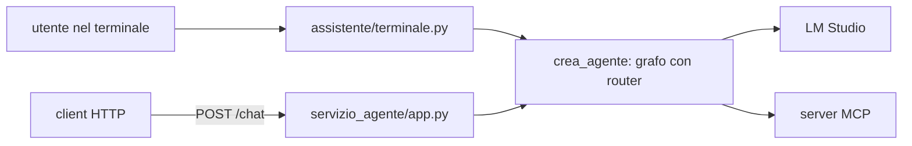

# 13 — L'agente come servizio HTTP

[← Indice](00-indice.md) · [← 12 Glossario e domande](12-glossario-e-domande.md)

## Scheda in 5 minuti

**Di che cosa parla.** Lo step 6 della lezione 6: lo stesso agente della CLI risponde anche via HTTP,
con `python -m servizio_agente`. È il primo passo verso l'interfaccia grafica (step 7–9).

**Le idee chiave**

1. **Un solo agente, due porte d'ingresso.** CLI e servizio costruiscono il grafo con la stessa
   funzione, `crea_agente` (`assistente/agente.py`): stesso modello, stesso router, stessi strumenti.
   → sezione 1
2. **Il servizio è senza stato.** La cronologia la conserva chi chiama e la rimanda a ogni turno,
   come fa il terminale. Così lo step 7 potrà salvarla in PostgreSQL senza toccare l'agente.
   → sezione 2
3. **Due endpoint.** `GET /salute` (modello, fuso, strumenti) e `POST /chat` (messaggio e cronologia
   in ingresso; risposta, strumenti usati e nuova cronologia in uscita). → sezione 2
4. **Errori sempre in italiano.** `400` richiesta non valida, `503` LM Studio non raggiungibile,
   `500` altro errore; sempre `{"errore": "..."}`. → sezione 3
5. **Un turno alla volta.** Un `threading.Lock` mette in fila le richieste contemporanee. → sezione 3
6. **L'evidenza.** La stessa domanda alla CLI e all'API dà la stessa risposta: identica per il
   rifiuto (testo fisso), con lo stesso risultato e lo stesso strumento per un calcolo. → sezione 5
7. **Anche in Docker** (10 novembre): servizio Compose `agente`, avviato con `avvia-agente.ps1`,
   porta pubblicata solo su `127.0.0.1`. → sezione 7

**Il quadro**



**Da sapere a memoria**

| Cosa | Valore | Dove |
|---|---|---|
| Avvio | `python -m servizio_agente` | `servizio_agente/__main__.py` |
| Porta | `AGENTE_PORTA` nel `.env` (esempio `8767`), solo `127.0.0.1` | `assistente/configurazione.py`, `leggi_porta_agente` |
| Endpoint | `GET /salute`, `POST /chat`, documentazione su `/docs` | `servizio_agente/app.py` |
| Cronologia | messaggi LangChain serializzati con `messages_to_dict` | `servizio_agente/app.py` |
| Costruzione comune | `crea_agente(config, strumenti, ambito)` | `assistente/agente.py` |
| Righe degli strumenti | `chiamate_riuscite`, comune a terminale e servizio | `assistente/terminale.py` |
| Log | `richiesta endpoint=/chat esito=... durata=...` in `logs/assistente.log` | logger `assistente.servizio` |
| Indirizzo di ascolto | `AGENTE_HOST`, predefinito `127.0.0.1`, `0.0.0.0` in Docker | `leggi_host_agente` |
| Docker | `.\avvia-agente.ps1`, servizio Compose `agente` | `compose.yaml` |

**Se te lo chiedono all'orale**

- *Perché il servizio non conserva le conversazioni?* Perché nello step 7 le chat le salva il
  back-end in PostgreSQL, e nello step 9 agente e back-end sono container diversi. Un agente senza
  stato si può riavviare o duplicare senza perdere nulla.
- *Che cosa vuol dire «stessa risposta»?* Con il modello finto: risposta e cronologia identiche.
  Con LM Studio il testo può cambiare tra due esecuzioni, quindi si confrontano il rifiuto (fisso)
  e, per un calcolo, il risultato e lo strumento chiamato.
- *Perché `charset=utf-8` nell'intestazione?* `Invoke-RestMethod` di PowerShell 5.1, senza charset,
  legge il JSON in Latin-1 e scrive «lunedì».

---

## 1. Un solo agente

Prima dello step 6, `assistente/__main__.py` e `tests/reale.py` costruivano il grafo ognuno per
conto suo. Ora entrambi, e il servizio, chiamano `crea_agente`:

```python
def crea_agente(config, strumenti, ambito):
    return crea_grafo(crea_modello(config, strumenti), strumenti, crea_router(config), ambito)
```

Anche l'avvio è lo stesso: `.env`, `verifica_server`, `prepara_strumenti` (server MCP e, con
`VARIANTE_SCADENZE=fastapi`, servizio delle scadenze), router e ambito da `risorse/ambito.json`.
Al posto di `esegui_sessione` c'è `uvicorn.run` su `127.0.0.1:AGENTE_PORTA`. Il server MCP viene
spento quando il servizio si ferma.

## 2. L'API

| Metodo e percorso | Richiesta | Risposta `200` |
|---|---|---|
| `GET /salute` | — | `{"stato": "ok", "modello", "fuso", "strumenti": {nome: origine}}` |
| `POST /chat` | `{"messaggio": "...", "cronologia": [...]}` | `{"risposta": "...", "strumenti": [{"nome", "origine", "argomenti"}], "cronologia": [...]}` |

- `cronologia` è facoltativa (vuota al primo turno). Il client rimanda quella ricevuta: contiene
  anche richieste e risultati degli strumenti, quindi il modello vede tutto come nella CLI.
- `strumenti` sono le chiamate riuscite del turno, con gli argomenti nell'ordine dello schema: le
  stesse che la CLI stampa come `[ora_corrente · mcp: Asia/Tokyo]`.
- `risposta` è il testo da mostrare; se il modello non risponde vale `(nessuna risposta dal modello)`,
  come nella CLI.
- La risposta arriva intera: lo streaming via HTTP non fa parte dello step.

Esempio reale da PowerShell (9 novembre, `google/gemma-4-e2b`):

```powershell
$r = Invoke-RestMethod -Method Post -Uri http://127.0.0.1:8767/chat -ContentType 'application/json; charset=utf-8' `
  -Body ([Text.Encoding]::UTF8.GetBytes((@{ messaggio = 'che ore sono a Tokyo?' } | ConvertTo-Json)))
$r.risposta     # Adesso sono le 06:22:59 di martedì 10 novembre 2026 a Tokyo.
$r2 = Invoke-RestMethod -Method Post -Uri http://127.0.0.1:8767/chat -ContentType 'application/json; charset=utf-8' `
  -Body ([Text.Encoding]::UTF8.GetBytes((@{ messaggio = 'e a Roma?'; cronologia = $r.cronologia } | ConvertTo-Json -Depth 20)))
$r2.risposta    # Adesso sono le 22:23:43 di lunedì 9 novembre 2026 a Roma.
```

Il secondo turno funziona perché la cronologia è tornata indietro: il router lo classifica come
«continuazione della conversazione precedente» e l'agente chiama `ora_corrente` con `Europe/Rome`.

## 3. Errori e concorrenza

| Caso | Stato | Esempio di `errore` |
|---|---|---|
| Campo mancante o di tipo sbagliato | `400` | `Richiesta non valida: messaggio: mancante` |
| Messaggio vuoto | `400` | `Richiesta non valida: il messaggio è vuoto.` |
| Cronologia non leggibile | `400` | `Richiesta non valida: cronologia non leggibile (...)` |
| LM Studio non raggiungibile durante il turno | `503` | `LM Studio non raggiungibile: Connection error.` |
| Altro errore nel turno | `500` | `Errore durante il turno: ...` |

FastAPI darebbe `422` in inglese per gli errori di validazione: come in `servizio_api`, un gestore
li trasforma in `400` in italiano. Le richieste contemporanee aspettano il turno precedente
(`threading.Lock`): per un laboratorio con un solo utente basta, ed evita turni sovrapposti su
LM Studio e sull'archivio delle note.

## 4. Configurazione e log

`AGENTE_PORTA` è obbligatoria solo per il servizio: la CLI non la legge. Deve essere tra 1024 e
65535 e diversa da `MCP_PORTA` e `API_PORTA`. Se la porta è occupata l'avvio si ferma prima di
accendere il server MCP.

Ogni richiesta lascia una riga in `logs/assistente.log`, dopo quelle del router, dei nodi e degli
strumenti:

```text
2026-11-09 22:23:30 nodo=router categoria=conversazione motivo=La richiesta è una continuazione della conversazione precedente riguardante i fusi orari. esito=ok
2026-11-09 22:24:03 richiesta endpoint=/chat esito=ok strumenti=["ora_corrente"] durata=48.18
2026-11-09 22:24:03 richiesta endpoint=/chat esito=errore stato=400 messaggio=Richiesta non valida: messaggio: mancante durata=0.0
```

## 5. Test e prova reale

- `tests/test_servizio_agente.py` (modello e router finti, `TestClient`): `/salute`; stessa
  risposta e stessa cronologia di `esegui_turno` (a meno degli `id` casuali dei messaggi);
  cronologia rimandata; rifiuto; errori `400`, `503`, `500`; un turno alla volta; `charset=utf-8`.
- `tests/test_avvio_servizio_agente.py`: `main()` con il server MCP reale, `uvicorn.run` sostituito
  per interrogare l'app; porta mancante o occupata.
- `tests/test_reale_servizio_agente.py` (`--lmstudio`): la stessa domanda a `esegui_sessione` e a
  uvicorn su una porta vera. Esito del 9 novembre: rifiuto identico; per «Quanto fa (3+4)*2?»
  entrambe «Il risultato di (3+4)*2 è 14.» con una chiamata a `calcola`.

## 6. Limiti noti

- Il servizio non ha autenticazione: per questo ascolta su `127.0.0.1` e, in Docker, la porta è
  pubblicata solo su `127.0.0.1` dell'host. Con più container (step 9) andrà rivisto.
- Un turno alla volta: con più utenti le richieste fanno la fila.
- La cronologia viaggia intera a ogni richiesta e cresce con la conversazione.
- L'arresto con `Ctrl+C` in un terminale interattivo non è stato provato a mano; è provato il
  percorso di arresto nel test di avvio.

## 7. In Docker

Il servizio Compose `agente` (`compose.yaml`) usa la stessa immagine della CLI e avvia
`python -m servizio_agente` con il suo server MCP. Nel container il servizio ascolta su `0.0.0.0`
(`AGENTE_HOST`, impostata da Compose), sull'host la porta è pubblicata solo su `127.0.0.1`.

```powershell
.\avvia-agente.ps1
```

Lo script passa il fuso di Windows e lancia `docker compose up --build agente`; `Ctrl+C` lo ferma
in modo ordinato. La prova Docker del 10 novembre (`tests/test_reale_docker_agente.py`) ha
verificato `/salute` con il fuso di Windows, una conversione con `converti_unita`, il rifiuto e
l'uscita con codice 0 con il server MCP spento. Dettagli in
[08, sezione 7.9](08-configurazione-avvio-docker.md#79-il-servizio-dellagente-in-docker).

---

## Scaletta per le slide

Una presentazione di circa 8 slide. Ogni slide: titolo, tre punti brevi, che cosa mostrare.

### Slide 1 · Dallo script al servizio
- Lo step 6: l'agente risponde anche via HTTP
- È la base di back-end, front-end e container
- La CLI resta com'era

*Da mostrare:* il diagramma «Il quadro» della scheda.

### Slide 2 · Un solo agente
- `crea_agente` comune a CLI, servizio e prove reali
- Stesso router, stessi strumenti, stesso modello
- Nessun codice duplicato

*Da mostrare:* `assistente/agente.py`.

### Slide 3 · Le due rotte
- `GET /salute`: modello, fuso, strumenti
- `POST /chat`: messaggio e cronologia
- Documentazione automatica su `/docs`

*Da mostrare:* la tabella della sezione 2.

### Slide 4 · Senza stato
- La cronologia la tiene chi chiama
- Contiene anche le chiamate agli strumenti
- Pronta per essere salvata dal back-end

*Da mostrare:* l'esempio «e a Roma?» della sezione 2.

### Slide 5 · Errori in italiano
- `400`, `503`, `500`, sempre `{"errore": ...}`
- Niente `422` in inglese
- `charset=utf-8` per PowerShell

*Da mostrare:* la tabella della sezione 3.

### Slide 6 · Un turno alla volta
- `threading.Lock` attorno al turno
- Niente richieste sovrapposte a LM Studio
- Basta per un solo utente

*Da mostrare:* il test `test_un_turno_alla_volta`.

### Slide 7 · L'evidenza: stessa risposta
- Rifiuto identico da CLI e API
- Calcolo: stesso risultato, stesso strumento
- Righe del log uguali

*Da mostrare:* l'esito della prova reale nella sezione 5.

### Slide 7 bis · Il servizio in Docker
- Servizio Compose `agente`, stessa immagine
- Dentro `0.0.0.0`, fuori solo `127.0.0.1`
- `avvia-agente.ps1`, arresto ordinato con Ctrl+C

*Da mostrare:* la sezione 7 e il blocco `agente` di `compose.yaml`.

### Slide 8 · Che cosa ricordare
- Un agente, due porte d'ingresso
- Servizio senza stato, errori in italiano
- Prossimo passo: le chat salvate (step 7)

*Da mostrare:* la tabella «Da sapere a memoria».

---

[← 12 Glossario e domande](12-glossario-e-domande.md) · [Indice](00-indice.md)
