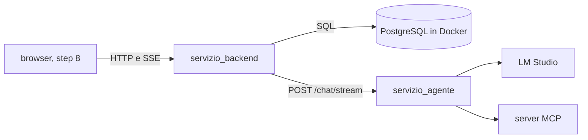

# 14 — Il back-end delle chat

[← Indice](00-indice.md) · [← 13 L'agente come servizio HTTP](13-agente-come-servizio.md)

## Scheda in 5 minuti

**Di che cosa parla.** Lo step 7 della lezione 6: un servizio che salva progetti, chat e messaggi in
PostgreSQL e fa da ponte tra il browser (step 8) e l'agente. Evidenza richiesta dalle slide: le chat ci
sono ancora dopo il riavvio.

**Le idee chiave**

1. **Tre servizi, ognuno con un compito.** Il database ricorda, l'agente ragiona (senza stato), il
   back-end tiene insieme le due cose. Il browser parla solo con il back-end. → sezione 1
2. **Tre tabelle, e la cronologia è separata dai messaggi.** `progetti`, `chat`, `messaggi`. La
   cronologia dell'agente (formato LangChain, con richieste e risultati degli strumenti) serve per
   continuare la conversazione; i messaggi sono il testo pulito da mostrare e da cercare. → sezione 2
3. **Il turno gira in un thread.** Un thread legge gli eventi dell'agente, li mette in una coda e il
   flusso SSE verso il browser li svuota. → sezione 3
4. **Si salva solo a risposta completa.** In una transazione, dopo l'evento `fine` dell'agente. Dopo un
   errore o un'interruzione non si salva nulla, nemmeno la domanda. → sezione 4
5. **Il browser può scollegarsi.** Il turno è già stato eseguito, magari con effetti (una nota): il
   thread arriva alla fine e salva comunque. → sezione 5
6. **SSE, non WebSocket.** Eventi `testo`, `strumento`, `fine`, `errore`; `fine` arriva dopo il
   salvataggio e porta la risposta definitiva. → sezione 6
7. **L'evidenza.** Back-end vero e database di prova fermati e riavviati: progetti, chat e messaggi
   identici. A mano, sul database dell'utente, lo stesso. → sezione 9

**Il quadro**

**Da sapere a memoria**

| Cosa | Valore | Dove |
|---|---|---|
| Avvio | `docker compose up -d database`, poi `python -m servizio_agente` e `python -m servizio_backend` | `compose.yaml:51`, `servizio_backend/__main__.py:39` |
| Tabelle | `progetti`, `chat`, `messaggi`, create all'avvio con `IF NOT EXISTS` | `servizio_backend/schema.sql:3,11,20` |
| Salvataggio del turno | una transazione: due messaggi, cronologia, `aggiornata`, titolo | `servizio_backend/archivio.py:218-234` |
| Un turno per chat | `RegistroTurni.occupa` / `libera`; `409` se occupata | `servizio_backend/turni.py:20-40`, `app.py:197-198` |
| Tempi verso l'agente | 5 s per collegarsi, 180 s di lettura tra due eventi | `servizio_backend/client_agente.py:10` |
| Limiti | `nome` 1–100, `istruzioni` fino a 4000, `q` almeno 2, ricerca al massimo 50, titolo 60 + «…» | `servizio_backend/app.py:30-35,228`, `archivio.py:80`, `testi.py` |
| Variabili | `BACKEND_PORTA`, `POSTGRES_USER`, `POSTGRES_PASSWORD`, `POSTGRES_DB`, `POSTGRES_PORTA` (predefinita 5432) | `servizio_backend/configurazione.py:10` |
| Ascolto | solo `127.0.0.1`, anche PostgreSQL | `servizio_backend/__main__.py`, `compose.yaml` |
| Log | `logs/servizio_backend.log`, mai i testi dei messaggi | `assistente/registro.py:12` |
| Prove | 625 passati e 64 saltati (dopo le correzioni della revisione finale); `--docker` 23 passati; `--lmstudio --docker tests/test_reale_backend.py` 4 passati | → sezione 9 |

**Se te lo chiedono all'orale**

- *Perché la cronologia e i messaggi sono tabelle diverse?* La cronologia contiene anche richieste e
  risultati degli strumenti in formato LangChain: serve all'agente, non è adatta né da mostrare né da
  cercare. I messaggi sono domanda e risposta in chiaro, quindi si cercano con `ILIKE`.
- *Perché non si salva la domanda appena arriva?* Un turno fallito non deve lasciare una domanda senza
  risposta: è lo stesso comportamento della CLI, dove un turno fallito non entra nella cronologia.
- *Che cosa succede se chiudo il browser a metà risposta?* Il back-end continua a leggere l'agente e salva
  il turno: lo strumento (per esempio `add_note`) è già stato eseguito, perderne la risposta lascerebbe
  la chat incoerente con ciò che è successo.

---

## 1. Perché tre servizi

L'agente (step 6) resta **senza stato**: non conosce le chat, riceve la cronologia a ogni turno. Il
database non sa niente di modelli. Il back-end (`servizio_backend/`) li collega: legge la cronologia
salvata e le istruzioni del progetto, le passa all'agente, inoltra al browser quello che l'agente
produce e salva il risultato.

Il vantaggio è la separazione: l'agente si può riavviare o duplicare senza perdere conversazioni, e il
database si può fermare senza toccare l'agente. Nello step 9 i tre pezzi (più il front-end) saranno
container diversi. In questo step solo il database è in un container; back-end e agente girano con
`python -m`.

Il back-end non importa il grafo: conosce l'agente solo attraverso HTTP (`client_agente.py`). Condivide
con il servizio dell'agente due moduli piccoli, `assistente/sse.py` (scrive e legge gli eventi SSE) e
`assistente/http.py` (JSON con `charset=utf-8` e messaggi di validazione in italiano).

## 2. Le tre tabelle

`servizio_backend/schema.sql`, eseguito a ogni avvio (`ArchivioPostgres.prepara`, `archivio.py:117`) con
`CREATE TABLE IF NOT EXISTS`: nessun sistema di migrazioni.

| Tabella | Righe dello schema | Contenuto |
|---|---|---|
| `progetti` | `schema.sql:3` | `nome` non vuoto, `istruzioni` (vuote se assenti), `creato`, `aggiornato` |
| `chat` | `schema.sql:11` | `progetto_id` (nullo = fuori da ogni progetto, `ON DELETE CASCADE`), `titolo` (nullo finché non c'è la prima domanda), `cronologia` `jsonb`, `creata`, `aggiornata` |
| `messaggi` | `schema.sql:20` | `chat_id` (`ON DELETE CASCADE`), `ruolo` (`utente` o `assistente`), `testo`, `strumenti` `jsonb`, `creato` |

Due indici (`schema.sql:29-30`): le chat di un progetto e i messaggi di una chat in ordine.

**Perché cronologia e messaggi sono separati.** La `cronologia` è quello che l'agente restituisce: la
rimandiamo uguale al turno dopo, così il modello vede anche richieste e risultati degli strumenti. I
`messaggi` sono il testo pulito che il browser mostra e che la ricerca legge. Il browser non riceve mai
la cronologia (`GET /chat/{id}` espone solo i messaggi).

**Cancellazioni.** `ON DELETE CASCADE`: cancellare una chat cancella i suoi messaggi, cancellare un
progetto cancella le sue chat. Le note di `add_note` stanno in SQLite e non si cancellano.

**Titolo.** `titolo_da` (`servizio_backend/testi.py`): le prime parole della prima domanda, al massimo 60
caratteri, tagliate su uno spazio se si può e con «…» se accorciate. Finché è nullo l'API dice «Nuova chat».
L'aggiornamento è `COALESCE(titolo, %s)` dentro `salva_turno`, quindi vale solo per il primo turno.

**Ricerca.** `ArchivioPostgres.cerca` (`archivio.py:236`): `ILIKE` con `ESCAPE`, dopo aver trattato `%`, `_` e
`\` di `q` come caratteri normali; un risultato per messaggio, dai più recenti, al massimo 50, con un
`estratto` di circa 80 caratteri attorno alla prima occorrenza.

**Una connessione per chiamata.** `_connessione` (`archivio.py:108`) apre una connessione, fa commit alla
fine del blocco e trasforma `psycopg.OperationalError` in `DatabaseNonRaggiungibile`. Niente pool: basta
per un utente solo, e un database riavviato non lascia connessioni morte.

## 3. Il turno in un thread

`POST /chat/{id}/messaggi` (`servizio_backend/app.py:192`) fa tre controlli prima di cominciare, con JSON
normale: messaggio vuoto `400`, turno già in corso sulla stessa chat `409` (`RegistroTurni.occupa`,
`turni.py:27`), chat inesistente `404`. La chat si prenota prima di leggere il contesto, così un turno non può
partire su una chat che sta per essere cancellata; se il contesto manca o l'archivio dà errore, la chat si
libera. Poi `agente.apri_turno` (`client_agente.py:56`): se l'agente è spento, occupato o rifiuta, `503` con il
motivo.

Quando tutto è a posto nasce un `Turno` (`turni.py:43`) che avvia un thread (`_esegui`, `turni.py:78`):

- `_leggi_eventi` (`turni.py:106`) legge gli eventi SSE dell'agente; `testo` e `strumento` vanno nella
  coda, `errore` diventa l'evento finale, `fine` salva e prepara l'evento finale;
- `eventi_sse` (`turni.py:63`) è il generatore che `StreamingResponse` consegna a uvicorn: svuota la coda;
- alla fine, nel `finally` di `_esegui`, si chiude il turno dell'agente, si libera la chat nel registro,
  si scrive la riga di log e solo **dopo** si mette in coda l'evento finale.

**Perché il thread.** Il generatore che alimenta la risposta HTTP viene chiuso se il browser si scollega. Il lavoro vero sta nel thread, che non dipende dal client.

**Perché l'evento finale viene dopo la liberazione della chat.** È una decisione presa durante
l'esecuzione: il browser (o il test) che riceve `fine` e manda subito il turno successivo non deve
trovare un `409` spurio. Per lo stesso motivo il servizio dell'agente rilascia il suo lock prima di
mettere in coda il proprio ultimo evento (`servizio_agente/app.py:154`).

**Errori.** `AgenteInterrotto` (flusso caduto a metà), `ErroreArchivio` (salvataggio fallito) ed
eccezioni inattese diventano un evento `errore` in italiano, e per le eccezioni inattese il log riceve il
traceback, solo per bug interni (`turni.py:86-88`); il messaggio dell'evento non contiene i testi. Se il flusso finisce senza `fine` né `errore`
l'evento è «La risposta dell'agente si è interrotta: il turno non è stato salvato.» (`turni.py:16`).

## 4. Si salva solo a risposta completa

`salva_turno` (`archivio.py:218`) inserisce il messaggio `utente`, il messaggio `assistente` (con
`strumenti`), poi aggiorna la chat (`cronologia`, `aggiornata`, titolo) nella **stessa transazione**. Se la
chat non esiste solleva `ChatInesistente` e il blocco `with` fa il rollback: non resta niente.

È chiamato solo quando arriva l'evento `fine` dell'agente (`turni.py:115`). Dopo `errore` o interruzione non
si salva nulla, nemmeno la domanda. La riga di log del turno ha `esito=ok` o `esito=errore`.

**Cancellare durante un turno.** `DELETE /chat/{id}` (`app.py:181`) e `DELETE /progetti/{id}` (`app.py:132`)
**prenotano** la chat nel registro dei turni prima di cancellare: se un turno è in corso rispondono `409`.
Così un turno che ha già avuto effetti trova sempre la sua chat quando deve salvarsi. Per il progetto si
prenotano tutte le sue chat, così nessun turno può cominciare durante la cancellazione.

## 5. Il browser si scollega

`eventi_sse` cattura `GeneratorExit` e segna `scollegato = True` (`turni.py:74-76`), ma il thread non si
ferma: legge fino a `fine`, salva, libera la chat. Il flag finisce nel log (`scollegato=true`). Con un
limite: se l'ultimo evento era già stato letto dal browser il flag può restare `false` (lo dice il commento
nel codice).

Se invece è l'**agente** a interrompersi, non si salva niente.

## 6. SSE: gli eventi

`formatta_sse` (`assistente/sse.py:7`) scrive `event: nome` e `data: json` su una riga (gli a capo diventano
`\n`), seguiti da una riga vuota; `leggi_sse` (`:19`) fa il contrario e ignora i commenti. U+2028, U+2029 e U+0085 escono come escape JSON (`\u2028`, `\u2029`, `\u0085`): i lettori di righe li tratterebbero come a capo e spezzerebbero l'evento. Un evento malformato nel flusso dell'agente diventa `AgenteInterrotto` (`client_agente.py:34`). Gli eventi del
back-end verso il browser:

| Evento | Dati | Quando |
|---|---|---|
| `testo` | `{"pezzo": "..."}` | ogni pezzo di testo del modello |
| `strumento` | `{"nome", "origine", "argomenti"}` | dopo ogni chiamata riuscita |
| `fine` | `{"risposta", "strumenti", "messaggio_utente_id", "messaggio_assistente_id", "titolo"}` | turno finito **e salvato** |
| `errore` | `{"errore": "..."}` | turno interrotto, niente salvato |

La `risposta` di `fine` è il testo definitivo, quello salvato: il client sostituisce con questa i pezzi
ricevuti. Serve perché il rifiuto e il messaggio del limite non arrivano a pezzi, e perché il modello può
scrivere qualcosa prima di chiamare uno strumento.

**Perché SSE.** Il flusso va in una sola direzione (server → browser), con una richiesta `POST` normale per
cominciare. Basta il protocollo HTTP, niente connessioni da gestire in più. Con `Invoke-RestMethod` non si
vede lo streaming (aspetta la fine): si usa `curl.exe -N` (README, sezione «Il back-end delle chat»).

**Dal lato dell'agente.** `POST /chat/stream` (`servizio_agente/app.py:118`): stessa richiesta di `/chat`,
gli stessi eventi, con `fine` che porta anche la `cronologia`. Non aspetta il lock: se un altro turno è in
corso risponde subito `409` (`:124-125`), che il client traduce in «L'agente sta già rispondendo a un'altra
chat: riprova tra poco.» (`client_agente.py:68`). Così il flusso non resta muto in coda e il limite di
lettura di 180 s non scatta per un motivo che non è un guasto.

## 7. Istruzioni del progetto

Un progetto può avere `istruzioni` (fino a 4000 caratteri). Il back-end le passa all'agente a ogni turno
(`contesto_turno`, `archivio.py:195`, dà cronologia e istruzioni in una sola query). L'agente le aggiunge in
fondo al messaggio di sistema sotto un'intestazione («si aggiungono alle regole precedenti e non le
sostituiscono») e **il router non le vede**: l'ambito resta deciso da `risorse/ambito.json`, il rifiuto
resta il testo fisso. Dettagli in [04, sezione 23](04-grafo-langgraph.md#23-le-istruzioni-del-progetto).

## 8. Errori, configurazione e log

- Errori sempre `{"errore": "..."}` in italiano; i `422` di FastAPI diventano `400` (`app.py:88`).
  Database non raggiungibile → `503` «Il database non risponde: riprova tra poco.» (`app.py:92`).
- **Rete di sicurezza.** Un gestore per `Exception` (`app.py:102`) trasforma gli errori imprevisti in
  JSON `500`, e un percorso senza questo gestore darebbe una pagina di testo non conforme al vincolo
  «errori sempre in JSON». Decisione presa dopo la revisione del Task 8, insieme a: id limitati a
  `2**31 - 1` (sono `INTEGER`), nome del progetto ripulito dagli spazi.
- `carica_configurazione_backend` (`configurazione.py:22`) elenca tutte le variabili mancanti insieme;
  `BACKEND_PORTA` deve essere diversa da `AGENTE_PORTA`, `MCP_PORTA` e `API_PORTA`.
- Avvio (`__main__.py:39`): configurazione, log, porta libera, database (`controlla` e `prepara`; se non risponde,
  l'errore riporta il motivo di psycopg, per esempio `password authentication failed`, e suggerisce
  `docker compose up -d database` e il controllo del `.env`; il motivo va anche nel log, mai il dsn), poi controlla l'agente e, se non risponde, **avvisa
  senza fermarsi** (`/salute` lo riporta). `SIGBREAK` e `SIGTERM` diventano un arresto ordinato
  (`__main__.py:28-37`).
- Log in `logs/servizio_backend.log`: avvio, arresto, **una riga per ogni richiesta** (middleware `riga_di_log`,
  `app.py:72`: `richiesta metodo=GET endpoint=/progetti esito=ok stato=200 durata=0.01`, solo il percorso, mai la
  query string; per il turno in streaming la durata arriva all'inizio della risposta) e **una riga per turno** con la
  durata completa
  (`richiesta endpoint=/chat/1/messaggi chat_id=1 esito=ok strumenti=["calcola"] scollegato=false durata=83.6`).
  Mai i testi dei messaggi né le istruzioni; un test lo controlla (`tests/test_turni.py::test_log_senza_testi`).

## 9. Test ed evidenza

Esiti della verifica finale (10 novembre 2026, `google/gemma-4-e2b`):

| Comando | Esito |
|---|---|
| `python -m pytest` | 625 passati, 64 saltati (618 prima delle correzioni della revisione finale) |
| `python -m pytest --docker -m docker` | 23 passati (4 saltati: `test_reale_backend.py`, che chiede anche `--lmstudio`) |
| `python -m pytest --lmstudio -m lmstudio` | 36 passati e 1 fallito: `test_reale_meteo.py::test_il_modello_usa_il_meteo`, «nessuna risposta entro 8 secondi» (servizio meteo esterno); rieseguito da solo: 2 passati |
| `python -m pytest --lmstudio --docker tests/test_reale_backend.py` | 4 passati |

- **Contratto dell'archivio.** `tests/test_archivio_chat.py` esegue gli stessi test su `ArchivioInMemoria`
  (`tests/finti_backend.py`) e su `ArchivioPostgres` (marcatore `docker`): le due implementazioni devono
  comportarsi allo stesso modo.
- **Database di prova separato.** `tests/postgres_prova.py`: un progetto Compose a parte
  (`docker compose -p assistente-laboratorio-prova`), con volume, porta libera e password di prova.
  Il database dell'utente non viene toccato, anche se acceso. Alla fine `down -v` solo sul progetto di prova.
- **Evidenza dello step.** `tests/test_reale_docker_backend.py`: back-end vero come processo, agente finto,
  database di prova. Crea progetto, chat e un turno; ferma il back-end (CTRL_BREAK, uscita 0) e il
  container; li riavvia; `assert dopo == prima`.
- **Prova a mano** (README) sul database dell'utente: stesso risultato, con una chat «Quanto fa (3+4)*2?»
  e la risposta «14» con `calcola`.
- **Prova reale** (`tests/test_reale_backend.py`): turno in più pezzi con 14 e `calcola`; istruzioni
  «in inglese» verificate sul **giorno della settimana** (con «14» non si vedrebbe la lingua); ricerca di
  «14»; rifiuto fisso anche dentro il progetto.

## 10. Decisioni prese durante l'esecuzione

- **Healthcheck su TCP.** `pg_isready -h 127.0.0.1` (`compose.yaml:64`): senza `-h` il controllo passa dal
  socket interno anche mentre l'inizializzazione ha ancora un server temporaneo, e il container risulta
  sano prima che la porta funzioni.
- **`DatabaseProva` e non una stringa.** `database_di_prova()` restituisce anche l'ambiente, perché
  `ferma` e `riavvia` devono parlare con lo stesso progetto Compose.
- **Lingua verificata sul giorno della settimana**, non sul risultato di un calcolo.
- **Evento finale dopo la liberazione del registro**, per evitare il `409` spurio al turno successivo.
- **Errori imprevisti sempre in JSON** (gestore per `Exception`).
- **`DELETE` prenota le chat**, invece di controllare soltanto.
- **`/chat/stream` risponde `409` subito** se l'agente è occupato.

## 11. Limiti noti

- Nessuna autenticazione e un solo utente: per questo tutto ascolta su `127.0.0.1`.
- Il flag `scollegato` è «al meglio»: può restare `false` se l'ultimo evento era già stato letto.
- `Ctrl+C` digitato in una console vera su `servizio_backend` non è stato provato a mano; l'arresto con
  CTRL_BREAK è provato dalla prova Docker (uscita 0, «arresto servizio backend» nel log).
- `.\avvia.ps1` non è stato rilanciato a mano; è coperto dalle prove Docker esistenti.
- La cronologia passata all'agente cresce come nella CLI (il riassunto è lo step 3).

---

## Scaletta per le slide

Una presentazione di circa 9 slide. Ogni slide: titolo, tre punti brevi, che cosa mostrare.

### Slide 1 · Dallo script al servizio con memoria
- Step 7: le chat salvate in PostgreSQL
- Il browser parla solo con il back-end
- Evidenza: le chat ci sono dopo il riavvio

*Da mostrare:* il diagramma «Il quadro» della scheda.

### Slide 2 · Perché tre servizi
- Database: ricorda
- Agente: ragiona, senza stato
- Back-end: li collega e salva

*Da mostrare:* la sezione 1 e il comando `docker compose up -d database`.

### Slide 3 · Le tre tabelle
- `progetti`, `chat`, `messaggi`
- Cancellazione a cascata
- Tabelle create all'avvio, senza migrazioni

*Da mostrare:* `servizio_backend/schema.sql`.

### Slide 4 · Cronologia e messaggi separati
- Cronologia: formato LangChain, per l'agente
- Messaggi: testo pulito, per mostrare e cercare
- Il browser non vede mai la cronologia

*Da mostrare:* la tabella della sezione 2.

### Slide 5 · Il turno in un thread
- Un thread legge l'agente e riempie una coda
- Il flusso SSE svuota la coda
- Una sola risposta alla volta per chat (`409`)

*Da mostrare:* `servizio_backend/turni.py:43-122`.

### Slide 6 · Salvare solo a risposta completa
- Una transazione, dopo `fine`
- Dopo un errore niente, nemmeno la domanda
- Il salvataggio è incluso nell'evento `fine`

*Da mostrare:* `salva_turno`, `archivio.py:218-234`.

### Slide 7 · Browser scollegato
- Il turno è già eseguito, con i suoi effetti
- Il thread arriva alla fine e salva
- Se si interrompe l'agente: niente

*Da mostrare:* `eventi_sse`, `turni.py:63-76`.

### Slide 8 · SSE
- Eventi `testo`, `strumento`, `fine`, `errore`
- `fine` porta la risposta definitiva
- `curl.exe -N` per vederli arrivare

*Da mostrare:* il flusso della prova manuale (README).

### Slide 9 · L'evidenza dopo il riavvio
- Database di prova separato da quello dell'utente
- Stop e riavvio di back-end e database, stato identico
- Prova a mano sul database dell'utente

*Da mostrare:* l'uscita di `tests/test_reale_docker_backend.py` (PRIMA e DOPO il riavvio).

### Slide 10 · Che cosa ricordare
- Tre servizi, tre ruoli
- Si salva solo ciò che è completo
- Prossimo passo: la chat nel browser (step 8)

*Da mostrare:* la tabella «Da sapere a memoria».

---

[← 13 L'agente come servizio HTTP](13-agente-come-servizio.md) · [Indice](00-indice.md)
