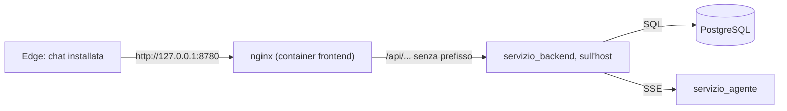

# 15 — La chat nel browser

[← Indice](00-indice.md) · [← 14 Il back-end delle chat](14-backend-delle-chat.md)

## Scheda in 5 minuti

**Di che cosa parla.** Lo step 8 della lezione 6: l'interfaccia di chat nel browser, nella cartella
`frontend/`. Parla solo con il back-end dello step 7, tramite nginx. Evidenza richiesta dalle slide:
conversazione completa dal browser, errori mostrati. Il programma da terminale resta com'è.

**Le idee chiave**

1. **Una PWA, non un'app nativa.** Una pagina web con manifest e service worker minimo: Edge (e Chrome)
   la installano come app, con la sua finestra e la sua icona. Niente Electron, niente store, un solo
   codice. → sezione 1
2. **Svelte 5 con le rune.** Lo stato sta in una classe (`StatoApp`) con `$state`; i componenti leggono
   e basta, e la pagina si aggiorna da sola. Pochi pacchetti, versioni esatte. → sezione 2
3. **Lo streaming si legge a pezzi.** Il browser riceve byte, non eventi: `LettoreSse` rimette insieme
   gli eventi anche se un pezzo arriva spezzato a metà di una lettera accentata. → sezione 3
4. **Il testo del modello è non fidato.** Passa sempre da `rendiMarkdown` (marked, poi DOMPurify con un
   elenco di tag ammessi): niente immagini, audio, video, SVG, moduli e stili. È l'unico `{@html}` del
   progetto; in più nginx manda una CSP che blocca le richieste verso altri siti. → sezione 4
5. **nginx serve i file e inoltra `/api`.** Stessa origine, quindi niente CORS; `proxy_buffering off`,
   altrimenti gli eventi arriverebbero tutti insieme alla fine. → sezione 5
6. **Il turno appartiene alla sua chat.** Se l'utente cambia chat mentre il modello risponde, la risposta
   non compare nella chat sbagliata. → sezione 6
7. **Gli errori si vedono e la domanda non si perde.** Back-end spento: striscia rossa che sparisce da
   sola. Turno fallito: messaggio fisso, domanda nella casella o rimessa con un clic, anche tornando nella
   chat dopo essere andati altrove. → sezione 7
8. **Due temi, scelti da te o da Windows.** Chiaro «acqua e salvia», scuro «acqua di notte». → sezione 8
9. **Prove nel browser vero.** Vitest per la logica, Playwright con Chromium contro il container nginx. → sezione 9

**Il quadro**



**Da sapere a memoria**

| Cosa | Valore | Dove |
|---|---|---|
| Quattro pezzi da avviare | `docker compose up -d database`, `python -m servizio_agente`, `python -m servizio_backend`, `docker compose up -d --build frontend` | README «La chat nel browser» |
| Indirizzo | `http://127.0.0.1:8780` (`FRONTEND_PORTA`, predefinita 8780), solo su `127.0.0.1` | `compose.yaml:78` |
| Sviluppo | `cd frontend; npm install; npm run dev` (Vite su `127.0.0.1:5173`, inoltra `/api` a `BACKEND_PORTA`) | `frontend/vite.config.ts:11-20` |
| Dopo una modifica al front-end | ricostruire l'immagine: `docker compose up -d --build frontend` | `frontend/Dockerfile:1-7` |
| Pacchetti | esecuzione: `svelte`, `marked`, `dompurify`; sviluppo: Vite, Vitest, jsdom, svelte-check, TypeScript | `frontend/package.json:12-25` |
| Intestazioni di sicurezza | CSP, `X-Content-Type-Options: nosniff`, `Referrer-Policy: no-referrer` su ogni risposta di nginx | `frontend/nginx/sicurezza.conf` |
| Testi fissi degli errori | «Il back-end non risponde: avvialo con python -m servizio_backend.»; «La risposta si è interrotta: il messaggio non è stato salvato.»; «Errore inatteso del back-end (stato N).» | `frontend/src/lib/api.ts:57-58,110` |
| Prove | Vitest 108 passati in 11 file; `pytest` 625 passati, 74 saltati; browser e Compose con `--docker` 9 passati; con LM Studio `--lmstudio --docker` 5 passati (prima della revisione finale) | → sezione 9 |

**Se te lo chiedono all'orale**

- *Perché una PWA e non un'app nativa?* Serve la stessa interfaccia, ma senza costruire e distribuire
  un programma per ogni sistema: il browser fa da motore, il manifest e il service worker bastano perché
  Edge la installi.
- *Perché nginx inoltra `/api` invece di far parlare il browser col back-end?* Così pagina e API hanno la
  stessa origine (niente CORS da configurare nel back-end) e il back-end resta su `127.0.0.1`. Serve però
  `proxy_buffering off`, altrimenti lo streaming non è più uno streaming.
- *Perché il testo del modello non va messo nella pagina così com'è?* Il modello può produrre HTML o
  immagini remote, che sono un canale per far uscire dati; `rendiMarkdown` lascia passare solo un elenco
  di tag ammessi, e la CSP di nginx vieterebbe comunque al browser di caricare risorse da altri siti.

---

## 1. PWA e perché non un'app nativa

Una **PWA** (*progressive web app*) è una pagina web che il browser sa installare. Bastano tre cose,
tutte in `frontend/public/`: un **manifest** (`manifest.webmanifest`: nome, `display: standalone`,
colori, icone), un **service worker** (`sw.js`) e il servizio su un indirizzo che il browser considera
sicuro (`127.0.0.1` lo è).

Il service worker è volutamente minimo (`sw.js:1-8`): non mette niente in cache e lascia passare tutte le
richieste, `/api/` compreso. Serve solo perché il browser consideri la pagina installabile. Si registra
solo nella versione compilata (`frontend/src/main.ts:7`, `import.meta.env.PROD`): in sviluppo con Vite
non c'è.

**Perché non un'app nativa.** Il progetto è già un'applicazione web: serve il back-end e il browser. Un
involucro nativo aggiungerebbe un altro programma da costruire e da tenere aggiornato per lo stesso
risultato. Il confine del `CLAUDE.md` è lo stesso: la chat nel browser è l'unica interfaccia grafica
ammessa.

**Installare e disinstallare.** Con il container acceso, in Edge si apre `http://127.0.0.1:8780`, menu
«…» › App › «Installa questo sito come app». Per toglierla: `edge://apps`, oppure «App installate» di
Windows.

**Dove non funziona.** Nel browser incorporato nel desktop app di Claude il service worker non si
registra («unknown error fetching the script», anche se `sw.js` è servito con `200`); in Chromium con
Playwright e in Edge sì. Il 12 novembre 2026 l'utente l'ha installata in Edge e ha confermato che
funziona.

## 2. Svelte 5 e le rune

**Svelte** compila i componenti in JavaScript semplice: non c'è un motore che gira nella pagina, solo
codice che aggiorna le parti toccate. Le **rune** sono le parole che cominciano per `$` e dicono al
compilatore che cosa è reattivo:

| Runa | Significato | Esempio |
|---|---|---|
| `$state` | un valore che, cambiando, aggiorna la pagina | `stato.svelte.ts:32` (`vista`), `BarraLaterale.svelte:12` |
| `$derived` | un valore calcolato da altri | `Casella.svelte:9` (`puoInviare`) |
| `$effect` | codice da eseguire quando cambia qualcosa, con pulizia | `StrisciaBackend.svelte:13-24` |
| `$props` | i dati che il componente riceve | `Avvisi.svelte:6` |

**Lo stato sta in una classe.** `StatoApp` (`frontend/src/lib/stato.svelte.ts:29`) tiene vista, chat
aperta, turno in corso, errori, ricerca e avvisi, e ha i metodi per ogni azione (`invia`, `apriChat`,
`eliminaChat`…). Il file si chiama `.svelte.ts` perché solo così le rune funzionano fuori da un
componente. I componenti ricevono `stato` come proprietà e non hanno logica propria: per questo
`StatoApp` si prova con Vitest senza browser. Il costruttore prende l'API come oggetto
(`apiBackend`, `api.ts:216`), così i test passano un'API finta.

**Pochi pacchetti, versioni esatte.** Esecuzione: `svelte`, `marked`, `dompurify`. Sviluppo: `vite`,
`@sveltejs/vite-plugin-svelte`, `typescript`, `svelte-check`, `@tsconfig/svelte`, `vitest`, `jsdom`.
Nessun `^` o `~`, e `package-lock.json` versionato (`frontend/package.json`). Decisioni di scelta:

- per ogni pacchetto la versione più recente pubblicata **almeno 14 giorni prima** (non oltre il
  28 ottobre 2026);
- **TypeScript 6.0.3**, non 7, perché `svelte-check` non supporta ancora la 7;
- `npm audit`: 0 vulnerabilità nei pacchetti di esecuzione e 2 di gravità bassa (`deepmerge`, dentro
  `@sveltejs/vite-plugin-svelte`), solo in sviluppo e senza correzione disponibile.

## 3. La lettura SSE incrementale

Il back-end manda eventi `testo`, `strumento`, `fine` ed `errore` ([14, sezione 6](14-backend-delle-chat.md#6-sse-gli-eventi)).
`EventSource` del browser non va bene, perché sa fare solo richieste `GET`: il turno è una `POST` con il
messaggio. Quindi `inviaMessaggio` (`frontend/src/lib/api.ts:174`) usa `fetch`, prende `risposta.body`
come flusso di byte e lo legge con `getReader()`.

I byte arrivano a blocchi di dimensione qualsiasi: un blocco può finire a metà di un evento, o a metà di
un carattere UTF-8 (una «è» sono due byte). Per questo c'è `LettoreSse` (`frontend/src/lib/sse.ts:7`):

- `aggiungi` (`:11`) decodifica con `TextDecoder` in modalità `stream: true`, che tiene da parte i byte
  di un carattere incompleto;
- normalizza `\r\n` in `\n` e cerca la riga vuota che chiude l'evento (`:14-23`); quello che resta lo
  conserva per il blocco successivo;
- `leggiBlocco` (`:33`) ricava `event` e `data`, ignora i commenti e fa `JSON.parse`;
- `fine()` (`:27`) scarta un evento rimasto a metà.

Il ciclo di `inviaMessaggio` (`api.ts:185-209`) chiama i gestori `suTesto` e `suStrumento` a ogni evento
e si ferma a `fine` (restituisce i dati) o a `errore` (solleva `ErroreApi`). Se il flusso finisce senza
nessuno dei due, o se un dato non è JSON valido, l'errore è «La risposta si è interrotta: il messaggio
non è stato salvato.» (`api.ts:58`). In `StatoApp.invia` (`stato.svelte.ts:173`) i pezzi si accodano al
testo del turno; a `fine` i due messaggi entrano nella chat con gli id e la risposta definitiva del
back-end, che sostituisce i pezzi.

## 4. Il markdown sicuro e la CSP

Il modello risponde in Markdown (elenchi, grassetto, codice). `rendiMarkdown`
(`frontend/src/lib/markdown.ts:38`) fa due passi: `marked` lo trasforma in HTML (GFM, con gli a capo come
interruzioni) e DOMPurify lo ripulisce. È **l'unico punto** in cui del testo del modello entra nella
pagina, e `Messaggio.svelte:35` è l'unico `{@html}` del front-end: sul testo dell'utente si usa il
normale `{testo}`, che Svelte protegge da solo.

Il testo del modello è **non fidato**: può contenere `<script>`, `onerror=`, collegamenti `javascript:`,
ma anche elementi che caricano una risorsa remota appena la pagina li mostra: ``, `<video poster>`,
`<audio src>`, `<video><source src>`, `<picture><source srcset>`, `<svg><image href>`, `<feImage>`,
l'attributo `background` di tabelle e celle. Una richiesta verso un altro sito è un canale per far uscire
dati. Un elenco di elementi *vietati* ne lascia sempre passare qualcuno; durante la revisione finale si è
passati quindi a un elenco di elementi **ammessi** (*allowlist*, `markdown.ts:26-36`):

- tag: `p`, `br`, `strong`, `em`, `del`, `code`, `pre`, `blockquote`, `ul`, `ol`, `li`, `a`,
  `h1`–`h6`, `hr`, `table`, `thead`, `tbody`, `tr`, `th`, `td`, `span`: quello che il Markdown produce per
  testo, elenchi, codice, citazioni, link e tabelle;
- attributi: `href` (che passa anche il controllo degli indirizzi di DOMPurify: niente `javascript:`,
  `vbscript:` o `data:`), `title`, `align` (allineamento delle colonne) e `start` (elenchi numerati che
  non partono da 1).

Tutto il resto sparisce: immagini, audio, video, `<picture>`, `<source>`, SVG e MathML, moduli e
controlli, contenuti incorporati, `style` e `class` (il nome del linguaggio sui blocchi di codice non
serve: non c'è evidenziazione). Di un tag tolto resta il testo. In `markdown.test.ts` c'è una prova per
ciascuno degli elementi elencati sopra: nell'uscita non devono restare né il tag né `src`, `poster`,
`srcset`, `href` o `background`.

I collegamenti si aprono in una scheda nuova con `rel="noopener noreferrer"` (`markdown.ts:15-19`). Il
purificatore si crea alla prima chiamata (`:12`), così importare il modulo non tocca `window` e i test
girano anche in Node.

**La CSP, una seconda difesa.** nginx aggiunge a ogni risposta, anche alle pagine d'errore (`always`),
tre intestazioni scritte in `frontend/nginx/sicurezza.conf`:

| Intestazione | Valore | Effetto |
|---|---|---|
| `Content-Security-Policy` | `default-src 'self'; script-src 'self'; style-src 'self' 'unsafe-inline'; img-src 'self' data:; media-src 'none'; object-src 'none'; frame-ancestors 'none'; base-uri 'self'; connect-src 'self'; manifest-src 'self'; worker-src 'self'` | il browser carica script, stili, immagini, connessioni, manifest e service worker solo dalla chat stessa; niente audio, video e plugin; nessun altro sito può incorniciare la pagina. Se un elemento remoto sfuggisse al purificatore, il browser si rifiuterebbe comunque di caricarlo |
| `X-Content-Type-Options` | `nosniff` | il browser non «indovina» il tipo di un file diverso da quello dichiarato |
| `Referrer-Policy` | `no-referrer` | aprendo un link, il sito di destinazione non riceve l'indirizzo della chat |

`'unsafe-inline'` sugli stili serve per gli stili che Svelte mette sugli elementi (per esempio la
posizione del menu delle azioni); gli script, invece, solo dai file compilati. In nginx una `location`
con un `add_header` suo non eredita quelli del `server`: per questo `sicurezza.conf` si include sia nel
`server` sia in ogni `location` che imposta `Cache-Control` (sezione 5). La prova
`test_intestazioni_di_sicurezza` controlla le tre intestazioni su `/`, `index.html`, un indirizzo
qualsiasi della chat, un file di `/assets/`, `sw.js`, il manifest e `/api/salute`; durante tutte le prove
nel browser la console non deve mostrare violazioni della CSP.

**Limiti noti:** il modello a volte scrive formule LaTeX (`$...$`); la chat non le interpreta e le
mostra così come sono. Le immagini nelle risposte non si vedono: è voluto.

## 5. nginx: inoltro di `/api`

Il container `frontend` (`compose.yaml:71-81`) è fatto in due fasi (`frontend/Dockerfile`): la prima
compila con Vite (`npm ci`, `npm run build`), la seconda è nginx senza privilegi
(`nginx-unprivileged`, porta 8080) con i file compilati. Compose lo pubblica solo come
`127.0.0.1:${FRONTEND_PORTA:-8780}:8080`; la variabile ha un valore predefinito e niente `:?`, come
per il database, perché Compose controlla tutto il file.

La configurazione è `frontend/nginx/default.conf.template` (nginx sostituisce `${BACKEND_PORTA}` con la
variabile d'ambiente all'avvio; `sicurezza.conf` è copiato accanto, in `/etc/nginx/`):

| Righe | Scelta | Perché |
|---|---|---|
| `:18-19` | `location /api/` con `proxy_pass http://backend/` | il `/` finale toglie il prefisso: `/api/chat` diventa `/chat` |
| `:23-24` | `proxy_buffering off`, `proxy_cache off` | gli eventi SSE devono passare uno alla volta |
| `:20-21` | HTTP/1.1 e `Connection ""` | connessioni persistenti verso il back-end |
| `:25` | `proxy_read_timeout 300s` | un turno con il modello in «thinking» dura 1–2 minuti |
| `:2-4` | `upstream` con `max_fails=0` | vedi sotto |
| `:14` e in ogni `location` con `add_header` | `include /etc/nginx/sicurezza.conf` | CSP, `nosniff` e `Referrer-Policy` su ogni risposta (sezione 4) |
| `:29-33` | `/assets/` con cache lunga e `immutable` | i nomi dei file cambiano a ogni compilazione |
| `:36-47` | `index.html`, `sw.js`, manifest con `no-cache` | un aggiornamento dell'app non deve restare bloccato nella cache |
| `:50-54` | tutto il resto torna a `index.html` | la chat è una pagina sola |

**Stessa origine, niente CORS.** Il browser vede pagina e API sullo stesso indirizzo e non fa richieste
tra origini diverse: il back-end non deve elencare origini ammesse e resta su `127.0.0.1`. Il container
lo raggiunge con `host.docker.internal` (`extra_hosts` in `compose.yaml`). In sviluppo lo stesso lavoro lo
fa Vite (`vite.config.ts:11-20`), con la stessa regola «togli `/api`».

**`max_fails=0`** si è aggiunto durante la revisione: con l'impostazione predefinita nginx, dopo
un errore, mette da parte il back-end per 10 secondi e risponde `502` anche se è già tornato. Contraddiceva
la promessa «la striscia sparisce da sola quando il back-end torna»; con un solo back-end non c'è niente
da escludere, quindi si disattiva.

## 6. Il turno appartiene alla sua chat

Un turno può durare minuti e l'utente può aprire un'altra chat. Durante la revisione si è deciso che
`Turno` e `ErroreTurno` portino il proprio `chatId` (`stato.svelte.ts:22-24`) e che la pagina mostri
`turnoVisibile` / `erroreTurnoVisibile` (`:65`, `:70`) solo se la chat aperta è quella:

- a `fine` i due messaggi si aggiungono **solo** se la chat del turno è ancora quella aperta
  (`stato.svelte.ts:205`); altrimenti, riaprendola, i messaggi ci sono, perché il back-end li ha salvati;
- se una chat nuova viene creata mentre l'utente è già altrove, non lo si riporta indietro (`:190-194`);
- un errore resta legato alla chat del turno, con la domanda; se l'utente è andato via diventa anche un
  avviso con l'inizio della domanda («Il messaggio «…» non è stato inviato: …», `:225-230`), senza
  toccare la bozza, e tornando in quella chat si ritrovano domanda ed errore (sezione 7);
- si può inviare solo se non c'è nessun turno in corso (`Casella.svelte:9`); da un'altra chat compare la
  nota «Sto ancora rispondendo in un'altra chat…».

Altri dettagli di rifinitura: Invio invia e Maiusc+Invio va a capo, senza interferire con la
composizione IME (`Casella.svelte`); la finestra scorre da sola con la risposta solo se chi legge è già
in fondo (`VistaChat.svelte:23-45`).

## 7. Gli errori

`chiama` (`api.ts:84`) trasforma ogni problema in un `ErroreApi` con un testo in italiano:

| Situazione | Che cosa si vede |
|---|---|
| `fetch` fallisce (rete, back-end spento) | striscia rossa «Il back-end non risponde: avvialo con python -m servizio_backend.» |
| `502`, `503`, `504` senza `{"errore"}` | lo stesso testo (nginx senza back-end risponde `502`) |
| risposta con `{"errore": "..."}` | quel testo, per esempio il `409` o il `503` dell'agente |
| risposta senza `{"errore"}` | «Errore inatteso del back-end (stato N).» (`api.ts:96-111`) |
| flusso senza `fine` | «La risposta si è interrotta: il messaggio non è stato salvato.» |

**La striscia** (`StrisciaBackend.svelte:13-24`) si accende quando `backendSpento` è vero; da quel momento
interroga `/salute` ogni 5 secondi e, quando risponde, sparisce e ricarica gli elenchi. Non serve
ricaricare la pagina.

**Dopo un errore del turno la domanda non si perde.** Durante la revisione finale ci si è accorti che
poteva perdersi in due casi: se durante il turno l'utente aveva già scritto altro nella casella, la
domanda lo sovrascriveva; se l'utente era in un'altra chat, la domanda restava solo nel testo
dell'avviso. Ora (`stato.svelte.ts:214-233`):

- l'errore si registra **sempre** nella chat del turno, insieme alla domanda (`erroriTurno`, al massimo
  uno per chat); la vista mostra la domanda come messaggio «non salvato» e sotto il riquadro d'errore;
- se la casella è vuota, la domanda ci torna da sola (`:224`); se l'utente ha già scritto altro, quel
  testo resta e il riquadro offre **«Rimetti nella casella»**, che mette in testa la domanda, poi una riga
  vuota e il testo già scritto (`rimettiDomanda`, `:79-83`);
- se l'utente è in un'altra chat, la bozza non cambia e l'avviso cita le prime 40 lettere della domanda
  (`inizioTesto`, `frontend/src/lib/testo.ts:16`); tornando nella chat del turno ritrova domanda ed
  errore;
- un nuovo invio in quella chat toglie il suo errore; una chat creata dal turno fallito compare subito
  nell'elenco, così ci si può tornare.

Il back-end, per la regola dello step 7, non ha salvato niente: rimandare la stessa domanda è sicuro.

**Chiudere la finestra durante una risposta** interromperebbe il turno, e il messaggio non verrebbe
salvato. Finché c'è un turno in corso, `App.svelte:17-21` registra un gestore `beforeunload`
(`frontend/src/lib/uscita.ts`) e il browser chiede conferma; finito il turno, il gestore si toglie.

## 8. I temi

Due palette come variabili CSS (`frontend/src/stile.css:4` e `:34`), scelte con l'attributo
`data-tema` sull'elemento radice: **chiaro «acqua e salvia»** (`#f6f8f6`, `#eef3f0`, `#d9ece7`,
`#5fb3a6`, `#2f3e3c`) e **scuro «acqua di notte»** (`#16211f`, `#121b19`, `#1f3a35`, `#4fb3a2`,
`#dfe9e6`). Regole di stile: angoli da 8 a 12 px, niente pillole, font di sistema; il verde acqua solo
per il pulsante principale, la chat aperta e le righe degli strumenti; gli errori in un rosso-terracotta
smorzato (`#c0705a` chiaro, `#d08a75` scuro).

`temaEffettivo` (`frontend/src/lib/tema.ts:5`) decide: con «automatico» vale la preferenza del sistema
(`prefers-color-scheme`), con «chiaro» o «scuro» la scelta. `SceltaTema.svelte:16-21` ascolta anche il
cambio di tema di Windows mentre l'app è aperta. La scelta si salva in `localStorage` (`tema.ts:13-31`),
ma ogni accesso è in `try`: se l'archivio è bloccato, si resta su «automatico».

**Il primo disegno.** `data-tema` lo mette il JavaScript; prima, la pagina usava le variabili chiare e,
con Windows scuro, all'apertura si vedeva un lampo chiaro. Ora `stile.css:65-94` ripete le variabili scure
dentro `@media (prefers-color-scheme: dark)` per `:root:not([data-tema])`: il primo disegno segue già il
sistema. Con un tema scelto a mano diverso da quello di Windows il lampo può restare, perché la scelta sta
in `localStorage` e si legge solo dal JavaScript (uno script in linea nella pagina lo eviterebbe, ma la
CSP li vieta). `frontend/src/stile.test.ts` controlla che i due blocchi scuri restino uguali.

## 9. Le prove, con Vitest e Playwright

Esiti del 12 novembre 2026 (branch `dev-frontend`). Le prime righe sono dopo le correzioni della
revisione finale; le prove con LM Studio (`google/gemma-4-e2b`) e l'intera suite `--docker` sono di prima
e non sono state rieseguite:

| Comando | Esito |
|---|---|
| `npm test` (da `frontend/`) | 108 passati in 11 file |
| `npm run check` (`svelte-check`) | 234 file, 0 errori, 0 avvisi |
| `python -m pytest` | 625 passati, 74 saltati |
| `python -m pytest --docker tests/test_reale_browser.py tests/test_compose_frontend.py` | 9 passati |
| `python -m pytest --docker -m docker` (prima della revisione finale) | 31 passati, 5 saltati |
| `python -m pytest --lmstudio --docker -m "lmstudio and docker"` (prima della revisione finale) | 5 passati |
| `python -m pytest --lmstudio -m "lmstudio and not docker"` (prima della revisione finale) | 35 passati e 2 falliti: il modello ha chiamato lo strumento in modo sbagliato (`converti_unita` con `litri`) o ha scelto `list_notes` invece di `delete_note`; rieseguiti i due file, 10 passati |

- **Vitest** (`frontend/src/**/*.test.ts`): la logica senza browser: lettore SSE, API con un `fetch`
  finto, markdown (con una prova per ogni elemento che caricherebbe una risorsa esterna), temi e primo
  disegno scuro, stato con un'API finta (compresi i turni falliti), conferma all'uscita, manifest, e un
  test che controlla che i sorgenti siano UTF-8.
- **Playwright** (Python, `playwright==1.65.0` in `requirements-dev.txt`, Chromium installato con
  `python -m playwright install chromium`): `tests/test_reale_browser.py` apre la chat vera nel
  container nginx di prova (`tests/frontend_prova.py`, progetto Compose a parte), con back-end vero,
  PostgreSQL di prova e agente finto. Sette prove: conversazione completa e riaperta dopo il
  ricaricamento (`:113`), progetto con istruzioni, ricerca ed eliminazione, agente spento (errore e domanda
  riportata), back-end spento (striscia che sparisce al riavvio, `:196`), app installabile (manifest e
  service worker attivo, con un limite di 10 secondi, `:213`), intestazioni di sicurezza (`:230`). In ogni
  prova la console non deve mostrare violazioni della CSP. Gli elementi si cercano con l'attributo
  `data-test`.
- **Con LM Studio**: `tests/test_reale_browser_lmstudio.py` fa la stessa domanda «Quanto fa (3+4)*2?»
  con l'agente vero e controlla che il testo arrivi a pezzi. Le attese sono di 300 secondi: il modello
  ora lavora in «thinking» e un turno dura 1–2 minuti. Una prova di questo tipo può fallire se il modello
  non chiama `calcola`: succede, è un esito da riportare.
- **Contratto di Compose**: `tests/test_compose_frontend.py` (porta solo su `127.0.0.1`, valore
  predefinito senza `FRONTEND_PORTA`).

I comandi:

```powershell
cd frontend; npm install; npm test; npm run check; npm run build; cd ..
python -m playwright install chromium
python -m pytest --docker tests/test_reale_browser.py -v -s
python -m pytest --lmstudio --docker tests/test_reale_browser_lmstudio.py -v -s
python -m pytest --docker tests/test_compose_frontend.py
```

## 10. Limiti noti

- Il modello è passato alla modalità «thinking»: un turno dura 1–2 minuti e la chat mostra l'attesa.
  Non è stato verificato il comportamento con il modello precedente, senza «thinking».
- Le formule LaTeX si vedono grezze.
- `Ctrl+C` su `servizio_backend` in una console vera non è stato provato a mano (resta dallo step 7).
- Nel browser incorporato di Claude il service worker non si registra; in Edge e in Chromium sì.
- Se una chat nuova non si riesce nemmeno a creare (back-end spento) e l'utente è già passato a
  un'altra chat, della domanda resta solo l'inizio nell'avviso: non c'è una chat dove ritrovarla.
- Due prove reali con LM Studio dipendono dal modello e a volte falliscono (il convertitore con
  «litri» e l'eliminazione di una nota con ID): non sono difetti del codice.
- Un messaggio più grande di 1 MB riceve da nginx una risposta HTML `413`, non un JSON.
- Dopo una modifica al front-end l'immagine va ricostruita: `docker compose up -d --build frontend`.

---

## Scaletta per le slide

Una presentazione di 10 slide. Ogni slide: titolo, tre punti brevi, che cosa mostrare.

### Slide 1 · Dalla API alla chat
- Step 8: l'interfaccia nel browser
- Parla solo con il back-end, tramite nginx
- Evidenza: conversazione completa, errori mostrati

*Da mostrare:* il diagramma «Il quadro» della scheda e la chat aperta in Edge.

### Slide 2 · Una PWA
- Pagina web con manifest e service worker minimo
- Edge la installa come app, senza un programma nativo
- Il service worker non mette niente in cache

*Da mostrare:* `frontend/public/manifest.webmanifest` e `sw.js`, poi la finestra dell'app installata.

### Slide 3 · Svelte 5 e le rune
- `$state`, `$derived`, `$effect`, `$props`
- Lo stato sta in una classe, `StatoApp`
- Pochi pacchetti, versioni esatte, TypeScript 6 per `svelte-check`

*Da mostrare:* `frontend/src/lib/stato.svelte.ts:29-42` e `package.json`.

### Slide 4 · Leggere uno streaming
- `fetch` con `POST` e `getReader()`, non `EventSource`
- `LettoreSse` rimette insieme gli eventi spezzati
- `fine` sostituisce i pezzi con la risposta salvata

*Da mostrare:* `frontend/src/lib/sse.ts:7-31` e un turno che scrive a pezzi.

### Slide 5 · Il testo del modello non è fidato
- Markdown con `marked`, poi DOMPurify con un elenco di tag ammessi
- Niente immagini, audio, video, SVG: nessuna richiesta verso altri siti
- La CSP di nginx come seconda difesa; un solo `{@html}`

*Da mostrare:* `frontend/src/lib/markdown.ts:26-44` e `frontend/nginx/sicurezza.conf`.

### Slide 6 · nginx e `/api`
- Stessa origine, niente CORS
- `proxy_buffering off` per lo streaming
- `max_fails=0`: il back-end riavviato risponde subito

*Da mostrare:* `frontend/nginx/default.conf.template` e la tabella della sezione 5.

### Slide 7 · Il turno e la sua chat
- Ogni turno porta il suo `chatId`
- Cambiare chat non sposta la risposta
- Un errore resta nella sua chat, con la domanda

*Da mostrare:* `stato.svelte.ts:63-72` e `:173-236`.

### Slide 8 · Errori e temi
- Striscia rossa, che sparisce da sola
- La domanda non si perde: casella o «Rimetti nella casella»
- Chiaro, scuro, automatico, già dal primo disegno

*Da mostrare:* la tabella degli errori (sezione 7) e i due temi affiancati.

### Slide 9 · Le prove nel browser vero
- Vitest: 108 test sulla logica
- Playwright: 7 prove con nginx, back-end e PostgreSQL veri, agente finto, CSP compresa
- Una prova con LM Studio sul testo a pezzi

*Da mostrare:* l'uscita di `python -m pytest --docker tests/test_reale_browser.py -v -s`.

### Slide 10 · Che cosa ricordare
- PWA: una pagina, installata da Edge
- Il modello non è fidato: markdown ripulito
- Il passo successivo: i quattro container (step 9)

*Da mostrare:* la tabella «Da sapere a memoria».

---

[← 14 Il back-end delle chat](14-backend-delle-chat.md) · [Indice](00-indice.md)
